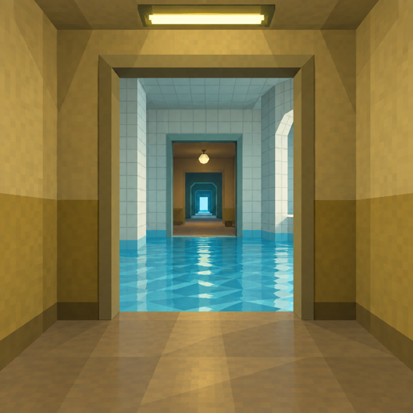

<p align="center">
  
</p>

<h1 align="center">Places</h1>
<p align="center"><strong>Take a walk. Stay a while.</strong></p>

Places is a game for walking and experiencing places. Wander through quiet
interiors, follow a trail into the night, or spend a little longer beside the
water. Let the architecture, light and small details set the pace.

There is no prescribed route through these spaces. Open a door, try a light
switch, look around a corner. Some places feel familiar. Others become stranger
the longer you stay.

## Somewhere to go

The **Quiet Collection** connects eight environments through a central hub.
Enter a themed door and use the destination's return door to come back. Each
visit starts fresh; objects and local objectives stay in their environment.

The environments offer different moods: the three floors of **Office: After
Hours**, the still water of **Pool**, the domestic spaces of **Home**, the
night trails of **Lantern Hollow**, the snow and ice of **Winter**, the open
waterfront of **Beach**, the bright architecture of **Frutiger Aero**, and the
bowling lanes, cabinets, birthday room and restroom of **Cosmic Lanes & Arcade**.

Doors, switches, weather and occasional encounters give the spaces their own
rhythms. Adjustable graphics and remappable controls let you settle into yours.
The active standalone projects are **It Only Exists in the Beam** (all four
chapters) and **The Long Way Home**. They remain independent of the collection.
**The Backrooms**, **Closing Time**, **One Guest Too Many**, **The Shape of an Exit**, **After Hours -
Rooms Beyond** and **Relay Annex** retain their complete editable sources in the
[project archive](archive/projects/README.md), outside the current release inventory.

## Controls

Move with WASD and look with the mouse or arrow keys. Gameplay bindings can be
changed in Settings; Escape always pauses.

| Action | Key |
| --- | --- |
| Walk forward | `W` |
| Walk backward | `S` |
| Strafe left | `A` |
| Strafe right | `D` |
| Look up | `UP` |
| Look down | `DOWN` |
| Look left | `LEFT` |
| Look right | `RIGHT` |
| Jump / swim up | `SPACE` |
| Crouch (toggle) | `C` |
| Interact | `E` |
| Pause | `ESC` |

Maps may explicitly grant a crowbar. On those maps, `1` holsters/redraws it and
left click swings once. An attack while carrying a prop drops it and swings on
the same click. With no drawn tool, left click retains its ordinary throw behavior.

## About this version

**Places 0.13.1** provides separate Mac and Windows packages, each containing
the game, editor, offline compiler and bundled live menu. The separate levels
download contains Backrooms, the nine-map Quiet Collection, all four Beam
chapters and the three-part Long Way Home. The application archives contain
no gameplay maps.

[Download 0.13.1](https://github.com/csd113/Places/releases/tag/v0.13.1) ·
[Download illustrated PDF](https://github.com/csd113/Places/releases/download/v0.13.1/Beginners_Guide_to_Your_First_Places_Space.pdf) ·
[Installation](tools/release/INSTALLATION.md)

The beginner guide follows the editor's Simple workspace from a blank project
through building and playing a three-room space. The illustrated PDF is
available with the release.

The Mac package is arm64, requires macOS **27.2 or newer**, and is ad-hoc signed
without notarization. The Windows package is x64. Linux remains future scope.

To play an existing collection package with a matching player and asset library:

```sh
PLACES_ASSET_ROOT="$PWD/assets" ./target/release/places --import /absolute/path/environments.placesmap
PLACES_ASSET_ROOT="$PWD/assets" PLACES_LEVEL=hub ./target/release/places
```

Choose **Places / The Quiet Collection** in Explore to enter the collection.
Authors can open `projects/environments/` in the native editor; an explicit
[collection export](levels/README.md) is only needed after changing its sources.

[Changelog](CHANGELOG.md)

[Installation, first launch and map imports](tools/release/INSTALLATION.md) covers
optional gameplay maps, bundled menu resources, external assets and separate
writable user data.

Places is open source under the [MIT license](LICENSE).
[Third-party notices](THIRD_PARTY_LICENSES.txt).
