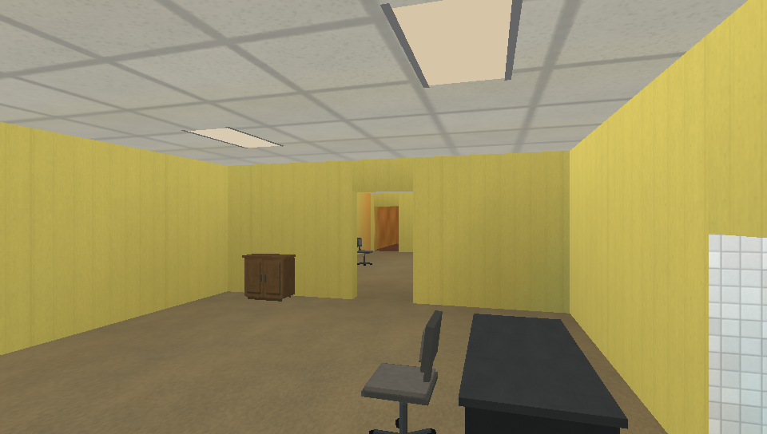
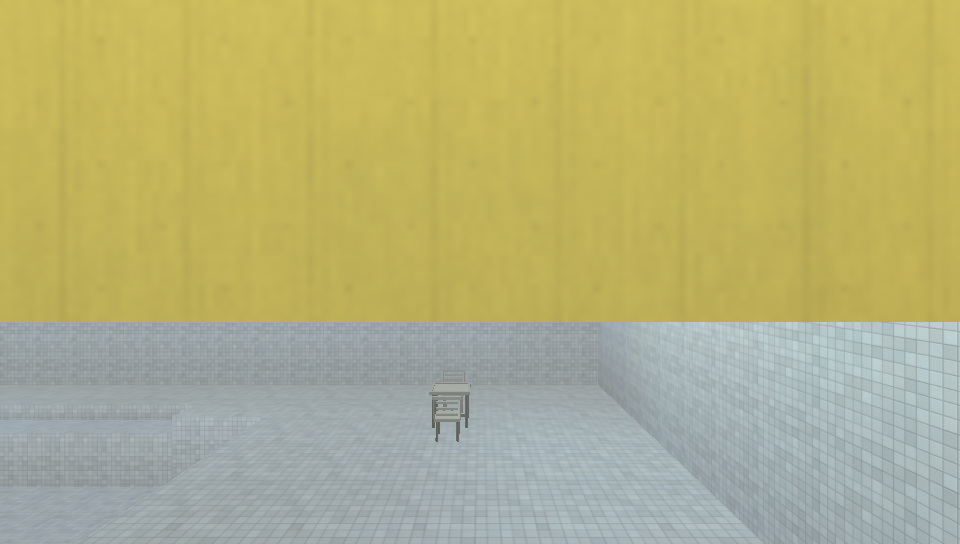
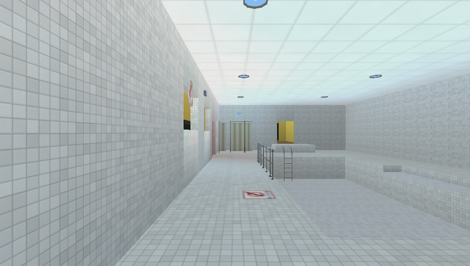

# Places

### an experience

A slow first-person exploration game. You walk through quiet, over-lit
institutional interiors — an office that keeps going, a swimming pool that has
been closed for years — and the building stops being finished around you. There
is nothing to collect, fight or solve.

Places is a desktop game written in Rust: `sdl3` for the window and input,
`wgpu` (Metal on macOS, Vulkan on Linux, Direct3D 12 on Windows) and a
baked-lighting renderer with no dynamic shadow maps. Every fixture bakes into a lightmap atlas for static geometry, props
occlude the bake, and emission, transparency, selective reflections and a
restrained post-processing stage are all authored as content. Its content is
data: levels are JSON, surfaces are PNGs, props are GLBs, and a catalog maps
stable logical ids onto all of it.



## Build and run

Rust 1.99.0 is pinned in `rust-toolchain.toml`. Install SDL3 and `pkg-config`
([desktop prerequisites](#desktop-prerequisites)), then run from the repository:

```sh
cargo build --locked --release
sh tools/build-maps.sh --workers 8
./target/release/places --list-levels
PLACES_LEVEL=places_demo ./target/release/places
```

Git contains authored JSON maps, PNG artwork, GLB models and generators.
**Compiled `.placesmap` files are local outputs and are never tracked.** The
explicit build step prepares Off, Medium and Full lightmaps and reflection
captures in `assets/levels/`. Cargo can build the compiler and run the source
checks before any package exists. The player loads packages; it never compiles.
A missing map leaves the menu available for Import and reports the build command.

After changing one source or one of its assets:

```sh
./target/release/places-compile build levels/places_demo.json \
  --out assets/levels/places_demo.placesmap --asset-root assets --workers 8
```

The compiler reuses current output and rebuilds changed dependencies. See
[developer orientation](docs/DEVELOPMENT.md) for the layout, checks and export
workflow; read the [map authoring guide](docs/MAP_AUTHORING_GUIDE.md) and
[asset specification](docs/ASSET_SPECIFICATION.md) before authoring content.

## Maps

[levels/](levels/README.md) contains the curated source lineup:
`places_demo`, `model_zoo`, `pool_showcase`, `home_showcase`, `lantern_hollow`,
`winter`, `beach_demo`, `frutiger_aero_demo` and `retro_arcade_demo`. Model Zoo shows the complete
catalog. Office is covered inside Places Demo; a dedicated Office showcase is
still missing. Regression scenes live under `tests/fixtures/levels/` and are
excluded from the distribution.

The Demo connects the Office, Pool, Home and night route. Winter has an ice
pond and weather controls; Beach and Aero have their own day environments.
Cosmic Lanes & Arcade connects four bowling lanes, fixed seating and period
game cabinets, with six carpet designs and controllable blacklights.
The [Retro Bowling & Arcade report](docs/reports/retro-bowling-arcade.md) covers
the reference-led asset pack, native screenshots and reusable UV response.
The [refinement report](docs/reports/environment-refinement.md) records current
native acceptance. Earlier Office/Pool screenshots remain documented as
historical views:

| Office | Pool |
| --- | --- |
|  |  |

## Controls

Menus use `W`/`S` to move through items, `ENTER` to activate and `ESC` to go
back; a Settings value uses `A`/`D` (or `ENTER`) to change it.

Settings is organized into three sections — **Graphics**, **Display** and
**Controls** — reached from either the main menu or the pause menu, so the game
can be reconfigured without leaving a level.

Gameplay defaults (all eleven bindings can be changed in Settings →
Controls; `Restore Defaults` puts them back):

| Action | Key |
| --- | --- |
| Walk forward | `W` |
| Walk backward | `S` |
| Strafe left | `A` |
| Strafe right | `D` |
| Jump / swim up | `SPACE` |
| Crouch (toggle) | `C` |
| Interact (press once) | `E` |
| Look up | `UP` |
| Look down | `DOWN` |
| Look left | `LEFT` |
| Look right | `RIGHT` |
| Mouse look | mouse movement (sensitivity in Settings → Controls) |
| Pause menu | `ESC` (fixed) |
| Performance overlay | `-` (fixed, hidden by default) |

Gameplay captures the mouse to the window with relative motion and hides the
pointer; the system cursor is never warped. Opening any menu — including the
pause menu — releases it, returning to gameplay captures it again, and losing
window focus releases it until focus comes back.

Graphics and display preferences, custom bindings, look speed, walk speed,
field of view and look inversion are saved to `settings.json` in the package
root and kept across launches. The defaults are a 1920×1080 windowed desktop
window; a fresh installation writes that configuration on first run. Changes
apply immediately: Graphics Quality (Low / Medium / High), Bloom, VSync and the
Advanced group (Texture Filtering, Lightmaps, Reflections), Window Mode,
Resolution, sensitivity, look inversion and bindings all take effect without
restarting or reloading the level. Changing the overall quality cascades the
three Advanced defaults; each may then be overridden independently, and an
override never changes the Quality label. See
[renderer reference](docs/RENDERER.md) for what each option changes.


## Desktop prerequisites

macOS is the verified host: `brew install sdl3 pkg-config`.
Linux needs SDL3 development headers, `pkg-config`, the Vulkan loader and a
native driver (for example `libsdl3-dev pkg-config libvulkan1 mesa-vulkan-drivers`
on Debian/Ubuntu). Windows needs SDL3, a C/C++ build toolchain and Direct3D 12.
Linux and Windows setup is reviewed against the build configuration; the
[verification matrix](docs/VERIFICATION.md) records what has actually run.

Python 3 with Pillow and NumPy supports the offline asset and image tools.
The game and map compiler do not load those Python dependencies.

## Export and custom maps

After building the player and curated maps, `sh tools/package.sh` creates
`target/package/Places/` and `target/package/Places.app/`. Export checks every
curated package against its source before publishing. It ships the catalog,
runtime assets and exactly the curated packages; local review maps, concept
boards, masters and build caches are excluded.

A portable payload runs from any working directory. `PLACES_ASSET_ROOT` selects
an alternate asset root; `PLACES_STATE_ROOT` selects writable settings, import
and custom-map storage. Compile custom JSON with `places-compile build`, then
import its `.placesmap` or copy it into the state root's `levels/` directory.

## Developer references

- [Developer orientation and cleanup](docs/DEVELOPMENT.md)
- [Architecture](docs/ARCHITECTURE.md) and [renderer](docs/RENDERER.md)
- [Map authoring](docs/MAP_AUTHORING_GUIDE.md), [asset contracts](docs/ASSET_SPECIFICATION.md)
  and [offline tooling](docs/OFFLINE_TOOLING.md)
- [Package format](docs/PACKAGE_FORMAT.md) and [verification](docs/VERIFICATION.md)
- [Documentation index](docs/README.md) and [changelog](CHANGELOG.md)

MIT; see [LICENSE](LICENSE) and [third-party notices](THIRD_PARTY_LICENSES.txt).
