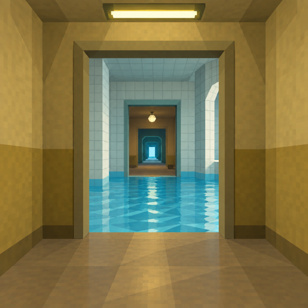
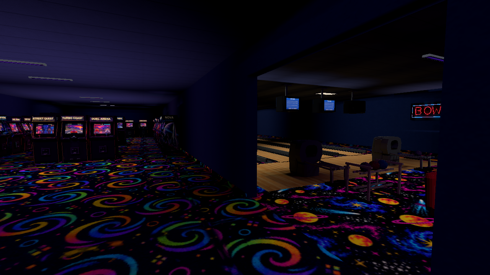
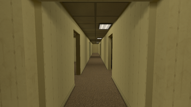
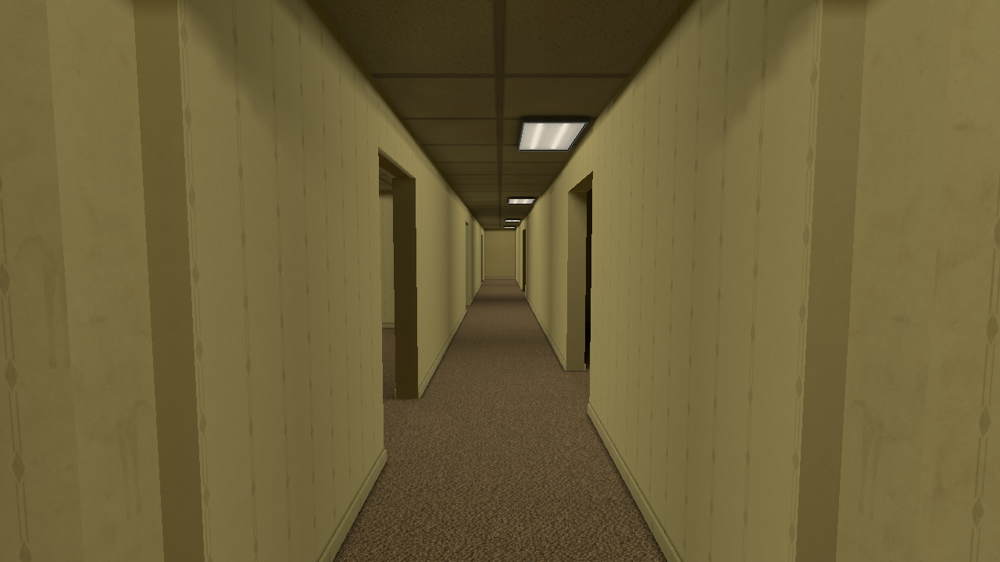
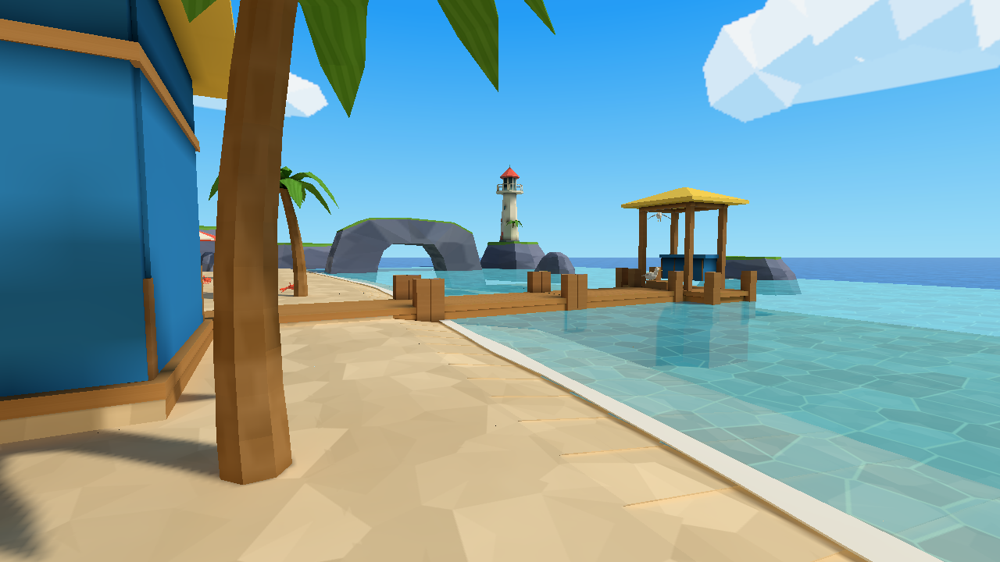
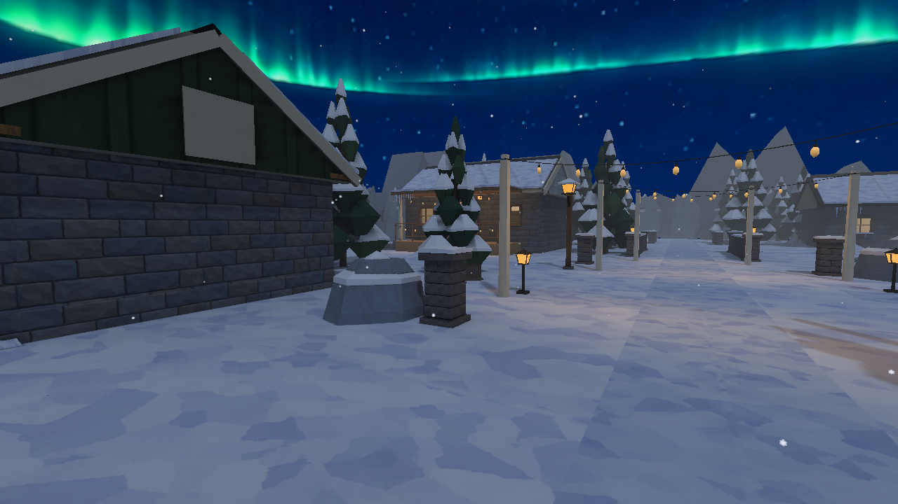

<p align="center">
  
</p>

<h1 align="center">Places</h1>
<p align="center"><strong>Take a walk. Stay a while.</strong></p>

Places is a game for walking and experiencing places. Wander through quiet
interiors, follow a trail into the night, or spend a little longer beside the
water. Let the architecture, light and small details set the pace.

There is no prescribed route through these spaces. Open a door, try a light
switch, look around a corner. Some places feel familiar. Others become stranger
the longer you stay.

[](docs/videos/places-0.9.0.mp4?raw=true)

[Download the 32-second walkthrough (MP4)](docs/videos/places-0.9.0.mp4?raw=true) —
real walking footage from all eight environments, with a short cut between each.

[](docs/videos/places-0.9.0.mp4?raw=true)

## Somewhere to go

The **Quiet Collection** connects eight environments through a central hub.
Enter a themed door and use the destination's return door to come back. Each
visit starts fresh; objects and local objectives stay in their environment.

The environments offer different moods: the three floors of **Office: After
Hours**, the still water of **Pool**, the domestic spaces of **Home**, the
night trails of **Lantern Hollow**, the snow and ice of **Winter**, the open
waterfront of **Beach**, the bright architecture of **Frutiger Aero**, and the
bowling lanes, cabinets, birthday room and restroom of **Cosmic Lanes & Arcade**.

| Office: After Hours | Beach |
| --- | --- |
|  |  |



Doors, switches, weather and occasional encounters give the spaces their own
rhythms. Adjustable graphics and remappable controls let you settle into yours.
Separate editable projects include **The Backrooms**, **Closing Time**,
**It Only Exists in the Beam**, **One Guest Too Many**, **The Shape of an Exit**
and **After Hours - Rooms Beyond**. They remain independent of the collection.
Relay Annex source is preserved and excluded from 0.13.0 release downloads.

## Controls

Move with WASD and look with the mouse or arrow keys. Gameplay bindings can be
changed in Settings; Escape always pauses.

| Action | Key |
| --- | --- |
| Walk forward | `W` |
| Walk backward | `S` |
| Strafe left | `A` |
| Strafe right | `D` |
| Look up | `UP` |
| Look down | `DOWN` |
| Look left | `LEFT` |
| Look right | `RIGHT` |
| Jump / swim up | `SPACE` |
| Crouch (toggle) | `C` |
| Interact | `E` |
| Pause | `ESC` |

## About this version

**Places 0.13.1** is the development version on `0.13.1-dev`.
The shareable [0.13.0 Windows prerelease](https://github.com/csd113/Places/releases/tag/v0.13.0) includes the game,
editor, compiler, runtime dependencies/assets and seven prepared project packages.
Native 0.13.0 validation covers Windows x64/Direct3D 12 and macOS arm64/Metal.
The [release report](docs/reports/release-0.13.0.md) records exact acceptance and
remaining platform, performance and delivery limits.

The 0.13.0 Windows prerelease includes the game EXE, native editor, offline compiler,
dependencies, runtime assets, an always-bundled live menu scene and all seven
approved project packages, including the nine-map Quiet Collection.
See [portable installation](docs/INSTALLATION.md#windows-portable-game-and-authoring-tools)
for launch and authoring instructions. The eight standalone environment demos are superseded by this
single package. See the [collection handoff](docs/reports/release-0.12.0.md#environment-collection-0120-retirement)
for the exact retirement inventory, validation and remaining work.

To play an existing collection package with a matching player and asset library:

```sh
PLACES_ASSET_ROOT="$PWD/assets" ./target/release/places --import /absolute/path/environments.placesmap
PLACES_ASSET_ROOT="$PWD/assets" PLACES_LEVEL=hub ./target/release/places
```

Choose **Places / The Quiet Collection** in Explore to enter the collection.
Authors can open `projects/environments/` in the native editor; an explicit
[collection export](levels/README.md) is only needed after changing its sources.

The images and walking footage above were captured from the native 0.9.0 game.
[Developer documentation](docs/DEVELOPMENT.md) · [Changelog](CHANGELOG.md) ·
[Documentation index](docs/README.md)

[Installation, first launch and map imports](docs/INSTALLATION.md) documents the
current runtime policy: optional gameplay maps, bundled menu resources, external
assets and separate writable user data.

Places is open source under the [MIT license](LICENSE).
[Third-party notices](THIRD_PARTY_LICENSES.txt).
