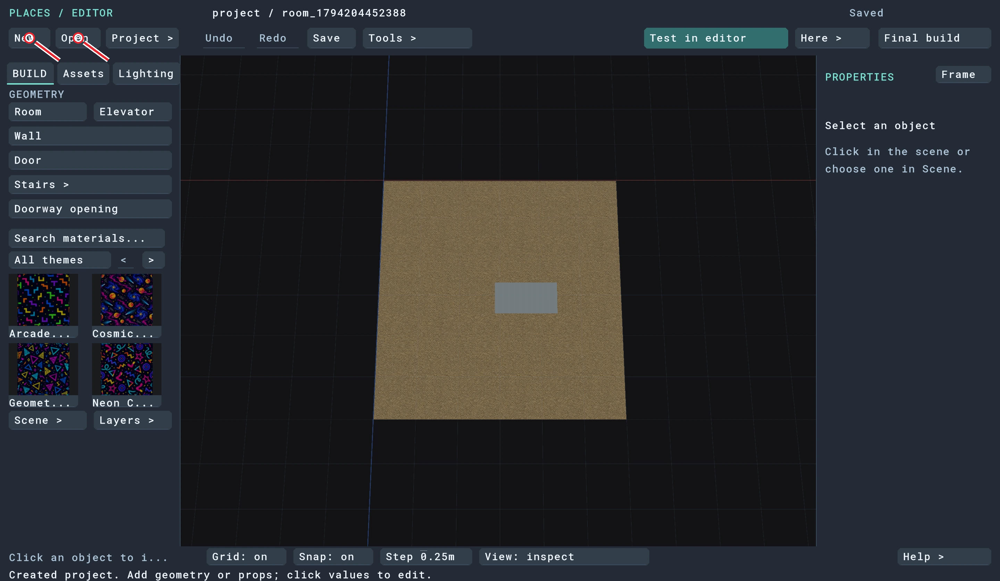
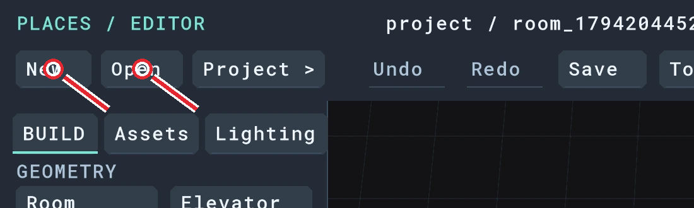
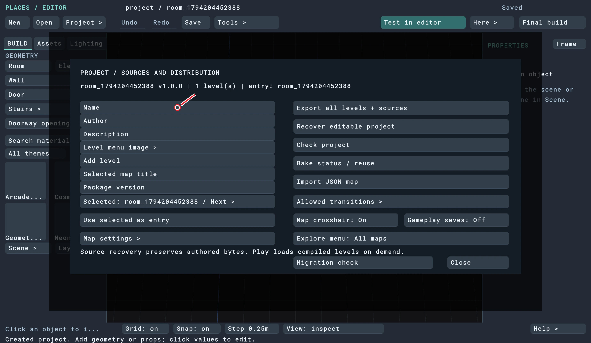
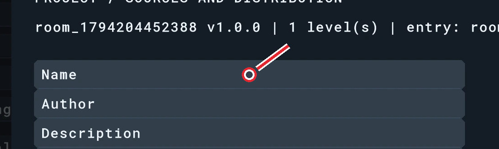
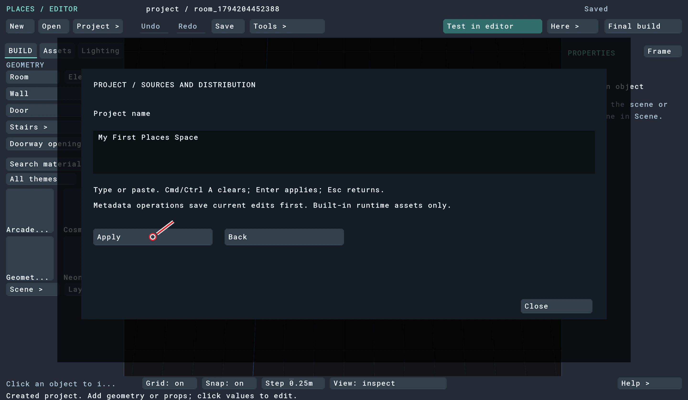
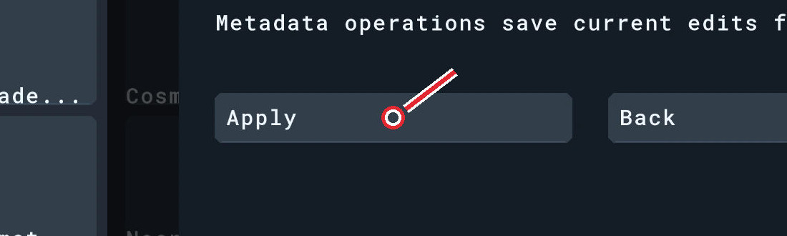
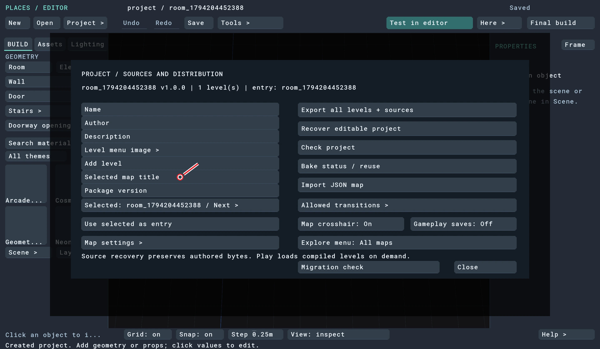
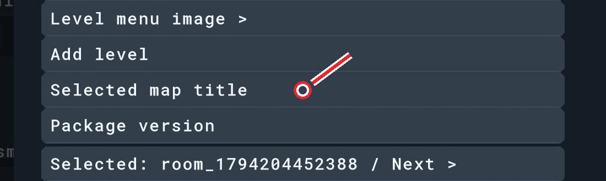
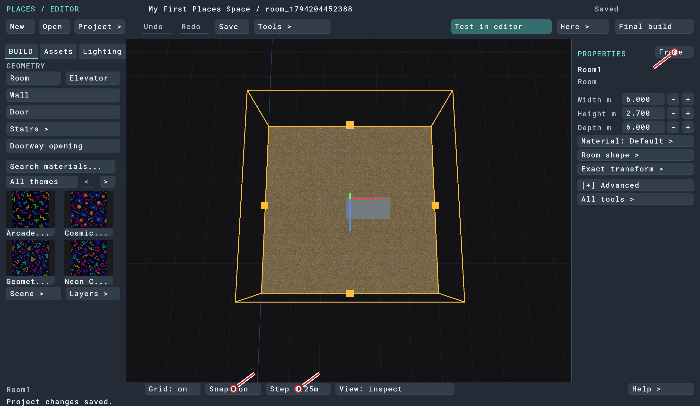
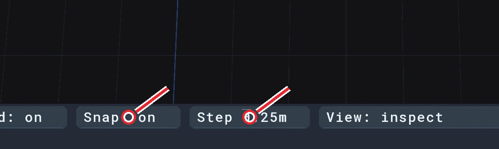

# 1. Start here

[Guide contents](../README.md) · [Download the complete PDF](https://github.com/csd113/Places/releases/download/v0.13.1/Beginners_Guide_to_Your_First_Places_Space.pdf)

In this chapter:

- [1. Beginner’s Guide to Your First Places Space](#step-01)
- [2. Open the editor](#step-02)
- [3. Create your project](#step-03)
- [4. Give it a useful name](#step-04)
- [5. Get comfortable with the view](#step-05)

## 1. Beginner’s Guide to Your First Places Space

Build a small world you can walk around: a Backrooms office, a furnished Home room and a tiled Pool room. Three linked elevators will take you between them.

Start with chapter 1 and work in order. Each section ends with a checkpoint so you can catch a missed step before it causes trouble later. Screenshots sit beside the action they explain in the reading sequence. Red circles point to the controls to use.

**Use Simple mode throughout.** This is the editor’s basic workspace. You won’t need Precision controls, the [+] Advanced section, entities or Luau. Walls, doors, resizing and most placement are visual; a few tools open forms even in Simple.

Have a mouse with a scroll wheel and middle button ready. You’ll use it to orbit, pan and move objects. Keep a writable folder for your project and save at each checkpoint.

**What you’ll finish:** Backrooms with a desk, chair, three pillars and an open doorway; Home with a bed, kitchen and fitted door; Pool with a recessed basin, water, bench, duck and a lit janitor closet. Then you’ll connect the elevators, build, export and play.

[Back to chapter contents](#1-start-here)

---

## 2. Open the editor

Keep the downloaded Places installation together, including its assets and compiler. The game and editor are separate executables.

**On Windows:** open the Places folder and double-click `places-editor.exe`.

**On Mac:** if you have `Places.app`, right-click it in Finder, choose **Show Package Contents**, and open **Contents → MacOS**. Open Terminal, drag `places-editor` from Finder into the Terminal window, and press Return. Use the same drag-and-Return method for the portable folder’s `places-editor`.

Double-clicking `Places.app` starts the game. There isn’t a separate editor app in this release package.

The screenshots and native walkthrough were recorded on Mac. The Windows executable name is verified against the packaging script; this guide does not claim a Windows hands-on test.

| Installation | Editor to open |
| --- | --- |
| Windows folder | `Places/places-editor.exe` |
| Mac portable folder | `Places/places-editor` |
| Mac app bundle | `Places.app/Contents/MacOS/places-editor` |

[Back to chapter contents](#1-start-here)

---

## 3. Create your project

**1.** Click **New** at the upper left, or press `⌘N` on Mac / `Ctrl N` on Windows.

**2.** In the folder chooser, choose a parent folder where you want to keep your work. On Mac, confirm with **Open**. The editor makes a new `untitled-…` folder inside it.

**3.** Keep track of that new folder. It contains the whole editable project; it is the folder you’ll select with **Open** next time.

*Figure 3.1. The fresh starter. New and Open are at the upper left.*

The starter already gives you a square **6 × 6 m room**, a floor, a ceiling and one fluorescent light. The ceiling is hidden when you look down from above, so you can see inside. It hasn’t been deleted.

You’ll add the walls yourself. The grey rectangle near the middle is the existing ceiling light.

> **Checkpoint:** You see one carpeted square and one light, with no walls.

[Back to chapter contents](#1-start-here)

---

## 4. Give it a useful name

**1.** Click **Project >**, then **Name**.

*Figure 4.1. Open the project name field.*

**2.** Press `⌘A` / `Ctrl A`, type **My First Places Space**, then click **Apply**.

*Figure 4.2. Apply the new name.*

**3.** In the same Project panel, edit **Selected map title** to **My First Places Space** and click **Apply** again.

*Figure 4.3. Then edit Selected map title and apply the same title.*

**4.** Close the panel and click **Save**.

These are the names people see. They don’t rename the project folder. The room names “Backrooms,” “Home” and “Pool” in this guide describe the areas we’re building; the editor’s scene list calls their footprints Room1, Room2 and Room3.

> **Checkpoint:** The top of the editor reads My First Places Space.

[Back to chapter contents](#1-start-here)

---

## 5. Get comfortable with the view

Try these before drawing anything:

**1.** **Left-click the carpet** to select the room. Its outline and handles appear. Click empty carpet rather than the grey light.

**2.** Press `F`, or click **Frame**, to bring the selection into view.

**3.** **Hold the right mouse button and drag** to orbit. Turn until you’re looking nearly straight down and the floor edges run roughly across and down the screen, like the pictures.

**4.** **Hold the middle mouse button and drag** to pan—slide your view without moving the room.

**5.** **Scroll the wheel** to zoom. Keep all four corners visible when drawing walls.

*Figure 5.1. Select the carpet, frame it, and check the bottom-bar settings.*

Leave **Grid: on**, **Snap: on** and **Step 0.25m** in the bottom bar. Click a toggle if necessary. The Step button cycles through sizes; keep clicking until it reads 0.25m.

The grid marks metres, while snapping lets your clicks and drags land in quarter-metre steps. A camera angle doesn’t need to match the screenshot perfectly. What matters is seeing the floor corners and the tool preview.

In the steps below, **back** means the far edge of the room in this overhead view; **front** means the near edge. If you lose your bearings, select the floor and press F again.

> **Checkpoint:** You can orbit, pan and zoom without changing the room.

[Back to chapter contents](#1-start-here)

---

[← Guide contents](../README.md) · [Build Backrooms →](02-backrooms.md)
