# 2. Build Backrooms

[Guide contents](../README.md) · [Download the complete PDF](https://github.com/csd113/Places/releases/download/v0.13.1/Beginners_Guide_to_Your_First_Places_Space.pdf)

In this chapter:

- [6. Draw the outside walls](#step-06)
- [7. Make a lobby and an open doorway](#step-07)
- [8. Add the first pillar](#step-08)
- [9. Make two copies and move them](#step-09)
- [10. Choose a desk, then move it](#step-10)
- [11. Add the chair and light the lobby](#step-11)

## 6. Draw the outside walls

**1.** Click the **Build** tab, then **Wall**.

**2.** Click **Chain: Off** once so it reads **Chain: On**.

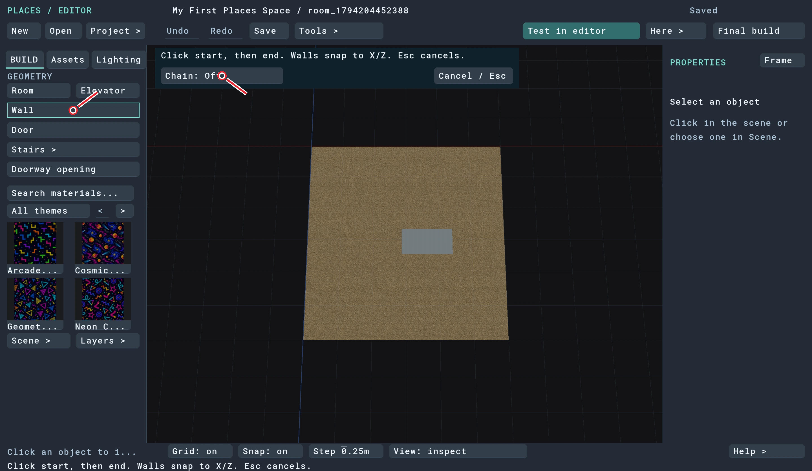

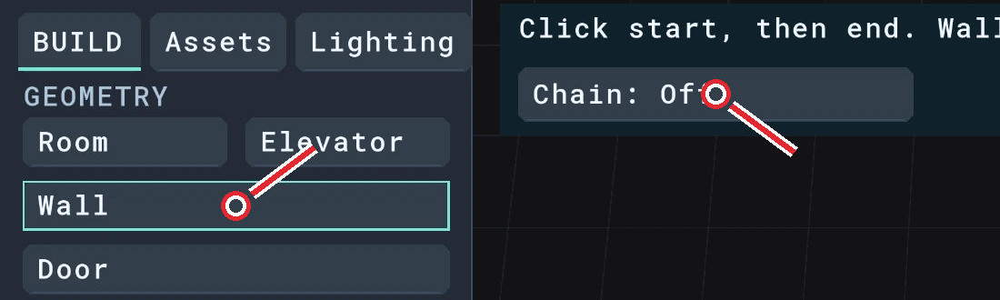

*Figure 6.1. Choose Wall, then turn Chain on before clicking the first corner.*

**3.** Click the floor’s **back-left corner**. This sets the start.

**4.** Move to the **back-right corner**. A wall preview appears. Check that it spans the room, then click to place it.

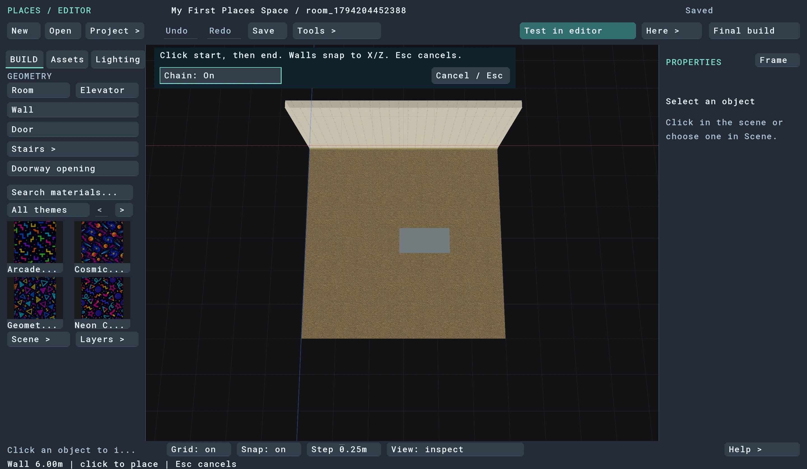

*Figure 6.2. The first wall spans the back edge. The preview says 6.00m.*

**5.** Continue around the floor: click the **front-right** corner, then the **front-left** corner, then the original **back-left** corner.

**6.** Press `Esc` to finish the chain.

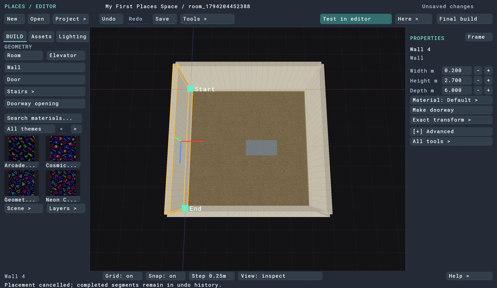

*Figure 6.3. Four walls now surround the starter floor.*

That is five corner clicks for four walls. You’re drawing along the floor edges. The tool makes straight walls, 0.20 m thick, as tall as the room’s ceiling. Nearby endpoints snap together.

If a segment goes the wrong way, press Esc and use **Undo** or `⌘Z` / `Ctrl Z`. Each completed wall is one undo step. Choose Wall again to redraw it.

> **Checkpoint:** There are four outside walls and no gap at a corner. The ceiling remains hidden from this overhead view.

[Back to chapter contents](#2-build-backrooms)

---

## 7. Make a lobby and an open doorway

A short lobby gives the elevator some breathing room. We’ll divide the room, then cut a passage through the divider.

**1.** With the same overhead view, choose **Build → Wall**. Leave Chain off for this single wall.

**2.** On the left edge of the floor, find a point a little past halfway from back to front—about **3¾ m from the back**. Click there, then click directly across on the right edge. The near lobby is about 2¼ m deep.

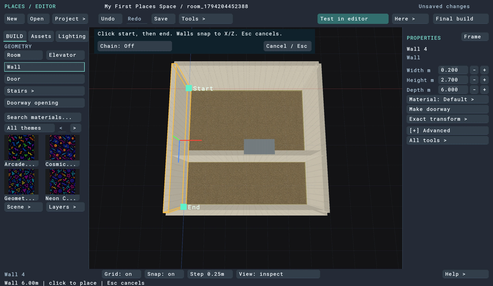

*Figure 7.1. Draw one divider across the room, leaving the near side for the lobby.*

**3.** Choose **Doorway opening** in the Build tab.

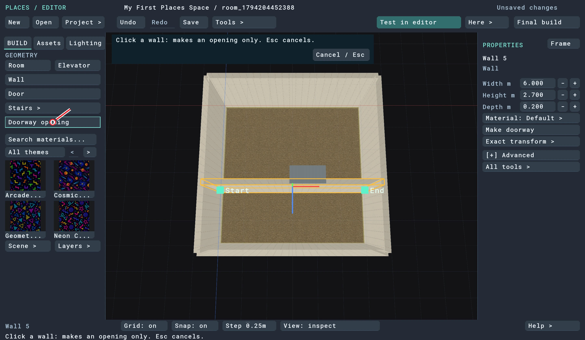

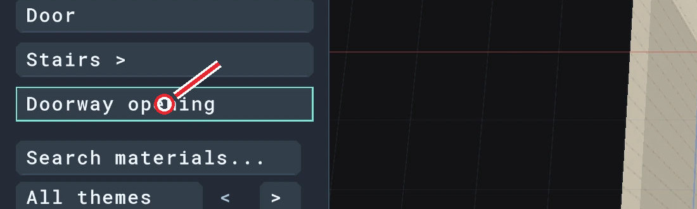

*Figure 7.2. Choose Doorway opening.*

**4.** Point at the middle of the new divider. Aim at its broad wall face, not empty floor. If the wall face is hard to see, right-drag to tilt your view a little.

**5.** When the opening preview is centered, click once.

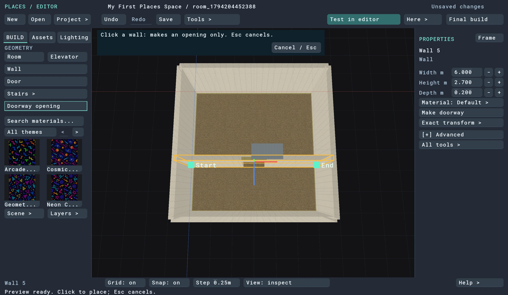

*Figure 7.3. Click the wall only when the opening preview is where you want it.*

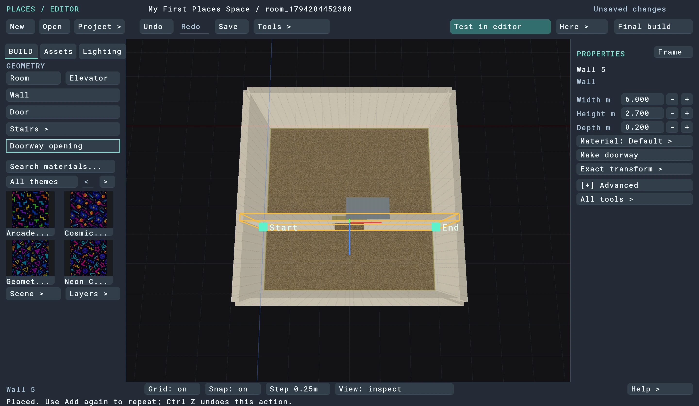

*Figure 7.4. The finished passage has no door leaf.*

This creates an open passage without a door. Leave it that way in Backrooms; you’ll add a working door in Home.

> **Checkpoint:** You have a room with a smaller front lobby and an open passage through the divider. Save.

[Back to chapter contents](#2-build-backrooms)

---

## 8. Add the first pillar

The rectangular pillar tool lives in the Tools menu. It uses a small form, even in Simple mode.

**1.** Click **Tools > → Geometry / stairs > → Rectangular pillar**.

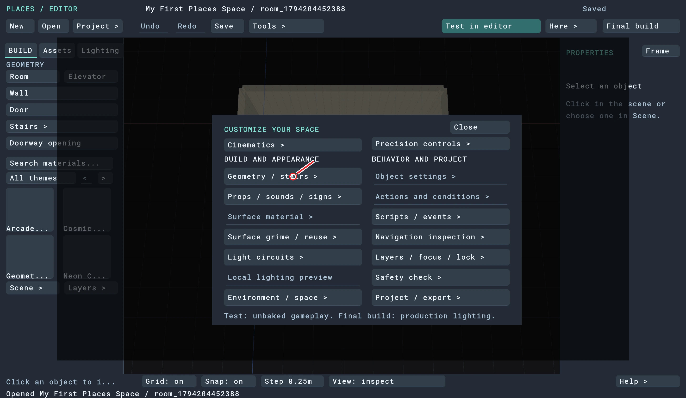

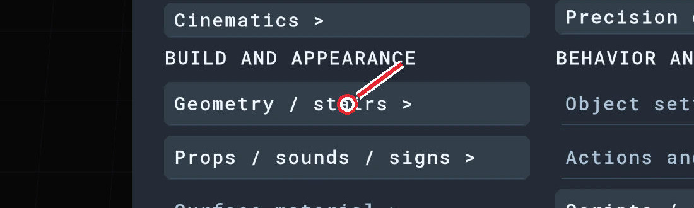

*Figure 8.1. Open Geometry from Tools.*

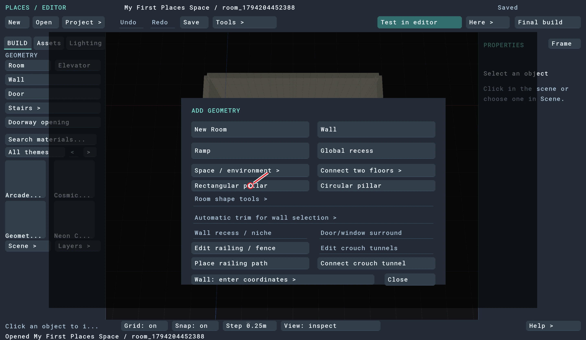

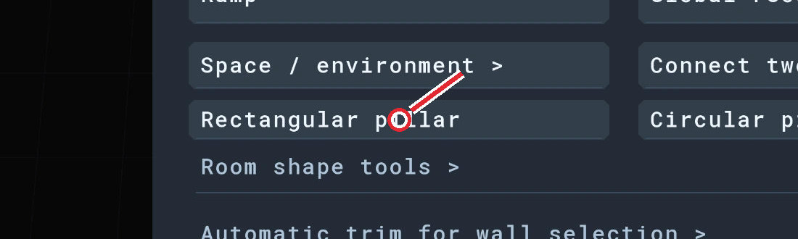

*Figure 8.2. Choose Rectangular pillar.*

**2.** Fill the first page as shown: **X 1.5**, **Z 1.5**, **Width 0.5**, **Depth 0.5**. Leave **Base Y** and **Height** blank; that makes the pillar run from the room’s floor to its ceiling.

**3.** To change a field, click it, select all with `⌘A` / `Ctrl A`, type the value, and press Return. Don’t type units.

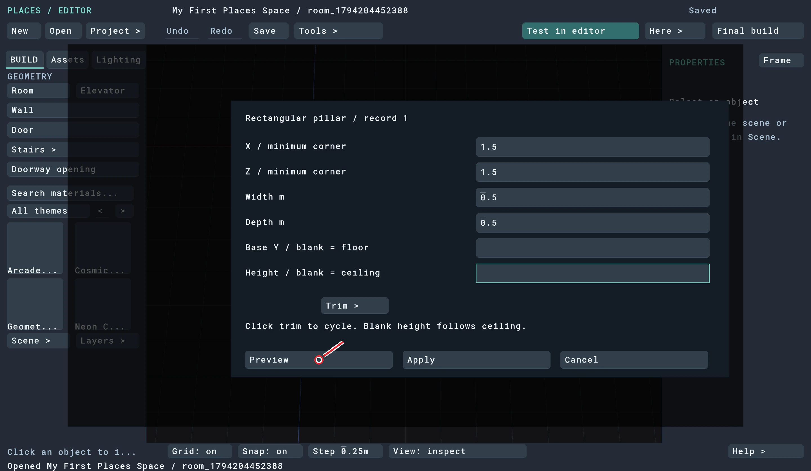

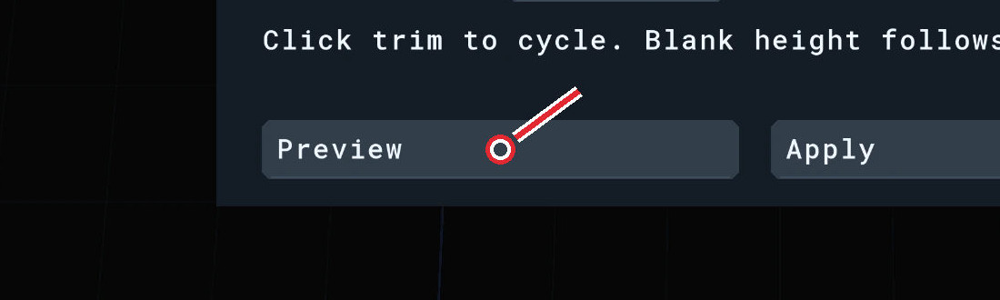

*Figure 8.3. Four values make a half-metre square pillar. Leave the two height fields blank.*

**4.** Click **Preview**. Check the pillar is inside the larger part of the room, then click **Apply**.

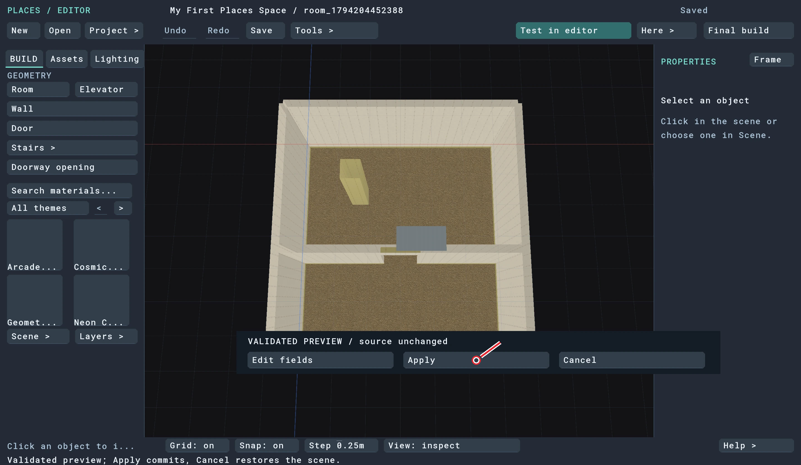

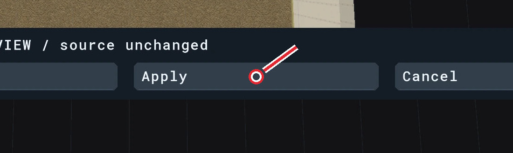

*Figure 8.4. Preview first, then Apply.*

Keep the other pages at their defaults. The pillar uses yellow wallpaper. Here X and Z locate its bottom corner on the floor; these initial values give us an easy starting point for the copies.

> **Checkpoint:** One floor-to-ceiling pillar stands near the back-left part of the office.

[Back to chapter contents](#2-build-backrooms)

---

## 9. Make two copies and move them

**1.** Keep the pillar selected and press `⌘D` / `Ctrl D`. The copy appears slightly forward and to the right, and becomes selected. Wait until its colored handles are visible.

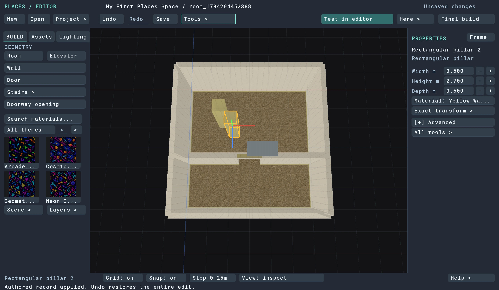

*Figure 9.1. Duplicate makes an offset copy. Its handles belong to the new selection.*

**2.** Drag the copy’s **red horizontal handle** toward the right side of the office. Leave room to walk around it. Use its **blue handle** to line it up roughly with the first pillar.

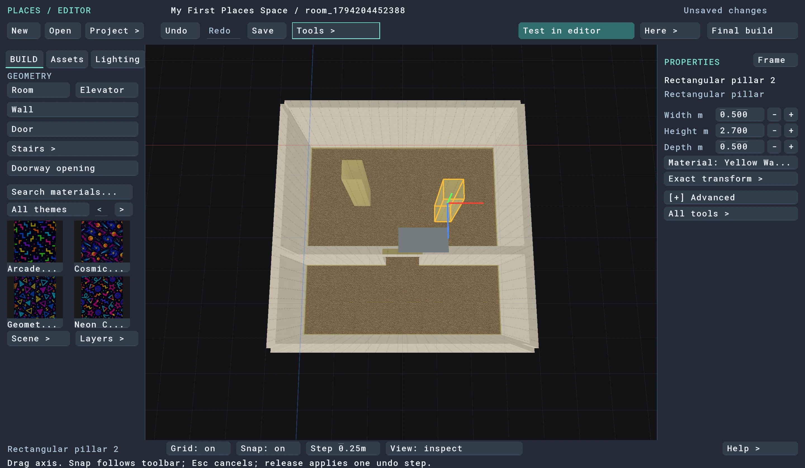

*Figure 9.2. Drag the red handle toward the right side.*

**3.** Duplicate that pillar once more. Again, use the new copy’s handles. If the handles haven’t caught up with the selection, click the new pillar once before dragging. Drag it left, then forward, so it sits below the first pillar in the picture.

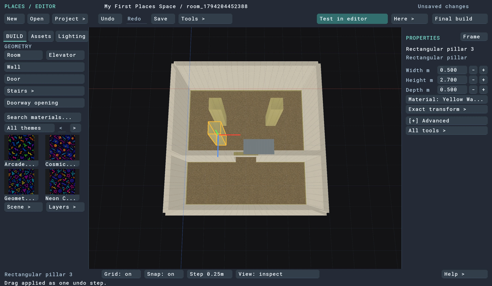

*Figure 9.3. Three pillars, with a clear route through the middle.*

Red moves across the room; blue moves along it. Grab the colored line rather than the pillar’s body. Release to keep the move. Esc cancels a drag, and Undo restores a move after you release.

The screenshot’s pillars sit roughly at the back left, back right and middle left. Their exact positions aren’t important; keep the central path and doorway clear.

> **Checkpoint:** Count three pillars. None blocks the opening or touches an outside wall.

[Back to chapter contents](#2-build-backrooms)

---

## 10. Choose a desk, then move it

**1.** Click clear carpet to select the room and press F. Orbit back to the overhead view if needed.

**2.** Click **Assets → Props**. Click the search field, type `core:desk`, and press Return.

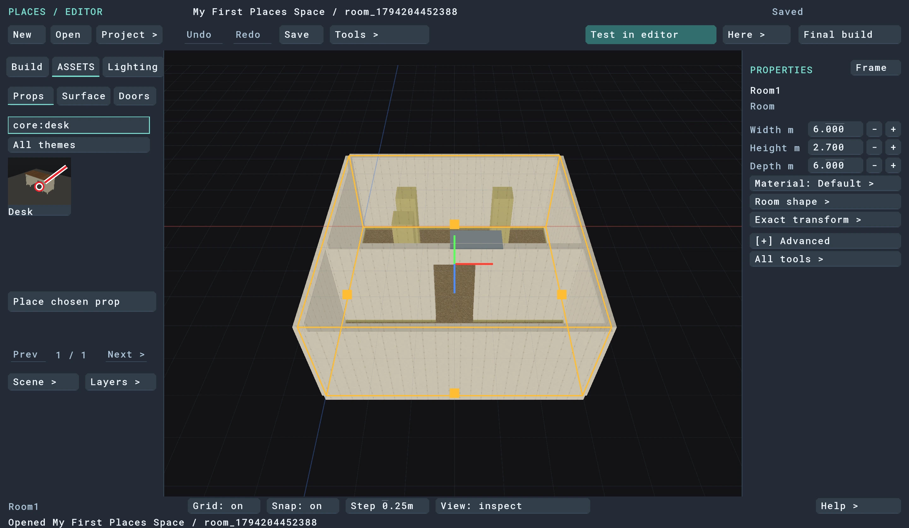

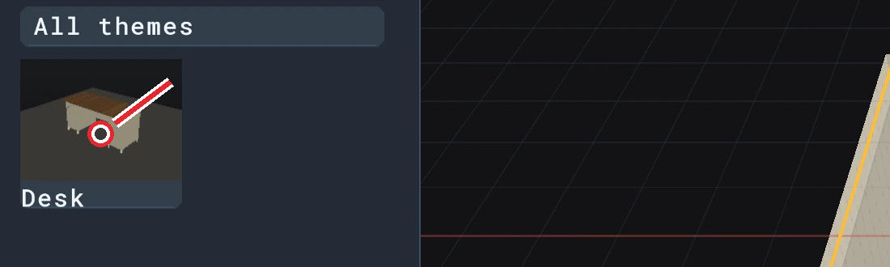

*Figure 10.1. Search for the exact desk ID, then click its thumbnail.*

**3.** Click the **Desk** thumbnail, then **Place chosen prop**.

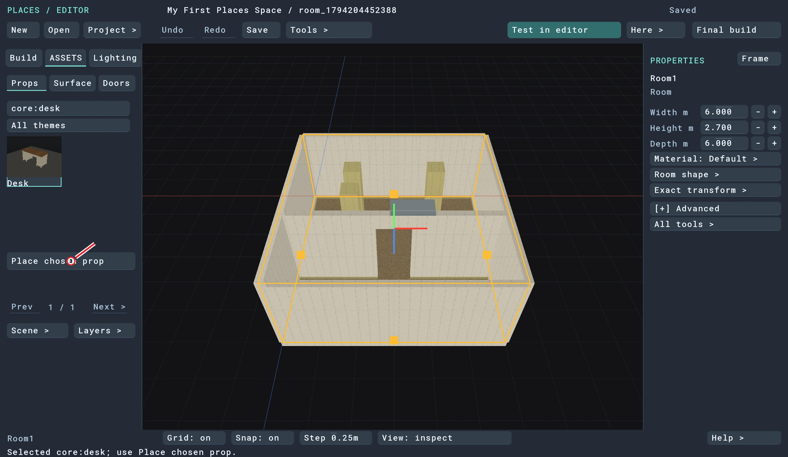

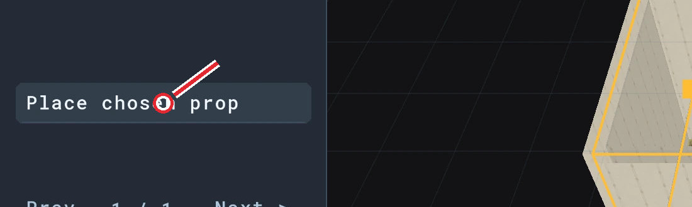

*Figure 10.2. Place the chosen desk.*

**4.** The desk appears near the center of your current view. Drag its blue handle toward the back wall, stopping about a metre from that wall. Keep it between the two rear pillars.

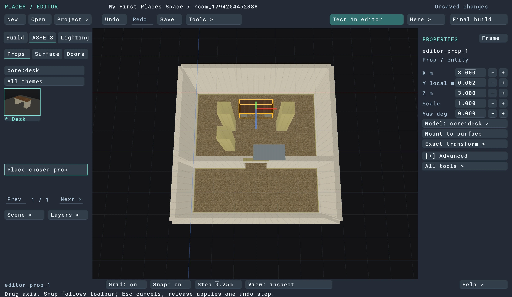

*Figure 10.3. Move the desk toward the back wall with its blue handle.*

Place chosen prop adds immediately; it doesn’t ask for another click on the floor. You can pan first to choose the general placement area, then use the handles to adjust it.

**Before choosing a different prop, click the floor.** Picking a catalog thumbnail while a prop is selected changes that existing prop into the new model.

> **Checkpoint:** The desk sits at the back of the office, with clear space in front of it.

[Back to chapter contents](#2-build-backrooms)

---

## 11. Add the chair and light the lobby

**1.** Click the carpet and press F. In **Assets → Props**, search for `core:chair`, click the Chair thumbnail, then **Place chosen prop**.

**2.** Drag the chair’s blue handle toward the desk. Leave a comfortable gap between the chair and desk.

**3.** In Properties on the right, click the **Yaw deg** value. Select all, type **180**, and press Return. The chair should face the desk.

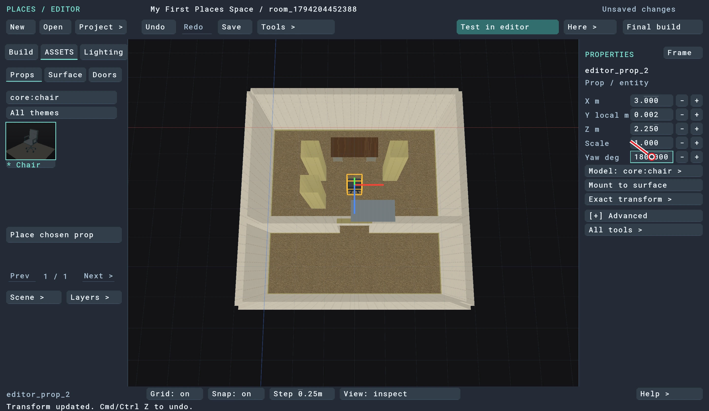

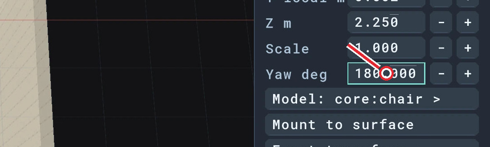

*Figure 11.1. Set the chair’s yaw to 180 degrees.*

**4.** Click **Lighting → Place light fixture**.

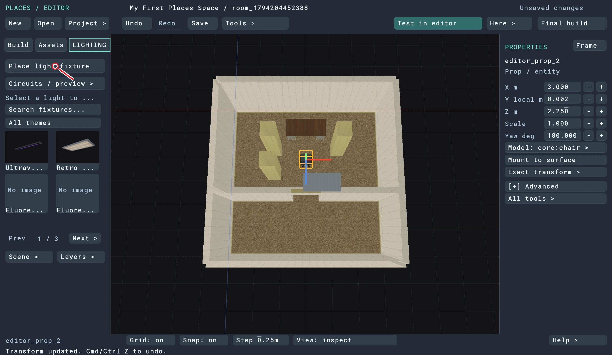

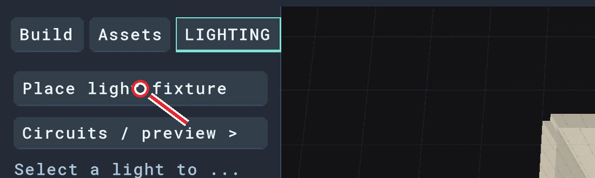

*Figure 11.2. Choose Place light fixture in Lighting.*

**5.** Point at the lobby floor, roughly midway between the divider and front wall. Click when the ceiling-light preview appears.

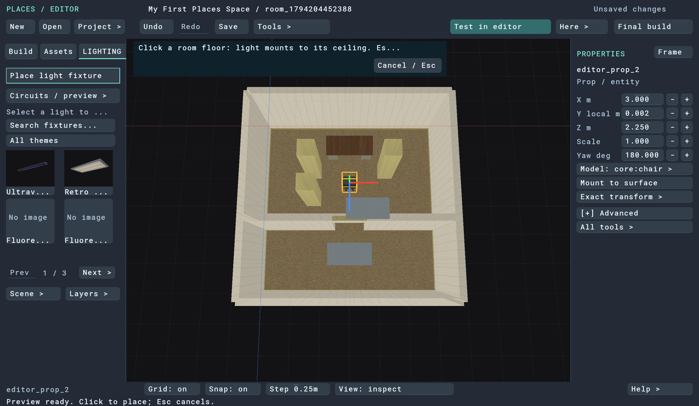

*Figure 11.3. Point at the lobby floor to preview the ceiling light.*

**6.** Click **Save**.

The starter light already covers the office. This second fluorescent light covers the lobby. Although you click the floor, the light mounts to the ceiling.

> **Checkpoint:** Backrooms has four outside walls, a divider with an open doorway, three pillars, a desk, a chair and two lights.

[Back to chapter contents](#2-build-backrooms)

---

[← Start here](01-start.md) · [Build Home →](03-home.md)
