# 3. Build Home

[Guide contents](../README.md) · [Download the complete PDF](https://github.com/csd113/Places/releases/download/v0.13.1/Beginners_Guide_to_Your_First_Places_Space.pdf)

In this chapter:

- [12. Create Home’s floor and ceiling](#step-12)
- [13. Enclose Home and fit its door](#step-13)
- [14. Give Home a wooden floor and painted walls](#step-14)
- [15. Place the bed on clear floor](#step-15)
- [16. Make a small kitchen along the back wall](#step-16)
- [17. Light the bedroom and lobby](#step-17)

## 12. Create Home’s floor and ceiling

**1.** Click clear Backrooms carpet to select that room.

**2.** Click **Build → Room**. The New Room form appears. A new room starts beside the selected room; there is no rectangle-drawing tool for this step.

**3.** Change only **West X** to **10**. Leave **North Z 0**, **Width m 4**, **Depth m 6**, **Floor elevation m 0** and **Room height m 2.7** as shown.

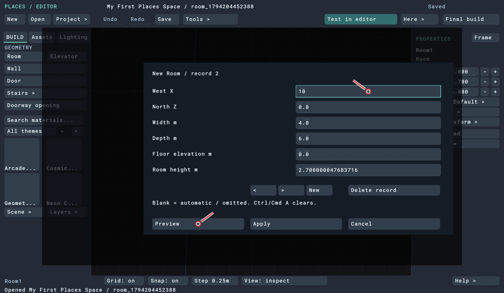

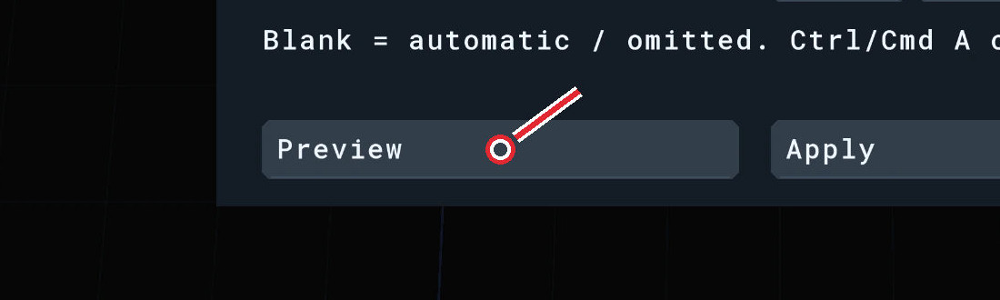

*Figure 12.1. Only X changes in the new-room form.*

**4.** Click **Preview**, then **Apply**. Press F to frame the new room.

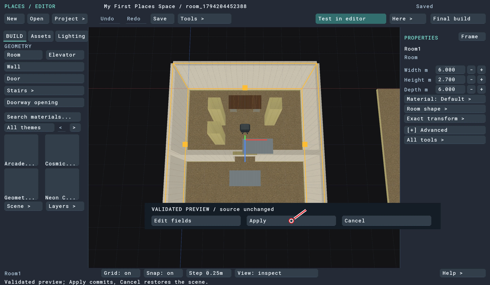

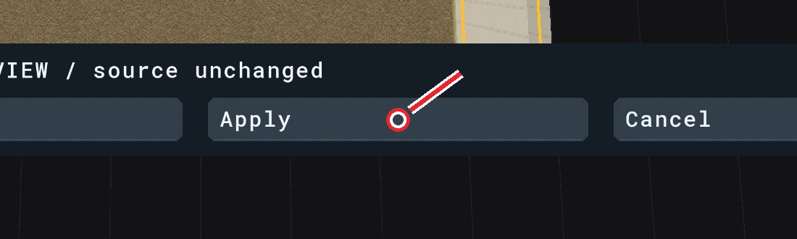

*Figure 12.2. Check the separate room, then Apply.*

**5.** Find the yellow handle halfway along its right edge. Drag it outward until the preview says the room is **6.00 × 6.00 m**, then release.

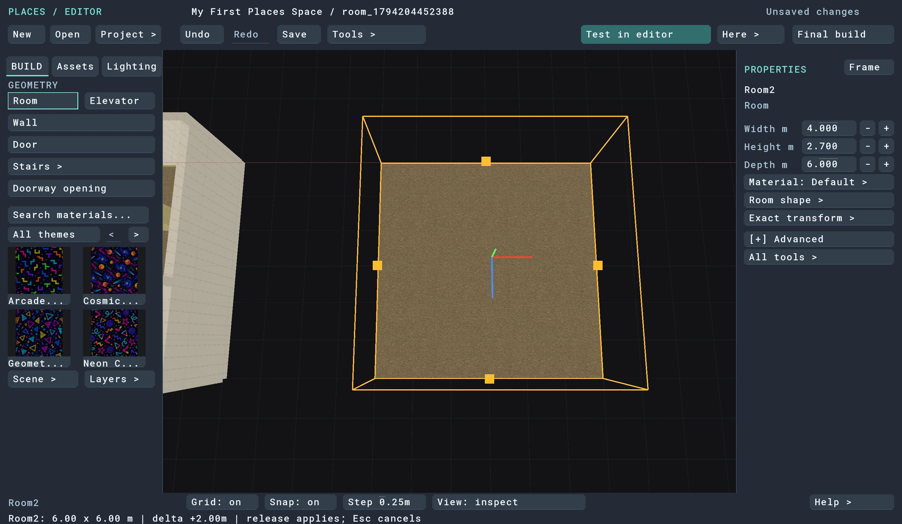

*Figure 12.3. Drag the yellow right-edge handle until the room is 6 × 6 m.*

The single X value leaves a gap between the rooms for this elevator layout. You’re using the visual edge handle for the room’s size. If you release too early or go too far, drag the same handle again and watch the dimensions.

For now Home is only a floor and ceiling. It needs its own walls; the next step builds them.

> **Checkpoint:** Home is a separate 6 × 6 m floor to the right of Backrooms. No Home walls have been added yet.

[Back to chapter contents](#3-build-home)

---

## 13. Enclose Home and fit its door

**1.** Keep Home in view from above. Choose **Build → Wall** and turn **Chain** on.

**2.** Click Home’s floor corners in this order: **back left → back right → front right → front left → back left**. Press Esc when all four walls are placed.

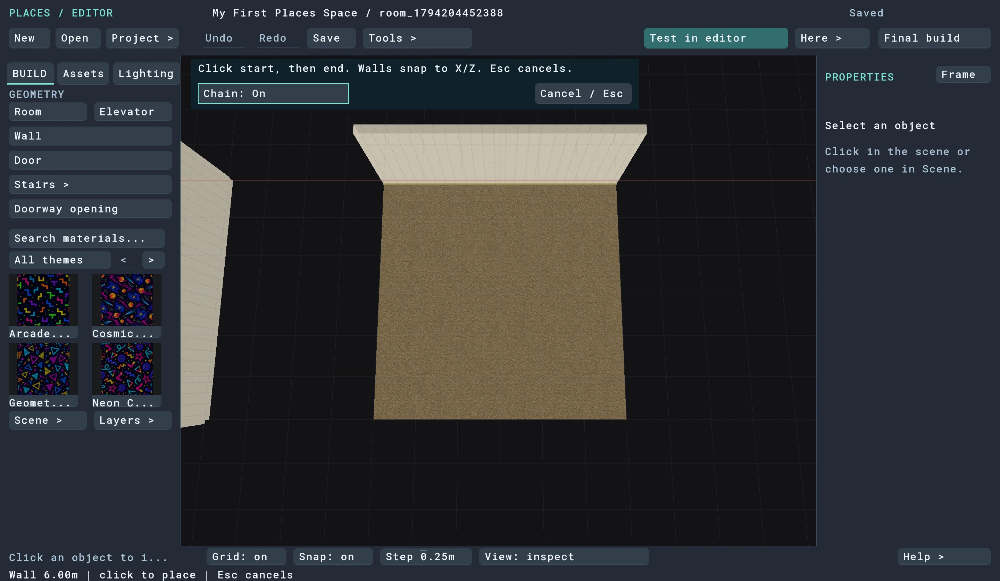

*Figure 13.1. Draw Home’s own four outside walls.*

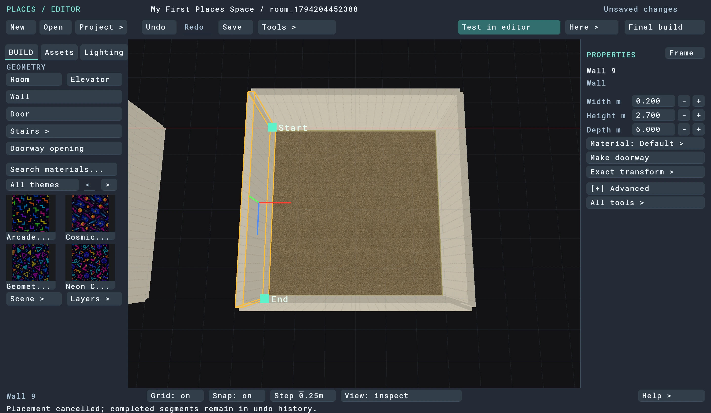

*Figure 13.2. All four Home walls are in place.*

**3.** Choose **Wall** again, with Chain off. Draw a divider from left to right about **3¾ m from the back**, just as in Backrooms.

**4.** Choose **Build → Door**.

**5.** Point at the middle of the divider’s wall face. Wait for a door preview, then click once.

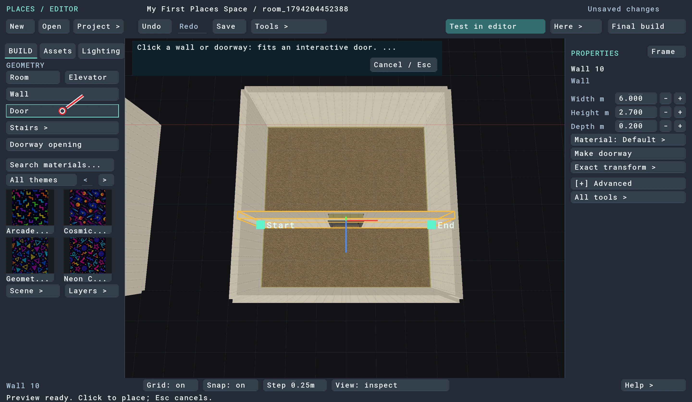

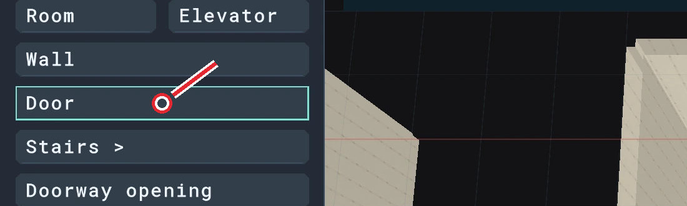

*Figure 13.3. Door previews an opening and a fitted leaf.*

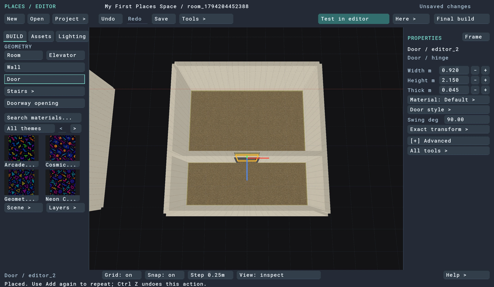

*Figure 13.4. The divider now has a closed door.*

The Door tool makes the opening and fits a working door in one action. You don’t need to cut a doorway first. It can also fit a door into an existing opening, but here we’re starting with a solid divider.

The door begins closed. You’ll open it with E when you test the room.

> **Checkpoint:** Home has four outside walls and a divider with one door. Save before decorating.

[Back to chapter contents](#3-build-home)

---

## 14. Give Home a wooden floor and painted walls

**1.** Click an empty part of Home’s floor. Choose **Assets → Surface**, search for `home:hardwood_oak_01`, and click the oak thumbnail. The floor changes immediately.

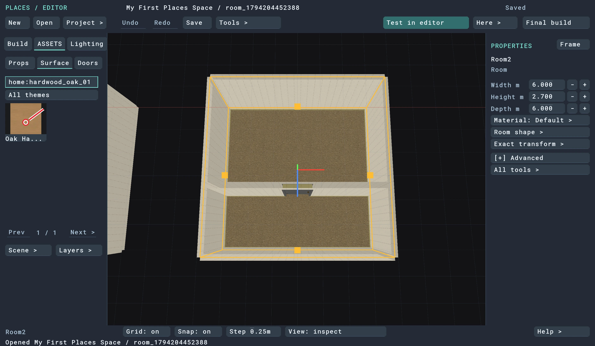

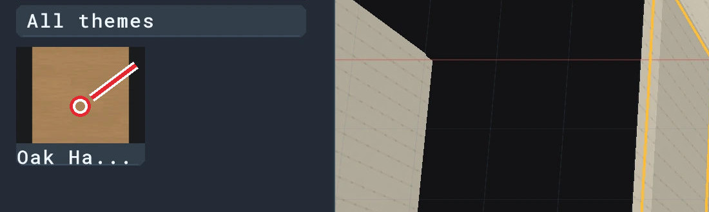

*Figure 14.1. Select the room’s floor and choose the oak surface.*

**2.** With the room still selected, click **Material: … >** in Properties. In the large catalog, click **Surface** once so the target reads **Ceiling**.

**3.** Search for `home:ceiling_white_01`, then click its thumbnail. The catalog closes. You won’t see much change from above because the ceiling is hidden.

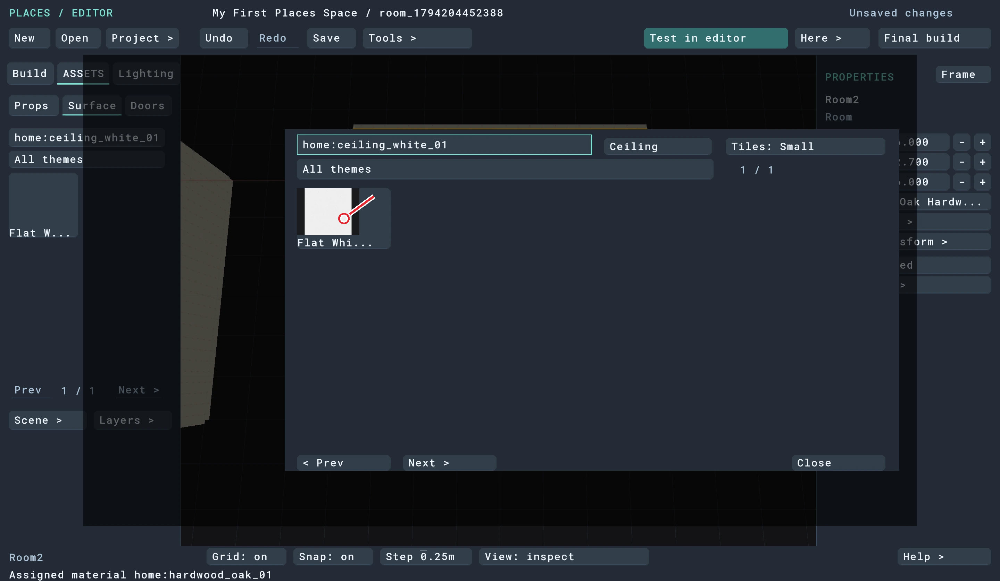

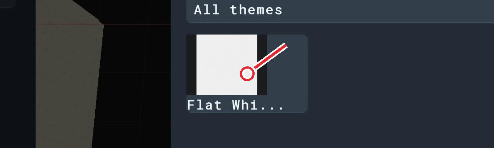

*Figure 14.2. The catalog target reads Ceiling for this choice.*

**4.** Click a solid part of one wall, away from the door. Check that Properties says **Wall**. Open its **Material: … >** button, search for `home:wall_paint_offwhite_01`, and click the paint thumbnail.

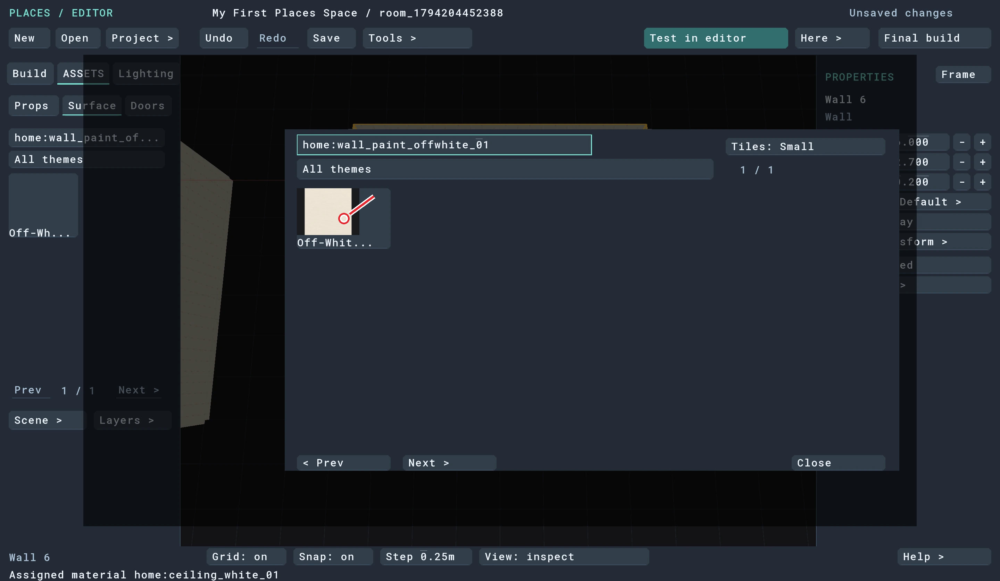

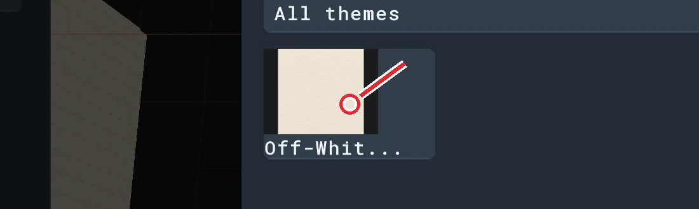

*Figure 14.3. Select a wall, then use its Material button to choose paint.*

**5.** Repeat the wall-material step for the other three outside walls and the divider—**five painted walls in total**.

Opening Material from Properties starts a fresh surface selection. Use that button when changing from ceilings to walls; it avoids leaving the catalog aimed at the ceiling.

> **Checkpoint:** The floor is wood. Each of Home’s five walls has the off-white paint material.

[Back to chapter contents](#3-build-home)

---

## 15. Place the bed on clear floor

**1.** Click clear Home floor and press F. Use right-drag to return to the overhead view.

**2.** Choose **Assets → Props**, search for `core:bed`, and click the Bed thumbnail.

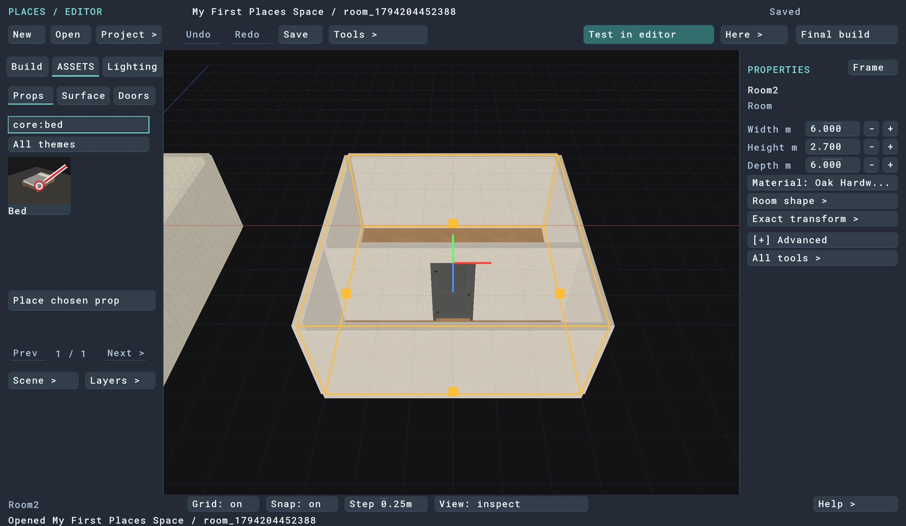

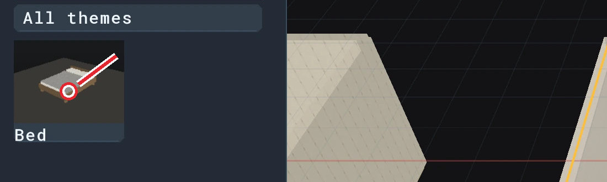

*Figure 15.1. Choose the bed from Props.*

**3.** Before placing it, **middle-drag the view** until the empty floor in the back-left part of the bedroom is near the center of the screen. Leave enough space for a bed about 2 m long, with its head toward the back wall.

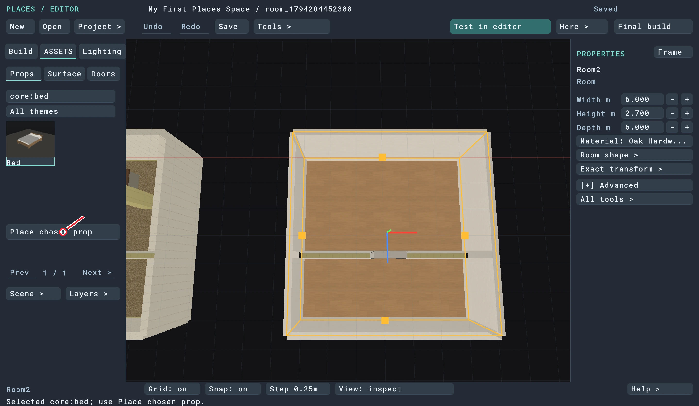

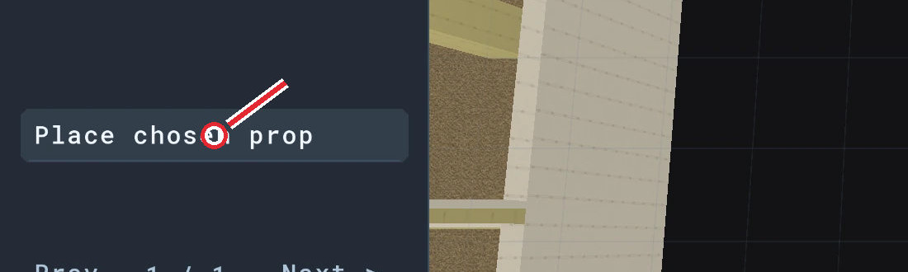

*Figure 15.2. Pan so the bed has clear floor around the center of your view, then place it.*

**4.** Click **Place chosen prop**.

**5.** If needed, use the red and blue handles to adjust it. Leave a route beside the bed and in front of the door.

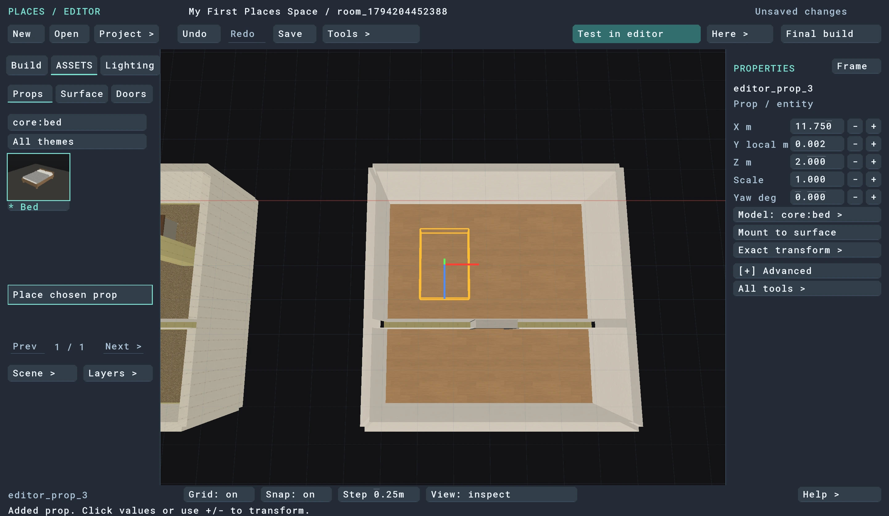

*Figure 15.3. The bed fits in the back-left part of Home.*

The bed is larger than the desk or chair. Trying to add it at the room’s center can put it through the divider or closed door. If placement is refused, the message at the bottom explains why. Pan toward a clear area and try Place chosen prop again.

> **Checkpoint:** The bed is wholly inside the bedroom and does not overlap the door or a wall.

[Back to chapter contents](#3-build-home)

---

## 16. Make a small kitchen along the back wall

Use three separate props. Before each new catalog choice, click clear floor and press F so the last prop is no longer selected.

**1.** In **Assets → Props**, search for `home:cabinet_base`. Click **Base Kitchen Cabinet**, then **Place chosen prop**. Drag its red handle to the right, then its blue handle toward the back wall. Leave roughly a metre between its center and the back wall.

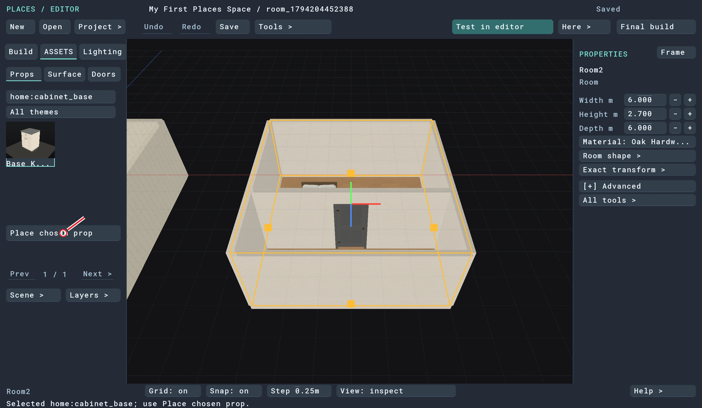

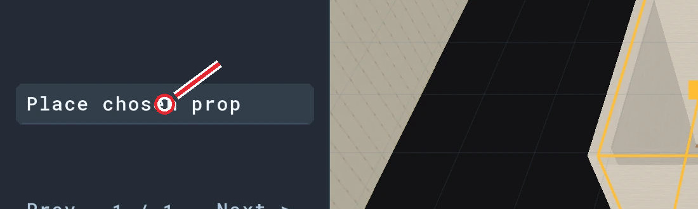

*Figure 16.1. Choose the cabinet, then place it.*

**2.** Repeat with `home:sink` (**Home Shaker Sink Unit**). Move it beside the cabinet, on the cabinet’s left.

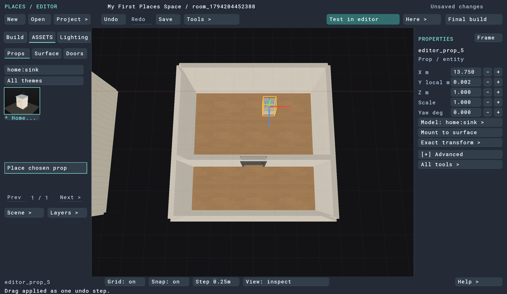

*Figure 16.2. Move the sink beside the cabinet.*

**3.** Repeat with `home:stove` (**Home Enamel Cooker**). Move it beside the sink, on the sink’s left.

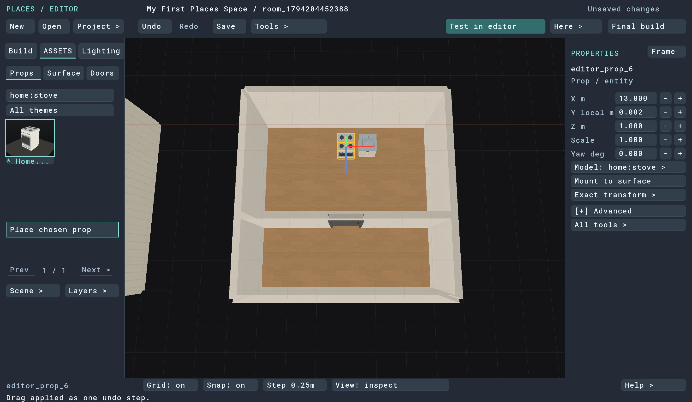

*Figure 16.3. Add the stove to finish the three-piece kitchen.*

Keep all three facing into the room at their default rotation. The front of the stove has the oven door; that side should face the bed and open floor. Leave a small gap between units and keep the route from the bedroom door clear.

The picture shows the finished row: stove, sink, cabinet. These are decorative kitchen props; this guide doesn’t add cooking behavior.

> **Checkpoint:** Home contains a bed, cabinet, sink and stove. None touches the door’s swing area.

[Back to chapter contents](#3-build-home)

---

## 17. Light the bedroom and lobby

**1.** Click **Lighting → Place light fixture**, then click the bedroom floor near its center. A fluorescent fixture appears on the ceiling.

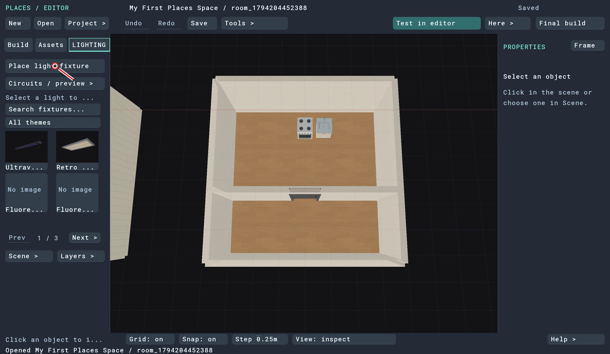

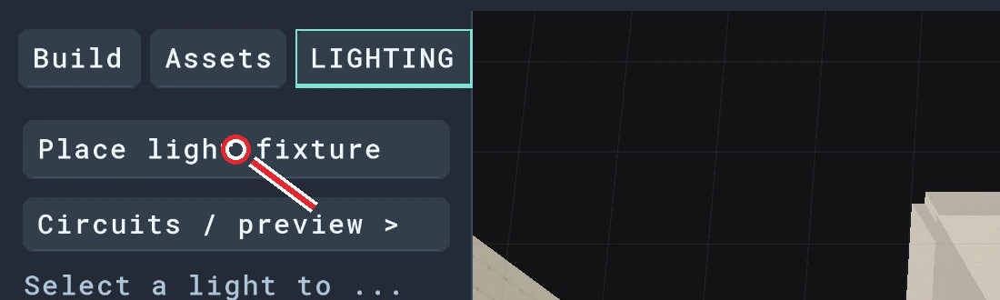

*Figure 17.1. Place a ceiling light by clicking the floor below it.*

**2.** Keep that new light selected. In the Lighting tab’s search field, enter `home:ceiling_light_round` and click the round fixture thumbnail. The selected light changes to the Home ceiling fixture.

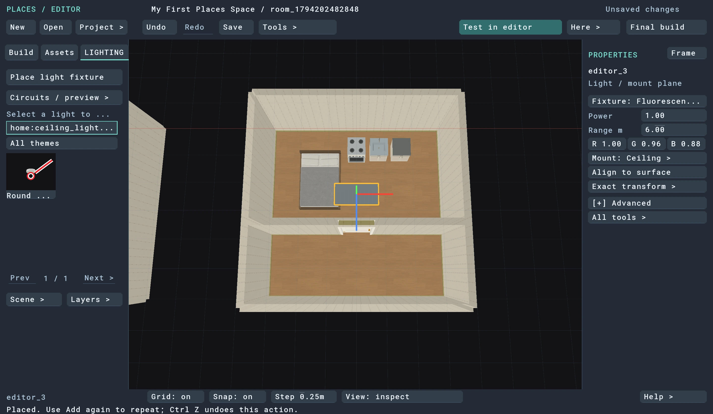

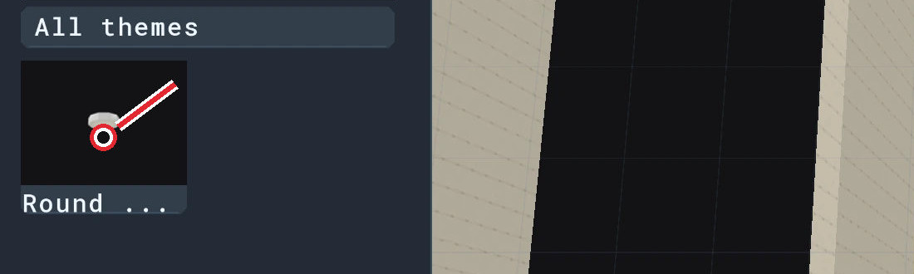

*Figure 17.2. With the new light selected, choose the Home fixture.*

**3.** Choose **Place light fixture** again and click the lobby floor halfway between the divider and front wall.

**4.** Search for `home:ceiling_light_round` again and choose it for this light too.

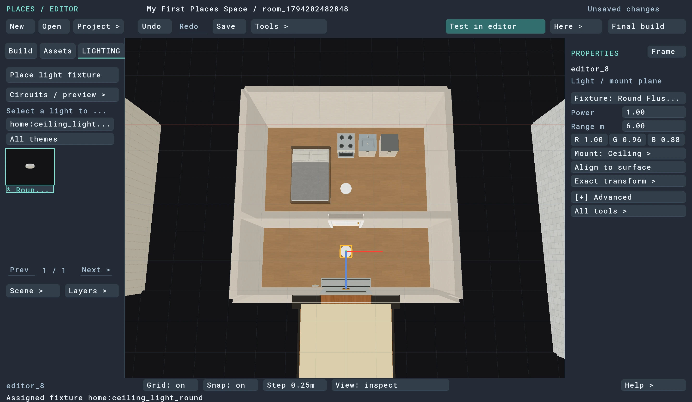

*Figure 17.3. A second light covers the lobby.*

**5.** Leave **Power 1.00** and the other light settings at their defaults. Save.

Use the Lighting tab for lights. A lamp model chosen from Props is furniture and does not, by itself, create illumination.

> **Checkpoint:** Home has two lights: one in the bedroom and one in the lobby.

[Back to chapter contents](#3-build-home)

---

[← Build Backrooms](02-backrooms.md) · [Build Pool →](04-pool.md)
