# 4. Build Pool

[Guide contents](../README.md) · [Download the complete PDF](https://github.com/csd113/Places/releases/download/v0.13.1/Beginners_Guide_to_Your_First_Places_Space.pdf)

In this chapter:

- [18. Create the Pool room before adding water](#step-18)
- [19. Draw all four Pool walls](#step-19)
- [20. Tile the room](#step-20)
- [21. Lower a patch of floor to make the basin](#step-21)
- [22. Fill the basin](#step-22)
- [23. Build the janitor closet and its door](#step-23)
- [24. Add the bench and rubber duck](#step-24)
- [25. Light the pool and stock the closet](#step-25)

## 18. Create the Pool room before adding water

**1.** Click clear Home floor so the room is selected. Choose **Build → Room**.

**2.** Set **West X to 20**. Keep **North Z 0**, **Width m 4**, **Depth m 6**, **Floor elevation m 0** and **Room height m 2.7**.

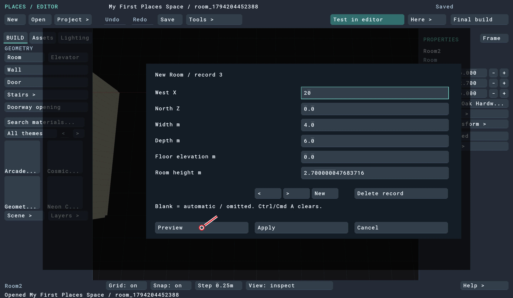

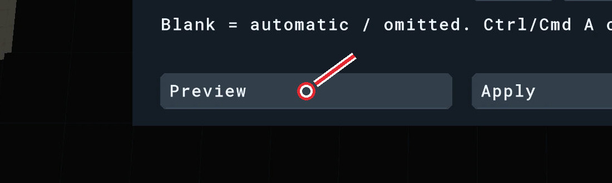

*Figure 18.1. Create a separate room at X 20, keeping the other starting values.*

**3.** Click **Preview**, then **Apply**. Press F to frame the new room and orbit to an overhead view.

**4.** Drag the yellow handle on the **right edge** outward until the width reads **8.00 m**. Release.

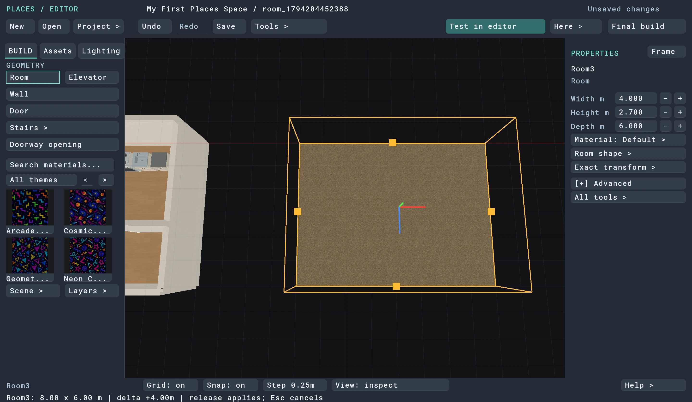

*Figure 18.2. Stretch the right edge to make the room 8 m wide.*

**5.** Drag the yellow handle on the **front edge** outward until the depth also reads **8.00 m**. Release.

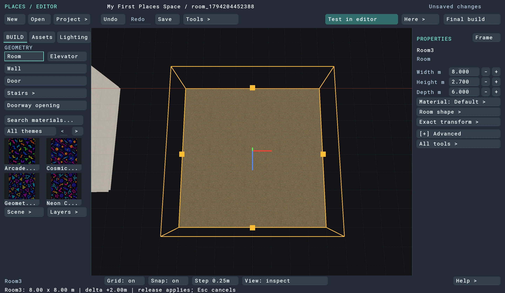

*Figure 18.3. Stretch the front edge to make it 8 m deep.*

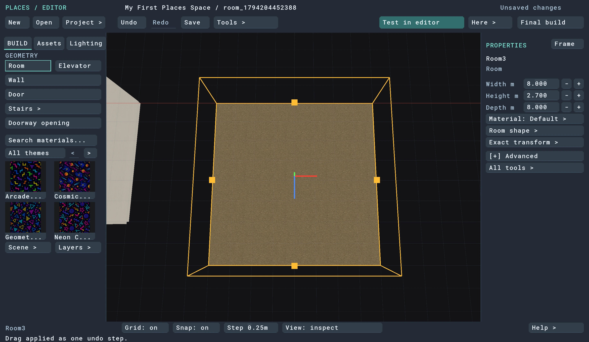

*Figure 18.4. The Pool room’s full footprint exists before we add walls or a basin.*

You should now have a large, empty 8 × 8 m floor with a ceiling above it. Keep it at the same floor height as the other rooms. There is no basin or water yet.

> **Checkpoint:** Pool is 8 × 8 m. Its floor is continuous and dry.

[Back to chapter contents](#4-build-pool)

---

## 19. Draw all four Pool walls

**1.** Keep the whole Pool floor visible. Zoom out a little if a corner is off-screen.

**2.** Choose **Build → Wall**, then turn **Chain** on.

**3.** Click the floor corners in order: **back left → back right → front right → front left → back left**.

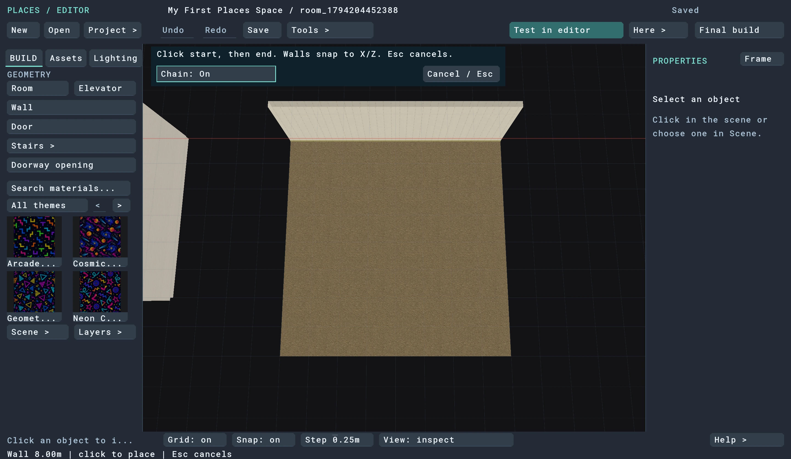

*Figure 19.1. Start the first wall along the back edge of the 8 m floor.*

**4.** Press Esc after the fourth wall. Each side should span the full 8 m edge.

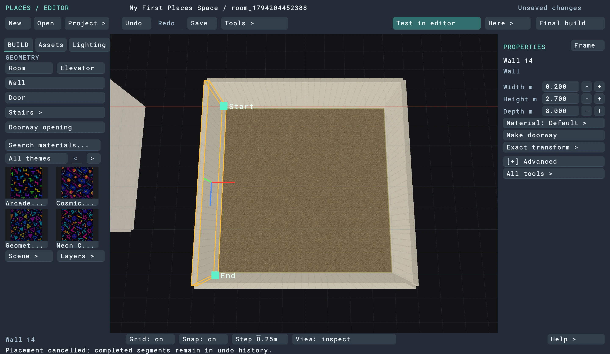

*Figure 19.2. The four walls completely enclose the Pool room.*

**5.** Orbit slightly to check the corners, then return to the overhead view.

Do this around the Pool floor, not the empty gap between rooms. The four walls form the Pool room’s outer shell. We’ll make the janitor closet inside this shell later.

> **Checkpoint:** Pool has a floor, ceiling and four outside walls. Save.

[Back to chapter contents](#4-build-pool)

---

## 20. Tile the room

**1.** Click empty Pool floor. Choose **Assets → Surface**, search for `core:pool_tile_deck_01`, and click the tile thumbnail.

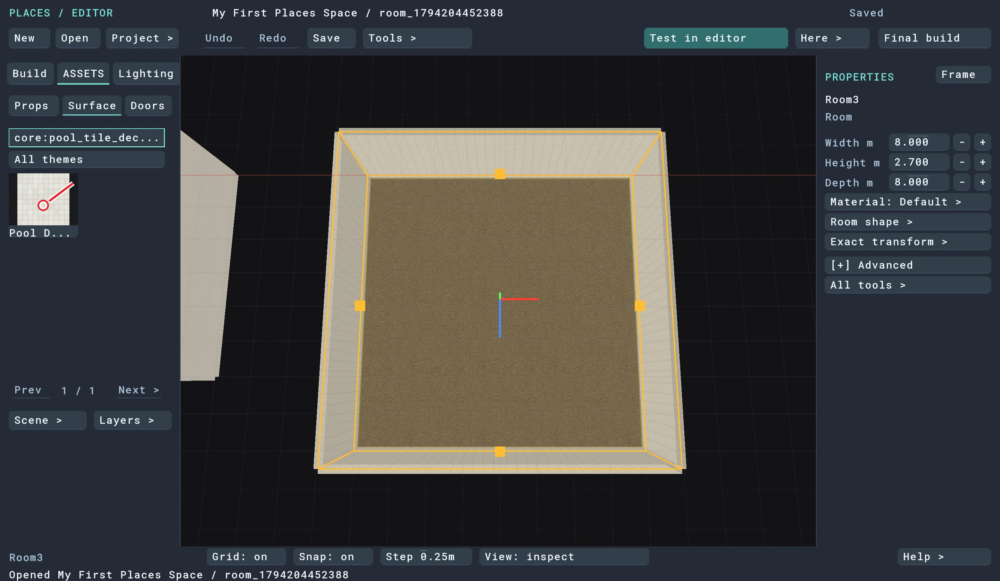

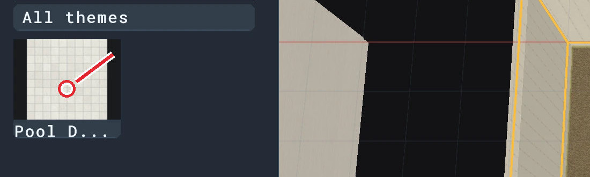

*Figure 20.1. Apply the deck tile to the room’s floor.*

**2.** With the room selected, open **Material: … >** in Properties. Switch the catalog target from **Surface** to **Ceiling**, search for `core:pool_ceiling_01`, and choose it.

*Figure 20.2. Choose the Pool ceiling material with Ceiling selected.*

**3.** Select a solid part of an outside wall. Check Properties says Wall. Open **Material: … >**, search for `core:pool_tile_wall_01`, and choose the wall tile.

**4.** Repeat for the other three outside walls. Save.

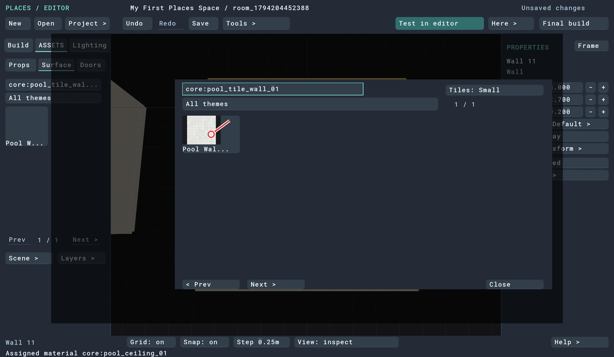

*Figure 20.3. Apply Pool wall tile through the selected wall’s Material button.*

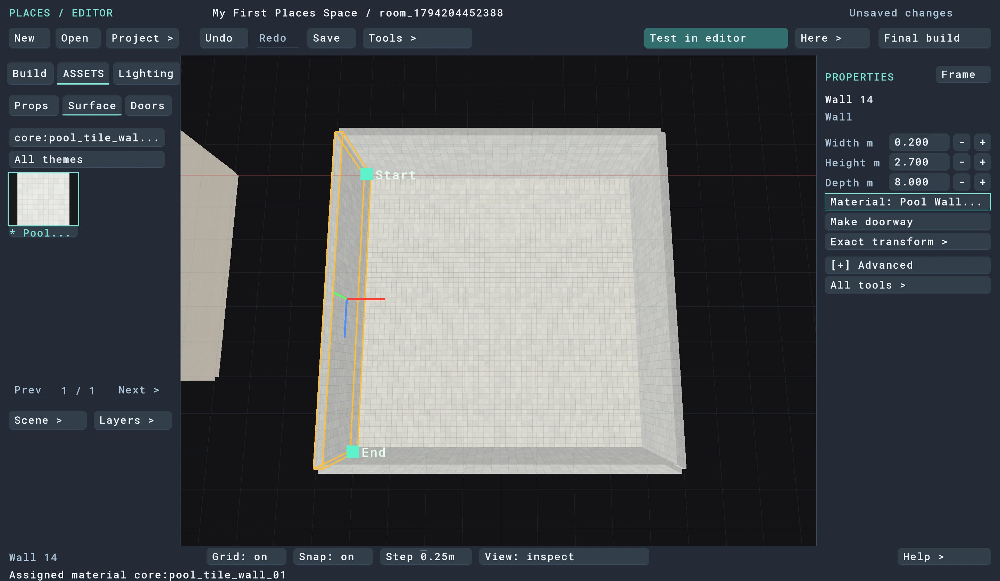

*Figure 20.4. The finished empty shell: floor, ceiling and four walls, with no basin yet.*

This is the last checkpoint before we cut the basin. Look around the empty room: the surrounding floor is the pool deck, not the pool itself.

> **Checkpoint:** The entire Pool room is built and tiled. Its floor is still flat and dry.

[Back to chapter contents](#4-build-pool)

---

## 21. Lower a patch of floor to make the basin

The basin is a recessed part of the existing floor. It has its own bottom and vertical tiled edges; you don’t need to build four tiny walls around it.

| Field | Value |
| --- | --- |
| X | 21.5 |
| Z | 2 |
| Width / Depth | 3 / 3 |
| Offset on ALL carriers | -0.4 |
| Surface material ID | `core:pool_tile_basin_01` |
| Edge material ID (next page) | `core:pool_tile_basin_01` |

**1.** Click **Tools > → Environment / space > → GLOBAL surface region**.

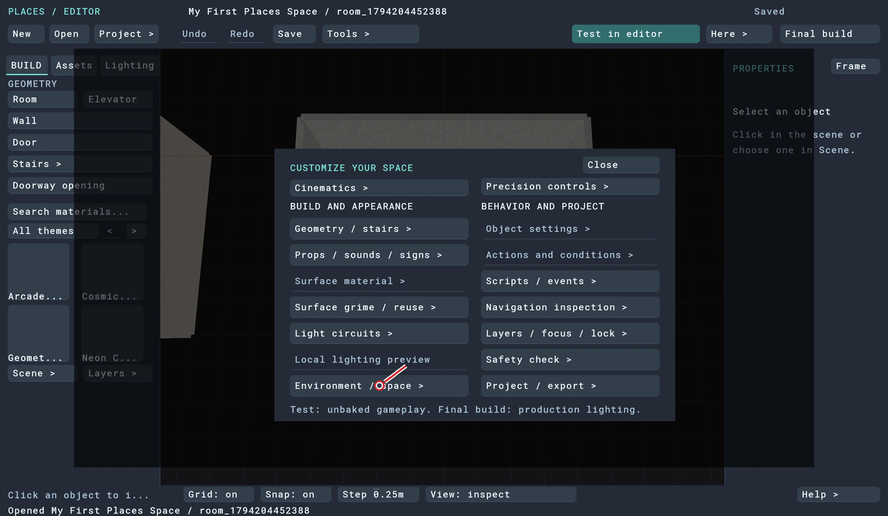

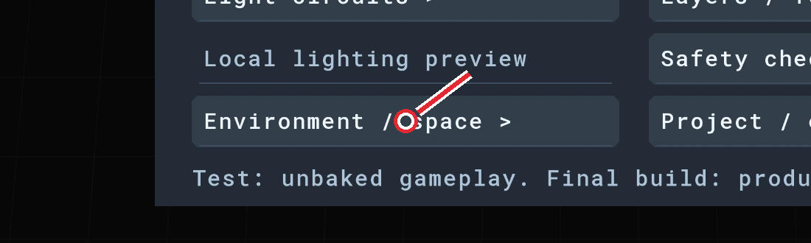

*Figure 21.1. Open Environment / space from Tools.*

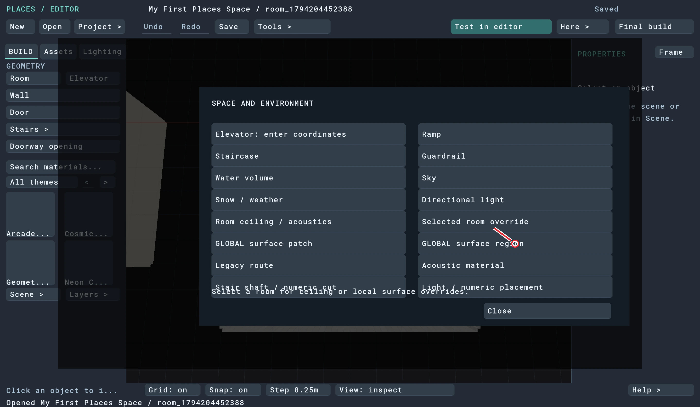

*Figure 21.2. Choose GLOBAL surface region.*

**2.** On the first page enter the values in the table. These place a 3 × 3 m basin toward the left side of the Pool room, leaving deck space around it.

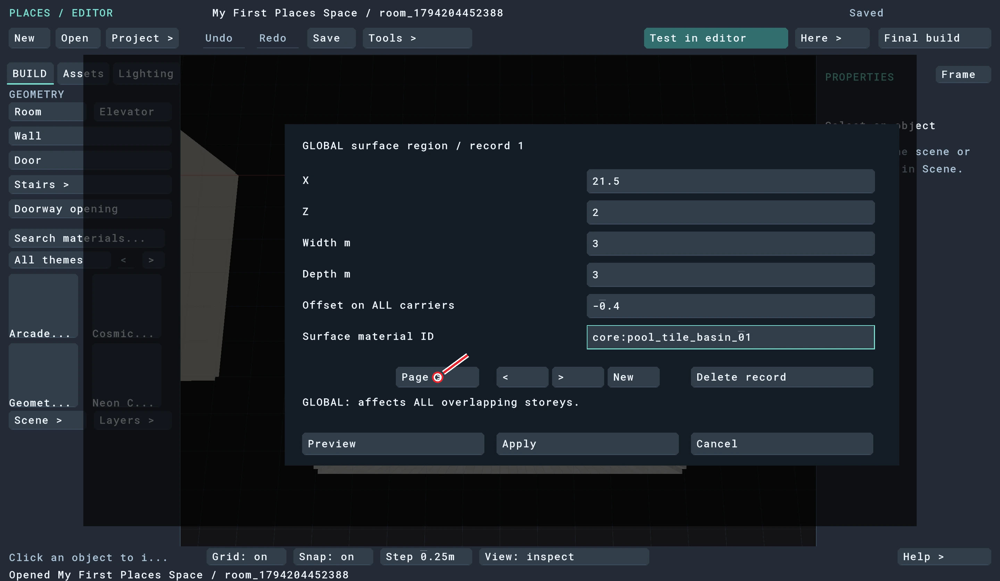

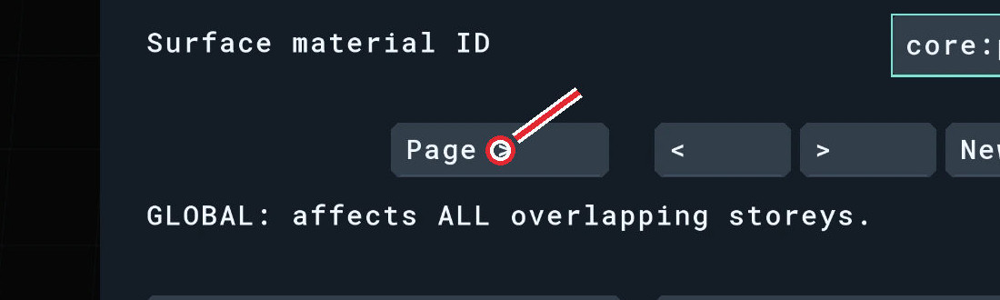

*Figure 21.3. Enter the basin footprint, depth and bottom material.*

**3.** Click **Page >** for the remaining field and enter the edge material.

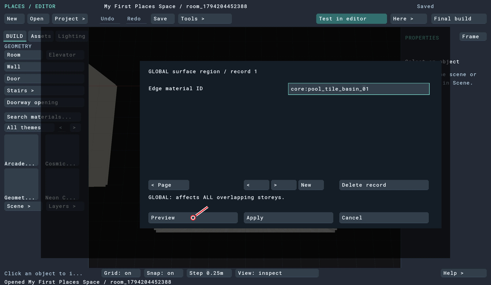

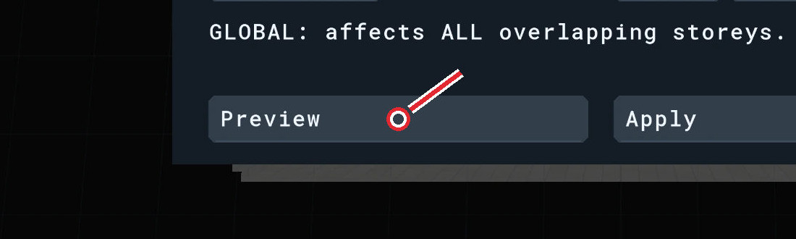

*Figure 21.4. Set the edge material too, then Preview.*

**4.** Click **Preview**. Check that the blue-tiled recess is entirely inside Pool, then click **Apply**.

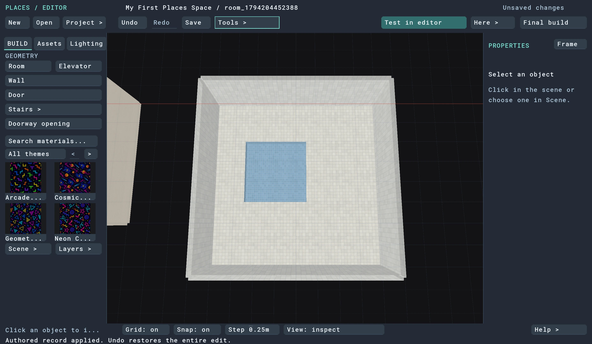

*Figure 21.5. The dry basin is real geometry. Check it before adding water.*

The negative offset lowers the floor by 40 cm. This tool is called GLOBAL because it affects every floor footprint underneath its rectangle. Our three rooms are separated, with no stacked storeys, so only Pool is affected.

> **Checkpoint:** There is a shallow, blue-tiled recess with visible vertical edges. It contains no water yet.

[Back to chapter contents](#4-build-pool)

---

## 22. Fill the basin

**1.** Open **Tools > → Environment / space > → Water volume**.

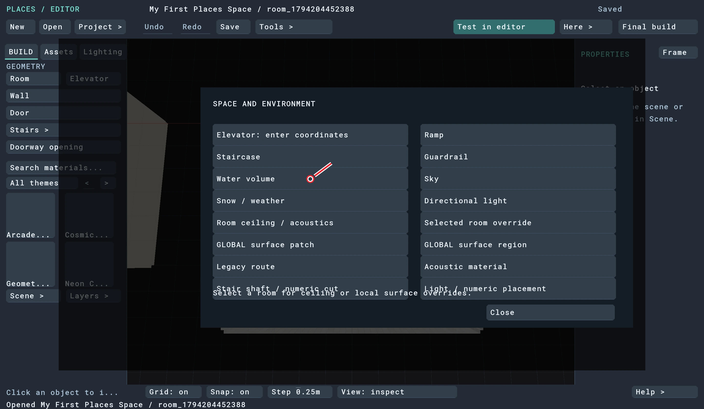

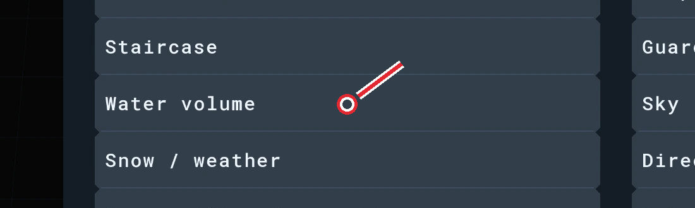

*Figure 22.1. Choose Water volume.*

**2.** Enter **X 21.5**, **Z 2**, **Width 3** and **Depth 3**. They must match the basin.

**3.** Set **World surface Y to -0.1** and **World bottom Y to -0.4**.

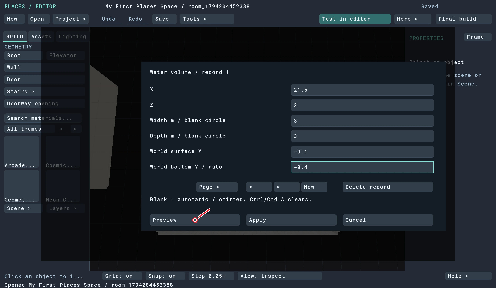

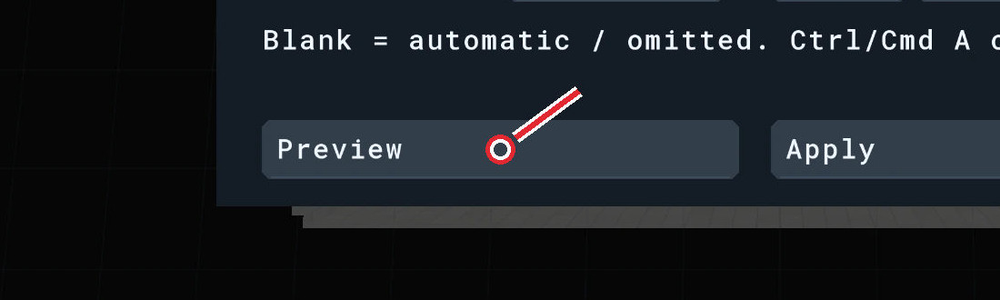

*Figure 22.2. Match the basin footprint and set the two water heights.*

**4.** Leave the remaining pages at their defaults. Click **Preview**, check the water is inside the recess, and click **Apply**.

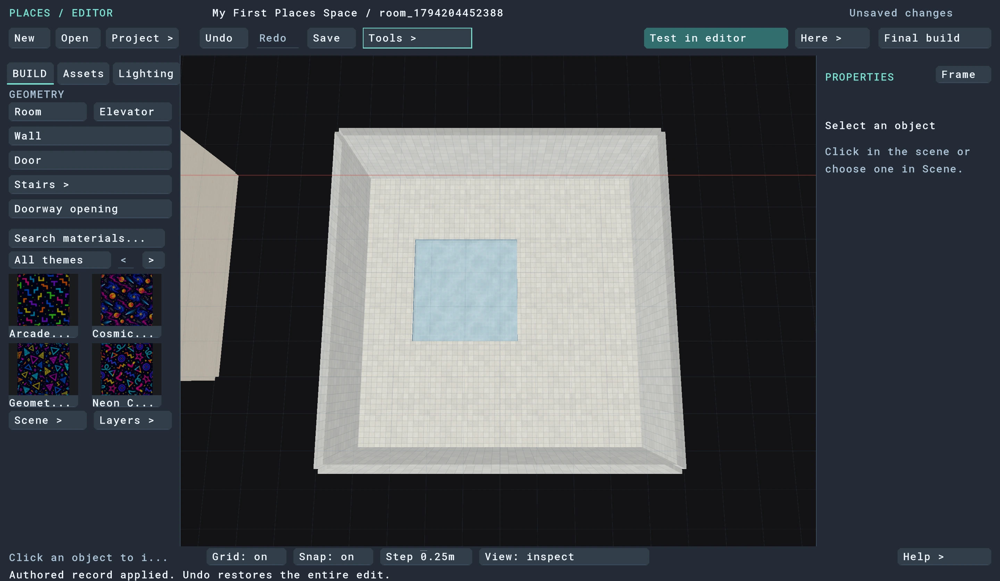

*Figure 22.3. The water now sits inside the tiled basin.*

**5.** Save.

The deck is at height 0. The water surface sits 10 cm below it, and the bottom matches the basin’s 40 cm depth. That leaves about 30 cm of water.

These matching form values are useful here: the water and basin edges need to agree. Water doesn’t dig a hole by itself, which is why we built and checked the dry basin first.

> **Checkpoint:** Water fills only the basin. The surrounding deck stays dry.

[Back to chapter contents](#4-build-pool)

---

## 23. Build the janitor closet and its door

Use the back-right corner of the Pool room. The existing back and right outside walls will form two sides of the closet.

**1.** Choose **Build → Wall**, with Chain off. Start on the back wall about **2½ m from the right edge**. Draw straight forward for about **2¾ m**.

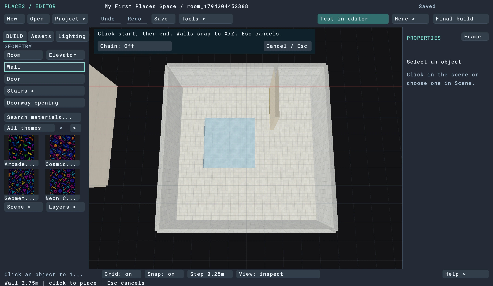

*Figure 23.1. Draw the closet’s left side forward from the back wall.*

**2.** Choose Wall again. From the front end of that wall, draw across to the right outside wall. These two new walls close a small rectangle in the corner.

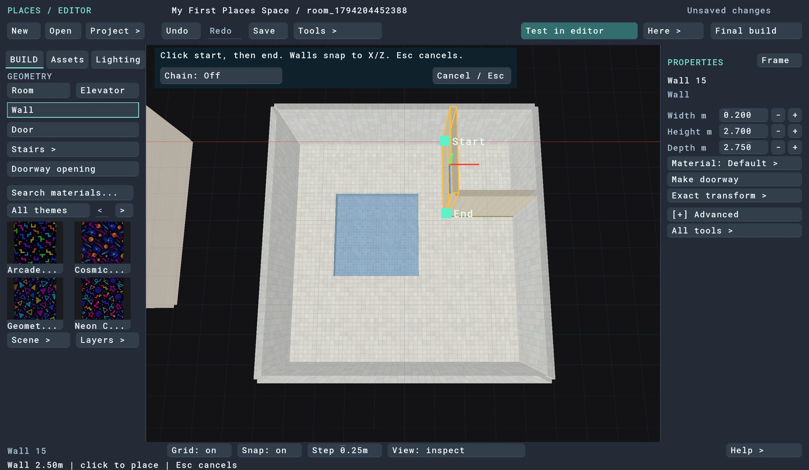

*Figure 23.2. Draw its front wall across to the outside wall.*

**3.** Choose **Build → Door**. Point at the middle of the new closet-front wall, check the preview, and click.

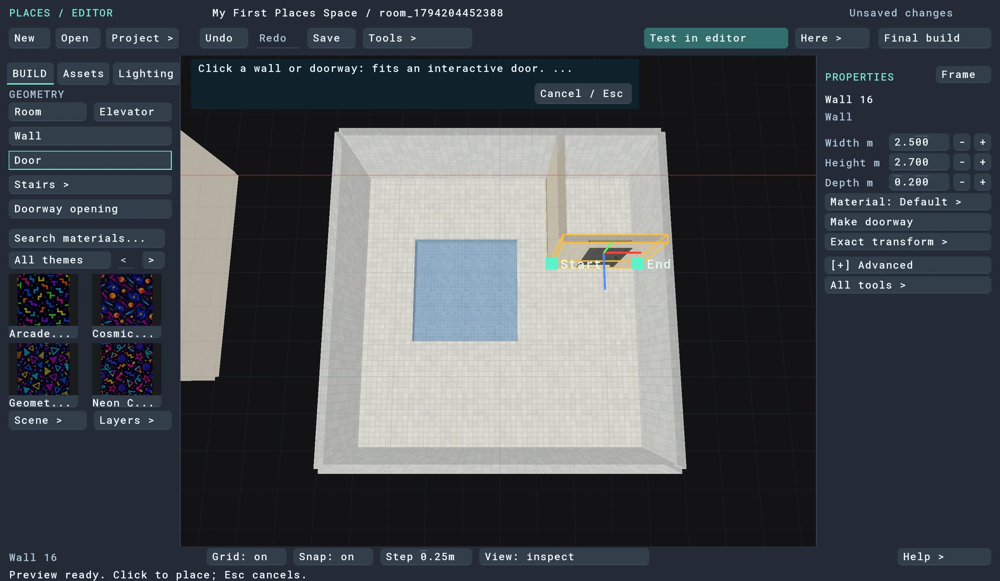

*Figure 23.3. Fit a door in the new front wall.*

**4.** Select solid parts of the two new walls, one at a time. Use **Material: … >** to apply `core:pool_tile_wall_01` to each.

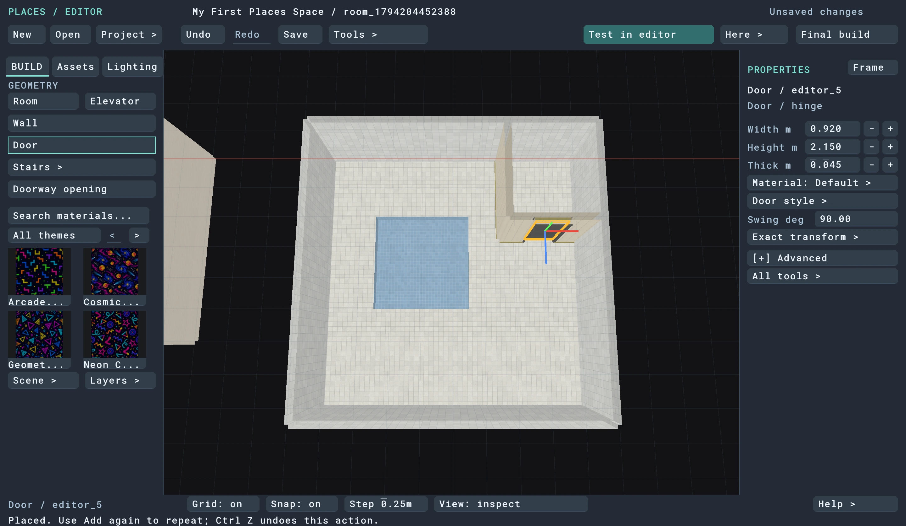

*Figure 23.4. The small corner enclosure is complete.*

The closet shares the Pool room’s floor and ceiling. It doesn’t need a second Room footprint laid over the same space.

> **Checkpoint:** The closet has four sides, a floor, a ceiling and one working door. It does not overlap the basin.

[Back to chapter contents](#4-build-pool)

---

## 24. Add the bench and rubber duck

**1.** Click the Pool floor to deselect the last wall. Choose **Assets → Props**, search for `pool:pool_bench`, and click **Pool Bench**.

**2.** Middle-drag until clear deck to the right of the pool is near the center of your view. Click **Place chosen prop**.

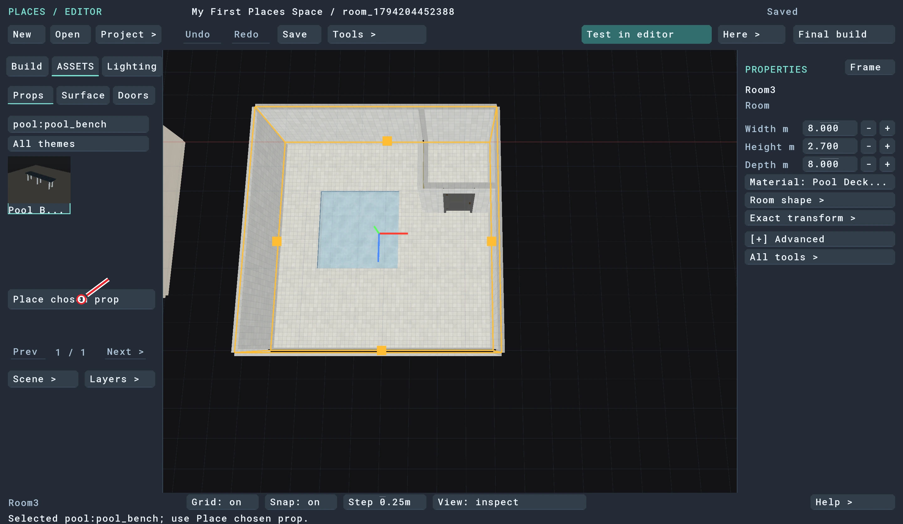

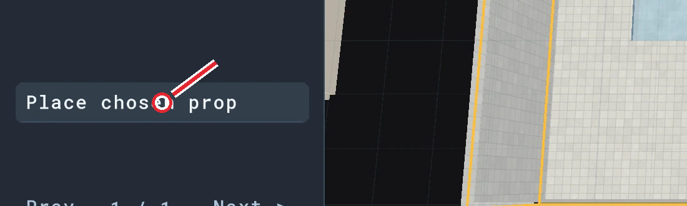

*Figure 24.1. Center a clear patch of deck before placing the bench.*

**3.** In Properties set **Yaw deg to 90**. The bench’s long side should now run along the right-hand wall. Move it with the red and blue handles if necessary, leaving space around it.

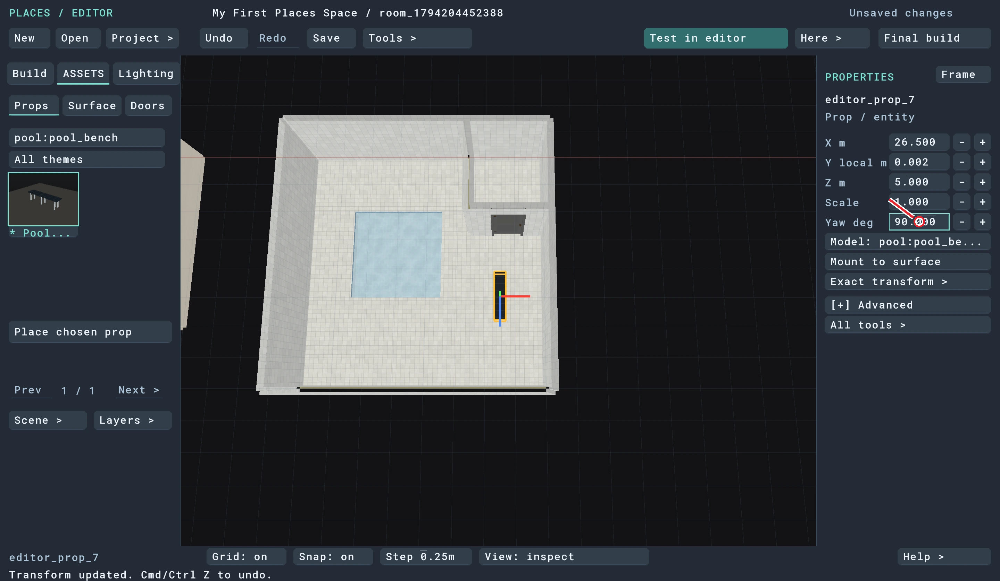

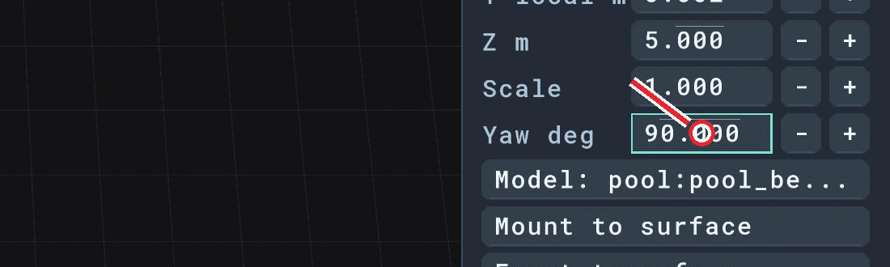

*Figure 24.2. Turn the bench 90 degrees.*

**4.** Click clear floor before choosing the next model. Search Props for `core:rubber_duck` and click the duck thumbnail.

**5.** Pan so a clear patch of deck just beside the bench is centered, then click **Place chosen prop**. Adjust with the handles if needed.

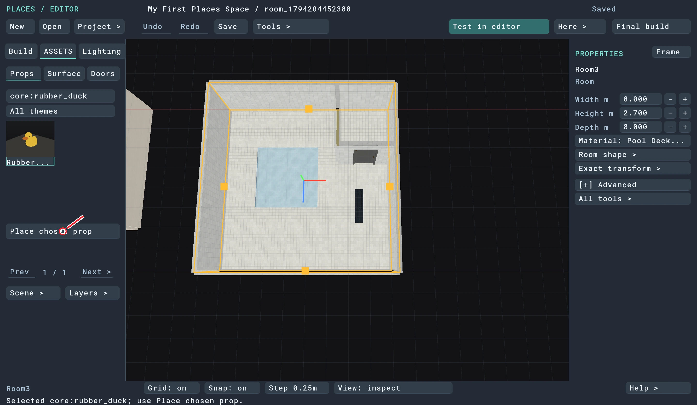

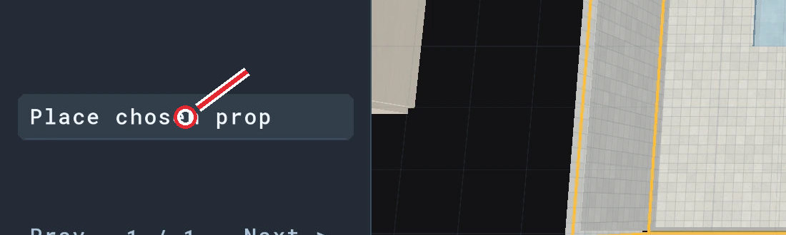

*Figure 24.3. Deselect the bench before choosing the duck, then place it on clear deck.*

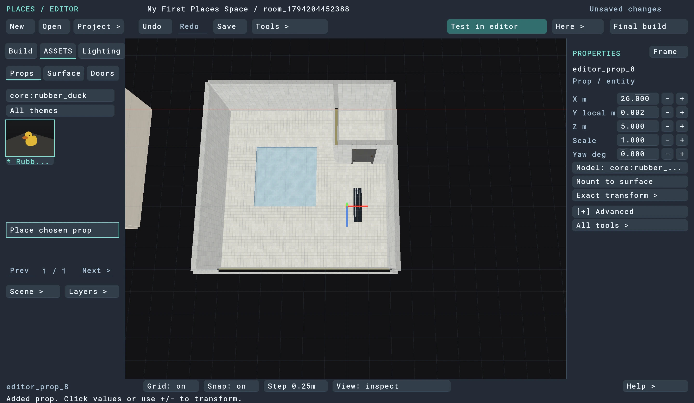

*Figure 24.4. The duck sits beside the bench.*

We’re placing the duck on the deck beside the bench. Its default size is small, so zoom in to check that it isn’t hidden under the bench.

> **Checkpoint:** A bench and a visible rubber duck sit on the dry deck, with a clear path around the pool.

[Back to chapter contents](#4-build-pool)

---

## 25. Light the pool and stock the closet

**1.** Click **Lighting → Place light fixture**, then click near the center of the basin. This still mounts the light to the room’s ceiling.

**2.** With the light selected, search the Lighting catalog for `core:pool_light_round` and click its thumbnail.

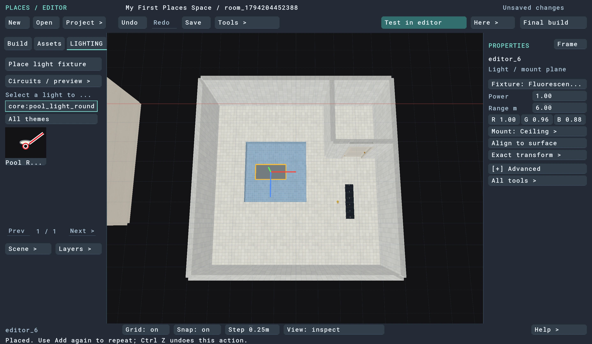

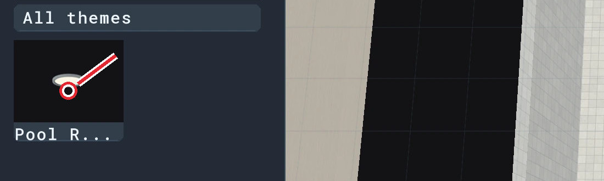

*Figure 25.1. Choose the Pool light fixture for each of the three new lights.*

**3.** Repeat the same two actions for a light above the **closet**, then another above the **front-right deck**. Keep Power at 1.00.

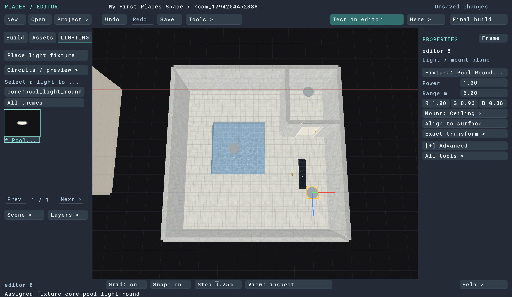

*Figure 25.2. The main pool, closet and front deck each have a light.*

**4.** Click clear Pool floor. In **Assets → Props**, search for `janitor:mop_wringer_bucket` and choose **Mop Wringer Bucket**.

**5.** Pan so clear floor near the back of the closet is centered, then click **Place chosen prop**. Keep it out of the door’s swing area.

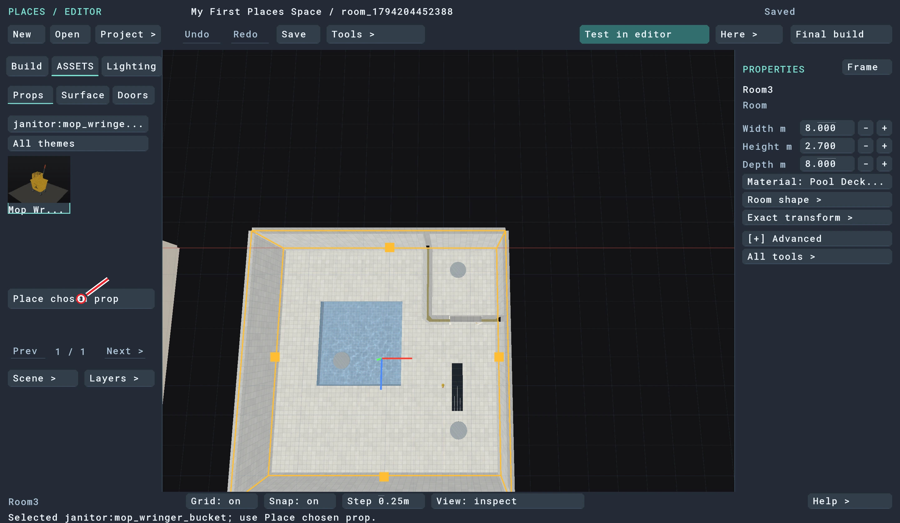

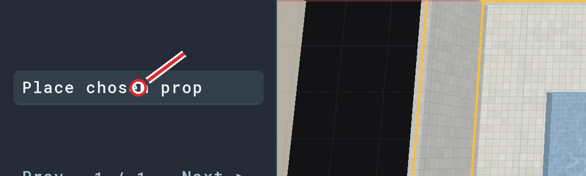

*Figure 25.3. Center clear closet floor before placing the bucket.*

**6.** Save.

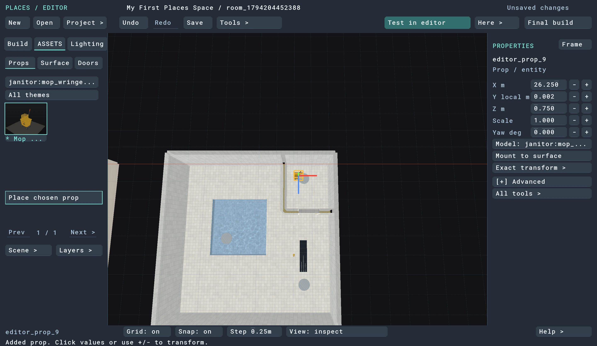

*Figure 25.4. The bucket gives the closet its janitor-room purpose.*

To select the Pool room again, click dry deck away from a prop or wall. The closet floor belongs to that same room.

> **Checkpoint:** Pool has three ceiling lights, a fitted closet door, a mop bucket, a bench and a duck. The basin and deck remain clear.

[Back to chapter contents](#4-build-pool)

---

[← Build Home](03-home.md) · [Connect the elevators →](05-elevators.md)
