# 5. Connect the elevators

[Guide contents](../README.md) · [Download the complete PDF](https://github.com/csd113/Places/releases/download/v0.13.1/Beginners_Guide_to_Your_First_Places_Space.pdf)

In this chapter:

- [26. Give each room an elevator cabin](#step-26)
- [27. Link the three stops](#step-27)

## 26. Give each room an elevator cabin

The cabins sit behind the front walls. We’ll give each one a name, then connect them. All three rooms are on the same floor; the linked cabins let you travel between separate locations.

**1.** Zoom out until you can see Backrooms again. Click its lobby floor and press F. Keep the overhead view and tilt it slightly if needed so you can point at the **inside face of its front outside wall**.

**2.** Choose **Build → Elevator**. Point near the middle of that front wall, well away from the corners.

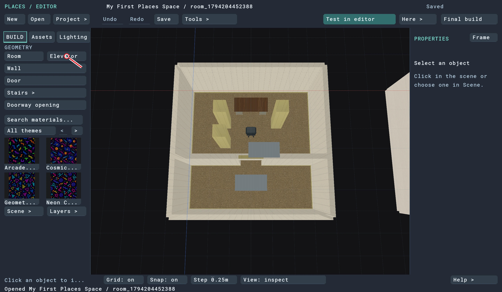

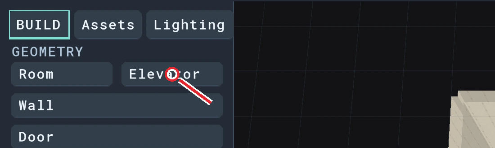

*Figure 26.1. Choose Elevator in the Build tab.*

**3.** Check the preview: the entrance faces the lobby and the cabin extends behind the wall. Click to place it.

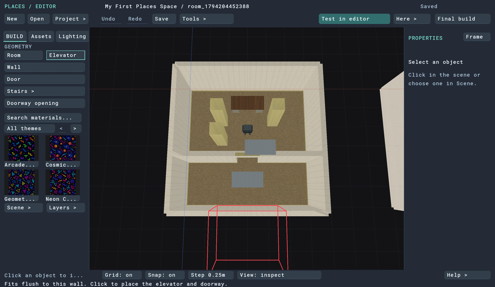

*Figure 26.2. The entrance faces into Backrooms; the cabin extends behind the wall.*

**4.** In the panel that opens, click **Name**, select all, type **Backrooms**, and press Return. Close the panel.

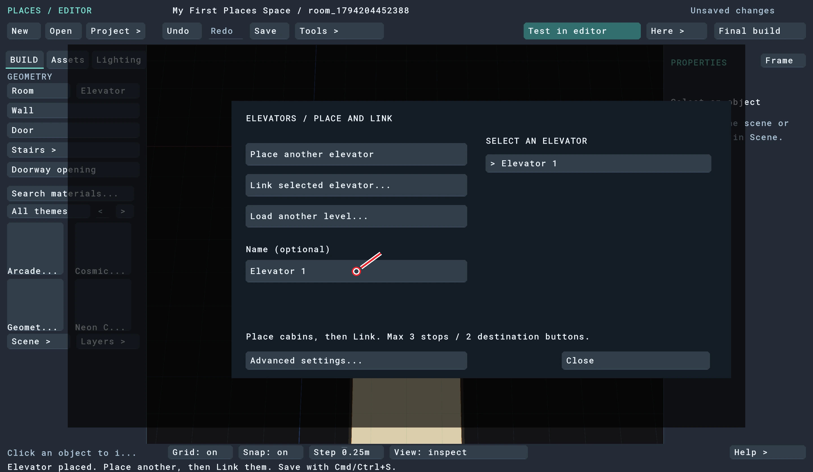

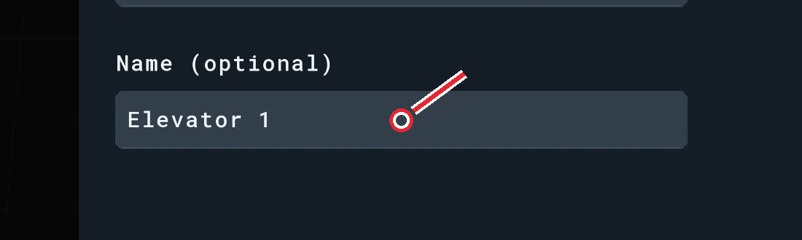

*Figure 26.3. Name this stop before closing the panel.*

**5.** Repeat on **Home’s front outside wall**. Name that cabin **Home**.

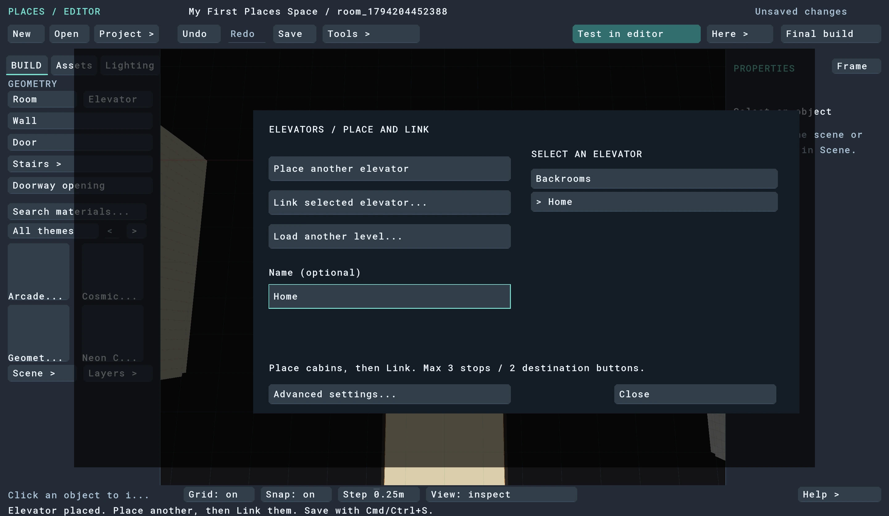

*Figure 26.4. Repeat in Home, using the name Home.*

**6.** Repeat on **Pool’s front outside wall**. Name that cabin **Pool**. Keep it clear of the basin and the bench.

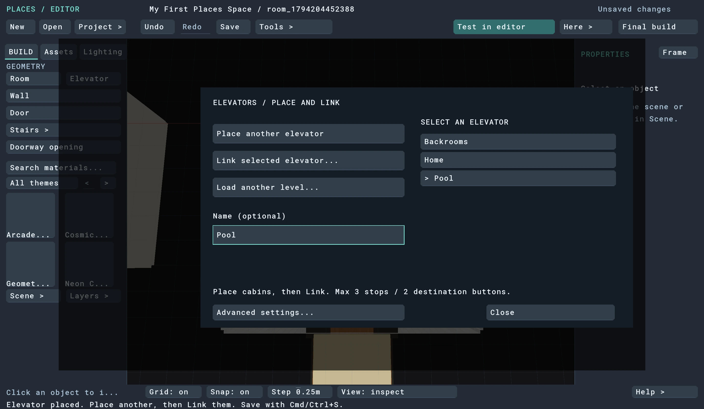

*Figure 26.5. Repeat in Pool, using the name Pool.*

Use the outside front wall, not the internal divider or closet wall. If the preview is on the wrong side, press Esc, tilt the view to see the inside face and start Elevator again. Don’t place it until the entrance faces the room.

> **Checkpoint:** You have exactly three cabins, named Backrooms, Home and Pool. Save.

[Back to chapter contents](#5-connect-the-elevators)

---

## 27. Link the three stops

**1.** Return your view to the Backrooms cabin. Choose **Build → Elevator**, then click the existing cabin to open its panel. Check that the selected name is **Backrooms**.

**2.** Click **Link selected**. The panel closes so you can pick a destination in the scene.

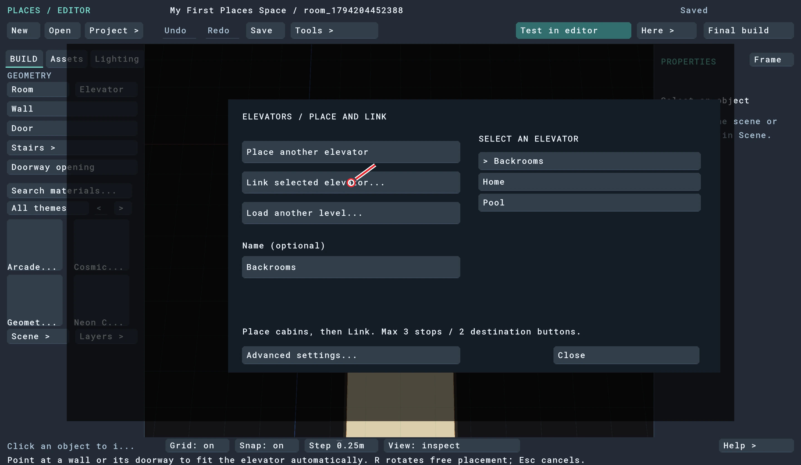

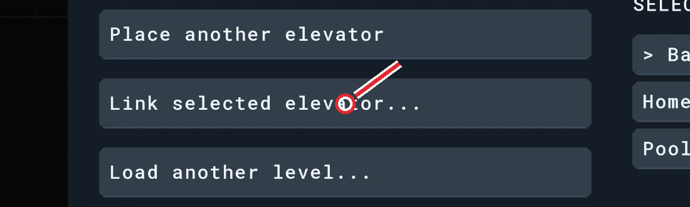

*Figure 27.1. Select Backrooms, then Link selected.*

**3.** Pan or zoom over to Home and click its existing elevator cabin. The link is made in both directions, and the panel opens again.

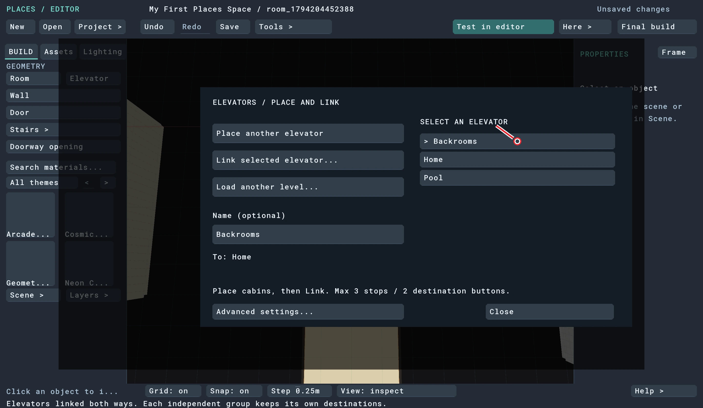

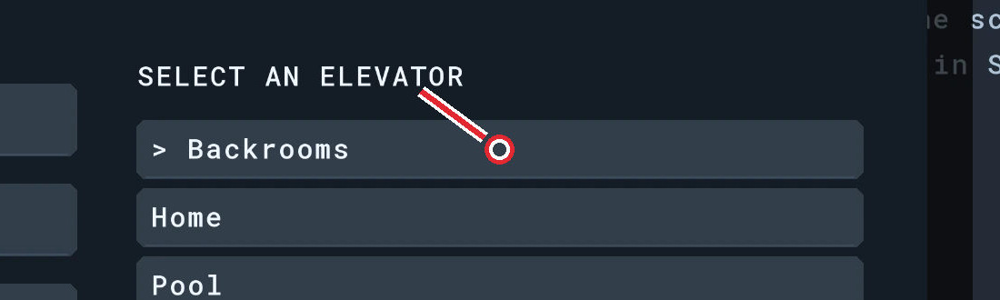

*Figure 27.2. After linking Home, select Backrooms in the cabin list.*

**4.** In the cabin list, click **Backrooms** to select it again, then click **Link selected**.

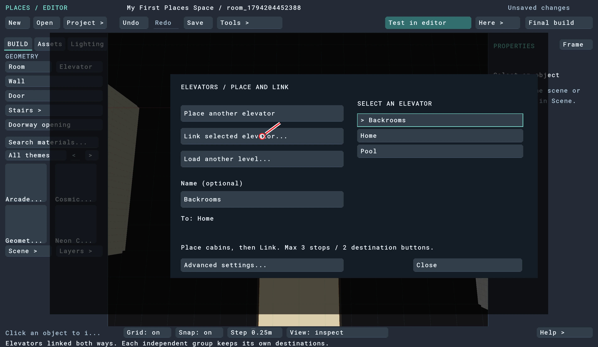

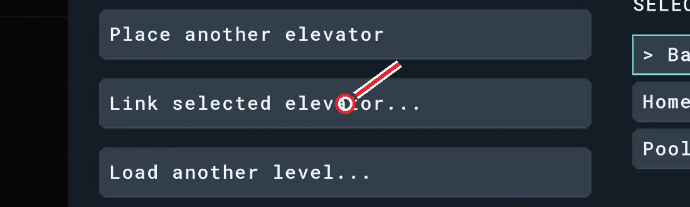

*Figure 27.3. Link selected again, this time to Pool.*

**5.** Pan or zoom over to Pool and click its cabin.

**6.** Check the panel lists all three named stops. Close it and save.

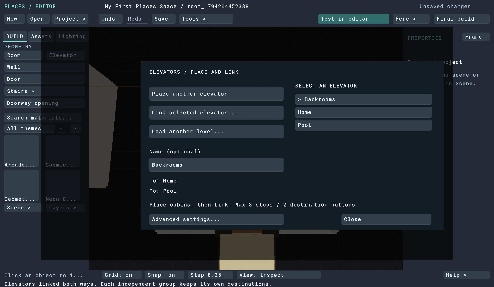

*Figure 27.4. The completed group contains all three stop names.*

These links join the cabins into one group, so each cabin can reach the other two. You don’t need to build an extra Home–Pool link or create another elevator.

> **Checkpoint:** Each cabin offers the other two rooms as destinations. Save, close and reopen the project to confirm the links were kept.

[Back to chapter contents](#5-connect-the-elevators)

---

[← Build Pool](04-pool.md) · [Build, export and play →](06-play.md)
