# 6. Build, export and play

[Guide contents](../README.md) · [Download the complete PDF](https://github.com/csd113/Places/releases/download/v0.13.1/Beginners_Guide_to_Your_First_Places_Space.pdf)

In this chapter:

- [28. Take your first walk](#step-28)
- [29. Build the finished lighting](#step-29)
- [30. Export a package you can play](#step-30)
- [31. Bring the package into Places](#step-31)
- [32. Try the whole route](#step-32)
- [33. Keep your work and make it yours](#step-33)

## 28. Take your first walk

**1.** Click **Save**, then **Test in editor** in the top bar, or press `⌘P` / `Ctrl P`.

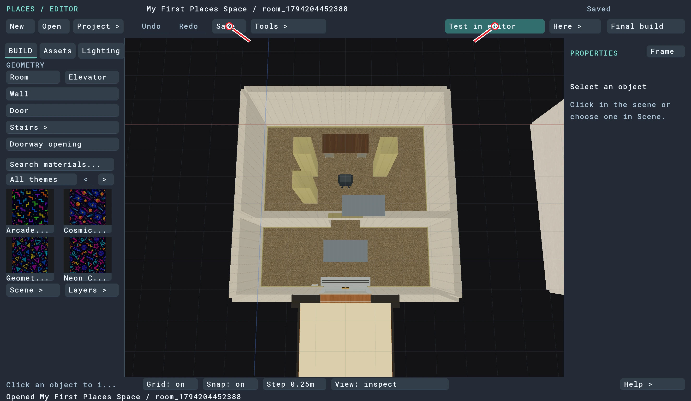

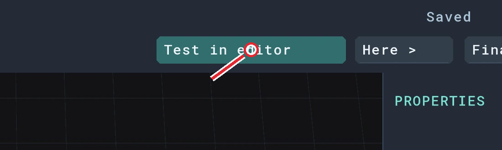

*Figure 28.1. Save first, then Test in editor.*

**2.** Wait for the first-person view. You start in the Backrooms lobby.

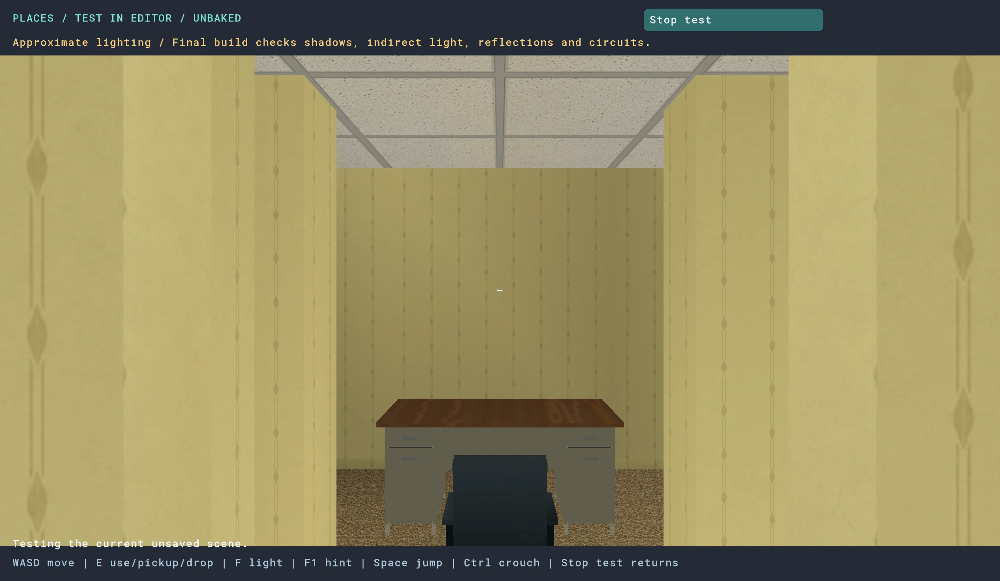

*Figure 28.2. The starter position is in the Backrooms lobby.*

**3.** Use **W, A, S, D** to walk and the mouse to look around. Walk through the open doorway, around the pillars, and up to the desk and chair.

**4.** Press **E** while looking at an interactive door or elevator control. Give swinging doors room to move before walking through.

**5.** Press **Esc** when you’re ready to return to the editor.

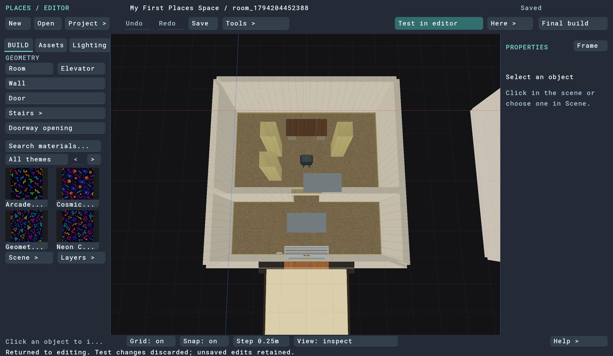

*Figure 28.3. Esc returns you to your editable scene.*

Take this first walk slowly. You can reach everything in this space without jumping.

Test in editor uses a temporary snapshot and approximate, unbaked lighting. Your bright overhead editing view also uses an inspection light. Judge the finished lighting in the built player version below.

> **Checkpoint:** You can walk through the Backrooms passage without getting caught on a pillar or piece of furniture.

[Back to chapter contents](#6-build-export-and-play)

---

## 29. Build the finished lighting

**1.** Stop the first-person test with Esc.

**2.** Click **Final build** at the upper right. It saves changed source and prepares the selected level.

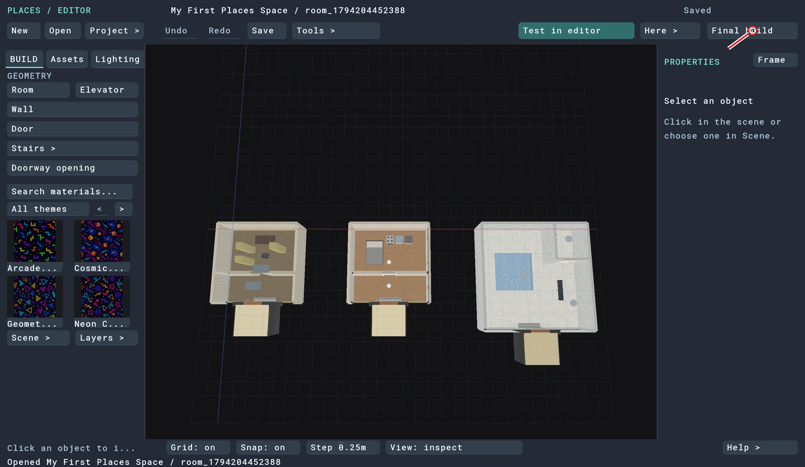

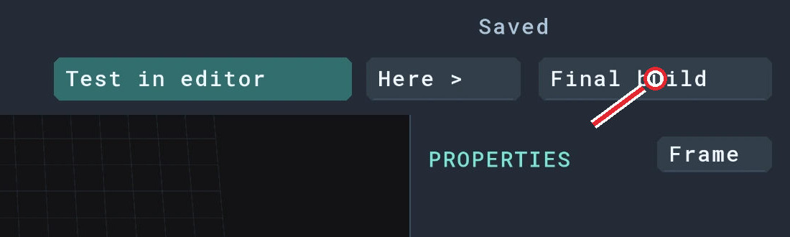

*Figure 29.1. Final build is at the upper right.*

**3.** Wait for the bottom status line to say **Build succeeded**.

*Figure 29.2. Wait for the explicit success message.*

The progress bar belongs to the current stage, so it can fill up and start again as the compiler moves on. That doesn’t mean it has restarted the entire job. Leave the editor running until it reports success.

If it reports an error, read the message and fix the problem before continuing. A previous successful package is not proof that your latest changes built.

> **Checkpoint:** The status line reports a successful final build of the current scene.

[Back to chapter contents](#6-build-export-and-play)

---

## 30. Export a package you can play

**1.** Click **Project > → Export all levels + sources**.

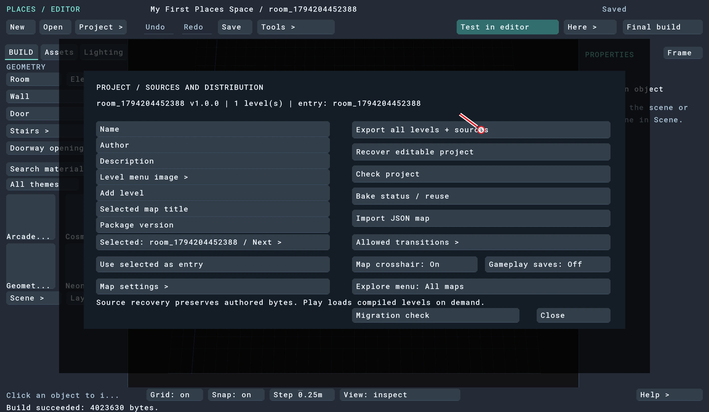

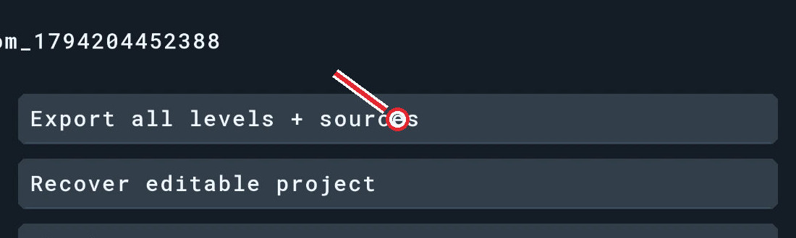

*Figure 30.1. Choose Export all levels + sources.*

**2.** Enter a full destination path ending in `.placesmap`, in an existing folder you can write to. For example, on Mac use `/Users/your-name/Documents/first-space.placesmap`; on Windows use `C:/Users/your-name/Documents/first-space.placesmap`. Replace `your-name` with your account folder.

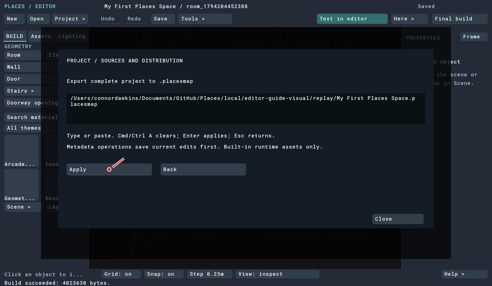

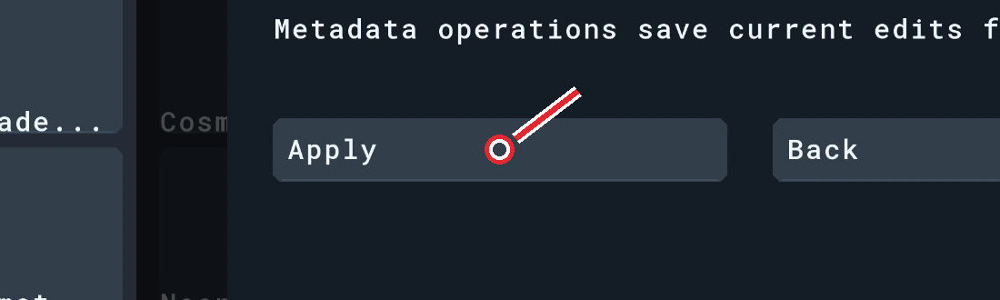

*Figure 30.2. Enter your own full path, then Apply.*

**3.** Click **Apply** and wait for the export to succeed. The panel closes while it works.

*Figure 30.3. Wait for the export’s success message.*

The exported `.placesmap` is the file you import into the game. Keep the original project folder too—it’s the easiest place to continue editing.

Final build prepares the selected level. Export all levels + sources creates the complete project package and includes editable sources. For this tutorial, the three rooms are all inside one level.

> **Checkpoint:** Your destination folder contains the exported .placesmap file.

[Back to chapter contents](#6-build-export-and-play)

---

## 31. Bring the package into Places

**1.** Open the game: **Places.app** on Mac, or **places.exe** in the Windows Places folder. The Mac portable player executable is **places**.

**2.** Choose **Explore**. A fresh installation may already show the empty Explore library.

**3.** Choose **Import folder**. Finder or File Explorer opens the game’s import folder.

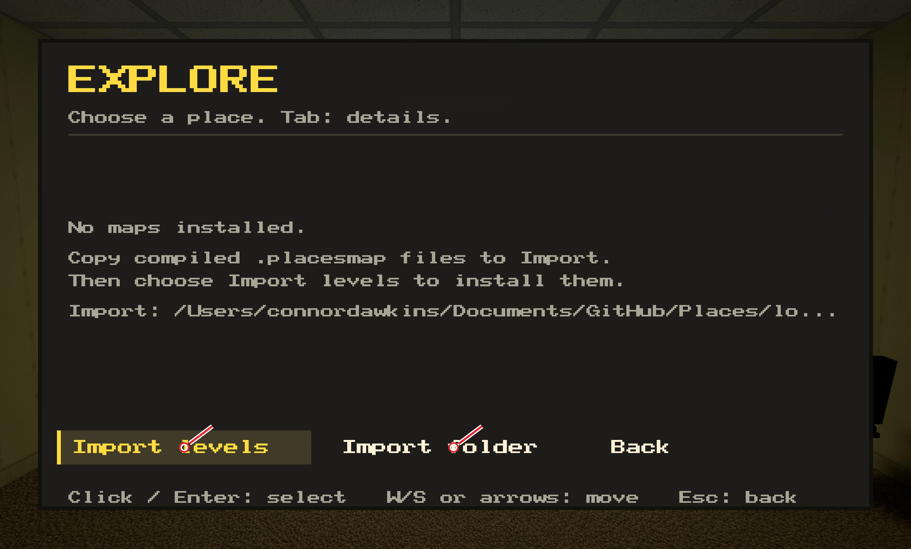

*Figure 31.1. Open the import folder, then return here and choose Import levels.*

**4.** Copy your exported `first-space.placesmap` into that folder. Keep your original export as well.

**5.** Return to Places and choose **Import levels**.

**6.** When **My First Places Space** appears, select its card to start playing.

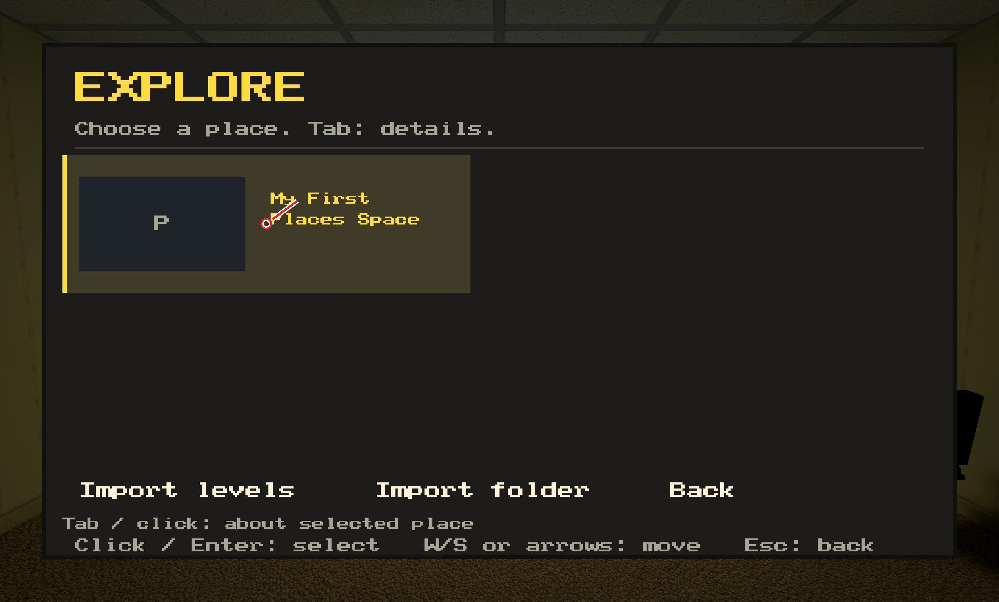

*Figure 31.2. Select the imported space’s card to play.*

Import levels reads the import folder; it isn’t a file-picker button. If it says no new maps were found, check that the exported `.placesmap`—not the editable project folder—is in the folder opened by Import folder.

> **Checkpoint:** The game loads your Backrooms lobby from the exported package.

[Back to chapter contents](#6-build-export-and-play)

---

## 32. Try the whole route

**1.** Walk around Backrooms and through its open doorway. Check the desk, chair and three pillars leave a comfortable path.

**2.** Return to the lobby. Open the elevator with its entrance control if necessary, then walk fully inside.

**3.** Turn toward the button panel beside the cabin entrance. Aim at the buttons until the on-screen prompt reads **Floor: Home**, then use that control by pressing **E** or left-clicking. Step clear of the doorway and let the doors close and the ride finish.

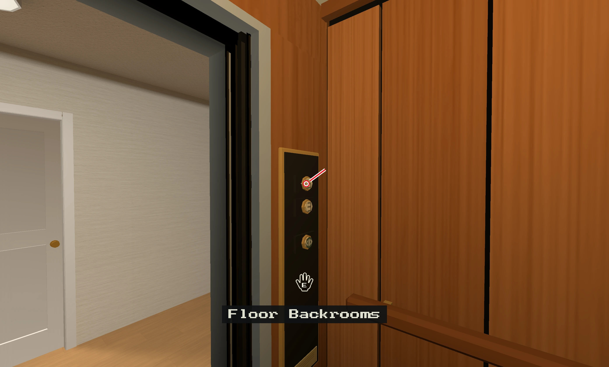

*Figure 32.1. Inside a cabin, aim at a destination button to read its floor name. This example shows Backrooms from Home.*

**4.** Leave the Home cabin, open the bedroom door with E, and walk inside. Look at the bed and kitchen. If the door swings toward you, step back, wait for it to open, then line up with the middle of the opening.

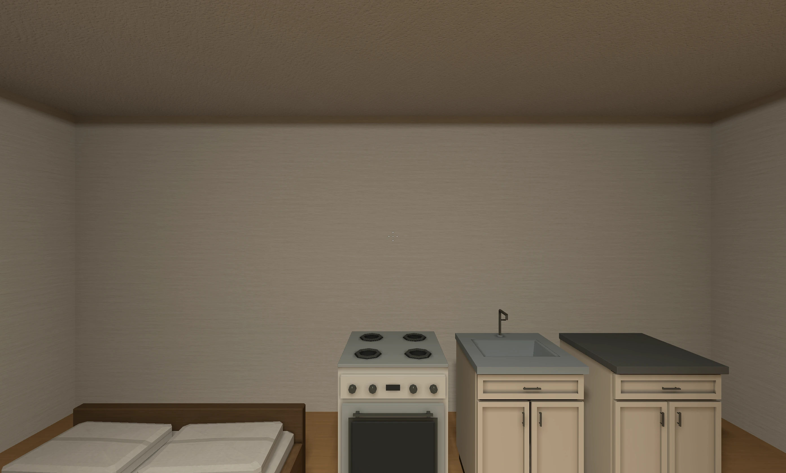

*Figure 32.2. Open the Home door and walk into the bedroom.*

**5.** Use Home’s elevator to visit **Pool**. Walk along the deck between the basin and bench, then turn toward the closet door. Open it and check that you can enter. Find the bucket, bench and duck.

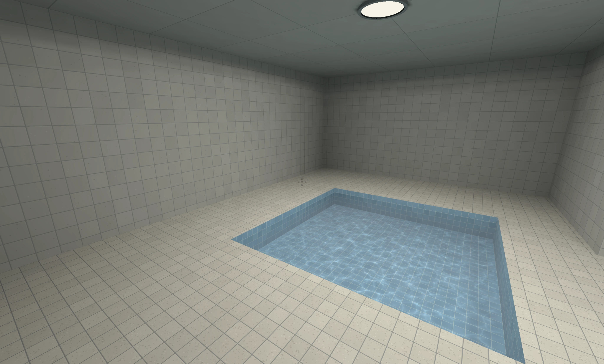

*Figure 32.3. Inspect the shallow basin and the paths around it.*

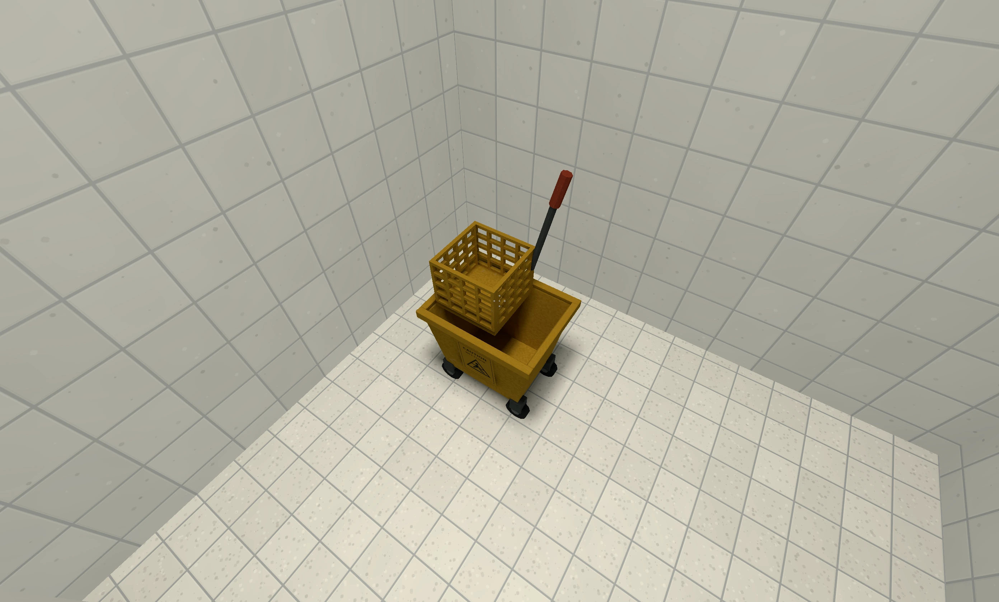

*Figure 32.4. Walk around the bench to reach the closet, open the door and step inside.*

**6.** Walk down into the shallow pool and back onto the deck. You should not need to jump to get out.

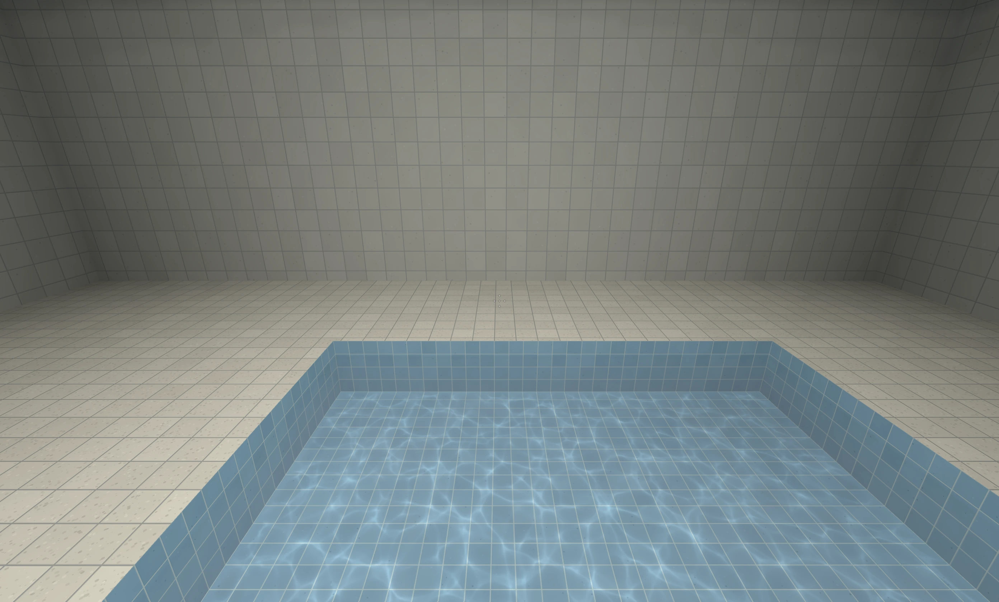

*Figure 32.5. Walk down into the shallow basin, then back onto the deck.*

**7.** Ride back to **Backrooms**. Try the remaining return trips too.

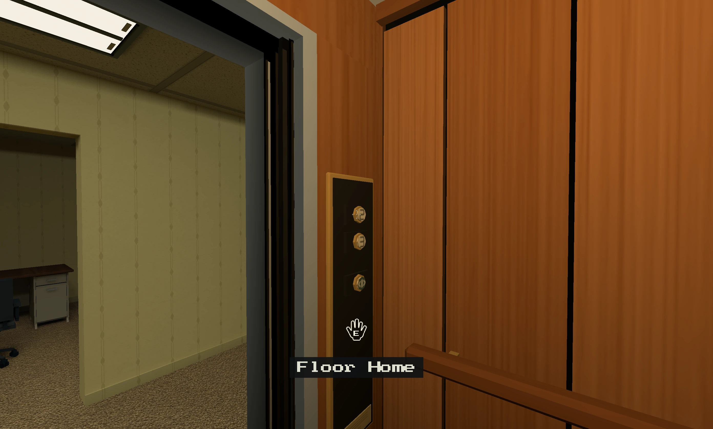

*Figure 32.6. Finish by returning to Backrooms.*

The green door-arrow control opens or closes the doors at the current stop. To travel, aim at a destination button and read the floor name in the on-screen prompt before you use it. If the doors keep reopening, move farther inside the cabin so you’re clear of the doorway.

> **Checkpoint:** You can reach every room, use both doors, enter and leave the pool, and return to where you started.

[Back to chapter contents](#6-build-export-and-play)

---

## 33. Keep your work and make it yours

Save the editor project whenever you finish a section. To return later, launch the editor, click **Open**, and choose the project folder containing `places.project.json`. Don’t select the exported .placesmap in this folder chooser.

Back up the **whole project folder**, including its `levels` folder. If you make changes, repeat Final build and Export, then import the new package into the game before judging the finished result.

You now know the core workflow: create a floor and ceiling, draw walls, cut openings or fit doors, choose surfaces, place props and lights, connect cabins, then test and export. Try moving the furniture, changing a material, or adding another light. Save a copy of the project first if you want to keep this first version.

*Figure 33.1. Your first space: three rooms linked by one elevator group.*

> **Checkpoint:** Keep the editable project and exported package in places you can find again.

[Back to chapter contents](#6-build-export-and-play)

---

[← Connect the elevators](05-elevators.md) · [Troubleshooting →](07-help.md)
