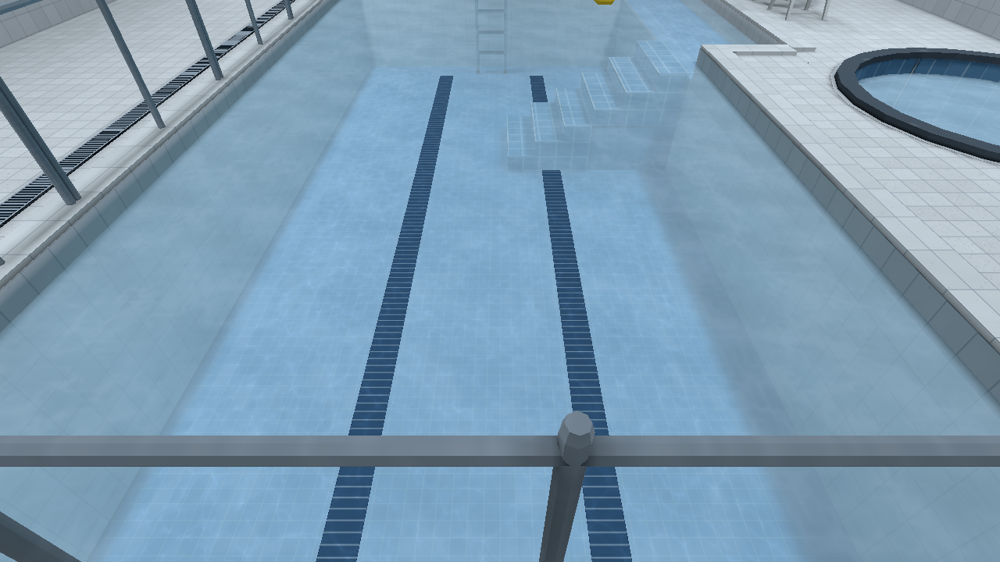

# Source-aware Pool caustics — 0.11.0

Issue [#19](https://github.com/csd113/Places/issues/19). Baseline:
`e8e729b192e836ff296292fd3497f854d2a2e26b`. This staging work does not merge
or release 0.11.0. The earlier Office side-spill observation remains
unreproduced; this stage does not claim to fix it.

Pool round/wall fixtures and explicit `sun` sources supply focused underwater
light. Fluorescent fixtures and `moon` sources cannot opt in. Other finite or
`directional` sources require explicit authored eligibility. RGB and brightness
never decide eligibility. Existing Beach/Aero sun and Winter/Lantern Hollow moon
sources now name those kinds in their source and generator.

Each eligible source retains its own direct basis from the existing compiled
lighting/visibility system. Runtime source state recomposes linear RGB without
rebaking diffuse light; excluded sources have no basis. Moving blockers reuse the
engine's existing caster resource and revision cache;
conservative source-to-cell bounds certificates cover the space between samples.
Source intensity controls preserve the shared power of wall-light apertures.
The ordinary fixture switch path refreshes source state too. These focused-light
radiance controls do not turn immutable prepared diffuse atlases into a runtime
colour/intensity solve.

World, model and decal receivers share world-XZ pattern coordinates and exact
water footprint/surface/bottom gates. A separate neutral material factor prevents
Static's baked mixed illumination from colouring eligible light a second time.
The blue lane decals now receive the same pattern as adjacent submerged tiles.
The committed numeric PNG is unchanged. There is no additional scene draw,
shadow-map pass, fluid simulation or runtime texture generation.

Per-water `caustics` authors multiplicative linear `tint`, `speed`, and `strength`.
Default speed is 1.35 times the previous drift; strength remains 0.24. Elapsed
simulation seconds drive motion. Speed changes retain phase, including freezing
at zero; quality-only reinstalls retain runtime controls and phase. Tint cannot
add a colour channel absent from the contributing source.

## Bounds and approximation

The receiver lattice targets 0.15 m horizontal spacing and at most three height
cells. Each cell owns eight RGB/floor records, capped globally at 65,536 records
(1 MiB GPU storage); spacing grows if needed. Pool uses 51,432 records
(822,912 bytes). Source bases are sparse and capped at 4,194,304 records
(48 MiB record payload before allocator capacity). A source exceeding the budget
fails closed and is counted in diagnostics. Tiny minimum-resolution circular
volumes use a constant centre-column sample inside the exact shader footprint.

This is a bounded direct-light approximation, not refractive transport. Every
static and moving source-to-cell region must be clear before its eight
corner factors can contribute. Thin blockers between lattice points therefore
fail closed. Bounds certificates can darken extra space around solids and alpha
cutouts and sub-grid static details; shadow edges and floor transitions remain
limited by lattice spacing. Compiled submerged support tops raise receiver
queries onto model floors and steps. Cell-local records preserve clear cells
beside blocked neighbours; per-fragment floor guards prevent higher light
reaching buried receivers.
Moving submerged objects use eight cached source anchors, excluding their own
caster while retaining other blockers. Finite source water entry uses the source
centre. The full prepared diffuse solve keeps its existing quality and visibility
path. Captured reflected scenery retains its
ordinary authored initial state.

Dry scenes allocate only small empty bindings. With all eligible sources dark,
the shader returns before field/pattern fetches; the clock writes one zero-count
header on transition and then stops uploading. Stationary moving geometry
reuses its visibility results. Disabling source focus does not discard the
resident resource needed to re-enable it. An enabled eligible source whose shared
field is fully shadowed may retain the active header for a higher, self-excluded
instance receiver; zero shared RGB alone does not establish the dormant path.
An object crossing water-volume boundaries falls back to the shared field, so
its own conservative caster bounds can darken the submerged portion.

## Native acceptance and motion

The final direct executable passes all 57 production Pool checks on Apple M2 Pro /
Metal at a physical 1280 × 720 drawable. Full/Static lighting and Low/High texture
transitions preserve source state, water controls and the held pattern. The
existing texture preset also selects its default filtering; Low/Medium/High
samplers are checked independently at startup.

Independent matched-pixel review confirms response on upper/middle treads, the
shallow shelf, circular bottom and actual submerged dynamic washer basket. For
example, 7,111/8,400 pixels in the tub-floor region change with focus; sampled
exterior corners, deck and wall stay identical. The basket's top response is
subtle (2–3 display-code values), while its vertical side remains unchanged.
All three focused/restored pairs match exactly, as do source-off/strength-zero
and the restored Full/High overview. Floor and blue lane respond continuously.

[No eligible source](../images/caustics-0.11.0/pool-no-eligible.png) ·
[Steps and shallow shelf](../images/caustics-0.11.0/pool-steps.png) ·
[Circular floor and dry corners](../images/caustics-0.11.0/pool-circle.png) ·
[Submerged physical receiver](../images/caustics-0.11.0/pool-submerged-prop.png)

Eleven small source/occlusion controls pass in both Full and Static. A separate
open-ceiling copy of the actual Pool retains its water, props, steps, floor
regions and blue decals and passes all seven source combinations in both modes.
Pool-only and Sun-only add focus; fluorescent-only, Moon-only, no-source and
excluded-only frames are pixel-identical to disabled focus. Mixed energy equals
the eligible sum. The ordinary baked base remains identical across these focused
source controls. Native dim/recolour/tint actions respond and restore exactly;
excluded-source recolouring and brightening leave focus unchanged.

A 20 mm overhead strip blocks the sampled shadow completely (0/255 changed
pixels in Full and Static), while adjacent clear regions respond. A real movable
crate reduces aggregate field energy by 35.89%; its sampled floor shadow remains
identical to disabled focus (0/1,920 pixels), with neighbouring clear floor
responding (1,150/1,200). Moving it away restores the original field and floor.

[Sun-only Pool](../images/caustics-0.11.0/pool-sun-only.png) ·
[Coloured eligible sources](../images/caustics-0.11.0/mixed-coloured-sources.png) ·
[Thin sunlight blocker](../images/caustics-0.11.0/thin-sun-blocker.png)

Matched prior-stage and candidate clips use a fixed west view at
`[3.8, 1.6, 5.4]`, yaw 90°, pitch −42°, Full lighting, High textures/filtering,
and a physical 1280 × 720 Metal drawable. Each contains 120 genuine native
frames over four simulation seconds, encoded at 30 fps H.264/BT.709 with no
interpolation. Candidate speed 1 and 1.35 are also compared; the selected 1.35
retains gentle drift and readable tiles. Measured phase slopes are 1.000 and
1.350 per simulation second; 1.35 also holds at a 30 Hz simulation cadence.
These cadences are not claims about actual rendering FPS. Capture uses V-sync,
with bloom/reflections off; those settings differ from the October 14 reference
campaign, whose original report remains [Pool caustics](pool-caustics.md).
The original 240-frame clip was also inspected: it opens with a camera reframe
and includes a foreground rail, bloom and Full reflections. The current fixed
view omits that rail; both use High textures/filtering, Full lighting, FOV 60°,
Metal and 1280 × 720. Its original SHA-256 remains
`07ec4d8198b67d10f998617f617383a85dd6bbe39f24215b87bf2723b60b88b4`.
The previous build also differs in contrast and lighting, so the same-build
speed-1/speed-1.35 pair isolates motion more clearly. Its mean adjacent-frame
basin change rises by 1.343×, with no abrupt flash in the reviewed sequence.
This four-second inspection does not establish long-duration loop behaviour.
Capture timings are not throughput evidence.

## Performance

Direct executables on Apple M2 Pro / Metal, fixed west eye/view as above,
physical 1280 × 720, High filtering independent of texture residency, bloom on.
Full requests Full reflections; this view submits zero planar reflection passes.
Static commits the engine's Low/off lighting and reflections off in both builds.
V-sync and all frame caps are off (`swap_interval: 0`). Creation initially logs
Fifo, then the installed settings explicitly switch to **Immediate** before
timing. Full's 383–505 FPS observations exceed the display's reported 120 Hz,
establishing that those runs are not refresh-capped. No map compilation or our
image/video capture ran concurrently.

Full/High uses three alternating runs per variant, 180 warm-up + 600 measured
frames each. Medium/Low are single observations with the same counts. FPS is
total measured frames / total loop wall time; CPU frame and deduplicated hardware
GPU values below are medians of the per-run medians, in milliseconds. GPU elapsed
is the union of pass stage spans and includes scheduling stalls; CPU frame wall
time includes renderer/presentation backpressure.

| Lighting / textures | Average FPS before → after | CPU frame ms before → after | GPU elapsed ms before → after |
| --- | ---: | ---: | ---: |
| Full / High | 469.6 → 462.6 | 1.265 → 1.132 | 1.100 → 1.442 |
| Full / Medium | 473.4 → 474.4 | 1.359 → 1.394 | 0.835 → 0.795 |
| Full / Low | 483.1 → 492.0 | 1.513 → 1.496 | 0.852 → 0.790 |

Full/High GPU median cost increases 0.343 ms; p95 is 1.916 → 2.199 ms.
Its average FPS decreases 1.5%, within the observed run spread (baseline
434.5–505.3, candidate 454.9–468.1). These observations establish no FPS gain.
Same-build effect-disabled and eligible-sources-off controls average 463.9 and
436.2 FPS respectively, with overlapping but broad ranges (450.3–485.8 and
383.1–494.3). Both have identical 0.061 ms median CPU update cost; GPU medians
are 1.107 and 1.140 ms. All 13 source-off actions execute before measurement,
leaving all 17 apertures inactive. Dormant focus retains its resident field.

Static adds three longer alternating runs per variant (600 warm-up + 1,800
measured frames) after the first short comparison. Baseline/candidate/disabled
pooled average FPS is 181.8 / 195.6 / 210.9, but individual observations range
130–625 / 131–491 / 131–493. Later all three converge near 130 FPS despite
Immediate, while background graphics services are active. **Static throughput
comparison is inconclusive**; its pooled averages are not evidence of a gain.
Early GPU medians are 1.146 → 1.371 ms; late medians are 2.678 → 3.348 ms,
which cannot isolate active GPU cost from changed scheduling/pacing.

Scene submissions remain identical: 27 draws / 19,720 triangles in Full and
28 / 22,084 in Static, with no caustics pass. Raw per-frame CSVs, hardware sample
IDs, actual presentation transitions, commands and process identities are in
`local/caustics-0.11.0/perf/`; summaries are `perf-summary.json` and
`perf-review.json`. These are Mac observations; other native GPU platforms and
continuous moving-blocker throughput were not measured.

## Verification and reproduction

Rust 1.99.1 / Cargo 1.99.1. The complete locked Rust gate passes: format,
all-target/all-feature check, strict debug and release Clippy, 42 CPU regressions
(0 failures/ignores, 0.01 seconds), and all-feature production executables.
Python source contracts pass 372 tests with four explicit skips. The focused CPU
regressions cover source eligibility
and metadata/legacy hydration; mixed RGB, initially dark activation, dimming,
recolouring and exclusion; small circles and wall aperture shares; independent
neutral material factors and versioned mesh/prop round trips; thin blockers,
submerged model support, narrow treads, clear neighbouring cells and a moving
receiver under a submerged platform. They prepare tiny
worlds without assets, full maps, transport baking or a native window.

Current records are PLLT4, PLMW3 and PLMP9. Legacy readers remain supported;
packaged authored identities restore legacy source eligibility. Neutral material
factors in old geometry default explicitly to white until the map is rebuilt.
Compiler identities include record revisions; acceptance must use current
verified packages, not an old bake.

Only Pool and the four maps with newly explicit Sun/Moon kinds were rebuilt;
each package passed `validate` and `verify --require-current` against the final
compiler. No prepared map is committed. Final executable SHA-256:
`394ee79bdac993d59bc7531292d5905a402848b959ad2c4bcab7899014e293c4`.
Compiler:
`299c322f6ad97df30cd62d6cf94965dca8e3552a51401e425146668501d02b5f`.
Production Pool package:
`9dcbe0bea5116f38105aa964157ca6b406431a003f921e9dfbd09bafa41ee127`.

`tools/bench/caustics_sources.py --author <local-directory>` writes disposable
source controls and a manifest of selected compile/verify commands. Its `--run`
mode accepts independent lighting and filtering settings; `--animation` supports
speed and simulation-cadence comparisons. Timing uses `tools/bench/frame_time.py`.
Raw commands, logs, original PNGs, native clips, hashes and exact pixel regions
remain outside `target` in `local/caustics-0.11.0/`, including
`curated-native-summary.json`, `manual-pixel-review.json` and
`manual-video-review/measurements.json`.

All native acceptance receipts pass. Asset validation passes with zero
warnings; texture checks retain 96 existing advisories. No PNG/model asset was
repainted or replaced. No archived map is in the refresh scope. Player swimming,
buoyancy redesign, moving water, editor features and broad compiler work remain
deferred; [#13](https://github.com/csd113/Places/issues/13) remains separate.
