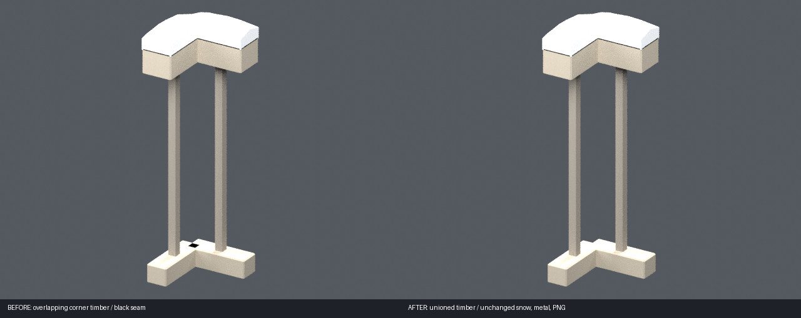
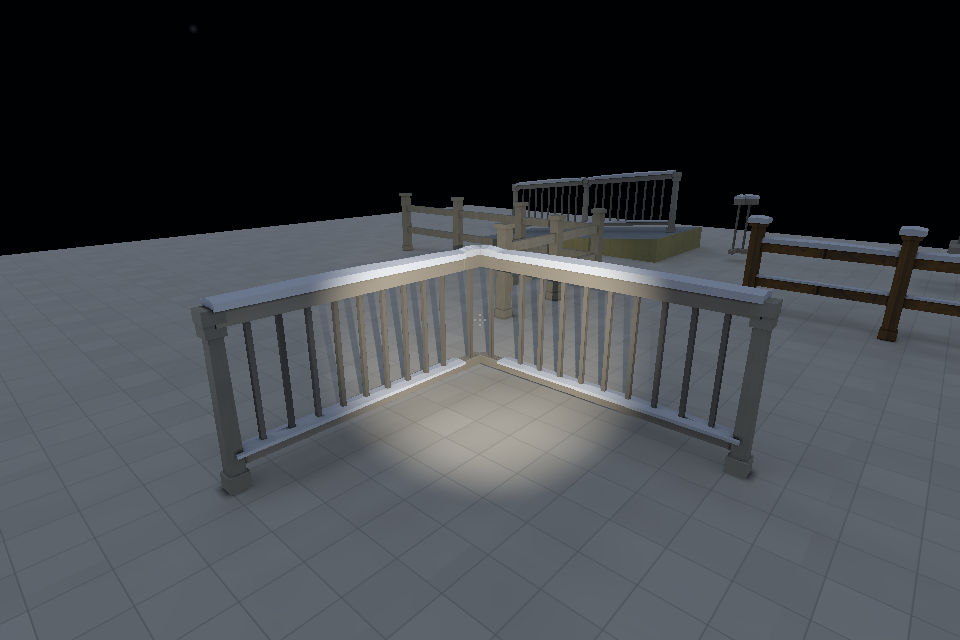
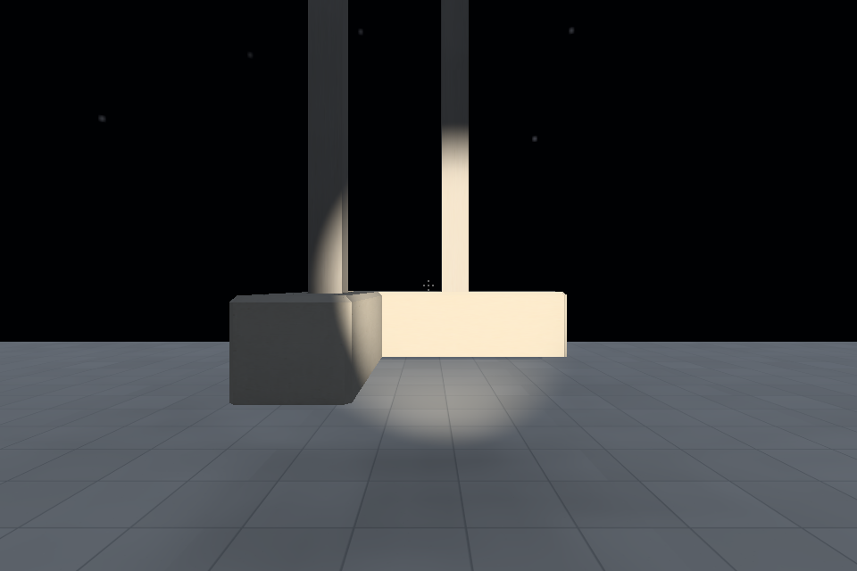
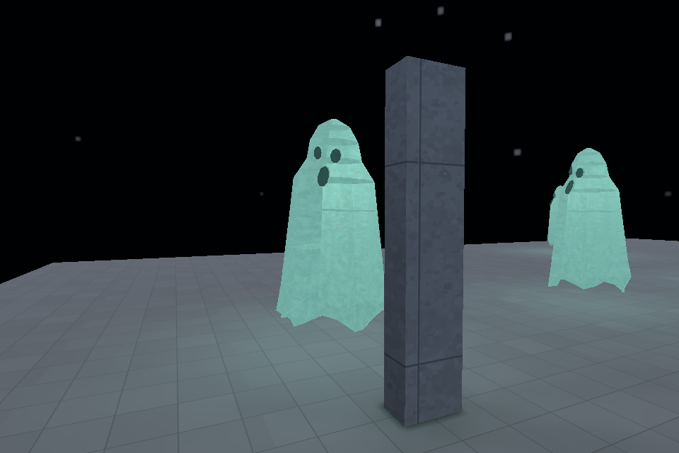

# Issue 24 modular assets and ghost native review — 30 October 2026

Six modular rail/fence paths are accepted. Only the Winter corner runtime GLB
changes; the other five retain their original bytes. The ordinary sheet ghost
remains pending because Windows native rendering fails rear self-occlusion.
[Issue #24](https://github.com/csd113/Places/issues/24) must remain open.

The review starts from `633af4e466fb332e27bcfecb850c3e4515e57aae` on
`0.13.1-dev`. All seven originals matched the cloud review's `98baef6` inputs.
The verified transfer contained 28 payloads; ZIP SHA-256
`010c73825c048fd8e29b70174a9d29ae3332f1574a88af24a1581d36db0c1576`.
The accepted 144-model cohort, integral-post assemblies and rejected Spoonerman
candidate are outside this change.

## Adopted modular assets

| Asset | Disposition | Triangles |
| --- | --- | ---: |
| `winter:railing_snow_corner` | Union the overlapping timber junctions; preserve rail-only interface | 348 → 456 |
| `winter:railing_snow_straight` | Retain unchanged | 336 |
| `outdoor:fence_two_rail_section` | Retain unchanged | 24 |
| `outdoor:fence_two_rail_post` | Retain unchanged | 36 |
| `winter:fence_two_rail_section_snow` | Retain unchanged | 156 |
| `winter:fence_two_rail_post_snow` | Retain unchanged | 102 |

The cloud Blender 4.3.2 repair unions the perpendicular timber pieces and removes
the black coplanar overlap. Metal, snow, embedded PNG, material slots, nodes,
origin and decoded extrema are unchanged. Native import exposed a separate export
contract error: the repaired timber used float RGB `COLOR_0`, while Places reads
RGBA. The offline export step now preserves every RGB byte and adds alpha `1.0`.
No runtime importer or renderer code changes.

Final runtime SHA-256:
`16726b4bf53e2579bd86210716a00143da5701e36fb411209a6997cba556c548`.
The GLB grows from 44,048 to 56,820 bytes (+12,772), with 108 additional triangles.
This is a geometry correctness repair; decoded runtime texture memory is unchanged.
The editable `railing_snow_corner.blend` retains SHA-256
`76f5c7dfdadc64266ff8d4e34218a04222df1235cc9ba0047d5bbbdd5d209066`.



The audit also recovered two missing standalone PNG sources directly from the
unchanged embedded image bytes: `outdoor/props/fence_two_rail_modular.png`
(256², shared by all four fence modules), and
`winter/props/railing_snow_modular.png` (128², shared by both Winter rails).
No pixels, UV frames, alpha behavior or runtime images changed.

All 404 prior accepted ledger records remain unchanged and in their original
order. Six records are appended, for 410 accepted paths. Catalog `completed`
ownership prevents primitive constructors from replacing these accepted exports.
The ghost is deliberately absent from the accepted ledger.

## Reproducible source export

The [asset-specific offline composer](../../tools/props/export_snow_corner.py)
is part of the source workflow. On an authorized Blender host, open the preserved
blend and export its selected mesh objects (`canonical_base` and
`snow_accumulation`) to scratch GLB: Y up, normals/UVs/materials/extras enabled,
animations disabled. Then run:

```sh
python tools/props/export_snow_corner.py \
  --blender-export /scratch/corner-blender.glb \
  --template assets/environments/winter/props/railing_snow_corner.glb \
  --out /scratch/corner-runtime.glb
```

The composer takes only the named timber primitive from that export. The accepted
runtime supplies the unchanged metal/snow, PNG, material slots, nodes and bounds.
It checks the required attributes and bounds and expands RGB colors to RGBA.
Changed outer bounds, unsupported color layouts, non-unit authored alpha, missing
nodes and existing output paths are refused. Changes to snow, metal, images or
the placement contract require a separate reviewed export.

The supplied raw Blender export (SHA-256
`6077007b0d6210bac992492c8e88c3111b5c1c04041aa4df70dfa60bdf26b6a8`)
and installed template reproduce the final runtime hash exactly. Accessor checks
also prove positions, indices, UVs, normals and RGB values equal the reviewed
repair. The Blender export itself was produced on the cloud authoring host;
the user's local Blender was not used.

## Native Windows evidence

Fresh Rust 1.99.1 all-feature production executables were used on NVIDIA RTX 3070
Laptop / DX12, DXC, 960×640 physical drawable, Fifo presentation. V-sync was on;
these are functional captures and movement checks, with no throughput claim.
The preserved player SHA-256 is
`88b7f208226d153cbe8453f22343a33eb2e2c6eb7334a2799c906fec976d9ac3`;
compiler SHA-256 is
`27ddcae5a452c5ac6467cff9bf6fceec01474c30138aff733351daf3edb83eae`.

Sixteen focused native runs retain 89 images, commands, binary/package identities,
settings, logs and traces. Full and Static lighting plus flashlight views cover
the actual imported corner, front/rear/underside and lower junction, linked
straight/corner contact, independent terminals, shared fence posts, snow slots,
material overrides and a sloped span. No placeholder or GPU validation errors
occurred. The final ownership-metadata package was separately built, validated,
verified current and launched successfully.





Held gameplay controls stop at the bare fence (`z=0.4325`), corner (`z=2.93`)
and sloped barrier (`z=-2.5386`). Ramp traversal reaches eye height 2.0 m and
returns to the lower end without falling through. These are focused collision
checks, not exhaustive traversal or OS mouse/pointer acceptance.

## Ghost: fade passes, self-occlusion fails

The ordinary sheet ghost remains exactly SHA-256
`ea07c5f3e89eebf426943aff688258392796917be8fc1be86571707aa0e0fe16`.
Its closed cloth and raised face geometry, three joints, `float_forward`/`idle`
clips, two BLEND primitives and runtime-controlled alpha are preserved.

High/Medium Full and Low Static captures inspect opacity 0, .05, .5, .85 and 1
from front, oblique and rear views, plus overlapping ghosts. Static flashlight
captures supplement those views. Zero opacity versus an absent-instance control
has **zero changed pixels**, with bloom and attached glow enabled. Native route
traces show the 4 s floating clip wrap and transition to idle. A proximity fade
goes `.85 → .553522 → .567419 → .799307 → .85 → 0` through an interrupted
fade-out and reversal; the attached light is absent at zero.

However, at opacity 1 the face remains visible through the rear cloth, with
horizontal/triangular ordering bands. The defect reproduces in the fresh native
build and is consistent with the retained internal BLEND ordering limitation.
Cloud Cycles/Eevee review does not establish native acceptance. Fixing the
renderer behavior needs separate scoped transparency work. Making the asset
opaque, removing the face or changing its shape would conceal the problem and
was not done. The ghost criterion remains unchecked and issue #24 stays open.

The [small developer inputs](../../tests/fixtures/native/issue24-assets/ghost-controls.json) preserve
the reproduction independently of a shipped collection. Compile that source
explicitly with Static/Full variants into an isolated state root's `levels/`
directory. Select `issue24_ghost_controls`, High/Full, bloom on, 960×640 and FOV
55. The opacity-1 rear view uses render eye `[7.6, 1.05, -2.7]`, yaw/pitch
`[204, -2]` and ready frame 340 at fixed delta `1/60`; the actor is at `[6.4,0,0]`.
Use `PLACES_BENCH_CAMERA_POSITION`, `PLACES_CAMERA` and the documented capture
switches. These explicit fixtures are outside automatic CI and the release lineup.



## Queued implementation follow-on

- [ ] Correct animated-character BLEND self-occlusion and internal ordering,
  then replay the preserved native controls before accepting the ghost.

Likely ownership is `src/engine/render/wgpu/world.rs` (`transparent_items` and
`encode_character_submeshes`) and `src/engine/render/wgpu/character.rs`
(`CharacterMeshGpu` shared index/submesh data). The shared transparent list sorts
each character as one item at its bounds center; its internal primitive/triangle
ordering is retained. Confirm the fix design in that renderer path. Keep the
ghost GLB and artwork unchanged, preserve cross-family ordering, skinning, fade /
emission coupling and OPAQUE/MASK behavior. No general legacy-format compatibility
layer is part of this item.

Acceptance must remove the opacity-1 rear face-through and cloth bands, preserve
coherent partial opacity and overlapping ghosts across the recorded quality /
lighting / flashlight matrix, retain exact zero-opacity invisibility and the
interrupted fade/clip behavior, and pass the required strict build gates. Windows
native evidence is required; unavailable platforms must remain disclosed. This
is an explicit implementation queue item on #24, not completion of ghost art
acceptance. Keep the ghost criterion and issue open until that work passes.

## Checks and package limits

Strict workspace/all-target/all-feature Clippy, the locked release workspace /
all-feature build, formatting, asset validation, prop/texture checks, three focused
ghost tests, two railing tests and clip-boundary checks pass. The 371-test Python
campaign has 18 expected skips; two sandbox directory-traversal failures pass on
a focused host retry of the existing packaging guards (six tests, three expected
skips). No source-test failure remains unresolved. The full audit covers 411 GLBs, 447 embedded
PNGs and 1,208 standalone PNGs with zero errors. Existing art/budget advisories
remain. No Rust test was added or expanded.

Catalog ownership metadata changes its SHA-256 from `ed1c9304…23429e8` to
`b50f1e43…ae9c8e8`, so new source builds receive new catalog fingerprints.
Package-local catalog closures also change where one of these six entries is
referenced; the current release sources use four of them in Winter. Such packages
need explicit currency checks and refresh before delivery. A preserved older
environment package was already compiler-stale before this change; it was not
presented as fresh shipping acceptance. No collection rebake, packaging finalize,
menu replacement, public release, tag or main merge was performed.

Native acceptance here covers the small explicit Windows fixtures. Current
Mac/Metal acceptance is deferred; Linux and broader OS pointer availability are
unestablished. The unrelated modified menu bytes remain unstaged and excluded.
Raw evidence, small fixture packages and final binaries are retained outside
`target` in the execution workspace's `issue24-evidence/` directory. Its
`report-receipt.json` binds this report to the adopted hashes and native results;
raw machine receipts remain local under the repository's existing convention.
