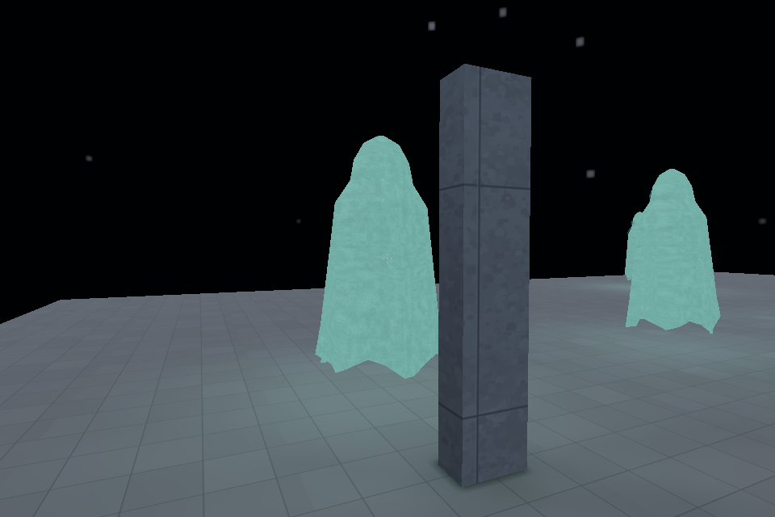
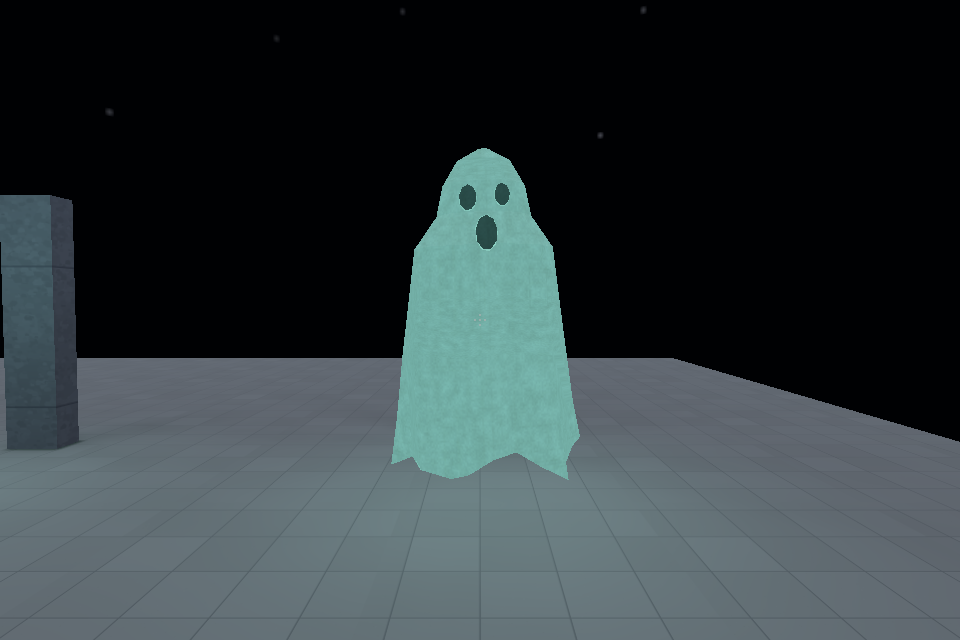
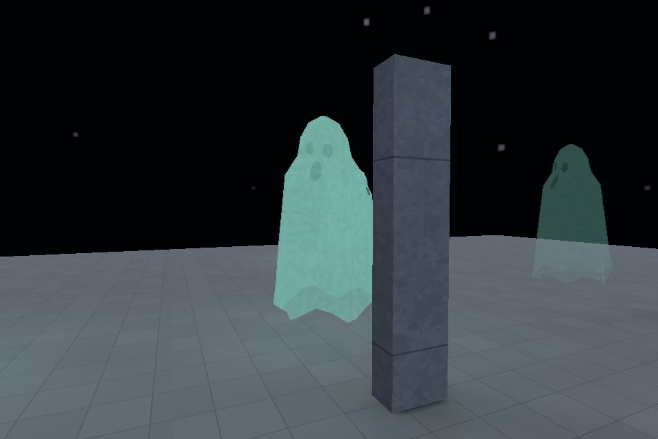
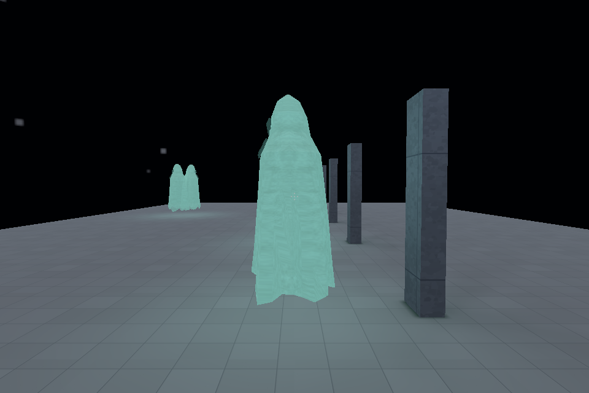
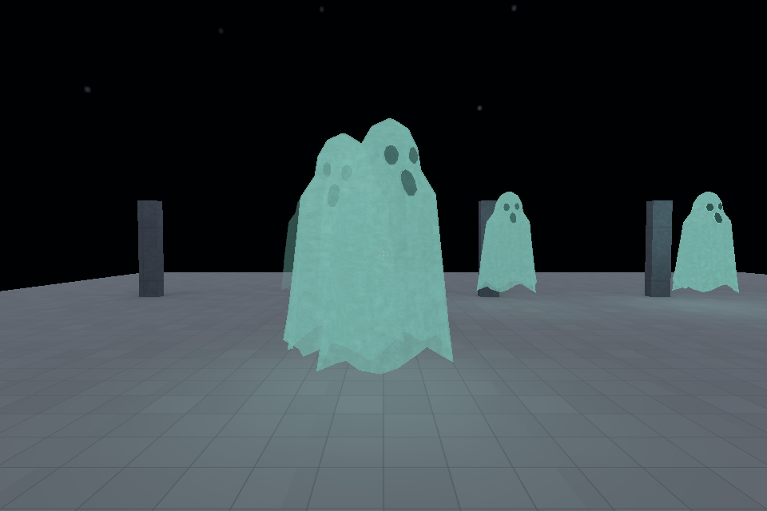
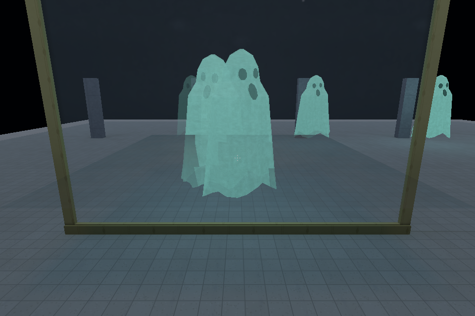

# Issue 24 animated BLEND correction — Windows, 30 October 2026

Follow-up: the separate planar backing obstruction is now corrected and Windows
acceptance is recorded in the [consolidated 0.13.1 report](release-0.13.1.md#planar-reflected-characters-windows-30-october-2026). The failed captures and limits below describe this earlier phase; clip labels alone are not actual selected-clip proof.

The ordinary ghost's main-scene rear self-occlusion is corrected without changing
its GLB, images, materials, rig, animation or fade. The exact reproduction now
hides the face behind the full-opacity rear cloth. Partial opacity intentionally
retains transmission through the cloth. **Issue #24 remains open:** its acceptance
body update is publication-blocked, and planar reflected-character acceptance is
not established. This report follows the historical
[asset review](issue24-assets-windows.md), whose failed-renderer result remains
valid for its recorded baseline.

## Cause and implementation

Baseline `75301532b3cc2f5c14d60e4755be1212047c4195` sorted a character using its
bounding-box centre, then submitted its BLEND primitives in imported index order.
With depth writes disabled, that order exposed the face through rear cloth and
produced cloth bands. Sound geometry alone could not correct submission order.

Animated BLEND triangles now join the existing world/prop/dynamic transparency
list using posed triangle-centroid distances and deterministic ties. Opaque,
cutout and flashlight depth geometry keep their ordinary indices. CPU positions
follow the skin pose revision; retained scratch and index buffers are sized from
admitted topology, with no GPU readback. Scene and emission share their view;
planar/probe views prepare and submit their own order before main-view reuse.

A naive triangle-correct pilot fixed the image but produced 2,034 draws in the
exact view, versus the baseline's 12. It was rejected. The final compatible
all-BLEND stream retains each actor's complete environment and each primitive's
exact emission, allowing adjacent triangles to merge across actors without
merging across intervening glass/water or incompatible bindings. Its extra GPU
buffers have a 64 MiB scene cap and device-limit checks; unsupported materials
keep the general sorted path. Dedicated pipelines compile during installation
only for compatible scenes. See [renderer contracts](../RENDERER.md).

## Reproduction and custody

Windows / RTX 3070 Laptop / Direct3D 12 / DXC; physical drawable 960×640, FOV 55.
The exact baseline view is High/Full, bloom on, eye `[7.6,1.05,-2.7]`, yaw/pitch
`[204,-2]`, ready frame 340, fixed delta 1/60, spawn `[0,1.6,6,0]`. Actor `opacity_4`
is at `[6.4,0,0]` with opacity 1. The retained baseline screenshot is
[here](../images/issue24-assets/ghost-rear-opacity-1.png).



| Identity | SHA-256 |
| --- | --- |
| Unchanged ghost GLB | `ea07c5f3e89eebf426943aff688258392796917be8fc1be86571707aa0e0fe16` |
| Baseline production player | `88b7f208226d153cbe8453f22343a33eb2e2c6eb7334a2799c906fec976d9ac3` |
| Final all-feature production player | `ac9575cc32d1edd29e5d1e8640acf461f8489a265f026bb1d303cd7c28e50461` |
| Final map compiler | `a2a794ef4aee7d132b6a867bf5e783c3da63d7b7a8909f59c1cf4639ea97738b` |

Native workload runs serially at Normal priority; builds use BelowNormal.
All ten production executables and their six DLLs are preserved outside Cargo's
target directory. DLL hashes match the baseline. A frozen manifest verifies all
575 Rust source files against the built source. The unrelated dirty menu scene
remains byte-identical and unstaged (SHA256
`93b92d7d6caaa9a7fc1a1bec2bb0805c17cccd25f584c730ef882ffbbcf9a27a`).

Raw commands, settings, environment, binary/package hashes, logs, PNGs, CSVs,
GPU resource receipts and source hashes are retained in
`C:/Users/Connor Dawkins/Documents/Codex/2026-10-29/task-8/transparency-evidence/`.
Core manifests are `final-binaries.json`, `final-source-hashes.json`,
`release-comparisons.json`, `performance-summary.json`, and per-run `identity.json`.
Diagnostic contact sheets and amplified differences are scratch inspection aids;
every committed PNG is an unchanged full-frame native capture.

## Production native results

| Check | Result |
| --- | --- |
| Exact full-opacity rear reproduction | PASS: face hidden, ordering bands absent; 5 draws / 15,354 submitted indices |
| Both idle and float_forward; opacity 0/.05/.5/.85/1, front/oblique/rear/side and overlapping actors | PASS: 132 captures across High/Full, Medium/Full and Low/Static |
| Both clips, flashlight with static lighting | PASS: 12 additional front/rear/overlap captures |
| Glass and water crossing lower cloth; both clips High/Full and Low/Static | PASS: 20 captures; no placeholder, shader or device validation error |
| Zero opacity versus absent actor | PASS: pixel-identical; no residual glow |
| Moving route, interrupted fade, reversal, clip wrap, return to idle | PASS: six captures plus native state snapshots |
| Batch versus general triangle path, both clips, eight full/half/side/overlap views each | PASS: across 16 image pairs, only 16 pixels differ, maximum channel delta 1/255; none exceeds 1 |
| Albedo diagnostic batch versus general | PASS: pixel-identical; production diagnostic shader enabled |
| Planar path | EXECUTED: active target and one actual pass; batch/general image equivalence passes. Expected reflected-character silhouette remains unestablished in both baseline and candidate controls; see pending follow-up below |
| Mac/Metal or Linux native | NOT RUN |

The motion state records opacity `.85 → .554 → .570 → .800 → .85 → 0`.
The final zero state has no light position; the float clip wraps from time 2.21
to 0.21 and subsequently selects idle. A capture-harness glob initially missed
the six successful action captures under `state/`; recursive discovery corrected
the receipt without rerunning or changing the game.







## Matched cost and memory

Ten serial baseline/final runs use the same freshly compiled packages, DLLs,
fixed simulation step and isolated settings. V-sync and limiters are disabled.
Every resource receipt reports actual **Immediate**, physical **960×640**.
The display is 165 Hz; rear runs exceed 365 FPS and the stress run is not a 165-Hz
plateau. These are throughput measurements; Fifo functional captures above
are not used for performance claims. Each run records 1,200 frames after 240
warmup frames. GPU samples are deduplicated by sample ID. Rear figures are
medians of three alternating run medians; other rows are one matched pair.

| View | CPU render ms, baseline → final | CPU update ms | GPU ms | Median FPS | Draws |
| --- | ---: | ---: | ---: | ---: | ---: |
| Seven ghosts, rear | .773 → 1.380 | .617 → .698 | .357 → .379 | 555.2 → 400.6 | 12 → 5 |
| Explicit 32-actor stress | 1.189 → 4.851 | 3.374 → 3.641 | .585 → 1.246 | 202.9 → 110.8 | 68 → 5 |
| Seven ghosts, glass/water/planar | 1.069 → 2.774 | .655 → .825 | 1.379 → .683 | 370.4 → 252.1 | 27 → 17 |

Correct ordering has a measured CPU cost; this is not a throughput optimization
over the visually incorrect baseline. GPU timestamps cover measured encoded
passes, excluding queue gaps and buffer-copy cost. CPU render/loop measurements
include submission work. The water pair submits 23,283 indices in each binary,
with one planar pass and an active 4,915,200-byte water snapshot; the rear and
stress pairs likewise submit equal index counts. The rejected unbatched pilot
is not the final performance result.

| Retained requested storage | Seven ghosts | 32 ghosts |
| --- | ---: | ---: |
| Additional batch GPU buffers | 3,351,880 B | 15,322,880 B |
| Additional per-character sorted GPU indices | 53,340 B | 243,840 B |
| CPU topology/position/order/index state | 548,388 B | 2,389,888 B |
| CPU batch payload | 436,248 B | 1,994,240 B |
| CPU global scene + emission scratch | 917,504 B | 7,340,032 B |

The interacting scene retains one further 458,752-byte capture scratch list.
All ordering/batch capacities remain constant in steady receipts from frame 600
onward. GPU texture bytes match baseline exactly: 56,557,568 B rear,
55,115,776 B stress and 82,182,144 B water. The table reports requested payload
and vector capacity, excluding allocator/driver overhead. HAL live buffers also
include transient in-flight allocations and are not a clean attribution of the
new buffers. Sorting remains in-place O(T log T), bounded by the existing
128-character and per-model topology admission. Triangle ordering does not
split cyclic intersecting geometry or change other families' range granularity.

## Verification and package currency

| Gate | Result |
| --- | --- |
| `cargo fmt --all -- --check` | PASS |
| `cargo clippy --workspace --all-targets --all-features -- -D warnings` | PASS |
| Same strict Clippy with `--release` | PASS |
| `cargo test --workspace` | PASS: 399 Rust regressions |
| `cargo build --locked --release --workspace --all-features` | PASS: all ten executables |
| Python source suite | 371 tests / 18 skips; two sandbox home-directory traversal failures. Focused six-test host retry passes with three platform skips; full suite was not rerun on host |
| Asset validation | PASS: 674 assets / 417 placeable / 10 themes, zero warnings |
| Ten explicit small fixture packages, integrity and `verify --require-current` | PASS: Static/Full; no full shipped-map bake |
| GUI Bake / portable-package publication / release | NOT RUN |

Three focused CPU regressions protect the actual failure: posed cross-material
ordering and alpha composition; material/emission eligibility; and legal range
coalescing across actors and intervening water/glass. They use a few triangles,
no GPU, asset decode or map bake, and sub-millisecond execution. Existing broad
coverage is reused rather than duplicated.

`build.rs` hashes engine source into compiler identity. This renderer change
therefore changes compiler/package currency even though the package schema and
art are unchanged. Final compiler fingerprint:
`346285fc66442f1b07efa1d2f0abd09a0263c90e91014a026c4fc8d40a4642da`.
The older exact-view package remains integrity-valid but fails
`verify --require-current` with “compiler preparation code changed” and exit 1.
Only the small controls were freshly built. Existing collection packages and
prior portable ZIPs must not be described as current for this compiler; no
compatibility layer or blanket rebake was added.

Generate the nine explicit developer sources with:

```sh
python tools/bench/character_transparency_inputs.py --out NEW_DIRECTORY
places-compile build NEW_DIRECTORY/ghost_idle.json --out NEW_PACKAGE.placesmap --asset-root assets --workers 2 --variants static,full --progress off --json
places-compile validate NEW_PACKAGE.placesmap --asset-root assets --json
places-compile verify NEW_DIRECTORY/ghost_idle.json --package NEW_PACKAGE.placesmap --asset-root assets --require-current --json
```

Install the package into an isolated state root, select High/Full with bloom,
set `PLACES_BENCH=1`, fixed delta 1/60 and the exact camera/frame above. Use
`PLACES_BENCH_CHARACTER_BATCH=off` for the general-path image oracle. The original
exact-view source remains `tests/fixtures/native/issue24-assets/ghost-controls.json`.

## Pending acceptance and queue publication

The main-scene renderer correction and its regression/production checks pass.
Reflected-character visual acceptance remains a separate demonstrated limit:
the planar controls execute a pass but do not establish the expected reflected
silhouette, including in the baseline. Batch/general and CPU-occlusion on/off
images agree, so CPU occlusion alone is not an established cause. No speculative
reflection rewrite was included.

Explicit implementation queue proposal **TR-PLANAR-CHARACTER** is saved locally
as `transparency-evidence/reflection-implementation-queue-proposal.md`, with
reproduction, required implementation, native acceptance and cost gates.
Automatic approval review denied creating its new public GitHub issue; the
creation did not execute and no alternate publication route was used. Publishing
that queue item awaits exact human approval. The separately denied #24 body edit
was not retried; a consolidated update proposal is also retained locally.
The accepted asset ledger is unchanged by this renderer commit. Keep #24 open
until its remaining acceptance and authorized reconciliation are complete.
