# Places 0.10.0 prerelease

October 16, 2026. This source prerelease brings the completed 0.10.0 staging
work to main. Maps remain optional external content; a fresh installation opens
the menu without baking, downloading or inventing a world.

## Included work

- [Item physics](release-0.10.0.md#item-physics-0100), [water behavior](release-0.10.0.md#water-0100),
  an [outline interaction hand](release-0.10.0.md#interaction-hand-0100) and the opt-in
  [developer console](release-0.10.0.md#developer-console-0100).
- An occluded [flashlight and Office fixture response](release-0.10.0.md#flashlight-0100),
  animated source-lit Pool caustics, [linked railings](release-0.10.0.md#modular-railings) and
  [soft bowling-lane reflections](release-0.10.0.md#bowling-lane-polish).
- Completed [Arcade/Shared/entity models](release-0.10.0.md#model-integration-0100) and
  [Pool/Office/Winter/Outdoors deliveries](release-0.10.0.md#pool-office-winter-model-integration).
  The accepted inventory has 178 model records; original deliveries and editable
  sources are preserved separately from runtime assets.
- [Lighting work reduction](release-0.10.0.md#runtime-lighting-0100),
  [Arcade performance fixes](release-0.10.0.md#performance-0100) and
  [runtime preparation scheduling](release-0.10.0.md#multicore-0100).
- A native `places-compile gui`: source/output pickers, explicit Static + Full
  lighting and reflection-probe baking, live per-pass counts, and cooperative
  cancellation. It uses existing SDL3 and the committed PNG font atlas. The GUI
  source left by the preceding task is preserved, with no new dependency.

Cargo is the version authority for the player menu/loading UI, diagnostics and
compiler. The macOS packaging script derives both bundle version fields from it.

## Final release validation

Passed on the final source/version inputs:

- `cargo fmt --all --check` and strict all-target/all-feature Clippy, including
  the additional all/pedantic/nursery/cargo lint groups, without suppressions.
- `cargo test --workspace`: 2,332 library tests and 11 binary/integration checks.
- `cargo test --workspace --all-features`: 2,339 library tests and the same 11
  checks. Both retain 19 existing ignored library tests; doctests also passed.
- Asset validation: 593 assets, 370 placeables, eight themes, zero warnings.
- The 362-test source Python run completed with 17 skips and one changelog
  heading failure. Restoring the established dated-heading format fixed it;
  that targeted check passed. No other case failed in that run.
- `cargo build --locked --release --bins` and strict release Clippy passed.
  The preserved compiler reports `places-compile 0.10.0`.
- The real-window empty-install check passed on Metal: no committed world or
  preparation cache, created settings/import/levels, and a captured menu showing
  `v0.10.0`. The player also discovers all eight existing local packages.
- The fresh native compiler displayed actual receiver counts, completed the
  existing `test_room` fixture, cancelled another bake, then completed a retry.
  Its 1,946,139-byte package passed archive validation and
  `verify --require-current`, with identical current/package fingerprints and
  no differences. The compiler window closed and all task-owned jobs exited.

Detailed earlier feature campaigns remain in the linked reports; they are not
represented as a new full-map campaign for this version change. Raw final logs,
native receipts and preserved binaries live in ignored `local/release-0.10.0/`.

## Compatibility and limits

The release follows the repository's annotated numeric tag and source-release
conventions (`0.10.0`), explicitly marked as a GitHub prerelease. There are no
attached platform binaries or compiled maps. Git LFS is required for tracked
binary assets; use `git lfs pull` after cloning.

The compiler executable/version participates in developer currency fingerprints.
Existing matching-catalog packages can remain runtime-compatible while
`verify --require-current` requests recompilation with 0.10.0. Compile selected
authored sources explicitly when current fingerprints are needed. Final release
validation does not rebake all eight production maps or archived maps.

The separately discussed refined Spoonerman delivery is not confirmed installed.
This release retains the previously accepted model (`e0aa64e6c7378d53e1bd08d3aca1c68f1e7beb178a54e7193abf55b232edd87f`);
it does not claim adoption of that later revision. The separate rubber-duck
rebuild and additional Blender work are outside this release.

Native acceptance is macOS/Metal only; Linux/Vulkan and Windows/Direct3D 12,
including their native GUI file pickers, remain unrun. The earlier intermittent
gameplay crashes remain unattributed; bounded diagnostics are retained. Existing
GPU-only ignored tests are not reported as passes.

## Consolidated feature evidence

The release acceptance above is authoritative for 0.10.0. The dated feature
records below retain distinct implementation details, measurements, failed probes,
evidence paths and limitations. Their test counts, package fingerprints and runtime
observations describe their own checkpoints. Earlier scope restrictions, pauses
and proposed next steps are historical decisions, superseded by later completed
sections and the release acceptance; they are not instructions for current work.
Current contracts live in the authoring, asset, editor, installation and API guides.

- [Bowling lane polish — October 15, 2026](#bowling-lane-polish)
- [Developer console — 0.10.0 staging](#developer-console-0100)
- [Flashlight and Office gameplay — 0.10.0 staging](#flashlight-0100)
- [Interaction hand](#interaction-hand-0100)
- [Item physics — 0.10.0 staging](#item-physics-0100)
- [Completed model integration — 0.10.0 staging](#model-integration-0100)
- [Modular railings and fences](#modular-railings)
- [Multicore runtime and Arcade performance — 0.10.0](#multicore-0100)
- [Arcade doorway performance — 0.10.0 staging](#performance-0100)
- [Animated Pool caustics — issue #4](#pool-caustics)
- [Pool, Office and Winter model integration](#pool-office-winter-model-integration)
- [Runtime lighting performance — 0.10.0 staging](#runtime-lighting-0100)
- [Pool water — 0.10.0 staging](#water-0100)

<a id="bowling-lane-polish"></a>
## Bowling lane polish — October 15, 2026

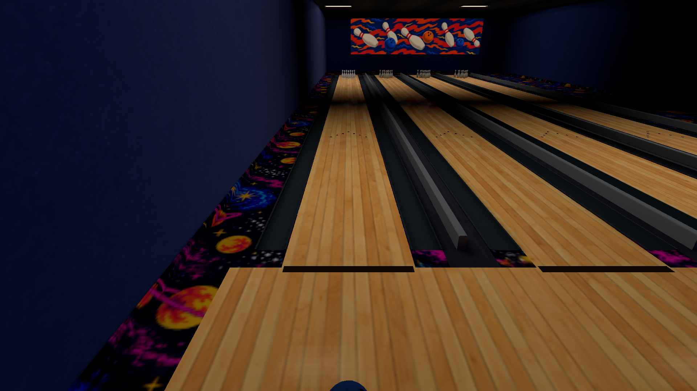

The Bowling Alley in Cosmic Lanes & Arcade uses the existing half-resolution
planar reflection path for a restrained polished maple finish. Only
`arcade:lane_wood_01` changes; its four lanes and wooden approach share the finish.

| Material control | Before | After |
| --- | --- | --- |
| Specular | 0.26 | 0.36 |
| Shine | 0.52 | 0.60 |
| Roughness (`1 - shine`) | 0.48 | 0.40 |
| Reflection strength | 0.12 | 0.28 |
| Reflection mode | Probe | Planar |

The existing rough planar filter softens reflected nearby lights.
The wood PNG, UV scale, lane arrows, foul lines, geometry, light placement and
physical friction remain unchanged. Carpet, gutters, walls and other materials
retain their original definitions. This introduces no shader changes, new
textures or dependencies. The renderer draws at most one half-resolution
reflection view per frame, choosing between the lane plane and existing
restroom mirrors; the former lane probe is no longer required. Reflections
remain controlled by the existing Full/Medium/Off setting and Static lighting
continues to omit the surface response.

Reflection priority now measures distance to each surface's finite bounds.
Previously, the floor's infinite plane could win from inside the restroom and
disable its nearby mirrors. The bounds calculation retains the same frustum
gate, deterministic ordering and one-view limit without allocating per frame.

<a id="bowling-lane-polish-reproduction"></a>
### Reproduction

Build the player and compile the actual production map using the normal pipeline:

```sh
RUSTC_WRAPPER= cargo build --locked --release --bins
target/release/places-compile build levels/retro_arcade_demo.json \
  --out assets/levels/retro_arcade_demo.placesmap --variants off,full --workers 8
target/release/places-compile verify levels/retro_arcade_demo.json \
  --package assets/levels/retro_arcade_demo.placesmap --require-current
```

Use `tools/bench/frame_time.py` with `--binary target/release/places`,
`--capture-frame 60 --warmup 15 --size 960x540` and a new `--out` directory.
The macOS drawable is 1920×1080. Camera arguments are degrees; spawn arguments
are X, eye Y, Z, yaw.

| View | `--spawn=` | `--camera=` |
| --- | --- | --- |
| Aligned with the ceiling fixtures | `10.65,1.6,22.2,0` | `0,-24` |
| Front | `12.65,1.6,22.2,0` | `0,-12` |
| Oblique, including carpet boundary | `18.3,1.6,21.7,330` | `330,-18` |
| Downward, grain and arrows | `12.65,1.6,19.2,0` | `0,-55` |
| Grazing, from the concourse | `14.65,1.6,24.6,0` | `0,-3` |
| Existing restroom mirror | `-2.7,1.6,5.6,180` | `180,-4` |
| Close fixture reflection and grain | `10.65,1.6,20,0` | `0,-70` |

Matched baseline runs use a preserved original catalog and original package via
`--asset-root`. Native logs, package/binary hashes, frame CSVs and capture
receipts are kept locally under `tools/bench/results/lane-polish/`.

<a id="bowling-lane-polish-native-results"></a>
### Native results

The production map was inspected from the front, oblique, downward, grazing,
fixture-aligned and close views. Reflected light stays dim and softened while
the maple grain, arrows and foul line remain readable. A centered camera can
place fixture reflections in the gutters; the aligned and close views show the
reflection on the wood itself.

| Original finish | Polished finish |
| --- | --- |
|  | 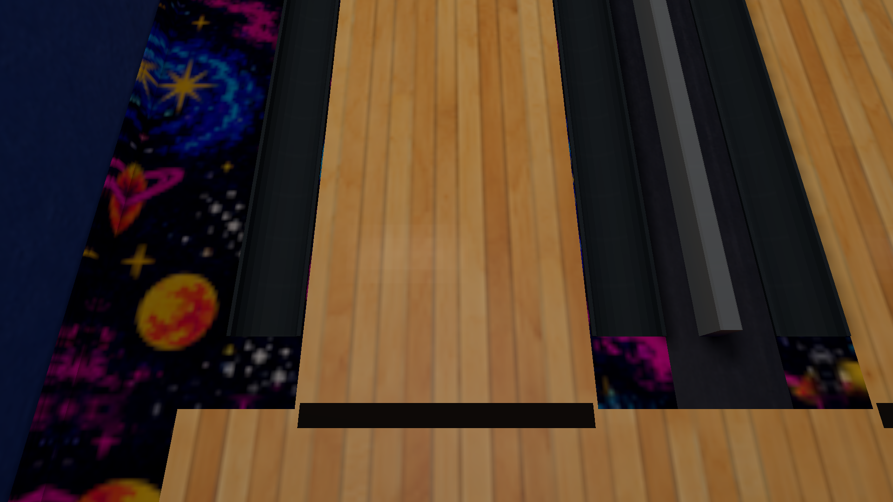 |

Matched frame sequences also checked Medium, Off, low texture filtering with
Full lighting, and Static lighting. The complete Static image and the complete
restroom-mirror image are pixel-identical to the original. The oblique carpet
boundary crop (1530,650)–(1870,1030), in the 1920×1080 drawable, is also identical.
Only the lane material differs in the catalog. The prepared geometry, props,
lightmaps, irradiance, collision and navigation records have identical content
hashes; the former lane-probe record changes because it is no longer needed.
Package verification reports current provenance, no differences and no warnings.

Both final sweep runs presented all 540 ready frames with zero skipped frames;
the close finish run presented all 60. Occluded exploratory runs were rejected
and excluded. Temporary macOS bundles contain exact copies of their respective
release executables so the windows can be foregrounded before loading completes.
The local runner adds a preparation delay solely for window activation; timing
starts after loading and warmup.

<a id="bowling-lane-polish-performance"></a>
### Performance

Apple M2 Pro / Metal, 1920×1080 drawable, High textures, Full lighting and
reflections, bloom enabled, Immediate presentation. Original and final players
ran serially without compilation or another game process competing. Each run
presented 3,600 ready frames with zero skips. Six 600-frame camera blocks
alternate front and oblique views; discarding the first 120 frames of every
block leaves 1,440 steady frames per view per player. GPU sample IDs are
deduplicated. These are elapsed GPU pass spans, including scheduling stalls,
not active hardware utilization.

| View | GPU median before → after | GPU p95 before → after | CPU loop median before → after |
| --- | --- | --- | --- |
| Front | 2.620 → 2.496 ms | 3.330 → 2.921 ms | 3.263 → 2.127 ms |
| Oblique | 2.711 → 2.718 ms | 3.312 → 3.127 ms | 3.326 → 2.194 ms |

The final GPU p95 stays below 3.2 ms in both views on this machine. Base scene
draws stay 161/173 for the two views; both players use exactly one reflection
pass. The existing one-view budget is preserved.
Raw CSVs, renderer identities and binary/package hashes are retained in
`timing-verified-before/`, `timing-verified-after/` and `performance-summary.json`
under the local results directory. Camera blocks are in `timing-cameras.json`.
The native sweeps use `sweep-before.json` and `sweep-final.json`, with graphics
changes at frames 301 (Medium reflections), 361 (Off), 421 (Full), 422 (Low
filtering) and 481 (Static).

<a id="bowling-lane-polish-validation"></a>
### Validation

The following source checks passed:

```sh
cargo fmt --all --check
RUSTC_WRAPPER= cargo clippy --workspace --all-targets --all-features -- \
  -D warnings -D clippy::all -D clippy::pedantic -D clippy::nursery -D clippy::cargo
RUSTC_WRAPPER= cargo test --workspace --all-features
RUSTC_WRAPPER= cargo test --workspace
python3 tools/assets/validate.py
git diff --check
target/release/places-compile verify levels/retro_arcade_demo.json \
  --package assets/levels/retro_arcade_demo.placesmap --require-current
```

All-features: 2,339 library tests passed; default features: 2,332 passed.
Both also passed nine binary/integration checks; each retains 19 existing ignored
library tests. Asset validation reported zero warnings. One regression test uses
two bounds and two cameras to protect mirror/floor selection. It runs without
assets, GPU work or baking; native comparisons exercise the resulting appearance
and existing renderer gates directly.

The shared catalog's hash is part of every compiled package's integrity
contract. After changing this material, other previously compiled local maps
also need recompilation against the new catalog before they can be loaded.
Packages are generated local artifacts and are not tracked in Git.

<a id="developer-console-0100"></a>
## Developer console — 0.10.0 staging

Enable **Settings → Controls → Developer Console** (Off by default). During
play, press **backtick** to open or close it; **Escape** closes it without opening
the pause menu. The world pauses while typing. The cursor is released, SDL text
input owns the keyboard, and closing clears held controls and resets timing.
Focus loss, menus and loading close the console. The setting is persisted;
commands, history and previews are session-local.

| Command | Current behavior |
| --- | --- |
| `/help` | Lists the typed command registry and controls. |
| `/clear` | Clears output; command history remains. |
| `/noclip [on\|off]` | Toggles, or explicitly selects, collision-free flight. Normal movement/look bindings apply; hold Jump to rise and Crouch to descend. |
| `/give <catalog-id>` | Places a validated small rigid prop ahead. Eligible gameplay profiles create physical items that can be picked up, dropped or thrown; other eligible models are explicitly reported as visual previews. |

Up/Down recall history and restore an unfinished draft; PageUp/PageDown or the
mouse wheel scroll wrapped output. Text editing appends and backspaces at the
end of the line. Storage is bounded to 256 ASCII input bytes, 32 commands and
128 output messages of at most 512 characters. Only changed console UI geometry
is rebuilt, through the existing font/quad pipeline. No dependency was added.

Noclip has a visible state in the console and an indicator during flight. Exit
checks the full standing body against solids, live doors and ceilings, and the
existing geometry-derived playable space. Clear in-map positions are retained;
otherwise a revalidated entry pose or validated spawn is used. Motion, stance,
water/ladder state, camera pose and trigger membership are reconciled without
resetting world entities. If a malformed world offers no safe destination,
exit is refused with an error; disabling the setting is also refused until the
player moves clear. Map/player reset clears the mode. Ordinary walking and void
recovery keep their existing paths.

`/give core:rubber_duck` is an example. Exact catalog IDs with a rigid model,
positive actual model bounds and no axis over 1.5 m are eligible. Characters,
morph models, materials/textures, missing models, raw paths and unknown IDs are
refused. Placement uses the player's current storey, flat footprint support,
conservative ceiling/solid/live-door clearance and non-overlap with other
previews. Noclip placement is refused. At most 16 previews exist per world;
disabling the console or installing/reloading world resources removes them.
Models, decoded textures and dynamic meshes reuse the existing renderer caches.
The first use of an uncached model still loads/uploads it synchronously.

`src/console/command.rs` owns the closed typed registry/parser. Console state,
UI, SDL ownership and runtime dispatch have focused modules. `CommandTarget`
is the small integration point for gameplay systems. The live target uses the
existing item physics runtime for eligible catalog profiles. `src/game/developer.rs` owns flight
and placement validation. Console input never executes OS commands, shell
expressions, scripts or arbitrary file paths.

<a id="developer-console-0100-validation"></a>
### Validation

Formatting and strict `cargo clippy --workspace --all-targets --all-features --
-D warnings` passed. `cargo test --workspace` passed (2,269 library tests);
`cargo test --workspace --all-features` passed (2,275). Binary, integration and
doc-test targets also passed; 19 existing opt-in GPU tests remain ignored.
The four new deterministic tests cover parser failures, enable gating, bounded
input/history/output, draft recall, dispatcher results, safe flight/exit/reset
and current-storey placement. They build only a tiny two-room fixture, need no
GPU and finish in less than 0.01 s. No production map bake was added to tests
or CI. Python tooling compiled successfully.

Seven sequential native acceptance runs used the existing Office and Arcade
packages through SDL/Metal on this Mac. Scripted key/text events exercised the
ordinary event handler; manual held-key acceptance and other platforms are not
claimed. Actual receipts assert menu persistence, disabled gating, zero held
controls while typing, released/restored mouse capture, history/output overflow
(70 submissions), help/clear, visible rigid props, invalid/non-placeable/character
IDs, duplicate placement refusal, two shared-model instances and cleanup.
Focus loss and Office → Arcade → menu → Office transitions close the console
and reset flight on world replacement. Noclip exits from ceiling overlap and
beyond every Office room immediately return to the validated entry; a clear
in-map exit retains its position. Screenshots were inspected for readability.

| Native timing mode | Loop median (ms) | Loop p95 (ms) | Update median (ms) |
| --- | ---: | ---: | ---: |
| Preserved lighting build | 1.902 | 2.506 | 1.202 |
| Console disabled | 1.930 | 2.948 | 1.199 |
| Help overlay open; world paused | 1.339 | 2.716 | 0.432 |

Values are means of two run medians/p95s, 600 measured frames per run after
120 warmup frames, with reversed order. Office, fixed camera, High textures,
Full lighting/reflections, Immediate presentation and 2560×1440 drawable were
matched; builds were idle. Disabled median loop difference is +0.028 ms; the
update median did not increase. Tail results varied and do not establish a
general tail guarantee. Open-console timings describe a paused world and
cannot be treated as a gameplay speedup. Raw receipts and the preserved
executable live under `local/developer-console-0.10.0/`.

Reproduce explicitly with an existing package:

```sh
python3 tools/bench/developer_console.py \
  --binary local/developer-console-0.10.0/bin/places \
  --mode input --out local/my-console-input
```

Other acceptance modes: `settings`, `preview`, `recovery`, `overflow`,
`transitions`. `tools/bench/frame_time.py --console-open` measures the open
help overlay. Neither tool bakes maps.

| Enable setting | Help and input | Actual prop preview | Safe return |
| --- | --- | --- | --- |
| 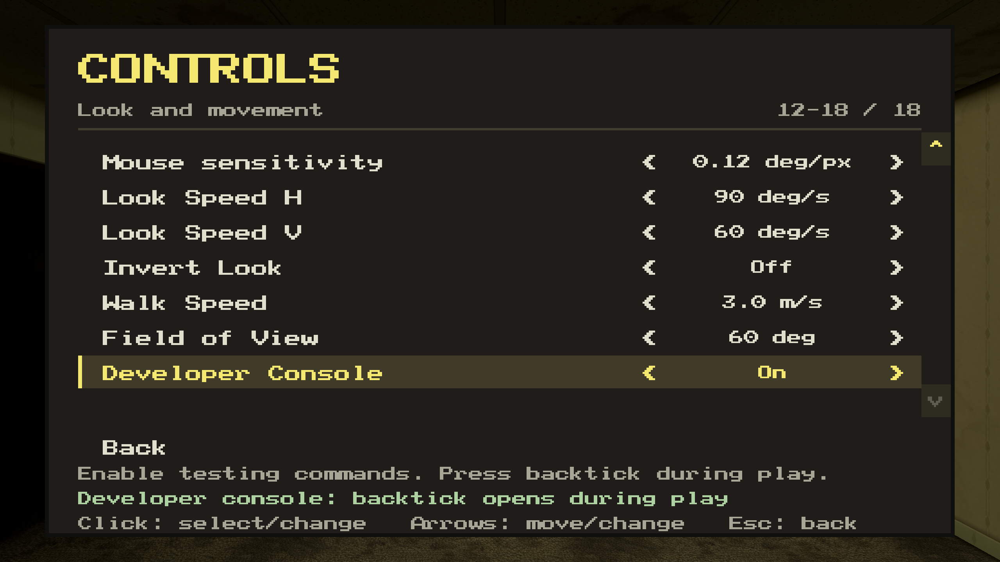 | 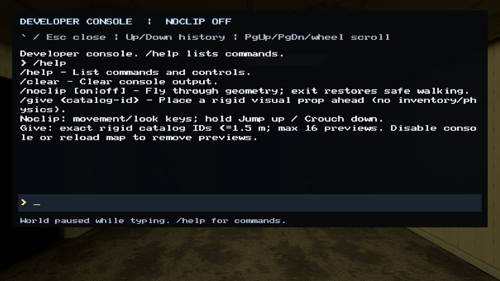 | 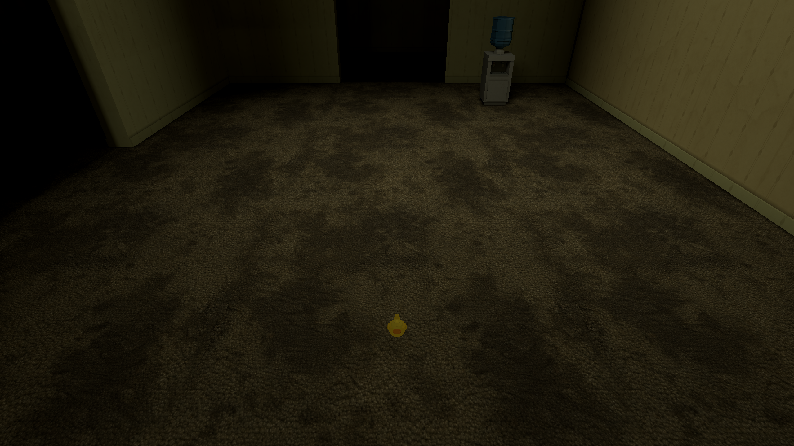 | 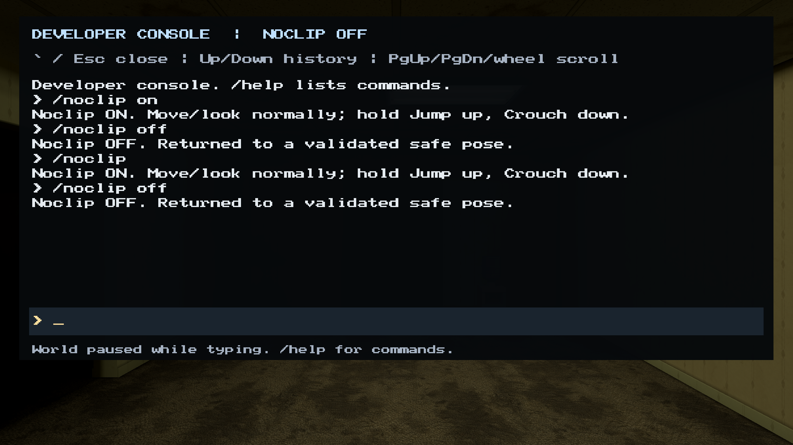 |

The validation above records the original console implementation. Later staging
work integrated physical `/give` items and reusable flashlight lighting; see the
[item physics report](release-0.10.0.md#item-physics-0100) and
[flashlight report](release-0.10.0.md#flashlight-0100) for current behavior. Inventory and audio
remain outside this console implementation. The prior intermittent gameplay crash remains
unexplained; this task does not claim to solve it.

<a id="flashlight-0100"></a>
## Flashlight and Office gameplay — 0.10.0 staging

The player now has a reusable handheld flashlight. **F** toggles once per press;
Settings → Controls can rebind it and saves the binding. Conflicting and reserved
keys are refused. Console typing, menus, focus loss and map preparation cannot
toggle it. Graphics changes retain power; loading a world starts it OFF.

The existing developer console remains opt-in under Controls and opens with
**backtick**. `/noclip [on|off]` preserves validated walking recovery and now
continues door animation during flight. `/give <catalog-id>` already integrates
eligible physical items with pickup/drop/throw; this work reuses that implementation.
Unknown commands, unknown items and file-path-like input return bounded errors.
No first-person model, interaction-hand replacement, tutorial or throw label was added.

<a id="flashlight-0100-shared-lighting-and-entity-behavior"></a>
### Shared lighting and entity behavior

The spotlight extends the existing attached-light material path for world,
decals, movable props and posed characters. Its final bright core is **20.55°**
across, with a soft **40.27°** outer cone. Intensity remains 12, range 24 m, with
windowed `1/(1+d²)` falloff. The camera attachment is 14 cm right, 18 cm down and
6 cm forward, converging at view centre 6 m away. Shared triangle visibility
retracts the source before nearby geometry.

One lazily allocated **1024² / 4 MiB depth target** and four PCF comparisons use
the existing world submission, culling, transforms and material coverage. OFF
submits no visibility pass; resources are retained for subsequent toggles. Posed
ray resources cache pose/opacity revisions and share existing PNG data. Live
planar captures retain the beam; offline probe captures remain unlit by it.

The generic `light_response` component observes five body anchors through the
same cone/falloff and static/live triangle visibility, excluding its own receiver.
Office's mannequin stops, selects its existing standing clip and faces the
player. Its original AI state, route and local timers remain intact. Activation
is 0.035, release threshold 0.005, with a 0.20 s dark hold. Completed-frame
observations are consumed on the following simulation tick; normal movement and
animation resume after release. The implementation contains no Office geometry
or mannequin-name special case.

Office's two failing fluorescent circuits independently spend **90.9% / 92.1%**
of their 50.3 / 62.9 s cycles OFF. Unequal 7.4–21.1 s blackouts alternate with
brief returns and an approximately 3.15 s final return. Fixture faces and emitted
illumination switch together. Exposure, ambient light and fixed navigation lamps
are unchanged.

<a id="flashlight-0100-validation"></a>
### Validation

Formatting, workspace check, strict debug/release Clippy, default and all-feature
workspace tests passed: **2,321 / 2,328 library tests**, plus integration tests.
The 19 pre-existing opt-in GPU tests remain separate. New regressions use scalar
beam/attachment fixtures, source-only validation and fewer than twenty ticks of
a 4 × 4 m navigation fixture; default tests and CI do not bake shipped maps.
The configured generators, asset validator (573 assets / 350 placeable; zero
warnings), mannequin identity/clip checks and 356 Python tests passed (four skips).

Only Office was rebuilt, with eight workers. Its archive integrity and exact
source/dependency/compiler currency passed. Existing Arcade and Pool packages
loaded through the unchanged runtime format.

Nine core sequential SDL/Metal cases passed **201 numeric checks**, with actual
native captures inspected. They cover direct stop/look/resume, dim-edge hold
below activation (0.014–0.029 incident intensity; **zero position drift**), wall,
floor and cabinet occlusion, close-wall retraction, static/moving/held/dropped/
animated lighting, repeated F presses, conflict rejection, R rebinding, console/
menu/focus ownership, live Static/Full changes, texture Low/Medium/High and reload.
Filtering was separately exercised at 4×/8×/16× while Full lighting stayed ON.
Office has no authored doors: its door regression uses Arcade's real swinging
door, including noclip animation and the existing planar mirror. Preserved Pool
captures verify transparent water and the lit basin without an opaque black mask.
No full-bright or black-smudging regression was observed in these views.

<a id="flashlight-0100-native-performance"></a>
### Native performance

Apple M2 Pro / Metal; High textures and Full lighting; **2560 × 1440** actual
drawable; Immediate requested; 120 warmup plus 600 measured frames per run.
Two OFF/ON pairs per view reverse order in the second repeat. Values below are
means of the two run statistics; worst is the maximum observed frame, in ms.

| View / metric | Median OFF → ON | p95 OFF → ON | p99 OFF → ON | Worst OFF → ON |
| --- | ---: | ---: | ---: | ---: |
| Dark / frame-loop wall time | 8.338 → 8.323 | 9.297 → 9.511 | 12.425 → 11.798 | 23.886 → 17.585 |
| Dark / GPU pass-span union | 4.046 → 5.217 | 4.450 → 5.603 | 4.769 → 5.967 | 5.759 → 7.925 |
| Busy / frame-loop wall time | 8.270 → 8.323 | 9.288 → 9.071 | 12.341 → 11.735 | 17.488 → 13.454 |
| Busy / GPU pass-span union | 4.148 → 5.040 | 4.484 → 5.549 | 4.789 → 6.850 | 5.175 → 7.660 |

Median CPU-side render spans grew about 0.20 ms in both views. AI actually reacts
in ON runs, so these are gameplay comparisons, not isolation of pure shader cost.
An additional GPU trace measured the cone-culled visibility pass at 0.026–0.251 ms;
the three traced scene spans were about 0.978 ms OFF and 1.169 ms ON. No shadow
quality or essential occlusion was removed. Distinct shadow pipelines, cone
culling, lazy allocation and revision/PNG reuse bound its work.

Separate OFF-after-ON controls measured loop/GPU medians of 4.800/2.293 ms (dark)
and 2.078/1.487 ms (busy), with retained resources. Peak native RSS across the ten
runs was **605.2–631.5 MiB**. Later diagnostic runs also ran faster: scheduling,
presentation and GPU clock state materially affect these short measurements.
GPU spans include scheduling stalls, exclude gaps and count overlapping spans
once; they are not active-utilization measurements. First-use resource creation
is outside the warmed comparison. No universal frame-rate guarantee is claimed.

<a id="flashlight-0100-deliverables-and-limits"></a>
### Deliverables and limits

`local/flashlight-0.10.0/` retains binaries, package checks, native receipts,
performance distributions, the acceptance summary and Library delivery manifest.
The final media directory contains a **24 s / 720-frame walkthrough**, a
**15 s / 450-frame sweep**, a **26 s / 780-frame 360° turn**, and five PNGs.
All three H.264 videos are 1280 × 720,
30 fps, YUV420P, BT.709 limited range, sampled from consecutive native source
frames at stride two without inserted or duplicated frames. Movement/look/F use
ordinary input; diagnostic camera aims leave entity motion autonomous. Decoded
video frames were also inspected. Library uploads succeeded.

The walkthrough Library ID is `libfile_e9309d61746081918d47f1eea1a4cf94`; the sweep
is `libfile_b0d861389f488191a11cc603f6432c43`. The requested final-width preview is
`libfile_88b63b25352c8191bd3ad17f286ec027` (40.27°). Exact final commit, remote SHA,
CI receipt and cleanup status are recorded in the local handoff after publication.

The later requested complete rotation is `libfile_c8f3c77dc6bc81918cf2266eec96e699`.
Native state logs verify 360.001° of continuous clockwise rotation at a fixed
position, with the beam retained. The existing viewpoint puts a cabinet at about
1.6 m, chair at 2.9 m, desk at 3.1 m and the doorway water-cooler landmark at
10.8 m. Office is sparse around the remaining sectors; no props were invented or
map data rebaked for the clip. Frame-based ordinary look input preserves the
Controls speed bounds while producing a smooth recorded turn.

Raster shadows retain opaque/cutout and nearly opaque blend coverage; ordinary
glass/water transmit rather than casting colored or partial-blend shadows. CPU
observations retain scalar partial transmission. Static retains its historical
coarse vertex illumination and existing `hold_in_static` fixture behavior;
the prolonged fluorescent blackouts are Full-lighting behavior. Native acceptance
is specific to this Mac; other platforms and universal performance are untested.

<a id="interaction-hand-0100"></a>
## Interaction hand

The interaction affordance now recreates the rounded off-white outline in the
user's Desktop reference, with a transparent palm/exterior and the current
interaction key inside. It occupies a fixed 16×16 reference-space quad low in
the HUD (about 30 pixels of visible ink at 960×544). There is no badge or extra
gameplay text. Existing precise targeting, pickup/drop/throw, held-item hiding,
menu/console behavior and flashlight logic are unchanged.

The committed `assets/shared/ui/font_01.png` is now 256×128, retaining the 2:1
aspect, original glyph pixels/orientation and white cell. Shared UV accessors
account for the new dimensions. A padded 64×64 hand cell uses spare space.
The HUD still uploads once, uses clamped nearest sampling without mipmaps,
and submits one draw; world texture quality never resizes this resource.
Decoded/uploaded storage increases by 96 KiB to 128 KiB. A one-character hand
uses 36 vertices instead of 1,014. No frame-rate improvement is claimed.

The catalog is byte-identical to the flashlight baseline. Existing package
discovery pins the entire catalog hash; keeping the existing registered PNG
avoids invalidating maps for this HUD edit. All eight shipped packages still
pass discovery. No map was baked or modified.

<a id="interaction-hand-0100-native-acceptance"></a>
### Native acceptance

Apple M2 Pro / Metal, actual presented captures. The preserved current-model
item fixture is `local/model-integration-0.10.0/followup-item-physics.placesmap`
(SHA256 `eee02d53d123c592d10f18ac4333ee344277eb0c1dbc8ba78aa067df56bc5a4c`).
Player SHA256: `ae6d6c9686653481f15b984f813a7092174a173ffca2b23b88b3bdd1890af9cc`.

- Workflow: 56 checks pass, including idle, direct aim, pickup disappearance,
  real drop/throw, live Controls rebinding E→R, old E becoming inactive,
  menus, console and real light switching.
- Targeting: 498 checks pass, covering narrow off-axis misses, reach boundaries,
  occlusion, nearby objects, switches and doors.
- Lit-door fullscreen: 10 checks pass at 3024×1898. Other reviewed drawables:
  960×544, 1280×720, 1600×1600 and 2560×1440.
- Font baseline/candidate: 31 native checks each. Thirteen exact title/subtitle
  ink-mask comparisons show zero differences against the preserved flashlight
  player, across Low/Medium/High and the four windowed sizes. All 95 source
  glyphs, UV mapping, transparency and the small hand/key layout are also
  protected by bounded CPU tests; no new map/GPU dependency enters Rust tests.

Curated unmodified native captures:
[aim](../images/interaction-hand-0.10.0/01-aim.png),
[after pickup](../images/interaction-hand-0.10.0/02-after-pickup.png),
[dark/rebound](../images/interaction-hand-0.10.0/03-dark-rebound.png),
[bright door](../images/interaction-hand-0.10.0/04-bright-door.png),
[960×544](../images/interaction-hand-0.10.0/05-reference-size.png).

Source receipts and reproducible native plans remain under
`local/interaction-hand-0.10.0/`. Source gates cover formatting, all-target /
all-feature check, strict debug/release Clippy, all-feature/default workspace
tests, asset/texture validation and source Python tests.

The local opaque 450×1114 reference was viewed and hash-verified as
`6901637caf3b8791f7d3546ceee9f8543c136759544ff62b6d35e9bba12467e0`.
Built-in imagegen recreated and cleaned its outline; offline atlas packing
preserved original font bytes. The prompt required the reference's exact
finger/thumb/wrist silhouette, off-white ink, transparent palm/outside, thin
dark edge and no baked letter, badge or captions. This is recreated artwork,
not a pixel extraction. Long binding names shrink inside the fixed palm;
native key coverage used E/R, with BACKSPACE fit covered by the CPU fixture.
Native evidence is limited to this Mac; other hardware was not visually tested.

<a id="item-physics-0100"></a>
## Item physics — 0.10.0 staging

Places now has reusable native pickup, drop, throw, bounce and roll behavior for passive rigid props. Player movement keeps its existing controller, stance, water, collision and void recovery; items and player share **9.8 m/s²** in metre/second units. Existing visual assets and the rendering catalog are retained.

<a id="item-physics-0100-architecture-and-choice"></a>
### Architecture and choice

**Rapier 0.36.1 / Apache-2.0** supplies collision response, mass properties, sleeping and CCD. It is a maintained pure-Rust solver with native and WebAssembly support; browser gameplay is not claimed here. Rapier remains serial at this bounded scale. Its required math dependency is isolated from the renderer’s existing glam version. The 31 newly introduced registry packages and available license texts are recorded in `THIRD_PARTY_LICENSES.txt`; no existing dependency was replaced.

| Owner | Responsibility |
| --- | --- |
| `src/physics/` | Strict profiles, shapes/mass, world lifecycle, activation, carry/release, floor contacts, pair impact onsets and escape recovery |
| `src/item_runtime.rs` | Small native-loop, console and renderer adapter |
| `src/item_input.rs` | Mouse edges and focus/console/recapture gating |
| `src/level/physics.rs` | Compact floor, recess, stair, ramp and roof collision from existing level descriptors |

Rapier allocates on the first physical spawn. A **120 Hz** fixed step retains fractional time and consumes at most twelve substeps / 0.1 s per frame. CCD permits two collisions per interval; bodies settle into natural sleep. Rendering interpolates centres and quaternion orientation, then restores model origins. Moving items use economical cuboid, sphere, cylinder, convex-hull or compound shapes, with friction, restitution, damping and derived inertia. Shape-aware carrying sweeps translation and rotation around walls, doors, the camera and player. Blocked release retains ownership. There is no per-frame model/texture reload.

Contacts use at most 2 mm of scale-aware skin, 1 mm allowed error, disabled contact recycling and critically damped 240 Hz ground softness; the solver retains its default four iterations / one internal PGS iteration. These settings fixed a demonstrated 5 kg ball compressing a 25 g cup through its supporting floor. The final native worst floor gap is **−0.26 mm**, using the actual physical transform without a mesh lift.

The future impact seam records solved contact onsets per collider pair, excluding zero-impulse speculative geometry and steady supporting forces. Its cache and 32-event queue are bounded. Audio remains deferred.

<a id="item-physics-0100-controls-and-authoring"></a>
### Controls and authoring

Aim at a pickable physical surface within **2.2 m**, then press Interact (**E** by default). Interact drops; **left click throws**. A carried prop returns smoothly upright and stays centred in front of the player. Throw speed depends on actual mass, with bounded inherited player motion. Menus, console typing, focus loss and recapture clicks cannot throw; held items must be dropped before noclip.

The small rounded white hand sits near **79% of screen height**, with the actual bound key in black inside its palm. It appears only for a precise, reachable, unobstructed target. It disappears on the pickup frame and throughout holding, including when facing another interactable. No drop/throw tutorial text replaces it. Native 1280×720 and 2560×1440 captures verify its readability.

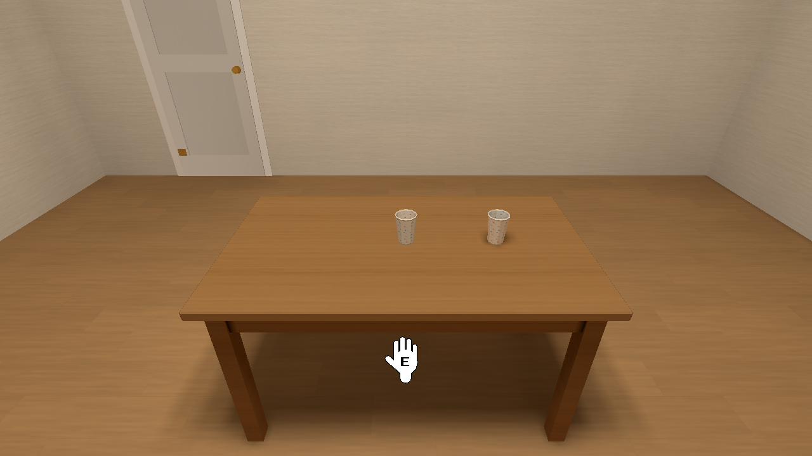
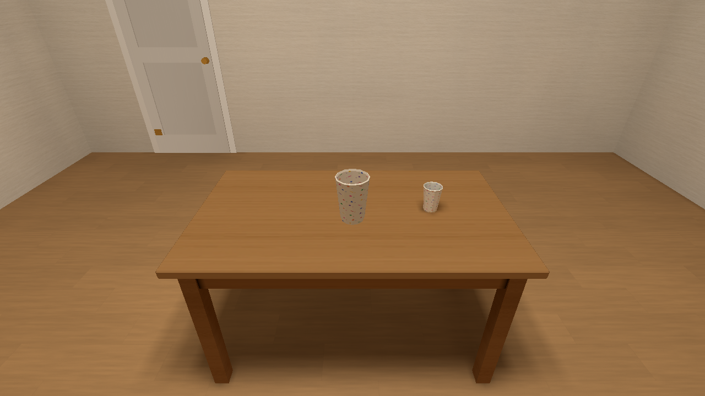

Placements select motion explicitly:

```json
"physics": {
  "motion": "dynamic",
  "shape": {"kind": "cylinder", "half_height": 0.061, "radius": 0.0425},
  "mass_kg": 0.025,
  "friction": 0.55,
  "restitution": 0.18,
  "pickup": true
}
```

Absent profiles retain legacy fixed scenery. An explicit `fixed` shape supplies immutable item collision while preserving the player’s existing `solid`/`size` box and static lighting. Fixed shapes enter queries immediately, including before any solver step, and have a separate 1024-placement cap. Routes, floating, animation, AI, balloon and lifetime ownership are refused for explicit fixed shapes; compatible static switches, labels, state, lighting and fade remain available.

**Authored movable props start dormant at their exact authored poses in every map**, even with imperfect scenery overlap. Pickup or a generic activation action wakes them; meaningful active-dynamic impacts also wake dormant dynamic bodies and chains before solver response. Natural sleeping after activation is distinct. `kinematic` props expose prescribed pose control. Movable props currently require passive rigid models; competing animation/AI/routes/components and attached lights are rejected.

The strict optional `assets/gameplay.json` supplies catalog-ID-based reusable physics and floor-friction profiles without changing visual catalog provenance. `/give` creates supported physical types through existing caches; unsupported types are labelled previews. The limits are sixteen given props and 128 movable/runtime bodies. Metadata round-trips through authoring, compilation and runtime; malformed fields, dimensions, mass, coefficients, hulls, scaling and counts are rejected. The full contract is in [MAP_AUTHORING_GUIDE.md](../MAP_AUTHORING_GUIDE.md).

Floor geometry stays continuous across material boundaries. Contact hooks resolve the existing support materials and multiply their friction with item friction; pack authors can set `ground_friction`. Player ice behavior is retained.

<a id="item-physics-0100-bowling-reset-and-recovery"></a>
### Bowling, reset and recovery

Arcade lane one uses its existing ten pins and Cobalt ball. Five convex sections follow the actual pin silhouette, including shoulder and neck; fixed gutter compounds follow the visible curved plastic instead of the recessed floor below it. Visual models/textures are unchanged. The return housing has a real reset switch.

Tiny unit-density hulls exposed an absolute eigensolver tolerance in the dependency’s inertia calculation. Mass properties now normalize density before combination and rescale to the requested mass. Native evidence retains the **5 kg ball / 1.5 kg pins**, pin COM y≈0.152384 m, and principal inertia≈0.001756 / 0.015031 / 0.015031 kg·m². The first solved rack impulse was 2.478 N·s, with finite activated pin mass before response. No mass-number workaround was used.

`physics.reset_group`, `reset_physics_group` and `activate_physics_group` are generic. Reset validates all destinations before mutation, restores authored poses and dormancy, clears linear/angular motion, forces, held ownership and interpolation, and reuses handles/resources. A live player, door or foreign body blocks the entire reset; unrelated state is preserved. Authored scenery intersections remain compatible.

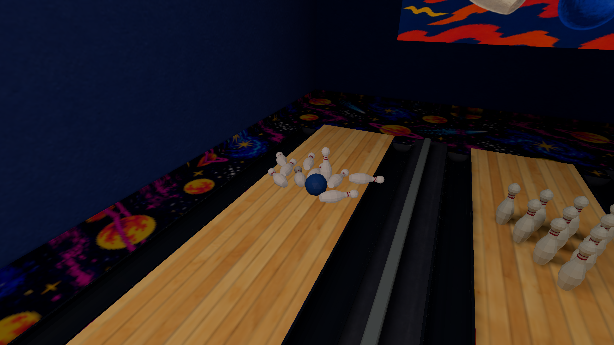

Recovery is a separate bounded safety net, never collision-test forgiveness. Escapes below local coverage or above closed local ceilings receive a one-second grace period; open-sky trajectories and lower floors/recesses remain valid. Invalid motion is caught before broadphase. Supported, full-shape-clear cached/authored/nearby poses restore safely; exact authored returns become dormant. If all candidates are blocked, a body suspends once and hides while retaining resources for reset. Original escaped pose, motion and reason remain diagnostic evidence.

Moving props use the existing dynamic lighting/culling/resource path, including current matrices, normals, probe anchors, direct visibility and contact shadows. Switchable indirect probe planes use prepared **PLPF v4**, with v2/v3 still readable. Only Arcade and the explicit tiny fixtures were baked for affected authored/probe data. The retained compiler that produced those packages verifies their provenance; later runtime/validation changes require no new lighting bake.

<a id="item-physics-0100-validation-and-performance"></a>
### Validation and performance

Formatting, workspace check, strict debug/release Clippy, release build and default/all-feature workspace tests passed: **2,310 / 2,316 total tests**, including 2,301 / 2,307 library tests. Nineteen existing opt-in GPU tests remain ignored. Eighteen focused physics tests take 0.03 s using small deterministic fixtures; extensions protect inertia/geometry, true pair onsets, kinematic reset velocity clearing, fixed-only authoring conflicts and initial query registration. No production-map bake enters default tests or CI. Source Python validation passed 388 tests with two skips; the asset validator reports 571 assets / 348 placeable / eight themes with no warnings, and the Arcade generator is current.

Sixteen final sequential SDL/Metal acceptance runs passed **5,295 checks**: two full bowling campaigns plus contacts/stacking/heavy impacts, seven fast floor/wall/door/corner/ramp/stair trajectories, constrained release, material seams, 30/144 Hz simulation deltas and bounded catch-up, dormancy/reset, target eligibility/HUD, switch/quality illumination, console/pause/noclip/reload and input gating, and twenty-body stress. Ordinary gameplay produced **zero escape recoveries**; two explicitly labelled invalid teleports separately verified recovery. Both solver and interpolated GLB vertices stayed above visible wood and gutter stock throughout both bowling runs. Screenshots and corrected encoded playback were inspected.

The existing bathroom-door regression view used the exact same preserved package/catalog, High/Full lighting, 2560×1440 drawable, 120 warmup frames and 600 measured frames. Three alternating pairs launched both binaries in the same way, with no other owned jobs. Values are medians of per-run statistics:

| Metric (ms) | Baseline median / p95 | Physics median / p95 |
| --- | ---: | ---: |
| Frame loop | 8.307 / 9.755 | 8.331 / 9.658 |
| Frame update | 1.398 / 1.692 | 1.342 / 1.677 |
| GPU timestamp span | 5.069 / 5.990 | 4.938 / 6.130 |

GPU spans include scheduling stalls and are not active-utilization measurements. An earlier mixed bundle/CLI campaign had wider GPU spans; the same-launch campaign above is the matched comparison. These short runs do not establish a causal speed improvement. Draw calls (274), visible indices (219,312), vertex buffers (20,483,056 bytes) and index buffers (493,212 bytes) are unchanged. Median peak RSS was **891.9→897.1 MiB**.

The twenty-body fixture peaked at eighteen active bodies and nineteen sleeping bodies; solver median/p95/worst were **0.030 / 0.081 / 0.382 ms** over 328 simulated frames with all twenty present, and peak RSS was 251.4 MiB. Entirely dormant four-body steps measured 0.000416 ms median / 0.000709 ms p95 (401 samples). Bowling’s twelve-body phase measured 0.154 / 0.584 / 2.201 ms. Logs now distinguish solver timing from the enclosing item-update adapter.

The corrected video is **600 consecutive native frames, 20 s, 1280×720, H.264/YUV420P, 30 fps, BT.709**, SHA-256 `50a1f308d628bd2fc765d217b111e2990fe44d466446bb55fdd884fa390b885a`. It replaces the original Library video as version 2; local binaries, playable packages, receipts and `run-arcade.sh` are retained under `local/item-physics-0.10.0/` outside Cargo’s target directory.

<a id="item-physics-0100-limits"></a>
### Limits

Cups use solid economical cylinders, without hollow-shell or liquid simulation. Kinematic control remains an explicit caller-owned seam; there is no new general entity controller or ragdoll system. Native acceptance was run on this Mac with scripted normal input dispatch and diagnostic fixture setup; other operating systems and browser gameplay are untested. The earlier intermittent native crash remains unresolved.

<a id="model-integration-0100"></a>
## Completed model integration — 0.10.0 staging

Adopted all 107 finished identities: 83 original Arcade models, two new benches,
16 Shared props and six entity rigs. Of 103 canonical GLBs, 102 remain byte-identical
to v36; Bepsi has the narrow print trim documented below. The five streamer colours share one neutral mesh
and bounded linear albedo tints; decoded family images and GPU uploads share
content identities. All 78 required unique PNG companions exist under assets.
The full accepted inventory, hashes and bounds are in assets/completed-models.json.

The three original archives, 191 editable payloads, checklist, manifests and
adoption notes remain on this Mac in Downloads/Places-completed-models-2026-10-14.
The included verify_delivery.py checked 372 files, 107 identities and 103 GLBs,
with no missing files, mismatches or unexpected runtime models. The delivery
manifest identifies master v36 with SHA-256
f5b832903a64c5c8ffea786ff2f568f89f6917b7077f39a2a0b2f500b87188d6;
the original master JSON itself was not bundled for an independent rehash.
Complete transfer results remain private in local/model-integration-0.10.0.

Catalog envelopes follow actual pivots and measured bounds. Cabinet positions
retain their original layout; light offsets follow the accepted exports. Pinball,
chair, cat and restroom envelopes were fitted. Six current cosmetic ball heights
follow the final triangle-contact manifest; the newer playable cobalt ball stays
on the approach. The reset switch now fits the return's accessible rear face.
Both opposite-upholstery benches occupy the east Arcade waiting wall. Native
movement stops against a seat and passes through their gap. The cat remains a
standalone prop and is absent from the Bepsi vending placement.

The pin's seven convex slabs follow its delivered profile; ball/pin masses remain
5 kg/1.5 kg with derived inertia. Gutter inner support and existing hulls remain
unchanged, including the documented 4.502298 mm inherited over-support and at most
1.154944 mm exterior refinement. Water buoyancy, drag, upright player dimensions,
dormant starts, carrying and bounded recovery remain intact.

Close native inspection exposed two delivery/integration defects. Bepsi's lower
printed opening overlapped its physical rim by 15–17 mm at the same depth. The
hash-guarded tools/props/trim_bepsi_dispenser.py moves 12 print vertices and their
affine UVs to leave a 0.2 mm gap. Exactly 96 bytes change; geometry elsewhere,
indices, normals, materials and images are unchanged. The original v36 archive
and editable master remain intact in Downloads.

Sink and toilet textures, normals and delivered meshes were correct. Full
lighting receivers could adopt a neighboring shallow-fold face, then clip their
sampling stencil against that different plane. Solver revision 21 uses the
existing numerical coplanarity tolerance for receiver ownership. The two-face
regression now covers both hard and shallow folds without tracing rays or baking
a map. In the diagnostic sink seam, the direct-light discontinuity falls from
0.3378 to 0.00108. Native fixture captures remove the broad wedges/splits while
retaining actual cavity, faucet and waterline shadows. No porcelain emission,
texture repainting or gameplay brightness compensation was introduced.

Cake candle_flicker, dim candle glow, named balloon body/string nodes and anchored
analytic idle motion are preserved. Cloth/gift fluorescence uses the actual UV
masks; metal housings remain nonemissive. Four hash-verified rectangular cloths
retain their 1.0495164 U overscan with clamp sampling. Ordinary UV limits and the
106 MiB unique decoded pack budget remain: 75.23 MiB shared versus 194.13 MiB
without image sharing. Historical exporters protect completed hashes rather than
regenerating the superseded models.

Denser geometry requires eight Full atlas pages. The typed record allowance is
384 MiB plus 64 KiB, retaining exact shape checks, the 512 MiB KTX2 limit and
1 GiB aggregate cap. A focused grazing-moment regression exposed unstable f32
calibration; finite surface energy now uses an isotropic representation when that
encoding fails the unchanged strict energy check. The final solver-21 Arcade
30m05s bake contains eight pages and 1,575 irradiance probes, with no Full
fallback and no compiler warnings. A sandboxed attempt could not access Metal
for final reflection capture; the successful run used verified native GPU access.
All eight supported packages passed require-current verification and fresh native
scene checks. Current receipts are preserved locally. Archived places_demo and
model_zoo remain unbaked JSON history; default Rust checks and CI bake no maps.

| Actual validation | Result |
|---|---|
| cargo fmt --all --check | Passed |
| cargo clippy --workspace --all-targets --all-features -- -D warnings; release equivalent | Passed |
| cargo test --workspace; --all-features | 2,320 / 2,326 passed; 19 existing GPU-only ignores |
| Source Python suite; asset audit; generator/clip checks | 356 tests, four skips; zero audit errors; passed |
| Native bowling / published normal-transform campaign | 944 / 468 checks passed |
| Native water acceptance | Six scenarios, 243 checks passed |
| Native scenes / rigs / materials | Eight supported scenes, 19-model fixture, all 24 rig clips; passed |

Native High/Full captures verify both bench colours, cake/balloon motion,
UV off/on/restored, mirrors and opening doors. Fixed cabinet far/near/far images
are RGB-identical; static UV regions restore exactly. Static mode is confirmed
by the renderer's off-atlas runtime state. Thirteen curated 1280×720 captures
are under local/model-integration-0.10.0/screenshots. Zero models failed or assets
were missing; four untextured draws intentionally use the committed white PNG.
Moving restroom leaves retain the existing parametric implementation; the remade
static stall-door GLB was verified in the explicit fixture. Full and Static
Arcade follow-up runs each passed eleven camera captures with zero unpresented
scene events, including four Bepsi angles and sink/toilet interiors. Three
defect captures are also saved to Library, with complete transfer results and
version xattrs retained.

Two final alternating idle 600-frame pairs with 120 warmup frames use the same
clear eye (6.7,1.6,9.5), yaw/pitch (275,0), Apple M2 Pro/Metal, 1280×720 drawable,
High textures/filtering, Full lighting/reflections, bloom and vsync off. The
baseline uses the verified water-stage binary/package and original assets,
including four runtime resources outside its package dependency list. Every
run presented all 720 ready frames with no misses. No owned compiler, captures,
body traces or scripted motion were active. Earlier valid adoption measurements
remain separately preserved; incomplete/collision-shifted preliminary runs are
excluded.

| Matched cabinet view | Water baseline | Final adopted models |
|---|---:|---:|
| CPU frame median | 2.594–2.670 ms | 2.624–3.133 ms |
| CPU frame p95 | 6.652–6.779 ms | 6.364–6.426 ms |
| Update median | 1.181–1.200 ms | 1.531–1.534 ms |
| GPU median | 2.422–2.480 ms | 2.012–2.998 ms |
| Visible triangles / draws | 24,804 / 123 | 77,774 / 99 |
| Animated vertex slots | 12,256 | 24,516 |
| Peak native RSS | 834–847 MiB | 1,246–1,272 MiB |

The mean CPU-frame increase across these pairs is 0.246 ms (9.4%); update cost
rises about 0.342 ms. GPU and submission timings vary between pairs, so neither
pair establishes a stable gameplay FPS result. Approved animation vertices and
3.14× visible geometry add work, while draws fall. Image hashes run during
uploads, outside the frame loop. Atlas CPU/GPU storage grows by 288/144 MiB,
accounting for most of the roughly 418 MiB RSS increase. This is one idle view
at 1280×720, not the user's actual-resolution 60-versus-120 FPS case or a
worst-case campaign. Multicore implementation and that independent Arcade
investigation remain the next stage; they were not started here. Exact receipts,
branch/remote/CI evidence, runtime preservation and ownership release are
recorded in the local handoff.

<a id="modular-railings"></a>
## Modular railings and fences

The Office shaft, Winter porch/pond fences and Lantern Hollow gardens use
file-backed modular props with shared grounded supports. Straight sections
fit between posts; one capped support closes a corner or terminal. Existing
rooms, walls, floors, water, weather and navigation routes retain their layouts.

`props[].span` fits only the run axis and shears height along it, keeping
balusters upright on slopes. Its continuous collision uses bounded slices
along the same baseline. `material_overrides` replaces selected opaque GLB
material slots from the catalog; snow retains its own material. Preparation
batches compatible instances and shares image allocations. Linking and vertex
fitting do not run per frame. Fitted model UVs clamp; catalog world tiling and
reflection modes do not apply to these overrides.

The timber two-rail section/post are extracted from the existing Outdoors
fence stock, with identical source vertices, UVs, colours and texture pixels.
Winter adds closed, supported snow. The porch kit's old export fitting shifted
the lower rail and distorted corner anchors; corrected exports keep measured
rail elevations and small timber chamfers. No production PNG artwork changed.

The cloud Winter ZIP and preview could not transfer, including one bounded
retry. Those models were **not installed**. This implementation uses existing
repository geometry and source-derived reusable components.

<a id="modular-railings-local-validation"></a>
### Local validation

Validation and native acceptance receipts are preserved under
`local/railings-0.10.0/`, outside `target`. The final report records command
outcomes, executable/package identities, native captures and frame costs.

| Gate | Result |
| --- | --- |
| Format; strict all-target/all-feature Clippy, debug and release | Pass |
| `cargo test --workspace` | 2,328 library tests passed, zero failures; binary/integration tests passed |
| `cargo test --workspace --all-features` | 2,335 library tests passed, zero failures; binary/integration tests passed |
| Python source suite | 359 tests, zero failures; four explicit native-only skips |
| Catalog validation | 577 assets, 354 placeables, zero warnings |
| Full read-only asset audit | 350 distinct models, zero integrity errors |
| Texture and prop checks; affected generators; patch whitespace | Pass; texture check retains 96 preferred-size/manifest advisories |

The 19 ignored Rust diagnostics remain explicit native/measurement workflows.
Native acceptance below is separate from those source-test results.

The small added regression fixtures protect shared corner/end supports,
whole-footprint slope grounding, upright span transforms, continuous collision,
schema boundaries, material-slot isolation and compiled image restoration.
They do not bake any shipped map; the package test uses a 2×2 m Static fixture.

Read-only source/GLB review measured 489 post-base samples: every support
contacts its floor, with 6–52.6 mm of base penetration in Office and 6 mm in
Winter/Lantern Hollow. No duplicated post positions were found. Every section
endpoint penetrates a structural post footprint by at least 7.99 mm.

| Authored content | Sections | Shared posts | Drawn kit triangles | Barrier slices |
| --- | ---: | ---: | ---: | ---: |
| Office | 41 | 45 | 11,784 | 223 |
| Winter | 10 | 13 | 1,962 | 66 |
| Lantern Hollow | 24 | 32 | 7,328 | 168 |

Bare fence section/post cost 24/36 triangles; snowy section/post cost 156/102.
Each section is one prop containing its rails/balusters, with no per-slat
entities. Only the three affected active packages are rebuilt; no archived
Demo or Model Zoo package is baked.

<a id="modular-railings-native-acceptance-and-cost"></a>
### Native acceptance and cost

All three rebuilt packages pass `validate` and `verify --require-current`.
Twenty-seven genuine Metal acceptance runs pass, including the exported Mac
app: Full/Static lighting, flashlight toggles, slope/endpoint/corner views and
eight held-control movement cases. Office reaches both ramp landings and stops
walking/jumping against its rails. Winter keeps its lodge approach clear and
blocks the capped fence post. The garden fence stops the player at its drawn
face. No new floor/wall holes or floating supports were observed on those routes.
These are scripted native-controller checks, not physical-keyboard coverage.

The three unedited 1600×900 captures below show the shared Office corner under
the flashlight, Winter's timber/snow terminal and the supported garden modules.

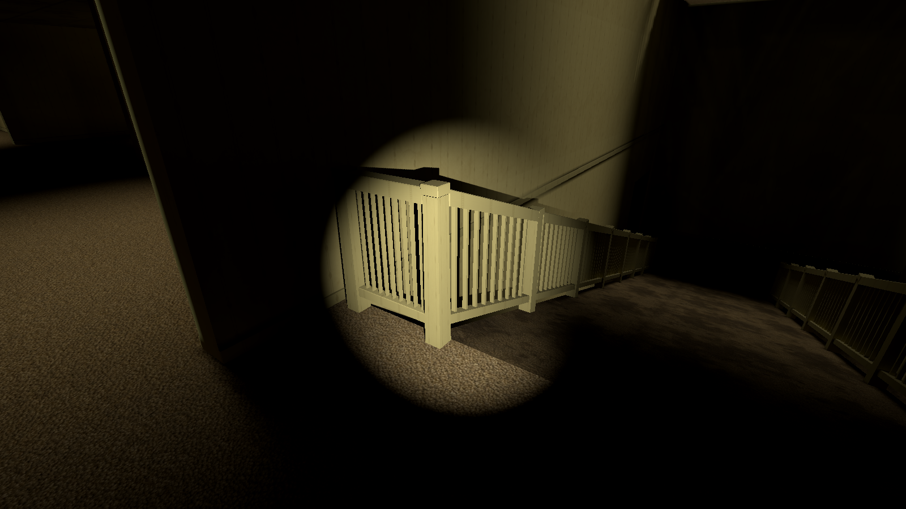

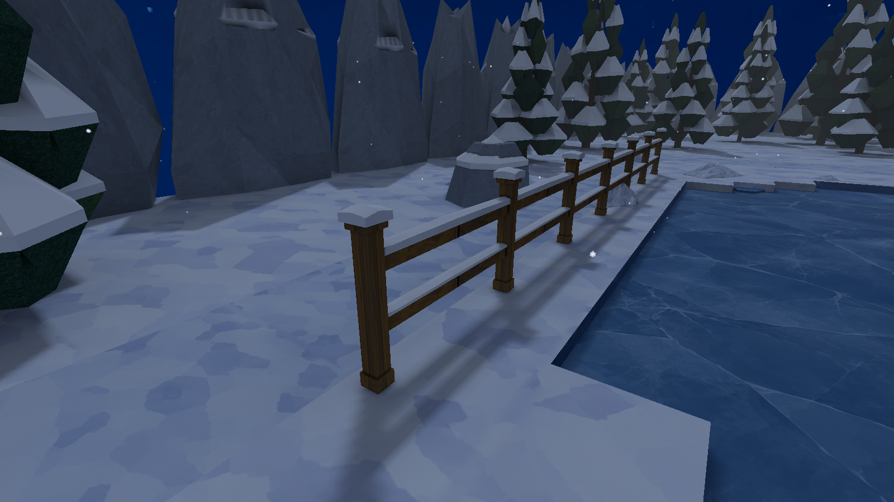

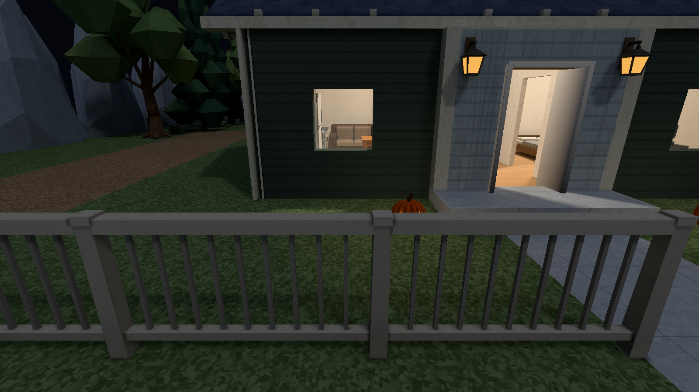

Fixed-camera ABBA measurements use the pre-change player/packages and the final
player/packages on the same M2 Pro/Metal host. Each side has two 300-frame runs,
60 warmup frames per run, High textures, Full lighting, reflections Off, bloom
On and a 1600×900 drawable. Builds finished before measurement. GPU samples are
deduplicated; explicit completion waits make these comparisons unsuitable as
ordinary gameplay FPS claims.

| View | Base-scene draws, before → after | Level vertices, before → after | Median GPU ms, before → after |
| --- | ---: | ---: | ---: |
| Office slope | 59 → 61 | 53,172 → 83,796 | 0.720 → 0.791 |
| Winter fence | 30 → 32 | 336,408 → 337,142 | 1.841 → 1.356 |
| Garden fence | 305 → 306 | 738,248 → 745,010 | 1.526 → 1.511 |

Material changes per sampled frame are 27→29, 23→26 and 204→205 respectively.
Office's VBO grows from 4.46 to 7.03 MiB. Its Full atlas grows from 144 to
192 MiB: one additional page across the base and two switched-light states.
Winter and Lantern Hollow retain their 96/160 MiB Full atlas allocations.
The matched stationary Office update median is 1.566→1.567 ms. The garden GPU
difference is within run spread; the other values describe these particular
changed views, rather than a general engine speedup. Machine receipts retain
all samples, hashes, source/model/atlas inventories and package/native identity
checks under `local/railings-0.10.0/`.

The preserved standalone export contains the three refreshed maps. The five
untouched repo-local packages retain their old catalog provenance and need
rebuilding before use with this new catalog; their files were preserved as
requested. Packages, binaries and full campaign logs remain outside Git.

<a id="multicore-0100"></a>
## Multicore runtime and Arcade performance — 0.10.0

The normal player now uses measured, bounded CPU parallelism. On this M2 Pro,
the final player's same-build cabinet comparison reduces CPU update **28%**;
heavy water work improves **30–45%**. Arcade's Full closed-door GPU interval
falls **39%**, and final loop p95/p99 fall **36%**. These results address the
reported fluctuating drops toward roughly 60 FPS. Remaining tails and smaller
regressions are recorded below; an unconditional 120 FPS lock is not claimed.

Eight published packages, textures, shadows, lighting quality, content, physics
parameters and fixed steps are preserved. No map is rebaked, no asset is
redesigned, and sound remains deferred.

<a id="multicore-0100-runtime-execution"></a>
### Runtime execution

One persistent `runtime_work` Rayon pool serves dirty receiver lighting,
Full-lighting character skinning/environment preparation, and water immersion
quadrature. Automatic capacity is at most four workers, reserving one available
logical CPU outside that budget; developer overrides are bounded to eight and
the hardware budget. One-core hosts, wasm32, thread-creation failure and small
jobs use the same work inline. There is no player setting or per-frame thread
creation. Loading retains its existing bounded preparation/cancellation path.

Measured gates are eight dirty lighting receivers, 8,192 changed vertices
across at least two characters in Full lighting, and 64 awake enabled dynamic
water bodies. Jobs borrow disjoint output slots, then join. GPU queue writes,
SDL, ordered physics impulses and fixed solver steps stay on the caller.
Vertex/water staging is reused; no results remain queued across map changes or
shutdown. Arcade character staging adds about 2.2 MiB. Future real-time audio
callbacks must not allocate jobs for, lock, or wait on this synchronous pool.

Exact lighting revision/placement/bounds/caster keys avoid unchanged sampling
and emitter scans. A moving balloon center inside its stable swept envelope
updates its center sample without rebuilding spatial anchors. Legacy APIs still
resample mutable fields. Resource installation and fixture switches advance the
renderer revision. Vertex order, inverse-transpose normals, UV response and
physics application order are preserved.

Static character preparation remains interleaved with uploads. A same-binary
control showed batching its shorter GPU workload raised frame-time tails;
the installed environment selects the corrected policy during live switches.
Water and receiver lighting retain their independent work gates.

Rapier 0.36.1's own solver parallelism is measured separately through optional
`parallel-physics`. Its
[determinism contract](https://rapier.rs/docs/user_guides/rust/determinism/)
covers worker-count independence subject to platform/compiler conditions.
Rapier's `None` pool selects Rayon's global pool, so its reference uses an
explicit bounded one-worker pool. Heavy solver work shares the runtime pool;
entry is 128 awake enabled dynamic bodies, exit fewer than 112 for 0.25 seconds.
Unchanged bindings are retained; explicit developer comparisons bypass policy.
The feature stays **off in production**: its overhead outweighs the total
benefit at current scene sizes. Actual parallel lighting, skinning and water
ship independently of that feature.

<a id="multicore-0100-arcade-bottleneck-and-fixes"></a>
### Arcade bottleneck and fixes

The Full spatial entity shader reconstructed the same eight trilinear weights
for indirect light, attenuation and direct-source visibility. A large nearby
receiver covers much of the Retina door view, magnifying that fragment cost.
It now computes two vectors once and reuses them, preserving corner order and
each `(x * y) * z` product. Fully occluded direct sources lose only their
strength when all eight anchors and four visibility lanes are exactly zero;
partial blending, water throughput and finite-emitter taps remain intact.
That source pruning alone did not materially improve the pilot.

The shared shader skips fog only when global density and regional count are
both zero. Completely overwritten fullscreen postprocess targets clear instead
of loading prior pixels; their quad has no blending/depth and single-sample
output. Controlled preceding-candidate repeats improved GPU intervals about 3%
at the door and 5% at cabinets for this attachment change. There is no map-name
check or quality concession.

The user clarified that FPS fluctuated toward roughly 60 rather than holding
an exact cap. Published door loop tails around 15–20 ms are consistent with
those drops, while representative views are below the 8.33 ms 120 Hz budget.
This is an inference from matched timings, not a replay of the user's monitor
telemetry. Reducing CPU work alone would not fix this GPU-heavy view.

<a id="multicore-0100-matched-native-measurements"></a>
### Matched native measurements

Apple M2 Pro/Metal, **3024 × 1898 physical pixels**, 1512 × 949 logical,
Retina scale 2, fullscreen, High textures/filtering, Full reflections, bloom,
FOV 60, identical packages/assets. Main runs use uncapped Immediate presentation;
there is no engine frame-cap setting. Each warms 120 ready frames and measures
600 at a fixed 1/60-second simulation step. Runs alternate order with no owned
build/bake/native contention. The harness rejects mismatched drawable, settings,
package, player bounds, reflection count or median submitted geometry.

GPU numbers are unioned pass-stage elapsed intervals, including scheduling
stalls. Overlapping Metal timestamps cannot be added or interpreted as exclusive
pass cost/active utilization. Hardware bandwidth/utilization and pixel-overdraw
counters were not collected. CPU update/render/submission, swap, geometry,
physics state and RSS receipts are retained.

The initial eight-scene campaign has 23 accepted pairs across 48 runs, all with
zero missed ready surfaces. One lateral pair differs by one 5 cm input step and
is excluded. Median of per-run statistics, milliseconds:

| View | CPU update before → after | GPU before → after | Loop before → after | Loop p95 before → after | Loop p99 before → after |
| --- | ---: | ---: | ---: | ---: | ---: |
| Arcade closed door | 2.205 → 1.192 | 11.582 → 7.092 | 10.847 → 6.584 | 14.518 → 8.637 | 16.857 → 9.033 |
| Arcade lateral movement | 1.785 → 1.046 | 6.819 → 4.431 | 6.261 → 3.900 | 9.168 → 6.029 | 10.677 → 7.260 |
| Arcade cabinets, one reflection | 1.550 → 1.009 | 4.204 → 4.130 | 3.470 → 3.651 | 5.997 → 5.917 | 6.800 → 6.325 |
| Arcade party room | 1.574 → 0.914 | 3.339 → 3.252 | 2.415 → 2.365 | 4.016 → 4.565 | 4.690 → 5.119 |
| Arcade bowling lanes | 1.582 → 0.909 | 3.767 → 3.728 | 2.928 → 2.972 | 4.566 → 5.071 | 5.383 → 5.563 |
| Home | 0.020 → 0.021 | 2.289 → 2.412 | 1.702 → 1.727 | 3.226 → 3.246 | 3.585 → 3.752 |
| Pool, dormant startup | 0.058 → 0.026 | 2.948 → 3.205 | 1.744 → 1.727 | 3.711 → 3.939 | 3.986 → 4.172 |
| Office | 1.471 → 1.380 | 1.990 → 2.083 | 2.182 → 2.128 | 3.257 → 3.526 | 3.815 → 3.818 |

All accepted pairs submit identical geometry: door 233 draws/117,902 triangles;
cabinets 98/76,238 plus one reflection. Several GPU/loop tails rise in lighter
views despite better CPU update; this is not a universal FPS gain. Peak RSS is
1320 → 1316 MiB at the door and 1313 → 1308 at cabinets, with noisier lateral
+83 MiB. No atlas expansion occurred. Earlier 41.99 → 11.70 ms lighting results
and small-window model-adoption measurements are separate baselines.

That campaign uses candidate `d6d4d757789c…`. Subsequent changes gate water-pool
initialization/64-body dispatch and keep Static uploads interleaved; the Full
shader/preparation path is unchanged. Final player `f7932d448807…` controls are
separate: two pairs/view for Full, three for Static.

| Final mode/view | CPU update before → after | GPU before → after | Loop before → after | Loop p95 before → after | Loop p99 before → after |
| --- | ---: | ---: | ---: | ---: | ---: |
| Full door | 2.234 → 1.259 | 11.606 → 7.052 | 9.814 → 7.185 | 16.513 → 10.583 | 19.708 → 12.569 |
| Full cabinets | 1.540 → 1.030 | 4.194 → 4.127 | 3.616 → 3.661 | 5.913 → 5.963 | 6.746 → 6.970 |
| Static door | 1.268 → 1.197 | 1.926 → 1.843 | 2.315 → 2.203 | 4.265 → 4.312 | 5.170 → 4.789 |
| Static cabinets | 1.289 → 1.260 | 2.680 → 2.834 | 2.087 → 2.015 | 3.526 → 3.635 | 4.879 → 4.771 |

Final door GPU improves 39% again, loop median 27% and p95/p99 36%. Its residual
tails remain above 8.33 ms and vary across campaigns. Render/submission tails
dominate; uncapped door swap p99 is about 0.11 ms. Cabinets remain roughly
throughput-neutral despite lower CPU update, with small upward tail differences.

Static's earlier batching regression was repeatable: identical-binary inline
versus automatic cabinet GPU 2.843–2.864 versus 3.235–3.239 ms, loop p95
3.574–3.606 versus 4.119–4.240 ms. Interleaved uploads correct that large cost.
Final Static cabinets retain a repeatable covered-GPU increase **0.11–0.21 ms
(4–8%)** and aggregate loop p95 **+0.109 ms (3%)**. Individual p99 pairs vary,
including one worse final run; aggregate p99 improves. The remaining driver/
shader/cadence contribution is unresolved. This residual is not hidden by Full's
gain, and Static is not claimed as a GPU win. Its sampled tails stay below
8.33 ms. Static is the existing UI label for internal off/vertex lighting;
its existing policy suspends reflections, so it is an independent control.

The final player's own two-pair inline/automatic Full cabinet comparison shows
CPU **1.402 → 1.005 ms (28% lower)**, p95 1.745 → 1.380 and p99 1.815 → 1.527.
GPU is 4.124 → 4.129; loop 3.678 → 3.772, p95 5.844 → 5.912 and p99
6.819 → 6.998 ms. Parallel work frees CPU headroom while that loop remains GPU/
submission limited. Earlier three-pair low-load controls start no runtime
workers in Home/Pool: update stays 0.019 ms in Home and 0.023 → 0.024 in Pool;
loop 1.676 → 1.686 and 1.739 → 1.715 ms, with noisier Pool p99.

A separate Retina Fifo door pair gives loop 10.693 → 8.342 ms, GPU
11.284 → 6.580, update 2.227 → 1.414, candidate p95/p99 8.655/9.815.
Three Home Fifo pairs show roughly 17 ms p95 in one published and one candidate
run, about 10.6 ms otherwise: no consistent paced regression/gain is established.
Diagnostic stage samples support the bottleneck analysis but are excluded from
acceptance timings.

<a id="multicore-0100-physics-and-correctness"></a>
### Physics and correctness

Five alternating repetitions of bounded 12/32/64/128-body contact, immersion
and dormant fixtures use 240 fixed steps/24 warmup. Only `ItemWorld::step` is
timed; velocity refreshes and per-frame state/contact/impulse hashes are outside
the timer. All **120** final one/four-worker and cross-feature comparisons are
exactly equal.

| Immersed bodies | Normal build inline → four workers, median ms | p99 ms | Policy |
| --- | ---: | ---: | --- |
| 12 | 0.024959 → 0.024958 | 0.032667 → 0.037542 | Both inline; timing noise |
| 32 | 0.063208 → 0.063208 | 0.077875 → 0.079167 | Both inline |
| 64 | 0.125292 → 0.087979 | 0.146125 → 0.117416 | Parallel, 30% gain |
| 128 | 0.252062 → 0.139145 | 0.287083 → 0.175375 | Parallel, 45% gain |

A 32-body pilot saved only 3.5% median while worsening p99 by 0.015 ms, motivating
the 64 threshold. Dry/dormant/sleeping entries cannot start unused water workers.
At 128 contacts, optional Rapier parallel changes its own reference
0.25310 → 0.21933 ms versus ordinary Rapier 0.22304: little total benefit.
Optional parallel-solver water at 128 costs about 0.162 ms versus normal plus
parallel water 0.139 ms. Smaller solver scenes cost more with the feature.

Final source passes fmt, strict workspace/all-target/all-feature Clippy in debug
and release, default Rust tests **2,325 passed**, all-feature **2,332 passed**,
and normal/optional release builds. Python source contracts: **356 run, four
existing skips**. Gates use empty `RUSTC_WRAPPER` because inherited sccache's
socket is unavailable in the sandbox; no gate bakes or requires shipped maps.
The 19 existing GPU-dependent Rust cases remain explicit desktop checks. The
existing 16 × 16 native GPU analytic normal/direction/visibility/direct-light
check passed separately. New small regressions protect joined slot reuse,
lighting/cache invalidation, normal/vertex/bounds parity, zero-source boundaries,
solver hysteresis and exact one-step 64-body water state (~9,216 simple rays).

Native acceptance preserves existing workflows:

- Bowling: **944 checks**, real pickup/drop/throw, contacts/gutters, blocked and
  held-member resets, two complete rounds; peak 11 active bodies, final dormant.
- Water: **243 checks**, six cases covering dormancy, settling, ownership,
  live quality, posture/entry/crouch/surface/shelf/deck and contacts. Five cases
  use Retina; the player case passes its original 1280 × 720 workflow.
- Moving receiver: **468 checks** at 1280 × 720 using the preserved small ball
  fixture, covering held/thrown motion, dim-room boundaries and fixture switches.
- Eleven matched capture pairs cover all eight packages and relevant Arcade
  views: nine identical, door seven pixels and Lantern one pixel different,
  maximum 1/255. Four final Full/Static door/cabinet pairs repeat that result:
  three identical, Full door seven pixels at 1/255, all at Retina resolution.
- Two 36-second lifecycle sessions each pass eight world commits across Arcade,
  Pool, Home and Office, repeated loads, UV/Full/Static/Medium/High switches,
  six captures, zero native validation errors and clean shutdown. Transient RSS
  peaks 1.23–1.52 GiB settle to 884–904 MiB near the final Arcade replacement.
  This checks resource return, not long-duration leaks or all driver caches.

Rejected/limited attempts remain separate: a wrong-drawable settling run passed
when retried at the required size; fullscreen water-player short shelf/deck
targets fail in both published and candidate while the original windowed case
passes. The fullscreen bowling plan exceeds its existing 60-second action budget
before launch; its supported windowed workflow passes. No fullscreen shelf/deck
claim or gameplay fault is inferred. Main performance/captures are Retina.
No other hardware, browser execution or physical single-core host is claimed;
the inline override and fallback code were checked.

<a id="multicore-0100-deliverables-and-repetition"></a>
### Deliverables and repetition

`local/multicore-0.10.0/runtime-deliverables.json` and `handoff.json` retain exact
publication, binary/package identities and custody. All four binaries and the
playable `play/Places-multicore.command` are outside `target`:
`bin/places-f7932d448807`, `bin/places-compile-5b0a868bc651`,
`bin/places-physics-bench-3cf470a75be3`,
`bin/places-physics-bench-parallel-0bd04d556491`. Eight packages retain their
published hashes under `assets/levels`.

Receipt groups: `final-full/accepted-summary.json`, `final-{static,full,inline}-policy/`,
`shipping-inline/`, `shipping-{vsync,vsync-home-repeat,static,static-repeat,static-inline}/`,
`physics-shipping-*.json`, `shipping-captures/`, `final-policy-captures/`,
`shipping-bowling-windowed/`, six accepted water case receipts,
`shipping-lighting-ball/`, `{native-lifecycle,final-policy-lifecycle}/`, and
`static-policy-gates/`. Large trace logs are gzip-compressed with an archive
manifest; decompress before re-auditing. Rejected receipts are labelled separately.

```sh
python3 tools/bench/multicore.py \
  --binary local/multicore-0.10.0/bin/places-f7932d448807 \
  --out local/new-inline-check --scenes cabinets home pool
python3 tools/bench/multicore.py \
  --binary local/multicore-0.10.0/bin/places-f7932d448807 \
  --baseline-binary local/model-integration-0.10.0/bin/places \
  --out local/new-published-check --scenes door lateral cabinets party lanes home pool office
local/multicore-0.10.0/bin/places-physics-bench-3cf470a75be3 \
  --workers 4 --frames 240 --repeats 5
```

Build first; measure in a fresh output directory with one native session and no
owned build/bake contention. Add `--lightmaps static` or `--vsync` for separate
controls. The tools never bake maps or run automatically in CI. No next queue
stage is started.

<a id="performance-0100"></a>
## Arcade doorway performance — 0.10.0 staging

Native measurements on 13 October 2026 reproduced near the reported severity:
the closed bathroom door at close range took **41.99 ms median (23.8 FPS),
47.34 ms worst (21.1 FPS)**. The corrected shader took **11.70 ms median
(85.4 FPS)** at the same resolution and quality, a 72% frame-time reduction.
At the more distant bathroom position, still and lateral runs improved by
69%. Exact sustained 20 FPS was not reproduced; the user's precise camera
position was unspecified.

<a id="performance-0100-cause-and-correction"></a>
### Cause and correction

Movable-object direct lighting interpolated eight receiver anchors separately
for each of four emitter taps. Each scalar lookup also explicitly copied a
176-byte anchor containing its entire visibility array into fragment-local
storage. `world.wgsl` now reads just the selected source's four visibility
channels from uniform storage, interpolates the vector once per source, and
uses each independent channel for its original tap. Source selection,
trilinear weights, clamping, falloff, cosine, attenuation and indirect lighting
are preserved. This applies to all objects using this lighting path, without
a map or camera special case. The two changes were measured together; their
individual contributions and actual GPU register spills were not isolated.

The existing GPU meter also added overlapping Metal stage spans. Three bounded,
labelled native samples showed seven overlapping spans: one summed to 98.161 ms
but covered only 16.012 ms. The meter now unions a fixed maximum of sixteen
intervals, counting overlap once and excluding disjoint gaps. The overlay calls
this **GPU elapsed**: stage timeline coverage can include scheduling stalls,
and is neither active execution time nor device utilization. The three-slot
asynchronous readback still skips busy slots instead of waiting. Individual
pass spans cannot establish additive pass costs on this backend.

The closed door still submits geometry behind it under existing frustum culling.
That fact alone did not establish the cause. A same-build depth-prefill pilot
changed still median 14.87→14.70 ms and motion 14.64→14.53 ms; it was discarded.
Splitting the opaque/discard shader path also produced no material gain and was
discarded. No visibility, depth, collision, map, texture, lighting or reflection
quality changes remain. No packages were rebaked.

<a id="performance-0100-matched-measurements"></a>
### Matched measurements

Hardware: Mac14,9, Apple M2 Pro (19 GPU cores), 16 GiB, macOS 27.0.1
(26A434), native wgpu/Metal, Bgra8UnormSrgb/Depth32Float, timestamp period
1 ns. High textures and filtering, Full lightmaps and reflections, bloom on,
FOV 60°. All 22 Arcade fixtures were on; entry and three stall doors were
closed, angle 0°, unobstructed. No additional frame cap was applied.

Windowed runs used logical 1280×720, **2560×1440 drawable, Retina 2×**.
Still eye `(−1.6, 1.6, 2.8)`, yaw/pitch `(90°, 0°)`. Lateral runs retained
X/Y and camera, moving Z approximately 1.65–4.05 at 3 m/s. The tool scripts
right at simulation seconds 2–2.4, then alternating left/right for 0.8 seconds.
Simulation uses 1/60-second steps; reported timings are real wall time.
Each run warms up 120 ready frames. Three alternating before/after pairs
provide 1,800 measured frames per condition. GPU samples are deduplicated by ID
(1,016–1,080 samples); they arrive asynchronously and are not paired with the
current CPU row. Median is the arithmetic middle; p95 uses nearest rank.

Fullscreen still eye `(−0.65, 1.6, 2.8)`, same camera, logical 1512×949,
**3024×1898 drawable, Retina 2×**, 360 measured frames per build. Actual
drawable dimensions differ from the panel's 3024×1964 dimensions. A separate
fullscreen motion pair changed drawable height and is excluded from comparisons.

All values below are milliseconds; CPU loop cadence includes update, render
preparation, drawable/presentation waits and pacing.

| Condition | Before median / p95 / worst | After median / p95 / worst | GPU elapsed median, before → after |
|---|---:|---:|---:|
| Windowed still, Immediate | 14.885 / 17.292 / 27.107 | 4.647 / 6.278 / 15.494 | 15.348 → 5.104 |
| Windowed lateral, Immediate | 14.722 / 23.805 / 29.235 | 4.513 / 6.497 / 18.116 | 14.993 → 4.876 |
| Close fullscreen still, Immediate | 41.988 / 45.807 / 47.341 | 11.704 / 13.512 / 19.935 | 42.701 → 12.400 |
| Close fullscreen still, VSync/Fifo | 41.784 / 42.393 / 46.003 | 11.546 / 12.364 / 14.550 | 42.386 → 12.109 |
| Final publication build, same Fifo repro | — | 11.565 / 12.023 / 12.331 | 12.092 |

Still submissions remained 274 base-scene draws / 73,104 triangles; lateral
median 275 / 73,224, maximum 294 / 76,458. No planar pass was active in this
door view. Baseline fullscreen update median was 0.804 ms. A separate three-second
sample found 162/230 main-thread samples waiting in `CAMetalLayer.nextDrawable`;
the CPU render interval therefore must not be read as active CPU work.
A same-final-build timestamp-off control gave median 11.533 ms versus 11.565 ms
with timing; p95 varied 13.499 versus 12.023 ms. This does not support material
instrumentation overhead, but does show pacing jitter.

Codex, browser and WindowServer remained active; no owned build ran during timing.
Representative load averages were 1.8–2.6, and the final run 2.7→2.4; receipts
retain each run's load. No thermal warning was reported. Three separate device
observations saw 100% whole-device GPU utilization and about 682 MiB player RSS;
these include other apps and do not imply an utilization improvement. Captures,
raw traces, the CPU sample and settings transitions are excluded from headline
timings. This is bounded Mac evidence, not a cross-platform performance guarantee.

<a id="performance-0100-controls-visuals-and-remaining-limits"></a>
### Controls, visuals and remaining limits

The adjacent bathroom view stayed approximately 1.94→1.89 ms; its p95 varied
2.93→3.14 ms. The mirror view retained its planar pass, GPU median 2.889→2.151 ms.
At `(−2,1.6,2.8)`, the entry was verified Open, 90°, unobstructed, with stalls
closed and lights on: loop median 11.231→4.617 ms, p95 23.400→12.970 ms.
An earlier interaction from inside the swing arc reversed and was excluded as
an open-door control.

Arcade party and cabinet views, Home and Office basement were also checked.
Home GPU median changed 1.357→1.155 ms; Office 2.078→1.468 ms while loop median
remained about 1.95–1.97 ms. Party's first p95 worsened 4.071→12.168 ms;
a reversed-order repeat gave 4.069→2.887 ms. Pool's first loop median worsened
2.104→2.674 ms; repeat 1.720→1.385 ms. Pool also contains gravity movement.
These short control runs expose background/presentation variation and do not
establish a uniform FPS benefit or eliminate every dip.

Six unmodified native 2560×1440 captures at ready frame 120 are **byte and pixel
identical within each pair**, including the legitimate open door and reflections:

| View | Baseline | Final |
|---|---|---|
| Closed entry | [before](../images/performance-0.10.0/door-before.png) | [after](../images/performance-0.10.0/door-after.png) |
| Open entry | [before](../images/performance-0.10.0/open-before.png) | [after](../images/performance-0.10.0/open-after.png) |
| Bathroom mirrors | [before](../images/performance-0.10.0/mirrors-before.png) | [after](../images/performance-0.10.0/mirrors-after.png) |

All eight packages passed current dependency verification and clean native
load/presentation checks: Pool, Home, Lantern Hollow, Winter, Beach, Frutiger Aero,
Arcade and Office (180 ready frames each, no skipped ready presentation or device
validation error). Repeated doorway crossings plus texture/filtering/lightmap,
reflection and bloom transitions completed and returned to High/Full settings.
That diagnostic retained an existing **1.805-second settings-transition pause**
(1.800 seconds in update), excluded from steady measurements. It remains open.
The original intermittent gameplay crash remains unexplained; these sessions
do not establish a crash fix.

<a id="performance-0100-reproduction-and-verification"></a>
### Reproduction and verification

Start point: `0.10.0-staging` and origin verified at
`2a3dfd573a7eff6486231fd5e94d07a423500ec2`, origin
`https://github.com/csd113/Places`. Local evidence and retained executables live
under `local/performance-0.10.0/`. Main comparisons use the original shader with
the corrected meter (`before-meter-release`, SHA-256
`aa29cac7298106e3204cbbc666a28a48e53ae9f5a77c31d892936665f0b94b84`)
and the measured candidate (`final-measured-release`,
`f694068c19b9b75057b4891eb9d785a5f69a4daa7227f7bfa3468a9b2428c68c`).
The publication binary adds infrequent door/light state snapshots; its confirmed
SHA-256 is `8b827df137d67e7315ff8b13bbf18d0644b40de3d799d0c66eeee6d50a23a159`.
The untouched original release baseline is retained separately. The Arcade
package SHA-256 remained
`fa9abf3fd0e45842dff2212b6a41787ef56a8529becdb495572561a3f3d373fe`.

```sh
python3 tools/bench/frame_time.py --binary local/performance-0.10.0/bin/final-release \
  --out local/new-door-still --frames 600
# Add --motion for the matched lateral trajectory.
python3 tools/bench/frame_time.py --binary local/performance-0.10.0/bin/final-release \
  --out local/new-door-full --spawn=-0.65,1.6,2.8,90 --fullscreen --vsync --frames 360
```

The tool saves settings, pre-launch binary/package identities (verified unchanged
afterward), CSV, actual drawable/present mode, player bounds and receipt. It
rejects skipped/occluded scenes and retains timeout output. Use a new directory
for each run; no map baking is part of this workflow.

Validation completed with exit 0:

- `cargo fmt --all -- --check` and `git diff --check`.
- `RUSTC_WRAPPER= cargo clippy --workspace --all-targets --all-features -- -D warnings`.
- The same Clippy command with `--release`.
- `RUSTC_WRAPPER= cargo test --workspace`: 2,263 library, two compiler CLI and
  seven integration tests passed; 19 existing GPU tests remain explicitly opted in.
- `RUSTC_WRAPPER= cargo test --workspace --all-features`: 2,269 library plus
  the same CLI/integration checks passed.
- Existing native GPU helper test explicitly run with `--ignored --exact`:
  `render::wgpu::renderer::entity_lighting_tests::normal_direction_helpers_keep_extreme_and_degenerate_vectors_finite_on_gpu`
  passed in 0.22 s. It now protects independent visibility lanes, sources,
  corners, interpolation/clamping and analytic direct-light totals, sharing
  one existing dispatch/readback (448-byte results, 6,240-byte uniform).
- Existing timestamp decoder test now covers overlap/containment/unordered
  intervals and gaps using a 64-byte fixture. No new test count or full-map test.
- Python `test_art_style_hero.py` (six) and `test_bench_metrics.py` (14),
  `py_compile` and benchmark `--help` passed.

Publication SHA and hosted CI outcome are recorded in the delivery message and
local `publication.json`, after normal staging-only publication.

<a id="pool-caustics"></a>
## Animated Pool caustics — issue #4

Underwater light bands now move across Pool's basin, shallow shelf, steps and
eligible movable surfaces. The shared world shader redistributes existing
diffuse illumination using two advected samples of a committed numeric PNG.
Tile detail, source colour, baked shadows, sheen, emission, transparency and
water attenuation retain their existing paths. There is no additional draw,
render pass, fluid simulation, map field or package format.

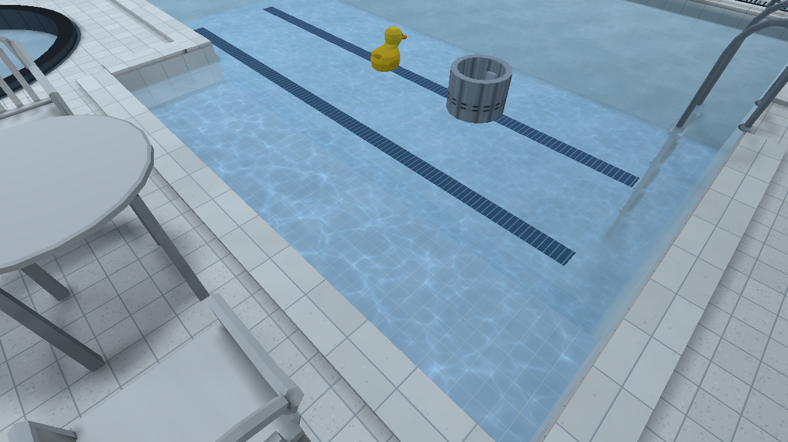

Exact rectangle/circle footprints, bottom and free-surface bounds exclude dry
decks, walls, undersides and the water sheet. A threaded spatial tree supports
every resolved volume without a camera-dependent cap; priority-first traversal
preserves authored overlap precedence and prunes coincident volumes. Only a
16-byte clock header changes each wet frame. Dry levels write nothing.

Static caustics require a visible, above-water finite practical light. Ambient,
sun and sky alone do not enable this indoor-pool approximation. Water spanning
rooms, partitions or intervening room floors conservatively disables static
caustics. Existing receiver illumination/shadows supply the local brightness;
this is not a refractive transport solve. A flashlight contributes only its
existing shadowed beam, with an above-water origin and a ray entering through
the water footprint. Submerged flashlights keep their ordinary beam.

<a id="pool-caustics-native-acceptance"></a>
### Native acceptance

Final release: `a25b646999d5f5132e158ce3796ca858f4930a951bb64aa2b3916b609dd32fd3`.
Baseline at `535f401`: `ae6d6c9686653481f15b984f813a7092174a173ffca2b23b88b3bdd1890af9cc`.
Apple M2 Pro / Metal, genuine 1280×720 drawable, identical Pool package
`14c3ba2fa44e252a655b2edc28ffe2789e1492c4f7b80e8e2d454d4ff4deda22`.

- Pool live campaign: **39 checks passed**. Basin, shelf/step edge, circular
  hot tub, moving bodies, above/submerged flashlight, Static/Full switching,
  High/Low textures and restoration all captured and visually inspected.
  Renderer state confirms Static (`off` internally), Full and texture quality
  commit independently. Mask residency remains identical across lighting modes.
- Float/sink campaign: **32 checks passed**. Physical duck floats and dense
  drum sinks without recovery. Player campaign: **32 checks passed**, including
  upright standing, explicit crouch, water entry, shelf traversal and dry exit.
- Three tiny 4×4 m native controls in both lighting modes: lit floor changes
  across time; source-disabled and partition-crossing scenes are pixel-identical
  (**zero changed pixels**). Flashlight-only dark controls change above water
  (104,550 / 93,328 pixels, Full / Static) and remain identical submerged.
- Video: **28 checks passed**, 8 seconds, 240 genuine native frames, source ready
  frames 1…479 at stride 2, H.264 1280×720 30 fps BT.709. No interpolation or
  synthesized frames. Video SHA-256:
  `07ec4d8198b67d10f998617f617383a85dd6bbe39f24215b87bf2723b60b88b4`.

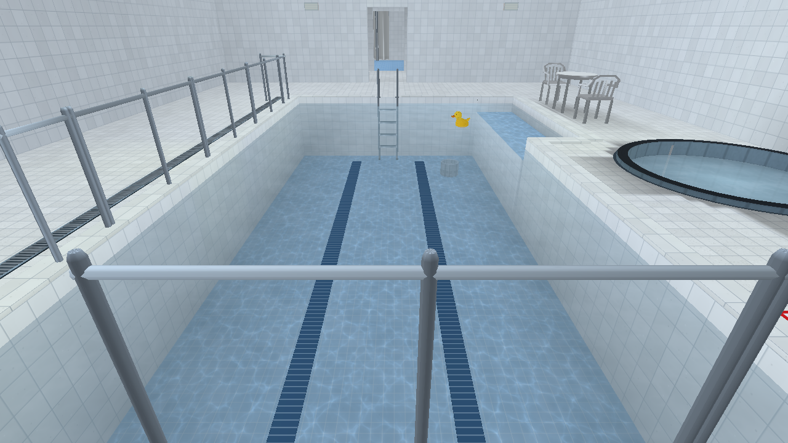

<a id="pool-caustics-matched-performance"></a>
### Matched performance

Three alternating baseline/candidate pairs per lighting mode; 600 warm-up and
1,800 measured frames per run, active authored physical water demo, fixed west
camera, High textures/filtering, Full reflections, bloom on, Immediate
presentation. No builds, captures or video encoding ran during timing. Values
below are medians of the three per-run statistics, in milliseconds. GPU samples
are deduplicated hardware elapsed spans; overlapping pass spans are not summed.
CPU values are frame wall time, including renderer/presentation backpressure.

| Measurement | Baseline median / p95 / p99 | Caustics median / p95 / p99 |
| --- | --- | --- |
| Full GPU | 0.817 / 1.644 / 1.922 | 0.957 / 1.832 / 2.589 |
| Static GPU | 0.758 / 1.483 / 1.999 | 0.880 / 1.910 / 2.477 |
| Full CPU frame | 1.359 / 7.544 / 8.760 | 1.427 / 7.636 / 8.589 |
| Static CPU frame | 1.272 / 7.641 / 8.777 | 1.328 / 7.558 / 8.807 |

Median GPU increase: **0.141 ms Full, 0.122 ms Static**. GPU tails also increase,
as shown; these are shared-host observations, not an isolated hardware cost.
Both builds submit **44 scene draws and the same six GPU passes** (scene,
emission, bloom H/V, resolve, presented). No added reflection pass or geometry.

Same-build disabled-effect control, three alternating pairs: GPU median
0.782→0.785 ms; p95 1.672→1.595; p99 2.003→2.457. Actual dry Office, two
alternating pairs: GPU median 0.843→0.922 ms; p95 1.193→1.320; p99
1.268→1.348. Dry CPU median 1.444→1.449 ms; 30 draws unchanged. Dry cost is
bounded by the shared shader's early exit: no mask residency or clock upload.

Pool adds **1,398,100 GPU mask bytes + 256 tree/header bytes** at High;
Low mask storage is 87,380 bytes. An empty level uses a 64-byte zero buffer and
the existing white fallback. A separate fresh-process diagnostic pair observed
peak native RSS 287,113,216→288,555,008 bytes (+1.38 MiB); RSS varies between
processes and is not an exact allocation counter.

Source PNG: 533,201 bytes; production executable: 9,709,344→9,742,384 bytes
(+33,040). No new dependency or compiler stage. Rust build-time delta was not
isolated from the local LTO/verification queue. All eight installed packages
and the catalog remain unchanged; only the three tiny controls were compiled.
No archived Demo/Zoo bake and no tracked compiled package.

<a id="pool-caustics-source-gates-and-reproduction"></a>
### Source gates and reproduction

`sh tools/check-rust.sh` passed format, all-target/all-feature check, strict
debug and release Clippy, and workspace tests: **2,340 passed, 19 explicit GPU /
measurement tests ignored**. `cargo test --workspace`: **2,333 passed, 19 ignored**.
Python source suite: **356 tests, 4 expected skips**. Catalog validation: zero
warnings; texture check: 123 textures, 96 existing advisories; prop check and
new mask seam check pass.

The three new bounded Rust regressions protect numeric/opaque PNG contracts
(one 4 MiB decode), exact water/overlap boundaries and coincident-tree pruning
(32 leaves), and source/partition isolation (one 4 m room). They require no
shipped map, atlas bake or native window.

```sh
python3 tools/bench/water_physics.py --mode acceptance --case caustics \
  --binary local/caustics/final/places --package assets/levels/pool_showcase.placesmap \
  --out local/pool-caustics-review
python3 tools/bench/water_physics.py --mode caustics-video --video-frames 240 \
  --binary local/caustics/final/places --package assets/levels/pool_showcase.placesmap \
  --out local/pool-caustics-video-review
```

Curated local delivery lives in `local/caustics/final/`: playable release tools,
matching Pool package, video, screenshots, concise receipts, performance
summaries and tiny control sources. Imagegen prompt/provenance and the fixed
renderer-resource contract are in `docs/ASSET_SPECIFICATION.md` §7.1b. Linux /
Windows native GPU performance and sun/sky-only caustics were not established.

<a id="pool-office-winter-model-integration"></a>
## Pool, Office and Winter model integration

<a id="pool-office-winter-model-integration-delivered-models-and-placement"></a>
### Delivered models and placement

The finished integration contains **75 delivered exports: 59 replacements and
16 new identities** (23 Pool, nine Office, one snack machine, 39 Winter and three
Outdoors trees). Drinks R2 replaces the provisional drinks export within that
count. The catalog contains 593 entries, 370 placeables and 178 accepted model
records. Exact model hashes and measured bounds are in `assets/completed-models.json`;
original deliveries and editable sources remain in ignored `import/model-rework/`.
Additional Blender authoring remains paused.

Drinks R2 is the exact delivered GLB, SHA-256
`2bec6e5a70c4a637cf9a3c047eccf4d539738bce0953ab61d8cbc6f406181443`:
2,869 triangles, 12 materials, 1 × 1.9 × 0.8 m, bottom-centered origin and +Z front.
Fascia slot 4 and LCD slot 6 follow the existing `break_room_vending` controller
alongside the snack machine, including actual spill illumination. Metal remains
non-emissive; both light anchors retain their specified positions. The exact
source retains intentional mechanical openings and eight coincident rear seam
triangles; the native front views show no visible z-fighting.

Winter changes keep the modular rail-only and linked fence/post stock unchanged;
the two delivered integral-post assemblies have separate catalog identities.
String-light spans use their measured 5/7/11 bulb positions with conserved power.
Attached-source capacity is 16; selected-direct and switched-source budgets stay
eight. Disabled sources and twin Pool fixture apertures count toward the aggregate
source limit. Lantern anchors follow the delivered geometry.

The bank tree moves 4 cm west and 20 cm south: all nine saved-mesh root contacts
are supported, with at least 17.9 mm bank margin. Four small timber pegs support
the lodge cables; end bulbs clear terminal shafts by 11 mm. Stone-wall colliders
use local `[2.4, 0.98, 0.5]` before yaw 90. Pool's drum starts and resets on dry
deck at `(14, 0, 6.7)`, retaining pickup, density, dormancy and sinking. All four
Office records cabinets face into the room at yaw 180. Native fork traversal
confirmed the intentionally narrow Outdoors trunk collider should remain.

<a id="pool-office-winter-model-integration-pool-and-office-foundation"></a>
#### Pool and Office foundation

The first adoption batch on 15 October 2026 contained 33 delivered models:
23 Pool, nine Office and one snack machine, with 19 replacements and 14 new
catalog entries. Its GLBs matched the completed Library deliveries; the ledger
then contained 136 accepted exports. Full editable/reference deliveries remained
in Library and the ignored local import collection. The finished 75-export
integration above supersedes that batch's pending deck reset, records orientation
and provisional drinks delivery.

Pool's two manufactured three-riser entry modules use six hidden player supports
and fitted item colliders following their treads. Basin, shelf, tub and water
volumes retain their dimensions; the ladder collider follows the delivered rails
and rungs. Tile/panel modules are catalog assets rather than extra demo displays.
The planter and safety notice join the existing kit.

Office's reception furniture, noticeboard, tall filing cabinet and snack machine
retain the layout, navigation, AI and modular ramp rails. Either vending machine's
E interaction cycles `break_room_vending` through steady, flickering and dark
states; the two basement fixture failures remain independent. Reusable fields
are `props[].switch_group`, fixed `light` components and numeric
`emission_overrides`.

The three fixture families use delivered GLBs and apertures matching the recessed
round lens, separate wall strips and downward Office diffuser. Metal/gaskets stay
non-emissive. Geometry revision 14 and PLMP v8 introduced prepared fixture/prop
controller identities while retaining readers for older prop records.

The snack export retains 16,240 triangles, 13 material groups, five shelves,
50 dimensional packets, 25 coils and thin BLEND glass. Only its exact accepted
hash enables the bounded 16,240-triangle importer profile; ordinary GLB imports
retain their 6,000-triangle ceiling. Thirteen unique embedded PNGs also exist as
standalone repository assets. Decoded images and ordinary opaque materials share
resources; only luminous uniforms require controller ownership.

Full switches emissions and prepared illumination together, excluding switched
and authored-off sources from the permanent baseline. Static retains authored
illumination and matching emissions, carrying runtime requests into Full.
Reflections retain their authored capture state rather than rebaking dynamically.
Cardinal fixtures were verified; arbitrary wall yaw retains the existing
axis-quantized finite-source limitation. Four independent Office circuits exceeded
the former four-page budget; sharing the vending circuit allowed six pages at
the unchanged density/byte limit, without enlarging renderer resource caps.

<a id="pool-office-winter-model-integration-lighting-and-package-bounds"></a>
### Lighting and package bounds

Geometry revision 15 routes static models above the existing 1,500-triangle art
budget and 3 m world extent through prepared directional probes. All five new
tree variants qualify. They retain indexed geometry as transport casters, source
albedo, normals, UVs and flashlight response. Packaging rejects unfinished probe
lighting; valid dark probes remain dark. Ordinary model lightmap density, the
14-page limit and 64 MiB metadata cap remain unchanged. A tiny deterministic
fixture protects this behavior without baking a shipped map.

All eight supported packages were refreshed and validated with the final assets
and compiler. Every Full variant has an actual atlas and no lighting failure.
Compiled packages remain outside Git; archived `places_demo` and Model Zoo were
not baked.

| Package | Atlas pages | Chart metadata, bytes |
| --- | ---: | ---: |
| Pool | 2 | 5,128,551 |
| Home | 1 | 949,720 |
| Lantern Hollow | 7 | 10,425,380 |
| Winter | 5 | 8,859,511 |
| Beach | 7 | 3,713,212 |
| Frutiger Aero | 4 | 3,421,225 |
| Retro Arcade | 8 | 23,013,433 |
| Office | 5 | 10,006,739 |

<a id="pool-office-winter-model-integration-validation-actually-run"></a>
### Validation actually run

Passed after the final source changes:

- `cargo fmt --all --check`.
- `cargo test --workspace`: 2,331 library tests plus target tests; 19 existing ignores.
- `cargo test --workspace --all-features`: 2,338 library tests plus target tests; 19 existing ignores.
- Debug and release `cargo clippy --workspace --all-targets --all-features -- -D warnings -D clippy::all -D clippy::pedantic -D clippy::nursery -D clippy::cargo` (release adds `--release`).
- `cargo build --release --bins`.
- 37 focused Python tests across Office/Winter assets, Winter assemblies, string lights and the synthetic zoo generator.
- Asset validation (zero warnings), prop and texture checks, Office/Winter/Lantern generator currency, and `git diff --check`. Texture validation retains 96 existing manifest warnings.

Native Metal checks passed with actual Full atlas uploads and zero failed prop
models. Pool passed two stair routes and four water scenarios (113 assertions),
covering reset grounding, duck buoyancy, dense-object settling, player entry/exit
and real E pickup/drop/sink; the drum settled at Y −1.498 m, fully submerged.
The final Pool Static/Full mesh, props, lighting and collision payloads match the
passing water evidence byte-for-byte. Winter passed stone-wall collision and
lodge/stair/forest traversal; final views show the supported bank tree and cable
mounts. Lantern passed trunk stop and fork-side passage.

Office Full captures show synchronized steady/flicker/dark behavior for both
machines, a darker nearby floor when switched off, and readable materials under
the flashlight. Static captures retain their initial baked illumination: matched
on/dark image regions are identical. Lantern Full shows transport shadows absent
from the brighter Static result, with readable materials and no full-bright trees.

Isolated performance used 60 warmup and 300 measured frames at matched cameras,
3024 × 1898, High/Full, reflections and bloom, on the local M2 Pro. No compiler ran
concurrently. All 360 presentations per run were ready.

| View | GPU median before → after | Peak RSS before → after |
| --- | ---: | ---: |
| Winter | 3.399 → 3.484 ms | 616 → 737 MiB |
| Lantern clearing | 3.225 → 3.755 ms | 881 → 1,723 MiB |

These representative views remain below a 16.7 ms GPU frame budget; they are not
a worst-case or cross-hardware guarantee. **Lantern's denser trees nearly double
peak memory**, a real remaining cost. Probe-lit trees also have coarser received
lighting than individual per-face charts.

<a id="pool-office-winter-model-integration-earlier-pool-and-office-foundation-acceptance"></a>
#### Earlier Pool and Office foundation acceptance

The first 33-model batch passed formatting, configured debug/release Clippy,
all-feature and default workspace tests, 359 Python tests, and catalog, texture,
completed-model and generator checks. Explicit developer runs covered Pool steps,
nine Office collision stations, water settling/pickup/swimming, both vending
interactions, basement failures and flashlight response. Full panel/floor captures
extinguished together; Static retained authored illumination. Office Full used
five atlas pages.

Its separate bounded 300-frame Metal trials at a 1920×1080 drawable measured
median GPU time of 1.19 ms for Pool and 1.17 ms for Office, with peak process RSS
of 294 MiB and 1,074 MiB respectively. These are single local workload samples
from the earlier batch, not the final paired Winter/Lantern measurements above
or a general performance guarantee.

<a id="pool-office-winter-model-integration-preserved-output-and-changed-files"></a>
### Preserved output and changed files

The self-contained local payload, eight packages, release player/compiler and
`play.command` are in `local/model-rework-20261015/final/`, outside `target`.
The player requires the existing Homebrew SDL3 installation. Its SHA-256 is
`9e9bb74f470e031419a77e1efb1e22a7e457b48f4b4f37f3c8f9d81660f78a7f`.
A native launch against that preserved payload passed. Essential screenshots and
receipts are in `local/model-rework-20261015/final75/`; they remain local.

This continuation changes 43 GLBs, three PNGs, the asset catalog/completed-model
records, Office/Winter level sources, 13 Rust files, six Python test files, four
authoring/validation tools, both canonical guides and this report. The preceding
published foundation commit contains the Pool/Office/snack installation and
shared vending controls. Git history provides the exact file list for both.

<a id="runtime-lighting-0100"></a>
## Runtime lighting performance — 0.10.0 staging

The follow-up to [the doorway correction](release-0.10.0.md#performance-0100) reduces the
matched close-door median from **11.546 to 10.541 ms** (86.6 to 94.9 FPS,
8.7% less frame time). The reproduced Full→Static update stall falls from
**1.765–1.811 seconds to 164–165 ms**. Four redundant 240 MiB lightmap
uploads disappear from each tested reflection/texture settings cycle.
All **14 matched native image pairs are pixel-identical**. There are still
transition stalls and an unexplained timing outlier; this is bounded evidence
on this Mac, not a general tail-latency or crash guarantee.

<a id="runtime-lighting-0100-demonstrated-causes-and-changes"></a>
### Demonstrated causes and changes

- Entity direct lighting still copied a 112-byte source with dynamically
  indexed taps into fragment-local storage. The shader now reads the selected
  uniform fields and skips exactly zero source/tap visibility. Positive tap
  arithmetic, accumulation order, source selection, attenuation and falloff
  remain unchanged. These changes were measured together; register spills and
  their individual contributions were not isolated.
- Prop upload traced UV visibility for every vertex, including ordinary
  materials. A ten-second symbolized CPU sample during settings changes found
  1,925/5,442 main-thread samples in prop upload, 1,883 in blacklight visibility.
  Upload now ORs the referenced vertices of fluorescent primitives and queries
  only those vertices. Shared vertices retain coverage; invalid metadata uses
  conservative coverage. Source counts for Arcade's mixed reactive batches
  were 18,354 Static vertices but only 2,346 reactive vertices. The GPU-only
  pilot retained the approximately 1.8-second stall; selective UV work removed
  most of it. Skins and moving objects retain their existing update paths.
- Texture/reflection rebuilds reuploaded an unchanged immutable lighting atlas.
  Exact `Arc` identity plus resident-texture status now permits sharing its GPU
  handles. Full→Static clears CPU atlas identity; Static→Full and replacement
  resources upload normally. Cancellation drops handles without destroying the
  live resource. The tested cycle logs six atlas uploads before, two afterward,
  and four reuse events: **960 MiB less transfer and four fewer duplicate atlas
  allocations**, with unchanged 240 MiB steady atlas residency.
- The renderer shares immutable `LevelLightmaps` metadata instead of cloning
  it. Arcade's 47,960 chart records at 96 bytes each account for **4.39 MiB** of
  avoided chart allocation/copy per Full install. Packed texel data was already
  shared; this change does not save another complete CPU pixel payload.

Probe interpolation, direct-light ranking, caster/visibility cache revisions,
door invalidation, static transport, shadow rays, transparency and reflection
ordering were reviewed. No further demonstrated inefficiency justified changing
them. A proposed receiver cache was discarded: shipped moving/animated assets
have no fluorescence, so its state and invalidation complexity had no measured
workload benefit. Three small per-frame uniform writes were also left alone.
No map, asset, texture quality, light count, geometry or culling changes remain.
Current packages were reused without baking.

<a id="runtime-lighting-0100-matched-native-measurements"></a>
### Matched native measurements

13 October 2026: Mac14,9, M2 Pro, 19 GPU cores, 16 GiB, macOS 27.0.1
(26A434), native wgpu/Metal. High textures/filtering, Full lighting/reflections,
bloom, FOV 60°. Windowed trials use logical 1280×720, **2560×1440 drawable,
Retina 2×**, Immediate presentation. Close fullscreen uses logical 1512×949,
**3024×1898 drawable**, Fifo/VSync. A new benchmark dimension guard rejects
changed drawable sizes; an earlier mismatched fullscreen series was excluded.
No owned build ran during timing and no thermal warning was reported.

Simulation advances 1/60 second, with 120 ready frames of warm-up. Two reversed
before/after pairs provide 1,200 frames per windowed condition and 720 fullscreen
frames. GPU samples are deduplicated per run; asynchronous results are not
paired with the current CPU row. Values are milliseconds, median / p95 / worst.
CPU loop includes drawable waits and pacing; update is a separate CPU interval.

| View | Loop before | Loop after | GPU elapsed median before → after | CPU update median before → after |
|---|---:|---:|---:|---:|
| Closed bathroom door | 4.638 / 5.627 / 14.747 | 4.162 / 5.165 / 14.759 | 5.088 → 4.606 | 1.121 → 1.052 |
| Bathroom lateral path | 4.505 / 6.118 / 15.883 | 4.059 / 5.570 / 17.164 | 4.879 → 4.405 | 1.068 → 1.026 |
| Close fullscreen door | 11.546 / 12.024 / 13.832 | 10.541 / 11.156 / 12.987 | 12.093 → 11.072 | 0.792 → 0.824 |
| Lit Arcade cabinets | 1.908 / 2.853 / 15.390 | 2.498 / 8.854 / 23.196 | 2.255 → 2.204 | 0.887 → 0.907 |
| Dark Office room | 1.988 / 2.992 / 22.438 | 1.970 / 2.698 / 19.396 | 1.521 → 1.439 | 1.223 → 1.240 |
| Winter outdoors | 1.618 / 3.077 / 20.138 | 1.426 / 2.939 / 14.208 | 1.910 → 1.823 | 0.234 → 0.245 |
| Bathroom mirrors | 2.019 / 3.545 / 15.293 | 1.942 / 3.224 / 17.433 | 2.164 → 1.961 | 0.859 → 0.852 |

One cabinet after-run had 8.183 ms loop / 5.418 ms GPU medians, while its first
repeat was 1.941 / 2.140 ms. Two further reversed controls returned loop medians
1.963 and 1.904 ms after versus 2.052 and 1.868 ms before; GPU medians were
2.159 and 2.146 versus 2.273 and 2.261 ms. The original outlier is retained above
and unexplained. Winter's individual runs also overlap; there is no claim of a
uniform benefit in light workloads. Draws/triangles match: door 274/73,104,
lateral median 275/73,224, close 247/69,794, cabinets 148/27,414, Office 26/7,760,
Winter 296/76,383, mirrors 209/37,600. The mirror view retains its planar pass.

Three raw Metal timestamp samples confirm non-overlapping accounting: seven
overlapping spans summed to 31.306 ms but covered 6.570 ms; the other unions
were 4.961 and 4.683 ms. **GPU elapsed includes scheduling stalls**, not active
utilization. A separate two-second Metal System Trace, excluded from timing,
covered 296 scene encoders in a stable 1.3-second window: active GPU interval
union averaged 4.134 ms per encoder. Metal allocation time-median/peak was
677,871,616 bytes (646.5 MiB); this final-only diagnostic cannot establish a
before/after allocation-peak reduction. Exported tables replace the bulky trace.

<a id="runtime-lighting-0100-settings-visual-acceptance-and-remaining-limits"></a>
### Settings, visual acceptance and remaining limits

Two matched cycles exercised Full→Static→Full, Low→High filtering, reflections
off→Full, then Low→High textures while retaining Full lighting. Full→Static's
CPU update changed 1,765.497/1,811.231→164.155/165.121 ms; subsequent loop gaps
changed 1,770.589/1,816.247→166.330/167.340 ms. The first cycle's complete
request→world-commit durations changed:

| Transition | Before → after, ms |
|---|---:|
| Full→Static | 4,017 → 732 |
| Static→Full | 3,310 → 1,713 |
| Reflections off / Full | 1,984 / 1,980 → 226 / 222 |
| Low / High textures, Full lighting | 2,172 / 2,315 → 417 / 581 |

These durations include background preparation and uploads, not one frozen
frame. Filtering applied directly. Full→Static still stalls approximately
165 ms; High texture return still stalls **272–277 ms** in update. Worker
preparation/decode and remaining resource creation are not eliminated.

Native comparisons cover static surfaces, colored lights, cabinets and UV
carpet, doors/windows, mirror reflections, dark Office props, Winter snow and
illuminated windows. Separate scripted captures verify door open/close,
fixture off/on, crate spawn/move/despawn, a dark mannequin actor's spawn/move/
despawn, Static/Full lighting, and Low textures with Full lighting. All 14 RGBA
2560×1440 pairs have zero differing pixels and zero maximum channel difference;
representative originals were visually inspected. Scripted/capture runs are
excluded from steady measurements. No missing illumination, stale resources,
leaks or visible popping appeared in these bounded samples. Same-process
Arcade→Office→Winter→Arcade reloads completed with matching package identities.
The prior intermittent gameplay crash was not reproduced or solved.

Curated native images: [cabinets](../images/runtime-lighting-0.10.0/cabinets.png),
[Static fluorescent gifts](../images/runtime-lighting-0.10.0/gifts-static.png),
[dark actor](../images/runtime-lighting-0.10.0/dark-actor.png),
[Winter](../images/runtime-lighting-0.10.0/winter.png),
[mirrors](../images/runtime-lighting-0.10.0/mirrors.png).

<a id="runtime-lighting-0100-reproduction-and-verification"></a>
### Reproduction and verification

Baseline commit `5843390f8da7cd20db1e5918de9bbe89d587f645`, retained binary
`local/performance-0.10.0/bin/places`, SHA-256
`8b827df137d67e7315ff8b13bbf18d0644b40de3d799d0c66eeee6d50a23a159`.
Final measured binary: `local/lighting-runtime-0.10.0/bin/places`, SHA-256
`f1dc2d911e8c7aa38876e4b8b9130cda185f04627a4264ce02fc713eb1318ddb`.
Arcade package remains `fa9abf3fd0e45842dff2212b6a41787ef56a8529becdb495572561a3f3d373fe`.
Local evidence retains `delivery-*` receipts/CSV/logs, all paired originals,
campaign/reload scripts, CPU sample, compact summaries and Metal exports.
Cameras: door `−1.6,1.6,2.8 / 90,0`, close `−.65,1.6,2.8 / 90,0`,
cabinets `7.4,1.6,17.8 / 306,5`, Office `21,1.6,10 / 0,−3`,
Winter `1,1.6,10 / −32,−3`, mirrors `−1.65,1.6,5.45 / 180,−14`.
Lateral retains the prior 3 m/s trajectory, Z approximately 1.65–4.05.

```sh
python3 tools/bench/frame_time.py --binary local/lighting-runtime-0.10.0/bin/places \
  --out local/new-lighting-door --expected-drawable 2560x1440 --frames 600
# Add --motion for lateral; substitute the retained baseline for before.
python3 tools/bench/frame_time.py --binary local/lighting-runtime-0.10.0/bin/places \
  --out local/new-lighting-close --spawn=-0.65,1.6,2.8,90 --fullscreen --vsync \
  --expected-drawable 3024x1898 --frames 360
```

Exit-zero validation: configured formatting and locked all-target/all-feature
check; strict Clippy in dev and release; `cargo test --workspace` (2,265 library,
two compiler CLI, seven integration) and `--all-features` (2,271 library plus
the same CLI/integration). Two inexpensive CPU fixtures protect selective UV
work/shared indices/fallback and immutable atlas identity/residency. The existing
ignored native GPU helper passed explicitly in 0.44 s with one additional
zero-source witness in the same dispatch/readback (464 bytes). The other 18 GPU
tests were not explicitly run. Python metrics (14), art-style hero (six),
`py_compile`, benchmark help and malformed-dimension rejection passed.

Publication SHA/hosted CI, executable identity and cleanup custody are recorded
in the delivery message and local `publication.json`. Prior evidence is retained.

<a id="water-0100"></a>
## Pool water — 0.10.0 staging

Pool now contains physical swimming water, a floating rubber duck and a sinking
metal drum. Authored items remain dormant until pickup, impact or the demo's
Interact control activates them. Player entry preserves the existing **1.8 m
standing body / 1.6 m eye height**, with **9.8 m/s² downward gravity** shared by
player and items. No automatic crouch or sprint was introduced.

<a id="water-0100-verified-starting-condition-and-authored-correction"></a>
### Verified starting condition and authored correction

The preserved `2e4174735262754ccce4a978255950f702daae2e` source/package and native
player confirmed the suspicion: the main basin had recessed collision geometry
but **no water descriptor**; only the hot tub had water. The original spawn was
inside the tub. The baseline includes an honest initial capture and a repeated
fixed-camera view for comparison.

`levels/pool_showcase.json` and its idempotent `tools/levels/refine_pool.py`
generator now author a 9 × 4.5 m main volume: floor −1.5 m, surface −0.15 m,
depth 1.35 m. The adjacent 4 × 0.9 m shelf has floor −0.35 m and depth 0.20 m.
The original hot tub remains. Spawn is on clear dry deck `(3, 9)`, yaw 56°.
Existing water PNG/material, transmission, reflections, lights and probes are
reused. Coping, overflow grates and two correctly proportioned submerged lane
decals provide focused polish; no new image/model assets or light-strength
compensation were needed.

The existing east ladder has an authored climb volume plus eight item-only
rail/tread colliders. Native pickup exposed a pre-existing guardrail problem:
west pieces had already-rotated dimensions that the resolver rotated again.
Their local long axis now matches their actual models, freeing the dry route.

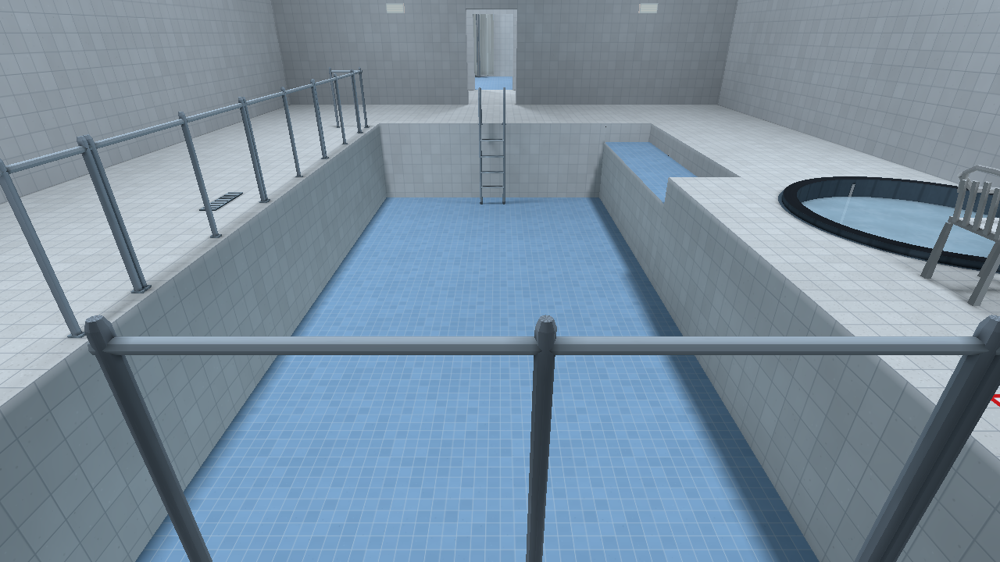
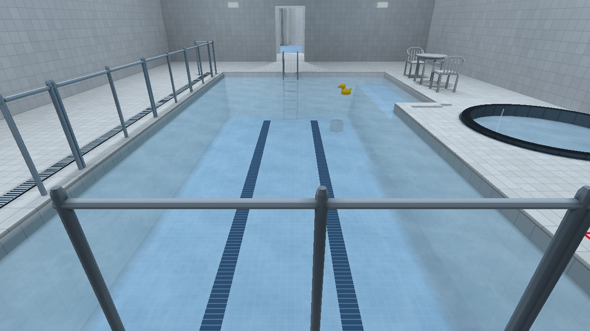

<a id="water-0100-physics-and-lighting-contract"></a>
### Physics and lighting contract

Rapier supplies contacts, sleeping, CCD and external impulses; Places supplies
the immersion and buoyancy model beside it. This follows Rapier's documented
[forces and impulses API](https://rapier.rs/docs/user_guides/rust/rigid_body_forces_and_impulses/).
There is no fluid solver, water current or scripted bobbing/waterline clamp.

`src/physics/water.rs` clips posed convex solids against enabled swimming
rectangles/circular chords, finite bottoms and the existing last-authored volume
priority. Distributed 6 × 6 columns produce displaced volume and its buoyancy
centre; off-centre lift produces rotation. Fully immersed solids use cached
volume/centroid. Upright cuboids and cylinders use exact vertical slices,
preserving their analytic centre to avoid numerical torque away from the origin.
Compounds sum their parts. More than sixteen competing water regions use a
bounded whole-body sampling fallback. Each fixed step allocates no new water
sampling buffers; dry maps allocate no water response state.

Lift is `1000 kg/m³ × 9.8 m/s² × submerged volume`. Exponential linear/angular
drag scales with displaced-water-mass/body-mass ratio, yielding useful damping
at floating equilibrium. The strict optional `physics.water` profile authors
source displaced cubic metres (scaled cubically) and bounded drag coefficients;
omission uses solid collider displacement. Source/scaled density and collider
stiffness bounds reject excessive lift. No behavior branches on an asset name.

The reusable duck profile describes a hollow float. Pool's 2.5× duck has 1 kg
mass and 10.156 L full displacement; it settles near 9.8% immersion. The open
metal drum has 6.4 kg mass and 0.8 L displacement, so it sinks. The ordinary
demo control toggles activate/reset through existing generic group actions.
Reset restores authored poses, zero motion and dormancy. Held/suspended/dormant
bodies receive no water impulses. Water enable changes wake active sleepers.

Native lighting exposed another existing defect: strict room lookup rejected
valid air below a nominal floor, despite prepared recessed probes. The indexed
compiled floor interface now supplies the local room-floor offset. A tiny
serialized two-storey regression verifies prepared/spatial/direct lighting,
floor/ceiling occlusion and below-floor rejection. No package-format change or
brightness workaround was introduced. Texture quality and Static/Full lighting
remain independent.

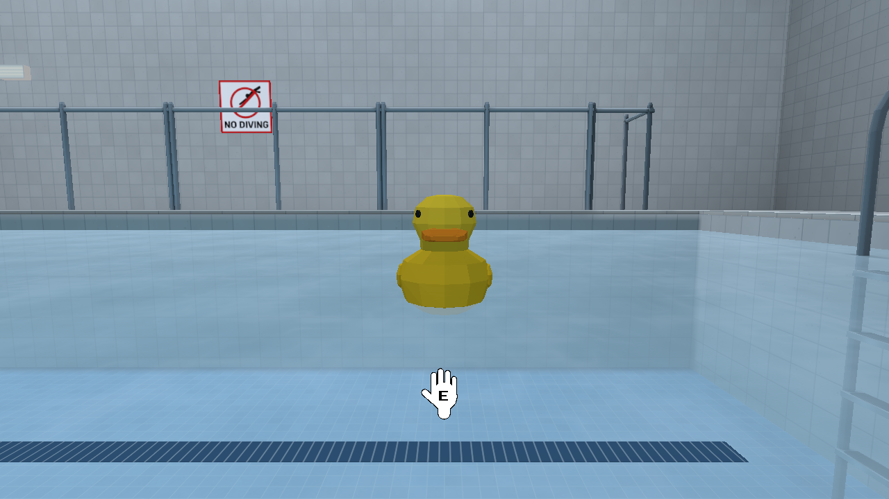

<a id="water-0100-validation-and-retained-delivery"></a>
### Validation and retained delivery

Final validation results and measured performance are recorded below before
delivery. Explicit native campaigns are outside default tests and CI; only Pool
was compiled for this stage. Existing Arcade packages and model bytes were used
unchanged for the shared-engine regression.

The five deterministic water tests use tiny bodies and take 0.01 s. They protect
strict/scaled metadata, partial rectangle/circle/bottom immersion and torque,
float/sink equilibrium, dormancy/toggle/reset and millimetre stiffness stability.
The existing immersion fixture additionally reproduces off-origin centroid
round-trip torque before the correction. One small Python table verifies the
matching authoring validation; existing Pool coverage now checks actual ladder
and guardrail collision contracts.

Formatting, workspace target/feature check, strict debug/release Clippy, release
build and default/all-feature workspace tests passed: **2,316 / 2,322 total
tests**, including 2,307 / 2,313 library tests; nineteen existing opt-in GPU tests
remain ignored. Clippy also enforced all/pedantic/nursery/cargo warnings. Source
Python tests passed 355 tests with four skips using `PLACES_SKIP_SMOKE=1`; the
asset validator reports 571 assets / 348 placeable / eight themes, zero warnings.
Texture/prop checks and the unchanged Arcade generator passed; Pool regeneration
is byte-idempotent. Commands and complete results remain in the local gate logs.

Eight final native Pool action cases passed **325 checks**: dormant activation
and reset; buoyancy/partial submersion/settling; wet/dry pickup/drop/throw;
High/Medium/Low textures with independent Full/Static/fallback lighting; standing
entry, explicit crouch/swim, surface and shelf exit; pair/wall contacts including
20 m/s stress; eighteen real physical bodies; and the recorded interaction.
No player reset or prop escape recovery occurred. The final stress run reached
seventeen simultaneous active bodies, then eighteen sleeping bodies, with at
most two substeps and no clamped simulation time. Existing Arcade bowling and
the tiny contact campaign passed another **944 / 334 checks**, with unchanged
packages and zero recoveries. Matched baseline/hero capture provenance also
passed; native PNGs and decoded video entry/exit/ownership frames were inspected.

Two alternating pairs per workload used the same compatible Pool package,
preserved visual assets/gameplay defaults, High/Full, a fixed west camera and
1280 × 720 drawable. Each measured 600 frames after 120 warmup frames (600 for
eighteen bodies), with capture, video and per-frame body tracing disabled.
Every measured frame retained the requested activated body count and a closed
console. The old strict parser cannot read new displacement overrides, so this
shared fixture omits them and measures default solid displacement; the actual
authored float/sink profiles are covered by the separate acceptance/stress runs.
Values below are medians of per-run statistics, in milliseconds:

| Bodies / metric | Prior physics median / p95 | Water median / p95 |
| --- | ---: | ---: |
| 2 / frame loop | 8.284 / 9.576 | 8.245 / 10.226 |
| 2 / CPU update | 0.265 / 0.443 | 0.342 / 1.082 |
| 2 / unique GPU elapsed span | 1.001 / 1.241 | 1.394 / 1.781 |
| 2 / physics step | 0.0049 / 0.0188 | 0.0051 / 0.0296 |
| 18 / frame loop | 8.299 / 8.983 | 8.296 / 9.025 |
| 18 / CPU update | 1.736 / 2.080 | 1.297 / 6.146 |
| 18 / unique GPU elapsed span | 1.803 / 2.290 | 1.553 / 2.013 |
| 18 / physics step | 0.0229 / 0.0291 | 0.0232 / 0.0313 |

Draw calls stayed 44 / 60 for the two/eighteen-body views. Median peak native
RSS was 275.6→275.3 / 275.7→276.1 MiB. Frame cadence remains near 120 Hz; the
eighteen-body CPU-update tail increased and is reported above. Different solved
poses and lighting work prevent attributing renderer timing changes solely to
the water force code, and short runs do not establish a speed improvement.
GPU spans are elapsed hardware samples, not utilization. Actual authored-water
stress with eighteen bodies present and active substeps measured **0.027 / 0.049
/ 0.330 ms median / p95 / worst** over 1,121 samples, including diagnostic trace
and capture overhead; peak RSS was 273.4 MiB.

The genuine clip is **600 consecutive samples of native rendered frames, 20 s,
1280 × 720, H.264/YUV420P, 30 fps, BT.709**. It samples every second ready frame
from a 60 Hz recording pace, without interpolated/synthesized images. Source
frames 1–1199 show float/sink, standing entry/exit and normal pickup/throw, with
diagnostic camera setup disclosed in the receipt. SHA-256:
`0221630e88880aa10be2b6b9767893b7a45f4d87df22144a004af91f28ce66cc`.

Confirmed Library identities (version 0, retain these identities for edits):

| Artifact | Library file ID |
| --- | --- |
| Baseline PNG | `libfile_85c63e286d08819187e0774df5672b8f` |
| Updated Pool PNG | `libfile_a74cf9be7c608191825f291d5164c8a4` |
| Duck waterline PNG | `libfile_ed0beed8e9c881918608532c355cf4fd` |
| Genuine MP4 | `libfile_033cc1c499708191bfe5c3509cdab155` |

`library-results.json` records exact local bytes, hashes and confirmed identities;
returned version attributes were applied and verified on the original files.
Consumers must materialize those Library files to their own executor destination
and verify hashes there; a cloud workspace path is not a Mac path.

Runnable binaries, current Pool package, isolated settings, curated receipts and
the genuine clip are retained in `local/water-0.10.0/` outside Cargo's target.
Launch `local/water-0.10.0/run-pool.sh`; aim at the east-deck table control and
press Interact to activate/reset the float/sink demonstration. Final Git/remote
SHA, CI identity, artifact hashes and custody release live in its `handoff.json`.

<a id="water-0100-limits"></a>
### Limits

This is a bounded rigid-body approximation: no displaced surface waves, fluid
exchange through hollow meshes or caustics. Default cups use economical solid
cylinders. Native acceptance was on this Mac's Metal renderer with real input
dispatch plus explicitly labelled diagnostic setup poses/velocities. Other OS
and browser gameplay are unverified. Audio, Pool caustics and separate Arcade
model delivery/integration remain subsequent work. The previously reported
intermittent native crash is not resolved or claimed reproduced here.
