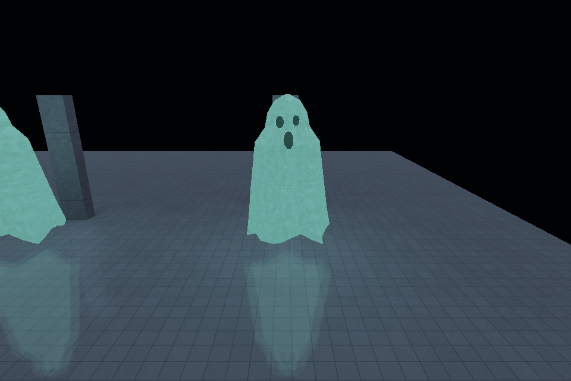

# 0.13.1 acceptance (unreleased)

The first phase added rectangular/circular pillars and fitted automatic trim.
Its accepted source is `fa9a8b93cbfba0b0e8a1b1ee064c01cbbe1be9e1`; its receipt,
native captures and binaries remain under `local/verification-0.13.1-trim/`.
The [changelog](../../CHANGELOG.md) retains its exact acceptance scope.

The second phase exposes New Room, Add Wall, Add Door, Add Light and Play in Simple
mode. Make Doorway cuts an aperture; Add Door creates or fits a functional leaf.
Wall placement has a private preview, optional chaining, snapping and cancellation.
Body dragging and endpoint handles preserve openings, doors, wall lights/decals
and automatic trim in one history transaction. Floor decals stay fixed. Existing
room stretching retains attachment, shared-boundary and elevated-prop guards.
Four visibility groups, room/wall isolation and persistent object locks support
focused editing. Material browsing has 24 compact tiles in four rows or 15 larger
tiles in three, while retaining labels, selection, search, theme and paging.
Eleven absent material previews are committed opaque 160x120 PNGs; existing
previews and source textures are unchanged.

## Razer acceptance, 2026-10-28

Formatting, strict workspace/all-target/all-feature Clippy, the locked release
workspace/all-feature build, 367 Rust tests and 369 Python source tests pass
(18 expected source skips). Two small CPU regressions protect atomic wall
attachments/source/history/focus identity and DPI control/hit correspondence;
ordinary tests never bake production maps. The asset validator checks 644 assets
with zero warnings. Texture/prop checks pass with their existing manifest and
preferred-budget advisories.

Native SDL verification uses ordinary editor handlers, real windows/GPU rendering,
framebuffer captures and source checkpoints. The accepted recipes cover adjacent
room creation; four chained walls; doorway versus leaf; light and materials;
repeat/cancel; locks, isolation and hidden layers; wall body movement, both
endpoints, aperture-conflict refusal, atomic undo/redo; and room stretching with a
door and trim. Save/reopen retains source. Simple Play saves/exports/builds,
launches the game and returns cleanly; native captures show the new door closed
and opened, and the player trace crosses its opening. Failed exploratory recipes
are retained separately and excluded from acceptance assertions.

Visual layout checks cover 960x544, 1280x720/800, 1000x900 and 1440x900 on the Razer
at Windows 150% display scale. CPU coordinate checks also cover 100/125/200% and
1x/2x drawable density. Actual Mac Retina validation is deferred. Fifo presentation
was negotiated; these checks make no uncapped FPS claim.

## Construction integrity (phase 3)

Construction/Safety now shares wall-plane/thickness classification and offline
alignment planning, opening slicing, collision, wall/mount attachment edits and
the emitter's covered-face subtraction. It adds short corner/endpoint gap/tail
review, floor/ceiling seams, sampled player/route/landing clearance, authored door
pose intrusion and measured ceiling/wall UV phase checks. Compatible chosen
corrections preview privately and commit in one undo step; stale, conflicting,
locked/hidden/isolated or protected contexts refuse. Lock changes invalidate cached
review, allowing immediate unlock/rescan. Cancellation discards partial
results. Supported L/T contacts, solid-supported seams and angled geometry remain.

Final Razer gates pass: format, strict workspace/all-target/all-feature Clippy,
locked release workspace build, 371 Rust tests, 369 Python source tests (18 skips),
644 assets with zero warnings and the unchanged texture/prop checks. Four tiny CPU
regressions protect source/history, original-index grouping, corner intent and
solid-versus-open floor gaps. Native Windows acceptance has 144 assertions across
392 actions, including preview/apply/undo/redo/save/reopen, repeat/idempotence,
mixed conflicts, locks/hidden layers, cancellation/restart and compact/tall/wide
layouts. Shared CLI/editor findings and marker positions agree. The deliberately
bad fixture retains its one unrelated original error after local corrections.

Three old/new runs retain all 10 small-scene and 89 Arcade legacy findings with
deterministic results. Small scans finish before the next frame poll; Arcade's
median report completion is 758 / 776 ms before/after; cancellation returns in
194 ms. These frame-polled observations justify retaining existing spatial
traversal and full scans; no new chunk/dirty-region cache, bake or FPS claim.

Automatic endpoint edits stay within 5 cm with one full-thickness solid carrier.
Near gaps up to 35 cm, partial/ambiguous corners, destructive aperture/headroom/
landing changes and unsupported UV wrapping remain review-only. Overlapping
record edits refuse as a group. Existing model/interactive budgets still report
incomplete coverage; this is no watertightness or complete-traversability proof.
Actual Mac native validation and full production/release closing remain deferred.
The prior phase CI passed; the phase commit's observed CI state is in the receipt.

Accepted binaries, source fixtures, recipes, captures, profiles, hashes and the
final receipt are under `local/verification-0.13.1-integrity/final-lock/`. Earlier
root-level integrity evidence is superseded, retained for audit. Main/v0.13.0,
production sources/packages and prior phase evidence are unchanged.

## Construction generators (phase 4)

Four generators now share validated editable source, private preview, ordinary
history and deterministic regeneration. Wall recesses retain real solid backing,
separate side/back materials and optional fitted trim. Through openings retain
their existing semantics. Door/window surrounds follow the aperture and provide
frame, sill and outer trim parameters. Their geometry clips existing wall trim
before lightmap construction, avoiding overlapping jamb/baseboard faces.
The niche back material affects only its cavity face; the exterior wall material
is retained. Surround fit includes neighboring apertures and other surrounds.

Railing paths collect corners in the existing direct-placement tool and commit
all sections/posts atomically. They reuse guardrail materials, spacing and height,
split at stair/ramp boundaries, follow the real surface profile, share corner
posts and meet at mitered rail faces. Short swept collision boxes preserve usable
space beside angled runs. Reversed and excessively tight turns refuse.

Point-to-point tunnels generate an enclosed passage on the owning room floor.
Clearance is bounded between the real crouched and standing hulls, with full
standing landings at each mouth. Collision, props, fixtures, authored door poses,
other passages and unsupported floor changes receive actionable refusal. Shared
Construction/Safety uses the same generator validation and collision; it reports
crouch clearance without destructive repair. No generated child geometry is saved.

Simple mode exposes these tools through More geometry and a selected wall's
Build button. Basic dimensions appear first; materials and explicit elevation
overrides remain on contextual form pages. Wall/door/light placement, 24-tile
material browsing and compact/tall/wide layouts remain available.

Native acceptance exercises private preview/cancel, repeated Apply, dimension
adjustments, undo/redo, source movement/resizing, generator/carrier deletion and
save/reopen. A blocked route, excessive recess depth, standing tunnel height,
truncated landing and colliding surround receive specific refusals. Captures
include baked niche lighting and backing-mounted light, the opposite exterior,
functional door/window frames, the passage interior and stair/landing corners.
Actual game input tests both tunnel directions, release-Crouch refusal inside,
standing refusal at each mouth, both exit transitions and stair ascent/descent
beside the generated railing. These are native visual/controller checks, not
just script completion or package preparation.

Final Razer source gates pass: format, strict workspace/all-target/all-feature
Clippy, the locked release workspace/all-feature build, 373 Rust tests and 369
Python source tests (18 expected skips). Two small CPU regressions protect
backing/shell collision, source/history/save determinism, bounded refusals and
stair-path regeneration; ordinary tests never bake maps. The unchanged asset
checks retain 644 assets with zero warnings and existing texture/prop advisories.

Final native acceptance passes 80 assertions across 576 editor actions. The
reopened combined fixture has no Safety errors or coplanar trim slivers; 56
measured wall-corner UV phase items remain review-only. Standing stops at X 1.60
and 7.40 at the two tunnel mouths, the 0.9 m crouched hull traverses both ways,
and both landings restore the 1.8 m standing hull without recovery resets. The
stair witness climbs to its landing, stops at the corner rail and returns down
the flight. Both small Static/Full packages pass integrity and current-source
verification. The game loads resident Full lightmaps on Dx12 at 960x600 with
Fifo presentation; these runs make no uncapped FPS claim.

Accepted executables/DLLs, fixtures, recipes, native captures, controller traces,
source/build identities and gate logs are sealed under
`local/verification-0.13.1-generators/final-lock/`; `sha256.json` hashes the
inventory. The adjacent `validation-receipt.json` records the exact commit,
remote verification, CI observation and cleanup. Earlier unsuffixed,
accepted/miter/exploratory evidence remains retained but is superseded.

Tunnels support straight, level X/Z routes 1-30 m long within one flat room.
Bent, angled, vertical, automatic through-wall and stair/ramp/region connections
are explicitly unsupported. Rail paths require supported floors and safe fit;
unusual crossings need manual review and Play validation. The existing Mount
Surface command fits niche backing and wall movement carries the fitted light.
Changing niche depth/aperture requires explicit remount/review; no persistent
niche-specific fixture anchor is introduced. Dynamic obstacles still need Play.

Actual Mac validation, production rebaking and release closing remain deferred.
Lighting circuits/compiler performance, HVAC/assets, presets/prefabs, runtime
repairs, packaging and FPS attribution remain outside this phase.

## Boundaries and retained evidence

Walls remain axis-aligned and must fit one room floor. Connected perimeter
changes use room edge stretching; edits that sever junctions, cut through openings,
cross shared-room boundaries or ambiguously move elevated fixed props are refused
with feedback. Visibility groups and isolation are session state; object locks
persist. Custom layer authoring is outside this bounded implementation. Advanced
numeric/build tools remain available, while Simple Play builds automatically.

`local/verification-0.13.1-editor/validation-receipt.json` records the accepted
commit, hashes, cleanup and remote verification. `accepted-bin/` retains the
production executables and DLLs; `accepted-project-v3/` and
`accepted-project-release/` retain small sources/packages. Recipes, logs,
`assertion-receipt.json` and native captures provide the supporting evidence.
No production map rebake, main merge or release is part of this phase. Published
main/v0.13.0 remain `b24361755e15c1a96d5b56d115499b9d4a9ef07f`. Full cross-platform
CI/version closing remains later; the local receipt records the observed branch
CI state when custody is released.

## Phase 5: circuits, compiler investigation and local lighting preview

The contextual Light circuits sheet selects one or many fixtures, supports
viewport painting, chooses an existing fixed prop or creates the existing wall
switch asset, and assigns/unlinks in one source undo step. Fixture IDs and group
names are managed internally. Reassignment, member/switch deletion, undo/redo and
save/reopen use the existing validated document/history paths. Duplicate member
light actions are adopted while sibling event actions survive. Existing generated
flicker ownership is retargeted atomically; conflicting/custom ownership receives
the existing explicit refusals. There is one generated controller per pattern.

The native switch gates power ahead of existing fixture/circuit updates. Flicker
can update its requested pattern while power is off without relighting the room.
Full uses the existing switched direct/indirect layers, fixture emission and
prepared irradiance field. The simple authoring default requires Full, retains
Static's authored state, and preserves the eight switched-source ceiling. Exact
advanced Static switching keeps its existing limits. No face-only runtime
substitute, compatibility layer or separate circuit baker was introduced.
The quick editor off/on view is private source preview and visibly distinguished
from game behavior and final transport.

The room/global-region preview reuses the preparation worker, compiler geometry,
transport, visibility rules and atlas fill. It keeps all emitters/occluders and
limits receiver charts to the footprint plus a 4 m halo, with at most 4 texels/m,
one bounce, 16 gather samples and 262,144 texels. Preview architectural spans cap
at 2 m before allocation; moving-object probes are omitted. Indirect energy from
beyond the halo remains approximate. The persistent NON-FINAL footer exposes
real stage/count progress, cancellation and clearing; edits/undo invalidate and
stale generations cannot publish. No package/cache writer is used. Large source
geometry may still exceed the shared preparation budget and report refusal.

### Native acceptance

The exact frozen production editor/compiler/game passed 95 assertions across
the native circuit lifecycle and room/region preview flows. Captures were visually
inspected at compact, normal and wide sizes. Ordinary E input targeted the actual
second switch for three off/on cycles in both one-light and two-light cases.
Off holds span flicker periods, outside/unlinked fixtures stay on, and no script
diagnostics occurred. Full lightmaps were resident. The crate/floor illumination
and real shadow changed with the prepared contribution, beyond the fixture face.
The many-light floor/crate capture mean changed from 63.23 to 0.19 display-code
units; the single-light off view retained 40.39 from the unaffected fixture.
These are functional visual witnesses at 960×600 with Fifo, not FPS measurements.

The room preview solved 17,089 texels in
901.5 ms and became ready in
1499.6 ms. The region solved
17,057 texels in 897.5 ms.
Actual progress included a partially completed direct receiver pass. Start/cancel,
repeat, edit invalidation, undo, clear and reopen passed. Nine source/package/cache
files remained byte-identical across the entire preview sequence. A subsequent
source edit and normal Play performed a final export and admitted it successfully.
The full-scene direct-shadow CPU regression also requires bit-identical selected
receivers after scope restriction, with all scene emitters and triangles retained.

### Matched compiler measurements

Before is the retained phase-4 compiler at `12018cad8a52ad19002c5807281894b2f16dcbdc`;
after is the frozen phase-5 compiler. On the same Ryzen 9 5900HX / RTX 3070 Laptop
Razer, Balanced power plan, each bounded fixture has three alternating fresh-process
forced Static/Full runs at 12 workers, with independent state/config/cache roots.
No build, editor, game or other campaign ran concurrently. Diagnostics were excluded
from these timed cohorts. Values below are medians; CPU is process user+kernel
time and memory is peak working set. Earlier build-contended exploratory worker
sweeps are retained separately and do not establish gains or an optimal worker count.

| Bounded source | Wall seconds before → after | CPU seconds before → after | Peak MiB before → after |
|---|---:|---:|---:|
| `material_transport` | 15.047 → 15.146 | 98.234 → 98.016 | 239.9 → 239.8 |
| `architecture_after` | 47.596 → 47.947 | 463.766 → 464.594 | 285.6 → 285.2 |
| `circuit_range` | 20.133 → 18.823 | 198.453 → 184.156 | 217.8 → 217.8 |

The circuit fixture derives from the native two-room scene: two near members and
one independently prepared outside circuit, no unswitched emitters, and bounded
fixture ranges. It targets real empty-channel and out-of-range work. The material
and architecture fixtures retain accepted general lighting workloads. Do not
extrapolate a circuit-specific gain into a universal bake speedup.

All nine pairs have exact physical payload equality: geometry, collision,
navigation, lighting metadata, HDR lightmaps, irradiance and reflection-probe mips.
Only the checked compiler code/executable identity, corresponding manifest input
record hash and compiler/lighting provenance fingerprints differ. No density,
taps, bounces, gather budget, floating precision, occlusion predicate or solver
quality revision was relaxed. Each cohort also remains deterministic across repeats.

The landed CPU changes skip an exactly empty direct channel, reject footprint
refinement only when a conservative spatial bound proves no emitter reaches it,
and omit visibility tests whose unoccluded support cannot improve the current max.
The implementation retains the exact accepted CPU visibility and shadow path.

| Source | Direct visibility seconds before → after | Indirect seconds before → after | After reflection capture s | After compression/publication s |
|---|---:|---:|---:|---:|
| `material_transport` | 4.003 → 4.030 | 4.512 → 4.581 | 5.338 | 0.051 |
| `architecture_after` | 17.005 → 17.190 | 21.639 → 21.521 | 5.952 | 0.121 |
| `circuit_range` | 4.730 → 3.572 | 13.013 → 12.903 | 0.000 | 0.063 |

Material transport has 1,498 triangles but 201,642 receivers, approximately
73.7 million counted direct rays and 25.8 million nominal bounce slots. Architecture
has 8,286 triangles, 470,706 receivers, approximately 178.8 million direct rays and
60.3 million nominal bounce slots. Footprint/support, alpha transport and gather
connectivity add work beyond these nominal counters. Low polygon count does not
bound receiver/sample cost. Stage timers separate geometry/receiver setup,
visibility, gather/filter/fill, GPU reflection capture and final archive costs.

A separate final-compiler diagnostic transforms 32,768 deterministic
queries from the actual material scene, without replacing its bake samples.
Receiver creation took 217.673 ms, spatial-cache construction
7.580 ms and direction transforms
0.787 ms. Timed kernels include allocation,
scheduling and result collection; gather includes its connectivity rays, so these
microkernel times are not additive whole-bake percentages or isolated hardware
instruction costs. Worker active-wall logs expose distribution/stragglers rather
than falsely labeling wall time as worker CPU.

| Workers | Nearest alpha-aware ms | Finite opaque/MASK ms | Gather stencil/connectivity/sample ms | Accumulation ms |
|---:|---:|---:|---:|---:|
| 1 | 9.763 | 8.261 | 25.852 | 0.035 |
| 12 | 2.985 | 1.958 | 5.650 | 0.024 |

The finite diagnostic segment goes from a real receiver to an emitter centre,
not to the bake's offset area-light samples; all 32,768
segments were blocked in this set. The nearest/gather set had
17,371 hits. Both worker budgets produced identical
hit counts and accumulated checksums. These bounded query distributions are
reported explicitly and do not represent the entire direct-light workload.

The primary retained triangle/hierarchy capacity estimate is
617,120 bytes, receiver capacity
14,361,600 bytes, and one accumulator layer
12,098,520 bytes. These exclude many textures, atlas,
driver and transient allocations; the process peak above is the actual whole
process observation. Compression/publication is a small cost on these fixtures.
Sampling/traversal/gather and, on the small source, reflection capture deserve
attention before archive work. No production map was blanket-rebaked.

### GPU feasibility

The retained wgpu 30.0.1 DX12 opaque f32 BVH microprototype was rerun against
16,384 fresh real-scene rays (1,496 opaque triangles,
2 nonopaque triangles excluded). Device setup
took 467.175 ms, packing/upload/pipeline
32.741 ms; dispatch/copy/synchronize/readback
times were 11.511, 0.918, 0.371, 0.345, 0.329 ms.
The CPU reference took 1.735 ms at 12 workers.
There were 0 differing classifications in this bounded replay.
GPU inputs used 642,800 bytes; the reported adapter storage-binding
limit was 2,147,483,644 bytes, not a portable device
allocation guarantee. The snapshot, exact prototype
source/lock/binary hashes and adapter report are retained outside target.

This experiment covers opaque any-hit queries only. The accepted baker also
needs alpha/MASK/BLEND/water transport, f64 watertight triangle decisions/canonical
ties, footprint support, nearest hits, radiance-cache connectivity, gather,
per-bounce updates, probes and deterministic output. Earlier Pool replay produced
151 f32/CPU classifications differing among 16,384 queries, mostly finite
endpoint/precision cases; that historical rejection still matters even if a new
small fixture agrees. It did not demonstrate 151 final-image errors.

In the pinned API, [SHADER_F64](https://docs.rs/wgpu/30.0.1/wgpu/struct.Features.html#associatedconstant.SHADER_F64)
and [EXPERIMENTAL_RAY_QUERY](https://docs.rs/wgpu/30.0.1/wgpu/struct.Features.html#associatedconstant.EXPERIMENTAL_RAY_QUERY)
are Vulkan-only capabilities, so neither supplies a portable DX12/Metal drop-in
for the current f64 CPU contract. The compiler currently uploads capture data
for reflections but owns no persistent GPU transport/radiance-cache backend.
Initialization could be amortized or share that device in a future design; it is
not an unavoidable cost of every GPU architecture. A useful future prototype
would keep the solve resident and use conservative GPU candidates plus exact CPU
fallback for ambiguous boundaries, with cancellation, memory limits and whole-map
quality/occlusion parity on each backend. Production remains the measured CPU
path. No fragile GPU backend, GPU acceleration promise or iGPU campaign landed.

### Gates, evidence and limits

Final format, strict debug and release workspace/all-target/all-feature Clippy,
locked release workspace/all-feature build, 376 Rust tests and the production
Luau exception-boundary verifier pass. The 369 Python source checks pass with
18 expected skips; 644 authored assets validate with zero warnings and unchanged
prop advisories. Three narrow deterministic regressions protect native circuit
power/flicker, atomic membership/source history and full-scene scoped shadows;
ordinary tests bake no production map. The prior phase
[CI run](https://github.com/csd113/Places/actions/runs/40668479262) completed
successfully. Phase-5 remote/CI/cleanup observations are in its custody receipt.

`local/verification-0.13.1-lighting/validation-receipt.json` is the concise index;
`final-bin/`, `final-binary-identity.json`, native source projects/packages,
recipes/captures/traces, `native-assertions.json`, `preview-isolation.json`,
`paired-results.json`, pair quality reports and `performance-analysis.json`
retain the exact evidence. Accepted artifacts and supporting helpers are sealed
by a SHA-256 inventory outside target before Cargo cleanup. Actual Mac validation,
full production rebaking/cross-platform closing and final FPS attribution remain
later. No HVAC/assets, prefab, runtime water/stair/draw-distance work was absorbed.

## Phase 6 utility kit, duct joins and local HVAC audio

Phase 6 is integrated and accepted on the Razer. The 25 cloud-authored Blender
4.3.2/GIMP 3.0.4 models retain their original GLB and native 256-square atlas bytes.
They total 11,764 triangles, 156–1,464 per model. The catalog adds 25 prop entries
and five operational fixture entries, reaching 674 assets / 417 placeable entries
across the existing ten themes. Existing janitor cart, supply box, two bottles,
mop bucket and mop are reused byte-for-byte, with six native inspection captures.

The final public-GitHub transfer was explicitly authorized after disclosure.
All 34 payloads / 100 ASCII transport parts were verified by length, SHA-256 and
Git blob identity. The repository preserves 31 original runtime/document inputs
and 38 original final editable/master/workflow/text-QA files. The consolidated
receipt is `f75d7f760c3b5b7b90dd60880a1fcb9d1e17d5a0`; editable ZIP SHA-256 is
`7af21156eae3bddc850f1c531641b9fea24993eb56c610a326af1d7bb50b970`.
Original source and per-file receipts live in `tools/props/backrooms_phase6/`.
The complete final contact sheet and hollow-elbow close-up were inspected as
actual pixels before acceptance. They remain outside runtime assets, alongside
native evidence. No models were remade on the Razer; the larger original Library
bundle and early construction history remain in their original Library records.

### Placement and runtime integration

Simple and Advanced modes expose contextual Duct joins for the six HVAC models.
Green A/pink B guides show outward normals. Six direction controls and ordinary
pitch/roll allow either horizontal direction and vertical up/down. Explicit
same-scale joins oppose normals, match rectangular aperture orientation, and
meet actual outer flange planes, including projecting elbow stock. Preview
frames the proposed source/target; Apply is one source pose edit. Cancellation,
undo/redo and save/reopen retain their ordinary document boundaries. Targets are
bounded to 32 nearest visible fixed duct ends; moving/floating/fitted poses are
refused. These decorative 0.6 x 0.4 m ducts are separate from crouch tunnels.
Their collision is the documented conservative transformed box.

The Add to scene sheet now exposes static catalog prop creation. Catalog model
changes capture measured size/solid defaults. The non-release showcase captures
all prop collision sizes explicitly and demonstrates all 25 variants, a joined
six-piece run, five circuit fixtures and reused maintenance stock. Ceiling grids
and passive fixture props are nonsolid. Doors are labeled Static Model; the
existing Add Door tool remains the interactive-leaf workflow. Speaker and clock
are passive/fixed scenery. See the kit's `INTEGRATION.md` for placement details.

Five Add Light variants reuse the delivered fluorescent GLBs through existing
mounting, Circuits, switches and Full lighting. Measured model-top offsets also
drive picking and canonical prepared placement. Luminous planes lie at the actual
lens/tubes; only material slot 2 emits, leaving housings, labels and damaged
diffuser fragments passive. Each owns a distinct 2:1 fallback PNG path containing
exact existing fluorescent-face bytes; normal rendering uses the original GLB
atlas. Passive prop versions are labeled explicitly to avoid overlapping housings.

Automatic `ambience_hvac` is owned by fixed catalog props tagged `hvac-duct`.
One nearest transformed envelope supplies one spatial voice, with 0.75 m near
distance, squared falloff and an 8 m cutoff. Adjacent/duplicate stock cannot stack
voices. Collision-size overrides do not enlarge the acoustic envelope. Anchors
jump between actual ducts instead of sweeping through empty space; gain smooths.
World resets/transitions clear the cache and voices. Old global/authored requests
for this reserved cue are suppressed. The authoring viewport remains silent;
Play uses the runtime owner. New generic Audio placements use positional
`empty_room`, and the chooser excludes the automatically owned HVAC cue.

### Measured budget and acceptance

The new atlas adds **0.25 MiB unique decoded RGBA**, or 6.25 MiB when summed over
25 embedded copies. The pack check reports 89.434 MiB by exact PNG identity,
conservative over decoded-pixel sharing. The authorized desktop cap is 128 MiB;
per-image and geometry safeguards remain. No delivered texture was downscaled.

- Formatting, strict workspace/all-target/all-feature Clippy and the locked
  release workspace/all-feature build pass. All 379 Rust tests pass serially;
  the two small new tests protect all-axis rectangular joins/history and measured
  fixture mounting/persistence without baking a shipped map. Python verification
  passes 369 tests with 18 documented smoke/optional skips. Packaging checks use
  the installed Git shell in the process PATH, without changing host settings.
- Catalog validation reports 674 assets and zero warnings. Prop/texture checks
  pass with existing art advisories retained. All 69 original imported files
  were hash-checked again after integration; reused maintenance GLBs match the
  pre-import branch byte-for-byte.
- Native editor capture covers every new variant. Ordinary input exercises six
  orientations, framed joins, both editor modes, preview/cancel, atomic apply,
  undo/redo, catalog creation/removal, fixture grouping and source save/reopen.
  Checkpoints verify that previews do not mutate source. Build/Play returns to
  editing normally. Full native rendering records all five circuit states on,
  then off, then on, plus material/fixture, hollow stock, joined-run and shadow
  captures. A measured-box control stops the standing player at Z=0.72052 and
  allows walking under overhead stock to Z=-1.82916.
- Native actual-duct audio passes 15 checks: one spatial near voice, lower middle
  gain, stopped far voice, restart on return, one voice for four rotated duplicate
  modules, and silence after removal/map transition. Three obsolete global HVAC
  requests in the no-pipe control produce no voice and PCM RMS 0.0. Locality PCM
  RMS is approximately 0.003713. Mixer/device errors are zero. Startup capture
  queues dropped 45,312/45,824 frames; these are real retained post-mixer samples,
  not a continuous-recording claim. Human listening remains unverified.
- Supported project export/import, package validation/currentness and recovered
  project checks pass with identical source semantics (38 props / 11 lights).
  The recovered project reopens natively with measured collision boxes and
  unchanged maintenance assets. Export archive SHA-256 is
  `5022f7f234dbd0ba42bf5601a10da9504b5e634da22995cd484a96602dac1619`.

The canonical local receipt and retained binary/DLL set, exact source snapshots,
recipes, packages, checkpoints, WAVs, images and hashes are under
`local/verification-0.13.1-utility/`. Earlier independent audio groundwork remains
under `local/verification-0.13.1-hvac-audio/` at commit `210d44b`.
Required evidence is retained outside `target` before cleanup.

For the separately requested responsiveness work, no Rust compiler remained when
the priority instruction arrived. Remaining compiler-only helpers used two
workers and explicitly requested BelowNormal; long-running compiler priorities
were observed as BelowNormal. Native game/editor priority was observed as Normal.
Fast compiler commands sometimes exited before sampling. This is per-process
scope, with no persistent host policy or observed later Rust-child inheritance.

Phase 5 CI run 40681947328 previously passed. This acceptance is native Windows
Razer evidence; new native Mac validation and human audio perception are not
claimed. Fifo captures make no FPS comparison. Production rebaking, later prefab
and runtime/FPS work, main merges and release publication remain outside phase 6.

## Reusable authoring tools (phase 7)

Reuse tools is visible in both Simple and Advanced modes. Its three tabs share
private scene previews, explicit scope, cancellation, ordinary selection, source
validation and one atomic undo/redo transaction. Repeated stamps advance their
destination; preview never selects or saves an uncommitted stamp. Save/reopen and
supported project source export/recovery preserve all authoring metadata.

Furnished rectangular room/corridor sources retain contained walls, openings,
recesses, surrounds, trim, pillars, fixed props, doors, fixtures and local tunnels.
They reuse the real catalog and shared geometry/circuit systems. Each stamp remaps
internal entity identities and native circuit groups. Sources are map-local;
linked updates are explicit three-way merges with field overrides, coherent array
overrides, removed-field/deleted-member tombstones and safe member removal.
Missing sources retain all placed geometry and permit explicit detach. Ordinary
Duplicate drops linked identities. Cross-name source recapture keeps member keys.
Carrier geometry overrides refuse updates until restored or detached, avoiding
child updates in an obsolete carrier frame. Unsupported cross-room, moving,
fitted, script-owned or ambiguous content refuses with a specific explanation.

Office, Worn and Home styles independently cover walls, floor, ceiling, existing
trim and ceiling fixture family. They retain geometry, openings, furnishings,
power and circuits. Only inward wall faces change; shared boundary trim stays.
Resolved fixture locations are pinned before ceiling-grid changes. An implicit
catalog trim topology change refuses with advice to use explicit trim or disable
Walls, preserving the prepared trim geometry.

Controlled prop variation uses an unsigned seed and a saved original pose for yaw,
uniform scale and sinking. A/B/A replay is exact, without accumulated edits;
Restore base retains original field presence, and Keep current base deliberately
adopts a manually changed pose. Active, fitted and circuit props are counted and
skipped. Optional standing-clearance protection uses the shared collision index,
real collision boxes, floor support, ceiling headroom and authored door pose with
the 0.4 m radius / 1.8 m standing hull. A newly blocking choice retains its base.
The bound is 0.2 m witnesses plus exact spawn, at most 50 by 50 m / 65,536 witnesses;
it is not continuous or dynamic route proof. No whole-layout generation was added.

### Final Windows acceptance

- Formatting, strict workspace/all-target/all-feature Clippy in debug and release,
  `cargo test --workspace -- --test-threads=1` (382 passed) and
  `cargo build --locked --release --workspace --all-features` pass. Three tiny CPU
  regressions protect linked identity/merge/history/persistence, geometry-preserving
  room scope and deterministic clearance-aware pose replay. They add no map bake
  to ordinary tests. The production Luau release boundary check also passes.
- Python source verification ran 369 tests with 18 expected smoke/optional skips.
  Asset validation passes 674 assets / 417 placeable entries / ten themes with
  zero warnings. Texture and prop checks pass with existing art/manifest advisories.
  No visual asset bytes or production map sources/packages changed.
- Exact-release native editor acceptance passes 59 checks across 392 actions.
  It covers private previews/cancel, repeated stamping, linked versus independent
  identity, atomic undo/redo, source recapture, per-instance override preservation,
  explicit/idempotent updates, carrier-geometry refusal, missing-source detach,
  save/reopen, locks/hidden scopes, A/B/A seed replay, base restore/adoption and
  protected/unprotected choices. Compact 960x544, tall 1000x900 and wide 1440x900
  windows were inspected at Windows 150% display scale in both editor modes.
- The accepted four-room fixture has 28 real utility props and eight fixtures,
  one source, two linked instances and one independent stamp. Static/Full project
  export/import, validation, currentness and recovered-source checks pass with
  identical source semantics. This opt-in small fixture was the only furnished
  room bake; it did not rebake a shipped map.
- Native Full gameplay passes ten checks: the source and linked switches independently
  gate their own fixture pairs; untouched circuits stay unchanged. The standing
  player walks the varied room at X=4 from Z=4.80000 to 0.60002 and returns to
  5.23580 without crouching or recovery. Runtime script diagnostics are empty.
  Actual Full rendering was inspected for furnishings, changed surfaces, fixtures,
  shadows and walkway. The four-room fixture's door leaves are passive scenery;
  a separate tiny native self-bound door witness passes four checks, opening the
  stamped door to 90 degrees through normal interaction while the source remains
  closed. Its Static/Full package passes current-source verification.

Sources are bounded to 32 names / 512 members each, linked instances to 128 and
variation scopes to 128 fixed props. Prefabs translate X/Z and retain elevation;
unsupported geometry or external bindings refuse rather than leave broken copies.
These implementation bounds and the sampled-clearance limit are documented in
[EDITOR.md](../EDITOR.md#reuse-tools-room-prefabs-room-styles-and-prop-variation-0131)
and the canonical map guide. Existing Safety/Play remains the route review tool.

Compiler-only tasks ran BelowNormal with observed Cargo/Rust child inheritance;
native game/editor processes were Normal. Small map builds used two workers,
without competing builds or persistent host/security/power/GPU changes. Native
runtime used Dx12 on the Razer's RTX 3070 Laptop at 960x600 with resident Full and
Fifo presentation. These are visual/controller checks, with no FPS comparison.
Actual native Mac validation remains unverified for the later cross-platform phase.

The retained acceptance tree is `local/verification-0.13.1-authoring/`:
`validation-receipt.json` indexes the final gates, native assertions and source
round trip; `accepted-bin/`, `binary-identity.json` and `sha256.json` retain exact
binaries, DLLs and hash evidence outside `target`. Earlier exploratory/interrupted
runs are explicitly superseded. `custody.json` records the phase commit, verified
remote SHA, exact-SHA CI observation and final idle/clean/cleanup observations.
Main, v0.13.0, phase 8 runtime fixes and release publication remain outside phase 7.

## Phase 8: runtime traversal, distance, water and Windows launch

Grounded movement was querying rendered treads across the square hull despite
the existing stair nosing contract. It now follows the whole-hull nosing envelope;
airborne and landing queries retain real treads. The last drop compares the prior
real supporting tread, preventing a legal maximum riser plus its pitch sample
from becoming an accidental fall. Walls, headers, doors, clearance and Rapier
sweeps remain authoritative. A bounded first-person eye correction handles the
remaining entry/exit step, settles on stopping and hands off immediately to falls,
jumps, swimming and ladders. It uses live camera clearance and never moves feet.

One small CPU regression covers ascent/descent, pausing/reversal, real hull
support, the 0.45 m maximum riser, 0.15 m minimum tread and their combined boundary.
It adds fewer than 2,000 controller samples and no assets/GPU/bake to ordinary tests.
Native ordinary input covers three flights, both landings, a low header that
refuses standing, crouched passage in both directions, restored standing,
interruption/reversal, an adjacent wall and a real side fall/landing. All require
zero recovery resets. The accepted clearance recipe uses the default 3.75 m/s
walk setting. Earlier short and invalid overlong recipes remain superseded.
Matched 100 ms native interior eye samples have a maximum change of 0.2000 m
before and 0.0945 m after; these are sampled trajectory witnesses, not frame timings.

### Effective long-view distance and focused cost

The main projection and its frustum shared a fixed 100 m far plane. The Backrooms
occupies 140 x 140 m, with unobstructed diagonal views beyond 100 m. The shared far
plane is now 256 m; near remains 0.1 m. The scene is already resident, so no distance
streamer was introduced or disabled. Spatial buckets, occlusion, resource and
prop budgets remain. Native diagonal/reverse/approach captures show the former
central void replaced by the real distant wall, without its approach pop-in.

Three alternating before/after fresh-process runs use the identical existing
Backrooms package and fixed view on the Razer RTX 3070 Laptop / Dx12. Each has
240 warmup and 1,200 measured frames at an actual 960x600 drawable, V-sync off,
no engine frame cap and actual Immediate presentation. Roughly 656-659 FPS is
well above the observed 165 Hz display pacing. No build or bake ran concurrently;
native process priority was Normal and host power/GPU/security settings were unchanged.

| Focused diagonal view | Before | After |
|---|---:|---:|
| CPU render ms, median of three run means | 0.663 | 0.679 |
| GPU render ms, median of three timestamp medians | 0.758 | 0.743 |
| Whole-loop median ms, median of three runs | 1.524 | 1.518 |
| Visible distinct submitted vertices | 144,410 | 145,698 |
| Draw calls | 322 | 324 |

The resident 402,961 vertices are unchanged. The small GPU/FPS difference is noise,
not a throughput-gain claim. This measures the added distance in one representative
view; full surface/prop attribution remains phase 10.

### Water radiance

Full reflections reproduced the reported dark animated sheet: a probe retained
the lit scene after the lamp switched off. Actual source changes in wet scenes
now refresh the existing bounded static probes. Live recaptures select their base
mip rather than stale package-filtered mips. Unfilled directions carry zero
radiance; authored sky is rendered into open directions. This preserves real
reflection instead of using local diffuse brightness as a reflection gate.
Moving subjects retain their live rendering and remain outside static probes.
The vertex-lit water sheen also consumes energy already folded into vertex colour,
rather than treating its unit fallback shader factor as illumination.

In the matched pool witness, the fixed interior ROI's dark mean falls from
12.347 to 0.0163 display-code units out of 255 (after maximum 1). The illuminated
mean remains 149.405; flashlight peak remains 244. Off holds, flashlight on/off,
power return, waves, basin visibility and the floating duck were inspected.
There are exactly two one-probe/six-face/64px recaptures for off/on, with no
unchanged-source per-frame recapture. No material or room is globally darkened.
Existing caustic eligibility remains: eligible pool sources/sun and an appropriate
above-water flashlight; fluorescent and moon sources stay excluded. The existing
essential source/visibility regressions pass.

### Windows launch and final gates

The release game changes from PE console subsystem 3 to GUI subsystem 2. Explorer's
ordinary executable-open mechanism (ShellExecute, empty argv, no console-suppression
flags) creates one game window without a console. Explicit CLI/verbose use can
attach to its caller's console; redirected `--paths` JSON still works. Compiler
and editor remain subsystem 3, with working help output. The native editor opens
the prior accepted authoring project without source edits.

The ordinary non-benchmark menu renders correctly in a retained 1920x1080 native
framebuffer capture. Normal close records clean shutdown. A controlled invalid
developer environment shows the native error notice with its diagnostics path,
then records the handled error and closes. All session markers clear. Windows
Graphics Capture timed out on this shell-launched window; native framebuffer
pixels, window inventory, native dialog accessibility and journals supply the
evidence. This is a launch-validation layout, not phase-9 package acceptance.

Formatting, strict workspace/all-target/all-feature debug and release Clippy,
383 Rust tests, the locked release workspace/all-feature build, 369 Python source
tests (18 expected skips), and the asset/texture/prop checks pass. Catalog validation
reports 674 assets and zero warnings; existing art/manifest advisories remain.
The focused native suite passes 21 assertions. Phase-7 exact-SHA CI run 40762985830
completed successfully; the new commit's exact-SHA CI observation is in custody.json.

Engine preparation inputs changed, invalidating compiler fingerprints. The two
bounded final Static/Full fixtures validate and verify current. Backrooms rendering
uses its unchanged compatible installed package deliberately; it is not evidence
of current preparation. Affected distributions must be prepared with the current
compiler before later packaging. No production map, texture or model was rebaked
or edited, and previous-phase evidence is retained.

`local/verification-0.13.1-runtime/validation-receipt.json` indexes accepted gates,
native assertions, fixture/package identities, launch evidence and limitations.
`accepted-bin/`, `binary-identity.json` and `sha256.json` preserve binaries and
evidence outside target; `custody.json` records exact commit/remote/CI and cleanup.
Compiler children ran BelowNormal where observed; game/editor were Normal.
The interrupted initial release run and superseded exploratory recipes are retained
and excluded from acceptance. Main/v0.13.0, Mac validation, phase 9, full FPS
attribution and release publication are outside this phase.

## Split distribution preparation (phase 9, Windows accepted)

The local Windows game/editor/compiler package and one shared levels-only ZIP
are prepared and accepted on the Windows host. The separately built native Mac
game/editor/compiler package remains required; the Mac is offline. These are
unreleased local artifacts. No release asset upload, main merge or tag is part
of this work. Existing 0.13.0 downloads remain unchanged.

Each application distribution bundles its prepared live menu and shared runtime
resources, with no gameplay archives. The levels ZIP contains exactly seven
project packages, 18 member maps and 36 Static/Full variants. Home remains in the
nine-member Quiet Collection; all four Beam chapters remain together. Annex
source is preserved and excluded, along with development fixtures. Blender
sources/backups, master artwork and the cabinet prompt document are excluded
from application staging while repository originals remain intact.

### Artifacts and source currency

| Local ZIP | Bytes | SHA-256 |
| --- | ---: | --- |
| `Places-0.13.1-Windows.zip` | 230,977,355 | `85d4ddb23898a4719d1e480ed7335d652f5aa0ededea92baf89e404a9bd227d3` |
| `Places-0.13.1-Levels.zip` | 767,680,764 | `538919060086b7643606e9c50c83a8d67d67d7525c55d483522433fd0cd2a141` |

The Windows clean extraction contains 1,559 files / 315,821,605
bytes, all three EXEs, six runtime DLLs and their notices, and zero gameplay
packages. Every payload hash remains unchanged after native acceptance. Its
bundled current menu is 16,490,613 bytes, SHA-256 `9eb71369668ab39f88ec569bc700efe5c14afba0d8c3dfe76cf39ef0f09bbd37`.

| Gameplay package | Members | Bytes | SHA-256 |
| --- | ---: | ---: | --- |
| `backrooms.placesmap` | 1 | 170,399,242 | `2a240f79cfcb46a8c79c5cedc9cb5113b36d40f2209b8f529adf81584eb99897` |
| `environments.placesmap` | 9 | 436,882,001 | `749c9f3e45120d7c72416891dd5d4f5965739dc88b60b5827f06fb1e33ac28f5` |
| `beam.placesmap` | 4 | 56,640,458 | `183d6d36728553b97d2cf8b0612da7107196ff29d9f69334f4ca20ff31115e3a` |
| `closing-time.placesmap` | 1 | 33,771,627 | `9a0a5b23c1efbacfd85e7cd8bfcfa692f796d10575df3b622bc7e3b89eaa21ea` |
| `one-guest-too-many.placesmap` | 1 | 14,811,117 | `71140cbeeca4b50c7b226cc2c84253a467e822d26cafbb8ba33f501902eff0fb` |
| `shape-of-an-exit.placesmap` | 1 | 10,719,538 | `e61cd8a0c19fc7f6411e6a1525cbb15c1625d823265df50148dea129eff0abe0` |
| `after-hours-rooms-beyond.placesmap` | 1 | 44,447,158 | `e39f041b94819d98dfd9f1556932834c907f1ddd186185d5a5874519f3541942` |

Currency inspection found no current artifact among 69 distinct retained
gameplay candidates. The latest exports of every release project, plus the menu,
reported changed compiler preparation code; older candidates also had source or
dependency differences. Those required outputs were rebuilt sequentially with
eight BelowNormal compiler workers. Every final package passes native integrity
and dependency validation, and every member passes `verify --require-current`
against maintained source. All 36 variants have intact Static/Full records;
Full variants contain lightmaps without a fallback. `LEVELS.json` records exact
compiler/catalog identities, source hashes and membership. The outer ZIP stores
each already-compressed package unchanged and contains no applications or shared
runtime assets. No source map was edited.

`tools/package-levels.py` enforces the explicit release inventory, validates all
archive records/dependencies and every member's currency, requires both lighting
variants, and refuses missing/extra maps or an existing output. Two tiny regressions
protect collection membership, lighting completeness, exact bytes and preservation
in about 0.03 seconds; ordinary source tests never bake shipped maps. Installation
and package-format documentation describe the split layout and recovery command.

### Extracted Windows acceptance

Native application checks use the actual extracted executables, a system-only
PATH, unrelated launch directories and isolated writable profiles. Successful runs use executable-relative
assets and tool/game discovery. All six runtime DLLs were observed loading from
the extracted application directory. Main, Settings, Credits and empty Explore
render correctly. Requesting an absent map records a warning and returns to the
bundled menu with import guidance. Ordinary ShellExecute creates one game window
without a console. Normal close records a clean shutdown; a controlled startup
error shows its diagnostics path and exits normally after OK.

Explore imports an actual shipping package from its inbox. All seven packages
import and discover exactly 18 members. Every project recovers to a fresh folder,
with maintained source bytes matching the levels receipt. Repeat, corrupt and
duplicate imports preserve installed package hashes and existing save data.
Explore shows seven project entries. All 18 shipping members start natively with
Full lighting; Backrooms and Pool also pass native Static witnesses. Captures,
state checkpoints and journals establish the selected member and lighting mode.
The app payload and synthetic existing user data stay intact throughout.

The editor saves/reopens/builds a copied tiny room, launches actual Full Play and
returns to editing. Its original fixture source remains unchanged. The native
compiler GUI's keyboard Bake produces a validated/current Static/Full package and
closes normally. Compiler GUI pixels remain unverified after Windows Graphics
Capture timeouts; native window/input, logs and output establish functional Bake.
The shared editor/player developer trace was unusable and is excluded; independent
player journals, framebuffers and editor checkpoints support accepted Play.

### Gates, persistence and remaining scope

Formatting, strict workspace/all-target/all-feature Clippy, the locked release
workspace/all-feature build, 371 Python source tests (18 expected skips), and
asset/texture/prop checks pass. The catalog has 674 assets and zero warnings;
existing art/manifest advisories remain. Rust source is byte-identical to accepted
phase 8, whose 383 Rust regressions and exact-SHA CI passed. No Rust test was
added. Fresh executables differ only in PE link timestamps/PDB GUIDs; the fresh
compiler confirms the same preparation fingerprint. Accepted binaries are reused
and preserved outside target, together with rebuilt comparison executables.

Two earlier attached Backrooms attempts were interrupted before a usable output
completed. Their distinct process lifetimes and partial evidence are retained;
Connor confirmed he did not intentionally stop the second run. The exact internal
origin of that tool cancellation remains unknown. Before repeating expensive work,
an ordinary same-user hidden `Start-Process` Python supervisor passed harmless
launcher-exit and monitor-cancellation preflights. Read-only job queries verified
kill-on-job-close was false before the compiler started. No scheduler, service,
`RunAs` launch, security setting or explicit job breakaway was used.
Final accepted bake receipts supersede interrupted progress counters.

Native Mac build, launch, dependencies/signing, editor/compiler behavior and use
of this same levels ZIP remain unverified and required on the Mac. No Mac package
was built on Windows. Windows coverage is portable acceptance on this existing
host, without clean-OS installer proof. Fifo captures establish correctness only;
no FPS attribution or phase-10 work occurred.

Phase 8 was normally pushed to `0.13.1-dev` at
`8671e1ffe45629a8d70b719f1f26a0c86d254eeb`; exact-SHA CI run 40777874999 passed.
Phase-9 local commit, final cleanup and custody are recorded in
`local/verification-0.13.1-packaging/custody.json`. The resumed turn is restricted
to local work: no phase-9 push or other remote write was attempted, and no
phase-9 exact-SHA remote CI is claimed. The parent coordinates any separate
authorized publication. Main/v0.13.0 remain unchanged.

`local/verification-0.13.1-packaging/validation-receipt.json` indexes final local
acceptance. `windows-artifact.json`, `levels-artifact.json`, `bake-receipt.json`,
`reused-binaries.json`, `rebuilt-link-metadata-proof.json`, native subfolder receipts,
gate logs and `sha256.json` retain exact identities outside target. Historical
`interruption-final.json`, `progress-reconciliation.json`, `resumption-diagnosis.json`
and `persistence-preflight/accepted.json` preserve the recovery audit. Initial failed
controller recipes and interrupted outputs are retained and excluded from acceptance.

## Final Windows FPS attribution (phase 10)

The [ranked attribution report](fps-attribution-0.13.1-windows.md) records eight
qualified native pairs on the Razer: three each for Hollow trees and close
Arcade cabinets, two for Arcade planar reflections. Median paired GPU elapsed
mean costs are 13.335, 6.114 and 1.646 ms respectively. These are controlled
render-removal costs, not implemented quality-preserving improvements. Tree and
cabinet frame-time tails improve; reflection removal improves means but worsens
whole-loop tails. Smaller Pool/Backrooms effects remain screening/inconclusive.

Four diagnostic runs identify a 3.4-3.5 ms Hollow character-lighting CPU floor;
idle item physics is small. Existing current packages/binaries are reused; no
Rust source, map, asset or shipping default changes, rebuild or rebake occurs.
Raw evidence, hashes, reproduction plans and custody are retained under
`local/verification-0.13.1-attribution/`, outside target. Exact-source phase-9 CI
40817629130 passed; 15 benchmark-metric regressions pass.

Connor explicitly defers native Mac validation until requested later; it remains
unverified, not an immediate access blocker. Follow-on work is queued in order:
cohesive NPC-subtitle/loading/level-grid UI; per-level optional save/checkpoints;
automatic measured-target optimization preserving visual quality; existing Hub
wall-sign editor authoring. No such implementation, release upload, tag or main
merge is part of this attribution task.

## UI readability pass (Windows)

Ordinary NPC messages now use queued bottom-center subtitles while gameplay
continues; explicit F1 guidance remains. Loading shares a minimal stage-driven
bar with separate unknown-work activity and retained logs/errors. Explore has
wider padded cards, bounded titles, full-name details and corrected odd-row
navigation. Existing previews, package discovery and map behavior remain.

Final source/build gates pass: strict Clippy, locked release workspace build,
386 Rust tests, 371 Python tests (18 skips), and 674 assets with zero warnings;
texture/prop checks retain their existing advisories. Native game/editor evidence
covers speech, interrupted/repeated loads, errors, HUD separation and six window
sizes at Windows 150% scale. No full-map rebake or compiler fingerprint change.
The [Windows UI report](ui-0.13.1-windows.md) records the retained cold-start
3.7-4.1 second pump gap and the unverified OS mouse check after computer-use
capture timeouts. Mac and remote publication remain deferred/held respectively.

## Targeted startup responsiveness follow-up (Windows)

Move first-use world pipeline preparation to one immutable device worker and
prepare smaller groups between frames. The shared loading UI presents and pumps
events while shaders compile; real milestone progress and the final playable
commit remain authoritative. Offline/editor constructors stay shared.

Three paired cold-process launches reduce median longest pump gap from
3381.919 to 228.842 ms (93.23%). Total time to playable is roughly unchanged.
The [startup report](startup-0.13.1-windows.md) records 0.23-0.36 second residual
gaps, the separate 8.5-second pre-loop initialization span, exact native cases
and local receipts. Engine-source hashing conservatively makes older packages
stale for --require-current; integrity/runtime loading pass, no check was
bypassed and no shipped map was rebaked. The exact approved FPS report commit
was normally pushed; UI/startup commits remain local. Mac stays deferred.

## Optional per-level gameplay checkpoints (Windows)

Gameplay saving is independently opt-in per level, with ordinary editor trigger
volumes and explicit Luau actions. Existing shipped maps stay disabled. One local
checkpoint restores supported authored state and explicit script closure data,
with identity/content checks, bounded atomic storage/recovery and cancellable
private reconstruction. Start new retains the previous checkpoint until the next
successful save. Unsupported gameplay states refuse capture with named feedback.

The [contract](../CHECKPOINTS.md) and [Windows report](checkpoints-0.13.1-windows.md)
record source authoring, persistence boundaries and final acceptance evidence.
Engine/source changes make prior packages stale for require-current; prior
completed packages remain preserved and only tiny checkpoint fixtures are baked.
Final production regeneration follows the remaining source queue. Mac remains
explicitly deferred; FPS optimization and Hub wall-sign work have not begun.

Checkpoint acceptance: final strict debug/release Clippy, locked production build,
390 Rust regressions, 371 Python checks (18 expected skips), asset checks and the
production Luau boundary verifier pass. Native Windows coverage verifies real
restart restoration, editor build/Play activation, disabled and changed-content
policies, corrupt recovery, atomic failure and canceled/failed-load rollback.
Exact state/identity witnesses and the excluded shared editor trace are recorded
in the checkpoint report; accepted artifacts and custody remain outside target.

## Targeted opaque model rendering optimization (Windows)

Specialize opaque model scene/emission programs to remove the unreachable editor
ceiling-cutaway discard. Architecture retains that gate. Preserve model faces,
geometry, artwork, alpha/blend behavior, lighting and Full planar reflections.
All maps/assets remain unchanged; no shipped package is rebaked in this phase.

On the checkpoint baseline c9c9eb92, nine matched pairs (18 runs, 21,600 measured
frames) raise median average FPS from 58.20 to 64.07 in Hollow, 105.14 to 131.32
close to Arcade cabinets and 102.74 to 123.12 in the lanes. GPU elapsed means
improve in every pair. Hollow/cabinet full-frame tails improve consistently;
lanes tails remain mixed. Extra request-to-ready time is about 0.28-0.55 seconds.
The [Windows optimization report](fps-optimization-0.13.1-windows.md) records full
pair ranges, CPU/GPU tails, seven visual comparisons, failed attempts, stage
diagnostics, exact binaries and the loading tradeoff. Strict debug/release Clippy,
locked release build, 390 Rust tests and 371 Python checks (18 skips) pass.

Retained archives validate and load, while require-current honestly reports
changed compiler preparation code. Packaging refresh remains after the remaining
engine queue. Mac validation stays deferred; Hub wall-sign authoring is later
work. This is unreleased development-branch acceptance.

## Issue 24 modular asset review (Windows)

Six rail/fence paths are accepted, with one repaired Winter corner GLB and five
unchanged modular exports. Editable source, deterministic post-export RGBA handling,
missing exact PNG sources and hash-bound native evidence are retained in the
[asset review](issue24-assets-windows.md). All 404 earlier accepted ledger records
remain unchanged. The ordinary sheet ghost stays pending: fresh native rear views
show face-through-cloth and internal BLEND ordering defects. Fade, zero-opacity
and clip checks pass, but issue #24 remains open. No collection rebake or release
is implied by this adoption.

## Runtime interaction qualification (Windows, 30 October 2026)

The current runtime passes exercised Home/Pool interactions, dormant contacts
and authored Relay recovery. A false Home timing workload was repaired in the
benchmark recipe and qualification guard; no new runtime FPS gain is claimed.
Direct exposed Annex riser-face native acceptance remains unverified behind its
authored barriers, and affected collection currency refresh remains a final
packaging item. See [the dated evidence and gates](runtime-qualification-0.13.1-windows.md).

## Editor responsiveness and ownership (Windows, 30 October 2026)

Lantern CPU wall edits improve from about 96 ms to 28 ms; native repeated edit
handlers improve from 62 ms to 37 ms, with undo/redo near 33 ms. Exact source,
undo, drag/cancel, save/reopen and bounded repeated-map ownership pass. Cold
GPU install stalls and hours-long/platform acceptance remain queued. The
[matched timings, memory scopes, final gates and follow-on acceptance](editor-responsiveness-0.13.1-windows.md)
record this batch; no FPS or leak fix is claimed. No map is rebaked here.

## Compiler transport and resource lifetimes (Windows, 30 October 2026)

Later switched circuits now solve in bounded pairs, sharing the exact geometric
traversal and cache stencil while accumulating each channel in its reference
order. One solve-local receiver set and lazy immutable radiance layout serve all
pairs, a final odd circuit and probes. At most two energy channels are live in a
batch; completed output layers still scale with the authored circuit count. Sky,
global support and baseline fill apply only to the permanent base. Direct light
stays unfiltered, probes precede indirect filtering, and atlas gutter dilation,
coverage samples, emitter order, alpha/water and output precision are unchanged.
This extends the existing base/first-circuit pair; it does not rebrand the earlier
phase-5 empty-channel/range/maximum-support skips as new work.

Compiler preparation now restores the caller's thread-local model owner on every
return. Full reflection faces are explicitly dropped before Medium; completed
capture unloads its scene while retaining the device. Request assets and the
lightmap cache are released before prop factoring/publication. Opt-in
`PLACES_COMPILER_MEMORY` logs capacities at owner boundaries. New gather counters
attribute cell/candidate/connectivity work; normal lookup uses compile-time
specialization so disabled counters do not branch inside candidate searches.
No persistent worker architecture, new storage format or production GPU baker is
introduced.

### Frozen identities and method

Reference source is `d0d86bc4d74cf0935ab9355ba4362033494d4fec` on
`0.13.1-dev`. Both production binaries, exact source hashes, input copies, settings,
logs, process PID/start-time witnesses and decoded comparisons are preserved in
`C:/Users/Connor Dawkins/Documents/Codex/2026-10-30/task-3/compiler-evidence/`
(`E` below). Reference compiler SHA-256 is
`438d89ad998879565e7c0a77254ec905ec27c8070cf0153f0d0747abe006f73f`;
final `E/optimized-bin/places-compile.exe` is
`86129f29cc15738f94a8ea4aa7f605f7de51ecd22306b15fe406bb7773718fe2`.
The first rejected candidate and a separately instrumented reference are retained
under `candidate-bin` and `memory-reference-bin`; neither is the final compiler.

Windows 10, Ryzen 9 5900HX (8C/16T), 16,537,948,160 bytes physical RAM, RTX 3070
Laptop, DX12 driver 32.0.16.1714; Rust/Cargo 1.99.1. Quiet builds force
`static,full`, 12 workers, separate fresh process/state/config/cache roots and
identical copied inputs. OS/driver caches were not purged. Builds/bakes run
BelowNormal; native and GPU experiments run Normal, one workload at a time.
Diagnostics are separate from timing cohorts. The three-circuit input copies the
previous range fixture with its three existing lights independently switched;
no geometry/artwork changes. Material and architecture inputs are unchanged
accepted fixtures; Lab is the actual copied performance-lab project. The current
Lantern Static resource pair is separate from Full timing. No Backrooms bake or
collection/package publication occurred.

### Alternating quiet results

22 final bakes form 11 exact pairs. Values are per-side medians, not confidence
intervals. RSS/private are Windows process observations, not allocation ownership.
`E/final-analysis.json` retains every sample, total CPU, compiler-phase medians,
transport timing sums and archive hashes; `final-*-parity.json` retains payload
comparisons.

| Input | Pairs | Total seconds, before -> after | Change | CPU seconds, before -> after | Peak RSS MiB, before -> after | Peak private MiB, before -> after |
| --- | ---: | ---: | ---: | ---: | ---: | ---: |
| Three circuits | 3 | 26.724 -> 19.588 | 26.71% faster | 258.28 -> 191.06 | 271.36 -> 272.18 | 266.14 -> 266.94 |
| Material | 3 | 19.893 -> 19.786 | 0.54% faster | 100.00 -> 99.94 | 280.41 -> 280.87 | 441.04 -> 440.67 |
| Architecture | 3 | 51.107 -> 52.155 | 2.05% slower | 454.19 -> 457.38 | 319.91 -> 318.57 | 544.64 -> 544.00 |
| Actual Performance Lab | 2 | 160.222 -> 161.801 | 0.99% slower | 1809.80 -> 1827.30 | 320.97 -> 322.41 | 321.28 -> 322.82 |

The useful demonstrated gain is the multi-circuit case. General architecture,
material and Lab improvement is not established; the adverse medians are retained.
Three-circuit Full prepare/encode falls 26.321 -> 19.214 s: receiver setup
1.028 -> 0.343 s, summed indirect gather 19.582 -> 13.020 s, probes
52.857 -> 19.454 ms. Direct 3.881 -> 3.935 s, filtering 1.256 -> 1.253 s,
fill 29.258 -> 29.478 ms and archive publication 88.951 -> 86.517 ms show that
compression is not this bottleneck. Logical per-layer samples are preserved;
three geometric gather traversals become two for three circuits plus the base.

Material Full prepare is 9.130 -> 9.155 s and capture 10.302 -> 10.240 s;
architecture 39.712 -> 40.549 s and capture 10.858 -> 10.916 s. Lab Full prepare
is 159.151 -> 160.682 s, indirect 138.298 -> 139.854 s, direct
14.992 -> 14.994 s, filtering 1.330 -> 1.361 s; archive 204.947 -> 196.439 ms.
The unchanged Lab work includes 758,629 texels, 30,136 triangles, 193,715,694 direct
rays and 97,104,512 logical bounce samples. Receiver/cache reuse is useful locally,
not a general solution to the remaining indirect work.

An earlier candidate regressed Lab by 6.3%; it was rejected and preserved. Moving
disabled gather instrumentation out of inner searches preceded this fresh final
cohort. One first-candidate architecture run completed but its sampler lost a
Windows heartbeat-file replacement race; incomplete timing was excluded, evidence
preserved and exit verified before repeating. No healthy bake was killed for
status. The sampler now tolerates status-reader locks.

### Exactness, native quality and cleanup

All 11 pairs have identical decoded physical records: geometry/props, lighting,
circuits, irradiance, reflection mips, collision and navigation. Expected
compiler/tool/preparation provenance and associated input hashes differ. Every
side/fixture is byte-deterministic across its quiet repeats. Eight distinct
reference/final packages validate with dependencies intact; four final currency
checks pass and four reference checks correctly require a rebuild. Diagnostic
and restart outputs also compare exactly (`package-validation.json`,
`diagnostic-path-parity.json`, `restart-parity.json`).

Holding the reference player constant isolates compiler output. Both packages
render Full lighting at actual 960x600 DX12, High settings, fixed simulation delta
and requested VSync off. Actual presentation is Fifo: this is visual acceptance,
with no uncapped throughput/FPS claim. All eight circuit combinations, two views
and restoration yield 17/17 exact RGB captures. Inspected illuminated interior
and doorway images preserve the wall/floor/material transitions and shadowed
opening. Nonzero world draws and applied Full settings are recorded in native
logs. See `native-parity.json`, `native-{baseline,optimized}-three_circuits/`.
This is a bounded visual fixture, not every shipped map/view/platform.

Shared-bounce and owned reflection-scene upload cancellation exit 130, preserve
the previous archive byte-for-byte and leave no owned staging. Exit follows the
last matching progress event by about 104 ms. A tiny Static output-path obstacle
fails safely without changing the obstacle; successful restart matches the quiet
candidate. A requested face-readback-stage cancellation was never sent because
that tiny stage completed between 100 ms progress events; its completed run is
preserved as a failed harness expectation, not a cancellation pass. Upload-stage
cancellation is the exercised GPU-owner boundary. In-flight face-readback cancel
latency, long GUI retention and exhaustive per-worker allocation lifetime remain
unproven. Process exit alone does not establish an in-process leak fix.

### Owned memory and the larger storage target

One diagnostic reference/candidate material pair shows peak RSS
282.16 -> 282.04 MiB and private 440.66 -> 440.03 MiB: no material process-peak gain.
Full/Medium face capacities are 196,608/110,592 bytes; explicit earlier release
reduces simultaneous CPU face ownership from 307,200 to 196,608 bytes. HAL live
scene texture bytes drop 81,592,320 -> 5,373,952 and buffer bytes
11,468,800 -> 3,997,696 at candidate unload; device/pipelines remain. These partial
HAL counters exclude driver allocations and are not added to process RSS.
Model asset scopes overlap the request owner; dropping one is not necessarily
freeing all of its reported unique bytes. A tiny Arc/Weak regression establishes
error-return owner destruction and exact caller restoration.

Current Lantern **Static** compiler peaks are RSS 1113.41 -> 1114.74 MiB and private
1419.39 -> 1420.61 MiB, with exact physical output. This does not supply the missing
historical baseline or explain the historical +312 MiB **runtime** RSS observation.
Five encoded records retain 370,466,085 capacity bytes; props alone use
342,504,549 bytes. Factored storage retains 236,153,763 capacity bytes across
18 records, with the stored prop representation using 208,192,227 uncompressed bytes.
Candidate factoring is about 9.60 s. Its model scope reports 13,152,192 geometry
and skin bytes, 8,650,752 texture bytes and 46 derived models; these overlapping
scopes are not summed as unique freed heap. Nonprop record spooling would touch
only about 18 MB while props dominate. No speculative BlobMap streaming is shipped.

The bounded 32,768-query CPU diagnostic includes allocation, scheduling and
collection. At 12 workers nearest-alpha traversal is 3.281 ms and gather
stencil/connectivity/sample 7.353 ms; serial values are 11.255 and 34.058 ms.
Receiver capacity is 26,172,928 bytes and one accumulator layer 13,401,960 bytes.
Opt-in gather records roughly 55.8-56.7 million cell visits, 1.459-1.462 billion
candidate visits and 35.7-35.9 million exact connectivity rays per order for
14,295,424 geometric samples. These are visits including repeated fallback, not
unique entries; instrumented timing is excluded. Rebuilding the layout itself is
only about 7.8 ms. Counts justify a bounded exact candidate-search follow-up;
they do not justify replacing scoped workers without allocation/scheduling
attribution. Source-level capacities and 100 ms sampled stage CPU/live RSS are
separate measurements, not allocator-exact peaks. No installed/cache-disk or peak
staging-disk saving is established by this batch.

### Persistent/tiled GPU experiment and implementation queue

The isolated Rust/WGSL helper keeps geometry resident, reuses ray buffers and
measures upload/dispatch/copy/sync/readback in 1024/4096/16384-ray tiles. It is
preserved under `E/gpu-tiled-prototype/`, never linked into Places. Fresh Pool
contains 51,618 opaque triangles, 32,935 BVH nodes (depth25), 16,384 rays and
56 excluded nonopaque triangles. It disagrees with the CPU on **163 rays**, both
false hits and misses; all tile sizes reproduce the same mismatch set. The
three-circuit snapshot (2154 triangles, depth16) matches all 16,384 rays. This
does not erase the earlier 151 Pool disagreements or establish exact transport.

Pool CPU12-worker reference is 2.477 ms. Device setup is 1776.886 ms and initial
packing/upload/pipeline 72.110 ms. Five-run tiled transfer/compute/readback medians (including the first run) are
7.009/2.072/0.848 ms; first runs 19.563/9.661/7.303 ms. Geometry input is
4,582,832 GPU bytes and output 65,536 bytes. Adapter reports no shader f64.
Three-circuit five-run tile medians are 4.675/1.427/0.591 ms versus CPU1.856 ms,
with 1145.712 ms setup and 69.923 ms initial packing/upload/pipeline.
These are bounded query experiments, never whole-bake speedups. An exact fallback
is not implemented: boolean f32 hits/misses lack the canonical primitive/error
proof needed to certify endpoints, ties and negative results. MASK/BLEND, water,
nearest-hit, connectivity, all bounces/probes, cancellation and residency policies
remain production requirements. No unsafe GPU bake path is shipped.

Concrete implementation items are drafted in `E/implementation-queue-drafts.json`:

- Exact persistent/tiled GPU traversal with canonical IDs and conservative CPU
  fallback for hits **and misses**, verify-all timing control, all material/query
  semantics, bounded queues/residency, failure/cancel fallback, exact fixtures and
  alternating end-to-end bake/native proof.
- Bounded prepared-prop factoring/staging, preserving reconstruction/storage
  choice and atomic output, with explicit simultaneous raw/compact/compressed
  owners, CPU/wall/peak staging disk, repeated builds, current Lantern and
  representative Full variants. The historical runtime lead remains separate.
- Exact cache candidate/connectivity reduction, preserving nearest/ties, plane
  compatibility, disconnected support, sample-count/bounce-order semantics and
  bounded reuse; counters plus quiet realistic pairs, memory and native parity.
  Attribute scoped-worker/scratch costs before a persistent scheduling rewrite.

GitHub publication of the first item was rejected twice by automatic approval
review for missing trusted publication authorization (the retry added verified
repository/remote evidence). No issue was created, no alternate route was used,
and the other issue writes and #30 reconciliation were stopped. Drafts are
concrete reviewable acceptance items; their GitHub publication remains blocked.
Specific #24/reflection-issue/packaging denials were not retried.

### Final source gates and package currency

Strict debug/release workspace all-target/all-feature Clippy, locked all-feature
release workspace build, format, 401 Rust tests and 372 Python tests (18 expected
skips) pass. Asset validation covers 674 assets with zero warnings; props/textures
checks pass with preexisting art advisories (112 texture manifest warnings).
The production Luau release exception/budget boundary passes using the preserved
final compiler. The Python suite initially lacked Git sh, then hit two sandboxed
fake-packaging home-directory cases; approved read-access escalation passes the
unchanged full suite. These are temporary test fixtures, not a real packaging run.
No full shipped-map bake is added to tests/CI. All receipts are retained in E.

Preparation-source SHA-256 changes from
`95dc8ac8070e637404446958a88eafb1c5803d1859587018452769ed31739b17` to
`860f150200359517ec84ed2bcdc69eaf773de0c708ce47d471d8bcd7b679aef1`.
Physical solver fingerprint stays `be16b2f68e0afdd3`, solver revision2 and geometry
revision7. Existing packages remain integrity/runtime readable but strict-current
checks require a future real rebuild against final preparation source. Final
packaging must regenerate affected packages after the remaining engine queue;
none is silently declared current or republished here. Native acceptance is
Windows only; hosted source/build CI does not establish Mac native validation.
The unrelated menu scene remains byte-identical to the task's initial dirty file
and unstaged. Evidence/binaries are preserved outside target before cleanup.

## Audio controls, resource lifetimes and shared startup preparation (Windows, 30 October 2026)

This bounded phase fixes lost final audio controls under game-thread update bursts,
caches exactly equal HRTF directions/parameters, and shares startup preparation with
the existing persistent level worker. The spatial/acoustic/HRTF system already
existed. DSP filters/taps, cue selection, 48 voice slots, pending replacement policy,
eight path queries per >=20 ms update and the 64 MiB decoded budget are retained.

### Implementation and frozen method

One owned `places-prepare` worker now discovers the catalog/packages, derives menu
metadata and validates/decodes the cue library before serving ordinary world loads.
UI and worker manager snapshots share one immutable catalog; the second catalog
and package-discovery pass is removed. The cue owner moves through one bounded
startup result. SDL audio/device creation and destruction, window/input, GPU device,
uploads and presentation stay on their existing owning thread. Preparation checks
cancellation between units/files; quit/error paths cancel and join the worker while
pumping events. The existing world-pipeline worker begins during bootstrap and is
reused by the frame loop. Editor/offline audio keeps its synchronous convenience
constructor. No additional audio manager, worker pool, callback decoder or callback I/O.

The measured reference constructor spent 2571.157 ms in catalog/discovery,
2554.982 ms repeating it, 1170.887 ms in menu metadata, and 172.638 ms in audio:
catalog 6.220, clips 53.010, SDL/device/mixer 111.734 ms. The matching candidate
smoke attributes 2700.393 ms to worker catalog/discovery, 0.031 ms to its shared
snapshot, 1183.292 ms to menu metadata, 58.919 ms to cue preparation and 110.334 ms
to main-thread audio/device creation. These are owner/stage wall observations,
including concurrent pipeline work. The startup gain is not credited to decode alone.

Source reference is local `4dab496dff271ce24f4e75ab54631526455b5574`, branch
`0.13.1-dev`. Evidence/binaries/recipes and every sample are outside `target` at
`C:/Users/Connor Dawkins/Documents/Codex/2026-10-30/task-4/audio-evidence/` (`A`).
`A/baseline-bin`, `reference-bin`, `candidate-bin`, `analysis.json`, identity files,
logs and process CPU/RSS/private samples preserve the experiment. Final player
SHA-256 is `69440541b53fe8d57fc7fa34d0b225a10ea98723ecfa95cf0063229d981e6cb1`; final explicit audio-audit tool is
`aa3d608d39654c2388bd34c8763b48b2480a0aa89c46fc352f79e48f7a242983`. Exact baseline identities are in `baseline.json`.
Only the explicit sustained harness was corrected after the matched cohort;
`final-probe-identity.json` proves every production executable except that developer
tool stayed byte-identical. Its earlier measured tool and failed receipt remain
under `pre-soak-repair-bin` and `candidate-stressed-sustained`. Final-hash control,
reload, ordinary audit and sustained checks all pass.

Windows/Razer, Ryzen 9 5900HX, RTX 3070 Laptop/DX12, Rust/Cargo 1.99.1. Native WASAPI
reports the Realtek/THX default output at actual 48000 Hz, stereo, 512 buffer frames.
Fresh processes have separate state/config/cache roots and identical copied/hardlinked
input packages. OS/driver caches are not purged. Three pairs alternate B/C, C/B, B/C
at Normal priority with no builds/bakes or other task-native workload during timing.
Startup uses actual 960x600, High/Full, VSync/Fifo; these are responsiveness and
readiness measurements, with no uncapped FPS claim. Process-to-ready observation
brackets are about 200 ms; `entry` tracing begins after initial installation validation.

### Matched startup and audio costs

Values below are medians of three process runs; complete ranges/samples remain in A.

| Startup measurement | Reference | Candidate |
| --- | ---: | ---: |
| Entry to first event pump | 8224.869 ms | 24.869 ms |
| Entry to first loading presentation | 8567.268 ms | 1544.920 ms |
| Entry to ready | 17756.011 ms | 10875.499 ms |
| Observed process-to-ready upper endpoint | 17.955 s | 11.106 s |
| Longest gap after frame-loop entry | 340.270 ms | 126.702 ms |
| Whole process CPU, including the short ready interval | 19.516 s | 16.703 s |

Entry-to-ready improves 38.75%. Candidate first pumps range
23.398-111.166 ms.
The initial adapter/device/bootstrap gap still reaches 1054-1182 ms (median1078 ms).
The reference's pump-gap series begins only after its ~8.2 s initial delay; the
new bootstrap series exposes this earlier device gap. It must not be confused
with post-frame-loop gaps or the previously accepted world-pipeline improvement.
Functional Home/Beam transitions still show 666-672 ms frame-loop gaps; those
transitions are state/ownership checks, not a matched timing gain or regression.

Each quiet audio process performs 32 actual-device cycles, including 24 full
48-voice intervals, moving sources/orientation, restart pressure, mute and pause.
There are 36 full-capacity intervals per mode per side across the three processes.
Mixer timing covers renderer/room processing and excludes command/admission
boundaries (`on_start_processing`), SDL submission and capture. It is wall time,
not full-callback CPU. Whole diagnostic CPU includes output/harness work. Full
callback-boundary/submission attribution remains in the queued DSP work.

| Full 48-voice mode | Main acoustic update, reference -> candidate | Timed mixer ms per PCM second, reference -> candidate |
| --- | ---: | ---: |
| Stereo | 7.561 -> 5.453 us | 169.399 -> 169.491 |
| HRTF | 29.472 -> 6.147 us | 283.192 -> 281.071 |

Exact direction/parameter caching reduces the HRTF main-thread component about 79%.
No general callback throughput, process-CPU or tail improvement is established:
whole diagnostic CPU medians are 18.172 -> 18.438 s,
and the largest quiet observed mixer block is 4.989 -> 5.823 ms.
Nine request-to-native-tap trials per mode/side give play medians/maxima of stereo
3.297/10.881 -> 2.671/10.816 ms and HRTF 3.698/4.069 -> 2.791/4.721 ms.
Mute-to-confirmed-10ms-silence medians/maxima are stereo 28.995/30.144 -> 29.768/30.792
and HRTF 28.983/30.397 -> 29.734/31.455 ms. These finite observations exclude physical
DAC/driver transport and do not establish a percentile/deadline guarantee.

### Freshness, ownership and final native checks

The reference control probe fills the old output FIFO with unchanged updates,
then requests mute and stalls the game thread for 100 ms. All 16 trials retain a
nonzero trailing 20 ms room tail; 2000 full-control-queue events are recorded.
Kira's existing bounded latest-value command channel now carries
room/gain/epoch and spatial targets, so newer state replaces unread older state.
The existing DSP ramp/tail implementation remains. Both candidate and final-hash
probes deliver 16/16 mutes, with exact trailing silence and no full-control events.
The existing device-free room regression now includes 128 distinct controls followed
by mute before one callback boundary. There are no new dependencies/unsafe blocks.

Forty-eight joined preparation/device reloads per campaign exercise real full
capacity, 48 pending replacement starts, scene clear, cancel/retirement and unload.
Final unloaded Rust bytes remain exactly 82,924 for all 48 cycles, including fixed
harness storage. Shared cues stay at 66 clips/43,409,440 decoded bytes across scene
clear; voice/pending/scene counters clear, and unload closes/synchronizes the stream
and releases clip/decode owners. A tiny two-file/Weak regression proves cancellation
permits restart and dropping an undelivered library releases its sample ownership.

The source-position stall witness holds 48 dirty positions for 150 ms, observes their actual
age, then takes another ~153 ms to refresh all paths with 25 ms polls. A second scene
replacement matches its current material path exactly. New dirty-age/max-wait
counters report wall time; six round-robin opportunities are never a latency promise.

The completed final-hash run lasts 600.320 s: 300 s stereo and 300 s HRTF,
48 continuously active looping voices each, ~14.399 million mixed frames per mode
and nonzero native PCM. All sampled Rust live heap values are exactly
45,416,505 bytes, including preallocated harness records.
The mode change begins with 48 pending starts and settles in
21.741 ms. Callback Rust allocations/frees and mixer/SDL
submission errors are zero; the observed cumulative mixer maximum is 6.292 ms.
The earlier 300 s attempt failed the harness's immediate active-voice assertion
at the mode change. It is preserved and excluded from completed-soak acceptance.
The repaired tool waits for the existing pending/retired boundary and saves each mode.

Matched initial native Rust ownership increases by 55,472 bytes (~54.2 KiB) for
the caches; latest-value controls have three fixed values instead of the old
two-value per-voice FIFO. No general process-memory reduction is claimed. After
ordinary harness cleanup, reference 6244 versus candidate 6245 total bytes reduce to
the same **5968 net bytes** after subtracting the differing pre-audio path/harness
baseline. The fixed residual is still unattributed, not a demonstrated leak or fix.
Rust counters exclude SDL/C/driver allocations; process peaks are separate observations.

Integrated final-player checks pass for early quit at 20/3000 ms, mode/mute settings,
Aero -> Home -> Beam loads, pending load cancellation/restart, missing/corrupt packages
and dismissal, and actual unavailable-device silent fallback while the world remains
playable. Separate invalid catalog, invalid WAV, missing library, disabled audio and
unavailable-device probes all release library/voice owners and report expected fallback.
Fixed ready-frame 30, actual 960x600 High/Full reference/final world PNGs are byte/pixel
identical and inspected (`native-pixels-v2-*`). One view does not cover every map.

Strict debug/release all-target/all-feature Clippy, locked release workspace build,
format, 402 Rust tests, 372 Python tests (18 expected skips), audio asset `--check`
and patch whitespace pass. Final harness-only changes reran strict gates/build/tests;
production hashes stayed unchanged. No ordinary test bakes a full shipped map.
Existing packages load normally; no currency rule was weakened and no production
map/package was rebaked. Final packaging still needs the current source after the
remaining engine queue. Native acceptance is Windows only. Physical hotplug, physical
latency, subjective room/speaker/headphone localization and native Linux remain open;
Mac validation stays explicitly deferred. Ten minutes does not establish multi-hour
or all-map acceptance.

### Local queue, publication hold and custody

`A/implementation-queue-drafts.json` contains three deduplicated implementation items:
shared metadata/pollable main-device and cold-commit preparation (#28/#29), exact
residual/native owner attribution (#27/#32), and bounded wall-time freshness/world-clear
publication/DSP work (#28/#32). Clear followed by no further main-thread update is
an explicit follow-on witness, including correct finite-source tail policy. Physical
and subjective acceptance remains under existing issues; this phase does not close #32.
`A/github-update-drafts.md` is local reviewable reconciliation text.

No push, GitHub issue/comment/status write, tag, release or main merge was attempted.
The ancestor `4dab496` push and compiler issue/#30 writes remain denied/pending the
parent's fresh user decision; no descendant push or alternate route bypassed that hold.
The original dirty, unstaged menu scene remains SHA-256
`93b92d7d6caaa9a7fc1a1bec2bb0805c17cccd25f584c730ef882ffbbcf9a27a`.
Final source/patch/production binaries and raw evidence are preserved outside target.
`A/handoff.json` records the local commit, final process witness and one final cargo
clean receipt. Build/native/write custody is released only with that final handoff.

## Cold editor pipeline responsiveness and preview retirement (Windows, 30 October 2026)

The editor now uses the existing player world-pipeline worker and staged auxiliary
constructors. Window/device/SDL, uploads and presentation keep their existing
owners. CPU preparation starts before driver constructors; its single result stays
in the existing worker channel until pipelines permit installation. One active
preview plus one supersedable pending request, cooperative cancellation, generation
rejection and bounded/weak build reuse are retained. The same four target/raster
sets share one validated world shader module in both worker and synchronous offline
construction; raster state, shader text and complete diagnostics are preserved.
The existing pipeline thread now has a joined lifetime owner. Normal editor close
cancels CPU/pending upload work and pumps events while retiring in-flight pipeline
resources. Failed pipeline preparation retires obsolete CPU results without
leaving readiness stuck pending.

### Frozen method and separate stages

Reference source is local `42282572697298c66f0f1fdda5a533c92630f236` plus common
opt-in entry/bootstrap timers. It already contains the accepted edit-validation
and shared player/audio changes. These measurements are editor results. Final
source is the commit containing this section. Evidence, recipes, frozen binaries,
source snapshots, all samples and initial/interrupted receipts are outside target at
`C:/Users/Connor Dawkins/Documents/Codex/2026-10-30/task-5/editor-cold-evidence/` (`E`).
`reference-bin`, `accepted-bin`, `accepted-analysis.json`, `final-native-validation.json`
and `accepted-gates.json` are the final receipts. Earlier baseline/pilot/candidate
artifacts remain preserved. An earlier foreground Rust gate lost its process
session before an exit receipt; it is incomplete and excluded, not a test pass.

Razer/Windows, RTX 3070 Laptop/DX12, Rust/Cargo 1.99.1, locked release workspace/all
features. Three fresh-process pairs per document alternate B/C, C/B, B/C, at Normal
priority, with no concurrent build/bake/native timing workload. Inputs are isolated
byte-matched copies of Performance Lab (117 objects) and Lantern Hollow (1,271).
Actual drawable is 1440x816, Fifo/V-sync with the ordinary 16 ms editor sleep.
These are responsiveness/ownership measurements; no uncapped FPS claim. App state,
config and cache roots are separate; OS/driver caches are not purged. Trace `entry`
now starts at editor application entry. First event handling, first presentation,
CPU request/result, install readiness and successful usable presentation are distinct.

Medians of three runs, milliseconds; raw ranges/samples remain in E.

| Document | Measurement | Reference | Final |
| --- | --- | ---: | ---: |
| Performance Lab | First event pump | 1395.267 | 103.712 |
| Performance Lab | First successful presentation | 5480.560 | 1595.575 |
| Performance Lab | First usable preview presentation | 6363.550 | 6166.549 |
| Performance Lab | Largest frame-loop pump gap | 3939.192 | 243.903 |
| Lantern Hollow | First event pump | 1408.597 | 103.474 |
| Lantern Hollow | First successful presentation | 5563.712 | 1613.640 |
| Lantern Hollow | First usable preview presentation | 10852.347 | 10895.071 |
| Lantern Hollow | Largest frame-loop pump gap | 4175.101 | 1026.079 |

| Document | Preview stage, ms | Reference | Final |
| --- | --- | ---: | ---: |
| Lab | CPU preview preparation wall | 203.666 | 205.072 |
| Lab | Request to CPU dispatch/start | 1.832 | 0.899 |
| Lab | Finished CPU result to allowed delivery | 3734.223 | 3802.832 |
| Lab | Admission | 0.101 | 0.090 |
| Lab | Install setup | 0.087 | 0.079 |
| Lab | Largest install handler | 10.540 | 10.481 |
| Lab | Preview request to install ready | 4790.440 | 4864.065 |
| Lantern | CPU preview preparation wall | 1958.819 | 1948.285 |
| Lantern | Request to CPU dispatch/start | 1.770 | 1.157 |
| Lantern | Finished CPU result to allowed delivery | 2215.162 | 2211.745 |
| Lantern | Admission | 0.065 | 0.042 |
| Lantern | Install setup | 0.900 | 0.834 |
| Lantern | Largest install handler | 999.368 | 999.634 |
| Lantern | Preview request to install ready | 9440.524 | 9471.520 |

CPU work and pipeline construction overlap; these intervals must not be summed.
Finished-result wait includes the deliberate pipeline readiness gate while the UI
continues presenting. First-pass dispatch after an auxiliary constructor added
about 167 ms of queue wait; final dispatch moves ahead of that constructor.
The atomic main device/app phase remains: final maximum all-pump gaps are
1266.160 ms Lab and
1221.116 ms Lantern.
The large late install still includes roughly one second of character commit.
No hard UI-handler budget or uniform end-to-end readiness improvement is claimed.

World constructor medians are Lab 3460.667 -> 3403.993 ms,
Lantern 3679.894 -> 3539.486 ms;
the main benefit is their owned asynchronous execution. On the explicit two-room
escape-recovery Full fixture, offline world constructors are
3316.204 -> 3254.085 ms and total build wall
16.475 -> 16.363 s. This near-baseline result does not establish a general
offline bake speedup. Native validators decode/re-hash every entry; all 13 non-provenance
records match in each of three pairs, including both Full/Medium probe cubemaps.
Compiler provenance/manifest identity is expected to differ. No currency rule or
validation was weakened and no production map was rebaked.

### Ownership, interruption and tradeoffs

| Document | Whole-process CPU | Peak working set | Peak private commit |
| --- | ---: | ---: | ---: |
| Lab | 5.281 -> 5.531 s | 327.14 -> 327.67 MiB | 466.50 -> 467.48 MiB |
| Lantern | 9.391 -> 9.672 s | 767.58 -> 801.86 MiB | 962.81 -> 960.75 MiB |

Earlier continuous loading feedback adds rendered UI work. Process peaks include
native/driver/transient owners and captures; they are separate from charged JSON
heap, live build/image/model ownership and shared-cache scopes. No general memory
reduction, callback improvement or leak fix is claimed. Existing immutable history
charges, 64 revisions/32 MiB per stack and 256 MiB aggregate admission are unchanged;
unsaved work/history is retained. `owner-snapshots.json` keeps the scopes separately.

Lab final flow retains 1 document, 1 history revision, 40,423 serialized history bytes and 524,318 charged document heap bytes. Its displayed build reports 11,228,459 retained bytes; source-image pixels are 16,777,216 bytes (0 cache-only), model geometry/skin 876,544, model pixels 5,505,024, and encoded model input 0 bytes.

Lantern final flow retains 9 documents, 1 history revision, 393,522 serialized history bytes and 31,395,819 charged document heap bytes. Its displayed build reports 62,066,595 retained bytes; source-image pixels are 141,623,296 bytes (78,643,200 cache-only), model geometry/skin 13,823,936, model pixels 8,962,048, and encoded model input 0 bytes.

These component scopes overlap through shared material/build/model owners and are
not added to each other or to process peaks. Both final document flows preserve
exact edit/undo/redo, save/reopen, latest-generation acceptance and stale retirement.
An additional cold-start edit plus eight preview supersessions before pipeline
readiness installs only the latest generation, then undoes/redoes/saves exactly.
That additional correctness witness ran under compile load and is excluded from
the quiet timing/memory comparison.
Lantern performs 18 successful dirty-map switches across all nine maps, with a
malformed unvisited source rejected, original document/history retained, then a
successful retry after restoring only the isolated source. Three initial pipeline
closes and two active GPU-upload closes exit cleanly; retirement continues pumping
native events. Native early window close also exits before opening the document.
Pipeline retirement takes 3.001-3.097 s in those three closes, with 172-178
event-pump calls while the non-cancellable driver work finishes; shutdown is not
an immediate hard-deadline guarantee.

Six final editor comparisons are pixel exact for world, overlays and controls;
whole-frame differences are confined to the isolated source-path status text.
The ordinary player fixed frame-30 Full capture also matches exactly and its
20/700 ms startup quit checks pass. Offline and shared-player checks were repeated against the final frozen hashes after the editor dispatch change. Final editor SHA-256 is
`4fb51650525bba10242e7354ab0b137670b8ac1d35c50488b97aebd1ae6bfe97`; the full component identities are in `accepted-bin/hashes.json`.

Strict debug/release all-target/all-feature Clippy, locked all-target/all-feature
check, locked all-feature release workspace build, format, 402 Rust tests,
372 Python tests (18 expected skips), asset validation,
Luau release and whitespace gates pass against the final unchanged source/binary
hashes. No new ordinary test requires native rendering or a full map bake.
The Luau runner's initial extensionless default failed before its cases started;
the supported explicit final Windows `.exe` invocation passes all eleven refusals.
Both attempt receipts remain, and default-path portability is queued locally.
This is bounded Windows acceptance, not hours-long/all-map/native Linux acceptance;
Mac remains explicitly deferred. #29/#18 are not closed.
Actual GPU device-loss/pipeline-failure injection was not performed.

### Local follow-on, publication hold and custody

`E/implementation-queue-drafts.json` refines the existing
`startup-shared-metadata-and-main-device` item under #28/#29 with the device gap
and late character commit. It preserves shared metadata receipts, cancellable
discovery, pollable owner-thread device setup and bounded cold commit as one
deduplicated follow-on. Broader audio freshness/residual/DSP, reflection, occlusion
and streaming work remain in their existing later queue items. The Windows
Luau guard default-path portability finding is a separate local #17 follow-on.

No GitHub write, push, tag, release or main/release merge was attempted. Publication
remains held: the prior ancestor `4dab496` push and three compiler drafts/#30 update
were denied/pending a fresh user decision. The remote was reported as `d0d86bc` at
handoff and was not rechecked here. All commits remain local. The unrelated dirty,
unstaged menu scene remains SHA-256
`93b92d7d6caaa9a7fc1a1bec2bb0805c17cccd25f584c730ef882ffbbcf9a27a`.
`E/handoff.json` records the final full local commit, saved source/binaries/evidence,
idle-only single cargo clean and final process witness. Custody is released with
that final receipt.

## Planar reflected characters (Windows, 30 October 2026)

Planar wet-floor captures now show the ghost and its animation/fade. This fixes
the separate `TR-PLANAR-CHARACTER` finding from the transparency phase. The failed
baseline/candidate captures in [the earlier report](issue24-transparency-windows.md)
remain valid historical evidence; the transparency ordering change did not cause
this missing-reflection behavior.

### Demonstrated cause and bounded fix

The recorded three cameras reproduce the failure with preserved production
`06a34c558e7a2461e78ab6d10ea811381e394df6`. A temporary raw RGBA16F readback shows
the floor's structural underside, at **y=-0.15**, filling the planar image from
the mirrored camera. Excluding the reflective top face at y=0 left this opaque
backing in front of the characters. CPU occlusion on/off alone could not remove
the GPU depth obstruction. The diagnostic binary, raw image, commands and original
source are retained; that temporary readback code is absent from final source.

Each planar capture now retains the world half-space on the **real camera's**
side of the mirror. The shared world/model/character shader and decals discard
the opposite side. CPU capture occlusion may use only triangles wholly inside
the retained half-space; clipped/crossing triangles cannot prove full coverage.
The ordinary frustum, projection/near/far depth, reflected eye, posed/held bounds,
BLEND semantics, material sidedness and per-view triangle sorting stay intact.
The active mirror's own material exclusion and one-plane/half-resolution budget
are retained. Probe and ordinary camera uploads clear the clipping half-space.
No GLB, image, authored material, rig, clip or production map was rebuilt.

The camera uniform is now 96 rather than 80 bytes. All consumers agree on the
layout; decal size comes from the Rust type instead of a stale literal. Retained
uniforms compare clipping bits too, including a same-matrix clip/reset transition.
No new frame container, cache, target, index stream or normal-path GPU readback is
introduced. Three sub-millisecond CPU regressions protect: real-side clipping
without projection changes; cached camera upload/reset across captures; and
clipped/crossing occluders versus wholly retained opaque coverage. Each uses tiny
geometry/state without assets, GPU, baking or duplicated broad gameplay tests.

### Identities, reproduction and acceptance

Evidence `E` is
`C:/Users/Connor Dawkins/Documents/Codex/2026-10-30/task-6/reflection-evidence/`.
`final-bin`, `final-source-hashes.json`, per-run `identity.json`, full logs, PNGs,
CSVs, process samples, raw failed controls and allocation receipts remain outside
Cargo target. Final player SHA256 is
`9dac4de4d52a0a1b4b0bedc81de5e38b17c1adfef482cbb3414bb9a8953e151d`;
reference player is
`f1ca0279f545e9a6977c76989aa48a53734ee480099509b84db644a0f642a4f3`.
The unchanged ghost GLB is
`ea07c5f3e89eebf426943aff688258392796917be8fc1be86571707aa0e0fe16`.
The final player is byte-identical to the passing pilot player.

Windows Razer / RTX 3070 Laptop / DX12/DXC; actual drawable 960x640, FOV55,
High/Full, bloom on, reflections Full. Original ready frames60/84/108 use front
eye `[6.4,1.8,3.4]`, yaw0/pitch-17; rear `[7.6,1.8,-3.4]`, yaw204/pitch-17;
side `[9.1,1.2,0]`, yaw270/pitch-10. Fixed delta is 1/60. Actual pass count **1**,
camera/frame/drawable, applied settings, nonzero submitted world draws, expected
captures and native exit/errors are checked, rather than qualifying a target
allocation alone. Final-mode, unmodified native PNGs are the image evidence;
thumbnail contact sheets are inspection aids only.

`tools/bench/character_transparency_inputs.py --out NEW_DIRECTORY` now writes
twelve small sources; the retained exact old rear fixture is a thirteenth control.
All thirteen were explicitly built Static/Full with final production compiler,
decoded/rehashed by native validate and accepted by `verify --require-current`.
The ten unchanged inputs retain all **117** content-addressed decoded blob hashes,
sizes and CRCs versus the preserved packages, including probe captures. Existing
distribution/collection packages were not rebaked or declared compiler-current.

| Check | Final result |
| --- | --- |
| Recorded front/rear/side silhouettes | PASS, including rear cloth and reflected static columns |
| Full/partial opacity and independently mirrored ordering | PASS for idle and an actually moving float_forward control, with native cue/pose receipts |
| Direct front/rear/side/overlap and quality controls | 30 stationary-idle + 24 moving-float pairs at High/Full, Medium/Full, Low/Static are pixel-identical; 30 legacy-labelled repeated idle pairs also retained |
| Batched versus general path | 36 image pairs: 15 changed pixels total, max1/255; none exceeds1 |
| CPU occlusion on/off | 36 pairs pixel-identical |
| Reflective room floor, wet patch, crossing glass/water | PASS, both stationary and moving/fading controls; single-plane routing retained |
| Actual float clock wrap and interrupted fade | PASS: opacity .85 -> .531 -> .583 -> .815 -> .85 ->0; light position is absent at 0; float time 2.215 -> .215 across its 4s wrap |
| Exact hidden versus absent control | PASS, full-frame pixel-identical at ready frame252; no residual reflected glow/depth |
| Runtime opaque and animated spawn/move/despawn | PASS for visible geometry and reflected movement; despawn matches absent exactly. Below-floor RGB contact footprint is separately limited below |
| Real /give, Interact pickup, held movement and release | PASS: same held key, moved published bounds, then released; actual planar captures and state receipts |
| Flashlight/shadow plus moving float on Static lighting | Explicit final native check retained with actual flashlight/clip receipts |

The old stationary `float_forward` filename did **not** establish that clip:
actual native cue was idle. Its failed live qualification is preserved and
excluded as float proof. The corrected moving fixture publishes real locomotion;
cameras follow its .3 m/s Z translation. Live receipts prove idle and float_forward
selection, changing posed bounds and clock wrap. The early fixed capture named
`zero` was only near the fade end; it is excluded from zero acceptance. The later
`hidden` capture is the exact absent match. The attempted model-hide isolation
also had no effect on authored characters and is explicitly unqualified.

### Matched cost and ownership

Twenty serial, Normal-priority throughput runs use byte-matched final fixture
packages, the same DLLs and isolated state. Builds/native work are absent at run
start. V-sync is off, actual presentation is **Immediate**, drawable 960x640; the
primary display reads 165 Hz. The seven-actor and water controls exceed that rate;
the32-actor control is below it without a refresh plateau. Each run measures 1,200
frames after 240 warmup frames. GPU samples are deduplicated by sample ID. GPU
figures describe encoded timestamp spans, not complete queue/driver latency.

Three alternating pairs per principal view; stress is one pair. Values below
are medians of run medians, or medians of each run's p99 for the tail column.

| View | CPU render ms, reference -> final | GPU ms | Loop p99 ms | Median FPS |
| --- | ---: | ---: | ---: | ---: |
| Seven ghosts, rear, reflections off (3 pair(s)) | 1.357 -> 1.335 | 0.397 -> 0.398 | 3.300 -> 3.375 | 418.9 -> 422.2 |
| Recorded wet-floor front view (3 pair(s)) | 1.356 -> 1.372 | 0.387 -> 0.466 | 3.368 -> 3.242 | 402.3 -> 411.2 |
| Glass/water/wet-patch overlap (3 pair(s)) | 2.604 -> 2.806 | 0.720 -> 0.830 | 4.624 -> 5.125 | 272.1 -> 257.2 |
| 32 ghosts, reflections off (1 pair(s)) | 4.908 -> 4.918 | 0.623 -> 0.610 | 10.713 -> 10.537 | 110.3 -> 110.1 |

This is a correctness fix, not a claimed throughput optimization. The recorded
view adds .079ms GPU; water adds about .201ms CPU submission and .110ms GPU, with
the median per-run p99 loop rising .501ms. Raw ranges and the slower first water
pair remain in `performance-analysis.json`; no tail improvement is claimed.
Dry direct/stress controls remain near baseline.

All 20 steady runs retain one fixed character/sorting capacity state. Two separate
allocation-attribution runs (excluded from FPS evidence) report the same final
77,594,624 allocated and 146,800,640 reserved backend bytes, the same camera
allocation labels/counts and 64 KiB camera allocation granularity. They each retain
six attribution receipts. Appending 16 logical camera bytes does not cross those
allocation boundaries. Texture payloads and admitted topology/scratch ownership
stay bounded. These backend host/device-block scopes overlap other memory scopes;
they are not RSS or every Rust/SDL allocation. Process peaks are separately
retained (water RSS 345.9-346.7 -> 345.5-347.8 MiB); no general memory reduction,
zero whole-process allocation claim or multi-hour leak acceptance is implied.

### Gates, limitations and local queue

Format; strict workspace/all-target/all-feature Clippy in debug and release;
locked release workspace/all-feature build of all ten executables; and 405 Rust
tests pass on Rust/Cargo 1.99.1. The Python suite passes 372 with 18 expected skips;
asset validation reports 674 assets / 417 placeable / 10 themes and zero warnings;
clip boundaries pass. Final generator syntax and all twelve generated JSONs match
the native inputs. Frozen Rust/WGSL/player hashes remain unchanged. Initial lint
failures and the Python run lacking `sh` are retained; the latter was rerun using
installed Git Bash in that test process's PATH, with no host setting change.

A fully buried runtime crate still projects a small contact footprint. Longer
settling did not remove it. The preserved reference with reflections OFF shows
the same class of footprint (18,458 pixels/max10); final RGB below is 18,158/max8,
while albedo/geometry and all despawn comparisons match. Native receipts retain
one contact subject below the support plane. This pre-existing support-eligibility
finding is **not** claimed fixed by planar clipping. It is deduplicated locally as
`RUNTIME-BURIED-CONTACT`; `TR-CAPTURE-ACTUAL-CLIP` queues maintained native cue/opacity
acceptance. `E/implementation-queue-drafts.json` contains concrete implementation
and acceptance steps, plus the newly requested full Rust-test usefulness/pruning
audit **after the existing agreed queue**. That broad audit did not run here.
Prior architecture, Lantern RSS, cold-device/character-commit and audio follow-ons
remain separate. Native acceptance is Windows only; Linux was not run and Mac
remains explicitly deferred. This does not close all of issue #24.

Fresh user approval allowed the normal push through 06a34c5 (including compiler
4dab496 and audio 4228257); remote SHA was verified and
[CI passed](https://github.com/csd113/Places/actions/runs/41108080625).
The reflection branch commit is also approved for normal publication after local
acceptance. Separate issue creations and issue #24/#30 body writes remain held after
their prior denials; none was retried. No main merge, tag, release, force push or
credential change was attempted. Final commit/publication, process release and the
single idle-only target cleanup are recorded in `E/handoff.json`.

## Resource ownership and longer native lifetime acceptance (2026-10-30)

This pass starts at published `319c7e606317f2d2202d42a379214dc2a84af52f`.

Here `E` is `C:\Users\Connor
Dawkins\Documents\Codex\2026-10-30\task-7\ownership-evidence`.

Raw baseline, failed attempt, final candidate, allocation and lifecycle receipts
remain outside `target`. `E/read-only-final/` preserves the originally completed
read-only analysis before explicit approval of implementation.
`E/final-comparison.json`, `owner-ledger.json` and the final handoff are the
entry points.

### Measured fixes and resource scopes

Both original 15-minute editor sessions retained one additional 65,536-byte
backend allocation labelled `Unlabeled buffer` per accepted preview, in addition
to the initial fallback. From `large-0` to `large-11`, 22 accepted previews
added 1,441,792 allocated bytes in each run. The pinned wgpu 30.0.1 DX12 path
creates an unlabelled intermediate for unaligned native texture-copy offsets;
its intermediate retirement bypasses ordinary allocator `free_resource`. A 1x1,
two-layer RGBA16F fallback write stages its second layer at offset 256, matching
that path. Pinned dependency excerpts and hashes are preserved in
`dx12-intermediate-retirement-lead.json` and `pinned-backend-source/`.

`LightmapAtlas::upload_white_array` now uploads each identical layer separately
with source offset zero. The texels, layer dimensions, format, shaders and
resulting view are unchanged. This adds one bounded queue write for the
two-layer fallback; it avoids the problematic backend path without changing the
dependency. All final settled editor checkpoints have zero matching unlabelled
allocations.

The first short candidate attempt exposed an existing cancellation bug during
rapid switching: fixed embedded PNG decoding inherited a cancelled map request
and the asset-invariant `expect` panicked, destroying the sole preview worker.
That attempt is preserved and excluded from acceptance. Fixed engine PNG sheets
now decode in a narrow baseline-resource scope, restoring the exact caller scope
before its next checkpoint. Only the closed built-in asset enum is exempt from
map cancellation/admission accounting; external images retain cancellation,
dimensional and admission checks. No asset bytes, cache policy, document history
or user data were changed.

A separate `places-memory-audit` executable installs a System-backed counting
Rust allocator and samples requested live/peak bytes every 250 ms. Production
player/editor allocators are unchanged. It flushes the CSV, refuses an existing
output file and joins the sampler before returning. It excludes
native/C/driver/GPU allocations and allocation overhead. Existing process-heap
snapshots are included only in explicit editor verification checkpoints. These
diagnostic runs are separate from matched production runs.

Document charges, displayed/prepared builds, source images, model images, GPU
handles and caches overlap. The displayed build and previous reuse entry can
share an Arc; model images can share material/cache ownership. GPU requested
texels, HAL live bytes and allocator allocated/reserved bytes are views of
overlapping resources. Windows process heaps include some native allocations and
exclude separate VirtualAlloc regions. None of these figures are added to
process RSS/private bytes. `owner-ledger.json` records each owner, lifetime,
bound and overlap.

### Matched editor acceptance

Four sequential Normal-priority production sessions use byte-matched project
inputs and DLLs, the same action recipe, drawable/settings and 30-second settled
small/large dwells. Each visits nine maps with 117 switches over twelve rounds;
a dirty Lantern light edit survives switching, exact undo/redo, eight preview
supersessions, save and a separate fresh-process reopen. The two final runs use
the same frozen candidate sources. The final 1440x816 RGBA captures match both
baselines exactly.

| Session | Seconds | Final accepted / stale | Unlabelled bytes, first -> last settled Lantern | Private delta across cycles MiB | Final supersession private delta MiB |
| --- | ---: | ---: | ---: | ---: | ---: |
| baseline-editor-long | 894.04 | 30 / 74 | 393,216 -> 1,835,008 | 14.414 | 215.723 |
| repeat-editor-long | 895.51 | 30 / 72 | 393,216 -> 1,835,008 | 15.273 | 211.445 |
| candidate-editor-final-1 | 894.99 | 30 / 71 | 0 -> 0 | 12.234 | 242.793 |
| candidate-editor-final-2 | 895.25 | 30 / 68 | 0 -> 0 | 41.355 | 273.906 |

| Editor observation, MiB | Two baseline runs | Two final runs |
| --- | ---: | ---: |
| Final settled private | 1,558.309–1,559.461 | 1,558.898–1,585.070 |
| Observed peak RSS | 1,147.945–1,178.379 | 1,124.609–1,145.406 |
| Observed peak private | 1,666.500–1,695.500 | 1,642.031–1,661.910 |
| Final backend reserved | 700.000–700.000 | 700.000–732.000 |

Higher candidate reservation or final private readings remain visible in this
comparison. Removing the per-preview allocation does not establish a reduction
in total process private memory; reserved block placement and process-heap
commitment remain separate observations.

At final settled Lantern, each displayed CPU build reports 62,066,595 retained
bytes; shared model geometry/skin is 13,823,936 bytes, decoded model pixels
8,962,048 and encoded GLB input zero. Final source-image cache totals are
182681600 / 178225152 bytes. Those image totals include material aliases;
cache-only bytes are a subset, and model pixels can overlap them. They are
inventories, not additive process totals. GPU traces separately record
installed/staged resources, staging state, pending texture/model sheet holds,
HAL buffer/texture bytes and allocator block slack. Displayed/previous-build
sharing and command/fence ownership are retained in the ledger and raw
checkpoints.

Nine document owners retain one revision / 393,522 serialized history bytes. The
conservative document charge remains 31,395,434 bytes through switching and
31,395,819 after undo/redo/save; the policy remains 64 revisions / 32 MiB per
stack and 256 MiB aggregate document admission. One active plus supersedable
pending preview remains the policy; settled workers are idle, current
generations accepted, stale generations retired. Optional image-cache contents
can differ with intermediate cancellation timing; those differences are not
claimed as memory gains.

Production CPU preparation, request-to-ready and upload-handler ranges remain in
`final-comparison.json`. These are allocation-traced native observations with
Fifo presentation, not uncapped FPS/throughput measurements. No general
performance improvement is claimed.

### Runtime and Rust allocation attribution

The production runtime comparison uses the same existing 436,882,001-byte
package (SHA256
`749c9f3e45120d7c72416891dd5d4f5965739dc88b60b5827f06fb1e33ac28f5`), no rebake,
High/Full settings and 960x600 drawable. Eight Lantern -> menu -> Home ->
Lantern cycles per run yield 25 verified checkpoints. Every expected level is
installed, scheduled/commit work is idle and retired strong-owner counts are
zero. Prepared CPU bytes remain Lantern 450,736,645, menu 102,258,649 and Home
80,152,501. Process medians use the final second before runtime checkpoints; raw
250 ms samples and observed high-water figures are preserved separately.

| Runtime | Seconds | Observed peak RSS MiB | Observed peak private MiB | Final Lantern private MiB |
| --- | ---: | ---: | ---: | ---: |
| current-runtime-long | 544.86 | 1,715.777 | 2,715.426 | 2,513.895 |
| candidate-runtime-long | 544.08 | 1,720.379 | 2,718.238 | 2,517.305 |

The separate four-round diagnostic editor session measures the final
supersession change as 0.219 MiB counted Rust live, 0.296 MiB all-process heap
allocated, and 59.629 MiB process private. Its detailed checkpoint join is
`diagnostic-editor/rust-attribution.json`; the separate three-cycle runtime
attribution is `diagnostic-runtime/rust-attribution.json`. CSV alignment uses
its NTFS creation time immediately before the Rust Instant origin and
four-second medians, avoiding transient checkpoint serialization. These counters
do not partition every native/driver owner or prove that all private-memory
growth is a Rust leak.

After application return, counted Rust live is 227,188 bytes (editor) and
219,682 bytes (runtime), including the still-live bounded sampler state.
Per-session/global Rust peaks remain separate in the CSV and summaries.

The separate diagnostic runtime also retains a small unresolved Rust-live drift.
First-to-third settled Home is 236,999,033 -> 241,316,239 bytes (+4.117 MiB),
and Lantern 1,462,387,365 -> 1,466,669,674 (+4.084 MiB). Prepared sizes and live
backend allocated bytes match for each map; the two-cycle interval does not
identify the additional Rust owner or prove a growing leak. This remains an
explicit attribution gap alongside the larger native/private reservation
changes; no blanket leak-free claim is made.

Two separate close controls prove actual GPU staging at the checkpoint, inactive
CPU/pending workers, followed by `install-cancelled`, cleared pending texture
cache/sheet holds and clean process exit. Their accepted receipts are in
`candidate-upload-close-1/acceptance.json` and
`candidate-upload-close-2/acceptance.json`. The final runtime street capture and
editor view were visually inspected. Exact full-frame RGBA parity applies to the
four editor finals; the runtime capture has a small difference region and is not
claimed pixel-identical.

### Gates, remaining gaps and queue

Format and final format check; strict locked workspace/all-target/all-feature
Clippy in debug and release; locked release workspace/all-feature build; and all
406 Rust tests pass. Exactly one new small deterministic test protects the
native-reproduced cancellation panic: exact built-in fallback pixels, restored
caller scope and continued external-decode cancellation. It uses a 16 KiB fixed
image, no map bake or GPU; the full Rust suite finishes in about 1.2 seconds
after compilation. The audit executable disables its empty test/bench harness
rather than adding test counts. Diagnostic CLI refusal and clean joined-sampler
receipts are in `diagnostic-cli/acceptance.json`.

The historical Lantern runtime RSS increase is still unresolved. Recovered
provenance identifies the old storage comparison as Mac/Metal at 1280x720,
Immediate, High textures/filter, Full reflections and bloom, with the same stage
player comparing two package representations. The recorded increases are
327,598,080 peak bytes (+312.421875 MiB) and 330,399,744 commit bytes
(+315.09375 MiB). Original `local/map-storage-0.13.0/final/`
inputs/binary/capture identities are unavailable locally; the Windows
package/player/backend differ. The DX12 fallback fix does not establish a cause
or resolution for that Mac gap. `historical-provenance.json` preserves
integration/implementation commits and recovered package identities.

The larger private-memory uplift, allocator/driver reservations, hours-long
sessions and exact native attribution remain qualified by the observed data.
Shared audio-library retention stays intentional; the earlier fixed 5,968-byte
post-unload residual remains unattributed and is not relabelled a growing leak.
Accepted prior audio/compiler/startup/reflection campaigns were not rerun. Linux
was not run; Mac remains deferred.

Deduplicated implementation/acceptance findings remain local in
`implementation-queue-drafts.json`. Resource-lifetime work precedes broad #31;
the requested full Rust-test usefulness/pruning audit remains queued after all
previously agreed work and has not started. Separate issue writes remain held.
Normal working-branch publication, independent remote SHA verification,
preserved evidence, unchanged unrelated dirty menu, single idle-only cleanup and
custody release are recorded in the final handoff. No main merge, force push,
tag, release or credential change was performed.
