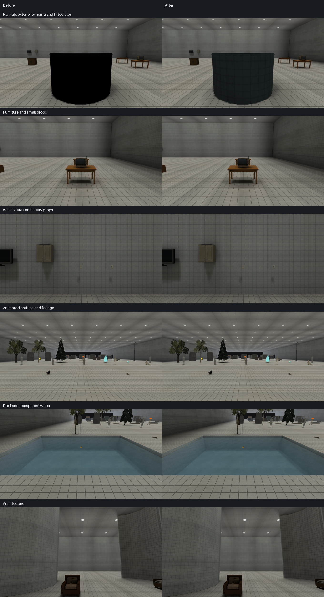
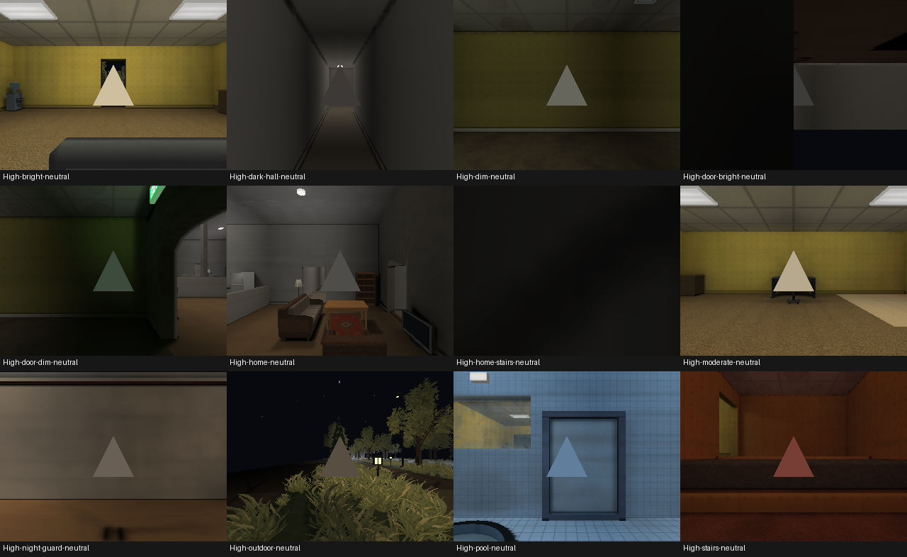
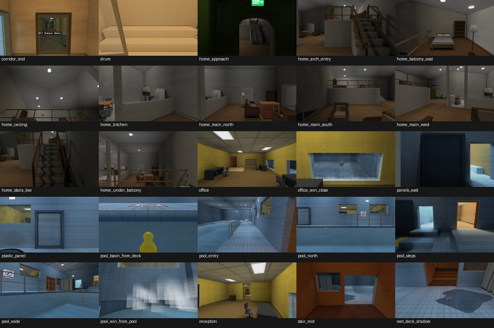
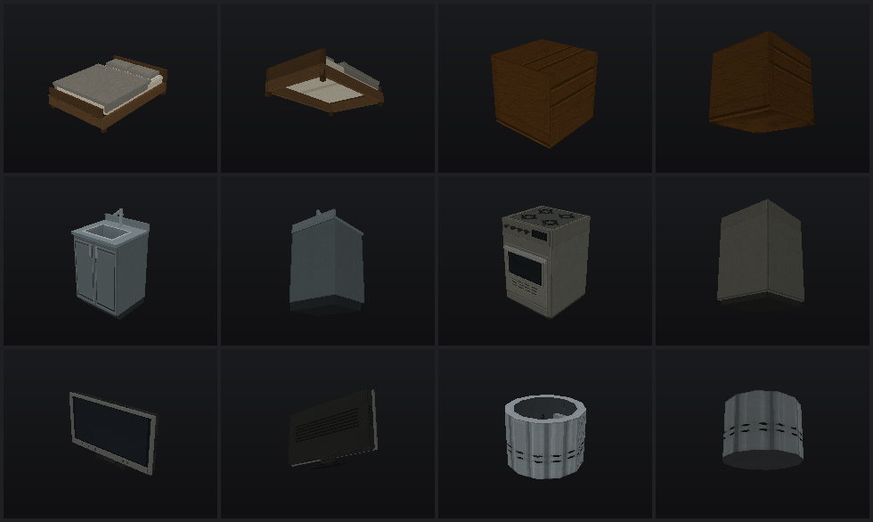
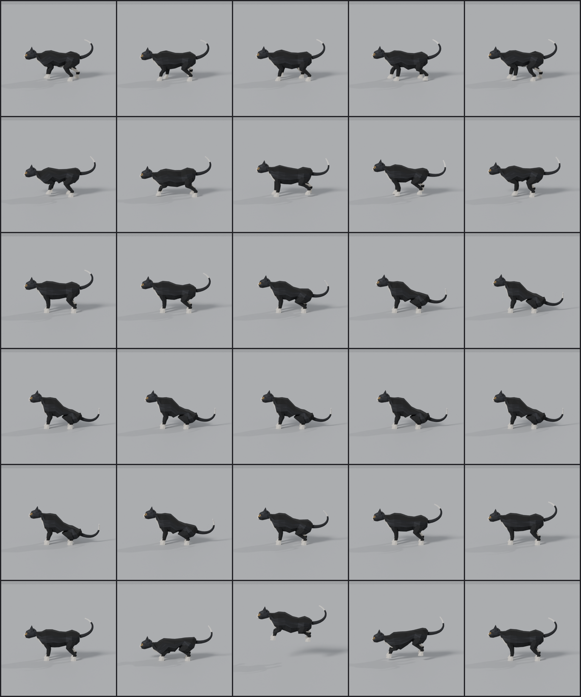

# Places 0.7.0 historical development report

This is the single report for work documented under the 0.7.0 package metadata.
It consolidates the original content, engine investigations and native evidence;
it does not create a new release or tag. Some retrospective summaries describe
earlier work and retain their own dates and tested commit identities.

Measurements, test counts, package fingerprints, failures and proposed work below
belong to their recorded checkpoints. Later corrections supersede earlier failed
probes; none of these historical results establishes current performance, memory
or platform acceptance. The [0.13.0 final report](release-0.13.0.md) records current
staging acceptance and limitations. Current contracts remain in the separate
authoring, asset, editor, installation and developer guides. Old custody and queue
statements are historical context, not active jobs or instructions.

## Evidence and investigations

- [Places asset library audit — 2 October 2026](#asset-library-audit-2026-10-02)
- [Places asset refinement — 26 September 2026](#asset-polish)
- [Places compiler pipeline audit](#compiler-pipeline-audit-20261003)
- [Desktop cleanup and loading](#desktop-cleanup-and-loading)
- [Domestic model remakes](#domestic-model-remake)
- [Integrated compiler and entity lighting](#entity-lighting-integration)
- [Hanging exit sign remake](#exit-sign-remake)
- [Remaining model geometry repairs](#geometry-repair)
- [Lantern Hollow showcase acceptance](#lantern-hollow)
- [Lighting energy repair and maintained-level rebake](#lighting-energy-repair)
- [Desktop lighting quality pass](#lighting-quality-pass)
- [Places movement controller audit](#movement-controller-audit)
- [Places desktop finalization — 2026-10-02](#places-finalization-2026-10-02)
- [Pool guard rails and curtain remakes](#pool-rails-curtains)
- [Offline probe baker audit — solver revision 8](#probe-baker-audit)
- [Rubber duck remake](#rubber-duck-remake)
- [Spoonerman: feline animation remake](#spoonerman-cat-motion)
- [Stop sign remake](#stop-sign-remake)

<a id="asset-library-audit-2026-10-02"></a>
## Places asset library audit — 2 October 2026

The complete current asset library was inventoried before edits, checked technically,
and inspected in front/top and rear/underside views. The hot tub had a definite
geometry and UV defect, and the pool table had a duplicated coplanar tabletop
closure. Both were repaired without changing their textures, dimensions or placements.
Twenty-eight missing standalone PNG records were recovered from the existing GLBs,
without changing their pixels. The existing art direction and valid assets were retained.
Preservation checks
confirm that all pre-existing PNGs and every GLB except the hot tub and pool table are byte-unchanged,
the new sources are exact original embedded PNGs, and the tub re-export is deterministic.

The house kit's lighter cladding above doors and windows remains a documented
shading issue. The user explicitly excluded lighting code from this pass. Its cause
is already present in exported vertex colours, produced by the shared offline
contact-shading helper; it is not a discontinuity in the PNG. No shared shading,
runtime renderer or baker code was changed.

The final canonical gate passed with both repairs installed. All four shipped
packages are current and valid at off/medium/full. No Rust production or gameplay
code changed,

<a id="asset-library-audit-2026-10-02-inventory-and-coverage"></a>
### Inventory and coverage

The complete inventory records paths, hashes, formats, dimensions, alpha ranges, bounds, vertices,
triangles, materials, embedded images and their standalone sources, transforms,
skins, clip channels/durations, map uses, code literals, unused data and duplicates.
It also inventories the other files under `assets/` and the application icon.

| Item | Inspected |
| --- | ---: |
| GLB 2.0 models | 134 |
| Standalone PNGs under `assets/`, before → after | 131 → 159 |
| Embedded PNG images, all checked against standalone pixels | 136 |
| Application icon outside `assets/` | 1 |
| Catalog material definitions | 52 |
| GLB material slots / maximum per model | 160 / 4 |
| Animated models | 10 |
| Animation clips | 29 |
| Skinned assets / clips / posed frames tested | 8 / 27 / 3,227 |
| Rigid clips / posed frames tested | 2 / 98 |
| Triangles / expanded inspection vertices, before → after | 35,483 → 35,481 / 75,825 → 75,821 |
| Catalog entries, including native fixtures/decals | 247 |
| JSON map sources inspected for uses, including developer/test fixtures | 34 |

The catalog model categories contain 72 Structure, 24 Decorative, 12 Furniture,
8 Utility, 7 Appliances, 5 Vegetation, 5 Lighting and 1 Other entries. This includes
the original and five themed house kits, porches, fences, ground modules, rocks,
trees, furniture, appliances, bathroom/pool props, tableware, switches, displays,
fixtures, mannequin, rat, Spooner-Man and the Halloween characters. Native doors,
walls, archways, pillars, stairs, trim and fixtures were covered by map geometry
checks, existing runtime/compiler tests and native captures. There are no current
loose GLTF files or separate roughness/metalness texture packs under `assets/`.
Two catalog materials reference normal maps; these remain ordinary PNG assets.

Every GLB has a map reference, including Model Zoo. Source masters, diagnostic
textures and alternative catalog materials are deliberately retained. An image
without a direct catalog ID is not necessarily unused: the inventory connects
pixel-equivalent PNGs to their embedding models and those models' map/code uses.

All 134 models were rendered with the corrected inspection reader and reviewed
from front/top and rear/underside, with backface culling to expose winding problems.
All original standalone textures and all recovered images were reviewed in contact
sheets. Native comparisons cover furniture/small props, fixtures, architecture,
entities, foliage, water and the hot tub. Outdoor captures cover the maintained
28-view kit, including all five house families. Maintained door views cover the
interior, sauna and outdoor entry. These are inspection views, not a claim that
every possible animation transition or camera angle was manually played.

<a id="asset-library-audit-2026-10-02-findings-by-category"></a>
### Findings by category

| Category | Finding and disposition |
| --- | --- |
| Geometry | Hot-tub outer wall was wound inward, conflicting with its caps. Corrected 96 exterior triangles. Pool-table closure duplicated its top with the opposite diagonal/winding; removed two redundant triangles. No degenerate or exactly coincident triangle faces were found elsewhere. Assembled shells, cavities, foliage cards and intentionally open props were retained. |
| Normals | Reversed tub faces generated inward exterior normals and a black exterior in the native bake. Fixed at the source winding. Authored normals/tangents across the library are finite and within unit-length tolerances; smoothing/silhouettes were inspected. |
| UVs | Tub tiles were stretched around a complete circumference with one atlas span. Changed to four fitted spans around each wall and seven painted rows up the wall. Other fitted/swatches/repeated UVs were retained after visual review. |
| Textures | Twenty-eight existing embedded images lacked equivalent standalone PNG files. Recovered their exact original PNG payloads. All 39 intended tiled surface sheets pass horizontal/vertical raw and smoothed seam metrics. No texture painting, resizing or upscaling was needed. |
| Materials | House cladding has approximately 11% brighter vertex tints above openings in all five themed door/window families. Documented below; shared authoring shading is excluded by the user's instruction. No extreme new reflectivity, emission or PBR treatment was introduced. |
| Scale | Bounds were compared with catalog sizes and architectural references. Table 1.40×0.75×0.80 m, stove 0.60×0.90×0.60 m, fridge 0.70×1.80×0.70 m, bed 1.40×0.55×2.00 m, plate 0.22 m diameter, bowl 0.15 m diameter, switch approximately 0.086×0.12 m, mannequin/skeleton approximately 1.72 m tall. House modules remain 3.0×2.7 m with a 1.10×2.15 m opening. Character pose bounds and the tub's 35 mm apron explain small catalog-envelope differences; no arbitrary rescaling. |
| Pivots | Rest transforms, bases and placement origins were recorded; native door hinges and the switch rocker/animated roots are covered by existing tests and clips. No origin changes were necessary. |
| Animations | All 29 clips parsed, channels/times/transforms checked. Skinned clips swept at 60 Hz through exact endpoints; rigid clips additionally sampled at 60 Hz using shortest-arc quaternion interpolation. Existing Halloween regeneration and clip-boundary checks protect the exported contracts. No clip rename, rig change or animation deletion. |
| Collision | Tub positions, bounds and map recess/water relationships are unchanged. Existing collider/route/controller tests cover doors, stairs, props and outdoor fixtures. Trunk-sized tree colliders and non-solid facade dressing are intentional map contracts; no physics or collision changes. |
| Organization | Standalone native records now accompany their GLBs; house families keep shared 128/256 px derivatives beside their 1024 px masters. Documented source/runtime distinction. No ID/path renames or compatibility aliases. |
| Performance | No accidental high-poly import or excessive material-slot count. Largest models are deliberate animated characters; pumpkin skeleton is 2,278 triangles, most static props much smaller. No unused material/accessor/image data was found that warranted removal. PNG decoding dominates the new audit; bounded process execution was used and serial/12-worker inventories were byte-identical. |
| Broken references | No unresolved catalog/model/material/texture references in the final checks. Source coverage now includes every embedded image. The old Demo package initially recorded the old tub hash, requiring the normal package rebuild. |

Topology is interpreted conservatively: a welded position count is not a reason
to merge UV seams or hard edges, and a signed-volume heuristic cannot decide
whether an inner basin or open foliage sheet should face outward. These checks
produce review data; they do not automatically repair the library. The new quad
comparison detects opposite diagonals that exact triangle hashing misses. One
remaining doubled quad belongs to the closed joint between a porch railing rail
and its end post; it is hidden assembly geometry and was conservatively retained.

<a id="asset-library-audit-2026-10-02-changes-made"></a>
### Changes made

| Asset/tool | Problem | Change and reason |
| --- | --- | --- |
| `core:hot_tub` / `assets/environments/pool/props/hot_tub.glb` | Exterior wall faced into the basin; tile cells were stretched approximately 4.7:1 before fitting. | Flipped exterior winding and fitted four atlas spans/seven vertical tile rows. Inner basin still faces inward and rim/apron face up. Physical cells are approximately 23–26 cm wide and 22 cm tall. |
| `core:pool_table` / `assets/environments/pool/props/pool_table.glb` | A generic boundary closure put a second, downward-facing quad exactly on the tray top, making it black in the bake. | Removed that two-triangle closure and four now-unused vertices. All surviving position/UV/colour records and the embedded PNG/materials are unchanged. The native tabletop receives light again. Its top sheet's boundary is buried in the rim; the lower apron remains intact. |
| `tools/props/repair_geometry.py` | The maintenance pass treated the tray sheet boundary as a missing solid face. | Added a reviewed, fail-closed table-cap removal and excluded this particular tray boundary from hole closure, so maintenance does not recreate the defect. |
| `tools/props/parts/pool.py` | Builder recreated the tub artwork instead of loading a standalone asset. | Loads the recovered, unchanged `hot_tub.png` and `pool_table.png` instead of recreating artwork. Keeps the tub's original two-region atlas, colours, geometry, pivot and 384 triangles. Removed the unused tub/tray painters; shared resin/metal painters for untouched assets remain unchanged. |
| 28 native PNG records | Existing artwork was available only inside GLBs. | Extracted byte-identical existing PNGs into the corresponding asset directories. The full source list identifies every added file. Only the tub and table GLBs changed. |
| `tools/assets/audit.py` | No one inventory joined all models, images, clips, duplicates and map uses. | Added a read-only stdlib audit with finite data, topology, coincident quads including opposite diagonals, UV, normal/tangent, skin, animation, native-image-budget and standalone-source checks. Uses the established bounded execution/atomic-write helpers. |
| `tools/props/glb.py` | Inspection kept only the first texture and lost primitive material assignment. | Retains every texture slot and triangle material, preserving the legacy first-texture field for existing callers. Game loading code is unchanged. |
| `tools/props/preview.py` | Multi-material models, foliage and translucent inspection views could be misleading; no rear/culling view. | Uses primitive textures/factors, MASK cutoff and BLEND compositing; adds `--cull` and `--rear`. Remains a bind-pose software inspection renderer. |
| `tools/bench/capture_zoo.sh` | Cameras still pointed at the former, smaller Zoo layout. | Updated fixed cameras to the current rows, pool, fixtures, table setting and architecture. No map rearrangement. |
| `tests/test_asset_audit.py` | No focused regression for these actual asset/tool contracts. | Seven tests cover coplanar quads with opposite diagonals, the table closure contract, exterior/interior tub normals and tile cell proportions, all material slots, NaN geometry, invalid clip data, rigid rotation/endpoints and cutout texture selection. |
| `tools/verify.sh` and documentation | New inventory/source guarantees were not part of the gate. | Added the audit and regressions, and documented the source policy and inspection limitations. |
| Bundled map packages | Prepared records must reflect the modified GLB. | Recompiled the Demo and Zoo packages; verified all four shipped maps against their current sources/assets. Source maps and placements are unchanged. |

The 28 PNGs total **1,505,666 bytes** of repository/source artwork. They are not
additional runtime texture allocations: models retain their original embedded
images. The new source groups are seven core props, two home cabinets, four office
props, collision peg, ten shared house derivatives and four pool props.

<a id="asset-library-audit-2026-10-02-optimization-and-duplicate-content"></a>
### Optimization and duplicate content

| Measure | Result |
| --- | ---: |
| Triangles removed / added | 2 / 0 |
| Unused table vertices removed | 4 |
| Texture-size reductions | 0 |
| Duplicate model files removed | 0 |
| Duplicate PNGs removed | 0 |
| Unused material/image/accessor data removed | 0 |
| Runtime model bytes, before → after | 11,219,756 → 11,219,648 (108 fewer) |

There are no byte-identical GLB files. Five groups share position geometry across
house family pieces, intentionally carrying different family artwork/semantics.
Seven groups of standalone PNGs have identical bytes/pixels: shared Halloween
surface art, concrete/showcase surface, fence/showcase wood, two grass patch
sources, original house wall sources, lamp sources and porch railing sources.
These are authoring/semantic family records, not accidental duplicate imports.
They were retained instead of introducing aliases or changing authoring contracts.
Skins' unweighted joint slots are support/root hierarchy nodes; removing them
without understanding the hierarchy would be unsafe.

All model files together contain 11,219,648 bytes. Their 136 embedded images decode
to 25,071,616 RGBA bytes before any runtime sharing/downsampling. Native embedded
sheets stay at or below 256 px; larger standalone masters are intentionally retained.
No nominal-resolution upscaling or simplification was performed for cosmetic diffs.

<a id="asset-library-audit-2026-10-02-visual-evidence"></a>
### Visual evidence




The additional Pool-table geometry-only pair is retained locally; the model findings and native baseline method remain below.

Native baseline views used the same binary, cameras and scratch settings with the
tracked pre-edit asset/package files from HEAD in a separate read-only package root.
The runtime's `PLACES_ASSET_ROOT` points to the parent containing `assets/`;
compiler `--asset-root` instead points directly to `assets/`. Baseline captures
were regenerated after correcting that distinction, and capture logs were checked
for requested-level fallback. An early door capture started before package
installation and entered the menu; it was discarded. Final door views were
rerun after `verify --require-current` and native level discovery confirmed the
installed package. The table comparison isolates its two-face removal
in the already-corrected pool fixture and a freshly rebuilt off/medium/full package.
Unchanged categories are intentionally very similar. Frame-count captures can
differ slightly in moving entities; no pixel-identical animation claim is made.
Initial old-camera Zoo captures are excluded from the comparison because several
views no longer framed the intended exhibits.

The tub is no longer completely black, but its exterior remains dark under the
existing bake. Its unchanged albedo is plainly visible in the unlit inspection
view. This residual lighting concern was not hidden by whitening its texture.

<a id="asset-library-audit-2026-10-02-validation"></a>
### Validation

The complete `sh tools/verify.sh` gate exited **0** with `set -eu`; every
required step passed. Additional checks are listed below:

| Command/check | Result |
| --- | --- |
| `cargo fmt --all --check` | Passed in the final canonical gate. |
| `cargo clippy --workspace --all-targets --all-features -- -D warnings -D clippy::all -D clippy::pedantic -D clippy::nursery -D clippy::cargo` | Passed in the final canonical gate. |
| `cargo test --workspace --all-features` | Passed: 1,912 library tests, 3 integration tests; 21 default ignored diagnostics. The gate additionally runs the maintained atlas-budget check and two native GPU checks, all passed. |
| `cargo check --workspace --all-targets --all-features` | Passed; final package refresh checked again. |
| `sh tools/verify.sh` | Passed, exit 0. All asset/source checks, seven Python suites, full package current/decode checks, geometry repair, native GPU and startup checks passed. |
| `cargo build --release` | Passed. |
| `python3 -m unittest tests.test_asset_audit tests.test_glb_accessors` | Passed, 18 tests. |
| `python3 tools/assets/audit.py --workers 1 --out target/asset-audit/serial.json` | Passed, zero integrity errors. |
| `python3 tools/assets/audit.py --workers 12 --out target/asset-audit/parallel.json` | Passed, zero integrity errors; JSON byte-identical to serial run. |
| Final `audit.py --workers 1 --out target/asset-audit/serial-final.json` / `--workers 12 --out target/asset-audit/parallel-final.json` and `cmp` | Both passed after both model/package repairs; JSON byte-identical and final inventory retained. |
| `python3 tools/entities/validate_entities.py --workers 12 --json` | Passed, eight assets/27 clips/3,227 posed frames; requested 12, effective 11 under existing memory cap. |
| `python3 tools/entities/check_clip_boundaries.py` | Passed. |
| `python3 tools/entities/author_halloween_assets.py --check` | Passed. |
| `python3 tools/textures/seam_repair.py --check <39 intended tiled PNGs> --workers 12` | 39/39 passed; no repair writes. |
| `python3 tools/props/build.py --only core:hot_tub` | Exported the focused repair; original artwork preserved. |
| In-memory `build.build_one(..., publish=False)` comparison | Tub re-export byte-identical; bounds, triangle count, materials and embedded image bytes match the original. No filesystem writes during this check. |
| `target/release/places --check-geometry --level <source> --json <output>` | Seven sources, all exit 0; zero errors, warnings retained below. |
| `places-compile build/verify/validate` for Pit, Hallows entity fixture and pool showcase | Passed for vertex-lit structural variants; pool showcase additionally built/current/validated at off/medium/full. |
| `PLACES_STATE_ROOT=<scratch> sh tools/bench/capture_zoo.sh <out>` | Ten current views in each comparison phase captured and inspected. |
| `PLACES_KIT_PACKAGE=<compiled fixture> sh tools/bench/capture_outdoor_kit.sh` | 28/28 native views in each phase, no failures. |
| `sh tools/bench/capture_doors.sh` with five maintained view selections | Captured maintained interior, sauna and exterior door views. |
| Native tub capture at `PLACES_SPAWN=36.6,21.6,0`, `PLACES_CAMERA=0,-8`, frame 4 | Before/after capture succeeded. |
| Table-only `repair_geometry.process(path, apply=True)` and a second read-only pass | Removed two closure triangles/four unused vertices; second pass is byte-idempotent. Bounds, texture and material definitions preserved. |
| `python3 -m unittest tests.test_asset_audit.PropGeometryRepairTests` | Four winding/cavity/seam regressions passed in the historical tool; now consolidated under this test class. |
| Fresh pool-showcase package and identical-camera table comparison | Geometry-only proposal restored the pale tabletop under the existing baker; no lighting code or albedo change. |
| In-memory legacy table builder/source comparison | Loads the exact retained 256×256 PNG pixels. No blanket model regeneration; shipped hand-finished geometry retained. |
| CPU profile of the new inventory | PNG decoding dominated; reused existing bounded process helper instead of adding dependencies. |

The initial canonical gate stopped at a Rust test asserting that the Demo package
has no validation warnings. The old package recorded the old hot-tub content hash;
the independent validator confirms that exact stale dependency. This requires a
normal asset/package rebuild, not a lighting-code workaround. The focused atlas
test passed after rebuilding Demo; the full canonical gate passed after the tub
repair and again after the final table repair. The
initial failed run is retained
alongside the successful final output.

<a id="asset-library-audit-2026-10-02-map-compatibility"></a>
### Map compatibility

| Source | Geometry check | Package status |
| --- | --- | --- |
| Places Demo | 0 errors, 2 warnings | Affected off/medium/full package rebuilt in an isolated asset root, checked against the repository assets and installed; final gate confirms it is current. |
| Model Zoo | 0 errors, 1 warning | Affected full package rebuilt; native after captures used it. |
| Lantern Hollow | 0 errors, 0 warnings | Unmodified assets; build reports current, and off/medium/full shipped package passes current verification and validation. |
| Movement Test | 0 errors, 0 warnings | Unmodified assets; build reports current, and off/medium/full shipped package passes current verification and validation. |
| Pool Showcase fixture | 0 errors, 0 warnings | Affected by tub; off/medium/full package built/current/validated. |
| Pit (`level0_pit`) developer fixture | 0 errors, 68 warnings | Structural package built/current/validated. |
| Hallows (`halloween_entities`) developer fixture | 0 errors, 12 warnings | Structural package built/current/validated; all associated skins/clips tested. |
| Capacity Dense stress fixture | Valid collider/route stress checks | Table dependency; structural package built/current/validated. |
| Outdoor Kit Showcase | Native 28-view coverage | Existing full scratch package remains current: its models/textures are unchanged. |

All 34 JSON sources were scanned for references; intentionally invalid test maps
were not misrepresented as current playable levels. The four shipped playable
sources are `assets/levels/{places_demo,model_zoo,lantern_hollow,movement_test}.json`.
The tub is referenced by Demo, Zoo and the pool showcase. The table additionally
appears in the `capacity_dense` stress fixture; its structural package was
rebuilt/current/validated after the repair. No source JSON, collision
definition, navigation route or placement was edited.

<a id="asset-library-audit-2026-10-02-remaining-issues-and-scope-limits"></a>
### Remaining issues and scope limits

**Asset appearance / offline authoring shading:** The lighter house lintels are
confirmed in both doorway and window GLBs in the original kit and all five themed families. In the
blue/red family, ordinary cladding uses RGB `(154,158,156)` while the head bands
use `(171,176,173)`. The bands are about 11% brighter before runtime lighting.
The shared `PropBuilder._ao_at` darkens each primitive according to its base;
floor-reaching columns get 0.9 contact tint, raised head pieces get 1.0.
The themed house builder applies continuous module-space UVs and the same PNG to both.
The same shared helper is used by the original kit. This is a family-wide authored
shading discontinuity, not evidence of a damaged texture or proof of a global
runtime lightmap bug. It was left unchanged under the user's lighting-code
exclusion; asset tint hacks and texture repainting were not used to disguise it.

**Lighting/baker:** Residual tub darkness is still visible; the definite winding
fault is repaired. Full baking retains the existing sub-texel vertex-light fallback
(33 Demo and 35 Zoo quad slivers). No claim is made that these warnings cause the
house tint issue. Lighting code was only read for diagnosis.

**Renderer:** The software preview does not simulate game emission, reflections,
skinning or baked lightmaps; native images supply that evidence. No new runtime
renderer defect was confirmed. Existing documented renderer limits, such as
fixture UV stretching on rotated native geometry and glass/decal sampling limits,
were not expanded into this task.

**Map geometry:** Seven source checks have zero errors but 83 aggregate warnings:
Demo's tiny wall-joint sliver and porch dressing/floor coplanarity; Zoo's room-leak
candidate; Hallows' four joint slivers and eight opposite-facing coplanar wall
overlaps; Pit's sixteen slivers and fifty-two missing-wall candidates. These are
existing map/checker findings, not new GLB corruption. Intentionally open geometry
also appears in the checker's explicitly suppressed findings. No map redesign or compiler change was made to
silence them.

**Gameplay/collision:** No new issue was confirmed. Furniture may use coarse box
collision and vegetation uses authored trunk boxes; visual gaps are not a reason
to change established gameplay. Pose sweeps and tests do not substitute for playing
every interaction. No collision/movement/AI/navigation code was changed.

<a id="asset-library-audit-2026-10-02-files-and-scope-discipline"></a>
### Files and scope discipline

No Rust production code, game renderer, global/offline shared lighting helper, baker,
gameplay, UI, save system, map format, editor or dependency declaration was changed.
No retired platform code was introduced. No commit or publication was performed.

Non-asset changes are the audit, GLB inspection reader, software previews, focused
regressions, corrected Zoo capture cameras, canonical gate and its documentation;
each exists to inspect or prevent the asset failures described above. Documentation
changes cover the source PNG contract, validation commands, inspection workflow,
current library/image-memory counts and the existing cutout/translucent contract. This report is review material, not runtime content.

The complete changed-file manifest
lists every modified and added file, including the 28 exact PNG source records
and this report. The implementation/documentation files are
listed below; the PNG source list is also available separately above.

- `assets/environments/pool/props/hot_tub.glb`
- `assets/environments/pool/props/pool_table.glb`
- `assets/levels/places_demo.placesmap`
- `assets/levels/model_zoo.placesmap`
- `assets/README.md`
- `docs/ASSET_SPECIFICATION.md`
- `docs/MAP_AUTHORING_GUIDE.md`
- `docs/VERIFICATION.md`
- `tools/assets/audit.py`
- `tools/bench/capture_zoo.sh`
- `tools/props/README.md`
- `tools/props/glb.py`
- `tools/props/parts/pool.py`
- `tools/props/preview.py`
- `tools/props/repair_geometry.py`
- `tests/test_asset_audit.py`
- `tools/verify.sh`
- `docs/reports/release-0.7.0.md#asset-library-audit-2026-10-02`

<a id="asset-polish"></a>
## Places asset refinement — 26 September 2026

Historical acceptance: September 2026 asset polish. Counts, timings and validation below describe
that tested version; the canonical guides govern current contracts.

This pass refines the assets already present in the working tree. It preserves their logical IDs, model paths, dimensions, metre scale, +Y up / +Z front conventions, rigs and gameplay roles. No commits, dependencies, engine architecture changes or unrelated asset rebuilds were made.

<a id="asset-polish-deliverables"></a>
### Deliverables

| # | Asset / clip | Refinement and final location |
|---|---|---|
| 1 | Rat | Fuller haunch and narrower shoulders; continuous weight blending across joined anatomy and rigid soles. `assets/entities/rat/model/rat.glb` |
| 2 | Human skeleton | Fuller cranium, shaped rib cage, narrower sternum, paired radius/ulna forms; retained articulated hands, feet and poses. `assets/entities/skeleton/model/skeleton.glb` |
| 3 | Stop sign | Flat-top octagon with matching fitted source artwork, corrected rim winding. `assets/shared/props/stop_sign.glb` |
| 4 | Hanging green Exit sign | Closed bevelled housing and inset luminous face; original rods, canopy, lettering and emissive material preserved. `assets/shared/props/exit_sign.glb` |
| 5 | Hanging white ball light | Twelve-sided globe, corrected face winding, socket collar and retained cord/rose. `assets/environments/home/props/ball_light.glb` |
| 6 | Wall light switch | Bevelled closed plate and rocker, round screw heads, recessed rocker surround; preserved hinge and `toggle` clip. `assets/environments/home/props/wall_switch.glb` |
| 7 | CRT TV | Deep tapered rear housing and cooling slots; repaired repeated screen UV strips, retained curved glass and controls. `assets/environments/home/props/crt_tv.glb` |
| 8 | Knife | Bevelled walnut handle and bolster; corrected blade top winding. `assets/environments/home/props/knife.glb` |
| 9 | Fork | Bevelled handle, neck, head and four individually readable tines. `assets/environments/home/props/fork.glb` |
| 10 | Spoon | Thin-walled, concave oval bowl replaces the sealed circular mouth; bevelled handle. `assets/environments/home/props/spoon.glb` |
| 11 | Plate | Sixteen-sided rim/well silhouette and corrected winding on the ceramic shell. `assets/environments/home/props/plate.glb` |
| 12 | Bowl | Deeper usable interior and sixteen-sided rim, corrected shell winding. `assets/environments/home/props/bowl.glb` |
| 13 | Small potted plant | Defined glazed rim around the soil; retained seven closed folded leaves and original table-scale proportions. `assets/environments/home/props/plant_table.glb` |
| 14 | Yellow rubber duck | Broad flat bill, fuller crown and low-relief folded wings; corrected body/head winding. `assets/environments/pool/props/rubber_duck.glb` |
| 15 | Ceiling vent | New clean stylized grille artwork with bevel, slats and corner fixings; retained square 128×128 cut-out contract. `assets/shared/decals/ceiling_vent_01.png` |
| 16 | Curved wall geometry | Reusable 90° and 180° engine-native modules: 2 m centreline radius, 24 cm thickness, 2.8 m height, 12 facets per quarter turn. the native curved-architecture contract in the map authoring guide |
| 17 | Circular pillar geometry | Reusable engine-native 60 cm diameter, 2.8 m height, 16-facet pillar with centre-floor origin. Same preset file. |
| 18 | Spoonerman idle | Quieter breathing/tail movement, denser keys, exact standing endpoint; in `spooner-man.glb`, clip `idle`. |
| 19 | Spoonerman walking | Smooth body-bob curve, denser sampling, repaired skin transitions; clip `walk`. |
| 20 | Spoonerman sit-down | Denser smooth transition and repaired haunch weights, continuous seated endpoint; clip `sit_down`. |
| 21 | Spoonerman sitting-idle | Subtle breathing, planted front-paw compensation, exact seated endpoint; clip `sit_idle`. |
| 22 | Spoonerman stand-up | Denser eased transition and exact standing endpoint; clip `stand_up`. |
| 23 | Rat idle | Reduced tail sweep; repaired skin junctions, stationary foot solve and exact loop closure; clip `idle`. |
| 24 | Rat walking | Calmer tail movement, continuous weights and retained analytic foot placement; measured speed metadata; clip `walk`. |
| 25 | Rat running | Reduced exaggerated tail lift, repaired ankle/haunch weights, retuned stride and measured speed metadata; clip `run`. |
| 26 | Mannequin standing | Broader chest/waist, outward-facing body surfaces, new light-grey concrete; `assets/entities/mannequin/model/mannequin.glb`, `pose_stand`. |
| 27 | Mannequin arms-up | Same refined geometry/material and preserved validated rig; `pose_arms_up`. |
| 28 | Mannequin arms-forward | Same refined geometry/material and preserved validated rig; `pose_arms_forward`. |
| 29 | Skeleton standing | Updated anatomy on the shared rig; `pose_stand`. |
| 30 | Skeleton floor-sitting | Updated anatomy, retained solved feet and hand placement, validated static hold; `pose_sit_floor`. |
| 31 | Skeleton chair-sitting | Updated anatomy, retained 45 cm seat reference and flat feet, validated static hold; `pose_sit_chair`. |

Spoonerman's five clips are embedded in `assets/entities/spooner-man/model/spooner-man.glb`. Its original mesh, textures, joint hierarchy and proportions remain intact. The six human pose variants ship as named hold clips in their shared rigged GLBs, not duplicate static files. The architectural assets use the project's native level format, not decorative GLBs; they retain real collision, baked-light occlusion and world-scale texture mapping.

<a id="asset-polish-artwork-and-rigging"></a>
### Artwork and rigging

Two new artworks: the mannequin's opaque 256×256 `concrete_grey_01.png` and the 128×128 transparent vent sheet. Their builders now load the finished PNGs rather than repainting them. Five fixture/sign/electronics atlases were preserved as standalone source PNGs beside their GLBs (`stop_sign`, `exit_sign`, `ball_light`, `wall_switch`, `crt_tv`); their builders embed those files. Spoonerman's three existing embedded sheets were also extracted unchanged into `assets/entities/spooner-man/textures/`. Other fitted atlases retain their layouts and artwork.

No new rigs or joints: Spoonerman 26, rat 25, mannequin 23, skeleton 24. Skin weights were repaired on the rat and Spoonerman without changing their rest skeletons. Loops close; Spoonerman's idle/sit/stand boundaries match within 0.00001 in the exported channels. Locomotion remains in place with reference-speed metadata; sit/stand use local pelvis movement, not route/root translation.

<a id="asset-polish-previews-and-checks"></a>
### Previews and checks

- Offline software inspection: [props, sheet 1](../images/reports/asset-polish/sheet_1.png): stop sign, exit sign, globe, switch, CRT; knife, fork, spoon, plate, bowl.
- The additional native integration capture is retained locally; its props, vent and curved-architecture validation is described below.
- [Architecture placement instructions](../MAP_AUTHORING_GUIDE.md).

The software preview camera was corrected so signs are no longer mirrored. The Blender contact-sheet tool now explicitly selects action slots, disables imported NLA overrides and provides room for raised-arm poses. The entity deformation validator now examines every skinned primitive, including all three Spoonerman parts. `tools/entities/check_clip_boundaries.py` adds an export-level check for normalized skin weights, loop seams and sit/stand transitions.

The rat passes 62 builder checks plus the independent 60 Hz sweep (maximum edge stretch under 1.8×). Spoonerman passes the all-primitive 60 Hz sweep (under 2×). Its walking/transition samples can still dip about 9 mm below the floor, within the project's contact tolerance; this is recorded rather than described as perfect foot locking. Separate closed components intentionally meet/intersect at prop assembly joints and humanoid articulations. UV/material seam vertices remain where needed.

<a id="asset-polish-validation"></a>
### Validation

Final validation passed: **1,265 Rust tests passed, 0 failed, 8 ignored**, plus formatting, strict Clippy and the asset checks.

All requested items have usable outputs. No asset was left as a missing export. The character contact sheets are offline visual checks; the in-game capture verifies the props, vent and native curved architecture. No claim is made of exhaustive interactive gameplay testing of every animation transition. Existing world-texture preferred-resolution warnings are unrelated to this pass.

<a id="compiler-pipeline-audit-20261003"></a>
## Places compiler pipeline audit

The implementation, paired benchmark comparisons, repository gates and native
validation passed in the October 3, 2026 audit. Measurements remain dated
observations under the host conditions below.

<a id="compiler-pipeline-audit-20261003-measurement-contract"></a>
### Measurement contract

The baseline is working-branch commit
`e66d3a05f6f6cf33eb8657c1d62abf6befb8980e`, after the movement audit and recent
lighting repairs. The development machine is an Apple Silicon M2 Pro MacBook
Pro, 12 CPU cores (8 performance and 4 efficiency), 16 GiB RAM. Rust 1.99.0 is
pinned by `rust-toolchain.toml`. All compile measurements use optimized release
binaries, identical source/assets and all Off, Medium and Full variants.

Clean samples are fresh compiler processes with `--force` and distinct output
packages. Native sampling, builds, tests, gameplay and correctness comparisons
are excluded from their timed intervals. Cold process startup remains included;
filesystem caches are not artificially flushed. Raw first samples remain
available separately. Reported summaries use medians, not fastest runs.
One brief `cargo fmt --all` command at 04:55:14 UTC overlapped the final two
seconds of Demo optimized pair 3 (finished 04:55:16). That sample is retained
and annotated; no owned compilation, test, native sampling or gameplay overlapped
its timed interval.

The user explicitly requested proceeding without waiting for an idle CPU.
The final comparison alternates baseline and optimized builds within each of
three map pairs. Each process records UTC intervals, CPU time, effective busy
cores, Darwin peak RSS, context switches and periodic host load. Executable
names/resource totals before and after each run document desktop, VM and other
background work without reading command arguments. These are measurements under
shared-host load, not claims of exclusive-host performance.

The original baseline binary SHA-256 is
`ad248f4ad2f0f0dd0dd6d8bfbd435e808096582e2e2ad0ad0dd398f3e33a6558`.
An instrumented baseline produces byte-identical packages and adds phase
timings. The frozen final benchmark compiler SHA-256 is
`7c01a36c28ab84f1a24164bf48175a60f0c1df846c56b258e16a9bb2cc49256b`.

<a id="compiler-pipeline-audit-20261003-baseline-and-bottlenecks"></a>
### Baseline and bottlenecks

The initial full-pipeline measurements identified transport, rather than disk
I/O, parsing, compression or BVH construction, as the dominant cost.

| Map | Transport triangles | Emitters | Switchable emitters | Original representative wall time | Accounted nested phases |
| --- | ---: | ---: | ---: | ---: | ---: |
| Small `test_room` | 719 | 1 | 0 | 8.875 s | 7.951 s, 89.6% |
| `places_demo` | 174,395 | 73 | 1 | 1,114.175 s | 1,103.401 s, 99.0% |
| `lantern_hollow` | 259,558 | 40 | 0 | 444.521 s | 436.860 s, 98.3% |

These representative runs explain costs; final speedup tables use the later
alternating repeated comparison. One original Demo run included sampling and
symbol linkage and is explicitly excluded from clean-performance medians.
Original Hollow runs overlapping other application work retain their labels.

| Nested phase | Demo | Hollow |
| --- | ---: | ---: |
| Indirect transport | 946.273 s | 339.560 s |
| Direct visibility | 50.656 s | 30.969 s |
| Lightmap filtering | 40.015 s | 8.704 s |
| Prop geometry/charts | 13.781 s | 48.043 s |
| Architecture/charts | 22.268 s | 3.339 s |
| Receivers | 17.509 s | 3.324 s |
| Chart fill | 10.499 s | 1.234 s |
| Probes | 1.210 s | 1.454 s |
| Atlas assembly | 1.029 s | 0.174 s |

Parent preparation timings include these child phases and must not be added
again. A native 15-second GI sample attributed 35.58% of mapped compiler samples
to nearest traversal, 23.76% to occlusion traversal, 23.26% to triangle
intersection and 16.21% to cache representative selection. This supported
algorithm and memory-access changes before further parallelization.

<a id="compiler-pipeline-audit-20261003-optimizations-and-correctness"></a>
### Optimizations and correctness

1. **Reuse complete CPU preparation.** Each quality variant previously built
   its CPU world again for GPU reflection capture. Capture now consumes the
   already prepared world, while retaining the historical pre-feather decal
   colours required for identical captures. Materials come from the actual
   requested asset root. Probe resolution, mip generation and lighting remain
   unchanged. Packages without probe capture points avoid creating an unused
   GPU capture renderer.
2. **Share independent light-layer geometry queries.** Demo's one switchable
   light repeated the same receiver, cache, stencil and ray geometry work for
   its base and switch layer. Both layers now use the same geometric queries
   and separate original radiance buffers and accumulation order. Sky enters
   only the base layer. The original path remains for other layer counts to
   bound memory. No samples or bounces are removed.
3. **Improve ray traversal.** A deterministic 16-bin surface-area hierarchy and
   contiguous packed triangle records serve the hot ray queries. Prepared rays
   calculate invariant shear/dominant-axis terms once. Opaque visibility uses
   an early-return any-hit path; transmissive surfaces still pass through.
   Point queries retain their original hierarchy.
4. **Preserve exact numerical eligibility.** Tighter nodes exposed boundary
   rounding differences in an experimental candidate. That candidate was
   rejected when strict lightmap comparison found changed HDR channels.
   Conservative SAH bounds now discover candidates, original leaf bounds
   enforce canonical visibility eligibility, and rounded nearest-hit ties
   replay the original traversal/identity rules. Acceptance arithmetic remains
   unchanged. Broad-phase tolerance never changes the accepted ray distance.
5. **Reduce cache and temporary work.** Representative squared distances are
   computed when cache cells are built, lookup stencils use bounded stack
   storage, and already farther fallback cells avoid visibility queries.
   Static props skip redundant initial vertex lighting when their actual
   lightmap receivers will be baked; failure paths restore the original fully
   lit fallback. Archive entries move their buffers instead of cloning them.
6. **Batch bounded workers.** Independent receiver/texel work uses dynamic
   contiguous chunks with stable ordered assembly. Chunk size is bounded to
   32–2,048 indices; scheduling is one atomic fetch per chunk. At most 12 workers
   run, serial work uses the caller, and pipeline stages do not nest pools.
   Cancellation and worker failures propagate before final publication.
7. **Make incremental reuse safe.** Package and stage identities include
   content hashes for the actual catalogue, models and all referenced albedo,
   normal and emissive-mask PNGs, quality/record/geometry/solver fingerprints.
   `asset_inputs_v2` invalidates private experimental pipelines. Only proven
   display metadata/navigation changes reuse prepared lighting; physical edits
   rebuild it. Retained blobs are validated, obsolete navigation records are
   removed, and lightmap content identities are refreshed for the edited source.
   Independent clean builds must produce the exact incremental archive bytes.

The calibrated light range/shape reach rejection already precedes expensive
visibility; global/directional illuminators retain their separate semantics.
No unsafe facing cull, approximate light influence or older lighting path was
introduced. Existing model/texture preprocessing caches are reused within a
build. No partial-GI cache is claimed: lighting geometry/light/material changes
invalidate the complete transport result.

The Rust CLI does not invoke Python for numeric baking. Existing CPU-heavy
Python asset/zoo tools already use bounded process workers, deterministic
assembly and cache identities. Their applicable tests remain part of the gate.
BVH construction, I/O, serialization and compression were outside the dominant
cost; adding pools or changing artifact formats there was not justified.
No dependency, explicit SIMD, unsafe code or architecture-specific CPU path
was added. Ordinary packed numeric kernels remain portable.

<a id="compiler-pipeline-audit-20261003-output-comparison-and-determinism"></a>
### Output comparison and determinism

Strict comparison checks every decoded archive record, not selected screenshots
or an image-error tolerance. Geometry, collision, navigation, entities,
materials, HDR lightmaps, indirect/directional coefficients, probes and all
reflection mip bytes must remain identical. The only accepted differences are
compiler/stage identities and added existing texture dependency hashes/sizes
verified against the actual PNG files. Demo adds two previously untracked normal
map dependencies; the PNGs themselves are unchanged.

Nine repeated builds of the exact-output repaired candidate passed strict
comparison across all three maps/qualities. Repeated package hashes were stable.
All four rebuilt production packages also passed comparison against preserved
pre-audit bundles. The frozen final compiler passed all six Small/Demo paired
comparisons and the full-quality Hollow spot check. Native results are recorded
below after completion.

<a id="compiler-pipeline-audit-20261003-regression-coverage"></a>
### Regression coverage

- Seeded prepared-ray tests compare 50,000 cases across four coordinate scales
  with the original watertight intersection, including zero/cardinal/invalid
  directions.
- BVH nearest/opaque/transmissive oracles cover 10,000 rays; another 80,000
  boundary/coincident rays protect distance bits and surface identity.
- Canonical leaf visibility is compared against the original traversal on
  50,000 additional rays. Captured grazing/parallel cases protect the rejection
  found in the experimental native bake.
- Cache connectivity, tie ordering, moments, eight-tap stencils, signed zero and
  fallback paths compare with the reference implementation.
- Shared base/switch layers preserve coefficients and probes with sky, water,
  dark lights, zero lights and zero through three bounces, at one/many workers.
- Parallel results are bit deterministic at 1/2/4/8/12/64 requested workers;
  tasks run exactly once, in output order, on no more than 12 worker threads.
  Cancellation and injected worker failure are covered.
- Compiler integration verifies metadata/navigation reuse versus independent
  clean builds at 1/12/64 workers, no orphan navigation records, catalogue and
  image-class invalidation, final algorithm-version invalidation, malformed
  input and invalid-worker preservation of the previous valid archive.
- An additional retained corruption fixture poisons a Medium lighting blob
  while leaving identities unchanged. Both unchanged and metadata-only builds
  must reject it and match independent clean bytes; the final default workspace
  run has passed this test.
- Nine Python harness tests cover parsing, resources, owned-child timeouts,
  atomic reports, strict output exceptions, preserved incremental edits and
  alternating comparison order. The ninth protects the distinction between
  runtime canonical-manifest identity and the complete ZIP archive hash.

<a id="compiler-pipeline-audit-20261003-clean-build-results"></a>
### Clean-build results

The final alternating window completed three pairs for Small and Demo. A
coordinated browser gate paused only outer orchestration while the final timed
Demo child continued normally to completion; its child timing, CPU, RSS and UTC
measurements are intact. The outer job was then ended after all timed children
had exited, before any new baseline began. The completed three-sample Hollow
architecture measurements were reused
instead of repeating expensive baselines, as requested when the user asked to
shorten the remaining work. One final-binary full-quality Hollow spot check
independently confirms exact output. The older architecture median and final
single sample are labelled separately rather than combined into a false median.

| Map | Before median | After median | Time saved | Reduction | Speedup | Repeats per side |
| --- | ---: | ---: | ---: | ---: | ---: | ---: |
| Small `test_room` | 8.002 s | 5.154 s | 2.848 s | 35.59% | 1.553× | 3 |
| `places_demo` | 1,203.784 s | 227.746 s | 976.038 s | 81.08% | 5.286× | 3 |
| `lantern_hollow`, repaired architecture | 444.521 s | 256.102 s | 188.419 s | 42.39% | 1.736× | 3, earlier window |
| `lantern_hollow`, final binary spot | 444.521 s retained baseline median | 246.247 s single sample | 198.273 s indicative | 44.60% indicative | 1.805× indicative | final: 1 |

| Map | Before median CPU-seconds | After median CPU-seconds | Before median effective cores | After median effective cores | Before median peak RSS | After median peak RSS |
| --- | ---: | ---: | ---: | ---: | ---: | ---: |
| Small `test_room` | 52.810 | 34.060 | 6.656 | 6.469 | 337,625,088 B | 289,783,808 B |
| `places_demo` | 11,023.001 | 1,549.782 | 9.154 | 6.778 | 2,221,867,008 B | 2,485,846,016 B |
| `lantern_hollow`, earlier median/final single | 3,631.270 | 2,226.781 | 8.173 | 9.043 | 2,416,967,680 B | 2,447,163,392 B |

Each metric is a median of its own per-run measurements. Demo's baseline wall
samples are 1,702.939 / 1,172.789 / 1,203.784 seconds; optimized samples are
227.746 / 228.741 / 217.882 seconds. All remain included. Different effective
core availability makes the wall-time result a shared-host observation; CPU time
also falls by about 7.11×. Demo's median RSS increases by about 11.9%, a measured
tradeoff rather than an unreported memory improvement.

All three Demo pairs passed strict physical-record equality, and each side's
complete archive hashes are identical across repeats. Sources and quality settings
remain identical. The first two pairs were compared automatically; the third was
also compared with the recorded background host load.

Hollow's repaired-architecture samples were 255.099 / 256.102 / 285.253 seconds
with median CPU time 2,291.408 seconds and median peak RSS 2,080,751,616 bytes.
The later final spot sample used 2,226.781 CPU-seconds and 2,447,163,392 bytes.
It is not a three-run final-binary median, nor a same-window paired speedup.

Hollow's final single-sample resident peak is about 1.25% above the earlier
baseline median; its repaired-architecture median was about 13.9% below it.
Different windows and memory pressure prevent attributing that difference solely
to the final kernel specialization. No universal RAM reduction is claimed.

<a id="compiler-pipeline-audit-20261003-worker-scaling"></a>
### Worker scaling

The frozen compiler rebuilt all three Small qualities three times per worker
count. All 15 complete archive hashes were identical:
`077a5fb7e9002d5acb74e9ff8ce00005246a2d847f66a50e4ad1e3be8305e571`.

| Workers | Small median wall | Median CPU-seconds | Median effective cores | Median peak RSS |
| ---: | ---: | ---: | ---: | ---: |
| 1 | 26.188 s | 26.082 | 0.996 | 330,842,112 B |
| 2 | 13.997 s | 26.902 | 1.922 | 376,979,456 B |
| 4 | 7.700 s | 27.183 | 3.530 | 375,881,728 B |
| 8 | 4.614 s | 27.584 | 5.975 | 372,555,776 B |
| 12 | 4.188 s | 33.502 | 7.992 | 373,243,904 B |

Twelve workers give a 6.25× wall-time improvement over one on this complete
fixture; the heterogeneous cores and serial stages prevent ideal 12× scaling.
Eight workers cost less CPU time but take longer. The default uses available
parallelism bounded by 12, honors a smaller configured budget and supports an
explicit single-worker fallback. No nested pool exceeds that shared budget.
Large-map Medium measurements at the same counts are recorded separately;
single samples characterize scaling without pretending to be stable medians.

| Workers | Hollow Medium wall, one sample | CPU-seconds | Effective cores | Peak RSS |
| ---: | ---: | ---: | ---: | ---: |
| 1 | 239.263 s | 239.028 | 0.999 | 1,762,050,048 B |
| 2 | 130.289 s | 241.791 | 1.856 | 1,841,987,584 B |
| 4 | 75.956 s | 246.539 | 3.246 | 1,642,446,848 B |
| 8 | 49.944 s | 261.160 | 5.229 | 1,751,203,840 B |
| 12 | 44.738 s | 301.994 | 6.750 | 1,828,470,784 B |

All five complete Medium archive hashes are identical:
`b7931974e9053c209a959c24d576db535337e2f8ec727731572f322a7787f11a`.
The 12-worker single sample is 5.35× faster than one worker; eight again uses
less CPU but takes longer. These observations support the bounded automatic
default on this Mac, while user budgets remain configurable.

<a id="compiler-pipeline-audit-20261003-incremental-builds"></a>
### Incremental builds

Each of the following all-quality cases starts from a fresh copy of a verified
clean package and has three timed trials. Every result is byte-identical to an
independent forced clean build of precisely the edited source. Identical repeated
edits use the same hash-identified clean reference; correctness comparisons are
outside timing and no repeated result skips comparison.

| Small edit | Baseline median | Final median | Reuse decision |
| --- | ---: | ---: | --- |
| Unchanged | 0.314 s | 0.317 s | Valid complete archive retained |
| Name/author | 6.063 s | 0.527 s | Final reuses validated geometry/lighting/probes/collision |
| Move light 0.125 m | 6.377 s | 4.809 s | Complete physical stage rebuilt |
| Move prop 0.125 m | 6.070 s | 4.302 s | Complete physical stage rebuilt |
| Change floor material | 5.966 s | 4.400 s | Complete physical stage rebuilt |

Small metadata rebuilds are 11.51× faster than baseline without stale lighting.
Unchanged-package performance is effectively unchanged. Metadata peak RSS falls
from 474,857,472 to 84,115,456 bytes; CPU time from 51.497 to 0.492 seconds.
Hollow unchanged/metadata checks also passed all six byte-exact comparisons:

| Hollow case | Median wall, 3 trials | Median CPU-seconds | Median peak RSS |
| --- | ---: | ---: | ---: |
| Unchanged archive | 2.192 s | 2.090 | 311,197,696 B |
| Name/author metadata | 7.786 s | 7.739 | 681,984,000 B |

The metadata median is 31.63× shorter than the final 246.247-second clean spot
sample; that comparison is a three-trial incremental median against one clean
sample, explicitly not paired clean medians. One independent forced all-quality
metadata bake protects every repeated identical edit. In total, 36 incremental
trials passed exact clean equality (15 baseline Small, 15 final Small, 6 final
Hollow). Large-map physical-edit incremental medians are not claimed: those edits
invalidate global lighting, as they must.
The observed decisions were nine complete-archive hits, six permitted prepared
stage hits and 21 complete rebuilds. All 18 physical edit trials rebuilt; the
remaining three rebuilds were baseline metadata edits. No unsafe lighting reuse
was observed.

<a id="compiler-pipeline-audit-20261003-remaining-measured-costs"></a>
### Remaining measured costs

These gains are cumulative measurements, not isolated attribution of each
optimization. Earlier exact-output prototypes recorded Demo at 535.210 seconds
after preparation/layer/cache reuse and at a 184.531-second median after the
repaired ray architecture; their background-load windows differ from final
paired measurements. A separate deterministic **development-profile** ray
kernel diagnostic measured 2.34× Demo and 2.01× Hollow representative-ray speed
with identical hit results; it is not presented as a release bake benchmark.
There was no full factorial ablation campaign. Process peak RAM, phase timing,
CPU time and context switches were collected; per-allocation counts and
per-thread lock-wait time were not instrumented.

In final Demo pair 3, indirect transport still takes 153.390 seconds of 217.882
total (70.4%). Direct visibility takes 18.720 seconds, filtering 9.236,
architecture/charts 11.760 and prop preparation 4.794. In final Hollow, indirect
transport takes 173.763 seconds of 246.247 (70.6%), direct visibility 20.017,
prop preparation 30.430 and architecture/charts 3.297. Its Full bake still
evaluates 461,531,776 gather directions; horizon rejection is included in that
count, so it is not asserted to be the number of triangle intersection calls.
Medium evaluates 70,314,880 gather directions. Ray traversal remains the measured
hot path; finer dependency-safe geometry caches or portable vector kernels are
possible further work, rather than grounds for silently removing samples.

The measured Demo gain exceeds the 3–5× objective. The retained Hollow median
improvement is 1.736× and does **not** meet 2×; the final single sample is
indicatively 1.805×. This report does not claim that the remaining transport is
at a theoretical hardware limit. Substantial duplicate preparation/query work
has been removed, the preserved quality is computationally expensive, and no
further speculative architecture changes were made after the user requested
shortening the task.

<a id="compiler-pipeline-audit-20261003-final-validation"></a>
### Final validation

All commands used Rust **1.99.0 (b940084d7 2026-09-28)** and Cargo
**1.99.0 (5f94df478 2026-08-27)**, `RUSTC_WRAPPER=` and
`CARGO_NET_OFFLINE=true`. Compiler regression controls retained their distinct input/package identities.

| Command | Result |
| --- | --- |
| `cargo fmt --all --check` | PASS, exit 0 |
| `cargo check --workspace --all-targets --all-features` | PASS, exit 0 |
| `cargo test --workspace` | PASS: 1,975 library tests, 0 failures, 23 ignored; binary tests 1 + 3 passed |
| `cargo test --workspace --all-features` | PASS: 1,975 library tests, 0 failures, 23 ignored; binary tests 1 + 3 passed |
| `cargo clippy --workspace --all-targets --all-features -- -D warnings -D clippy::all -D clippy::pedantic -D clippy::nursery -D clippy::cargo` | PASS, exit 0; configured policy unchanged |
| `sh tools/verify.sh` | PASS, exit 0; 1,345.436 s total |
| `git diff --check` | PASS, exit 0 |
| `python3 -m unittest tests.test_compiler_bench` after capture assertion correction | PASS: 9 tests, 0 failures |

The complete gate also passed asset validation/inventory, maintained model/clip
checks, four idempotent map-authoring checks, all four bundled package
build/currentness/decoding checks, 20 showcase Python tests, 48 package tests,
23 packaging/accessor/asset tests, 49 tooling/generator/benchmark tests,
14 geometry-repair tests, 10 compiled-build tests and 26 native renderer tests.
Focused Rust preflights passed 9 showcase, 19 static-prop, one explicit large
atlas-planning test and both native low-lighting tests. Expected injected-worker
failure text in the Python suite is a tested refusal path; all suite summaries
are successful.

The complete gate ran after the final Rust/bake implementation. The later small
Python capture assertion correction changed no Rust or bake code; it received
its focused nine-test run and the real native capture comparisons. The earlier
incorrect-assertion attempt is retained separately. Runtime identity hashes the
canonical manifest, while the harness independently retains full archive SHA-256
and verifies the exact loaded source path, selected variant and zero runtime
preparation work. Neither identity nor loading checks were removed.

<a id="compiler-pipeline-audit-20261003-native-output-and-playable-evidence"></a>
### Native output and playable evidence

The same saved executable rendered baseline and final packages at authored frame
1 through the real Apple M2 Pro **Metal** backend. Ten fixed views (six Demo,
four Hollow) were captured at each of Low, Medium and High: **60 captures,
30 before/after pairs, zero changed pixel channels**. Every capture is 1,280×720
pixels from the same 640×360 logical window, camera, spawn, quality, bloom and
vsync settings. Every run verified the selected canonical manifest identity,
full archive hash, exact package source path, requested variant and zero runtime
lighting/prop/surface/atlas preparation. Representative office, pool and night
street images were also visually inspected. No GPU validation/device errors
were observed.

Every one of the **29 distinct preserved fixture packages** also opened in the
saved native game: 29 Low runs plus six representative Medium/High runs,
**35 profile cases passed**. Invalid source and corruption reproductions remain
separately labelled expected failures; their last valid packages stay playable.
All four final production bundles passed strict physical-record comparison with
the pre-audit bundles after their final identity rebuilds. There is no unexplained
numeric or visual output difference.

After the Python identity assertion correction, the complete applicable
tooling/generator/benchmark Python group was rerun: **50 tests passed**, zero
failures, 14.621 seconds. No Rust/bake implementation changed after the full gate.

Typed worker errors and controlled archive failures return compiler errors before
publication. Atomic ZIP writing removes failed `.partial` files and preserves
the previous package. The repository's existing release `panic = "abort"` policy
remains: an unexpected panic aborts the process before publication rather than
returning a joined-worker error. Unwinding test builds exercise the joined-worker
failure path. The audit does not claim graceful recovery from process termination.

Shared light layers retain separate radiance buffers to preserve accumulation
order. This can increase peak resident memory; measured figures are reported
above. There is no claim of universal memory reduction or safe
partial lighting reuse after physical edits.

<a id="compiler-pipeline-audit-20261003-reproduction-inputs"></a>
### Reproduction inputs

The dated comparisons require the original authoring sources, analytic fixtures,
matching catalog/assets and valid packages, plus the saved player/compiler and
local SDL dependency. A later checkout or screenshots alone cannot reconstruct
these controls. The independent archive retains 29 distinct valid fixture
packages and separately labelled expected-failure inputs.

```sh
python3 debug-maps/compiler-audit-20261003/launch.py
```

Running the preserved launcher without a map argument lists its fixtures. Use
`tools/bench/compiler_bench.py` and the canonical verification guide for new measurements;
retain the exact source/asset inputs and distinguish canonical runtime manifest
identity from the hash of the full ZIP archive.

<a id="compiler-pipeline-audit-20261003-terminal-progress-follow-up"></a>
### Terminal progress follow-up

The later pre-0.9 terminal-progress campaign in October 2026 is separate from
the October 3 benchmark measurements above. Its maintained output and cancellation
contract is in [Offline Tooling](../OFFLINE_TOOLING.md#compiler-feedback-and-cancellation).
The existing compiler/transport timing phases were retained; reflection capture
used the GPU while light transport remained on CPU workers.

Formatting/diff checks, strict debug and release Clippy, workspace tests
(2,253 library, two compiler CLI and seven integration) and all-feature tests
(2,259 library, two CLI and seven integration) passed, retaining 18 existing
ignores. Sixty-five focused Python package/benchmark checks passed. Tiny
deterministic tests protected terminal width/count policy, concurrent counters,
warning redraw and cancellation immediately before publication; no full-map
test was added.

Real pseudo-terminal/plain captures used the existing 4×4 packing control and
8×6 material-routing fixture. Progress enabled/disabled produced identical
control archives. JSON with verbose logs, 120→60-column resize, warnings,
current/prepared reuse, collection failures and actual terminal Ctrl-C passed.
Native Metal capture verified Full/Medium reflection stages and probe counts.
Evidence remained in `local/compiler-progress/` outside the build directory.
Production maps were not baked; active source/package and unrelated audit hashes
were preserved. Linux/Windows native acceptance and broad performance measurement
were not run in that campaign.

<a id="desktop-cleanup-and-loading"></a>
## Desktop cleanup and loading

Implementation and verification record for the September 2026 corrective pass.
The corrective pass stopped with an unbuilt, untested final pacing edit.
Completed measurements and that remaining acceptance gap are distinguished below.
The [feature summary](release-0.8.0.md#feature-expansion-summary) preserves the preceding
gameplay and tooling delivery.

<a id="desktop-cleanup-and-loading-baseline-and-measurement-scope"></a>
### Baseline and measurement scope

The baseline includes the user's uncommitted demo, authoring-guide, geometry and
continuity-test changes. A tracked-source copy was preserved outside the checkout;
the ignored Pit input was copied separately before its corrected measurement.
No branch, worktree, commit, user cache purge, or system cache purge was used.
Measurements run serially on macOS / Apple Silicon M2 Pro. Application-cache cold
means a fresh isolated state directory, not cold operating-system or GPU caches.
The controlled release harness uses High, VSync, a 640×360 logical window, camera
74°, and four ready frames. Effective renderer configuration was recorded independently.

The baseline Rust gate compiled in 12.85 seconds. Its cached full invocation took
1140.17 seconds wall time, with 1139.35 seconds reported test execution: 1288 passed,
2 failed and 8 ignored (1298 unique tests). Failures were the allocation-estimate
ratio assertion and cross-room wall continuity.
Over-60-second notices identify candidates, not independently measured durations;
their times must not be added to claim suite wall time.

<a id="desktop-cleanup-and-loading-retired-implementation-and-coverage"></a>
### Retired implementation and coverage

The standalone `apps/places-pocketchip` implementation and exclusive files were
removed. It was outside the desktop workspace and normal desktop gate, so this
removal saves **zero measured desktop-suite execution time**. No desktop backend,
Linux/ARM support, low-quality setting, or low-resolution safety coverage was
removed. The root dependency lockfile did not need changes.

<a id="desktop-cleanup-and-loading-runtime-preparation"></a>
### Runtime preparation

A single persistent preparation worker owns level reading, immutable asset
snapshots, geometry, lighting, collision-world preparation and character initialization.
Final collision-index/state installation still runs on the main thread. One active
request and one replaceable pending request are bounded by generation IDs. The UI
pumps and presents while preparation runs; cancellation and supersession reject
obsolete completions. Shutdown cancels work and continues pumping until the worker
can be joined. Direct selection prepares the requested level without first building
the demo. The previous complete world stays paused until a compatible replacement
is ready, and input edges and simulation timing are cleared across transitions.

Conservative room and light candidate indexes preserve original predicates and
candidate ordering. Prop expansion samples identical source positions once per
placement while preserving every vertex, UV and color. These remove actual repeated
CPU work rather than merely moving it behind loading feedback.

GPU installation retains the old world while atlas, geometry, textures, materials
and bounded prop batches are uploaded. Finalization and resource disposal still
require large-level trace acceptance; the existence of these phases alone is not
proof of a bounded frame time.

<a id="desktop-cleanup-and-loading-cache-contracts"></a>
### Cache contracts

Prepared geometry uses exact prepared level/material/catalog/model-input content,
asset root and effective lightmap quality. Its LRU retains at most three builds and
192 MiB of accounted retained data; oversized worlds work but are not retained by
that LRU. Up to eight weak build identity keys can additionally retain raw model-byte
Arcs outside the 192 MiB budget until the next request prunes dead identities.
Active resources remain independently owned. Lightmap memory retention is
four entries / 128 MiB. Disk atlases use a versioned, length-checked, checksummed
single-file envelope, bounded metadata/pages, and atomic same-directory publication.
Corrupt, outdated and interrupted entries miss safely. Semantic version 10 invalidates
old topology after covered wall faces and unnecessary rectangular-cap diagonals
were removed; map content and lighting sampling thresholds were not changed.

PNG identities include encoded content and embedded model images include dimensions
and RGBA content. Exact model-input snapshots detect same-path/same-mtime edits.
Optional prior texture retention is trimmed at load boundaries to 256 entries /
256 MiB for CPU and GPU caches, without evicting assets midway through one level's
resolution. Active level resources can exceed those retention budgets. Model caches
retain the current request's dependency paths rather than accumulating every visit.

<a id="desktop-cleanup-and-loading-verification-cost"></a>
### Verification cost

Six read-only render tests now share immutable demo builds by quality (eight complete
bakes become three). Their assertions, including independent atlas refill, remain.
The doorway ownership test no longer repeats the separate full-map coincidence
audit. The light-range audit performs its required independent fill without first
filling an unused complete atlas. Report-only sorting is opt-in. Texture validation
runs once through the package suite, and one duplicated zoo CLI freshness check was
removed while its package-suite equivalent remains. Python worker controls and the
shared execution budget are preserved.

<a id="desktop-cleanup-and-loading-reproduction"></a>
### Reproduction

Run the authoritative gate from the repository root:

```sh
sh tools/verify.sh
```

Measure an already-built binary with fresh application state (output must not exist):

```sh
python3 tools/bench/loading.py --binary target/release/places --out /tmp/places-loading-run
```

The same harness accepts an already-built debug binary. Do not include compilation
in runtime comparisons. Native lifecycle cases are in
`tests.test_wgpu_bootstrap.WgpuRuntimeSmokeTests`; the action fixture exercises actual
SDL event processing and the actual preparation worker under an injected delay.

<a id="desktop-cleanup-and-loading-targeted-checks-and-acceptance-limits"></a>
### Targeted checks and acceptance limits

Strict Clippy passed after cache/loader integration. Prepared-build identity/LRU,
exact model refresh, texture retention and active-ownership regressions pass.
Five native small-fixture scenarios previously passed: direct launch, resize/cancel/
retry, shutdown during preparation, supersession and failure recovery. Their maximum
observed event-pump gap was 42 ms and scripted event latency ranged 0.4–10.3 ms.
These are small-fixture results, not claims about dense-level upload behavior.

The final gate result is recorded below. Large-level cancellation/disposal, a
manual gameplay walkthrough, and baseline/current visual comparisons have not
been completed. Linux/Windows runtime checks were unavailable: this host has no
running Docker daemon or corresponding native runtime. These are acceptance
limits, not passing checks.

<a id="desktop-cleanup-and-loading-final-controlled-runtime-measurements"></a>
### Final controlled runtime measurements

Already-built binaries, one cold/warm pair per level; seconds include process
startup, readiness, four rendered frames and clean exit. These are individual
observations rather than statistical confidence intervals. Renderer configuration, first-ready presentation, phase records, RSS and event
gaps were recorded with each invocation.

| Entry | Before cold | After cold | Before warm | After warm |
|---|---:|---:|---:|---:|
| menu | 29.337 | 15.957 | 2.226 | 1.294 |
| places_demo | 29.191 | 15.704 | 2.250 | 1.309 |
| model_zoo | 37.010 | 6.492 | 2.841 | 0.784 |
| level0_pit | 36.560 | 3.550 | 2.457 | 0.494 |
| capacity_sparse (subsequently retired) | 31.196 | 1.000 | 2.299 | 0.375 |
| capacity_dense | 78.992 | 27.839 | 30.929 | 11.418 |

Unoptimized debug normal startup improved from 346.570 to 181.764 seconds cold
and from 26.885 to 13.811 seconds warm. Debug first present was 2.386 seconds
cold / 0.562 seconds warm, so debug still has a noticeable initial setup delay.
Cargo profiles were not changed. Release
loading feedback first presents in 168–214 ms across these runs; this is distinct
from full world readiness. Dense warm loading still takes 11.4 seconds: the disk
atlas hit avoids baking, but geometry/props are rebuilt in each fresh process.

The initial window/device setup still accounts for gaps above 100 ms. Once the
loading loop is running, the demo cold trace has p99 event spacing of 8.925 ms;
its largest event gap is the initial 162.746 ms. Final GPU work is not universally
bounded for arbitrary imported content. Earlier serial-fill representative traces
had upload steps up to 62.5 ms; small staged-cancel disposal measured 0.044 ms.
No dense-cancellation disposal bound is claimed.

The final atlas fill uses at most three workers, leaving CPU capacity for the
UI. Each has a one-result queue and processes charts in source order; the writer
consumes original order and retains identical texel arithmetic and atlas output.
Layout validation precedes producer allocations, and cancellation is checked per
row. Shipped presets bound chart buffers to about 84 MiB including the consumer,
plus atlas storage; arbitrary custom configuration is not universally size-capped.
Explicit two/three-worker versus serial output tests pass. A proposed greedy
assignment was rejected because an ordered-queue model predicted worse completion;
it was not installed. Runtime serial reference is available using
`tools/bench/loading.py --workers 1`. No final same-binary serial timing sweep was
completed; the earlier serial-fill matrix is preserved separately, not presented
as an isolated parallel speedup.

The first debug pilot and the second accidentally overlapping packaged-app run
are invalid; only `places-loading-before-debug-controlled` is used above.
No packaged prebake requirement was added. Cache misses remain supported.
No new dependencies, production art changes, preference migrations or commits
were introduced.

Cold-process maximum RSS decreased from 709.6 to 656.3 MiB for normal menu entry
and from 1428.9 to 672.8 MiB for the dense fixture. RSS is process resident memory,
not a GPU allocation or process-tree measure. Across release cold runs, measured
maximum event-pump gaps ranged 132.3–170.1 ms including initial setup. Sparse has
few observations and its p99 includes that initial interval; it must not be
summarized as universally sub-10-ms. Dense cold p99 was 8.915 ms. Synthetic action
latencies and repeated-visit RSS samples were recorded;
synthetic focus actions do not prove operating-system focus handling.

<a id="desktop-cleanup-and-loading-final-integration-corrections"></a>
### Final integration corrections

The first complete integration run found seven failures (1317 passed, 7 failed,
8 ignored; 694.06 seconds test execution, 703.44 seconds invocation). This initial run was not a passing gate.
The seven targeted reruns all passed after these focused corrections:

- Empty scripted Escape/Quit variants now reject unknown JSON fields. Serde's
  internally tagged unit variants had silently accepted them.
- The material assertion now checks the full content-derived texture key and
  shared image allocation, rather than expecting an obsolete bare logical key.
- Z-axis horizontal caps, floating-box undersides and X-axis wall ends now wind
  outward, preserving per-corner attributes. Falling ramp sides use their surviving
  triangle for orientation when their first triangle is degenerate. The relocated
  winding regressions exposed these latent defects; their assertions were retained.
- The wall-lighting check selects the first exposed corner at x=48.2 after hidden
  overlap removal, using the same geometric tolerance and red-dominance assertion.
- Cache semantic version 10 invalidates prior atlas corner/normal arrangements.

The user's existing wall-coverage changes in `src/render/common/mod.rs` remain;
this pass additionally corrects the unrelated wall-end winding in that file.
The other three originally edited files remain byte-identical to the preserved
baseline. Production asset files remain unchanged.

The runtime table above was collected immediately before these final winding and
script-validation corrections (binary hashes are preserved). It measures the
implemented loader, caches and bounded fill; it is not a post-correction timing
rerun. Final-code validation is listed separately below.

<a id="desktop-cleanup-and-loading-stopped-at-the-users-request"></a>
### Stopped at the user's request

Implementation work was stopped on explicit request. This is **not a fully verified
completion**. No build or game process owned by this task remains running.

The last complete Rust run passed 1324 tests with 8 ignored in 683.44 seconds.
Formatting and strict Clippy passed at that point. Asset validation, prop freshness,
43 package tests and 34 tooling tests passed. Seven of eight compiled-build tests
passed; the stale empty-install log assertion was replaced and its targeted rerun
passed. All 23 native SDL/wgpu tests passed in 85.685 seconds.

Geometry checks: Demo exits 0 with one sliver warning; Zoo exits 0 with no findings.
Pit exits 1 both before and after: 16 errors and 76 warnings. All 16 error locations
are unchanged. Three sampled sliver warning locations differ after triangulation;
warning totals/categories are unchanged. No map or suppression rule was altered.
Dense accepted-upload cancellation and cold-fill cancellation passed. Their traces
then exposed an occluded-surface busy loop: skipped acquisition was treated as a
presentation. A final pacing/tracing correction is present in the working tree,
but its validation is **unfinished**. The latest strict Clippy invocation fails
`too_many_lines` in `src/main.rs::render_and_present` (101/100 lines). No blanket
lint allowance was added. The final pacing change has not been rebuilt or rerun
through native tests. Earlier passing results therefore do not certify that edit.

The latest change makes presentation report success explicitly, yields up to 16 ms
on unavailable surfaces, and distinguishes actual presentation in traces. It also
updates the empty-install assertion to check committed world identity alongside
its capture file. These edits need the remaining lint fix and affected checks.

The displayed timing table predates these final corrections. No final timing sweep,
manual gameplay walkthrough or baseline/current visual comparison is claimed.
Linux/Windows runtime verification was unavailable. No commits were created.

The source journal also records the preceding input correction: short key taps
are latched until simulation consumes their edge, with crouch height and a
placed-instance E action checked through the native player. That completed
feature acceptance does not certify the later untested loading pacing edit.

<a id="domestic-model-remake"></a>
## Domestic model remakes

Historical acceptance: September 2026 domestic prop remake. Counts, timings and validation below describe
that tested version; the canonical guides govern current contracts.

Remade all ten requested models in the existing Places style and catalog paths.
No catalog IDs, placement contracts, gameplay code, or unrelated models changed.
All models remain triangulated GLBs with embedded PNGs and baked face shading.

| Asset | Geometry changes | Triangles |
|---|---|---:|
| Knife | Shaped octagonal handle, bolster, broad asymmetric blade with a rounded nose | 188 |
| Fork | Tapered handle, curved shoulder, four individually tapered rising tines | 320 |
| Spoon | Shaped handle/neck and an elongated concave bowl with thickness | 336 |
| Plate | Defined foot ring, broader flat rim, shallow well and closed underside | 400 |
| Bowl | Broader upper body, rolled lip, thinner inner wall and stable foot | 480 |
| Wall switch | Bevelled plate and raised housing, slotted screws, shaped moving rocker | 232 |
| CRT TV | Closed tapered rear cabinet, chamfered bezel, convex glass, controls and feet | 516 |
| Couch | Three separate seat/back cushions, sloped upholstered arms, tapered feet | 544 |
| Bed | Timber rails/headboard, bevelled mattress/pillows, folded blanket with side drops | 532 |
| Office chair | Five-star base, horizontal casters, contoured waterfall seat and padded back | 524 |

The four larger props slightly exceed the preferred 500-triangle target but
remain below the 800-triangle review threshold. The bed retains the catalog's
low 0.55 m height. Existing material colors and texture pixels are preserved;
this pass changes the models and UV mapping, not their painted artwork.

<a id="domestic-model-remake-files-produced-or-changed"></a>
### Files produced or changed

GLBs replaced:

- `assets/environments/home/props/knife.glb`
- `assets/environments/home/props/fork.glb`
- `assets/environments/home/props/spoon.glb`
- `assets/environments/home/props/plate.glb`
- `assets/environments/home/props/bowl.glb`
- `assets/environments/home/props/wall_switch.glb`
- `assets/environments/home/props/crt_tv.glb`
- `assets/shared/props/couch.glb`
- `assets/shared/props/bed.glb`
- `assets/environments/office/props/chair.glb`

New file-backed sources extracted from the previous models without pixel changes:

- `assets/shared/props/bed.png`
- `assets/environments/office/props/chair.png`

Authoring and validation:

- `tools/props/parts/domestic_remade.py`: new builders for the ten models.
- `tools/props/parts/{tableware,home,furniture}.py`: route only these catalog entries to the new builders.
- `tools/props/validate_domestic_remake.py`: repeatable geometry, texture and switch audit.
- `docs/ASSET_SPECIFICATION.md`: extracted texture sources and revised switch hinge.
- This report and `docs/reports/domestic-model-remake/`: three contact sheets, build log and geometry JSON.

<a id="domestic-model-remake-animation"></a>
### Animation

The wall switch retains the rigid `toggle` animation, `switch`, `lever_pivot`
and `lever` node names, 0.35-second duration and 30-degree travel. The hinge was
repositioned to fit the new housing. A 31-position sweep confirms the rocker
stays in front of the backing plate. No character rigs or clips changed.

<a id="domestic-model-remake-validation"></a>
### Validation

Passed:

```sh
python3 tools/props/build.py --only home:knife home:fork home:spoon home:plate home:bowl home:wall_switch home:crt_tv core:couch core:bed core:chair
python3 tools/props/validate_domestic_remake.py
python3 tools/props/preview.py --only home:knife home:fork home:spoon home:plate home:bowl home:wall_switch home:crt_tv core:couch core:bed core:chair --out docs/reports/domestic-model-remake --sheet --width 480 --height 480
```

All ten exports pass the authoring scale/origin, UV and budget checks. The
additional audit finds zero boundary edges, non-manifold edges, degenerate
triangles, contradictory components or reversed faces. Embedded texture pixels
match their source PNGs. Front, rear and overhead previews were inspected.
Meshes use intersecting closed component shells where parts join; they are
render assets, not single Boolean-unioned fabrication solids.

No Rust tests, builds or Clippy were run, as requested. No in-engine playtest
was performed. Nothing in this requested ten-model set remains unfinished.

Preview ordering, left to right: couch, office chair, bed, switch, CRT;
knife, fork, spoon, plate, bowl.

<a id="entity-lighting-integration"></a>
## Integrated compiler and entity lighting

Historical acceptance: 2026-10-01 compiler/runtime integration. Measurements, package identities and limits below
describe that tested version. The canonical guides govern the current checkout.

The combined implementation fixes probe preparation and runtime consumption without
changing light calibration or making dark entities emissive. Compiler-owned air
labels, physical transport values, serialized coefficients, runtime weights and
GPU inputs now form one validated pipeline. An integration regression at real open
doorways was also fixed: room ownership no longer introduces an abrupt lighting
step when both populations are visible through the opening.

The runtime-only audit and baker audit were reconciled in this combined result.
The earlier runtime pass deliberately retained low-energy outdoor bake problems
and a doorway ownership step; the final fresh-map controls below test their
combined corrections. Runtime-only stale-package failures are superseded by the
rebuilt integration gate. The [baker report](release-0.7.0.md#probe-baker-audit) records the
transport investigation.

<a id="entity-lighting-integration-root-causes-and-reconciliation"></a>
### Root causes and reconciliation

The baker discarded sky escape contributions, repeated sky in diffuse orders,
allowed cache/chart interpolation and authored recovery fill through occluders,
miscomputed lattice dimensions after increasing spacing, and labelled probes with
forgiving heights and incomplete solid tests. Independent per-probe rays added
noise. Whole alpha-tested vegetation cards blocked transport, making nearby ground
black while air probes saw fixtures. Invalid energy could be accepted or concealed.

Runtime multiplied spawn lighting into object albedo, used unstable sparse fallback,
applied a room-baseline floor to valid dark probes, omitted directional shader
reconstruction, and refreshed some moving samples only after a distance threshold.
Asset pivots and independently implemented rigid/animated paths disagreed about
sampling positions. Quality reinstalls could discard live entity state/resources.

The branches disagreed about HDR validation: runtime had a 65504 bound and the baker
accepted larger finite values. The shared validator now rejects coefficients above
65504, matching the static atlas representable range. This rejects unrepresentable
inputs; it does not clip legitimate light or tune entity brightness. Malformed
reader tests corrupt valid serialized bytes after proving that the writer rejects
the same invalid record.

Strict same-room interpolation left an approximately 0.109 display step across a
1 cm ownership boundary in the combined diagnostic. Runtime now blends supported
probes across room/zone boundaries only through clear compiled-solid segments.
Within an existing connected area, the prepared field retains its local interpolation.
The opening's actual centre is `[9,1,3.6]`; `[9,1,3]` lies on its solid jamb edge and
is retained as a separate boundary diagnostic, not misreported as an open doorway.

Cross-room filtering verifies each stored label against the probe's actual owner.
Package loading rejects labels outside its compiled room list. Invalid records cannot
become a bright neighbouring-room contribution. Horizontal/prop segment indices are
derived once during preparation/deserialization; each limits solid references to
16 MiB and falls back to exact linear geometry queries if that budget is exceeded.
They change neither serialization nor bake values.

<a id="entity-lighting-integration-final-probe-contract"></a>
### Final probe contract

[PACKAGE_FORMAT.md §6.1](../PACKAGE_FORMAT.md#61-irradiance-field-for-moving-objects)
is the shared reference. PLPF remains version 2; solver revision 8 invalidates old
bakes through the normal fingerprint.

| Property | Meaning |
| --- | --- |
| Coordinates | World metres, +Y up; no model-relative origin or repeated transform |
| Lattice | Lower-boundary origin; centre `origin + (index + 0.5) * cell`; X fastest, then Y, then Z; common spacing, at most 64 cells/axis |
| Irradiance | Finite nonnegative RGB mean in calibrated linear HDR light units, each channel at most 65504; no sRGB conversion/exposure/material albedo |
| Direction | Signed aggregate first moment in world XYZ irradiance units; coefficient order XYZ; never normalized to unit length |
| Validation | `length(moment) <= sum(I) * (1 + 32*f32::EPSILON)`; reserved axes bounded to `[0,1]`, writer emits `[0.5,0.5]` |
| Storage | Little-endian f32, 38-byte header, 36-byte samples, original accepted bits preserved |
| Labels | `-1` unavailable; nonnegative compiled room index, checked against room list and air ownership; valid zero is darkness |
| Interpolation | Exact-centre path, otherwise normalized `(1 - d/2)^2 / d^2` inside two cells; f64 sums, one conversion to f32; ownership/visibility predicates shared with diagnostics |
| Anchor | Transformed bind-pose bounds centre, shared by rigid and animated models, refreshed every frame |
| Reconstruction | Interpolate mean/moment first; shared `LightmapTexel::light_at` fit using actual world face normal; albedo multiplied once |
| Missing support | Explicit Prepared/NoField/Roomless/Unresolved/InvalidPosition source; existing authored environment fallback, finite display RGB; no fabricated full-white/full-black result |

GPU environment uniforms retain the tested 1280-byte layout: energy at offset 1248,
moment at 1264. Energy W is 1 for prepared probes, -1 for defined fallback, and 0 for
static geometry; moment W is 0. HDR coefficients reach the shader unchanged. The
untextured material fallback is genuinely white. No entity-specific multiplier,
ambient boost, room exception, brightness floor or new emissive material was added.

<a id="entity-lighting-integration-placement-fresh-maps-and-determinism"></a>
### Placement, fresh maps and determinism

All checked-in playable packages were rebuilt through the normal compiler with a
sequential shared budget of 12 workers; compiled outputs were not hand-edited.

| Map | Package bytes | Forced build wall time | Maximum RSS / peak footprint |
| --- | ---: | ---: | ---: |
| `places_demo` | 74,576,091 | 914.44 s | 2,965,716,992 / 4,451,209,080 bytes |
| `model_zoo` | 58,788,712 | 241.30 s | 2,634,530,816 / 2,621,278,848 bytes |

Both builds report zero warnings. Demo has `[42,5,64]` cells, 13,440 records and
2,470 valid probes, with coverage in every one of its 14 rooms. Zoo has 6,912 records
and 5,182 valid probes. Actual floor/stair/ramp/region heights, ceilings, 3D walls,
5 cm surface clearance and closed outward-wound prop rejection determine validity.
Openings and air above partial walls remain usable. Placement and closed-divider
regressions retain the baker's tests.

Both demo payloads exactly match the independent completed baker build:

* Medium: `fd290b4c9eeb121d6c5f4a7749c7c8ee424f8be51126f67ac35b73dcb8bbd1f1`.
* Full: `a5043d093a9cea89b765a84f85f3d86bc2d7e605383e809e4bb508e57879fd4c`.

Zoo also matches bit-for-bit: Medium
`13bb40133f54f65bcd5dda69d9fc1a1d3ab5fac48335d6c55747c3e3bed98c16`, Full
`f744ba98069e7808c6fe914c4c74f9b59933eceaab9999225f7ceaba8c618a9f`.
Whole package archive metadata is not used as a lighting-determinism claim. Shared
serial arithmetic and explicit 1-versus-12-worker tests prove deterministic probe
and filled-atlas values.

For both fresh demo variants, every raw baked mean/moment and final room label was
correlated with its serialized record: all 13,440 records agree bit-for-bit. Across
24 actual entity traces, decoded candidates, normalized weights, f64 interpolation,
f32 results and the GPU uniform mirror agree with zero observed rounding difference.
The table below records representative final coefficients.

| Full variant location | Final shader mean RGB | Source |
| --- | --- | --- |
| bright room | .897626, .836478, .689093 | Prepared |
| moderate room | .837016, .775888, .643092 | Prepared |
| dim corridor | .310227, .309140, .269467 | Prepared |
| dark hallway | .337314, .321121, .299270 | Prepared |
| home | .383070, .373014, .353522 | Prepared |
| pool | .377830, .497737, .615603 | Prepared |
| stairs | .473110, .254370, .217435 | Prepared |
| outdoor | .206113, .181929, .154495 | Prepared |
| doorway centre | .727943, .675784, .548322 | Prepared |
| pumpkin area | .060431, .051688, .042152 | Prepared |
| skeleton area | .328256, .290414, .247273 | Prepared |

These are raw means, not tonemapped pixel RGB. For the before/after comparison, the
baker's previously zero outdoor physical receiver becomes
`[.449155,.380149,.299301]`; its upward probe/static-under-probe luminance becomes
`.506678/.431217`. The old runtime room floor made the pumpkin-area diagnostic
approximately `.354,.346,.332` regardless of real darkness. The merged system
preserves dim data instead of reintroducing that floor.

<a id="entity-lighting-integration-visual-movement-model-and-quality-checks"></a>
### Visual, movement, model and quality checks

The explicit native Metal GPU suite passes all four tests, including real compiled
demo geometry/materials, 12 locations at both prepared qualities, shifted asset
pivots, and rat, sheet-ghost-cat and skeleton assets placed at the same world anchors.
Their coefficients agree; authored material/albedo/emission differences remain.
The controlled fixture excludes authored actor static batches to prevent an actor
at the exact sample anchor from occluding the neutral model. Normal production
captures retain authored actors and normal reflections.



White neutral models inherit warm office/stair color, cool pool color, and genuine
dimness in halls/home/night locations. Static surfaces and models broadly belong to
the same lighting environment. Some additional home-stair/door-approach viewpoints
are geometrically occluded; native stair/home views and numerical traces cover those
areas without treating an occluded model as a lighting failure.

Production captures include all 25 canonical views in High and Low (50 captures),
48 High night-route frames, 11 final-release audit viewpoints, a final-release zoo
view, and direct/restored High native quality snapshots. Every capture command exits
successfully and produces a PNG. Existing ghosts are intentionally emissive; their
appearance does not serve as a neutral diffuse-lighting assertion.



Three 501-position paths exercise open office-to-office transitions, vertical
stairs and the night area. Actual GPU coefficients refresh at every position;
stationary and reverse samples are identical. Maximum adjacent display steps are
`.0132924`, `.0001497`, `.0002401`; there are no source/fallback changes or bright/black
snaps on those paths. The 1 cm aperture-centre XYZ diagnostic peaks at `.0125874`.
The adversarial opening/closed-wall test proves smooth blending through an opening
and isolation behind the same wall when closed.

High → Medium → Low → Medium → High preserves entity handles/playback and restores
correct prepared resources. The compiled-scene GPU fixture's final High pixels are
exactly identical to direct High. The native cycle records all four production
settings changes and successful installations; all 26 stationary actors restore
identical lighting inputs out of 32 actors, with the other six moving normally.
31 actors use Prepared; one moving duck's bounds centre is outside probe air and
uses the explicit finite authored Roomless fallback. That is recorded rather than
concealed by a probe brightness hack. Native snapshots have advancing animation/UI,
so they are not asserted pixel-identical.

<a id="entity-lighting-integration-regression-coverage-and-validation"></a>
### Regression coverage and validation

New integration regressions prove generated HDR sky → compiler air labels → f32
serialization → runtime interpolation; open-door blending versus a solid wall;
wrong/missing room labels; bounded segment-index fallback; compiled environment
pixels and asset-pivot parity; real-model parity; moving GPU uniform updates; and
compiled quality restoration. Original baker, runtime, malformed-value and
serialization tests are retained.

The final canonical gate uses explicit executable paths for the external cache:

```sh
PLACES_BIN=/tmp/places-lighting-target/release/places \
PLACES_SMOKE_BIN=/tmp/places-lighting-target/release/places \
PLACES_COMPILE_BIN=/tmp/places-lighting-target/release/places-compile \
RUST_TEST_THREADS=4 CARGO_TARGET_DIR=/tmp/places-lighting-target sh tools/verify.sh
```

It passes fmt, strict repository Clippy, 1,856 unit tests, all 3 CLI tests, package/
asset/generator validation, both current-map verifications, both package validators,
all 14 geometry-repair tests, all 10 compiled-build smoke tests, and release build.
The Python package/tool groups pass 47 + 16 + 39 tests. The 18 normal Rust ignores
are developer diagnostics/GPU cases; all four entity GPU tests and the four
relevant reflection, packaged-chain, sRGB and odd-index GPU tests were explicitly
run and passed. The canonical native bootstrap run initially passed 15 tests and explicitly skipped
11 while the console was locked; the unlocked rerun is recorded below. No skipped
or zero-draw native run is counted as a rendering/performance pass.

The unlocked native bootstrap rerun passes all 26 tests with no skips, including
actual presentation, graphics-only state preservation, Low/Full rebuild restoration,
request cancellation/retry and world replacement. All 10 compiled-build and 14
geometry-repair tests run without skips. The expected failure messages in the
package/tool logs belong to negative-path regression fixtures; their test groups pass.

<a id="entity-lighting-integration-performance-and-remaining-limits"></a>
### Performance and remaining limits

The final compiled movement diagnostic measures approximately 2.81–3.99 microseconds
per allocation-free CPU lookup in the optimized test profile. This is a local cost
measurement, not a controlled historical speedup or GPU timestamp measurement.
Bounded segment indices and a constant-size two-cell neighbourhood remain suitable
for multiple moving entities. Map size, probe counts, bounded worker execution and
memory measurements are reported above. Fresh probe hashes prove that derived
runtime indices do not change compiler output.

Unlocked cold/warm native startup reaches the usable demo scene in 1774.62 /
1731.12 ms and zoo in 1034.73 / 1027.21 ms. Package loading windows are
1610.54 / 1552.69 ms and 855.44 / 850.66 ms respectively. These isolate empty
application caches, not OS/GPU caches. Peak RSS is approximately 1.68 GB for
demo and 0.789 GB for zoo.

Three final High runs each measure 120 frames after 20 warm-up frames, with
GPU completion enabled. Render submission means are 6.598–6.666 ms; median
complete frames are 8.279–8.316 ms and p95 frames 14.513–15.238 ms. Each run
records 247 draws, 148 texture binds and 149 material changes in the pinned view. CPU render submission and end-to-end
frame completion are not presented as isolated GPU timestamp costs or a
controlled before/after benchmark. Earlier occluded zero-draw runs are excluded.

Systemic limitations: a bounded uniform lattice and compact first moment cannot
resolve every tiny shadow, narrow passage or arbitrary multi-direction field.
Uncharted surfaces do not supply solved indirect radiance. Cutout cards transmit
as whole cards, without per-texel blade shadows. Permanent probes exclude switchable
lights. Material albedo retains the engine's existing display-authored convention;
this pass does not introduce a complete radiometric sRGB pipeline. Derived compiled
visibility does not rebake dynamic door-leaf occlusion.

Map/content limitations: dark-albedo models remain dark; existing emissive ghosts
remain emissive. Sparse samples in the home's furniture shadows can differ from a
nearby floor texel, and outdoor fixture reach creates legitimate very dim tails.
An actor centre outside actual probe air uses the defined authored fallback. Artistic
light placement and malformed/non-manifold prop interiors are distinct content work;
no map-specific engine exception was added.
<a id="entity-lighting-integration-directional-response-and-diagnostics"></a>
### Directional response and diagnostics

For unit world normal `n`, mean energy `I`, signed moment `g` and `k = sum(I)`,
the shader reconstructs
`max(0, I + I/k * (2*max(dot(g,n),0) - length(g)))`, using the shared small-energy
guard. The existing soft knee runs once before material/texture and emission.
Prepared coefficients are neither gamma decoded nor multiplied into spawn albedo.
Opaque, cutout and blended entity primitives preserve their alpha/material routes.
A sloped-face native oracle distinguished the true `(0,1,1.4)` geometric normal
from an authored +Z normal: opposing Y moments produced 0.216 versus 0.1 before
the knee, with a framebuffer red-channel difference above 20 and predictions
within two channels. This is independent shader evidence, not a full-scene bake
brightness assertion. One bounds-centre sample per body remains a limitation for
very large objects spanning different volumes.

Normal play emits no lighting telemetry. Use `PLACES_ENTITY_LIGHT_TRACE=all`,
an instance ID, `DynamicId(0)` or a model path with `PLACES_VERBOSE=1` and the
existing `PLACES_CAPTURE` destination. Developer output identifies the sample
anchor, ownership, candidates/weights, raw coefficients, fallback reason and
actual GPU uniform mirror. Missing/unresolved/out-of-room inputs use the authored
finite environment response bounded to `[0,1]`; valid zero prepared energy stays
zero. Malformed serialized fields fail decoding.

```sh
cargo test --lib entity_lighting_tests -- --ignored --nocapture
```

The GPU suite requires a working native desktop adapter. Optional
`PLACES_ENTITY_TEST_CAPTURES` and `PLACES_ENTITY_PROBE_REPORT` destinations retain
its diagnostic images and numeric output.

<a id="exit-sign-remake"></a>
## Hanging exit sign remake

Historical acceptance: September 2026 sign remake. Counts, timings and validation below describe
that tested version; the canonical guides govern current contracts.

Rebuilt `core:exit_sign` as a closed, low-poly fixture with a chamfered painted-metal case, 6 mm recessed green lens, two suspension rods, four mounting sockets, and a wider ceiling canopy spanning both rods. The front retains EXIT with a right-pointing arrow. Only the panel emits; level lighting is unchanged.

300 triangles, eight closed components, two materials. Original 0.45 × 0.57 × 0.08 m bounds, bottom origin and +Z front preserved. Source builder and atlas specification updated to match.

New 256×256 opaque PNG atlas: top half is the 2:1 sign face; bottom left is off-white housing paint; bottom right is grey suspension metal. Neutral emissive factors preserve white lettering instead of tinting it green.

Files:
- `assets/shared/props/exit_sign.glb`
- `assets/shared/props/exit_sign.png`
- `tools/props/parts/signage.py`
- `docs/ASSET_SPECIFICATION.md`
- `docs/reports/exit-sign-remake/exit_sign.png` — overall preview
- `docs/reports/exit-sign-remake/inspection.png` — front/rear/side views

Validation: targeted asset build passed; exported GLB reloaded; exact dimensions and pivot checked; UVs in 0..1; embedded texture matches source pixels; zero degenerate triangles, boundary edges, non-manifold edges or winding errors. Front/rear/side previews inspected. No Rust tests, Cargo builds or Clippy runs.

Texture generated with the built-in imagegen tool and resized to 256×256 using macOS sips. Final generation prompt:

Create a square flat game texture atlas, 1024x1024. Production texture artwork only, no 3D render, no perspective, no mockup, no shadows. Exact layout: the ENTIRE TOP HALF x=0..1023 y=0..511 is a single 2:1 horizontal green EXIT sign panel. Uniform deep institutional green background, large crisp bold conventional condensed sans-serif white text exactly 'EXIT', placed in left 72 percent, centered vertically, and one clear large white right-pointing arrow in right 22 percent. Even balanced comfortable margins all around, lettering height approximately half the panel height, no border, no symbols other than text and arrow. Text must read E X I T, solid professionally shaped letters, no pixel font and no decorative stencils. Bottom-left quarter x=0..511 y=512..1023 is plain warm light grey/off-white painted metal housing material, edge to edge, no objects or details. Bottom-right quarter x=512..1023 y=512..1023 is plain medium neutral grey satin metal material for suspension rods and fittings, edge to edge, no objects or details. Exact hard boundaries at image midlines, no gutters, no labels. PS1/PS2 stylized game palette, clean flat readable finishes, almost no surface variation, no grain, no scratches, no rust, no photographed realism, no bevel or glow effects painted into texture. Entire image opaque. Will downsample to a 256x256 PNG, keep large high-contrast typography and a simple solid arrow.

<a id="geometry-repair"></a>
## Remaining model geometry repairs

Historical acceptance: September 2026 model geometry repair. Counts, timings and validation below describe
that tested version; the canonical guides govern current contracts.

Inspected all 48 repository GLBs: the 16 assets from the preceding polish pass were preserved byte-for-byte; the other 32 received topology and visual review. Repaired 18 and left 14 sound models unchanged. No textures, materials, rigs, animations, catalog entries, pivots, or node transforms were changed. No commits were created.

Existing triangle UVs and vertex colors are preserved. Added closure faces reuse neighboring atlas regions. Exact duplicate vertex records and obsolete geometry buffers were removed from edited GLBs; UV and shading seams remain separate. All edited models remain at 60–472 triangles.

<a id="geometry-repair-per-model-results"></a>
### Per-model results

Paths below are relative to the repository root. The JSON manifest contains exact hashes, bounds, vertex counts and topology counts.

| Model file | Triangles before → after | Result |
|---|---:|---|
| `assets/shared/props/armchair.glb` | 368 → 368 | Inspected; no geometry repair needed. |
| `assets/shared/props/bed.glb` | 230 → 276 | Closed frame, foot, headboard, mattress, blanket and pillow undersides; corrected mixed winding. |
| `assets/shared/props/bookshelf.glb` | 180 → 180 | Inspected; no geometry repair needed. |
| `assets/shared/props/cardboard_box.glb` | 12 → 12 | Inspected; no geometry repair needed. |
| `assets/shared/props/couch.glb` | 588 → 588 | Inspected; no geometry repair needed. |
| `assets/shared/props/crate.glb` | 60 → 60 | Corrected inward-facing crate and batten surfaces. |
| `assets/shared/props/fridge.glb` | 108 → 108 | Inspected; no geometry repair needed. |
| `assets/shared/props/lamp.glb` | 448 → 448 | Inspected; no geometry repair needed. |
| `assets/shared/props/plant.glb` | 512 → 512 | Inspected; no geometry repair needed. |
| `assets/shared/props/rug.glb` | 12 → 12 | Inspected; no geometry repair needed. |
| `assets/shared/props/sink.glb` | 208 → 230 | Closed door backs/undersides and faucet/drain component ends; corrected winding; retained the basin opening. |
| `assets/shared/props/stove.glb` | 126 → 144 | Closed cabinet, oven-door and knob component gaps; corrected winding; retained the cooking-surface plane. |
| `assets/shared/props/table.glb` | 136 → 136 | Inspected; no geometry repair needed. |
| `assets/shared/props/tv.glb` | 68 → 86 | Moved the screen 21 mm back into the bezel; closed housing underside and bezel backs/undersides; corrected winding. |
| `assets/shared/props/washer_drum.glb` | 144 → 154 | Joined the outer shell across the 40 mm rim gap, closed its base, and oriented the basket surfaces correctly; mouth remains open. |
| `assets/shared/props/washing_machine.glb` | 140 → 150 | Closed top-cover/control-strip/dial gaps; corrected body winding; explicitly oriented cavity surfaces toward the opening. |
| `assets/environments/home/props/cabinet_base.glb` | 102 → 102 | Inspected; no geometry repair needed. |
| `assets/environments/home/props/cabinet_wall.glb` | 70 → 70 | Inspected; no geometry repair needed. |
| `assets/environments/office/props/cabinet.glb` | 192 → 192 | Inspected; no geometry repair needed. |
| `assets/environments/office/props/chair.glb` | 392 → 392 | Inspected; no geometry repair needed. |
| `assets/environments/office/props/desk.glb` | 96 → 96 | Inspected; no geometry repair needed. |
| `assets/environments/office/props/vending_machine.glb` | 106 → 110 | Closed selection-column gaps and corrected inward surfaces. |
| `assets/environments/office/props/water_cooler.glb` | 192 → 206 | Closed bottle-neck and tap backs; corrected the bottle and cabinet winding. |
| `assets/environments/pool/props/pool_chair.glb` | 216 → 218 | Closed the seat underside and corrected its inward component. |
| `assets/environments/pool/props/pool_curtain_corner.glb` | 202 → 218 | Closed support/carrier component bottoms and corrected frame winding; preserved both sides of the folded cloth. |
| `assets/environments/pool/props/pool_curtain_end.glb` | 130 → 142 | Closed support/carrier component bottoms and corrected frame winding; preserved both sides of the folded cloth. |
| `assets/environments/pool/props/pool_curtain_straight.glb` | 258 → 284 | Closed support/carrier component bottoms and corrected frame winding; preserved both sides of the folded cloth. |
| `assets/environments/pool/props/pool_guardrail_corner.glb` | 262 → 262 | Corrected inward post/cap surfaces; preserved module dimensions and rail connections. |
| `assets/environments/pool/props/pool_guardrail_end.glb` | 164 → 164 | Corrected inward post/cap surfaces; preserved module dimensions and rail connections. |
| `assets/environments/pool/props/pool_guardrail_straight.glb` | 230 → 230 | Corrected inward post/cap surfaces; preserved module dimensions and rail connections. |
| `assets/environments/pool/props/pool_ladder.glb` | 464 → 472 | Closed tread-insert undersides and corrected foot-boot winding. |
| `assets/environments/pool/props/pool_table.glb` | 174 → 176 | Closed the table underside and corrected winding. |

<a id="geometry-repair-geometry-checks-and-limits"></a>
### Geometry checks and limits

- All original triangle surfaces were retained, apart from the documented TV-screen and drum-wall position corrections. Existing UV/color values match the baseline.
- All 48 embedded PNG payloads and every source PNG under `assets/` match their pre-task SHA-256 hashes.
- Zero degenerate triangles and zero inconsistent winding across two-face shared edges in all 32 reviewed models. Re-running the repair tool proposes no further edits.
- The manifest’s `flipped_triangles` field is a generic signed-volume suggestion, not an unresolved-error count: open washer cavities and doubled curtain cloth intentionally override that heuristic. The asset-specific repair pass is idempotent.
- Models are assembled game props, not Boolean-unioned manufacturing meshes. Touching/overlapping components remain, as do deliberately doubled curtain cloth and independent textured planes. Position-welded non-manifold-edge counts therefore remain on some assemblies; they remain explicit audit findings.
- The sink retains seven boundary edges around its open carcass/trim assembly; the washer retains 26 around its frame/cavity assembly. The stove and TV each retain four edges on their independent textured surface plane. These were not blindly capped. The drum itself is now a closed material shell around an open mouth.
- No rigging or animation work was required in this pass. The previous character assets and animations remain unchanged.

<a id="geometry-repair-produced-files"></a>
### Produced files

- The 18 GLBs marked repaired above, in their existing project locations.
- `tools/props/geometry.py`: seam-aware topology audit and winding logic.
- `tools/props/repair_geometry.py`: reviewed, geometry-only GLB repair CLI; read-only by default.
- `tests/test_asset_audit.py::PropGeometryRepairTests`: four consolidated regression checks for closed-shell orientation, float32 planar surfaces, cavity direction and UV/color seams.
- `tools/props/README.md`: geometry maintenance instructions and rebuild caveat.
- `docs/reports/release-0.7.0.md#geometry-repair`: this report.
- `docs/reports/geometry-repair/inspection-1.png`, `inspection-2.png`, `inspection-3.png`: front/top and rear/underside inspection sheets with back-face culling enabled.

<a id="geometry-repair-offline-inspection"></a>
### Offline inspection

Each model occupies two adjacent cells: front/top, then rear/underside. These use the project’s software preview renderer with back-face culling added for inspection. They are development previews, not runtime texture assets.

1. Bed, crate; sink, stove; TV, washer drum.
2. Washing machine, vending machine; water cooler, pool chair; corner curtain, end curtain.
3. Straight curtain, corner guardrail; end guardrail, straight guardrail; pool ladder, pool table.



<a id="geometry-repair-validation"></a>
### Validation

Asset format/catalog validation, source/embedded texture preservation, regression checks and the targeted engine import/budget test pass. Formatting and strict Clippy pass. Full workspace tests: **1265 passed, 0 failed, 8 ignored**.

<a id="lantern-hollow"></a>
## Lantern Hollow showcase acceptance

Historical acceptance: October 1, 2026. The October 2
[desktop finalization](release-0.7.0.md#places-finalization-2026-10-02) completed the initially
blocked presentation and performance checks. The initial bake/layout timings
below remain dated results; current density and package limits belong to the
canonical lighting/quality guides. Launch Lantern Hollow from Level Select.

<a id="lantern-hollow-authored-content"></a>
### Authored content

The actual attached 1536x1024 reference was inspected locally. Exactly four
walkable furnished cottages face the road with connected sidewalk/porches,
fenced gardens and pumpkins. Existing blue, cream, white and ochre home
modules/furniture provide modest variation. Five forest trails converge on a
rocky clearing with seven skeletons playing the existing seated pose around
an animated campfire. The left pond has stepped shores, water and safe exits.
There are 54 disjoint rooms, 1,076 props, 247 trees and 459 grass placements.
Visible rock faces and closed road gates contain walking and jumping. No cars.
The existing human sheet ghost and three repaired sheet-cat placements retain
the original characters; no rejected spectral-cat model is included.

The 14 new modular models are road_straight, road_unmarked, road_dash, sidewalk,
sidewalk_corner, curb, curb_ramp, sidewalk_transition, rock_face,
rock_face_variant, boulder, campfire, road_gate and stump_seat. Their catalog
IDs use `outdoor:showcase_`; their GLBs are under
`assets/environments/outdoor/props/`. Two existing 128px textures are
reused byte-for-byte. The road materials are normal albedo aliases, without
lighting brightness floors or emissive compensation.

Both existing sheet-ghost facial meshes conform to their animated cloth
surfaces with shared deformation joints and positive face clearance. Normal,
UV, accessor, loop-seam, topology and animation checks cover these outputs.

<a id="lantern-hollow-systemic-static-model-lighting"></a>
### Systemic static model lighting

Static GLB triangles now keep neutral albedo and receive the compiler's real
HDR visibility-tested surface lighting. Source NORMAL data is retained and
transformed by inverse transpose; absent normals derive from actual winding.
Source UVs remain independent from per-face atlas UVs. The normal transport
scene supplies architectural, model and self shadows to static receivers,
respecting each placement's existing authored occlusion flag. Animated ghosts, skeletons
and the fire model retain the established probe lighting path.

Architecture retains its MAXRECTS layout/density and two-texel gutter. Model
charts use deterministic disjoint guillotine pages in the same hard eight-page
budget. Small models use 8 texels/m; large/cutout models use 1 texel/m lighting
LOD. Every model chart retains one dilated texel for the renderer's verified
single-mip ClampLinear lightmap sampler. There is no painted brightness,
vertex-lighting disguise or increased atlas-page allowance. Solver revision 10
invalidates stale baked packages.

Explicit real-map planning passed:

| Map | Medium pages | Full pages | Charts |
|---|---:|---:|---:|
| Lantern Hollow | 6 | 7 | 230,083 |
| Model Zoo | 5 | 7 | 24,323 |
| Places Demo | 7 | 8 | 153,486 |

Final six-map-variant planning passed in 24.01s. Earlier instrumented Lantern
Hollow planning took 9.784/9.329s for Medium/Full. The final normal Off/Medium/Full sky bake took
323.78s with ten workers, produced 115,443,902 bytes, and returned no warnings.
Peak compiler RSS was 2,585,608,192 bytes and peak footprint 2,801,273,664 bytes;
there were zero swaps. Medium reports 76 pre-existing sub-texel architectural
slivers without atlas failure. The final package fingerprint and current-source
fingerprint both equal
`602f5cb311894b50b85e79d2625594c6a7f5f4c0c765571973cd53edd741eb67`.

<a id="lantern-hollow-interior-lighting-correction"></a>
### Interior lighting correction

The wall discontinuity was a receiver-coordinate defect. A gable trapezoid
was treated as a parallelogram, discarding its fourth corner. At one visible
wall sample this moved the baked receiver 1.41 metres away from the rendered
surface. Charts now use exactly the same two piecewise-affine triangles as
the native mesh, including the inverse mapping, true area and folded-triangle
sampling. Five regressions cover actual emitted gables, strongly tapered
quads, inversion, adjacent filtered charts and preservation of real cabinet
occlusion. There is no shadow blur, fill-light workaround or corner blending.

All four houses also have closed physical corner joins and their decorative
roof soffits sit behind the interior wall planes. Actual GLB geometry tests
check soffit clearance and ridge overlap. Native same-camera before/after
views show continuous walls, removal of the erroneous roof band, and a
correctly shaped cabinet shadow while table, chair and shelf shadows remain.

The dense model charts serialize about 54 MB of metadata. The runtime,
writer and CLI validator use the same dedicated 64 MiB lightmap-metadata
limit; the material-data limit remains 16 MiB. The regression reads and
validates the actual dense showcase package under these bounds.

The eight-page Demo HDR array occupies 256 MiB before its 196-byte KTX2
header. A dedicated atlas-record limit allows 64 KiB of bounded container
overhead in the writer, runtime and CLI. Ordinary entry and aggregate limits
are unchanged. A regression rejects the old cap and validates/loads the real
full Demo array. Incremental checks reuse all three completed packages; their
SHA256 values remain unchanged after this container-reader correction.

<a id="lantern-hollow-ghost-face-correction"></a>
### Ghost face correction

Both original sheet characters have attached visible eyes and mouths. The
cat's translucent body previously overpainted its face because the facial
triangles preceded rear cloth triangles in one blend primitive. The generator
now draws cloth first and the attached facial primitive last, using the
original human ghost's dim facial material so body emission does not wash out
its dark features. Original body material, texture, geometry attributes, skin,
nodes and both original animation clips per model remain intact. The human face maintains at
least 6 mm clearance and the cat at least 5.077967 mm in measured animated
poses. Clip-boundary, 60 Hz deformation and front/oblique native views pass.
No global ghost shader or body-brightness change is used.

<a id="lantern-hollow-verification-already-completed"></a>
### Verification already completed

- Six actual-controller audits passed: all four kitchen/couch/bedroom routes,
  doors closed/open, five trails, crouched swimming and exit, both gate joins,
  84 boundary jump challenges and diagonal corners.
- Strict authored geometry check: zero errors and zero warnings. Its narrow
  declared intents cover 196 outdoor perimeter wall omissions and 22 exterior
  checker voids outside the playable world; actual visible prop containment
  is independently tested through the controller. No house exemption.
- Ten authored-map Python checks and all new road/fire/ghost checks pass.
- Asset catalog validation: 247 assets, 134 placeables, zero warnings.
- Rust 1.98.1 native release build and strict canonical lint/format gates passed
  for the final receiver, metadata and atlas-container changes. Canonical
  commands were completed in resumed batches after an execution transport reset;
  the presentation portion remains incomplete, not a passed desktop gate.
- Both final native Metal Low-lighting resource tests passed: 2/2 in 1.34s. They
  verify actual Low path equivalence, retained texture quality, and live
  atlas/reflection/material retirement and recovery.
- Final package suite: 47 tests passed in 36.524s. Real compiled-build desktop
  suite: 10 tests passed in 43.664s. Metal bootstrap: 26 tests in 66.874s,
  with 15 passed and 11 explicitly skipped because the Mac console locked.
  Presented-frame acceptance remains incomplete until those 11 can run.
- Full Rust 1.98.1 workspace suite: 1,893 library tests and 3 additional
  workspace tests passed, zero failures; 21 optional diagnostics ignored. The
  library run took 1,579.54s with two test threads and optimized test code.
  Required ignored atlas and native GPU audits were then run explicitly.
- Twenty new map/road/ghost Python contracts passed; the independent final
  packaging, GLB, tool execution, zoo, benchmark, lightmap and geometry repair
  run passed 69 tests in 470.757s.
- Nine native recorded routes passed position assertions: road entry, bedroom
  and return for all four cottages; pond swim and exit; winding trail to the
  fire; repeated jumps into both gates and the northern forest rock edge.
- Seven native live settings changes completed eight ready-world installations.
  High textures with Low lighting, Medium textures with Low lighting,
  override OFF and Medium recovery, High, Low, Medium and High all installed
  the expected renderer resources with stable level identity, player position,
  four interactables and eleven routes. Matched Low/Medium/High/High-with-Low
  native interior, pond and fire captures were inspected.
- The final sky radiance is 0.22 with the existing cool sky colour and star PNG.
  Visibility-tested sky/bounced light reveals pond rocks, paths and tree
  silhouettes; warm authored lamps/fire remain the focal lighting. The change
  uses normal compiler transport, not a brightness floor or emissive disguise.

<a id="lantern-hollow-load-and-performance-evidence"></a>
### Load and performance evidence

All three final normal packages are built. Places Demo took 1297.79s with
ten workers (113,268,854 bytes; peak RSS 3,883,859,968 bytes; peak footprint
6,403,315,088 bytes). Model Zoo took 421.6s (79,228,585 bytes). All three
incremental builds reused the completed packages, passed `--require-current`
and decoded every variant. SHA256 values were unchanged.

Eight serial native fresh-process runs, two per setting, measured request-to-
ready and process RSS after the CPU-intensive checks finished. Filesystem
caches were warm; these are package decoding/renderer installation timings,
not GPU completion or presented-frame benchmarks. Host: Apple M2 Pro/Metal,
16 GB RAM, logical window 1280x720, actual drawable 2560x1440. Selected Vsync
was off; the adapter reported Fifo presentation mode. All runs installed the
expected level, four interactables, eleven routes and twenty characters.

| Selected quality / lighting | Mean request-to-ready | Mean process-to-ready | Peak RSS |
|---|---:|---:|---:|
| Low / Low | 454.69 ms | 702.34 ms | 456.47 MiB |
| Medium / Medium | 1437.53 ms | 1675.25 ms | 1399.55 MiB |
| High / High | 1579.34 ms | 1817.96 ms | 1604.97 MiB |
| High / Low override | 463.69 ms | 701.58 ms | 571.31 MiB |

Low installs 20,546 architecture vertices and 471,690 prop vertices; Medium
and High install 9,733 architecture vertices and 683,616 prop vertices.
There are 641 installed prop draw ranges, before camera culling. Architecture
reports zero missing texture draws. High and High-with-Low both retain
65,710,744 bytes of architecture texture residency and High filtering, compared
with Low's 9,087,640 bytes: the override retains selected-quality textures.

The initial load-only runs had zero presented draws and were excluded from
frame-rate acceptance. The subsequent October 2 finalization completed all
26 native checks with zero skips and all 16 presented street/fire measurements.
The table above remains the original load/install measurement, not those later
presented results. Native camera definitions and capture commands are maintained
in `tools/bench/lantern_hollow_views.json` and
`tools/bench/capture_lantern_hollow.py`.

<a id="lantern-hollow-scope-limits"></a>
### Scope limits

This adds static model receivers, not a dynamic-shadow rewrite. Moving ghost
and skeleton lighting follows the integrated probe contract; animated models
do not freeze bind-pose atlas coordinates. The campfire uses five animated
flames and supported point illumination; smoke/embers/audio are not added.
Coarse forest lighting LOD is required by the existing atlas budget. Dense
forest trees and grass receive baked lighting but opt out of casting transport
shadows; tree trunks retain physical collision. Furniture, cliffs, gates,
boulders and stumps retain authored occlusion and actual cast shadows. Existing
PS1/PS2/Source-inspired art and desktop-only target remain unchanged.

<a id="lantern-hollow-source-and-package-reproduction"></a>
### Source and package reproduction

The original attached reference was inspected during authoring. Its source image
and matched native controls belong to the preserved authoring inputs. The
showcase was integrated at `a53696eed70b45b397f83dc58265aeeb740158a5`.
Lantern Hollow and Places Demo use Git LFS; materialize packages before building
a fresh clone:

```sh
git lfs install
git lfs pull
cargo build --release
PLACES_LEVEL=lantern_hollow ./target/release/places
```

<a id="lighting-energy-repair"></a>
## Lighting energy repair and maintained-level rebake

Historical acceptance: September 2026 physical transport repair. Measurements, package identities and limits below
describe that tested version. The canonical guides govern the current checkout.

The physical transport repair preserves the prior intersection, wall ownership,
ceiling clipping, stair, roof and triangle bounce-cache fixes. Authored intensity,
global brightness, exposure, tone mapping and albedo were unchanged. No
dependencies were added.

<a id="lighting-energy-repair-confirmed-causes--fixes--independent-evidence"></a>
### Confirmed causes → fixes → independent evidence

| First incorrect stage | Repair | Evidence / why previous checks missed it |
|---|---|---|
| Direct/indirect angular compression treated a first moment as the cosine integral. Opposing grazing lights could illuminate a floor; a uniform hemisphere reconstructed 1.5 instead of 1.0. | Carry the actual per-channel `sum(weight * max(dot(direction, normal), 0))` beside the moments. Interpolate this energy in the bounce cache, gather it for bounces/probes, and calibrate final directional encoding at the geometric normal. | New independent hemisphere quadrature and tangent-light zero tests. Previous tests covered single lobes, finiteness, visibility, relative contrast and CPU/shader agreement; those can all pass with the same incorrect multi-direction energy. |
| Second bounce gathered cumulative `D + KD` and added `K(D + KD)` to it, counting `KD` twice. | Gather only the preceding bounce order: cumulative output is `D + KD + K²D`. | A reflective floor beneath a black ceiling has nonzero first bounce and exactly zero second bounce. The regression failed against the old recurrence and passes now. Previous tests checked that bounce added light, not that each reflection order appeared once. |
| Installed package selection could use stale content. | Bump solver revision 6 → 7, force rebuild all variants, verify dependencies/fingerprints, log runtime package identity, and reject stale staged capture packages. | Before verification found stale Model Zoo, The Pit and Geometry Intentional. The old capture set exercised the demo only and did not establish every installed package's freshness. |

The compiler now rejects a mismatch between integrated and encoded surface
energy, reporting room, patch kind/origin, texel coordinates and both RGB
values. This is an arithmetic invariant, not a brightness ceiling: legitimate
HDR remains valid. A new package round-trip test independently expects
`[2, 1, 0.5]` after the runtime half-float decoder and explicitly requires values
above one to survive. Existing contrast/occlusion thresholds are unchanged.

The all-level pass also exposed a compiler integrity-check mismatch:
`capacity_dense` emits a 308,295,329-byte prop record. The runtime and typed
validator already allow 512 MiB binary records, but generic validation and cache
reuse read every entry with a 256 MiB limit. Those reads now share the runtime's
existing mesh/prop budget while retaining the archive total cap, smaller limits
for other roles, hashes and typed decoding. The measured capacity record is a
regression witness. Small-package tests never crossed the inconsistent cap.
The final compiler and all accepted force-rebuilt packages include this fix.

The first attempted baseline runtime capture of `test_room` also exposed an
index-upload crash: 363 `u16` indices occupy 726 bytes, which violates wgpu's
four-byte queue-copy alignment. Shared world, prop, character, decal and dynamic
index uploads now use wgpu's existing padded mapped initialization, retaining
the original draw count. The GPU regression independently checks 0, 3, 6 and
363 indices against 4, 8, 12 and 728 allocated bytes, and was explicitly run on
Metal. Quad-only coverage had hidden the odd-triangle case. The original player
could not render a `test_room` before image. Its
original baked package is also captured with the final upload fix, providing
a lighting baseline without altering the old baked energy. This baseline explicitly records the newer
player hash and original package hash.

<a id="lighting-energy-repair-stage-measurements"></a>
### Stage measurements

The deterministic Full-quality stage audit below reports area-weighted
RGB-mean light, before display tone mapping. The audit assembles its geometry
through the existing regression path; it is representative solver evidence,
not a claim that these statistics are extracted from the final package.

| Region / stage | Before | After |
|---|---:|---:|
| Demo home (room 6), direct ceiling mean | 0.072351 | 0.014159 |
| Demo home, final ceiling mean / peak | 0.607548 / 0.810113 | 0.319927 / 0.470075 |
| Demo home, final floor mean / peak | 0.480874 / 0.963233 | 0.344828 / 0.568973 |
| Demo home, final wall mean / peak | 0.321005 / 1.080530 | 0.232138 / 0.527432 |
| Demo room 0, final ceiling mean / peak | 1.423202 / 2.029367 | 0.534123 / 0.690286 |
| Home Showcase room 1, final floor mean / peak | 1.164634 / 1.766816 | 0.681959 / 0.893850 |
| Home Showcase room 2, final ceiling mean / peak | 1.277339 / 1.502930 | 0.520894 / 0.563111 |

The old demo-home ceiling already averaged 0.570020 **before** fill, versus
0.607548 after fill. Baseline fill was not the first incorrect stage and was
not used to compensate for the repair. The diagnostic fraction above 1.4
(where the existing display shoulder retains less than 5% slope) fell from
50.11% to zero for demo room 0 ceiling and from 23.72% to zero for Home Showcase
room 1 floor. This diagnostic is not a universal pass/fail brightness threshold.

<a id="lighting-energy-repair-pipeline-checks-and-hypotheses"></a>
### Pipeline checks and hypotheses

- Authoring → geometry/emitters: existing fixture sampling, calibrated intensity
  units/falloff and material albedo remain unchanged. Multiple directions, not
  a duplicated authored fixture, explain the independent failing witnesses.
  The earlier geometry/ray regressions remain in the full passing suite.
- Direct → bounce → fill: stage audits isolate the first error before fill;
  per-order and exact-integral regressions cover the two proven energy errors.
- Filtering/atlas → package: chart-local filtering averages the exact energy
  with the moments; its output must preserve that integral. HDR lightmaps use
  half-float storage, not sRGB texture decoding or an 8-bit early clamp.
- Package → runtime: each final capture checks the loaded manifest hash,
  renderer level, graphics profile and lightmap variant, and rejects a runtime
  transport/bake log. It also requires positive preparation-trace evidence of
  zero lighting and atlas work; missing or nonzero timing fails the check.
  Whole-archive hashes are recorded separately. The
  embedded loader identifies its package by whole-archive hash; its empty
  source path plus an empty installed-level directory confirms fallback use.
- Runtime shader/tonemapping: `surface_light` reconstructs base and enabled
  switchable layers, then applies the existing soft shoulder once. It has no
  runtime fixture-light loop that could duplicate baked illumination. Emission
  remains a separate material/bloom term. Static textured surfaces and emissive
  diffusers are assessed separately in actual Metal runtime captures.
- Linear/display conventions: the engine uses its documented calibrated
  display-light scale. No speculative gamma conversion or inverse-square
  migration was introduced. Dynamic probes still use the established neutral
  directional representation; this repair removes incorrect surface energy
  feeding their gathers, not the approximation inherent in that representation.

<a id="lighting-energy-repair-coverage-and-reproducibility"></a>
### Coverage and reproducibility

`tools/bench/capture_lighting_regions.py` inventories every top-level maintained
source and adjacent package in `assets/levels`, `tests/fixtures/levels` and
`levels`. Duplicate source copies are hashed. `geometry_broken` and nested
negative/repair inputs are inventoried separately from playable acceptance.
There are 19 maintained playable level IDs. The only embedded level is the
compiled demo in `src/loader.rs`; it is refreshed by rebuilding the player
following the demo package update.

Room views use explicit floor-relative eye height, four directions per grid
site at no more than 12 m spacing, plus tall-room ceiling views and water/floor
region views. Each room also has an explicit floor view and ordinary-height
ceiling view: a small room's cardinal cameras can otherwise see only walls.
Curved partitions get views toward and away from both faces,
because a center camera can land inside a screen. High covers every direction; Medium and Low cover every site,
ceiling and region with one cardinal direction. Each profile pins all advanced
settings. The 25 canonical demo cameras were also refreshed with the frozen
final player in `canonical-final/`, including opposite roof, balcony and
pool/window close-ups. They supplement the full room-grid acceptance set.

Matched before views used the original executables/installed packages, with
missing fixture packages built by the original compiler. The initial incorrect
eye-height attempt is excluded. All 1,087 unique High before views have exactly
matching final camera coordinates and angles and cover every bakeable room/region.
Curved partitions and floor/ceiling supplements preserve independent original
inputs. Explicit wet/dry ceiling and overview views cover Water Transmission,
whose generic centre camera lies inside a divider. Accepted final captures use
the two repaired-authoring versions rather than superseded images.

<a id="lighting-energy-repair-retired-level-and-authoring-repairs"></a>
### Retired level and authoring repairs

`capacity_sparse` fails before lighting: the current dense navigation format
requires 404,854,416 cells across its four islands at ±2 km, against a 2,097,152
cell cap. The original compiler reproduces this failure. Changing room scale,
coarsening navigation or relaxing the allocation cap would change unrelated
behavior; no fake/partial package is emitted. This level could not receive package
or runtime acceptance in this repair. At the user's subsequent request, its JSON
source was deleted and removed from generation and benchmark defaults. The
large-coordinate CPU regression remains in memory, preserving collision, water,
trigger and route assertions. The historical 19-level results below retain the
failed attempt; all 18 remaining maintained playable sources were upgraded.

The all-profile visual pass exposed a second kind of defect in Water Transmission:
Low showed jagged depth fighting where the divider extended from -1.2 m to 3.2 m
over faces already supplied by the basin skirts. This was first incorrect in
**authoring/geometry**, before lighting or tone mapping. Starting the divider at
deck height (0 m), with its top unchanged, removed all 24 duplicate-surface errors
and the visible overlap. Basin dimensions, water, fixtures and the opaque control
remain unchanged. `water-overlap-comparison.png` records the matched Low result.

The Rendering Diagnostic's two stained wall panels overlaid a continuous backing
wall and duplicated its generated baseboards. Splitting the backing wall around
the existing panels removed its 14 duplicate-surface errors while retaining the
same wall boundary and materials. Both levels were force-rebaked with the same
frozen compiler, revalidated and recaptured at all three qualities; the water
wet/dry supplements were repeated too. Source fingerprints changed automatically.

New geometry regressions check the corrected fixtures and recreate each original
overlap as a negative witness. The panel witness runs the full authoring preparation
step because that is where the duplicate baseboards were introduced. Existing
geometry diagnostics already reported these conditions; previous maintained-clean
fixture assertions and demo-only visual cameras did not cover these two sources.
No diagnostic thresholds or intent suppressions were changed.

The full suite caught a test that required the diagnostic fixture's former
overlapping representation. That original input remains an explicit coalescing
regression; the repaired playable source is additionally checked for both stained
panels' exact position and full height. The test's material-partition assertions
remain intact. This test-only update does not change the frozen binaries or bakes.

All 19 maintained geometry checks now exit successfully with zero errors. Warning
findings remain explicit: Water Transmission has 32 opposite-facing contacts at
the opaque control, and Rendering Diagnostic has six small trim-joint slivers
(0.00081 m² each) plus three doorway/room-footprint warnings. The other 17 levels'
findings are unchanged.

<a id="lighting-energy-repair-final-results"></a>
### Final results

18 of 19 maintained playable levels were force-rebuilt and accepted at the
package/runtime lighting stages: 54 quality variants, 90 rooms. All 18 passed
package `validate`, source `verify`, dependency integrity and current-fingerprint
checks without warnings. The five existing shipped/installed copies match the
rebuilt archives byte for byte. `capacity_sparse` remains blocked before lighting.

The final visual pass inspected 2,185 frozen-player runtime images: 2,145 room/
region/profile views, 12 wet/dry basin views, 25 canonical demo close-ups and
3 embedded-fallback views. Every external capture identifies the exact rebuilt
package, renderer level, profile and lightmap variant; preparation traces confirm
zero lighting and atlas work. The three embedded captures are pixel-identical
to the corresponding external-package captures.

Counts below are the main High / Medium / Low room-region set. “Pass” in the
bake column means all three variants, package validation and current source/
dependency verification passed. All geometry checks now have zero errors;
remaining warnings are detailed above.

| Level | Rooms | High / Medium / Low | Bake / verify | Visual finding | Geometry errors |
|---|---:|---:|---|---|---:|
| `asset_polish_showcase` | 1 | 14 / 11 / 11 | Pass | Curved walls, trim and material detail preserved | 0 |
| `capacity_dense` | 1 | 202 / 97 / 97 | Pass | 120-fixture hall, dense props and pool checked; authored dark edge retained | 0 |
| `capacity_sparse` | 4 | — | Navigation limit | No package/runtime acceptance | 0 |
| `entity_showcase` | 1 | 18 / 6 / 6 | Pass | Fixture pools, ceiling, carpet and actors coherent; open void confirmed | 0 |
| `geometry_intentional` | 3 | 22 / 13 / 13 | Pass | Curves, tile detail and central light pool preserved | 0 |
| `home_showcase` | 4 | 25 / 13 / 13 | Pass | Ceiling/wood/tile detail retained; excess energy removed | 0 |
| `level0_pit` | 25 | 294 / 129 / 129 | Pass | All storeys checked; authored deep-gallery darkness retained | 0 |
| `lighting_diagnostic` | 9 | 54 / 27 / 27 | Pass | Unlit, colored, mixed, bright and tall-room controls remain distinct | 0 |
| `lighting_isolation` | 13 | 78 / 39 / 39 | Pass | Sealed, door/window, stub and RGB isolation controls preserved | 0 |
| `lighting_repair_cases` | 5 | 30 / 15 / 15 | Pass | Cluster remains brighter with detail; doorway darkness and controls preserved | 0 |
| `model_zoo` | 1 | 111 / 51 / 51 | Pass | Hall, prop clusters, curves and water coherent | 0 |
| `places_demo` | 12 | 114 / 63 / 63 | Pass | Home, roof, balcony, stairs, pool and steam checked | 0 |
| `pool_showcase` | 3 | 24 / 12 / 12 | Pass | Pale basin tiles, grout, steps and fixture gradients preserved | 0 |
| `prop_showcase` | 2 | 12 / 6 / 6 | Pass | Furniture, carpet, wallpaper and localized illumination retained | 0 |
| `prop_stress` | 1 | 18 / 6 / 6 | Pass | Dense furniture and lamp detail retained; sparse fixture pools coherent | 0 |
| `rendering_diagnostic` | 3 | 18 / 9 / 9 | Pass | Warm/cool/dark controls preserved; duplicate panel walls repaired | 0 |
| `test_room` | 1 | 10 / 4 / 4 | Pass | All profiles render after upload fix; matched old-package lighting baseline checked | 0 |
| `vertical_diagnostic` | 4 | 32 / 20 / 20 | Pass | Raised floors, stairs, ceiling heights and obstruction shadows preserved | 0 |
| `water_transmission` | 1 | 11 / 8 / 8 | Pass | Wet/dry transmission retained; Low skirt/divider overlap repaired | 0 |

High retains texture detail, controlled fixture pools and occlusion. Medium
preserves the same illumination structure with its existing coarser indirect
sampling; some soft sampling variation remains visible. Low intentionally uses
vertex lighting without lightmaps, with flatter/brighter fill and reduced shadow
detail. No global profile settings or acceptance thresholds were changed.

Intentional dark areas were checked against authoring: the deep Pit galleries
have disabled/zero-brightness fixtures; the dense stress hall contains exactly
120 fixtures and stops after three lights in its final southern row. Bright
diffuser faces and the demo sauna steam were not mistaken for diffuse blowout.
Water Transmission has four extra wet/dry views per profile because its generic
centre camera lies in a divider. The final canonical home roof/ceiling and
balcony close-ups retain surface grain and intentional shadows.

A second forced 12-worker Home Showcase bake was byte-identical to the first.
The 1,087 matched High baselines and all accepted captures used independently
verified package/player identities; expected navigation failures were kept
separate from the successful final 18-level campaign.

<a id="lighting-energy-repair-validation-commands"></a>
### Validation commands

- `git diff --check`: passed.
- `cargo fmt --all --check`: passed.
- `cargo clippy --workspace --all-targets --all-features -- -D warnings -D clippy::all -D clippy::pedantic -D clippy::nursery -D clippy::cargo`: passed.
- `cargo test --workspace --all-features -- --test-threads=1`: 1,660 passed,
  zero failed, 14 ignored, including the final authoring regressions. This
  workspace declares no optional Cargo features.
- `cargo test odd_triangle_indices_upload_without_changing_draw_counts -- --ignored`: passed on Metal.
- `python3 -m unittest discover -s tests -p test_lighting_regions.py`: six passed.
- `python3 -m unittest discover -s tests -p test_package.py`: 47 passed;
  the printed duplicate-ID error belongs to an intentional negative test.
- `python3 tools/assets/validate.py`: passed, no warnings.
- `python3 tools/textures/build.py --check`: passed, 42 existing preferred-size
  warnings across the 51 textures checked; no texture assets changed.
- `python3 tools/props/build.py --check`: passed.
- `places --check-geometry --level <source> --json <report>` for all 19
  maintained IDs: all 19 have zero errors after the two focused authoring repairs;
  warnings and before/final comparisons are retained.

<a id="lighting-energy-repair-changed-files"></a>
### Changed files

- Solver/encoding: `src/lighting/transport.rs`,
  `src/lighting/lightmap/mod.rs`.
- Regressions: `src/lighting/transport/tests.rs`,
  `src/lighting/transport/tests/fill.rs`, `src/lighting_repair_regression.rs`,
  `src/geometry_check.rs` (two fixture regressions), `src/render/tests.rs`
  (preserved legacy coalescing coverage and repaired-panel dimensions).
- Package validation and runtime identity: `src/compiler.rs`, `src/loading.rs`.
- Padded GPU index uploads: `src/render/wgpu/world.rs`,
  `src/render/wgpu/props.rs`, `src/render/wgpu/dynamic.rs`,
  `src/render/wgpu/character.rs`, `src/render/wgpu/decals.rs`.
- Capture tooling: `tools/bench/capture_lighting_regions.py`,
  `tests/test_lighting_regions.py`.
- Documentation: `docs/MAP_AUTHORING_GUIDE.md`, `docs/RENDERER.md`, this report.
- Corrected level authoring: `tests/fixtures/levels/water_transmission.json`,
  `tests/fixtures/levels/rendering_diagnostic.json`.
- Tracked shipped packages: `assets/levels/places_demo.placesmap`,
  `assets/levels/model_zoo.placesmap`.
- Existing local installed copies: `levels/home_showcase.placesmap`,
  `levels/geometry_intentional.placesmap`, `levels/level0_pit.placesmap`.
  These local and fixture controls are separate from shipped bundle acceptance.

Only the two proven overlapping-geometry source defects were changed. No visual
assets, dependencies, exposure settings or authored light intensities changed.
Geometry/texture warnings were not suppressed.

<a id="lighting-energy-repair-sparse-level-retirement"></a>
### Sparse-level retirement

Deleted `tests/fixtures/levels/capacity_sparse.json`, the only maintained source
that failed the upgrade. Updated `src/zoo_audit.rs`,
`tools/levels/build_capacity_fixtures.py`, `tools/bench/loading.py` and
`tools/bench/measure_capacity.sh` to retain CPU regression coverage and remove
references that would regenerate or try to load the retired playable source.
Historical reports and intentional negative-test inputs remain unchanged.

Post-retirement validation passed: `cargo fmt --all --check`, the full strict
Clippy command above, and `cargo test --workspace --all-features -- --test-threads=2`
(1,660 passed, zero failed, 14 ignored). The dense generator `--check`, six
capture-harness tests, Python compilation, shell syntax and `git diff --check`
also passed. All 18 remaining maintained IDs match successful final rebakes.

<a id="lighting-quality-pass"></a>
## Desktop lighting quality pass

Historical acceptance: 2026-10-03 UV, gather, cache and moon quality pass. Measurements, package identities and limits below
describe that tested version. The canonical guides govern the current checkout.

Completed 2026-10-03 on Apple M2 Pro, 12 CPU cores, 16 GiB unified memory. Systemic UV, receiver-normal, GI-cache/reconstruction and adaptive visibility repairs are validated; Lantern Hollow now uses a true baked directional moon. The full repository gate passes. Known finite-resolution and prop-filter limits are documented below.

Scope: the modern desktop engine and compiler, starting at `540d111920cea71a43ac98f3e3ae175ab28a99bd`. The original player, compiler and all seven packages were preserved before changes. No source texture, model texture, roof placement, local light strength or ambient constant was repainted or increased. Lantern Hollow receives the newly supported directional moon. No dependencies or commits were added.

<a id="lighting-quality-pass-1-prop-blotches"></a>
### 1. Prop blotches

Several failures overlapped. Model receivers used geometric normals while the runtime reconstructed light with imported shading normals. The nearest-surface lookup could choose an adjoining face at a hard edge. Smooth-normal gathers could trace below the actual geometric hemisphere, and the diffuse cache could emit a front surface's irradiance through its opaque back face. These are now consistent: imported normals drive lighting response, the geometric normal selects the receiving face and ray separation, and an opaque back face blocks visibility without transmitting its front irradiance.

Atlas UVs addressed `chart_origin + chart_size * local_uv`, although the bake samples both endpoints of an inclusive grid. Runtime UVs now address `chart_origin + 0.5 + (chart_size - 1) * local_uv`. A one-texel chart stays at its centre. Existing separate chart gutters cover the actual single-mip bilinear footprint; chart storage is not a mipmapped texture.

Some apparent blotches are real small-object shadows reconstructed over an excessively large binary sample. The Hollow refrigerator's 2 cm handles and small hinges are real geometry. The baseline direct stage already contains isolated black texels on an otherwise smoothly lit door. Adaptive coverage reduces the footprint of those shadows instead of disabling the blockers. Matched Model Zoo captures show the false door diagonal removed and the hinge blotch substantially reduced, with handle contact shadows retained.

<a id="lighting-quality-pass-2-jagged-diagonal-shadows"></a>
### 2. Jagged diagonal shadows

The original bake evaluated receiver visibility at one position per output texel. The denoiser could then average direct illumination independently within each chart. This both quantized diagonals and made a chart border change reconstruction.

A centre pass now classifies visibility changes. Only edges integrate deterministic stratified receiver footprints: 2×2 at Medium, 4×4 at High. Architectural chart borders compare supported world-space neighbours; a border alone is not a visibility edge. Unchanged direct fields keep their centre sample. Unsupported footprints clamp back to their real receiver. Direct illumination is not denoised.

The 45° numerical control holds a 17×17 receiver grid over a 2 m square fixed across modes (8 intervals/m) and compares against an independent 64×64 area-coverage oracle. This isolates visibility integration from density changes. Across 22 partially covered interior texels, total absolute error is **7.6676893** for one position, **3.2703688** at Medium and **1.6020381** at High: 57.3% and 79.1% reductions. Fully shadowed interiors remain below `1e-6`. Direct ray counts are **289 / 509 / 1169**, respectively; refinement is not charged to every texel.

<a id="lighting-quality-pass-3-wall-strip-discontinuities"></a>
### 3. Wall-strip discontinuities

Bounce-cache lookup previously required the exact hit triangle. Equivalent coplanar triangles therefore selected different representatives or missing cache neighbours. Cache irradiance now shares a visible oriented plane across triangle boundaries. The hit triangle still supplies its own albedo; geometry, material, interaction and object identities are retained.

GI reconstruction previously stopped at each chart. Its filter now follows the physical architectural surface across chart joins only when kind, geometric and shading normals, bake albedo and visible connectivity agree. Actual corners, dividers and different bake albedos retain their separation. Material IDs and assignments are preserved; compatibility checks bake albedo rather than material IDs. The direct field is re-added unchanged.

Controls compare one 8 m wall against four 2 m vertical strips, horizontal strips and actual vertical wall geometry, including diffuse bounces. The required discrepancy is below `2e-4` at Medium and High.

<a id="lighting-quality-pass-4-windows-and-openings"></a>
### 4. Windows and openings

The same triangle-local cache and chart-local reconstruction failures affected separate wall pieces around openings. A further numerical defect was exposed by the window control with a real floor bounce: reconstructed ray hits occasionally rounded just behind their own plane. A cache connectivity segment then intersected its receiving surface at the endpoint and rejected a valid neighbour.

Cache endpoints are now projected onto the hit plane and separated toward its air side with the existing position-rounding bound. Distance ties between grid-equivalent representatives resolve by world coordinates instead of chart iteration order. The rectangular-window control compares four surrounding sections against 22 smaller tiles, with two bounce orders, including points immediately beside the opening and chart joins. It passes the `2e-4` tolerance at both qualities. The known Places Demo pool window is included in the fixed production camera list.

<a id="lighting-quality-pass-5-corner-isolation"></a>
### 5. Corner isolation

Opaque visibility remains watertight, two-sided and based on f64 triangle intersection. Ray separation remains tied to float position precision, not source distance. No broad bias or AO-radius change was introduced. Back-face bounce transport and erroneous cache endpoint rejection were corrected; connectivity checks remain mandatory when cache samples and GI neighbours are shared.

Closed-box directional controls at world scales **0.01, 1 and 1000** require zero interior illumination. Existing thin-wall, divider, water-extinction and probe-isolation controls remain part of the transport suite.

<a id="lighting-quality-pass-6-apparent-diagonal-house-shadows"></a>
### 6. Apparent diagonal house shadows

The user identified the four houses in Lantern Hollow. Two fixed interior views per house, at Medium and High, are preserved for comparison. Investigation separates physical furniture shadows from triangle-shaped lighting discontinuities.

House 0's fridge door has a false diagonal between original Medium charts **10313 and 10314**, on the front face at `x=-30.47`. Their shared direct samples agree; their raw bounced field differs by **0.0833693743** and filtered field by **0.0473701954** in a linear RGB channel. Across **71 identical physical positions**, the final raw discrepancy is **0.0002478659** (**99.7% reduction**); filtered discrepancy is **0.0129529238** (**72.7% reduction**). The remaining small prop-local filter difference is acknowledged in section 19. The corresponding clean quad cache control previously differed by 0.01875 when only the hit triangle changed; it now agrees within `1e-5`. Full samples and chart coordinates.

The selected black door samples have positively identified physical casters: **all 30 queried rays hit the fridge's own handles or hinges**, **0.77–4.04 cm** from their receivers. Triangle **12667** is the middle hinge, **12630** the upper handle, **12650/12651** the upper hinge and **12678** the lower hinge. Owner `model:shared/props/fridge.glb`, world corners, origin, direction, distance and triangle ID are preserved in the exact selected hits. Those small legitimate shadows were overrepresented by binary texel-centre visibility; adaptive footprint coverage corrects their reconstruction. The separate full-door diagonal originates in indirect transport and has no roof caster.

<a id="lighting-quality-pass-7-roof-involvement"></a>
### 7. Roof involvement

The final production investigation tests **1,452 valid visible-air floor rays**, **363 per house**, directed upward and toward its living/bedroom fixtures. There are **zero roof hits**. First blockers include **476 ceilings, 268 partitions, 48 tables, 32 beds** and other legitimate furniture; **500 segments are unobstructed**. These rays are separate from the 30 selected refrigerator rays. The summary and complete ray records are preserved.

The preliminary investigation included forty upward roof hits from origins buried inside partition footprints, where the ceiling intentionally excludes hidden geometry. Those origins were excluded from the final visible-air receiver set. They do not demonstrate a leak into a visible interior.

The diagnostic building contains four walls, floor, ceiling and a pitched roof split into diagonal triangles. The focused ceiling/roof regression also proves that adding the roof leaves its local-light/bounce result unchanged, and upward interior rays hit the ceiling first. All Hollow roofs and gable ceilings remain present. The observed defects did not justify changing roof geometry or caster classification.

<a id="lighting-quality-pass-8-global-illuminator-architecture"></a>
### 8. Global illuminator architecture

`LevelDef.global_illuminators` is an optional bounded list of at most eight directional sources in format 3. Each exposes `id`, `kind`, `direction`, `color`, `intensity`, `enabled`, `cast_shadows`, `bake` and `angular_size_degrees`. Authoring direction is light travel from source toward world; the prepared source stores the opposite normalized incoming direction. IDs must be unique and nonempty; finite vector, color, intensity and angular-size domains are validated before preparation. Normalization uses f64 so every valid finite f32 direction can normalize safely.

Sources have no position, range or inverse-square attenuation. Infinite shadow rays use the same opaque/transmissive scene as local light. Angular diameter uses deterministic equal-area disk directions. Direct moon energy and diffuse transport are baked into the base HDR atlas and moving-object probe field. Gameplay Low stores its occluded cosine response in static vertex colors using infinite box/slab visibility. Open ceilings no longer create invisible Low occluders.

Compiled lighting records advance from version 1 to 2. Cache version is 13, transport revision 11 and geometry revision 3. Current packages must be rebuilt. Invalid compiled global-light data is rejected. There is no new per-frame global-light loop, shadow texture or shadow pass.

<a id="lighting-quality-pass-9-lantern-hollow-moon"></a>
### 9. Lantern Hollow moon

The generator authors `moon`, direction **[-0.36, -0.8, -0.48]**, RGB **[0.85, 0.9, 1.0]**, intensity **0.12**, full angular diameter **0.5°**, enabled with shadows and bake participation. This is a cool near-neutral low source, with warm local lamps retaining their roles. `sky.ambient` remains **0.22**. The star texture has no visible moon requiring alignment; no new sky imagery was added.

The directional source and existing diffuse sky contribution remain separate. Closed surfaces block direct moon energy normally. Fixed street, house and pond captures at Low, Medium and High verify readable exterior geometry, warm lamp contrast and locally lit interiors. Low retains its coarser, brighter legacy vertex-light character; it is not presented as equivalent to the HDR bake.

<a id="lighting-quality-pass-10-engine-compiler-format-and-tooling-changes"></a>
### 10. Engine, compiler, format and tooling changes

Contained changes cover endpoint atlas UVs, quality-related model density, imported/transformed normals, reflected static glTF winding, oriented receiver selection, cache connectivity, GI filtering and adaptive direct coverage. No renderer architecture or material shader was replaced. Negative determinant glTF node transforms swap triangle winding while preserving inverse-transpose normal transforms.

The compiler logs receiver setup, direct visibility, indirect transport, probes, reconstruction, fill and atlas assembly timings. Geometry/chart preparation is separately timed for props and architecture; these are combined planning stages, not falsely labelled pure chart-allocation time.

`tools/levels/build_lighting_quality.py` emits deterministic geometry using existing catalog assets and 20 fixed diagnostic views. It includes continuous/subdivided walls, equivalent window surrounds, door/inset openings, concave and convex corners, thin/thick enclosed rooms, connected/stacked rooms, ceiling with pitched roof, rotated cubes, cylindrical/curved props, scaled near-wall props, representative production models, an isolated curved model, a thin diagonal caster and grazing surfaces with slightly different normals.

`PLACES_LIGHTING_DUMP_DIR` exports direct, bounced, indirect, filtered, filled, global direct and normal stages, HDR receiver RGB and chart metadata. `PLACES_LIGHTING_LOCAL` isolates a local emitter. `PLACES_LIGHTING_RAYS` accepts bounded validated requested rays and reports the first opaque triangle, owner, world corners, normal and distance. Separate AO and runtime shadow-map stages do not exist in this engine.

`capture_lighting_quality.py` preserves full settings, cameras, fixed time, binary/package/image hashes and native PNG dimensions. It checks package stability across the native run. Earlier captures predate the package-hash field; the index explicitly identifies hashes subsequently collected from preserved unchanged packages. It rejects a requested-level failure even when the player falls back to the demo. `inspect_lighting_dump.py` projects triangles and trapezoids through the actual piecewise affine UV mapping, isolates world faces, exposes chart IDs/density and reconstructs old UV sampling for controls. NumPy/Pillow are optional analysis tools, not game dependencies.

The chart inspector's `--audit` checks finite/nondegenerate geometry, unit normals, atlas bounds and disjoint padded reservations. Original and final Hollow Medium both pass **all 230,117 charts with zero errors**. The deliberate malformed control detects overlap, degeneracy, nonunit normals and zero width. One-sample axes and extreme elongation remain reported budget/pathology diagnostics, rather than automatically being called corrupt. `inspect_metal_trace.py` unions overlapping active GPU channels and weights resource-allocation states by duration.

The five representative production meshes—fridge, water cooler, boulder, stump and rubber duck—have no duplicate faces, zero-area UV triangles, inverted triangles, nonmanifold edges or geometry-audit errors. The fridge has **108 triangles and nine closed components**. All five contain no authored normals: imported-normal repairs are protected by transformed synthetic controls and are not falsely claimed as this fridge diagonal's cause. Geometry audit.

The subsystem classification is supported by controls rather than appearance alone:

| Subsystem | Finding and evidence |
| --- | --- |
| Map geometry and surface segmentation | Equivalent clean wall/opening controls diverged before the cache/reconstruction repairs; no manual wall brightness correction is needed. |
| Model geometry / caster classification | Small refrigerator handles/hinges are legitimate opaque blockers; source meshes remain intact. Reflected glTF winding is corrected and tested. |
| Triangle splitting / interpolation | Exact-triangle GI cache identity creates a false diagonal; coplanar oriented-plane cache controls protect the repair. |
| UV generation / atlas sampling | Bake endpoints and old runtime coordinates disagreed. The endpoint-centre regression covers 1×1 and larger charts. |
| Chart generation / density | Separate charts remain separate; density follows quality. Metadata exposes actual world spans and sample counts. |
| Packing / padding / dilation | Shared-page planning and isolated-gutter tests check disjoint footprints and neighbouring colors; no unsafe wider filter or atlas mip was added. |
| Direct visibility | Binary receiver-centre visibility is quantized; 45° oracle establishes the coverage improvement. |
| Indirect light / reconstruction | Triangle-local lookup, rounded connectivity endpoints, back-face emission and chart-local filtering caused discontinuities. Controlled bounced wall/window tests protect each boundary. |
| Ray precision / bias / BVH | Existing f64 two-sided intersection and scale-aware separation are preserved; scaled enclosure, self-intersection and ceiling controls test isolation. No evidence justified a larger bias. |
| Normals | Bake and runtime now agree on imported shading normals; geometric normals retain visibility ownership. Hard edges and reflected nonuniform transforms are tested. |
| Tangent space | Runtime normal-map tangent/handedness reconstruction is retained. The baker does not sample tangent-space normal textures. These do not explain a discontinuity already present in linear bake-stage exports. |
| AO / runtime shadow maps | Neither is a separate stage in this baked desktop path; there is no AO radius, PCF kernel, shadow cascade or runtime shadow-map allocation to repair. |
| Vertex lighting | Low receives statically prepared directional cosine/visibility, with its existing coarser occluder contract. |
| Roof / ceiling | Ceiling shielding is tested; all 1,452 final visible-air house rays have zero roof blockers. |
| Environment / global sources | Existing diffuse sky radiance is unchanged. New directional moonlight has independent infinite visibility and no range falloff. |

<a id="lighting-quality-pass-11-deterministic-captures"></a>
### 11. Deterministic captures

The campaign accepted 169 native Metal images: 39 production before and 39
after, 48 equal-source local A/B controls, 40 directional controls and three
closed-corner views. All verify loaded map/quality and real presented draws.
Production Hollow adds the authored moon, so its before/after views are not a
pure equal-source engine comparison. The local controls hold physical sources
constant. The representative pairs below are original native PNGs.

| Control | Before | After |
| --- | --- | --- |
| Vertical strips, High, equal local source | [Before](../images/reports/lighting-quality-pass/local-control-before-vertical_strips-high.png) | [After](../images/reports/lighting-quality-pass/local-control-after-vertical_strips-high.png) |

The archived Zoo-fridge pair still shows the coarse legitimate handle/contact-shadow
footprints described in the limitations. It demonstrates the dated diagonal
correction, not complete acceptance of later reported kitchen smears.

<a id="lighting-quality-pass-12-world-space-texel-density"></a>
### 12. World-space texel density

| Receiver class | Before Medium / High | After Medium / High |
| --- | --- | --- |
| Architecture | 12 / 16 texels/m nominal | 12 / 16 |
| Small opaque model | 8 / 8 | 6 / 8 |
| Large opaque model, span over 3 m | 1 / 1 | 1.5 / 2 |
| Cutout model | 1 / 1 | 1 / 1 |
| Gameplay Low | Static vertex lighting | Static vertex lighting |

Model densities now derive from the architecture quality rather than remaining fixed across qualities. Actual inclusive endpoint density is `(axis_texels - 1) / physical_axis_span`; rounded chart dimensions and tiny one-sample axes are reported in metadata. The policy is constrained by the existing eight-page budget, including real Hollow foliage/structure fragmentation. It does not allocate arbitrary per-map brightness or density overrides.

Measured examples: Hollow's 9 m architectural floor axis has **108 samples = 11.888889 intervals/m**, unchanged at Medium. Its two front fridge-door charts change from **6×8 / 8×5** to **4×6 / 6×4** at Medium. Measured axis densities change from **[7.575759, 7.907208] / [7.907208, 6.779662]** to **[4.545456, 5.648006] / [5.648006, 5.084746]**. Better visibility/cache reconstruction permits smaller Medium model charts while large surfaces gain density. The equal-source diagnostic's median resolved floor-axis density is **11.854167 / 15.854167** at Medium/High; wall medians are **11.5 / 15.5**.

<a id="lighting-quality-pass-13-sample-counts"></a>
### 13. Sample counts

Medium retains two emitter taps per axis, one diffuse bounce and 32 gather directions; High retains three taps, two bounces and 64 directions. A point emitter has one source position; line/rectangle taps scale with their shape. A global angular disk uses up to taps² directions. Adaptive receiver coverage adds four or sixteen deterministic positions only at detected visibility edges. Bounce sequences remain chart-independent and deterministic. Gameplay Low has no atlas solve.

The isolated 45° coverage control uses 289 / 509 / 1169 direct rays. Compiler stage measurements include real visibility work; no unmeasured map-wide ray total is inferred from nominal taps.

<a id="lighting-quality-pass-14-offline-bake-cost"></a>
### 14. Offline bake cost

Clean offline measurements use **12 bounded bake workers**, sequential processes, forced fresh output, no diagnostic stage exports and no concurrent native/test jobs. Three repeated alternating A/B builds use the identical local-light fixture with moon bake participation disabled. Observation-only timers in the original compiler are verified to leave its first Medium/High packages **byte-identical to the original preserved compiler output**. Values below are medians of three runs.

| Full fixture compilation | Before, s | After, s | Change |
| --- | --- | --- | --- |
| Medium | 2.920 | 2.630 | -9.9% |
| High | 12.752 | 12.462 | -2.3% |

| Fixture stage, ms | Medium before → after | High before → after |
| --- | --- | --- |
| Legacy/static vertex preparation | 4.05 → 4.05 | 4.10 → 3.99 |
| Prop geometry and charts | 8.71 → 8.57 | 8.53 → 8.22 |
| Architecture and charts | 4.00 → 4.02 | 3.13 → 3.18 |
| Receiver setup | 150.47 → 91.33 | 239.01 → 154.36 |
| Direct illumination + visibility | 68.50 → 106.18 | 199.75 → 379.89 |
| Indirect transport | 1784.73 → 1542.34 | 11059.78 → 10659.78 |
| Moving-object probes | 33.91 → 31.71 | 38.52 → 36.68 |
| GI reconstruction | 322.49 → 331.58 | 545.14 → 581.92 |
| Baseline fill | 78.44 → 84.47 | 134.17 → 139.84 |
| Atlas assembly | 8.09 → 6.36 | 9.23 → 9.04 |

A clean single production **Hollow High** build changes **236.69 → 305.56 seconds (+29.1%)**. This includes the new moon and increased large-model density; it is not the equal-source control. Its direct/visibility stage changes **1.80 → 25.87 s**, indirect **214.84 → 246.71 s**, prop geometry/chart planning **7.62 → 20.01 s**, architecture/chart planning **270.23 → 272.51 ms**, and atlas assembly **80.58 → 91.33 ms**.

Direct lighting and visibility are evaluated together and reported as a combined stage. Geometry/chart preparation also includes planning; it is not falsely labelled pure allocation. Stage medians need not sum exactly to overall medians, which additionally include scene preparation, validation, navigation and package serialization. The extra production cost is offline. All individual samples and stage records, build logs and original/final compiler hashes are preserved. Full seven-map rebuild timings in the rebuild records include multi-variant/switchable/reflection preparation and are not used as isolated bake A/B benchmarks.

<a id="lighting-quality-pass-15-runtime-cpugpu-performance"></a>
### 15. Runtime CPU/GPU performance

CPU comparisons use three alternating A/B runs per camera/quality, **600 discarded warm-up frames and 1,200 recorded frames per run**: 3,600 recorded frames per side/view. Settings, resolution, fixed camera/time, binaries and package hashes are controlled. No bake/test/profiling job runs concurrently. The first 120-warm-up series showed startup submission stalls in the first 300 recorded Zoo frames. That series is preserved separately and prompted the longer warm-up for every view.

The following values are medians of three per-run medians; p95 values are medians of the three per-run p95s. CPU `frame_ms` measures update + submission with no swap. `render_ms` is CPU submission, not GPU execution.

| Camera / quality | CPU frame median, ms before → after | CPU frame p95, ms before → after | Update median, ms before → after | Submission median, ms before → after |
| --- | --- | --- | --- | --- |
| hollow street-high | 2.152 → 2.146 | 2.249 → 2.229 | 1.510 → 1.500 | 0.641 → 0.645 |
| hollow street-medium | 2.166 → 2.140 | 2.248 → 2.234 | 1.498 → 1.467 | 0.668 → 0.668 |
| pool window-high | 2.023 → 2.061 | 2.502 → 2.476 | 1.419 → 1.421 | 0.565 → 0.617 |
| pool window-medium | 1.629 → 1.627 | 1.705 → 1.700 | 1.225 → 1.220 | 0.404 → 0.403 |
| zoo fridge-high | 1.362 → 1.364 | 1.822 → 1.462 | 1.090 → 1.091 | 0.268 → 0.270 |
| zoo fridge-medium | 1.338 → 1.325 | 1.408 → 1.379 | 1.108 → 1.099 | 0.229 → 0.226 |

| Hollow GPU, ms | Device occupied work / frame, before → after | Main scene span mean, before → after | Main scene span p95, before → after |
| --- | --- | --- | --- |
| Medium | 1.771 → 1.767 | 1.403 → 1.395 | 1.626 → 1.594 |
| High | 2.234 → 2.236 | 1.716 → 1.713 | 1.730 → 1.727 |

GPU results come from native **Metal System Trace**, eight-second recordings attached after successful Hollow load and a two-second settle; the stable trace window is seconds 1–7. Overlapping active hardware channels are unioned, then divided by scene encoder count. This is device occupied work per rendered frame, not display FPS or end-to-end latency. Main-scene spans are reported separately. One trace per side/quality does not support interpreting sub-percent changes as improvements or regressions.

Draw calls, reflection pass counts, VBO bytes and index bytes are identical across each matched CPU camera (Hollow 761 draws, pool window 274, Zoo fridge 25; reflections zero). No new dynamic global-light loop or shadow pass is added. Global energy is already in the existing atlas, probes or Low static vertices. These results establish the measured fixed-camera cost on this M2 Pro, not a guarantee for every GPU/camera. Raw warmed CPU samples, per-frame CSVs and GPU summaries are preserved.

<a id="lighting-quality-pass-16-memory"></a>
### 16. Memory

This M2 Pro has **16 GiB unified memory**, not separate dedicated VRAM. Each resident 1024² atlas page contains two RGBA16F planes: **16 MiB per layer set**. Low allocates no atlas. No new shadow maps are allocated. Compiled global records are small static CPU data; Medium/High shaders gain no source loop.

| Package | Medium atlas MiB, before → after | High atlas MiB, before → after |
| --- | --- | --- |
| lantern_hollow | 96 → 96 | 112 → 128 |
| model_zoo | 96 → 96 | 112 → 128 |
| movement_test | 48 → 48 | 80 → 80 |
| places_demo | 224 → 192 | 256 → 256 |
| geometry_intentional | 16 → 16 | 16 → 16 |
| home_showcase | 16 → 32 | 16 → 32 |
| level0_pit | 48 → 64 | 64 → 80 |

Places Demo includes its base and switchable layer set; all other rows use base-only atlases. Hollow High changes **seven → eight pages**, adding **16 MiB**, while Medium remains six pages. Model Zoo High adds one page. Home and Pit each add a page; Demo Medium saves a page in each layer set. These costs are not concealed as a universal memory improvement. Package bytes, hashes, charts, sample totals and atlas resources include all seven packages.

Native Metal allocation covers all device resources rather than the atlas alone. The duration-weighted median and stable-window peak are:

| Hollow quality | Median allocation MiB, before → after | Peak allocation MiB, before → after |
| --- | --- | --- |
| Medium | 281.06 → 281.06 | 286.84 → 286.84 |
| High | 388.20 → 404.75 | 395.08 → 406.72 |

The approximately 16.5 MiB High median increase is consistent with its extra 16 MiB atlas page plus transient resource variation. Medium allocation is unchanged. Device allocation is not process RSS or physical dedicated VRAM. CPU geometry-buffer sizes remain identical in the matched views. No separate runtime shadow allocation is introduced.

<a id="lighting-quality-pass-17-regression-coverage"></a>
### 17. Regression coverage

Fourteen quality controls cover coplanar hit-triangle cache identity, diagonal shadow coverage, constant infinite direction/no falloff/determinism, scaled closed-room isolation, ceiling shielding from pitched roofs, imported normals, oriented hard faces, direct continuity, chart-border coverage, actual vertical/horizontal wall subdivisions, window surrounds with floor bounce, tilted-normal self-bounce and opaque-backface probe emission. Three directional authoring/compiled-record/Low tests and a reflected nonuniform glTF transform test accompany them.

Existing atlas endpoint/isolated-gutter controls and the real gable mesh-to-chart UV test protect the new sampling contract. The transport suite passes 68 tests; the 14 quality controls pass after the endpoint fix. The full repository gate passes; results are recorded below.

<a id="lighting-quality-pass-18-validation-and-package-currency"></a>
### 18. Validation and package currency

The dated final **`sh tools/verify.sh` exited 0** with its matching source, compiler and packages.

| Validation | Result |
| --- | --- |
| `cargo fmt --all --check` | Passed in full gate |
| `cargo check --workspace --all-targets --all-features` | Passed, 4.13 s final run |
| `cargo clippy --workspace --all-targets --all-features -- -D warnings -D clippy::all -D clippy::pedantic -D clippy::nursery -D clippy::cargo` | Passed, 7.38 s final gate |
| `cargo test --workspace --all-features` | 1,931 library tests passed, 21 intentionally ignored; three integration tests passed; zero failures |
| Supplemental showcase/static-prop checks | Nine / 19 passed; zero failures |
| Ignored bundled Medium/High atlas preflight | Passed |
| Ignored native GPU Low/resource-toggle tests | Both passed |
| Python suites including compiler builds and native bootstrap | All 182 tests passed |
| Asset validation and complete asset audit | Passed: 247 assets, 134 models, four themes; inventory has 35 maps, 136 embedded PNGs and 159 standalone PNGs; no warnings/errors |
| Maintained asset/entity/generator checks | Passed, including Hollow and new lighting fixture |
| Four shipped package currency/decode checks | Passed in gate |
| Three local development package currency/decode checks | Passed separately |
| New Python tools: `python3 -m py_compile` | Passed after final edits |
| `git diff --check` | Passed after report/evidence finalization |

All seven packages are rebuilt with Low/off, Medium and High/full variants and matching source/asset fingerprints: **places_demo, model_zoo, lantern_hollow, movement_test, geometry_intentional, home_showcase, level0_pit**. The last three packages are intentionally ignored local development artifacts. All selected variants passed currentness and full decode.

Earlier runs interrupted for stale geometry-revision and Hollow page-count assertions are not counted as passes. Those assertions now reflect revision 3 and the validated eight-page Hollow High plan. The final complete gate has no failed tests.

<a id="lighting-quality-pass-19-remaining-limitations"></a>
### 19. Remaining limitations

Finite density and diffuse gather counts remain deliberate stylized budgets. Tiny handle/hinge contact shadows are integrated within receiver footprints, not ray-traced per pixel. Hollow's fridge-door filtered chart discrepancy remains **0.0129529** linear RGB maximum, reduced from **0.0473702**; prop reconstruction stays local to its chart, whereas architectural joins share compatible physical-surface reconstruction. The primary false diagonal field is reduced by 99.7%, not described as mathematically zero.

Cutout models retain their existing inexpensive caster contract. Directional sources are baked static illumination; `bake:false` sources are inactive, and this work does not add animated day/night shadows. Low keeps coarse static vertex/box visibility and has no Medium/High diffuse probe solution. It can look brighter and less detailed than the HDR bake. Tangent-space normal textures remain a runtime response detail rather than a bake input.

The tested eight-page budget was binding; several production High packages are at that limit. A higher large-model density was evaluated and rejected because Hollow could not fit. The dated final policy fit all seven tested maps. Subsequent model-lighting work
changes chart sharing, physical resolution and bounded Full capacity; these
measurements must not be treated as the current density policy. Native runtime results measure warmed fixed-camera rendering on this host, not all-camera gameplay, other GPUs or a guarantee against every authored micro-gap. No source imagery, local-light strength, ambient constant or roof geometry was changed to mask errors.

<a id="lighting-quality-pass-reproduction"></a>
### Reproduction

Use `tools/levels/build_lighting_quality.py` for the twenty analytic controls,
`tools/bench/capture_lighting_quality.py` for native views, and the compiler
stage/ray diagnostic commands described above. Equal-source comparisons require
matching authored inputs and physical light sources; production moon changes
must remain separately labelled.

<a id="movement-controller-audit"></a>
## Places movement controller audit

Historical acceptance: 2026-10-03 controller audit. Counts, timings and validation below describe
that tested version; the canonical guides govern current contracts.

2026-10-03. Canonical `working` checkout, starting at `540d111920cea71a43ac98f3e3ae175ab28a99bd`. The released lighting baseline was recorded separately as `665bfae2f665d912784d6802b8bd404d81dd6c11`. The previous lighting owner explicitly released the checkout, native jobs, and shared targets before implementation. Lighting/rendering/assets were preserved; production map geometry was not changed. The changes repair the existing upright-cylinder controller without a physics dependency or map/prop special cases.

<a id="movement-controller-audit-root-causes"></a>
### Root causes

**The Pit balcony drop.** Room ceilings were selected by X/Z and authored room order, without considering the player's live feet. Entering the footprint of a lower balcony selected its ceiling even while the player was above it. The vertical solver unconditionally assigned `feet = ceiling - body_height - tolerance`, including during descent; the following landing query then restored a prop/support top. This combined downward correction bypassed gravity. The actual Pit regression dropped about 0.537 m in one 60 Hz deterministic frame. The matched native before run dropped 0.4993 m between five-frame samples near the jump apex. No pin or balcony collider was changed.

**Low-ceiling penetration.** Room ceiling lookup sampled the centre, so the cylinder's edge could enter an adjoining low ceiling before its centre did. Sideways entry into a ceiling/raised floor was also missing a physical barrier. A discrete endpoint test could miss a very shallow ceiling crossing around the apex when both interval endpoints were clear. The final solver queries the full disc and solves the first upward impact, including an apex between endpoints.

**Wall/corner penetration and tunnelling.** Horizontal movement relied on endpoint overlap checks and successive local pushes. A thin obstacle could lie between the endpoints; resolving one contact could introduce another. A walking rim's step allowance also admitted physical overlap before support resolution. The repair casts the full displacement and resweeps each tangent segment, with physical side bands and a separate validated step path.

**Incorrect support and step lifecycle.** Jump launch followed horizontal movement, allowing the first jump frame to use the walking step rules. Grounded state could survive without a current supporting contact; spawn initialization inferred support from a floor below the X/Z point. Landing used the centre, missing prop and platform edges touched by the cylinder. Legitimate box steps could remain blocked. Ground state now depends on current support beneath the feet, and jump launch precedes horizontal resolution.

**Adversarial roof/spawn failures.** Roof-edge landing still needed footprint support. A gabled ceiling can cross the feet while its lowest point is already below them; that overlap must be detected independently of an overhead query. Both are protected by additional regressions. Invalid spawn recovery is separate, bounded, deterministic, and selects the nearest validated candidate.

<a id="movement-controller-audit-controller-architecture-and-invariants"></a>
### Controller architecture and invariants

The player remains a 0.30 m radius upright cylinder, 1.8 m standing height / 0.9 m crouched height. Feet are the integrated physical coordinate; eye animation is an offset. Default walking speed remains 3 m/s, jump launch 4.427189 m/s / intended apex 1 m, and downward gravity 9.8 m/s². WASD, arrow-key looking, Escape pause, crouch, water/ladder behavior, and no sprint are retained.

Input, looking, stance, and doors are updated once per frame. Land locomotion shares horizontal/vertical intervals of at most 1/120 s, bounded to twelve intervals under the existing 0.1 s simulation-delta cap. Input edges are consumed once. Gravity uses the actual interval duration and the exact constant-acceleration displacement; fractional 144 Hz time is not deferred in a vertical accumulator. Water keeps its existing separate model.

Horizontal collision uses exact rounded-rectangle casts against boxes, local-space casts against oriented doors, and the existing spatial grid over the entire requested segment. Up to eight contacts project only incoming movement onto each tangent and resweep. Unconsumed motion is discarded at the iteration limit. Floor boundaries and ceiling patches block sideways entry into their live body band. No large margins, thicker map colliders, scene-wide iterative escape search, or new dependency were introduced.

Vertical contact selects physical surfaces by height and full footprint across stacked rooms. Descending feet land on the highest crossed support, including props, room edges, and roof edges. Upward impact solves time of contact, consumes the incoming vertical component, and applies gravity for the remaining interval. Lateral motion remains available. Walls and ceilings cannot establish grounded state.

A step requires current grounding, a reachable top at or below 0.4 m plus the existing step tolerance, head clearance, and a successful elevated sweep to the destination. Airborne side contact cannot invoke it. Drops beyond the intended step-down allowance lose support and fall. Spawn/reset recovery validates complete-body clearance, is limited to 3.6 m, and is never used as an ordinary movement escape teleport. Small horizontal recovery is separately bounded by the radius and rejects residual overlap.

| Numerical quantity | Purpose |
| --- | --- |
| `CONTACT_EPS = 0.0001 m` | Documented contact/nonpenetration tolerance; excludes tangent support/head bands. |
| `STEP_EPS = 0.001 m` | Existing discontinuity/step equality tolerance; not used as landing penetration allowance. |
| Sweep skin `0.00002 m` | Roundoff protection before a hit; enlarged only to one representable f32 coordinate increment at distant coordinates. |
| Motion squared `1e-12 m²` | Negligible displacement termination. |
| Grazing `1e-8 m/sweep` | Incoming-direction/contact-time numerical classification. |

`PLACES_MOVEMENT_DEBUG=1` enables frame input/body/position/velocity state, requested movement, box identities/bounds, sweep fractions/normals, step reasons, depenetration, ceiling impact time, support classification, grounded transitions, and final state. Ordinary gameplay does not emit these traces. Sweep fractions are normalized over the requested segment. No visual overlay was added.

<a id="movement-controller-audit-reproductions-and-native-behavior"></a>
### Reproductions and native behavior

The user's “pin” was clarified as the stacked balconies. The deterministic regression uses the maintained Pit fixture and the actual north balcony route: eye `(50.2, 1.6, -29.2)`, yaw 180°, jump at 0–0.06 s, forward at 0–0.58 s. The old controller failed the per-frame drop bound; the repaired controller resolves contact and falls under gravity onto the real available surface.

The low-ceiling edge fixture starts at X=-0.15 m beside a room whose ceiling is 2.05 m. Native before/after runs use the same source, standing body, and ordinary held jump input. Before: maximum recorded head 2.7313 m, penetrating that ceiling by 0.6813 m. After: maximum recorded head 2.0493 m, then a natural return to the floor. Focused tests additionally verify upward velocity removal, subsequent falling, and lateral preservation.

Native validation used real SDL/Metal on an arm64 Mac, macOS 27.0.1. The complete route pass covers 82 cases: cardinal/diagonal movement, wall slide, narrow lane, steps, headers, stairs, ramps, ledges, prop jumps/landings, crouch transitions, doors, pools/exits, wedges, sloped ceiling, and The Pit. All saved maps also opened and produced PNG/player trajectories with the final native build.

Manual pre-repair checks exercised jump, crouch, arrow-key look, and Escape pause in The Pit. The UI automation supports key taps but no held-key duration, and its connection later became unavailable while the Mac stayed online. The exact before/after route uses the engine's existing held-input script through its ordinary input state on real hardware. A complete manually held-key before/after Pit traverse is therefore not claimed.

<a id="movement-controller-audit-regression-coverage"></a>
### Regression coverage

Twenty-two new controller regressions and three low-level cast regressions cover:

- stacked-storey ceiling reference and actual Pit balcony drop;
- whole-disc prop/room/roof edge landings and ceiling-edge clearance;
- real support at airborne spawn, current ledge departure, and ballistic falling;
- low/near-apex ceilings, stop of upward velocity, lateral preservation, and fall afterward;
- apex crossing between two clear endpoints;
- airborne wall slide with no false ground or upward step;
- repeated floor/two-wall/ceiling corner contacts without new penetration;
- thin floor/overhead slab at high vertical speed;
- sideways entry into low ceilings and raised room floors;
- maximum valid steps, above-limit obstacles, and insufficient headroom;
- narrow passages, crouch, refused standing, and stable repeated jump cycles;
- physical floor-region rims and roofs approached from above;
- bounded deterministic box and gabled-roof spawn recovery;
- a 50 m cast through a 0.1 mm wall, independent corner planes, and a 45° thin door.

The existing movement diagnostics also exercise supported ramps/stair joins, rejected above-limit slopes, pool transitions/exits, doors, props, measured speed, and irregular frames. Four old fixtures were corrected to start on their actual authored floor or clear of a rail; their behavioral assertions remain. Ceiling tests observe an actual contact event rather than requiring the player to remain frozen at impact until the next render frame.

<a id="movement-controller-audit-timestep-results"></a>
### Timestep results

The same invariant fixtures run at 30, 60, 120, and 144 Hz and a repeating mixed pattern containing 0.1 s frames. A fall starts at feet Y=8 m and runs for exactly one second; the expected result is Y=3.1 m and velocity=-9.8 m/s. Jump values below are sampled frame maxima, so 30 Hz slightly undersamples the apex.

| Pattern | Feet after 1 s (m) | Vertical velocity (m/s) | Sampled jump apex (m) |
| --- | ---: | ---: | ---: |
| 30 Hz | 3.1000054 | -9.799994 | 0.99891037 |
| 60 Hz | 3.0999985 | -9.800001 | 0.99998504 |
| 120 Hz | 3.0999954 | -9.800004 | 0.99998504 |
| 144 Hz | 3.0999815 | -9.800013 | 0.99999857 |
| Mixed/0.1 s | 3.1000023 | -9.799996 | 0.9999716 |

Fall position spread is below 0.03 mm; the largest sampled apex error is about 1.1 mm. The matrices also assert finite state and per-frame solid nonpenetration. Ceilings, corners, repeated jumps, rims, and floating floors run over the same patterns.

<a id="movement-controller-audit-performance"></a>
### Performance

An opt-in release benchmark runs seven 20,000-frame samples through the real controller, with an ordinary fixture and 4,000 additional off-lane colliders. Before medians were 0.1647375 µs/frame and 0.1770083 µs/frame. Final medians are 0.70056875 µs/frame (ordinary) and 0.6964333 µs/frame (dense), increases of 0.53583125 µs and 0.519425 µs. The larger increase occupies about 0.0032% of a 16.7 ms frame. The measured increase is reported rather than described as noise; its absolute cost is far below meaningful frame-time impact. The swept grid query remains allocation-free and iteration counts are bounded.

<a id="movement-controller-audit-validation-and-evidence"></a>
### Validation and evidence

Commands ran with the pinned repository toolchain and `RUSTC_WRAPPER=`; offline mode avoided unnecessary network work. Native GPU/window-dependent checks ran outside the restricted filesystem execution context. An initial restricted package test had no Metal adapter; the exact test passed with native access, and the complete native gate passed afterward.

| Command | Result |
| --- | --- |
| `cargo fmt --all --check` | Exit 0. |
| `cargo check --workspace --all-targets --all-features` | Exit 0. |
| `cargo clippy --workspace --all-targets --all-features -- -D warnings` | Exit 0. |
| Strict policy with additional `-D clippy::all -D clippy::pedantic -D clippy::nursery -D clippy::cargo` | Exit 0. |
| `cargo test --lib game::tests -- --nocapture` | 188 passed, 0 failed, 3 opt-in ignored. |
| `cargo test --workspace --all-features` on final source | 1,956 library tests + 3 integration tests passed; 0 failed; 22 intentionally ignored. Library runtime 892.44 s. |
| `cargo build --release` | Exit 0; runnable build preserved outside target. |
| Asset/prop/Halloween/clip/generated-map checks | Exit 0; asset audit reports zero errors. |
| `sh tools/verify.sh` | Exit 0, including full workspace tests, strict lint policy, release build, Python suites, atlas budget opt-in test, package currentness/decode checks, and real native SDL/wgpu bootstrap. |
| Movement native capture harness | 82 final-build SDL/Metal captures, 0 failed. |
| Saved debug-map build/currentness/decode/native load | 36 maps; all currentness/decode checks passed; all 36 opened with the saved build, saved assets, and local SDL, with screenshots and trajectories. |
| `git diff --check` | Exit 0 in the native gate; read-only check also passed with LFS clean filtering bypassed. |

Passing negative-fixture tests intentionally print malformed asset/worker errors; these are not unexplained validation failures. The four shipped packages remain current. Lighting files were hash-checked against the preserved baseline: only `src/level.rs` (controller surface queries) and the small movement clarification in `docs/MAP_AUTHORING_GUIDE.md` differ; the other 275 files matched exactly before publication. No lighting implementation or asset content changed.

<a id="movement-controller-audit-remaining-limits"></a>
### Remaining limits

The engine uses boxes, oriented doors, segmented curved colliders, and analytic floor/ceiling heightfields. It does not expose a general triangle-mesh player collider; rotated prop collision remains the authored conservative AABB contract. Triangle seam behavior therefore cannot be presented as a repaired mesh solver. The existing supported ramp slope limit and stair pitch-line walking convention are preserved; invalid above-limit ramp authoring remains rejected instead of adding arbitrary steep mesh surfaces to this controller.

Malformed fully enclosed spawn geometry with no clear candidate within 3.6 m reports a warning instead of an unbounded escape. The existing 0.1 s simulation-time cap remains. f32 world-coordinate precision limits are handled by a representable horizontal skin; they are not a claim of arbitrary-coordinate exact arithmetic. The manual held-key limitation is described above. No production map/prop special cases or unresolved failures in the corrected regression scenarios remain.

<a id="movement-controller-audit-native-reproduction"></a>
### Native reproduction

```sh
python3 debug-maps/movement-audit-20261003/launch.py
```

The saved collection contains 36 authoring/package controls with matching assets,
player and SDL. Native trajectories sample every five rendered frames; frame
rates vary, so those positions are not uniform-time numerical trajectories.
Exclude initial menu/boot zero-coordinate rows. Standing head height is eye Y
plus 0.2 m. Deterministic timestep regressions supply the quantitative movement
invariants independently of the recorded images.

| Pit stacked-balcony reproduction | Before repair | After repair |
| --- | --- | --- |
| Native route endpoints; differing player heights are intentional | [Before](../images/reports/movement-controller-audit/native-before/pit_stacked_balcony.png) | [After](../images/reports/movement-controller-audit/native-after/pit_stacked_balcony.png) |

<a id="places-finalization-2026-10-02"></a>
## Places desktop finalization — 2026-10-02

Historical acceptance: 2026-10-02 native desktop finalization. Measurements, package identities and limits below
describe that tested version. The canonical guides govern the current checkout.

Lantern Hollow is playable, compiled and visually verified in the native Metal
renderer. The previously blocked presentation checks now pass with zero skips.
All four bundled packages are current and decode. The movement owner's completed
changes are integrated; Rust 1.99.0 is pinned and strict lint passes. The complete
canonical desktop gate passes, including native presentation with
zero skips. A fresh-release Python follow-up closes a discovered binary-order
gap. The saved Rust 1.99 executable also passes native showcase captures, quality
recovery and all 16 final presented performance cases.

<a id="places-finalization-2026-10-02-launch"></a>
### Launch

```sh
git lfs install
git lfs pull
cargo build --release
PLACES_ASSET_ROOT="$PWD" PLACES_LEVEL=lantern_hollow ./target/release/places
```

Level Select exposes Lantern Hollow and Movement Test. WASD moves, mouse looks,
E operates doors, Space jumps and C crouches. The default-off Low-lighting
override retains selected texture quality and recovers baked lighting when
disabled. These dated results describe the saved Rust 1.99 control, not a
current-package identity assertion.

<a id="places-finalization-2026-10-02-final-authored-content"></a>
### Final authored content

The inspected attached reference informs four furnished cottages facing a modular
road, connected sidewalks and porches, fenced yards, pumpkins, a left-side pond,
dense forest and five converging trails. Seven seated skeletons surround the
animated, illuminating campfire. Rock faces and closed gates physically contain
the playable area. The final layout contains 54 disjoint rooms, 1,076 props,
247 trees and 459 grass placements, with no cars.

The 14 modular models are road_straight, road_unmarked, road_dash, sidewalk,
sidewalk_corner, curb, curb_ramp, sidewalk_transition, rock_face,
rock_face_variant, boulder, campfire, road_gate and stump_seat, under catalog IDs
`outdoor:showcase_*`. Existing home furnishings, vegetation, streetlights and
skeletons are reused. Both original sheet ghosts have attached facial geometry
that shares their cloth deformation; three sheet cats are placed in the map.
Asset checks cover animated clearance, exported clip seams, normals, UVs and GLB
accessors. Native front and oblique views show visible eyes and mouths.

The prior receiver-coordinate, model-chart and package-bound fixes remain in
place. Lighting comes from the compiler's visibility-tested HDR surface transport
and the established animated probe path. No brightness floor or compensating
emissive treatment is introduced. Later road/porch repairs and the movement
physical water rim are retained.

<a id="places-finalization-2026-10-02-movement-integration"></a>
### Movement integration

The changes repair falling beyond authored floor edges, candidate-support
headroom, crossed-top landing, stair pitchline descent, airborne body collision,
and the narrow physical water rim. They add the authored/compiled Movement Test
map, native capture harness and regression coverage. Walk, jump, gravity and
swim tuning constants are unchanged. Details and station inventory are in
[`MOVEMENT_DIAGNOSTICS.md`](../MOVEMENT_DIAGNOSTICS.md).

<a id="places-finalization-2026-10-02-native-showcase-acceptance"></a>
### Native showcase acceptance

- Final Rust 1.99 Metal bootstrap/presentation: **26 passed, zero skipped**,
  191.739 seconds. The earlier pre-upgrade run also passed all 26.
- Thirty-six native capture runs cover all four interiors, street, fire, pond,
  gates, both ghost models, overview, nine recorded walking routes and live quality
  recovery. High/Medium/Low and High with Low lighting were visually inspected. Eight
  additional captures from the saved Rust 1.99 binary refresh the final hero
  views and independently repeat eight presented quality installations.
- Nine position-audited native routes pass: enter each cottage from the road,
  strafe through its furnished interior, reach the bedroom and return; crouch/swim
  across the pond and exit; traverse the winding trail to the fire; repeatedly
  jump against both gates and the northern forest rock boundary.
- Eight quality installations retain level identity, player position, 20
  characters, four interactables and 11 routes. Each ready request subsequently
  records real presentation. The initial-level `scene_presented` marker is separate
  from the normal `present` events used by same-world graphics changes.

These are actual rendered/native controller runs, not manual keyboard-feel
acceptance. Manual keyboard/mouse playtesting and allocation profiling have not
been performed.

<a id="places-finalization-2026-10-02-presented-performance"></a>
### Presented performance

Sixteen final serial runs use the preserved Rust 1.99 executable and measure 600
frames after 120 warmup frames, twice per camera and setting. Host: Apple M2 Pro,
Metal, 16 GB RAM, 1280×720 logical window, 2560×1440 drawable. Vsync is disabled;
all 16 logs confirm actual Immediate presentation after initial Fifo setup. Every
run installs the expected level and quality with nonzero draw calls.

The table gives the mean of two per-run frame medians and p95 values, in ms.

| Selected quality / lighting | Street median / p95 | Campfire median / p95 | Street / fire draws |
|---|---:|---:|---:|
| Low / Low | 2.567 / 4.120 | 2.042 / 2.669 | 783 / 80 |
| Medium / Medium | 2.630 / 3.945 | 2.005 / 2.420 | 761 / 80 |
| High / High | 2.558 / 3.766 | 2.015 / 2.292 | 761 / 80 |
| High / Low override | 2.623 / 4.298 | 2.131 / 2.622 | 783 / 80 |

Four fresh-process runs per setting, with warm filesystem caches, report:

| Selected quality / lighting | Mean request-to-ready | Mean process-to-ready | Maximum peak RSS |
|---|---:|---:|---:|
| Low / Low | 676.7 ms | 1280.2 ms | 378.9 MiB |
| Medium / Medium | 1544.2 ms | 1867.6 ms | 1038.6 MiB |
| High / High | 1679.8 ms | 2000.9 ms | 1175.5 MiB |
| High / Low override | 645.0 ms | 967.8 ms | 453.4 MiB |

These are CPU frame/loop timings and CPU decode/renderer-install measurements,
not GPU completion latency or an isolated quality ranking. Normal desktop and
other-project activity is not controlled. Earlier pre-upgrade runs had an unrelated
benchmark occupying a CPU core; they are retained separately rather than used in
this final table. No compiler-upgrade performance gain is claimed.

<a id="places-finalization-2026-10-02-rust-1990"></a>
### Rust 1.99.0

`rust-toolchain.toml` selects exact `1.99.0`, minimal profile plus Clippy and
rustfmt. Cargo's `rust-version` is `1.99`; README and verification prerequisites
match. No dependency or lockfile upgrade, machine-wide default change or lint
policy relaxation is required. No existing CI configuration is present.

Compiler-introduced strict lint diagnostics are fixed using fused arithmetic,
eligible const functions, typed empty comparisons, standard tuple/array
conversions and shared success branches. Regression expectations use the same
numeric formulas. Commits `06819a7` and `1fb1be2` contain the compiler/lint changes.

Strict formatting and full-policy Clippy pass. Canonical validation is invoked
with bounded concurrency and optimized test code, retaining debug assertions:

```sh
CARGO_BUILD_JOBS=4 RUST_TEST_THREADS=2 CARGO_PROFILE_TEST_OPT_LEVEL=3 sh tools/verify.sh
```

This runs the complete workspace suite, required ignored atlas/GPU audits,
asset/generator checks, incremental compilation/currentness/decoding for all
four maps, Python/package/geometry checks, native compiled-build and presentation
tests, and the release build. It passed: 1,912 library tests plus three workspace tests, zero failures; the
library run took 1,666.92 seconds. The full suite initially ignores 21 diagnostics;
the required atlas audit and two GPU audits then pass explicitly. The remaining
18 optional diagnostics are outside the canonical gate.

The Python suites pass 175 tests in total, including 48 package, 16 packaging/GLB,
41 tooling, 14 geometry, 10 native compiled-build and 26 presentation checks.
Generator/current-asset checks and all four current/decode checks pass.

A gate-order issue was identified: geometry and packaging tests could select a
previously existing release application before the script rebuilt it. The release
build now runs immediately after the full Rust suite, before Python/native checks;
the documented command order matches. After the first script run passed, all
139 affected pre-release Python tests were rerun against the fresh Rust 1.99
application and passed in 387.247 seconds. The final GPU and 36 native tests already
used that new executable. Shell syntax and diff checks pass. This follow-up closes
the stale-binary gap without repeating the unchanged expensive Rust suite.

<a id="places-finalization-2026-10-02-dated-package-identities"></a>
### Dated package identities

| Package | Bytes | SHA256 retained through upgrade |
|---|---:|---|
| lantern_hollow | 115,529,161 | `cf94109ce18d84bb4bf2227dfdf29ff8bcc27ed26494f5931a769c242e9e2683` |
| model_zoo | 82,395,130 | `7601d77f7ac3a3bfc719603d17c97eba0516374cf6552877f3cb264d69b853cb` |
| movement_test | 43,641,558 | `9f43945c0fa2e87eecff130e087bcb0b0710830f59ee6b64389e8383be0fabb5` |
| places_demo | 113,120,220 | `786b625945978807294b2ab7dd1534ba20b1951695d9a1c6ba6a53cb7b5ae4aa` |

The final packages pass `verify --require-current` and complete decode. All
four canonical incremental builds reuse their packages and SHA256 checks retain
these exact bytes; no lighting solver revision
or discretionary rebake is introduced for lint fixes. The Lantern/Demo packages
use Git LFS. A fresh clone needs `git lfs install` and `git lfs pull`.

<a id="places-finalization-2026-10-02-scope-limits"></a>
### Scope limits

Fire has five animated flames and supported point illumination; smoke, embers
and audio are not added. Animated characters retain probe lighting without dynamic
shadow redesign. Dense foliage receives baked light with coarse chart LOD and
does not cast transport shadows; tree trunks remain collidable. Furniture, cliffs,
gates, boulders and stumps retain authored occlusion and shadows. The desktop
target and low-poly art style remain unchanged.

<a id="pool-rails-curtains"></a>
## Pool guard rails and curtain remakes

Historical acceptance: September 2026 pool asset refinement. Counts, timings and validation below describe
that tested version; the canonical guides govern current contracts.

Completed all six modules. Existing catalog dimensions, origins, orientation,
solid flags and texture pixels are preserved.

- Guardrail straight, end and corner: added matching Ø42 mm middle bars at
  0.525 m, below the existing 0.98 m top bars. Both corner legs have both bars.
  Rebuilt the closed posts/flanges and removed coincident cap seams.
- Curtain straight, end and corner: remade the fabric as thin closed shells
  with gentler pleats, gathered headers, continuous texture mapping, hanging
  tabs and slightly scalloped hems. The corner is one continuous L-shaped
  fabric shell. Retained the modular tracks and post locations.

<a id="pool-rails-curtains-files"></a>
### Files

Replaced GLBs and added matching PNG sources under
`assets/environments/pool/props/`, for each basename:

- `pool_guardrail_straight`
- `pool_guardrail_end`
- `pool_guardrail_corner`
- `pool_curtain_straight`
- `pool_curtain_end`
- `pool_curtain_corner`

PNG sources were extracted from the existing embedded artwork; no textures
were painted or altered. Runtime still reads embedded PNGs from the GLBs.

Other changes:

- `tools/props/parts/pool_remade.py`: reproducible geometry builders.
- `tools/props/parts/pool.py`: routes these six entries to the new builders.
- `assets/catalog.json`: descriptions updated for two rails and revised pleats.
- `docs/ASSET_SPECIFICATION.md`: records source atlases and new geometry contracts.

<a id="pool-rails-curtains-validation"></a>
### Validation

Passed:

```sh
python3 tools/props/build.py --only core:pool_guardrail_straight core:pool_guardrail_end core:pool_guardrail_corner core:pool_curtain_straight core:pool_curtain_end core:pool_curtain_corner
python3 -m py_compile tools/props/parts/pool_remade.py
```

Export checks cover scale/origin, triangle budgets and UV bounds. An additional
`geometry.inspect` audit of the six shipped GLBs found zero open edges,
non-manifold edges, degenerate triangles or winding conflicts. Decoded texture
pixels were compared against the pre-edit GLBs and match exactly. All models
are below 800 triangles. The finished contact sheet was visually inspected.

No animation changes. No Rust tests or in-engine playtest were performed.
No requested model remains incomplete.

Preview order: curtain corner/end/straight, then guardrail corner/end/straight.

<a id="probe-baker-audit"></a>
## Offline probe baker audit — solver revision 8

This audit owns compiler preparation, transport, probe placement, baked data and
PLPF serialization. It does not change runtime spatial sampling, object lighting,
shaders, exposure, quality transitions, gameplay, source maps or visual assets.
The work is isolated on `agent/probe-baker-audit` in `Places-probe-baker`, from
`ba16887`; no runtime-agent work is included.

<a id="probe-baker-audit-confirmed-defects-and-fixes"></a>
### Confirmed defects and fixes

| Defect | Reproduction and resulting behavior |
| --- | --- |
| Escaping probe rays discarded the authored sky | An empty scene with sky `[2, 0.125, 0.001]` returned zero. Probes now gather that radiance with the existing sphere-mean convention and preserve its HDR/dim channels. |
| Every diffuse order, including switchable layers, injected sky again | A black surface became brighter with additional orders despite reflecting nothing. Sky enters only the base first order; subsequent orders transport the preceding order. |
| Surface-cache identity did not isolate an architectural triangle spanning a divider | A sealed dark compartment received about `0.010410` per channel from the bright side. Cache interpolation and nearest fallback now require visibility from the representative receiver to the hit. The dark side is exactly zero in the regression. |
| Chart denoising moved light through a divider within one chart | A 3×3 neighbor could sit across a sealed wall. Filtering now checks visibility between safe receiver origins. |
| Authored recovery fill used fixture falloff without fixture visibility | A blocked sample received permanent fill from an unseen fixture. The existing support curve is now weighted by the visible source fraction; the authored fill formula and constants are retained. |
| Grid dimensions used the preferred spacing even after the cell size increased | Large worlds retained unnecessary vertical/X cells outside the useful bounds. Choose the common cell size first, recompute all dimensions, and center the lattice in its bounds. |
| Room labeling used an XZ wall check and forgiving height lookup | Probes above ceilings, below floors, inside raised regions and inside props could be marked usable; air above a half wall could be excluded. Compiler labels now require actual air heights, 3D wall bounds and opaque-surface clearance. |
| Codec and numeric paths repaired or concealed invalid energy | The writer accepted nonfinite values; some reads normalized/clamped records, and source-strength overflow could disappear as zero. Validate inputs, accumulated passes, final values and both codec directions; physical-validation failures abort compilation. |
| Per-probe random rays added unrelated neighbor noise | Independent 24-ray patterns had directional bias even in constant sky. Use 64 shared stratified antipodal directions; a constant environment has zero net moment and identical neighboring probes. |
| Alpha-tested prop cards were entirely opaque in transport | Native rays at the outdoor actor sample hit grass cards only 3–7 cm above the floor, blacking out static ground while the 1 m air probe saw fixtures. Prop MASK/cutout primitives now transmit using the architecture cutout convention. Opaque and static BLEND-fallback primitives remain solid. |

<a id="probe-baker-audit-pipeline-and-calculation-audit"></a>
### Pipeline and calculation audit

Authored rooms, fixtures, surfaces and transformed props feed geometry preparation.
Static geometry, lights and probes operate in world-space metres, +Y up. Model
transforms are applied by preparation before triangles enter transport; neither
the baker nor the PLPF reader reapplies them. Nonfinite positions, albedo, emitter
parameters, sky/water parameters and target arrays fail validation. Degenerate
triangles are rejected by triangle construction; zero-length emitter-to-receiver
directions use the existing finite fallback. Receiver-target length mismatches
fail instead of disabling fill.

Direct light samples the authored point/rectangle/line source, traces the same
two-sided static BVH and applies color, intensity, height factor, calibrated
falloff and visible fraction once. Ceiling-fixture falloff intentionally uses
horizontal reach; this is the game's authored pool convention, not inverse-square
radiometry. There is no spotlight-cone source type. Fixture/material glow is not
an independent diffuse emitter without an authored light. Switchable sources
remain excluded from permanent probes and retain separate static atlas layers.

Watertight ray/triangle tests, bounded BVH traversal, endpoint allowance and
receiver offsets remain in use. Existing edge/T-junction, thin wall, acute-corner,
long-distance, area source and curved-surface tests exercise those paths.
Opaque blockers count from either side. Glass/water triangles marked transmissive
are skipped by shadow and nearest-hit rays; water depth attenuates/tints receiver
light with the existing per-channel extinction. This is a transparent/opaque
approximation, not refractive transport or partial glass absorption.
Prop cutout cards use the same transmission approximation as architecture cutout
grilles: transparent card regions cannot turn the entire card into a blocker.
The solve does not trace individual alpha texels, so it also omits blade-level
cutout shadows. Static prop BLEND remains the renderer's opaque fallback; routed
dynamic transparency/fade state belongs to runtime.

Diffuse surface orders gather outgoing irradiance times hit-surface albedo;
receiver albedo is applied later by shading, not twice by the solve. Each order
reads only the previous order, with the existing bounded count and gain of 1.
Sky enters once. The cache stores the exact cosine integral at the geometric
normal, not the nonlinear reconstruction of compressed moments. The probe then
gathers these physical solved receivers before chart filtering/artistic fill,
plus direct fixtures and escaping sky. It applies the same visibility-supported
continuous authored recovery response as surfaces. No room mean, entity exception
or new ambient/brightness constant enters this calculation.

Transport indices are interleaved across at most 12 scoped workers to distribute
spatially clustered expensive work. Visibility-supported chart fill also uses
that pool; each index retains its serial arithmetic order and shares the immutable
scene. Buffers remain bounded by the existing receiver/probe budgets. Regression
tests compare filled atlas values and probes bit-for-bit at 1 and 12 workers.
The nearest cache fallback also avoids visibility traces for candidates that
cannot improve its already-visible nearest result, preserving original tie order.
Variants with no reflection positions avoid a redundant capture-preparation
bake when the logical and resolved capture reflection metadata agree. Custom
asset roots with different reflection state retain the capture path.

Arithmetic is linear in the engine's calibrated light units, not normalized RGB.
There is no probe gamma conversion, exposure, tone map or early HDR clamp.
The existing material albedo convention uses raw display-authored values loaded
as `Rgba8Unorm`; it is not a full sRGB-to-radiometric-linear material pipeline.
A bake-only gamma change would disagree with current renderer/material semantics
and is deliberately outside this fix. Static atlases quantize to RGBA16F;
PLPF coefficients retain their original f32 bits.

<a id="probe-baker-audit-placement-behavior"></a>
### Placement behavior

Preferred spacing is 1.5 m; all axes share a cell edge, enlarged as needed for
the 64-cell axis cap (at most 262144 probes). Dimensions are recomputed at that
edge and bounds centered, so a large horizontal extent does not leave vertical
centers outside a thin air volume. Sub-cell input bounds are padded to one
preferred cell; a floor-only scene consequently has air samples above the floor.

Final compiler validity requires the room footprint, the actual floor plus
walkable region/stair/ramp offset, the ceiling, 3D wall exclusion and at least
5 cm opaque-surface clearance. Doorways without a wall solid and air above a
half wall remain eligible. Six axis rays conservatively reject a closed,
outward-wound solid when every nearest hit is an exiting backface; placed prop
triangles participate. Open/non-manifold or incorrectly wound models cannot be
classified perfectly by that test. Curved surfaces use their actual triangles.
The compiler reports every room without a usable sample.

The bounded uniform lattice can still miss narrow passages, and a large world
can reduce vertical resolution in tall spaces. It does not adaptively insert
extra probes. Uncharted prop surfaces block rays but have no solved receiver
radiance to contribute; a zero cache hit can be legitimate darkness or missing
surface coverage. Neither case is replaced with invented ambient light.

<a id="probe-baker-audit-runtime-contract"></a>
### Runtime contract

The complete binary contract is in
[PACKAGE_FORMAT.md §6.1](../PACKAGE_FORMAT.md#61-irradiance-field-for-moving-objects).
PLPF remains v2: 38-byte header, 36-byte samples, little-endian, no padding.
Positions are implicit centers `origin + (index + 0.5) * cell_m`, X fastest,
then Y then Z. The lower boundary is not the first center.

Samples contain nonnegative finite RGB means `I`, signed world XYZ aggregate
first moment `g`, reserved axis `[0.5, 0.5]`, and signed room label. In valid
records `|g| <= sum(I)` within rounding tolerance. Finite HDR values above one
are allowed; there is no universal display-space minimum or upper brightness
cap. Values are calibrated white-surface light, not physical lux. For normal
`n`, the shared compact reconstruction is:

```text
k = sum(I)
light_c(n) = max(0, I_c + I_c/k * (2*max(0, dot(g,n)) - length(g)))
```

At effectively zero `k`, return `I`. This is a compact directional fit, not
full SH and not exact for arbitrary multi-direction illumination. Interpolate
means and signed moments before reconstruction; never normalize stored `g`.
Label `-1` means unavailable. A valid zero sample means deliberate darkness.
Missing samples return `None` for runtime fallback. Invalid records return an
error, never a repaired bright/dark value. Solver revision 8 and fingerprinted
probe parameters invalidate old bakes; package version and runtime APIs are
unchanged. Existing packages must be rebuilt.

<a id="probe-baker-audit-deterministic-diagnostics-and-inspection"></a>
### Deterministic diagnostics and inspection

Diagnostics are opt-in and do not add normal-build logs:

```sh
PLACES_PROBE_DUMP_DIR="$PWD/target/probe-audit/demo" \
  target/release/places-compile build levels/places_demo.json \
  --asset-root "$PWD/assets" --workers 12 --force --out target/probe-audit/demo.placesmap
python3 tools/bench/probe_lighting_report.py target/probe-audit/demo.placesmap \
  --locations target/probe-audit/locations.json --variant full
```

Use a separate dump directory for each source/build. `probes-bN.json` records
world positions, target rooms, direct/indirect RGB and moments, combined values,
ray counts, surface/escaping/zero-radiance hits and contributing emitter indices.
`labels-medium.json`/`labels-full.json` supply final compiler validity.
`surfaces-bN.json` records at most 65536 deterministic physical receiver samples
and a continuous-fill estimate; these are prefilter diagnostics, not the final
atlas. Capture preparation may repeat the solve and overwrite the same dump.
JSON files are published through exclusive temporary files and rename.

The report independently reads the **packaged PLPF and packaged RGBA16F atlas**,
checks entry hashes/sizes and reconstructs unit-albedo static illumination.
It samples at most 65536 distributed atlas positions plus the closest projected
texel at each requested location and each selected probe center (at most 64
requested locations). It chooses the nearest valid
same-room probe and upward static sample, records their actual positions/distances and
flags 100× mismatches or adjacent same-room jumps. These are investigation
candidates, not automatic errors: normals, heights, occlusion and sparsity
matter. This is not the runtime interpolated entity result or a visual claim.
Both the surface beneath the requested point and the surface beneath the selected
probe are retained, so a sparse lattice does not conceal an offset or shadow.

<a id="probe-baker-audit-representative-map-measurements"></a>
### Representative map measurements

Measurements use the unchanged authored `places_demo` source on both sides.
Its night sky ambient is **zero**. Locations cover office room 0 at
`[4.5,1,3.5]`, moderate room 1 `[14,1,3.5]`, corridor room 5 `[43,0.1,13]`,
dark home hallway room 7 `[61,0.1,-8]`, living area room 6 `[62.5,0.1,8]`,
pool room 3 `[5.6,-0.5,8.4]`, stair room 2 `[21.5,-0.5,3.5]`, home stairs
room 6 `[56.6,0.5,13.6]`, outdoor actor room 12 `[1.4,1,-18]`, doorway
approaches room 6 `[58,0.1,13]` and room 5 `[52,0.1,13]`, and the outdoor
night-guard room 13 `[13.5,1,-95.7]`. Pool/stairs/outdoor locations include
authored model placements.

The table reports raw mean RGB and upward reconstructed probe luminance,
compared with the final packaged unit-albedo upward static atlas beneath the
selected probe. These are calibrated linear working-light values, before exposure.
The centered lattice changes nearest probe positions; these are representative
location comparisons, not identical sample-center comparisons.

| Location | Mean RGB before → after | Upward probe L before → after | Static L beneath final probe |
| --- | --- | --- | --- |
| bright office | `[1.079, 0.995, 0.777]` → `[1.022, 0.946, 0.774]` | 1.079 → 1.132 | 0.977 |
| moderate office | `[0.841, 0.783, 0.648]` → `[0.849, 0.788, 0.652]` | 0.806 → 0.912 | 0.778 |
| dim corridor | `[0.447, 0.448, 0.405]` → `[0.415, 0.417, 0.375]` | 0.478 → 0.407 | 0.445 |
| dark Home hallway | `[0.232, 0.222, 0.208]` → `[0.238, 0.227, 0.212]` | 0.233 → 0.205 | 0.220 |
| Home living area | `[0.294, 0.288, 0.277]` → `[0.323, 0.316, 0.303]` | 0.394 → 0.368 | 0.006 |
| pool | `[0.484, 0.639, 0.797]` → `[0.488, 0.643, 0.800]` | 0.820 → 0.746 | 0.591 |
| stairs | `[0.500, 0.251, 0.215]` → `[0.524, 0.255, 0.215]` | 0.321 → 0.338 | 0.300 |
| Home staircase | `[0.350, 0.343, 0.326]` → `[0.306, 0.301, 0.289]` | 0.396 → 0.341 | 0.260 |
| outdoor route | `[0.353, 0.323, 0.285]` → `[0.555, 0.488, 0.409]` | 0.156 → 0.507 | 0.431 |
| bright doorway side | `[0.350, 0.343, 0.326]` → `[0.306, 0.301, 0.289]` | 0.396 → 0.341 | 0.260 |
| dim doorway side | `[0.153, 0.193, 0.140]` → `[0.276, 0.349, 0.273]` | 0.216 → 0.351 | 0.096 |
| night guard | `[0.543, 0.516, 0.484]` → `[0.484, 0.438, 0.386]` | 0.585 → 0.495 | 0.416 |

No requested location triggers the report's 100× probe/static mismatch threshold.
The living-area floor beneath the chosen air probe is in a furniture shadow
(static L 0.005964 versus probe L 0.367801); this remains a substantial local
contrast. A sparse 1.83047 m lattice and different heights cannot resolve every
shadow at an entity's exact position. The actual requested living-area floor
is L 0.091830. Pool requested-floor L is 0.166315 versus 0.590733 beneath the
selected probe; the report retains both measurements rather than hiding the offset.

The intermediate visibility-corrected bake exposed a stronger outdoor defect:
ground was exactly zero while the air probe saw two fixtures. Native rays hit
grass card triangles just above the floor. With the MASK fix, physical receiver
RGB near `[2.3625,0,-18.6036]` is `[0.449155,0.380149,0.299301]`. Final outdoor
upward probe L is 0.506678 and static L beneath it is 0.431217; static L beneath
the requested point is 0.230140. No owner-prop exemption or brightness tuning
was used.

The full grid changes from `[52,6,64]` / 19968 records / 5424 valid records to
`[42,5,64]` / 13440 records / 2470 valid records. All 14 rooms have
coverage (minimum four valid probes in room 10); stricter air/solid rejection
accounts for most of the valid-count reduction. Valid mean luminance spans
0–1.472524 after versus 0–1.667446 before. Genuine zero values remain valid.

Adjacent same-room 100× candidates fall from 653 to 46. Only three final
candidates have their brighter value above 0.05; all are in outdoor room 12
and have different visible emitter sets. No indoor 100× pair remains. Very dim
outdoor transport tails and authored fixture reach boundaries account for the
remaining candidate classes; the metric does not imply every contrast is a defect.

Full-quality PLPF SHA-256:

- Before: `82dddb016f4d9bd4735b0c39aa48ba051734082ef63e91eb1cb1bbd2e5e004c4`
- After: `a5043d093a9cea89b765a84f85f3d86bc2d7e605383e809e4bb508e57879fd4c`

The demo package is 74,576,126 bytes, with no compiler warnings. Its forced
release build took 1477.288 s (24 m 37 s), including reflection capture and the
independent capture-preparation solves. The baseline debug build took 1265.100 s
(21 m 5 s); an intermediate release build before work balancing took 3071.704 s
(51 m 12 s). These runs shared a heavily contended host and differ in build
profile, so they are observations, not a controlled performance benchmark.
Probe rays increase from 24 to 64 and visibility checks add work; the lattice
contains 32.7% fewer records. Quality was not reduced for speed.

Model Zoo's final forced build took 464.438 s (7 m 44 s), compared with
2103.653 s (35 m 4 s) for the intermediate release build before balancing and
empty-capture elimination. The final package is 58,788,712 bytes, has 6912
records / 5182 valid, no warnings and no adjacent 100× candidates. At spawn
`[15.6,1,21.1]`, mean RGB is `[0.782369,0.754161,0.698763]`; upward probe L
0.871599 compares with static L 0.738654 beneath the chosen probe. Full PLPF
SHA-256 is `f744ba98069e7808c6fe914c4c74f9b59933eceaab9999225f7ceaba8c618a9f`.

Every RGB/moment coefficient and room label in the medium/full records matches
the pre-serialization diagnostics exactly: 13440 records per demo variant,
6912 per Zoo variant, zero mismatches. Demo reflection capture independently
repeated both numeric solves; those repeat coefficients match the package's
original solve bit for bit. Zoo's proven empty reflection capture is skipped.
Unit tests separately establish repeated and 1/12-worker equality. Archive
compression/manifest timestamps need not produce identical whole-ZIP bytes;
the baked numerical records are the determinism contract.


<a id="probe-baker-audit-regression-coverage-and-validation"></a>
### Regression coverage and validation

Eighteen new Rust tests and five Python tests cover dark/lit enclosed compartments, sealed-wall
probe leakage, fill/filter leakage, coherent neighbors, repeat/1-vs-12-worker
bit identity, bounded interleaved work assignment, HDR sky with zero moment,
sky once per order and excluded from switchable layers, solid/surface clearance,
capped world-coordinate grids, real floor/ceiling/region heights, half-wall
openings, neutral probe/static consistency, source/accumulation overflow and
codec corruption/NaN/Inf/negative energy/invalid moments/exact HDR round-trip.
Prop-scene tests cover MASK transmission and clearance while proving OPAQUE and
static BLEND-fallback geometry still blocks.
Python oracles independently check record offsets, world centers, signed
moments, HDR/dim channels, malformed records, normal reconstruction, single-texel
centering and exact location sampling between coarse atlas taps.

No dependencies or lint suppressions were added. The existing numeric-kernel
lint exceptions remain.

| Validation | Result |
| --- | --- |
| `cargo fmt --all --check` | Passed. |
| `cargo check --workspace --all-targets --all-features` | Passed. |
| `cargo clippy --workspace --all-targets --all-features -- -D warnings -D clippy::all -D clippy::pedantic -D clippy::nursery -D clippy::cargo` | Passed. |
| `CARGO_BUILD_JOBS=2 CARGO_PROFILE_TEST_OPT_LEVEL=3 cargo test --workspace --all-features -- --test-threads=2` | Passed: 1841 unit tests + 3 CLI tests; 14 existing ignored tests; zero failures. Unit suite took 1321.88 s. |
| Focused transport / offline scene / compiler placement tests | 54 / 6 / 2 passed. |
| `python3 -m unittest tests.test_probe_lighting_report tests.test_tool_execution tests.test_lightmap_harness tests.test_package tests.test_packaging` | 76 run, passed, one existing packaging skip (no release game binary). Expected negative-fixture error output is intentional. |
| `python3 tools/assets/validate.py` | Passed; zero warnings. |
| `python3 tools/textures/build.py --check` / `python3 tools/props/build.py --check` | Passed. |
| Forced 12-worker native demo / Zoo builds, all off/medium/full variants | Passed; no warnings. |
| Native `places-compile validate <package> --json`, both final packages | Passed; dependencies intact. |
| Native `places-compile verify <source> --package <package> --asset-root "$PWD/assets" --require-current --json`, both final packages | Passed; current, no fingerprint differences. |
| Independent PLPF diagnostic/package comparison, both qualities and maps | Every RGB/moment coefficient and room label exact; zero mismatches. |
| Independent native repeated demo bake and 1/12-worker tests | Bit-identical probe output. |
| `git diff --check` | Passed. |

The full Rust run uses optimized numeric code with debug assertions and all
features enabled. Only concurrent test count is limited; no tests, bake quality
or resolution are removed. Timings above are native representative builds,
not synthetic estimates. Native validation reads the rebuilt payload through
the normal compiled-map decoder, including the strict PLPF reader.


<a id="probe-baker-audit-files-changed"></a>
### Files changed

| File | Purpose |
| --- | --- |
| `src/compiler.rs` | Validate final probe air/coverage and abort invalid physical bakes. |
| `src/compiler/probes.rs` | Compiler-only 3D room/wall/solid labeling and placement tests. |
| `src/lighting/transport.rs` | Visibility-isolated transport/fill/filter, sky accounting, corrected lattice, numeric validation, coherent gathers, bounded worker distribution and revision/fingerprint. |
| `src/lighting/transport/probe_audit.rs` | Opt-in atomic deterministic diagnostic dumps. |
| `src/lighting/probes.rs` | Exact, validated f32 PLPF codec and corruption/HDR tests; contract comments. |
| `src/lighting/transport/tests.rs` | Updated revision pin and visibility-aware existing regression expectations. |
| `src/lighting/transport/tests/fill.rs` | Serial/parallel partition-independent authored fill validation. |
| `src/lighting/transport/tests/probes.rs` | New independent transport, placement, determinism and consistency oracles. |
| `src/render/common/light_transport.rs` | Offline prop-submesh MASK transmission and regression; runtime object-light logic is untouched. |
| `tools/bench/probe_lighting_report.py` | Read-only native-payload probe/static comparison and outlier candidates. |
| `tests/test_probe_lighting_report.py` | Independent binary/HDR/atlas/location oracles for the report. |
| `docs/PACKAGE_FORMAT.md` | Exact PLPF coordinate, energy, interpolation and validity contract. |
| `docs/MAP_AUTHORING_GUIDE.md` | Revision-8 behavior and diagnostic workflow. |
| `docs/reports/release-0.7.0.md#probe-baker-audit` | Findings, measurements, limitations and validation evidence. |
| `assets/levels/places_demo.placesmap` | Rebuilt baked data with current dependencies and revision-8 lighting. |
| `assets/levels/model_zoo.placesmap` | Rebuilt second representative package with current dependencies and revision-8 lighting. |

Only compiled map content changes. Authored JSON, geometry, texture files,
catalog/model assets and gameplay are unchanged. Against the rebuilt solver-7
baseline, every off-variant payload and dependency declaration is unchanged.
Medium/full payload changes are restricted to mesh lighting, lightmap metadata/atlas,
irradiance and captured reflection data; collision, navigation and authored lighting
records are unchanged. The existing bundles also
recorded older corner-trim model byte sizes than the assets at `ba16887`; their
regeneration repairs those dependency declarations as part of the required bake.

<a id="probe-baker-audit-runtime-handoff-and-remaining-limits"></a>
### Runtime handoff and remaining limits

There is no shared runtime API or binary-layout migration to integrate.
Consumers need revision-8 packages and must respect the documented mean/moment
and missing/zero distinction. The reader now rejects malformed records that
previously could be repaired; valid v2 data remains compatible.

The runtime room-only interpolation can still mix opposite sides of an
internal divider carrying the **same room ID**. The ray-tested bake does not
encode per-edge visibility in v2. Runtime object-light baseline floors,
orientation-free `sample_display`, fallback behavior, material application and
quality transitions must be audited on the runtime side. In particular, the
existing moving-object baseline floor can lift a valid dark probe, and the
stored mean alone differs from a normal-aware static reconstruction. No
compiler multiplier was introduced to compensate for either behavior.

<a id="rubber-duck-remake"></a>
## Rubber duck remake

Historical acceptance: September 2026 duck remake. Counts, timings and validation below describe
that tested version; the canonical guides govern current contracts.

Replaced the duck with a continuous low-poly body/neck/head shell, broader
orange bill, raised tapered tail, shallow moulded wings and small dark eyes.
The flat base, +Z facing direction, catalog ID and floating placement behavior
remain unchanged. Actual bounds are 0.10124 × 0.12 × 0.145 m, within the
0.10 × 0.12 × 0.14 m catalog tolerance.

Created a new opaque 256×256 PNG atlas using the built-in image generation tool
(imagegen skill), then downsampled the generated raster with `sips`. The existing
2×2 body/head/beak/eye region layout is preserved: clean golden yellow,
lighter yellow, orange and charcoal. No runtime texture generation. No new
rig or animations; floating motion remains controlled by the existing level setup.

Files changed or produced:

- `assets/environments/pool/props/rubber_duck.glb` — final 560-triangle model.
- `assets/environments/pool/props/rubber_duck.png` — new texture, embedded in GLB.
- `tools/props/parts/duck_remade.py` — reproducible model builder.
- `tools/props/parts/pool.py` — routes the duck entry to the new builder.
- `docs/ASSET_SPECIFICATION.md` — records the new duck texture contract.

Validation passed:

```sh
python3 tools/props/build.py --only core:rubber_duck
python3 -m py_compile tools/props/parts/duck_remade.py
```

Additional GLB audit: zero open/non-manifold edges, degenerate triangles,
reversed faces or degenerate UV triangles; finite UVs inside 0..1; embedded
texture pixels match the source PNG. The three-view preview was inspected.
560 triangles is slightly above the preferred 500, below the 800 review threshold.
Intersecting closed accessory shells are intentional. No Rust tests or in-engine
playtest were run. All requested work is complete.

<a id="rubber-duck-remake-texture-generation-prompt"></a>
### Texture generation prompt

Mode: built-in image generation, opaque new image. Final prompt:

Use case: stylized-concept. Create a flat square opaque game texture atlas, NOT a render of a duck. Four equal square quadrants in a precise 2 by 2 grid filling the entire image, no borders or gutters. Top left: uniform warm golden yellow rubber (#f4c52c), extremely subtle broad tonal variation only. Top right: matching slightly lighter warm yellow rubber (#f7cf39), nearly flat. Bottom left: warm orange rubber (#e98a22), nearly flat. Bottom right: solid near-black charcoal (#202323). These are plain material color swatches for a low-poly PS1/PS2 rubber duck model. Matte clean toy rubber, stylized, quiet and readable at 256x256 resolution. No objects, eyes, circles, outlines, text, labels, watermarks, scratches, grime, grain, speckles, shine, lighting gradients or cast shadows. Exact quadrant boundaries at half image width and height.

<a id="spoonerman-cat-motion"></a>
## Spoonerman: feline animation remake

Historical acceptance: September 2026 motion refinement. Counts, timings and validation below describe
that tested version; the canonical guides govern current contracts.

Reworked the existing Spoonerman rig into a four-beat walk, a haunch-supported sit/stand set, a faster bounding run, and a one-shot pounce. The canonical GLB remains in `assets/entities/spooner-man/model/spooner-man.glb`.

| Clip | Duration | Playback | Change |
|---|---:|---|---|
| `idle` | 4.0 s | Loop | Preserved unchanged. |
| `walk` | 0.6 s | Loop | Hind-left, fore-left, hind-right, fore-right; long support phases and low lifted paws. |
| `run` | 0.46 s | Loop | Hind push-off followed by offset foreleg catches, spinal flex and tail balance. |
| `sit_down` | 1.8 s | Once | Forepaws brace while the pelvis settles over folded hind legs. |
| `sit_idle` | 5.0 s | Loop | Upright chest, folded hocks, tail swept aside, restrained breathing. |
| `stand_up` | 1.5 s | Once | Rises from exactly the same seated pose into the standing stance. |
| `pounce` | 1.4 s | Once | Crouch, hind-leg launch, airborne reach, foreleg landing and recovery. |

Two-bone leg IK maintains bone lengths and compensates paw orientation. Dense sampled LINEAR keys and mesh-based ground correction keep feet from passing visibly through the floor. Loop endpoints and sit/stand/pounce connections match exactly.

All locomotion is in place. `walk` declares a 0.20 m/s reference speed and `run` declares 0.60 m/s, so the existing character path can scale playback. Pounce has a vertical pelvis arc but no horizontal root travel and adds no attack AI. Play it through the existing named-clip route step:

```json
{ "step": "play", "clip": "pounce", "seconds": 1.4, "loop": false }
```

<a id="spoonerman-cat-motion-preserved-asset-data"></a>
### Preserved asset data

The first 450,412 canonical BIN bytes are byte-for-byte unchanged, including geometry, UVs, textures, skin weights and inverse bind matrices. Nodes, mesh definitions, materials, rest pose and the original standing-idle channels also match the baseline. The model retains its 26-joint rig and 1,380 triangles. No new textures or rig were created.

<a id="spoonerman-cat-motion-validation"></a>
### Validation

- `python3 tools/props/animate_spooner_man.py --check`: passed; all seven clips present and loop keys continuous.
- `python3 tools/entities/check_clip_boundaries.py`: passed; loop boundaries, transition endpoints and skin weights valid.
- `python3 tools/entities/validate_entities.py --glb assets/entities/spooner-man/model/spooner-man.glb --workers 2 --samples-per-second 60 --json`: passed with no reported problems.
- Export independently imported and sampled in Blender; side-view motion previews and contact sheets reviewed.
- Regeneration: byte-for-byte idempotent.
- Python compilation and scoped `git diff --check`: passed. No Rust tests or Cargo commands run.

| Clip | Frames sampled | Lowest vertex (m) | Maximum edge stretch |
|---|---:|---:|---:|
| `idle` | 241 | -0.000000 | 1.099× |
| `walk` | 38 | -0.000032 | 1.668× |
| `run` | 29 | -0.000145 | 1.885× |
| `sit_down` | 109 | -0.000096 | 1.799× |
| `sit_idle` | 301 | 0.000000 | 1.816× |
| `stand_up` | 91 | -0.000096 | 1.799× |
| `pounce` | 85 | -0.000179 | 1.824× |

Maximum edge stretch measures deformation against the unchanged bind mesh, not bone scaling. The mesh’s existing leg/body weight transitions constrain extreme poses; the final clips stay within the project’s 2× gate without altering those weights.

<a id="spoonerman-cat-motion-files-produced-or-changed"></a>
### Files produced or changed

- `assets/entities/spooner-man/model/spooner-man.glb` — updated animations and playback metadata.
- `assets/entities/spooner-man/README.md` — clip table and integration notes.
- `tools/props/animate_spooner_man.py` — seven-clip export, updated checks, cached pose-wide skin matrices.
- `tools/props/cat_motion.py` — deterministic feline gait, IK, sitting and pounce authoring.
- `tools/entities/check_clip_boundaries.py` — one-shot pounce and idle endpoint checks.
- `docs/reports/release-0.7.0.md#spoonerman-cat-motion` — this report.
- The curated offline contact sheet below preserves the sampled final poses.

<a id="spoonerman-cat-motion-offline-motion-inspection"></a>
### Offline motion inspection

The offline Blender clips were inspected in motion. The contact sheet below
shows sampled poses; a still image does not independently establish continuous
playback or clip timing.

Contact-sheet rows, top to bottom: walk, run, sit down, seated idle, stand up, pounce. Each row progresses through its clip from left to right.



<a id="stop-sign-remake"></a>
## Stop sign remake

Historical acceptance: September 2026 sign remake. Counts, timings and validation below describe
that tested version; the canonical guides govern current contracts.

Rebuilt only `core:stop_sign`: 88 triangles, 0.45 × 1.8 × 0.06 m, +Y up / +Z front, floor-contact origin.

- Thin 6 mm octagonal metal plate replaces the bulky plate.
- Eight-sided 40 mm diameter pole is behind the plate with 14 mm clearance; it reaches both rear stand-offs without crossing the face.
- Two closed stand-offs connect the pole to the plate rear.
- Clean 256×256 opaque PNG atlas with bold white STOP lettering, a white border, red face and neutral grey metal regions. Neutral face vertex colors keep the lettering white.
- Updated the source builder so rebuilding the sign preserves the fix.

Files:
- `assets/shared/props/stop_sign.glb`
- `assets/shared/props/stop_sign.png`
- `tools/props/parts/signage.py`
- `docs/reports/stop-sign-remake/stop_sign.png` — gameplay-style preview
- `docs/reports/stop-sign-remake/mounting.png` — close front, rear and side views

Validation: targeted prop build passed. Export reloaded successfully; exact catalog bounds, sensible pivot, 0..1 UVs, source/embedded texture pixel match, zero degenerate triangles, zero boundary/non-manifold edges, and consistent outward winding. Front, rear and side previews inspected. No Rust tests, Cargo builds or Clippy runs performed.

Texture created with the built-in imagegen tool, then mechanically resized to the project's native 256×256 with macOS sips. No runtime texture generation.

Generation prompt:

Create a production-ready square 1024x1024 flat texture atlas for a low-poly PS1/PS2 stylized STOP sign. This is texture artwork, NOT a 3D render, no lighting, no perspective, no mockup. Exact atlas layout: upper-left quadrant x=0..511 y=0..511 is the sign face: a flat-top regular octagon centered at (256,256), bounding box (8,8)-(504,504), dark brick-red face, narrow ivory-white octagonal border following the perimeter, tiny red outer margin. Large bold condensed highway-style white sans-serif text exactly 'STOP', centered, crisp conventional letter shapes, very legible. No bolts or pole on this face. Fill outside the octagon with the same brick red, no transparency. Upper-right quadrant x=512..1023,y=0..511 is uniform neutral medium-light grey galvanized pole metal, extremely subtle broad tonal variation, no objects. Lower-left quadrant x=0..511,y=512..1023 is uniform dark neutral grey bracket metal, no objects. Lower-right quadrant x=512..1023,y=512..1023 is uniform medium grey painted metal sign backing, no symbols/text. Every quadrant is filled edge-to-edge, hard exact divisions at 50%, no gutters or separators. Restrained flat stylized colors, clean intentional surfaces, no grain noise, no scratches, no photorealism, no rust, no shadows, no bevel highlights. Clear readable typography is the priority; keep border comfortably away from lettering. This atlas will be downsampled to 256x256 for a game.
