# Places 0.8.0 historical development report

This is the single report for work documented under the 0.8.0 package metadata.
It consolidates the original content, engine investigations and native evidence;
it does not create a new release or tag. Some retrospective summaries describe
earlier work and retain their own dates and tested commit identities.

Measurements, test counts, package fingerprints, failures and proposed work below
belong to their recorded checkpoints. Later corrections supersede earlier failed
probes; none of these historical results establishes current performance, memory
or platform acceptance. The [0.13.0 final report](release-0.13.0.md) records current
staging acceptance and limitations. Current contracts remain in the separate
authoring, asset, editor, installation and developer guides. Old custody and queue
statements are historical context, not active jobs or instructions.

## Evidence and investigations

- [Arcade art direction and Bepsi vending](#arcade-art-direction)
- [Arcade cabinets, Bepsi bottles and closed-door privacy](#arcade-refinement)
- [Arcade restroom validation — 2026-10-12](#arcade-restroom)
- [Crash investigation and bounded diagnostics — 2026-10-13](#crash-diagnostics-investigation)
- [Culling correctness — October 10, 2026](#culling-correctness)
- [Environment refinement — October 10, 2026](#environment-refinement)
- [Desktop gameplay and tooling expansion — September 2026](#feature-expansion-summary)
- [GPU lighting bake feasibility](#gpu-lighting-bake-feasibility)
- [Graphics and diagnostics repair — 2026-10-12](#graphics-diagnostics-repair)
- [The Temptation of Adam and Eve](#hanging-painting)
- [Lightmap efficiency and ceiling fixtures](#lightmap-efficiency-and-ceiling-halo)
- [Map independence — October 12, 2026](#map-independence)
- [Bringing map storage and browser delivery costs down](#map-optimization-recommendation)
- [Map storage and Static / Full lighting](#map-storage-lighting)
- [Menu redesign verification](#menu-redesign)
- [Model lighting: root causes and correction](#model-lighting-root-cause-and-fix)
- [Office defects, recovery and colour response](#office-defect-repair)
- [Office demo validation](#office-demo)
- [Office concept-art refinement](#office-refinement)
- [Focused engine cleanup before 0.9](#pre-09-cleanup)
- [Retro Bowling Alley & Arcade](#retro-bowling-arcade)
- [Retro bowling birthday and three connected rooms](#retro-bowling-birthday)
- [Spooner-man body refinement — 2026-10-11](#spoonerman-body-refinement)
- [Beach and Frutiger Aero final program report](#two-environment-implementation-plan)
- [Winter environment development](#winter-final-audit)

<a id="arcade-art-direction"></a>
## Arcade art direction and Bepsi vending

12 October 2026. The connected arcade, bowling and party rooms now use tighter
colored practical light pools, with a rebuilt soda machine following the actual
blue vending silhouette and front layout in the original concept board. Both
Arcade reference boards and the current birthday artwork were inspected as pixels.
The accepted birthday composition remains intact.

Two existing fixture positions now carry visible violet battens with **zero UV
excitation**. Pink/violet cabinet and pinball spill is more localized, and the
western seating pool is pink. Final native refinement restored cabinet/trim
readability after the first colored-light pass became too dark. Ordinary source
power/reach was corrected locally; ambient, exposure, bloom, atmosphere and engine
code are unchanged. Warm bowling keys and the party entrance light are preserved.

The Bepsi cabinet is **0.96 × 2.03 × 0.86 m**, with a large illuminated soda
globe/logo, two banks of twelve total drink windows, raised selection bars,
central bill/coin/return hardware and a **15 cm recessed delivery cavity**.
Only printed light panels emit; cabinet stock, payment hardware and delivery
surfaces remain ordinary. Existing localized blue source lights are preserved.
Only the decorative `vending_cat_plush` placement was removed; Spooner-man and
the reusable plush asset remain intact.

Three purposeful installed-Blender inspections covered the original silhouette
and layout, rebuilt panes/cavity/UVs, then physical selectors/materials and the
final export. Native views supplied the final lighting review. The **792-triangle,
five-primitive** model stays below the 800-triangle review ceiling; closed windows,
selectors and the real cavity account for its detail above the preferred 500.
The Rust parser caught excessive alternating material primitives during export;
grouping this static model's index runs preserves the exact material-owned
triangles and PNG while satisfying the existing engine ceiling. No limit or test
was weakened.

Artwork uses one opaque **256-square native PNG**, a 1024-square master and a
retained generated illustration. Built-in imagegen produced the soda artwork;
the [exact prompt](../../assets/references/neon_bowling_arcade/Vending%20Artwork%20Prompt.txt)
and offline fitting command are retained. No concept-board crop is a runtime
texture. The editable Blender inspection scene is
`assets/environments/arcade/props/vending_machine.blend`; the existing Python
builder remains authoritative. The revised UV contract is documented in
[Asset Specification §8.14](../ASSET_SPECIFICATION.md#814-arcade-soda-machine-revision).

The **38 birthday models, 94 placements, 32 carpet-matched trim bands, 1024 cloth
prints, 512 wraps, equal cube gifts, corrected skirt UVs, purple walls, darker
ceiling, ink masks, candle light and anchored balloon behavior** are unchanged.
All 143 protected birthday/entity/Office files and five preexisting audit files
retain their hashes. Model Zoo source changes only its vending name and width.

These are unaltered **1280×720 wgpu/Metal** captures on Apple M2 Pro, using the
same production binary, Full/High settings, frame 30 and fixed 1/60 simulation.

| Untouched baseline | Finished scene |
|---|---|
| 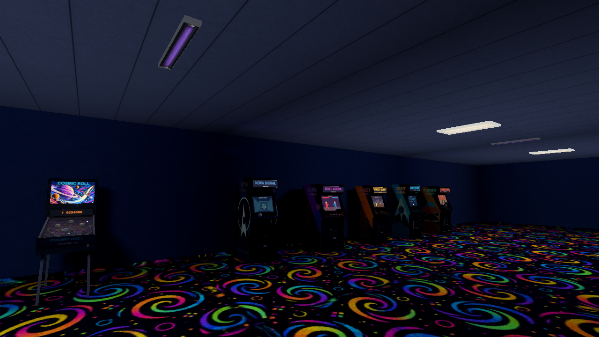 | 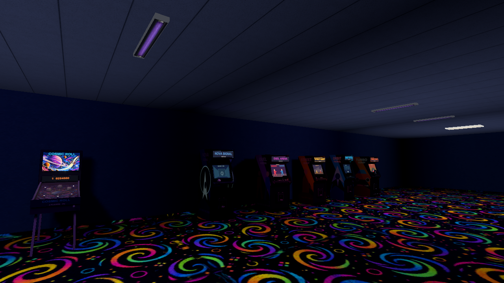 |
| 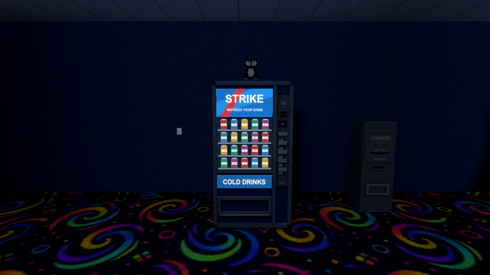 | 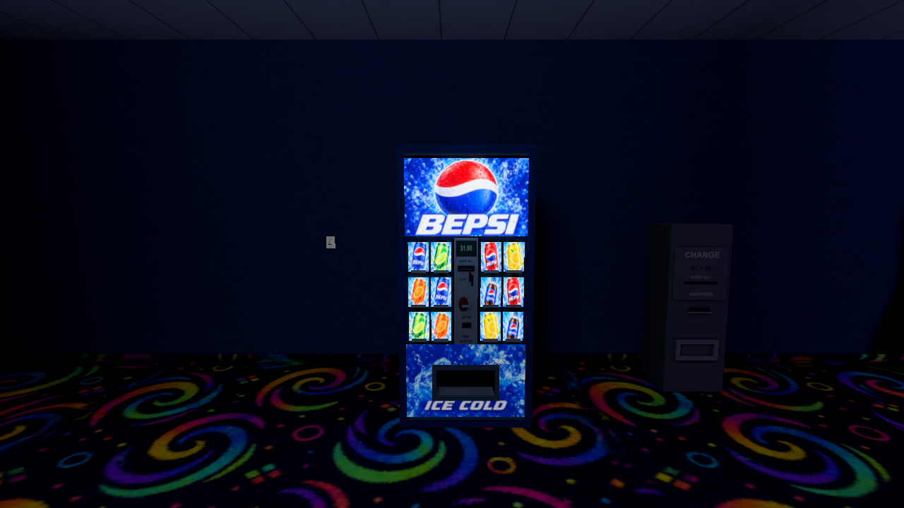 |

| Preserved wood lanes | Preserved birthday room | Connected transition |
|---|---|---|
| 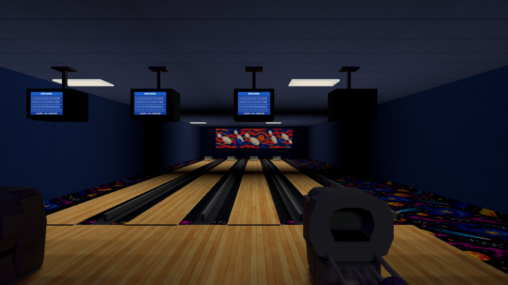 | 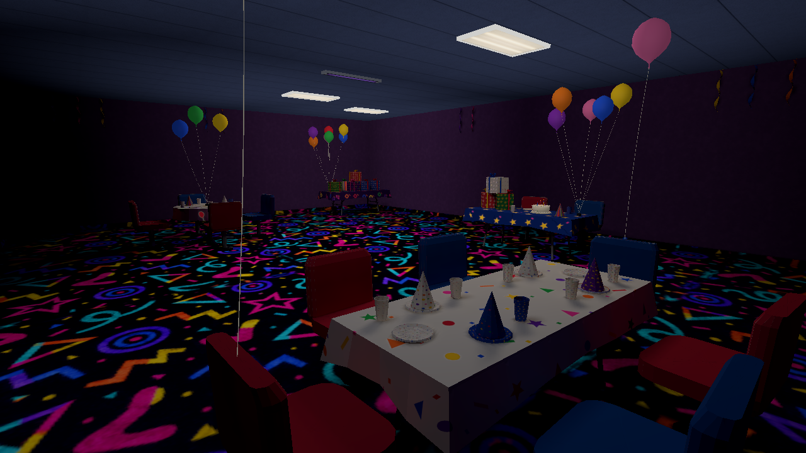 | 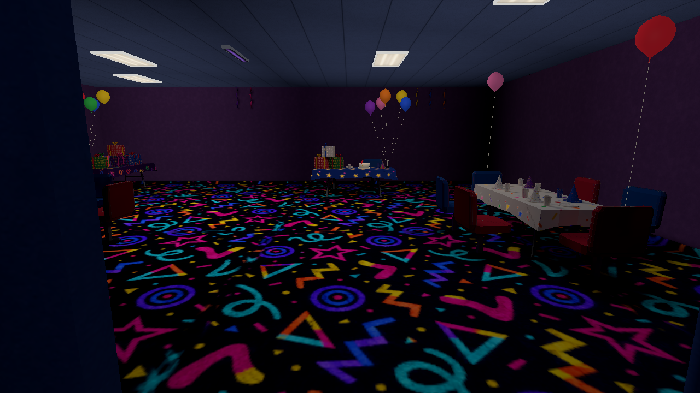 |

Native checks find zero failed models and no observed floating contacts,
z-fighting or blocked passage. A held-control out-and-back route crosses all
three rooms: **168 ready samples, X=6.7–25.3497, Z=25.2, eye Y=1.6**. UV on/off
changes mean RGB by 3.04 display levels and restores **pixel-identically**.
Independent Low/High textures/filtering with Static/Full lighting also restore
pixel-identically. Two/four-second balloon views show motion with fixed ties;
selected party source IDs remain **4, 5, 14, 17**. The existing 20 m² developer
fixture verifies real candle illumination: a frosting patch gains
**20.89 / 11.02 / 2.71 RGB** with a distant control unchanged. Matched party and
cake views differ from the untouched scene by only **0.0043 / 0.0051** mean RGB.

The current normal package is **45,317,180 bytes / 43.22 MiB**, up **66,746 bytes
/ 0.15%**. Full keeps four atlas pages, 1,323 probes, 57 wall boxes and one
14,696-cell navigation region; prop batches fall 120→119 and placed prop
triangles rise by 134. Imported texture data falls 31,956→31,892 KiB after
removing the plush. The whole 336-model pack remains **104.37 MiB decoded**,
within its unchanged 106 MiB cap. Final normal bake: **524.62 seconds**, no
package warnings; current-provenance and complete package validation pass.

One bounded **240-frame** sample after 120 warmup frames per stationary view,
VSync off and no competing builds, gives arcade CPU loop mean/p95
**4.21/11.44 → 5.88/15.50 ms**. Draws/binds stay **62/14**, visible vertices
11,924→11,868, peak RSS 1,032.0→1,030.4 MiB. Final vending mean/p95 is
**6.23/15.99 ms**. These CPU timings include host/frame-pacing variation; one
pair does not establish hardware GPU cost or a general performance trend.

Formatting, strict workspace/all-target/all-feature Clippy, default Rust
tests (**2,272 library + eight integration**), all-feature Rust tests
(**2,278 + eight**) and **351 Python tests** pass; 19 existing GPU tests and
four expected Python native skips remain. Asset validation, texture/prop checks,
birthday authorer, generator freshness and asset integrity pass. Inventory:
336 GLBs, 364 embedded PNGs, 485 standalone PNGs, zero integrity errors; final
vending topology is closed and has no coincident quads. Geometry checking has
zero errors and the same 34 known differently posed bouquet-anchor warnings.
Normal tests and CI perform no production-map bakes.

[Compact evidence receipt](../images/arcade-art-direction/evidence.json) records
capture identities, hashes and measurements. Seven curated PNGs are retained.
Compiled packages stay ignored. Aero remains stale against shared catalog/tool
provenance; Office now differs only in shared catalog provenance. Their sources
are untouched. The inherited Model Zoo Full-atlas overflow was not rebaked.
Those reconciliations belong to the queued map-independence/cleanup stage.
Static retains the existing brighter/flatter approximation and distant strings
can alias. Windows/Vulkan and hardware GPU timing were not run.

Package SHA-256: `71992d9bc62cf2fa3e0a8e630d0db36ab359e23d313f2310e10dcb228e47d379`.
[Arcade branch CI](https://github.com/csd113/Places/actions?query=branch%3Aarcade-env)
and the final task handoff provide publication status and the exact commit/CI
receipt, cleanup space and custody release.

<a id="arcade-refinement"></a>
## Arcade cabinets, Bepsi bottles and closed-door privacy

13 October 2026 UTC. Arcade now has **36 cabinets**, arranged as close wall rows,
a north bank and two three-wide back-to-back islands. The side aisles measure
**1.88 m and 1.90 m**; cross aisles connect them. Bowling, Arcade, party and
restroom retain their separate bounds and connections. All 262 non-cabinet
placement records, the 22 ceiling fixtures, two existing circuits and carpet
baseboards retain their authored values. All 94 protected party/audit files
match their handoff hashes.

Both approved concept boards were inspected as pixels; the copies under
`local/arcade-reference-inputs/` match the originals under
`assets/references/neon_bowling_arcade/`. Original generated print/gameplay
inputs, 1024-square masters, 256-square native sheets and GLBs are retained
under `assets/environments/arcade/props/`. The
[prompts and reproduction commands](../../assets/environments/arcade/props/illustrations/CABINET_ARTWORK_PROMPTS.md)
and [asset contracts](../ASSET_SPECIFICATION.md) document the pipeline.

Three purposeful passes were inspected in the real Places Metal renderer:
illustrated sides/marquees and distinct profiles with fitted CRT frames;
detailed period gameplay/HUDs, grounded colored controls and ordinary edge
molding; then quiet marquee backing and a lowered, tilted racing wheel with
a real deck notch that clears the complete CRT while retaining its exact
1.0 m footprint. The five models total **2,864 triangles**, up 376. Individual
counts are racing 560, shooter 516, action 516, fighting 784 and sci-fi 488.
Each retains eight primitives and five materials; their combined decoded
texture storage remains **1.5 MiB**.

CRT and marquee faces emit at strengths 1.15 and 1.20. Bodies, side printing,
controls and hardware use ordinary materials. Each placed cabinet owns two
restrained existing point sources near its screen and marquee. A small explicit
native fixture using the actual authored sources compared enabled/disabled
illumination with the same GLBs: a floor patch gained mean RGB
**[0.94, 3.60, 2.81]** display levels in Full and **[2.58, 7.80, 7.08]** in
Static, while screens and marquees remained visibly illuminated. Room ambient,
exposure and bloom controls retain their authored values. Static remains the
existing brighter, flatter vertex approximation; Full uses prepared transport.
Machine spill is baked. Sci-fi pigment and the carpet retain their separate
blacklight response.

Both table bottles and the fallen bottle now embed one dedicated Bepsi atlas.
Three upright logo repeats use the existing approved vending branding, with
matching master/native/GLB UV frames. Shape, cap, glass opacity and placements
retain their original contracts. Standing views 1.25 m behind each table bottle
show the globe and wordmark without changing FOV.

The reported closed-door crack was reproduced from Arcade at
**(0.35, 1.6, 2.085), yaw 267.44°**: a narrow latch-edge strip exposed restroom
tile detail. The 8 mm leaf clearance exceeded the old 4 mm jamb overlap, and
the commercial frame lacked a rebate. Its liner now follows the resolved wall
depth, with an overlapping stop behind the closed leaf, opposite its swing,
and a head that closes the aperture. Door frames are built at load time;
the static geometry revision remains 11. A tiny triangle-ray regression checks
privacy from both directions for both swings and a clear open walking aperture;
the isolated test takes approximately 0.15 seconds and requires no map bake.

Native closed views covered both sides and multiple oblique angles. Real E
edges opened the leaf, then aimed at its live open collider to close it.
Closed movement stopped at **X=0.201 m**; the open traversal reached **X=-1.5 m**
and returned. Both close-only and traversal/return/close images were
pixel-identical to the initial closed view. All four interactive doors still
start closed. Held movement traversed both side aisles from Z=21.5 to 3.5002,
the cross aisle from X=2.3 to 7.45, and the three-room connection from X=6.7
to 25.2997, with eye Y=1.6 throughout.

All six Low/Medium/High texture × Static/Full combinations loaded correctly.
Bathroom physical off/on repetition restores identical images in both modes;
Full-off → Static-off → Full-off also restores identical pixels. Its Full
on/off mean RGB difference is 104.48. The Cosmic UV circuit restores identical
pixels, with on/off mean RGB difference 3.44. Full mirrors visibly reflect the
stall geometry. The matched party image differs by only 0.0023 mean RGBA
display levels. Native coverage is Apple M2 Pro / Metal at 1280×720.

<a id="arcade-refinement-executed-gates-and-measured-cost"></a>
### Executed gates and measured cost

Formatting, strict workspace/all-target/all-feature Clippy in debug and release,
default Rust tests (**2,246 library plus eight executable/integration checks**),
and all-feature tests (**2,252 plus eight**) passed. Eighteen pre-existing GPU
tests remain ignored. The source Python gate passed **349 tests with four
native classes skipped**. Catalog validation has zero warnings; the complete
346-model/497-PNG audit has zero integrity errors. Texture/prop checks and
generator freshness passed; the texture tool retains 96 pre-existing
informational manifest/resolution warnings. Geometry checking has zero errors
and the same 34 accepted balloon-anchor warnings. Normal tests/CI bake no
production map; only Arcade was rebuilt here. The focused Arcade/package Python
suite also passed all 61 checks.

| Matched production cost | Before | After |
| --- | ---: | ---: |
| Cabinet placements | 7 | 36 |
| Visible vertices / draws | 97,916 / 142 | 145,798 / 174 |
| Texture binds | 62 | 66 |
| GPU render median / p95 | 3.806 / 4.049 ms | 4.534 / 4.639 ms |
| CPU loop mean | 1.960 ms | 2.133 ms |
| Process peak RSS | 868.23 MiB | 1,014.38 MiB |
| Full atlas pages / resident atlas storage | 5 / 240 MiB | 6 / 288 MiB |
| Compressed package | 44,274,305 bytes | 71,003,099 bytes |

Frame samples use the same final binary/camera, High/Full, VSync off, 120
warmup frames and 240 measured frames, with compiler/audits idle. GPU numbers
are hardware pass timestamps; CPU loop durations and process peak RSS are
separate measurements. One bounded pair is not a general performance trend.
The package grew **60.37%**; 25,502,479 bytes of the 26,728,794-byte increase
are compressed lightmap records. The targeted storage review measured:

| Compressed section | Before bytes | After bytes | Explanation |
| --- | ---: | ---: | --- |
| Lightmap coefficients | 39,681,003 | 65,183,482 | More cabinet receiver surfaces and more exact coefficient tiles |
| Shared prepared props | 3,082,696 | 4,097,758 | Additional placed geometry and lighting records; exact chunks remain shared across qualities |
| Lightmap chart metadata | 833,585 | 1,025,284 | 9,626 additional cabinet charts |
| Other payloads and ZIP framing | 677,021 | 696,575 | Source records and small lighting/collision changes; architecture meshes essentially unchanged |

All **1,174,870 additional receiver texels** and all chart growth map to the
cabinets; architecture and other-prop receiver totals are identical. Receiver
texels per cabinet rise only **1.8%**, from 39,624 to 40,340. The new sixth page
is **91.0% occupied**, and the last three pages are 95.5%, 96.4% and 91.0%
occupied including gutters. No padded charts overlap or repeat geometry. The
existing sparsely filled second page is unchanged. There are still three
lighting groups, for the base, Cosmic UV and restroom circuits.

The compact codec's exact-fallback tile count rises from **20,399 to 32,840**;
its compact fraction drops from 66.8% to 55.5%. Additional illuminated receivers
and less uniform coefficients are consistent with the higher storage cost;
precision was not reduced. Inspection of all physical shared-prop chunks found
**zero duplicate contents** in both packages. The second segment follows the
existing 16 MiB segment cap. Neither package embeds PNG texture payloads; master
and illustration inputs remain external source assets. Native decoded prop
textures remain **32,184 KiB**. No avoidable inflation introduced by this task
was found, and the existing packer was not changed.

The normal final bake took **674.619 seconds**,
delivered Static/Full without failure, and passed integrity and
`verify --require-current`. The whole prop pack remains **104.45 MiB / 106 MiB**.

Final ignored package SHA-256:
`2bd18ed052d58be4d5d568b8dae12f4859533763b1d772d44b2811c3d8960fdc`.
The compact `local/arcade-refinement/verification.json` receipt preserves
capture recipes, gate results, hashes and numerical evidence outside `target`.
Publication, CI and cleanup receipts are added there and in the delivery message.

Three selected authorized native smoke checks passed: malformed-settings
recovery, isolated Arcade discovery and no player-side static preparation.
The separately executed empty-install check opens successfully but fails a
pre-existing assertion for an old menu sentence; the current sentence was
already present at handoff. This remains for the queued Python audit.
Winter's unchanged package now needs a compiler-identity refresh; the six
previously queued active packages still need normal recompilation. No archived
Demo or Model Zoo source/package was rebaked or reactivated.

<a id="arcade-refinement-curated-native-views"></a>
### Curated native views

Twelve unaltered PNGs total 6,788,394 bytes. Matching pairs use the same
camera/settings, ready frame 30 and fixed 1/60 simulation.

| Before | After |
| --- | --- |
| 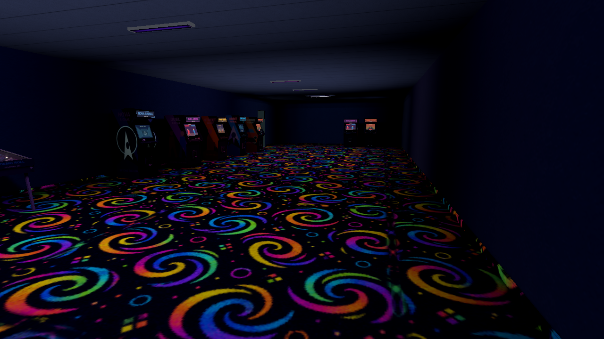 | 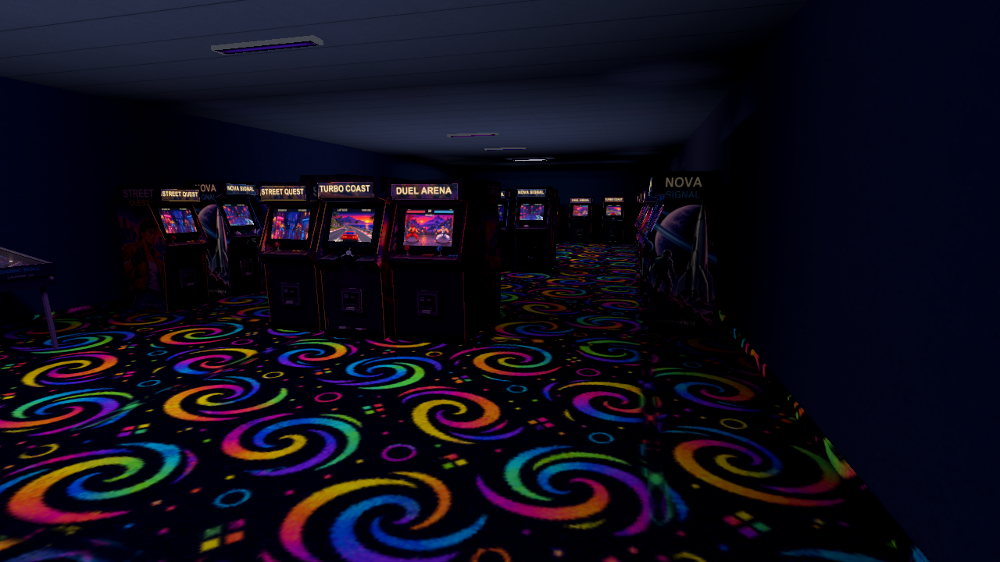 |
| 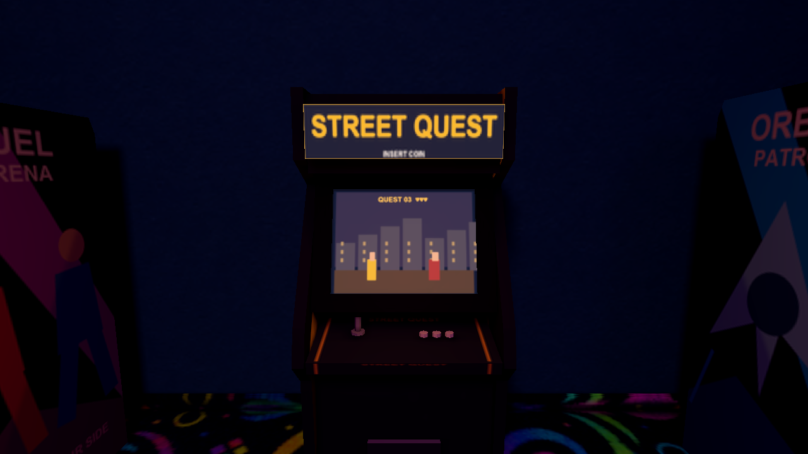 | 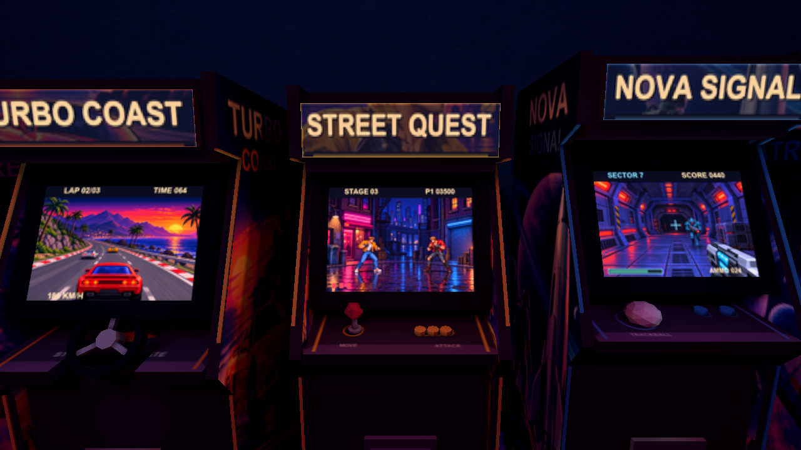 |
| 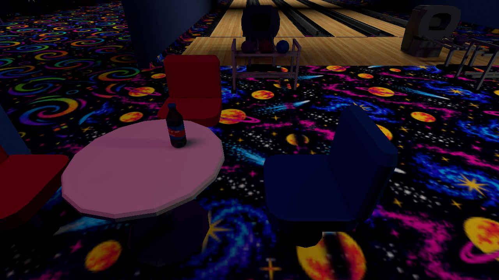 | 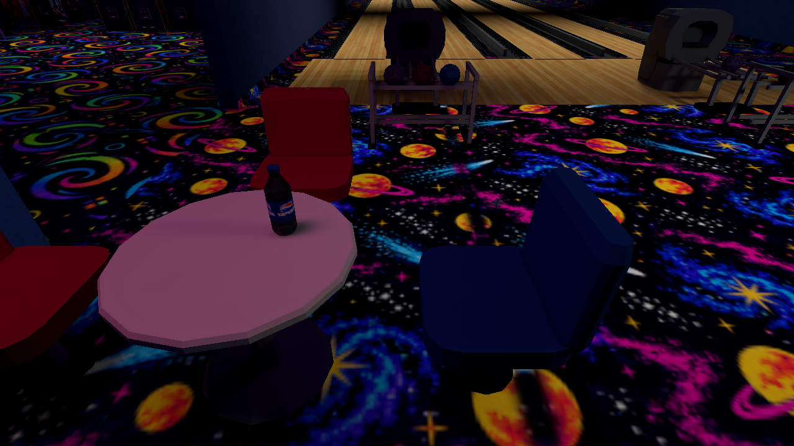 |
| 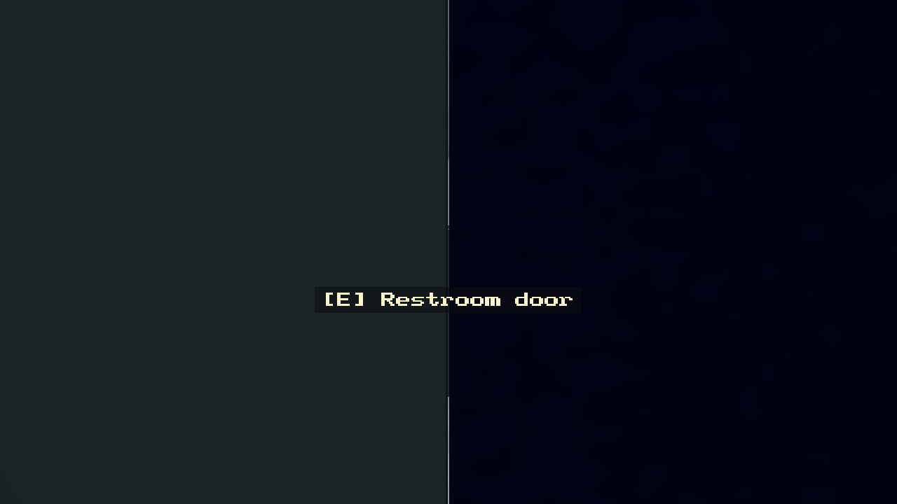 | 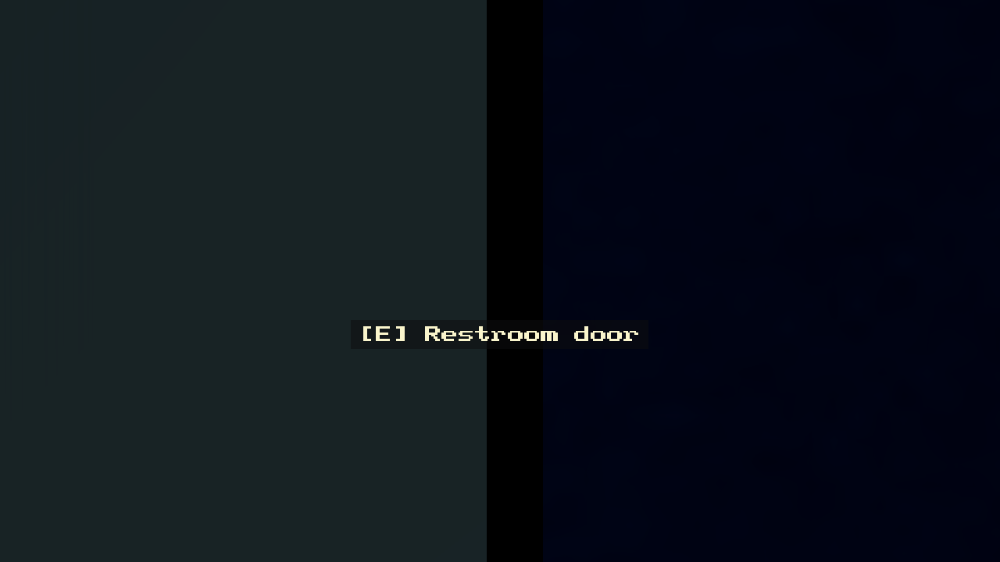 |

[Clear aisle](../images/arcade-refinement/aisle-after.png),
[second table bottle](../images/arcade-refinement/bottle-second.png),
[open doorway](../images/arcade-refinement/door-open.png),
[closed from inside](../images/arcade-refinement/door-inside.png).

<a id="arcade-restroom"></a>
## Arcade restroom validation — 2026-10-12

A 6.6 × 7.8 m restroom is connected through the existing Arcade west wall. The bowling, arcade and accepted birthday rooms retain their original bounds, contents and walking routes. All 172 protected files, including Bepsi, party art, Office, Spooner-Man and pre-existing user audits, were hash-checked unchanged. The existing Cosmic switch now addresses its four existing fixtures as one circuit; their positions, brightness and UV material behavior are unchanged.

The room has three stalls with real porcelain toilets, a wider first bay and grab bar, two wall-mounted basins with taps and soap, framed mirrors, 30 cm floor tiles, 20 cm wall tiles, ceramic skirting, and two ceiling ventilation grilles. The 1.4 m entry and 1.165–1.315 m stall leaves are interactive and initially closed. The commercial door kind uses the established interaction, swing and obstruction handling with thick flat laminate leaves. New-map guidance specifies closed doors by default; existing maps were not mass-edited.

<a id="arcade-restroom-reusable-assets-and-corrections"></a>
### Reusable assets and corrections

The editable Blender source and ten GLBs live in `assets/environments/arcade/restroom/`; the complete kit is 248,832 bytes and 1,708 unique triangles. Three purposeful Blender passes reviewed porcelain silhouettes, basin hardware and ledge seams, partition feet/headrails, closed frame topology, UV swatch placement and export bounds. All ten meshes have zero degenerate triangles, boundary edges, nonmanifold edges or flipped faces. The final native refinement made the playable door leaves honor the teal catalog tint and raised the grab bar above the tank. Existing committed PNGs supply every surface; no texture generation or mirror-specific renderer was added.

The sink wall exposed an engine UV defect: opening fragments inherited their own top as the vertical origin. Wall faces now retain the parent wall/ceiling vertical reference through sill, header and cross-wall fragments. Small X/Z and explicit/ceiling-bound mesh witnesses protect the continuous grout phase; geometry cache revision 10 invalidates stale geometry without changing the application or package version.

<a id="arcade-restroom-lighting-and-mirrors"></a>
### Lighting and mirrors

Four neutral troffers use one reachable physical wall switch. The interaction changes actual source illumination and fixture emission. Full lighting sums the members into one prepared circuit contribution; the four existing Cosmic sources form a second circuit. Eight physical switchable sources remain within the existing limit, with two circuit contributions plus the base contribution. Static lighting stores one optional pre-lit off geometry/prop state built from the same already-baked lighting, sharing PNGs. Runtime swaps prepared banks and preserves source states across lighting-mode changes. No per-click bake, enlarged contribution limit, shader layout change or new per-frame framework is introduced.

The two coplanar mirror panes use the existing Full planar reflection path. Static lighting or Reflections Off leaves an ordinary nonreflecting pane. This is the existing renderer limitation, not a painted substitute advertised as a functioning mirror.

<a id="arcade-restroom-validation"></a>
### Validation

Formatting, strict workspace/all-target/all-feature Clippy, default Rust tests (2,237 library plus eight integration tests), and all-feature Rust tests (2,243 library plus eight integration tests) passed. Asset validation covered 568 entries with no warnings; the broader model/PNG audit and existing authoring freshness checks passed. The source Python suite passed, followed by affected source/archive fixture checks. No default Rust test or CI job bakes a shipped map.

Geometry validation reports zero errors and 34 pre-existing duplicate-anchor warnings for accepted party balloons. Those anchors and animations remain unchanged. Small regression fixtures cover circuit membership and energy, repeated source toggles, Static off payload round-trip/reuse and malformed alternate records, and the visible restroom door tint.

Native wgpu/Metal inspection on Apple M2 Pro at 1280 × 720 confirmed aligned grout, grounded fixtures, clear grab-bar/tank separation, real reflected stall geometry, and no GPU validation/model-loading failures. Four selected tiny native smoke checks passed: nonempty upload, texture identities, material passes, and world replacement/repeat with cached 1024px sheets and normal map.

Held-control walkthroughs first stopped at the closed entry (`x=0.201`) and first stall (`x=-3.699`), then used E to open them, entered to the rear wall (`x=-6.3`) and returned to Arcade. The other two stalls were likewise opened, entered and exited. The basin wall stopped the player at `z=7.5`; jumping stopped the eye at `y=2.9961` under the 3.2 m ceiling. Partition jumps remained blocked at `x=-3.681`. All five routes returned to a stable `y=1.6` floor with no void fall or escape.

Four physical switch presses produced on/off/on/off/on in each lighting mode. Repeated on and off images are pixel-identical; mean RGB on/off differences are `[98.20, 101.12, 97.42]` in Full and `[33.81, 35.31, 35.70]` in Static. Full-off → Static-off → Full-off retains an identical Full-off image. Static preserves its existing ambient fill. Its alternate bank adds 14,105,168 vertex bytes and 390,192 index bytes, sharing images; Full allocates no alternate bank.

The final ignored Arcade package is **43,897,722 bytes** (41.86 MiB), versus 45,317,178 at handoff: −1,419,456 bytes (−3.13%). SHA-256: `6df925a0bc140e6bb448477c7e1d2ed900f009de019693a23a39533e834e9510`. `verify --require-current` matched fingerprint `aa8e7befbb52674c4c18ad6f4cecc677c711e24e6330b3cb1d1cdd720385da32`; validation found 21 entries, 96 intact dependencies and no warnings. Full has five 1024-edge atlas pages, three contribution groups and 30 storage layers: **240 MiB**, versus 320 MiB at handoff (−25%).

Two sequential 1,200-ready-frame stationary sink runs used High textures/filtering, Full lighting, vsync disabled and the existing GPU-completion drain. The final 240 genuine-world samples are reported below. These are CPU frame/completion timings, not GPU timestamps. The mirror adds approximately 1.13 ms at the median in this bounded comparison; the p95 variation is noisy. There is no reliable clean pre-restroom frame baseline, so no whole-map FPS improvement is claimed.

| Reflection setting | Frame median / p95 (ms) | Render median / p95 (ms) | Main draws | Planar passes |
| --- | ---: | ---: | ---: | ---: |
| Full | 6.29 / 15.59 | 4.77 / 14.29 | 159 | 1 |
| Off | 5.16 / 18.79 | 3.74 / 17.43 | 159 | 0 |

Reproduce the package gate with `target/release/places-compile build levels/retro_arcade_demo.json --out assets/levels/retro_arcade_demo.placesmap --workers 8` using native Metal access, followed by `verify --require-current` and `validate`. Camera/settings witnesses are in `tests/fixtures/native/arcade-restroom-manifest.json`; `tools/bench/capture_art_style_hero.py` performs the explicit native captures. The final successful normal build took 369,831 ms.

<a id="arcade-restroom-preservation-and-follow-through"></a>
### Preservation and follow-through

Only `retro_arcade_demo.placesmap` was compiled with normal reuse and eight workers. All nine other pre-existing package files remained byte-identical during validation. Seven other active maps will need a normal compile after their queued edits because the catalog, tool identity and geometry revision changed; no unrelated library bake was performed here. The queued fluorescent tint, prop-size warnings, Medium filtering, snow distance and Office repairs remain with their respective owners.

The historical sources were moved byte for byte outside active discovery, build and level validation:

| Source | Bytes | SHA-256 |
| --- | ---: | --- |
| `docs/archive/levels/places_demo.json` | 537,437 | `65833e98579a696167d616ce0cc94ebab85f744fdd72837ed247c483db1f9dec` |
| `docs/archive/levels/model_zoo.json` | 313,154 | `71ff7d364cd8620f6800c0ab0bb65a41a43226b1579ec6ff8e9fa29477aedfd7` |

Their disposable ignored packages total 154,436,171 bytes. At handoff they matched those source hashes, catalog `391254da90c8236cff5901ddef75c93545ec14a7786c472e23412cd3eec8ee75`, tool hash `b77f987ebbb76f104f80cdb18581acc8516066bf6ee7048ef0cd25c80bb43380`, probe capture enabled, and commit `f9c8eed6965b1c5664891fc242a8f8e2277ccce0`. They are removed after publication validation; neither archived map was baked during this task. Only preservation hashes remain in default tests. The optional generator requires an explicit destination.

<a id="arcade-restroom-final-screenshots"></a>
### Final screenshots

[Arcade entrance](../images/arcade-restroom/entrance.png) · [Room and closed stalls](../images/arcade-restroom/room.png) · [Sinks and working mirrors](../images/arcade-restroom/sinks.png) · [Toilet and grab bar](../images/arcade-restroom/stall.png) · [Ceiling vents](../images/arcade-restroom/ceiling.png) · [Static off](../images/arcade-restroom/lights-off-static.png) · [Full off](../images/arcade-restroom/lights-off-full.png)

Seven unaltered native PNGs total 2,907,763 bytes. The reusable kit and report remain small source deliverables; the 41.86 MiB compiled package stays ignored in Git.

Publication cleanup removes the build target, disposable task logs and intermediate captures after exact-SHA CI completes. It retains original inputs, the reusable kit, the current ignored Arcade package, these final screenshots and this report. Actual cleanup totals, publication SHA/CI and custody release are recorded in the delivery message.

<a id="crash-diagnostics-investigation"></a>
## Crash investigation and bounded diagnostics — 2026-10-13

Two renderer invariant gaps are corrected and failures now retain bounded
support evidence. **The user's intermittent gameplay crashes remain unattributed;
this work does not establish that they have been eliminated.** No release/version
integration, production-map bake or visual-asset change was performed.

<a id="crash-diagnostics-investigation-evidence-and-confirmed-corrections"></a>
### Evidence and confirmed corrections

The available macOS report is a `places-compile` SIGSEGV on October 12:
`EXC_BAD_ACCESS`, invalid address `0x8`, main-thread CoreFoundation bundle access
through IOSurface and Metal device discovery (`MTLCopyAllDevices`). It is a
native signal, not a Rust panic. The report's compiler frames are stripped; its
binary SHA, map and settings were not retained. Older Places crash metadata
exists without its report; a separate debug-player record names a force quit.
Neither that evidence nor the temporal proximity of an earlier `cargo clean`
establishes the gameplay cause. Raw OS reports and unrelated private files were
not copied into repository evidence.

**Oversized drawable.** The requested wgpu device limit is 8192 pixels per edge,
but the renderer previously accepted any drawable and allocated its depth
attachment without checking that limit. A 64×64 native control confirmed that
an 8193×64 depth request generates a validation error. Initialization, resize,
attachment preparation and capture now reject oversized physical drawables
before allocation, with the observed size, limit and smaller-window remedy.
Zero-sized minimized windows remain valid. A real 4097×64 logical window on the
2× backing display produced the expected readable fatal error and clean exit,
without a validation panic.

**Window lifetime.** The safe constructor returned `Surface<'static>` without
borrowing or retaining its SDL window. Although the player already declared
locals in a safe order, another safe caller could drop its window first,
violating the raw-handle contract. The renderer now retains the SDL window's
shared context as its final field, after the surface and GPU resources. Lost
surfaces are recreated from that exact retained window. This is a demonstrated
API safety hole; it is not an attribution of the observed compiler SIGSEGV.

The audit found no confirmed timestamp-callback or level-unload use-after-free.
Callbacks capture channel senders, and the three timestamp slots remain owned
through completion, mapping and unmapping. Existing cancellation and displayed
world leases preserve independent resource ownership.

<a id="crash-diagnostics-investigation-new-diagnostics"></a>
### New diagnostics

`<state-root>/diagnostics` uses the same state root as settings, including
`PLACES_STATE_ROOT`. Two logs are capped at **256 KiB each**, records at **4 KiB**.
Rotation retains executable/version identity, the latest map request and runtime
context. A locked owner file prevents a concurrent player from rotating another
session. An active-session marker is removed after completed shutdown.

Quiet launches retain exact executable SHA-256, platform/version, adapter,
requested package manifest identity/path, loading/cancellation, window/graphics
transitions, warnings and state/RSS/GPU-timing context on state changes or every
15 seconds. No credentials, environment dump, image buffers or OS reports are
collected. Panic location/message and a bounded backtrace are recorded without
catching or continuing the panic. Returned fatal errors request a readable SDL
dialog. Explicit benchmark runs retain the evidence without modal dialogs.

A missing shutdown marker cleanup triggers a next-start notice describing an
interrupted session, which may mean a crash, force quit or interrupted shutdown.
A controlled SIGTERM was handled gracefully by SDL and generated no notice;
SIGKILL retained the marker, and restart reported the interruption, preserved the
previous log and completed normally. The desktop approval/session interruption
prevented reliable visual acceptance of the modal notice; the notice call and
text were verified from persistent evidence. No approval remains pending.
Native signals, allocation aborts and SIGKILL cannot safely promise immediate UI;
OS reports and the last session context remain necessary. Failed log I/O disables
further disk writes; read-only/full disks and very early failure limit evidence.

<a id="crash-diagnostics-investigation-validation-cost-and-scope"></a>
### Validation, cost and scope

- `cargo fmt --all --check`, strict workspace/all-target/all-feature Clippy in
  debug and release, and `git diff --check`: passed without weakening lints.
- `cargo test --workspace`: 2,263 library plus nine integration tests passed;
  library runtime 33.70 s. All-feature workspace tests: 2,269 plus nine passed,
  library runtime 31.44 s. Nineteen explicit native/performance tests remain
  excluded from automatic tests; the new small native limit control passed in
  0.05 s. No normal Rust test or CI stage bakes a shipped map.
- Source Python checks: 354 tests passed in 128.57 s, four native classes
  explicitly skipped; native controls above were separate real-window runs.
- New deterministic coverage protects Unicode/record bounds, rotation, context
  preservation, clean/interrupted shutdown, competing writers and both drawable
  edges. Its isolated storage fixture writes less than 1 MiB. The existing
  ordinary-wall regression now presses while grounded before jumping against
  the same contact. Existing shared ramp/stair and movement controls passed.
- Native M2 Pro/Metal: 480 ready frames in 9.44 s exercised movement,
  resize/minimize/restore, Low/Medium/High textures, Static/Full lighting,
  filtering, bloom and reflection preferences, with 414 GPU timing samples.
  Office has no reflective draws; this does not repeat physical planar/probe
  acceptance. Pause/resume, world replacement, cancellation, failed preparation
  with the prior world retained, skipped-present shutdown and oversized-window
  exit passed. No device-loss injection or exhaustive gameplay traversal is
  claimed.
- Only the existing one-room `graphics_fixture_contract.json` was compiled:
  865 ms, 236,100 bytes, Static/Full, integrity and `--require-current` passed.
  All eight installed production packages remain byte-identical. Office was
  runtime-compatible; the other seven were correctly rejected for their known
  stale catalog identities. Their refresh and supported-package reconciliation
  remain for the final release stage.
- Native diagnostic logs were 5.6–26.4 KiB per short control. Startup elapsed
  through executable identification was 26–42 ms. Steady operation adds one
  elapsed-time check per frame and low-frequency context writes; no comparative
  FPS improvement or zero-cost claim is made.

Final native player SHA-256:
`329c8d23c1a6fb45946fffdb7af7f8786280d6fb6a72abeebb412fd59aea6ab9`.
Small private receipts and recipes remain in `local/crash-investigation`, outside
`target`. The three unknown-owner audits, cloud entity candidates, assets, maps,
version and root README were preserved. Exact publication/CI, scoped cleanup and
custody release are recorded in the final handoff and local verification receipt.

<a id="culling-correctness"></a>
## Culling correctness — October 10, 2026

This bounded renderer pass restores animated limbs incorrectly rejected by the
CPU frustum, honors eligible opaque entity materials' single-sided contract,
and avoids some unnecessary static-prop submissions. Baseline:
`dbbf54e4c1f8902cd98ba9650a969381cb22c39f` on `Art-style`.

<a id="culling-correctness-confirmed-behavior-and-changes"></a>
### Confirmed behavior and changes

The existing CPU frustum rejected whole world ranges, prop draws and entities;
a surviving draw submitted its complete index range. All shared world/entity
pipelines rendered both sides. That was necessary for some content, but glTF
`doubleSided` was discarded even for opaque entities that authored one side.

The importer now retains and validates `doubleSided` (omitted means false,
following the [glTF material contract](https://registry.khronos.org/glTF/specs/2.0/glTF-2.0.html#double-sided)).
Eligible opaque dynamic/character primitives select back-face-culling pipelines.
Scene and emission agree; reflected placements reverse facing and compose with
the existing reflection-camera convention. Finite nonuniform placements retain
their determinant parity. Singular or invalid transforms fall back to two sides.
No shipped winding defect was demonstrated: a read-only audit of thirteen
single-sided opaque entity primitives, totaling 10,884 triangles, found no
degenerate, inconsistent or nonmanifold topology and no required winding flips.
Authored normals agreed with winding; missing normals already use posed geometry.

Character GPU bounds previously used a padded bind-pose box. The mannequin's
forward arms extend about 0.449 m beyond its old local Z limit; raised hands and
the skeleton's seated pose also exceed their old boxes. Bounds now accumulate
the exact positions in the existing skinning/upload loop, cache held poses,
and refresh after animation or placement changes. Eight-corner placement
transformation and a small numeric margin preserve conservative frustum tests.

Opaque/cutout static-prop draws now use their referenced primitive's bounds,
computed once during upload. Blended draws keep their previous batch bounds and
sorting centre. Invalid metadata retains the original conservative bounds.
Prop vertex telemetry now counts distinct references per draw; its former
whole-chunk charge could exceed the scene's total. This counter correction is
separate from actual draw/index savings.

<a id="culling-correctness-intentionally-two-sided"></a>
### Intentionally two-sided

| Category | Reason |
| --- | --- |
| Architecture and prepared static props | Opaque opening panes are mid-plane quads; void shells promise visibility from either side; curtains and fitted planes need their backs. All shipped static prop materials explicitly request two sides. Prepared records retain their existing layout. |
| Explicit `doubleSided`, MASK and BLEND | Preserve cloth, foliage, cutout coverage, glass and transparent entities. |
| Water, decals, sky and effects | Preserve underwater views and their existing dedicated pipeline contracts. |
| Uncertain characters | Reflected/singular retained bind hierarchies or inverse binds, scale-animation channels and morph targets cannot establish stable facing. |
| Dynamic models with skins or morphs | This bind/default-pose path does not retain enough rig information to establish orientation. Code-built doors also retain two sides. |

Mixed-joint rotation deformation follows the authored material side; the guard
does not prove every future deformation avoids folding a triangle. Authors must
request two sides when their content needs it. Static single-sided material
support would require preserving new prepared-record semantics and remains outside
this format-preserving pass. No PVS, occlusion system, meshlets, LOD, map changes,
lighting changes or water-height gameplay fix were introduced.

<a id="culling-correctness-native-evidence"></a>
### Native evidence

The preserved ordinary baseline and candidate run on Apple M2 Pro / Metal at
1280×720, FOV 60°, fixed simulation step 1/60 s, isolated state, unchanged assets
and compiled packages. Static captures use ready frame 120; affected entity
details use frame 230. Live movement, weather controls and Low→Medium→High
transitions use the existing benchmark scripts.

Of 59 accepted paired screenshots, 52 are pixel-identical. Four differences restore the
missing extended arms, including camera samples across the old bound. The other
three changes are four pixels on the skeleton's back, five pixels on the
pumpkin skeleton's back and one pixel in Demo's night view. The return-to-standing samples match. Independent review found no visible
culling regression; six current world-normal/vertex-normal diagnostics also
look correct. The renderer has no existing wireframe mode to check.

Before: the old box rejects the entire mannequin despite visible hands.

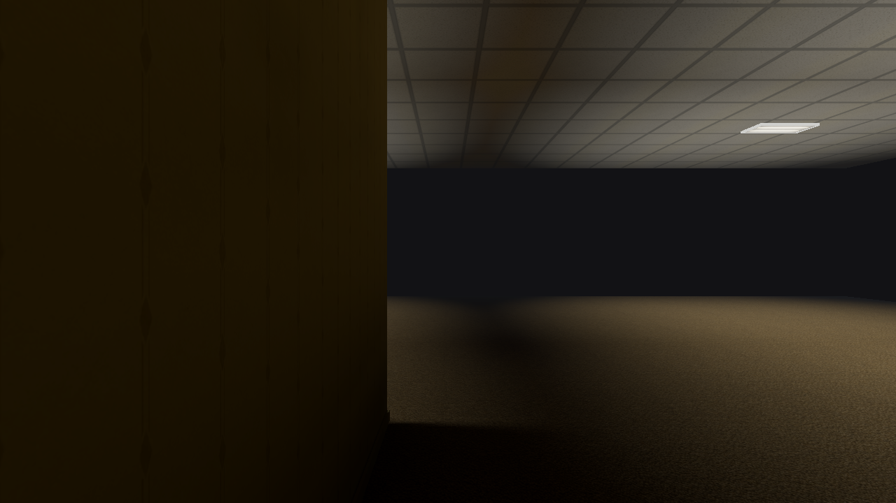

After: the uploaded pose's bound keeps both hands visible at the same camera.

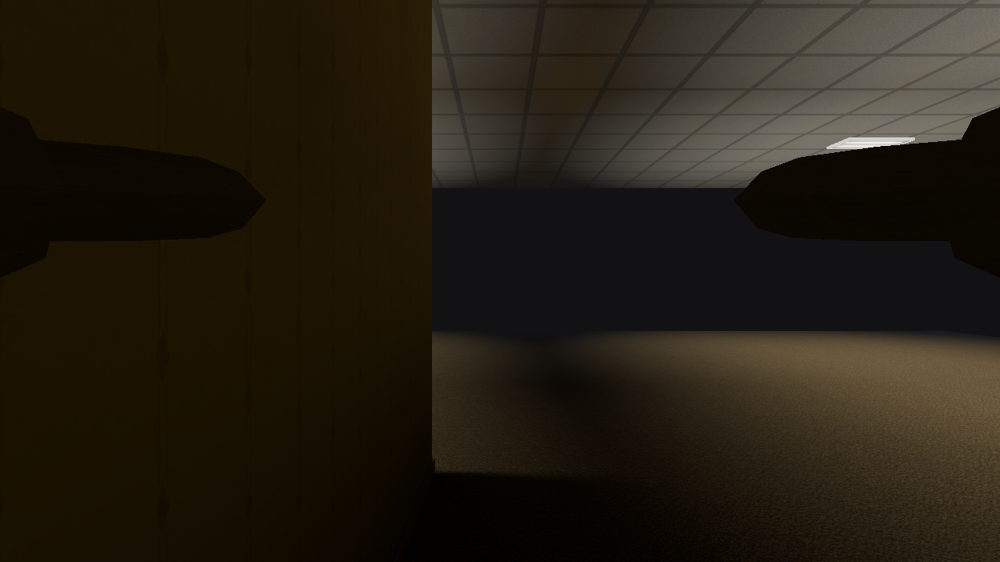

The archived underwater and beach-shore controls preserve the unchanged material and outdoor findings. Atrium, hero movement and entity-detail captures
provide useful glass, doorway and backside coverage. Front/back carved-pumpkin,
pumpkin-skeleton and benchmark-spawned Spooner Man pairs cover additional entity
families. Three weakly framed shots
(the labeled glass/doorway/poses views) are not treated as strong evidence.
Screenshots sample motion; they do not prove continuous visibility at every
possible camera or animation frame. Focused Rust tests additionally reproduce
the old near-plane rejection, cover transformed posed positions, stale-bound
replacement, invalid metadata and conservative sidedness fallbacks.

<a id="culling-correctness-submission-and-frame-cost-evidence"></a>
### Submission and frame-cost evidence

High-quality fixed-camera telemetry shows real submission reductions:

| View | Draws before → after | Submitted triangles before → after |
| --- | ---: | ---: |
| Hero room | 31 → 31 | 4,954 → 4,954 |
| Hero contact | 23 → 21 | 3,682 → 2,962 |
| Demo doorway | 299 → 296 | 107,436 → 104,760 |
| Beach shore | 85 → 84 | 18,118 → 16,554 |

These are tighter-frustum savings. Back-face culling rejects back-facing
triangles during rasterization; it does not necessarily avoid vertex processing
or reduce submitted indices. No GPU timestamp, vertex-invocation or disk-saving
claim is made.

Timing used three sequential pairs per view, alternated ordering, 120 warmup
frames and 600 measured frames per run (10,800 measured frames). Owned test CPU
workloads were temporarily paused and resumed around the campaign. The existing
GPU-drain option measures renderer completion wall time, not GPU timestamps.
Below are ranges of the three run medians in milliseconds; all runs are retained.

| View | Frame before → after | Renderer before → after |
| --- | ---: | ---: |
| Hero room | 1.149–1.259 → 1.155–1.830 | 1.107–1.219 → 1.114–1.788 |
| Entity front | 2.059–2.070 → 2.033–2.065 | 1.511–1.536 → 1.460–1.471 |
| Beach shore | 2.497–2.503 → 2.572–2.591 | 1.603–1.605 → 1.590–1.599 |

Entity renderer medians improve 2.98–4.95%; its whole-frame changes range from
−0.24% to −1.69%. Beach whole-frame medians regress 2.76–3.66%
(+0.069–0.092 ms), with update medians +0.065–0.075 ms and renderer medians
slightly lower. This is an observed small absolute frame-cost increase, not an
overall performance win; precise causal attribution is unavailable.

Hero paired frame deltas are +2.36%, +45.41% and +0.52%. The second pair's
time series shows the same roughly 1.8-ms renderer regime in both executables
before returning toward 1.1 ms, so a pooled speedup/regression inference would
be unreliable. The prior refinement's unresolved hero timing variation remains
unresolved, and this campaign includes a larger transient. No significant or
general speedup is claimed. Numeric pose-bound accumulation and per-primitive
pipeline selection have costs; correctness and demonstrated submission savings
are the verified gains.

<a id="culling-correctness-verification"></a>
### Verification

Passed:

- `cargo fmt --all --check` and `git diff --check`.
- Required `cargo clippy --workspace --all-targets --all-features -- -D warnings`.
- Required `cargo test --workspace`: 2,237 library tests plus seven integration
  tests passed on the initial implementation. The final all-features gate below
  includes the subsequent dynamic skin/morph fallback regression test.
- Final `sh tools/check-rust.sh`: locked check, debug and release strict Clippy,
  and all-features tests (2,244 library plus seven integration tests; 32 ignored).
- Full Python discovery: all 362 package, asset, compatibility and native checks.
- Existing ignored Low-lighting GPU tests: both passed on Metal, including live
  High→On→Medium→Off→High resource changes and the Low override's material paths.
- All seven bundled packages validate. New Off/Medium/Full `test_room` and
  `entity_showcase` packages both validate and pass `verify --require-current`:
  thirteen successful compiler build/verify/validate commands in total.

Rust ran with `RUSTC_WRAPPER=` because this session's sccache daemon returned
`Operation not permitted`; the configured Rust toolchain and lint policy were
unchanged. No lint levels were lowered. CI exact-commit status is verified in
the final handoff. The whole-library preparation phase of `tools/verify.sh` was
not rerun: this pass changed neither assets nor prepared record semantics.
Bulk logs preserve actual outcomes; legacy PLMP3/4/5 and current PLMP6 compatibility
tests are part of the passed Rust gate.

<a id="culling-correctness-reproduction-and-retained-evidence"></a>
### Reproduction and retained evidence

Bulk evidence is ignored under `tools/bench/results/culling-20261010/`: manifests
record binary/package/source hashes, settings, adapter, capture receipts and
exit codes. It retains `captures.py`, `extra_captures.py`, `motion.py`, camera
sequences, `paired_perf.py`, package checks and independent source/visual reviews.
The existing tracked harness is `tools/bench/capture_art_style_hero.py`.
`before/arm-gap` is an excluded initial camera pilot; `arm-correct` is the accepted
reproduction. Initial Halloween/Spooner placement and wrong-yaw camera pilots
are excluded from the comparison manifest; accepted family views use
`halloween-detail/pumpkin_*`, `halloween-facing/walker_*` and `spooner-spawn`. Only the four curated native PNGs above are added to documentation.

Ordinary candidate player SHA-256:
`acf06a0c62b1410e2b4b3c6c04fac1b6de3de127a390390ae13b7fe19dc9701d`.
Compiler SHA-256:
`c9a28170e84d36f8aacae86dbc07d12ffd931df21ed8613890b4c4b7e187f39c`.
No package/schema/geometry/solver revision changed. Compiler executable identity
is part of developer currency checks, so historical packages are validated and
preserved, while focused new fixture packages verify current with the new
compiler. There is no renderer dependency requiring a whole-library rebake.

<a id="environment-refinement"></a>
## Environment refinement — October 10, 2026

Beach, Frutiger Aero and Winter retain their existing lighting, textures, animations and exploration. This pass fixes construction and topology at their sources rather than adding general polygon detail.

<a id="environment-refinement-what-changed"></a>
### What changed

Beach: ramp sides close only against the actual adjacent surface, removing buried shoreline crossbands while preserving exposed exterior skirts. The cove uses one sealed scalloped foam strip. A closed masonry arcade grounds the raised lookout terrace, and bunting connects real facade anchors. Shallows fish sit 20 cm higher, with slightly clearer authored water; their full swim poses remain below the surface and above the seabed.

Aero: the dome soffit fills the square atrium corners, curved white spandrels close stock above both lime portals, and modular bays keep rounded apertures inside square outer frames. Returning bay stock clears the broad face; leaf marks follow the folded panes. Glass keeps its existing approximate transparency and sheen.

Winter: measured roof stock seats all ridge caps; each pitched side has a single closed snow blanket instead of intersecting bay caps and eave strips. Door-hood snow sinks into its timber support. Cottage strings hang from short fascia arms with visible upstands; lodge rail clips intersect their supporting timber. Existing roof thickness, icicles, warm bulbs, collision and accessible interiors are retained.

The Model Zoo adds four exhibits in previously unused annex slots. All 271 earlier prop objects and every non-prop field are unchanged.

<a id="environment-refinement-play-the-maps-and-use-the-button"></a>
### Play the maps and use the button

Open **Beach**, **Frutiger Aero**, or **Winter** in the ordinary player. Authored sources and runnable packages are the sources `levels/{beach_demo,frutiger_aero_demo,winter}.json`; compiled outputs
are ignored `assets/levels/*.placesmap` files. Run `sh tools/build-maps.sh` first.

In Winter, enter the raised lodge west of the central square via its ramp and front doorway. Inside, the timber-backed control panel is beside the front door at X −10.25, Z −10.34. Aim within 2.1 m and press **E** (default Interact). The main **Blizzard control**, centre world Y 1.89 m, alternates moderate strength 0.35 and calm over two seconds. Three lower rockers select mild 0.15, moderate 0.35 or severe 1.0. The upper **Timed snowfall** rocker starts a gentle 120-second cycle between calm and 0.45: 45-second dwells and 15-second ramps. Pressing it again eases to calm. Any manual weather action cancels the timer. The main lever and start/stop prompts show control state; preset prompts name the next action rather than the active strength. Holding E produces one activation.

Fresh loads/reset restore authored calm with the timer off. Pause freezes strength and timer controls; live Low/Medium/High changes retain strength, target and cycle. The reusable optional `weather_alternate`, `weather_cycle`, `set_weather_strength`, `set_weather_cycle`, `toggle_weather` and `set_prompt` contracts use the established interaction and weather pipeline. Numeric wind, snow, fog and sky parameters blend in place with retained travel history, seeds, textures and shelter coefficients. No map reload, lighting bake or new weather renderer is involved.

Winter's saved 2048×1024 sky keeps its original aurora. A narrow offline U-edge correction changes at most 4/255 in only the outer 16 columns per side; all 2016 interior columns, dimensions and PNG contract are unchanged. All four catalog panoramas have exact left/right edge matches; V poles stay separate.

<a id="environment-refinement-native-evidence-and-validation"></a>
### Native evidence and validation

The native review covers all 17 Beach and 18 Aero High composition views, their focused Low/Medium counterparts, all 12 Winter views at each quality, and all four skies across qualities and U-wrap/pole cameras. The final player reproduces six original hero images byte for byte. Actual controller routes cover 49 Beach/Aero traversals and 1,933 loaded samples, including ramps, shore/swim exits, portals, stairs and obstruction boundaries. Winter's lodge approach activates the physical control through actual movement and aiming. Near-facade moving views cover both cottages and the lodge; final exterior roof sweeps supplement them. Geometry tests independently check every authored roof and light assembly.

Seven native weather scenarios pass a float32-aware independent oracle: preset changes, forty presses, held E through quality changes, a full timer cycle, manual override/priming, pause/resume and same-id reload. Prepared capacity stays at 1,400 particles, 5,600 vertices, one group and one texture, with zero capacity growth. Visible severe samples submit 55/700, 86/1,050 and 136/1,400 flakes at Low/Medium/High. Retained traveled phases are rescaled with changing weather dimensions, preventing the moving particle sheets caught during acceptance. Explicit small aim boxes keep the five controls independently selectable.

Formatting and both strict Clippy profiles pass, including the required `cargo clippy --workspace --all-targets --all-features -- -D warnings`. The required `cargo test --workspace` passes (2,231 library tests, zero failures; binaries, integrations and documentation also pass). The asset/geometry/tool suite passes all 362 Python tests; the explicit atlas-quality test and both actual Low GPU resource tests pass. The 52-case map matrix has 50 passing packages, one intended CPU contract and one expected named invalid-geometry rejection. An initial all-features run exposed a stale geometry-revision-8 test expectation; its revision-9 assertion was corrected and passed. Final package provenance and exact-head CI receipts accompany publication.

Raw logs, scripts and recovery evidence remain under ignored `tools/bench/results/environment-refinement-20261010`; the following 13 representative original native PNGs remain in documentation. Repeated cottage, overview-baseline and atrium-baseline frames are retained locally.

| Composition | Before | After |
| --- | --- | --- |
| Beach shoreline | [View](../images/environment-refinement/beach-shoreline-before.png) | [View](../images/environment-refinement/beach-shoreline-after.png) |
| Beach town | [View](../images/environment-refinement/beach-town-wide-before.png) | [View](../images/environment-refinement/beach-town-wide-after.png) |
| Aero construction | [View](../images/environment-refinement/aero-architecture-before.png) | [View](../images/environment-refinement/aero-architecture-after.png) |
| Winter lodge | [View](../images/environment-refinement/winter-lodge-before.png) | [View](../images/environment-refinement/winter-lodge-after.png) |

[Final atrium](../images/environment-refinement/aero-hero-after.png) · [Final Winter composition](../images/environment-refinement/winter-overview-after.png).

[Control panel](../images/environment-refinement/winter-controls.png) · [Severe outside](../images/environment-refinement/winter-severe-outside.png) · [Sheltered doorway](../images/environment-refinement/winter-severe-sheltered.png). Cameras and settings match within each pair. Beach/Aero use fixed 1/60-second time and frame 60; Winter uses its preserved 1.5-second capture recipe, with an immediate overview. Calm flakes are not pixel-locked in the Winter pairs.

<a id="environment-refinement-measurements-and-limits"></a>
### Measurements and limits

Matched native Metal measurements use the local Apple M2 Pro, High quality, 640×360 logical / 1280×720 drawable, bloom and vsync off, fixed 1/60 simulation, 120 warmup frames and 600 measured frames with GPU completion. These are single environment pairs; display pacing varies, so lower means do not establish a general speedup. Draws/triangles are renderer counters, not a device-wide census.

| View | Mean frame ms, before → after | p95 ms, before → after | Draw calls | Visible triangles |
| --- | --- | --- | --- | --- |
| Beach hero | 8.830 → 7.986 | 20.052 → 19.414 | 89 → 85 | 19,466 → 18,118 |
| Aero hero | 7.686 → 6.839 | 16.463 → 16.232 | 83 → 84 | 18,546 → 20,278 |
| Aero corridor | 7.626 → 7.004 | 16.115 → 17.018 | 62 → 62 | 8,468 → 9,236 |
| Winter lodge | 8.327 → 6.767 | 19.319 → 16.508 | 140 → 146 | 41,557 → 42,488 |

Hero-room mean first rose 17.4%. Two focused alternating-order repeats measured +1.2% and −2.7%, with identical geometry counters. Across all three pairs, median run means are 6.911 → 7.160 ms and median p95 is 16.656 → 17.195 ms: the large initial increase did not repeat consistently, but a small regression cannot be excluded. The contact view measured 6.635 → 6.839 ms in its single pair.

Vertex buffers change by −1.8% Beach, +7.5% Aero and −0.6% Winter. The Aero cost buys fitted bay/portal stock rather than decorative subdivision. Peak process RSS changes from 1,050.3 → 1,037.2 MB Beach, 623.0 → 625.0 MB Aero hero, and 1,078.8 → 1,117.4 MB Winter. RSS is a whole-process peak and does not isolate toggle allocations.

| Package | Before → after, decimal MB | Change | Final normal compile |
| --- | --- | --- | --- |
| Beach | 43.285 → 32.365 | −25.23% | 199.1 s |
| Aero | 26.350 → 26.401 | +0.20% | 131.2 s |
| Winter | 81.338 → 80.039 | −1.60% | 297.8 s |

All seven shipping packages pass integrity, inspection and `verify --require-current`. The normal compiler ran serially with 12 workers, preserving Off/Medium/Full variants. These compile times are costs, not matched speed comparisons. A final compiler-provenance refresh changed only package metadata; every other entry retained identical bytes.

Forty presses and the other native scenarios retain weather buffer/texture capacities without growth. Whole-process heap allocation and GPU-residency traces are **unavailable**: Instruments waited on macOS authorization before the player entered main. Only the task-owned stalled recorder and suspended player were stopped; system security settings were unchanged. The diagnostic evidence is preserved. Resource-capacity stability is verified; a zero-heap-allocation claim is not made.

Fine close-range shoreline risers, approximate Aero alpha/glass and mild ceiling/contact variation remain. Low quality has flatter lighting and can fragment very thin fixtures or show rectangular path-light patches; the review did not establish these as new regressions. Winter intentionally exposes a narrow dark shingle band below its seated ridge caps. The lower preset rockers use aim prompts rather than permanent labels. Moving roof frames are sampled rather than a continuous flicker recording. The views and routes do not prove every camera or collision path.

A runnable Apple Silicon macOS player, compiler, real assets and isolated launch script are preserved outside Cargo target in the local evidence directory’s `final-tools` and `final-runnable` folders. SDL3 remains the native system dependency. The target/cache and task-owned sleep assertion are retained for the authorized queued handoff; the final queued owner performs cleanup.

<a id="feature-expansion-summary"></a>
## Desktop gameplay and tooling expansion — September 2026

The September expansion delivered movement, authored interactions, animated
entities, reusable props, curved architecture, capacity controls and the generated
Model Zoo. This report consolidates the completed feature results and their
acceptance limits. The [map authoring guide](../MAP_AUTHORING_GUIDE.md),
[asset specification](../ASSET_SPECIFICATION.md) and
[offline tooling guide](../OFFLINE_TOOLING.md) govern current formats and commands.
Later movement, lighting and loading reports qualify the historical measurements
below; they are not fresh measurements of the current checkout.

<a id="feature-expansion-summary-gameplay-and-interfaces"></a>
### Gameplay and interfaces

Player collision uses a feet position and an upright body. The expansion added
crouching through the remappable C action, falling beyond floor edges, prop-top
support, head clearance, water entry/exit and authored ladders. Gravity remains
9.8 m/s² and the step allowance 0.4 m. Later whole-body sweep and timestep repairs,
including the current 1 m jump apex, are documented in the
[movement controller audit](release-0.7.0.md#movement-controller-audit).

Water immersion and stance are separate state: buoyancy and held jump support
surfacing while crouching changes body height. Ladder volumes define position,
width/depth, bottom/top height and facing. Validation bounds their count and
requires finite positive dimensions. Approach-side movement attaches to a ladder;
climbing uses 2.2 m/s, backward input or jumping detaches, and blocked exits stay
bounded. Decorative ladder props are non-solid where the authored volume owns
climbing. There is no general mantle system or separate climb-down animation.

Interaction identity belongs to each placed instance, using its authored ID or a
stable generated identity. Two placements of one model can have different labels
and actions. E selection applies reach, aim and occlusion tests before dispatching
one action batch. Area triggers use swept entry, cooldown/once state and deferred
pending actions; reset reseeds trigger state and clears input edges and held state.
Supported action variants include `toggle_label`, `reset_to_start`,
`play_animation` and `toggle_animation`. Unsupported `play_audio` is rejected
explicitly. A luminous sign's artwork does not automatically create room lighting;
physical lights and switched light behavior must be authored separately.

Entity routes are bounded lists of loopable steps with per-instance state. The
route controller owns world motion; the animator supplies the pose. It uses
collision/headroom checks, at most 1/60 s route substeps, a 0.1 s frame clamp,
0.3 m step allowance and 1 mm blocked-motion tolerance. Arrival tolerances are
2 cm and 0.02 radians; turns are bounded at 240°/s. Routed labels follow the same
instance transform. Clip selection, looping and action overrides are independent
per instance, so operating one placement cannot toggle every copy of its model.

Rigid animation retains the imported node hierarchy with one bind weight per
node. Scrub-style toggles traverse their clip in 0.35 s, reverse from the current
pose, hold at either endpoint and emit arrival once. Characters without locomotion
clips retain their bind pose. The importer supports STEP, LINEAR and CUBICSPLINE
channels, node/skin transforms and morph deformation, preserving deformed normals
and tangents. Static reflection probes and transport occluders do not follow every
animated frame; dynamic shadow redesign and attack AI were outside this expansion.

Floating props are non-solid dynamic instances validated inside a water region.
An absolute clock supplies surface-minus-draft height, sinusoidal bob and heel;
XZ placement stays fixed. Spawn is idempotent and level changes clear the state.
They are excluded from static batches and bake occluders. This is an authored
display behavior, not a fluid or rigid-body simulation.

<a id="feature-expansion-summary-assets-geometry-and-capacity"></a>
### Assets, geometry and capacity

The work delivered the rat, concrete mannequin, skeleton and Spoonerman motion,
plus household/table-setting props, luminous signs, fixtures and a hinged switch.
Imported models remain in metres, Y-up, with established forward orientation,
instance pivots and committed PNG artwork. Rig counts were 25 rat, 23 mannequin,
24 skeleton and 26 Spoonerman joints. Rat walk/run metadata uses approximately
0.1985/0.5731 m/s. Subsequent Spoonerman clips and measured deformation limits are
in the [motion report](release-0.7.0.md#spoonerman-cat-motion); geometry and material outcomes
are in the individual asset reports.

Curved walls and circular pillars are native architecture, so rendering,
collision and baking share their surfaces. The reference curves use 2 m radius,
24 cm thickness, 2.8 m height and 12 facets per quarter turn. A 0.6 m pillar uses
16 facets. UVs maintain world scale. The geometry checker reports errors and
warnings rather than accepting overlapping or malformed authored surfaces.
Wood rails, vent faces, ceiling frames and pool sheen received corresponding
geometry/material repairs without new renderer dependencies.

Capacity expansion introduced explicit bounded parsing and allocation rather
than unbounded collections. At delivery, limits included 2,000 rooms,
20,000 walls/ceilings/props, 1,024 distinct models, six million prop vertices,
eight million level vertices, 32 MiB source JSON and 64 character instances.
These are dated delivery values; current atlas/payload limits belong to the
quality and package guides. Broad-phase collision uses a conservative CSR grid,
deduplicated ascending candidates and exact linear fallback when its bounded
cell layout cannot represent a source. Identity validation uses hash sets and
route lookup builds one index.

The dense diagnostic contained 5,312 props, 120 fixtures, 18 routes, 12 curves,
48 decals, about 4.11 million vertices and 739 observed draws. Its excess
characters exercised the supported capacity behavior. The former 2 km sparse
fixture was subsequently retired because its navigation request exceeded the
existing cell bound; it is not a currently accepted playable map. The
[lighting energy report](release-0.7.0.md#lighting-energy-repair) records that distinction.

Model Zoo is generated from the catalog, with stable
`zoo:<catalog-id>:<role>` identities, inspected real bounds and 1.4 m clear aisles.
Animated envelopes use 48 sampled poses. Model growth and removal are reflected
without editing a hand-maintained placement list or excluding registered assets.
Catalog order, output hashing and worker assembly are deterministic. Inspection
cache identity includes model content metadata; `--no-cache` supplies the
independent control. Catalog counts in early runs are historical snapshots,
not the current asset inventory.

The editor was removed from the desktop product. The later Pocketchip retirement
and preparation/cache implementation are documented in
[desktop cleanup and loading](release-0.7.0.md#desktop-cleanup-and-loading). That corrective
pass ended with an unbuilt, untested pacing edit; the completed September feature
gate does not certify it.

<a id="feature-expansion-summary-integrated-acceptance"></a>
### Integrated acceptance

The final September gate passed 1,288 Rust cases with eight existing ignored
diagnostics, formatting, strict Clippy, 43 package checks, 23 tooling checks,
eight compiled-build cases and 14 native wgpu cases. The late short-tap input fix
was exercised through the actual player: crouch height traversed
0.7 → −0.1 → 0.7 m, and a kitchen E interaction changed its placed-instance label.
That interaction used a diagnostic 0.39 m eye height; it does not establish
ordinary standing-player reach for every placement. The complete timed Spoonerman
route and manual keyboard/mouse feel were not exhaustively observed.

Linux/ARM validation passed 175 Rust cases with one existing ignore, built the
player and inspected an Xvfb software-rendered Low capture. This was functional
coverage, not a performance result. Windows native validation was unavailable.
Later reports contain additional native movement and presentation acceptance.

Three High-quality samples per map used 120 frames after 20 warmup frames on
Apple M2 Pro at 3024×1676, 74° FOV and VSync off:

| Map | Median frame | p95 frame | Observed draws | Separate capture load | Peak RSS |
| --- | ---: | ---: | ---: | ---: | ---: |
| Places Demo | 6.901 ms | 13.550 ms | 170 | 1.49 s | 701.3 MiB |
| Model Zoo | 7.327 ms | 14.368 ms | 56 | 14.45 s | 761.4 MiB |
| Dense diagnostic | 7.830 ms | 13.713 ms | 739 | 56.37 s | 1,438.9 MiB |

The load column measures a separate capture invocation through four ready frames.
Filesystem caches were not purged and it is not a first-interactive timer. These
observations do not demonstrate a speedup or a universal frame-time bound.

<a id="feature-expansion-summary-offline-tools-and-measured-limits"></a>
### Offline tools and measured limits

Offline tooling gained bounded workers, deterministic output assembly, task-count
caps and content-based duplicate work avoidance. Validation compares output
bytes/hashes; known JSON timing/root metadata is normalized explicitly. The
following complete CLI measurements used Python 3.13.5 on a 12-core M2 Pro with
16 GiB RAM, sequential runs and an original saved working-tree baseline:

| Task | Original | Updated, 1 worker | 4 workers | 8 workers | 12 workers |
| --- | ---: | ---: | ---: | ---: | ---: |
| Prop previews | 4.694 s | 4.569 s | 1.611 s | 0.988 s | 0.856 s |
| Texture validation | 183.179 s | 88.462 s | 31.643 s | 21.334 s | 15.151 s |
| Four small props | 0.308 s | 0.326 s | 0.309 s | 0.309 s | 0.311 s |
| Six animation checks | 5.750 s | 5.921 s | 2.346 s | 1.850 s | 1.834 s |
| Geometry repair | 0.345 s | 0.380 s | 0.280 s | 0.257 s | 0.312 s |
| Rat Blender export | 2.660 s | 2.217 s | 2.205 s | 2.220 s | 2.213 s |
| Entity validation | 1.067 s | 5.341 s | 1.603 s | 1.084 s | 1.103 s |
| Zoo generation | 1.720 s | 2.141 s | 1.713 s | 1.719 s | 1.715 s |
| Seam checks | 1.854 s | 1.592 s | 0.629 s | 0.621 s | 0.629 s |
| Texture resize | 2.122 s | 2.080 s | 1.914 s | 1.874 s | 1.909 s |
| Hole capture helper | 0.285 s | 0.277 s | 0.218 s | 0.221 s | 0.223 s |
| Eight comparisons | 0.924 s | 0.892 s | 0.362 s | 0.326 s | 0.307 s |

Texture validation's 2.07× serial improvement and 5.84× worker scaling are
different effects; their combined 12.09× improvement is not 12× parallel scaling.
Preview and clip improvements were 5.48× and 3.14×. Tiny prop/repair jobs did not
benefit materially. Blender warm startup dominated its short export. Entity
validation and Zoo already used parallel paths, so their original columns are
not serial baselines. Task limits cap six distinct clips and four seam jobs.
Observed process-tree RSS peaked near 867 MiB, with shared pages counted by the
observer; this is not a universal memory bound.

No historical `sitsearch.py` solver was recovered. Its legacy forced full-scale
static-cat output is not evidence for the current character dimensions. The
implemented pose checks and maintained animation tools are the reproducible
results. The original timing baseline was a saved working tree, so timing claims
cannot be recreated solely by checking out a nominal Git revision.

Use the documented generator/currentness commands in the offline tooling guide
and `sh tools/verify.sh` for the current acceptance gate. For loading measurements,
use the exact harness and limits in the loading report. Native capture reports
identify their tested renderer, camera, quality and source package; offline
contact sheets establish asset inspection only.

<a id="gpu-lighting-bake-feasibility"></a>
## GPU lighting bake feasibility

13 October 2026. Audited `arcade-env` at
`6c5f43f4d3d2a82989fa58bd83bbfccb6c20a8d5`; Apple M2 Pro, 12 CPU cores
(8 performance / 4 efficiency), 19 GPU cores, 16 GiB unified memory; wgpu 30.0.1,
native Metal, optimized Rust 1.99 release build.

**GPU acceleration could meaningfully shorten large fresh Full bakes. Recommend
a bounded correctness prototype as future work, keeping the CPU baker as the
default. A production GPU rewrite is not justified yet.** The expensive work is
parallel transport, but the current watertight intersection deliberately uses
double precision unavailable on this Metal adapter. There is no acceleration
switch to enable. This audit implements no lighting backend and changes no map,
asset, package, solver, quality setting or cache contract.

<a id="gpu-lighting-bake-feasibility-what-the-compiler-actually-does"></a>
### What the compiler actually does

The [compiler](../../src/map_compiler/mod.rs) validates dependencies and package hashes,
reuses a valid complete package or prepared lighting when permitted, builds
collision/navigation inputs, resolves material images, then prepares each variant.
Full runs [scene preparation](../../src/engine/render/common/light_transport.rs), chart
planning and [CPU transport](../../src/engine/lighting/transport.rs), assembles atlases,
encodes prepared records/PLLC, optionally captures reflections, shares prop records,
hashes records and publishes a Deflate-6 archive. Static uses the cheaper vertex
bake; accelerating Full rays cannot remove its geometry/visibility preparation.

The transport scene has a 16-bin SAH BVH, four-triangle target leaves, depth cap
40 and contiguous 48-byte ray triangles. It also retains canonical bounds and
the original tree/order for point queries and equal-distance hit identity.
Any-hit visibility exits early; nearest-hit bounce traversal prunes by distance.
Receiver jobs already use dynamic contiguous batches of 32–2,048, at most 12 scoped
CPU workers, ordered outputs and cancellation checks.

Full uses three emitter taps per axis, two bounce orders and 64 deterministic
hemisphere samples per receiver/order. [Direct integration](../../src/engine/lighting/transport/coverage.rs)
keeps all 4×4 receiver-footprint positions, adding an 8×8 stencil at visibility
edges: 80 positions there. Bounce hits read previous-order radiance through eight
cache cells, selecting compatible visible surface representatives and sometimes
searching farther cells. These connectivity checks trace additional rays. The
base and single switched layer share geometry/stencils but keep independent
radiance; other circuit layouts use the general path. Porting only intersections
would leave cache lookup, accumulation and much ray-dependent control on CPU.

[Filtering](../../src/engine/lighting/transport/filter.rs) is a serial, physical-surface
four-neighbour stencil with chart joins and visibility checks. It filters indirect
energy, preserving direct shadows, material/normal boundaries and directional
moments. Recovery fill has its own visibility support. Irradiance probes use
CPU direct/gather transport before filtering; reflection cubemaps already use
Metal, followed by readback and deterministic CPU mip/record encoding.

<a id="gpu-lighting-bake-feasibility-measurements-and-their-limits"></a>
### Measurements and their limits

Used the existing [benchmark harness](../../tools/bench/compiler_bench.py), with
explicit 4×4 packing/switch control and 8×6 material-routing fixture; three fresh
processes per worker count, `--force --variants off,full`, no owned compilation,
native probe or tests during accepted timing intervals. Filesystem/driver caches
were not flushed. Medians below are milliseconds; child phases are nested inside
Full preparation and must not be added to that parent. The harness polls exit at
100 ms intervals, so process wall is deliberately separate from compiler wall.

| Measured stage | 4×4 / 1 worker | 4×4 / 8 workers | 8×6 / 1 worker | 8×6 / 8 workers |
|---|---:|---:|---:|---:|
| Complete process wall | 3,222.8 | 933.1 | 4,056.6 | 1,143.3 |
| Compiler wall | 3,136.2 | 836.7 | 3,982.1 | 1,067.6 |
| Full prepare + encode, parent | 2,949.9 | 675.3 | 3,533.1 | 697.2 |
| Scene/BVH + targets | 0.657 | 0.601 | 0.868 | 0.748 |
| Receiver construction | 7.9 | 7.8 | 8.2 | 8.4 |
| Direct visibility, all layers | 1,118.1 | 156.3 | 1,281.2 | 190.5 |
| Indirect cache + gather + accumulation | 1,540.7 | 225.6 | 1,979.2 | 287.3 |
| Irradiance probes | 0.87 | 0.93 | 2.42 | 1.92 |
| Indirect filter + compression to coefficients | 77.2 | 78.6 | 88.2 | 86.8 |
| Recovery fill / final validation | 0.64 | 0.89 | 62.8 | 9.8 |
| Atlas assembly | 5.9 | 5.9 | 3.3 | 3.6 |
| Reflection capture, including device/upload/readback/encoding | — | — | 179.0 | 177.2 |
| Record hashes + manifest | 47.1 | 47.0 | 25.0 | 24.6 |
| Archive compression + publication | 17.6 | 17.7 | 20.6 | 20.0 |

Eight workers deliver measured **3.45× / 3.55× end-to-end CPU speedups** versus
one. Each fixture has one identical complete archive hash across all six builds.
The 4×4 solve has 442 triangles, 20,831 receivers, 3,686,832 direct-ray counter
increments and 2,666,368 logical gather samples; 8×6 has 106 triangles, 46,409
receivers, 7,336,656 / 5,940,352 respectively. Gather counters include horizon
rejection and can count shared light layers; they are not triangle-test counts.

At eight workers, direct + indirect account for **40.9% / 41.8% of process wall**
(45.6% / 44.8% of compiler wall). Approximately 199 / 108 ms of Full preparation
is outside the listed child timers, covering other preparation, assembly of solve
outputs and prepared-record/atlas encoding; it is not measured ray time or an
isolated codec measurement. Material resolution costs 38 / 72 ms; despite its
`capture_device_materials` label, this phase does not initialize Metal. The
reflection device is initialized later inside `capture_full`.

These small scenes establish costs and scaling, not current production proportions.
The [October 3 pipeline audit](release-0.7.0.md#compiler-pipeline-audit-20261003) measured final
Hollow at 246.247 s: indirect 173.763 s (70.6%), direct 20.017 s, prop preparation
30.430 s. Its earlier native sample located traversal/intersection/cache selection
as the hot path. Those sources/settings predate later quality/content changes.
The [storage audit](release-0.8.0.md#map-storage-lighting) measured Full prepare/encode at
535.20 s for Hollow and 354.55 s for Arcade, but did not isolate rays. The more
recent [efficiency audit](release-0.8.0.md#lightmap-efficiency-and-ceiling-halo) measured Arcade
643.721 s / 2,633 MiB peak RSS and Home 35.978 s; those totals cannot be combined
with older ray fractions to claim a current GPU bake estimate. Archived Demo/Zoo
observations were read only; no archived or production map was baked here.

<a id="gpu-lighting-bake-feasibility-gpu-setup-movement-and-capacity"></a>
### GPU setup, movement and capacity

A small isolated wgpu probe measured adapter/device creation, an empty WGSL compute
pipeline and byte-exact buffer roundtrips. **It traces no rays and measures no
lighting kernel speed.** First observed process setup was 18.19 + 10.55 + 253.63 =
282.37 ms; another fresh process with warm driver cache was 19.02 + 6.33 + 0.13 =
25.48 ms. These are two observations, not a cold-cache guarantee or the compilation
cost of a real BVH shader. No-op pipeline execution was not timed.

Warm repetitions within the first device, medians of three, measured:

| Buffer payload | CPU staging copy | Submit + upload + two GPU copies + map/wait | Copy mapped result to CPU Vec | Total |
|---|---:|---:|---:|---:|
| 4 MiB | 0.54 ms | 0.66 ms | 0.11 ms | 1.30 ms |
| 16 MiB | 2.06 ms | 1.43 ms | 0.33 ms | 4.02 ms |
| 64 MiB | 7.27 ms | 3.74 ms | 1.42 ms | 12.60 ms |

The 64 MiB first roundtrip cost 27.64 ms before warm reuse; constructing its CPU
input cost 5.16 ms separately. Allocation calls were below 0.1 ms but exclude
deferred commitment. The second process's warm 64 MiB total was 13.48 ms.
These synchronized wall costs include scheduling; they are not GPU timestamps or
PCIe bandwidth. Unified memory still incurs wgpu staging, ownership transitions,
completion waits and CPU result copies. [Queue documentation](https://docs.rs/wgpu/30.0.1/wgpu/struct.Queue.html#method.write_buffer)
confirms immediate staging and deferred transfer at submission. Real scene packing,
alpha uploads, cache flattening and kernel setup remain unmeasured.

The adapter advertises approximately 4 GiB buffer/binding limits, 29 storage
bindings and 1,024 workgroup invocations. The probe requested default device limits;
advertised limits must be explicitly negotiated, not assumed available. Portable
[wgpu defaults](https://docs.rs/wgpu/30.0.1/wgpu/struct.Limits.html) are 128 MiB per
storage binding, 256 MiB per buffer, eight storage bindings and 256 invocations.
Design chunked dispatch/resources around those, querying actual capabilities.

Arcade's measured 3.405 million receivers would occupy about 260 MiB in a proposed
80-byte GPU receiver layout. One packed 60-byte accumulator array alone is about
195 MiB per contribution, before GPU alignment; direct, total and previous/next
bounce buffers quickly exceed 1 GiB with independent circuits. Add both tree
orders, triangles, flattened cache representatives, alpha data, CPU copies and
atlases. Runtime Arcade lightmaps' 240 MiB is not the bake working set. Receiver
tiling must retain access to the global previous-order radiance/cache; independently
baking tiles would change light transport. Never allocate every emitted ray at
once. Chunk buffers and preserve cross-chunk indices; fail over on capacity or
device failure without publishing a partial package.

<a id="gpu-lighting-bake-feasibility-practical-backend-choices-and-correctness"></a>
### Practical backend choices and correctness

**Portable wgpu compute/software BVH is the best first experiment.** Keep CPU
geometry validation, chart packing, tree/cache construction and serialization.
Flatten nested vectors/maps into explicit WGSL storage layouts; batch many
receivers, keep scene and bounce buffers resident, synchronize between orders and
read final coefficients back in batches. Start with one invocation per receiver
and ordered sample accumulation; splitting rays into parallel reductions changes
rounding. Grouping spatially can improve locality, but divergent BVH paths,
variable direct footprints, cache fallback and Blend crossings limit occupancy.
Large traversal stacks increase register pressure/spills. Measure these kernels
against eight CPU workers, not the serial reference.

The native probe reports `SHADER_F64=false` and `EXPERIMENTAL_RAY_QUERY=true`.
wgpu's [30.0.1 Metal implementation](https://github.com/gfx-rs/wgpu/blob/v30.0.1/wgpu-hal/src/metal/adapter.rs)
corroborates ray-query support; the API documentation's Vulkan-only platform list
is incomplete here. A flag is not a measured successful ray-query bake. Native
Metal acceleration structures or wgpu experimental queries are an alternative,
but use different intersection/tie rules, require acceleration-structure build
costs and give up portable WebGPU. The [experimental API contract](https://docs.rs/wgpu/30.0.1/wgpu/struct.ExperimentalFeatures.html)
also requires an explicit unsafe opt-in. M2 lacks dedicated hardware ray tracing;
[Apple introduced that on M3](https://www.apple.com/newsroom/2023/10/apple-unveils-m3-m3-pro-and-m3-max-the-most-advanced-chips-for-a-personal-computer/).
Do not predict RTX/M3 performance from this host.

The current ray kernel evaluates watertight edge functions/divisions in `f64`,
rounds accepted distances to `f32`, and replays canonical traversal for ties.
Thin-face alpha barycentrics also use `f64`. [WGSL types](https://www.w3.org/TR/WGSL/#floating-point-types)
provide runtime `f32` and optional `f16`, not runtime double precision.
[Its evaluation rules](https://www.w3.org/TR/WGSL/#floating-point-evaluation)
permit reassociation/fusion and some subnormal flushing. Even an ordered GPU
reduction cannot promise CPU/GPU or cross-device bit identity. The SplitMix64
sample seed and visibility signatures additionally need exact two-u32 arithmetic
or CPU-generated sequences for browser portability; native u64 is insufficient
as a portable contract. Current Cargo enables desktop backends only; browser
baking is not required for a future WebGPU player to read these same packages.

Retain linear HDR, signed per-channel moments, actual shading/geometric normals,
source shapes/range, 80-position shadow integration, switch separation, sky and
the recovery/energy guards. Preserve opaque/MASK coverage with numeric bilinear
alpha and clamp/repeat addressing; Blend attenuates straight rays, merges shared
crossings and keeps cache-connectivity semantics distinct. Glass passes through;
water applies depth attenuation. A GPU must not replace these with binary shadows,
refraction, display RGB, half-precision accumulation or premature clamping.

**No GPU error tolerance is established by this audit.** Existing CPU changes
are accepted by exact record comparisons. A future approximate backend needs
CPU-reference sweeps of boundary/tie/thin-opening/long-ray cases, alpha thresholds,
water, dark channels, HDR peaks, normals, multi-bounce and circuits, followed by
coefficient and reconstructed-light error distributions and native shadow views.
Visibility, chart topology and circuit identities need exact semantic agreement;
an averaged image metric cannot excuse a leak. PLLC's existing per-channel bounds
(coefficient relative 0.001953125; reconstructed light 0.00390625, with small
absolute bounds and exact-half fallback) constrain storage error, not permission
for another solver error. Measure the combined GPU-plus-codec error against the
CPU reference before proposing any budget. Keep strict CPU gates unchanged.

If exact physical bytes remain mandatory, investigate conservative GPU candidate
discovery with CPU `f64` acceptance/ordered arithmetic, or software extended
precision. Neither is validated or timed here; CPU/GPU exchanges could erase the
gain, and conservative eligibility must be proved rather than patched with an
epsilon. Repeated same-adapter bakes also need stable hashes. Record backend,
kernel/precision revision, sample contract and relevant adapter/driver identity
in both package and prepared-stage keys; existing executable/solver hashes alone
cannot distinguish runtime backend selection. CPU fallback must use its own key.

<a id="gpu-lighting-bake-feasibility-benefit-and-implementation-decision"></a>
### Benefit and implementation decision

Use `T_gpu = T_cpu - R + R/r + H`: measured replaceable transport wall `R`,
hypothetical GPU transport speedup `r`, and additional packing/setup/transfers/
readback/fallback overhead `H`. Acceleration of triangle tests alone is less than
acceleration of the entire direct/indirect stage used in these projections.

| Projection, not a GPU bake measurement | 2× transport | 4× transport | 10× transport |
|---|---:|---:|---:|
| 4×4 eight-worker process, H = 30 ms | 1.21× | 1.38× | 1.51× |
| Same, H = 300 ms | 0.90× | 0.99× | 1.05× |
| Historical final Hollow, H = 0.5 s | 1.64× | 2.43× | 3.40× |

The H values are explicit scenario assumptions informed by the staging probe,
not measured real-baker overhead. With zero H and infinitely fast direct/indirect,
the measured small fixtures cap at 1.69× / 1.72×; historical Hollow caps at 4.69×.
No GPU transport speedup was measured, so the audit promises none. Startup can
consume small-scene savings, while seconds of overhead matter little in a several
minute solve. Keep a device across a future collection build. Verified package
hits here cost about 100 ms compiler wall / 210 ms polled process wall and perform
no solve; prior Arcade/Home package hits were 0.863 / 0.115 s. Reuse should return
before GPU initialization.

Less risky CPU work has evidence: retain existing shared queries/SAH/batching and
safe package reuse; investigate parallel independent filter outputs (79–87 ms
serial in these controls), preserving each stencil's arithmetic/order. That is
a candidate, not an implemented or measured gain. Legacy large-map prop preparation
also has measured cost. More BVH builders, compression pools or speculative SIMD
are not justified by this audit; the existing CPU optimization report already
removed substantial duplicate work.

Recommended future sequence, with a stop/go decision at each dependency:

1. Define the precision/semantic acceptance contract and run existing bounded ray
   oracles against an isolated GPU intersection candidate. Resolve double precision,
   ties and alpha first; stop if correctness requires an unacceptable compromise.
2. Flatten immutable scene/cache data and implement opt-in batched direct transport,
   with capacity checks, bounded cancellation, CPU fallback and backend-aware keys.
3. Move nearest-hit gather **and** visible cache selection/accumulation together;
   preserve shared layers and previous-order buffers. Then consider probes/filtering.
4. Compare identical small fixtures and one explicitly approved active large map,
   including first/warm setup, transfers, RSS, readback and full archive wall time.
   Proceed to production only with repeatable worthwhile end-to-end savings and
   passing numeric/visual/cache gates; keep CPU available for unsupported devices.

Only this report is a tracked change. Release compilation, 12 accepted fixture
bakes, six verified cache hits and two native staging probes passed; all six
archives per fixture match exactly. Raw logs, source hashes, summaries and isolated
probe source remain in `local/gpu-bake-audit/` outside `target`. An exploratory
batch overlapping probe compilation and its sandbox reflection failure are
explicitly excluded. Documentation/link/arithmetic/whitespace checks apply;
workspace tests/Clippy were not rerun for documentation alone (the audited
baseline's exact-SHA CI passed). No GPU lighting prototype, Linux/Windows/browser
measurement or current large-map ray breakdown was performed.

<a id="graphics-diagnostics-repair"></a>
## Graphics and diagnostics repair — 2026-10-12

Five reported problems were traced through the existing renderer and asset pipeline. No shipped map source or visual PNG was redesigned. Arcade and Winter are the native acceptance targets; the retired Demo and Model Zoo are historical sources only.

<a id="graphics-diagnostics-repair-causes-and-corrections"></a>
### Causes and corrections

**Fixtures.** Luminous vertices discarded source colour, added a brightness floor and clipped emission at one. They now carry the source’s linear colour × authored emission, defaulting to brightness. The existing fitted PNG still shapes the diffuser. Fixture asset IDs also reach the existing emission-animation uniforms; independent face slots and switch × animation factors keep an off fixture dark through flicker.

Fluorescent housings now use a non-emissive metal definition referencing the existing metal PNG and normal map. Ordinary Static vertex lighting and Full receiver charts handle illumination; the body never enters the emission pass. It does not introduce a reflection-probe dependency. Making the body genuinely opaque exposed another defect: source taps sat on the housing’s outer frame at its mounting plane. The source now matches the recessed diffuser aperture, with equal-area midpoint samples instead of finite weight on zero-area edges. Real housing shadows remain. Turned borders and UVs preserve the same 2:1 sheet fit. Geometry revision 11, the lighting fingerprint and solver revision 19 invalidate obsolete cached results.

**Prop warnings.** The ten Arcade warnings concerned four 1024px cloths and six 512px gifts, already approved in the asset specification. Runtime still assumed every model had a 256px budget, while asset tests used broader name-prefix exceptions. Both now use the same exact reviewed file paths. Unreviewed assets, oversized edges and triangle violations still warn. Catalog/model bounds agreed within 0.000005 m; neither scale nor geometry needed correction.

**Medium textures.** Ordinary 256px props previously uploaded unchanged on both Medium and High. Medium now uses 384px surfaces/fixture faces/decals, 192px props/masks and 768px skies. Proportional fitting replaces integer-only division, which would collapse 256→192 to 128. Sky and decal fitting now follows the existing linear-light, alpha-weighted colour filter, avoiding darkened reduced sheets and hidden-colour bleed. High retains native pixels. Filtering and Static/Full lighting remain independently selected.

**Blizzards.** World extinction and a severity-only sky blend approached different colours, leaving silhouettes against the sky. Sky, opaque/transparent surfaces, models, characters, decals and emission now converge coherently. The squared-exponential curve has a smooth optical-depth 2–3 tail ending at exact zero; transparent steam also loses distant contrast. Complete exterior occlusion is at 50/21.43/7.5 m for Winter’s mild/moderate/severe presets. Sheltered sightline intervals, nearby lights, snowfall seeds and weather controls are retained.

**GPU and RAM overlay.** The previous GPU percentage sampler only searched Linux interfaces. This M2 Pro supports Metal pass-boundary timestamp queries, although arbitrary encoder timestamps are unavailable. The device requests its supported feature; three persistent slots retain queries through GPU completion, resolution and asynchronous readback. The meter sums actual render-pass durations in milliseconds, excluding CPU/upload/presentation waits and screenshot rerenders. Invalid samples have explicit reasons and may recover; unsupported adapters report their actual limitation.

The visible overlay also reads the published whole-device AGX utilization counter and current-process RSS every 500 ms through cached public APIs. GPU device percent includes other applications; game render milliseconds are separate. RAM is resident MiB, without adding driver-owned unified-memory allocations. No helper, subprocess, permission or new dependency is needed for those counters.

<a id="graphics-diagnostics-repair-executed-verification"></a>
### Executed verification

Formatting, strict debug/release workspace/all-target/all-feature Clippy, default Rust tests (2,245 library plus eight integration tests), all-feature Rust tests (2,251 library plus eight integration tests), and the final release build passed. Eighteen pre-existing GPU tests remain explicitly ignored. Asset validation covered 569 entries with zero warnings; 346 props stayed within the existing 106 MiB decoded budget. The source Python suite reported 349 tests with four native classes skipped; four selected bounded native smoke checks subsequently passed. No default Rust test or CI job bakes a shipped map.

Native wgpu/Metal checks used Apple M2 Pro at 1280 × 720. The tiny fixture demonstrated emission 0.25/1/3, the turned aperture, pink source colour, visible flicker, and a textured metal body with a black off diffuser. The middle face’s mean RGB changed from [230.19, 94.74, 159.63] to [168.75, 67.26, 115.79] during the dip. Off images remained identical through flicker. Environmental illumination stays baked. The unchanged water-lighting control measured 0.730 luminance through water and zero through its opaque control; lighting thresholds were retained.

Arcade exercised all six Low/Medium/High texture × Static/Full lighting combinations and live Low/Medium/High filtering, including Low textures with Full lighting. Base world texture bindings occupied 38.88 / 11.38 / 8.88 MiB on High/Medium/Low; this excludes lightmap storage. Returning to High reused native texture identities without reupload. The ten previously captured prop-budget warnings became zero; invalid-budget regressions still reject unreviewed oversized sheets and excessive triangles.

Four scripted E edges aimed at the actual bathroom switch produced on/off/on/off/on. Repeated on and off images were pixel-identical. Full-off → Static-off → Full-off returned the exact same Full-off image; on/off mean RGB differences were [104.81, 107.63, 103.21]. The Cosmic circuit also switched and returned. Native counters confirmed planar reflections in Full and none in Static. Resize/minimize/restore and live setting changes produced no GPU validation or timestamp-data rejection.

Winter’s matched Static views confirmed the distant skyline converges with the fog at strengths 0.15/0.35/1. Full sheltered severe and calm images were pixel-identical, and a nearby lantern remained warm in severe weather. Physical preset/toggle/timer inputs completed the authored cycle: the trace recorded 0.45 during the timed storm, zero during its calm dwell and zero after stopping. Capacity remained 1,400 particles / 5,600 vertices with zero growth. The nearby-lantern witness is a native capture; its occluded normal surface produced no timing sample, and it is not performance evidence.

The isolated overlay used ordinary wall time with the compiler idle and no GPU-completion drain. Its final 240 CPU records contained 157 distinct hardware samples: **7.72 ms median / 9.38 ms p95** summed GPU render-pass time. The retained meter image shows **GPU device 91%, GPU render 7.59 ms and Game RAM RSS 515 MiB**. An independent first driver sample returned 98%; resident bytes matched `ps` exactly at the end of the probe. A 200-read cached public API pair measured 26.19 µs median / 44 µs p95 including Python FFI. Rapid burst utilization reads are not a utilization average. No CPU duration is presented as GPU time, and no performance improvement over the old renderer is claimed.

<a id="graphics-diagnostics-repair-packages-and-handoff"></a>
### Packages and handoff

Only Arcade and Winter were production acceptance builds. After the final colour-filter correction changed the executable identity, those two were refreshed and passed `verify --require-current` and integrity validation. Other six active packages remained byte-identical; they need normal recompilation after their queued edits. No archived map was built or restored to discovery.

| Final ignored package | Compressed bytes | SHA-256 |
| --- | ---: | --- |
| Arcade | 44,274,305 | `0b54fe844ec859f8613aff1f15e2c8796b34cce44b8cec72ce35c5a5732d037f` |
| Winter | 42,585,232 | `2fc8bec49cb56b9e0b8afcd91205ed525cff5779b59400f1fcbbde6d88b27aaa` |

Final player SHA-256: `c5856f45831b9dc16455795c287678d52a0e458f02db6a5e8488acd0df9c9bc7`; compiler: `6103b1563ed7e6a7a19003ac56961483c2b90e25649fac5cdf07238ef150c5db`. Camera/settings inputs are in the three `graphics-*-manifest.json` files under `tests/fixtures/native`; the small source is `tests/fixtures/levels/graphics_fixture_contract.json`. `local/graphics-diagnostics/verification.json` retains compact receipts, exact capture recipes, package identities and numerical evidence outside `target`.

The following remain separate: Office repairs; the Arcade cabinet/art pass; and the reported closed bathroom door’s side crack viewed obliquely from Arcade. Prior frontal acceptance does not disprove that crack. Newly authored interactive doors must start closed unless explicitly requested otherwise. Mirrors retain the established Full-with-reflections requirement. Hardware verification here covers M2 Pro/Metal; unsupported backends show their actual reason, but other hardware was not tested natively.

<a id="graphics-diagnostics-repair-curated-native-images"></a>
### Curated native images

Sixteen unaltered PNGs total 5,990,404 bytes. No frozen executable, profiling trace or redundant screenshot archive is retained.

- Fixture: [white before](../images/graphics-diagnostics/fixture-before-pink.png), [pink after](../images/graphics-diagnostics/fixture-pink.png), [blue after](../images/graphics-diagnostics/fixture-blue.png), [graded emission](../images/graphics-diagnostics/fixture-emission-on.png), [flicker dip](../images/graphics-diagnostics/fixture-flicker-dip.png), [metal with diffuser off](../images/graphics-diagnostics/fixture-metal-off.png).
- Matched textures: [High](../images/graphics-diagnostics/texture-high.png), [Medium](../images/graphics-diagnostics/texture-medium.png), [Low](../images/graphics-diagnostics/texture-low.png).
- Visibility: [mild before](../images/graphics-diagnostics/winter-before-mild.png), [mild after](../images/graphics-diagnostics/winter-mild.png), [moderate](../images/graphics-diagnostics/winter-moderate.png), [severe](../images/graphics-diagnostics/winter-severe.png), [clear sheltered room](../images/graphics-diagnostics/winter-sheltered-severe.png), [nearby warm lantern](../images/graphics-diagnostics/winter-near-lamp-severe.png).
- [Live GPU and RSS meter](../images/graphics-diagnostics/gpu-ram-meter.png).

Publication SHA/CI, reclaimed storage and custody release are recorded in the delivery message after verification and cleanup.

<a id="hanging-painting"></a>
## The Temptation of Adam and Eve

Historical acceptance: October 2026 painting integration. Counts, timings and validation below describe
that tested version; the canonical guides govern current contracts.

The supplied photograph is now a hanging timber-framed painting in the Home
section of Places Demo and in Model Zoo. Aim at the Home frame and press E to
toggle the title through the existing interaction system.

The source is 900×546 pixels. Every decoded source pixel is preserved without
cropping, resizing or colour adjustments in a transparent 1024×1024 PNG.
High quality uploads that sheet unchanged; Medium and Low use the existing
decal texture budgets. The visible artwork is 1.800×1.092 m, with a 50 mm
frame. The frame reuses the existing bookshelf PNG atlas and has 48 triangles.

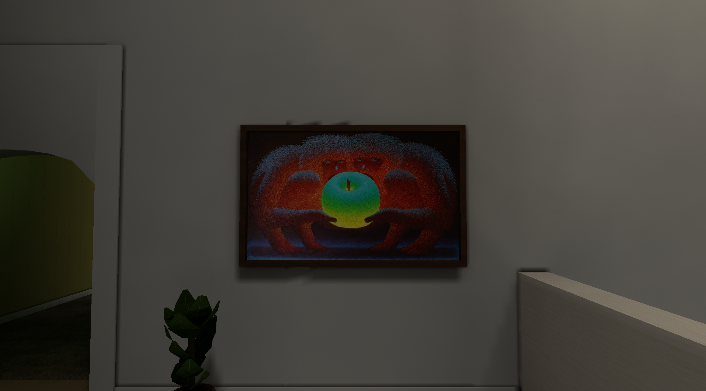

<a id="hanging-painting-files"></a>
### Files

- `assets/shared/decals/temptation_adam_eve_01.png`
- `assets/shared/props/painting_frame_landscape_01.glb`
- `assets/catalog.json`
- `levels/places_demo.json` and `assets/levels/places_demo.placesmap`
- `levels/model_zoo.json` and `assets/levels/model_zoo.placesmap`
- `tools/props/parts/decor.py`
- `tools/textures/decal_art.py`
- `tools/levels/build_model_zoo.py`
- `src/loader/tests.rs` (add the painting to the existing expected decal list)
- `docs/ASSET_SPECIFICATION.md`
- `docs/MAP_AUTHORING_GUIDE.md`
- `assets/environments/home/README.md`

<a id="hanging-painting-validation"></a>
### Validation

Passed:

- Exact decoded source-photo/PNG active-rectangle pixel comparison passed.
- `cargo fmt --all --check`.
- `cargo clippy --workspace --all-targets --all-features -- -D warnings -D clippy::all -D clippy::pedantic -D clippy::nursery -D clippy::cargo`.
- `python3 tools/assets/validate.py` (290 assets, zero warnings).
- `python3 tools/textures/build.py --check` (68 textures; existing soft budget
  warnings, including this intentionally higher-resolution artwork).
- `python3 tools/props/build.py --check` (166 models; within geometry/texture budgets).
- `python3 tools/assets/audit.py --workers 2` (zero errors).
- `python3 tools/levels/build_model_zoo.py --check --quiet` and its shipped-level
  generator test.
- Fresh uncached targeted showcase coverage, embedded-demo loader, decal-depth
  and official-demo feature tests. The existing exact decal-list assertion was
  updated to include the new painting sheet.
- Demo and Model Zoo builds with off/medium/full lightmap variants,
  `places-compile validate`, and `places-compile verify --require-current`.
- Final demo geometry audit: zero errors; two existing warnings for a tiny wall
  overlap and the night-house porch floor.
- Actual native High-quality game launch/capture in Places Demo, inspected for
  correct framing, orientation, proportions and wall placement.

`env RUSTC_WRAPPER= CARGO_INCREMENTAL=0 cargo test --workspace --all-features -- --test-threads=4`
finished with **2,005 passed, 3 failed and 23 ignored** (674.15 seconds).
The painting's existing demo decal-list fixture failed in that already-running
binary; its one-line update subsequently passed the fresh targeted test and
final strict Clippy. The two unresolved failures are external to the painting:
`loader::tests::test_the_default_level_is_the_shipped_demo` and
`static_prop_lighting_tests::real_dense_showcase_metadata_exceeds_material_budget_and_loads_under_its_own_limit`.
Both reject stale `lantern_hollow.placesmap`: its Office cabinet dependency
records 97,468 bytes, while the final concurrent Office asset is 104,356 bytes.
The subsequent combined package refresh and integrated gate passed, as recorded
in the October 7 integration note. No checks were skipped or assertions weakened.

The full workspace command has **not** passed yet. Binary and documentation
integration tests after the failing library stage remain unverified in this run.

The subsequent [October 7 integration](../style-upgrade-20261007/README.md#preceding-integration-provenance)
records the combined package refresh and successful final gate. The initial
asset-only run above retains its actual stale-package failures; it is not
relabeled as a complete workspace pass.

<a id="lightmap-efficiency-and-ceiling-halo"></a>
## Lightmap efficiency and ceiling fixtures

Arcade now uses five Full atlas pages rather than six, saving **48 MiB of resident
GPU lightmaps** across its three contribution groups. Home uses one rather than
two, saving **16 MiB**. Receiver density, HDR coefficients, gutters, filtering,
switch groups and overflow guards are unchanged. The fluorescent ceiling outline
is fixed by closing the housing's open back. The approved commercial vent design
also replaces Arcade's two fixed-colour vent decals and follows room switches.

Baseline: `arcade-env` at `6e529d7b5acdc5b0807ee197d64f5904d7a70c66`,
with CI `38328890341` passed. Measurements, input/output hashes, native recipes,
publication and cleanup are retained in `local/lightmap-efficiency/verification.json`.
Only Arcade and Home were refreshed; no archived map was baked.

<a id="lightmap-efficiency-and-ceiling-halo-waste-and-the-packing-change"></a>
### Waste and the packing change

The prior Arcade expansion from 44.3 to 71.0 MB was mostly legitimate model
lightmaps. There were no duplicate payloads to remove. The actual avoidable waste
was **free space stranded between receiver families**: architecture opened two
pages, with only 26,706 padded samples on its second page, while models opened four
more. Architecture holes were previously available to models only near the cap.

Architecture keeps its inline MAXRECTS placements. At the first model receiver,
an integer sweep partitions the remaining free-rectangle union into disjoint
guillotine holes. Models immediately reuse these holes. Exact adjacent holes are
coalesced on a miss **before** opening another page. This retains the earlier
coalescing fix and avoids expensive overlapping-hole pruning for every model
triangle. A pilot reproduced all 47,800 original Arcade chart coordinates before
changing the policy; the same-sized input then needed five pages. Both accepted
layouts reach the padded-area lower bound of five and one pages respectively.

| Full allocation | Arcade before | Arcade after | Home before | Home after |
|---|---:|---:|---:|---:|
| Pages / contribution groups | 6 / 3 | 5 / 3 | 2 / 1 | 1 / 1 |
| Chart samples | 3,394,993 | 3,404,737 | 371,365 | 371,365 |
| Gutter samples | 1,569,272 | 1,573,016 | 144,068 | 144,068 |
| Unallocated samples | 1,327,191 | 265,127 | 1,581,719 | 533,143 |
| Padded occupancy | 78.90% | 94.94% | 24.58% | 49.16% |
| Resident GPU lightmaps | 288 MiB | 240 MiB | 32 MiB | 16 MiB |
| Raw atlas records | 186,880,664 B | 160,422,920 B | 18,774,584 B | 10,288,152 B |
| ZIP-compressed atlas records | 65,183,482 B | 65,216,778 B | 2,698,872 B | 2,689,651 B |
| Complete map archive | 71,003,099 B | 71,060,432 B | 3,186,305 B | 3,174,118 B |

Each page costs 16 MiB per contribution group: two RGBA16F planes. Arcade's base
and two independent switched contributions therefore cost 48 MiB per spatial
page, now 80 MiB per group. Loaded CPU half-float planes shrink by the same amount.
Static does not allocate these atlases and retains its prepared on/off behaviour.

There is **no Arcade archive saving**: the combined fix adds 57,333 bytes (0.08%).
Empty tiles already compressed well; removing them changes PLLC tile grouping and
reduces the compact-tile fraction from 55.46% to 47.64%. Exact fallback remains
mandatory at the existing error bounds. The raw atlas saves 26.46 MB, but its ZIP
payload grows 33,296 bytes. Home's complete archive saves only 12,187 bytes (0.38%).
No encoding tolerance or compression setting was weakened to improve these numbers.

Allocation rounding also carries real quality costs: Arcade's inclusive endpoint
rows/columns account for 591,003 samples, and folded triangle bounding rectangles
include 112,451 samples outside their triangles. These and the gutters were
retained. Shrinking them or repartitioning tiny model charts would require new
sampling/filtering proofs and yielded no necessary benefit here. Naively keeping
overlapping MAXRECTS holes throughout model allocation was too costly in the
pilot; the one-time conversion is the bounded alternative.

All 47,736 retained Arcade receivers and all 3,563 Home receivers keep their
dimensions. Arcade replaces 64 old flange charts with 16 backplate charts and adds
208 vent charts; its final chart count is 47,960. Both layouts have zero padded
overlap. Arcade switch indices remain `[10, 18]`; collision and navigation records
are byte-identical. Content key 15 and geometry revision 12 invalidate stale
compiled data. Existing packages/codecs remain readable; there is no format migration.

<a id="lightmap-efficiency-and-ceiling-halo-ceiling-outline-and-switched-vents"></a>
### Ceiling outline and switched vents

The pale rectangle was reproduced in actual Arcade at normal and oblique views,
including with bloom disabled. The fluorescent housing's four-strip top flange
left its centre open. Ceiling receivers could see the analytic source through
that opening, obtaining direct light and visibility-supported recovery fill.
The latter compresses colour channels independently and strongly desaturates the
received pink. This was a geometry/transport leak, not atlas padding or bloom.

In a bounded pink-source diagnostic, filtered RGB at the ceiling was
`[0.02126, 0.00438, 0.00954]`, but recovery lifted it to
`[0.20855, 0.15671, 0.19257]`. A full opaque, textured, non-emissive metal backplate
now blocks the invalid direct/recovery support. Legitimate filtered bounce remains
`[0.00968, 0.00167, 0.00228]`; a farther ceiling sample changes by less than 0.000012.
The diffuser stays below the plate and retains its colour, UVs and aperture.
The new ray regression fails on the old housing, passes for both fixture rotations,
and verifies unobstructed, correctly tinted room-facing light without an atlas bake.

The old vent decal shader retained its baked corner colours when the Full room
circuit switched off. The shared replacement `core:ceiling_diffuser_01` uses the
existing static-model receiver/circuit path: a 600 mm frame, real inset four-way
louvers and a closed plenum, 208 triangles, no emission or collision. The approved
design is preserved. Its opaque paint PNG and 1024-square master are committed;
the [model builder](../../tools/props/parts/ceiling_diffuser.py) records the exact
built-in ImageGen prompt and loads the PNG rather than generating texture imagery.

At the same Arcade vent crop, Full mean RGB is `[62.09, 62.83, 58.55]` on and
`[0, 0, 0]` off; the old decal stayed at `[60.60, 62.74, 62.20]` off. Static darkens
while preserving legitimate ambient. Actual bathroom interaction followed by
Full-off → Static-off → Full-off restores an identical PNG. A tiny pink-source
vent control also has an identical on/off/on return. No ambient, exposure or
map-specific lighting mask was introduced.

<a id="lightmap-efficiency-and-ceiling-halo-native-evidence-and-costs"></a>
### Native evidence and costs

The 13 curated PNGs below are unmodified native captures. Matched pairs use the
same pose, settings and capture frame, with 1280×720 output, High textures,
Full lighting and reflections unless identified otherwise. Every accepted capture
was checked for commitment of the requested scene. Invalid menu-only attempts
were rejected. Normal pink views disable bloom; oblique views enable it.

| Evidence | Before | After |
|---|---|---|
| Pink ceiling, normal | [before](../images/lightmap-efficiency/halo-normal-before.png) | [after](../images/lightmap-efficiency/halo-normal-after.png) |
| Pink ceiling, oblique | [before](../images/lightmap-efficiency/halo-oblique-before.png) | [after](../images/lightmap-efficiency/halo-oblique-after.png) |
| Arcade floor/chart edges and cabinets | [before](../images/lightmap-efficiency/arcade-before.png) | [after](../images/lightmap-efficiency/arcade-after.png) |
| Home floor/props | [before](../images/lightmap-efficiency/home-before.png) | [after](../images/lightmap-efficiency/home-after.png) |
| Bathroom vent, Full off | [old bright decal](../images/lightmap-efficiency/vent-before-off.png) | [new off](../images/lightmap-efficiency/vent-after-off.png) |

Additional captures show [vent on](../images/lightmap-efficiency/vent-after-on.png),
[Static vent off](../images/lightmap-efficiency/vent-static-off.png) and
[diagonal cabinet/contact shadows](../images/lightmap-efficiency/diagonal-shadow.png).
Blue/pink fixtures, Static/Full circuit changes, Medium textures, cabinet art,
Bepsi props, reflections and the rebated bathroom door were inspected. Actual
switch and door return captures are pixel-identical. The GPU timing/device/RSS
overlay path is unchanged. Blizzard code/assets were untouched.

A single bounded runtime pair used the same final binary, pose and settings,
VSync off, 120 warmup + 240 measured frames, with no compiler/audit running.

| Native run | GPU pass median / p95 | CPU loop mean | Peak process RSS |
|---|---:|---:|---:|
| Arcade before | 9.288 / 13.330 ms | 5.932 ms | 996.70 MiB |
| Arcade after | 8.307 / 11.335 ms | 5.574 ms | 895.92 MiB |
| Home before | 4.556 / 7.046 ms | 5.552 ms | 377.89 MiB |
| Home after | 4.476 / 7.184 ms | 5.566 ms | 353.73 MiB |

These are sampled render-pass timestamps, not a general FPS claim. Thermals and
host/device scheduling were not controlled across repetitions. Home's starting
package already had an older compiler/catalogue; unchanged source and referenced
assets were verified, but its lighting/image/timing differences also include the
previous equal-area source-sampling change. Its allocation result is confirmed
independently by the identical-dimension packing pilot.

Final eight-worker bake: Arcade 643.721 s, peak RSS 2,633.39 MiB; Home 35.978 s,
349.42 MiB, with zero warnings/fallbacks. The prior owner's Arcade bake was
674.619 s, but this is not an isolated packing speed comparison. Current-package
hits take 0.863 s / 0.115 s and do no bake. One earlier owned Arcade bake was
cancelled when the vent scope was added, before publication; final acceptance
used only the combined Arcade bake and proportionate Home bake.

<a id="lightmap-efficiency-and-ceiling-halo-validation-and-handoff-limits"></a>
### Validation and handoff limits

Passed: formatting/diff checks; strict workspace/all-target/all-feature Clippy;
workspace Rust tests (2,248 library + 8 integration); all-feature tests
(2,254 + 8), both retaining 18 existing ignores; Python source suite (349 run,
four native-class skips); three separately invoked native smoke checks; source
generator; asset validation (570 entries/347 placeable, zero warnings); texture
and prop checks; complete asset audit (347 GLBs, 499 standalone/375 embedded PNGs,
zero errors). Texture checks retain 96 existing warnings. Prop decoded RGBA is
107,208 KiB, under the 106 MiB aggregate budget. No default test or CI requires
a production-map bake.

The exact-free-union test uses a 16-pixel grid; expanded existing packing tests
protect early sharing, coalescing before growth, gutters, determinism and true
overflow. The new fixture-ray test costs about 0.01 s. A 4×4 compiler control
compares unchanged, metadata, light and prop incremental outputs against clean
records: all four are byte-identical, with metadata reuse retained. Arcade/Home
integrity validation, `verify --require-current` and subsequent cache hits pass.

Unrun: Linux/Windows native acceptance, broad performance campaigns and further
production refreshes. Winter, Office, Beach, Frutiger Aero, Pool and Lantern Hollow
packages remain byte-identical and await normal compilation. Places Demo and Model
Zoo remain historical JSON only. The previously reported empty-install smoke opens
the game but has an old menu-text assertion; it remains queued for the tooling audit
and was not weakened or repeated. Compiler progress, Office recovery/shadows,
cleanup campaigns and 0.9.0 work remain outside this task.

<a id="map-independence"></a>
## Map independence — October 12, 2026

Places builds, packages and starts with zero installed maps. Authored sources,
assets and existing ignored packages are preserved; no map is embedded or
fabricated as a fallback. Version remains 0.8.0 on `arcade-env`.

<a id="map-independence-coupling-removed"></a>
### Coupling removed

- Packaging previously required the compiler, current packages for every curated
  source, and `levels/lineup.txt`. The default `tools/package.sh OUTPUT` now exports
  the player and runtime assets with empty map folders. `--maps DIRECTORY`
  explicitly includes any supported external packages after archive/dependency
  validation and ordinary player discovery. Failed validation leaves the previous
  export intact. No source names or map compilation are involved.
- Cargo source distributions exclude `levels/` and `assets/levels/`. There is no
  project build script that fetches or bakes a map.
- Startup and worker requests no longer require the official demo or retry it.
  An empty installation goes straight to the usable menu. An explicit missing
  `PLACES_LEVEL` leaves the menu with a warning; otherwise the first discovered
  package can provide the background. Geometry authoring commands require an
  explicit source. Dynamic washer parts follow placed content in any map.
- Production-source includes, directory scans and large navigation/content
  campaigns were removed from normal Rust tests. Ten bounded unit fixtures total
  99,424 bytes. Contact, door, water, navigation, encounter, weather, material,
  codec/security and numerical-boundary assertions remain; redundant authored
  layout promises stay with source checks and deliberate developer campaigns.
  No new ignore marker or feature gate hides required coverage.

Explore rescans on opening. Import rescans both writable folders and continues
past invalid candidates, preserving successful imports. Missing, corrupt or stale
packages fail cleanly. Errors use two bounded lines clear of Back and the keyboard
legend, with full diagnostics in the log. Catalog and dependency hashes, package
format checks and Full atlas quality requirements remain enforced.

<a id="map-independence-verification"></a>
### Verification

A disposable source copy physically omitted both production map directories;
original files were never renamed or removed. Existing Rust dependency caches were
reused. Runtime assets and state were explicitly pinned for its fixture tests.

| Command / check | Result |
| --- | --- |
| `cargo fmt --all --check` | Passed |
| `cargo clippy --workspace --all-targets --all-features -- -D warnings` | Passed in normal and map-free source trees |
| Release Clippy with the same targets/features | Passed |
| `cargo test --workspace` | 2,232 library + 8 integration tests passed; 18 existing manual native diagnostics |
| Map-free `cargo test --offline --workspace --all-features` | 2,238 library + 8 integration tests passed; library execution about 31 seconds |
| Map-free offline check of all targets/features and release build of both binaries | Passed without fetching or baking production maps |
| `cargo package --offline --allow-dirty` | Archive verified by compilation; actual archive contains neither production map directory nor any `.placesmap` |
| `PLACES_SKIP_SMOKE=1 python3 -m unittest discover -s tests -p 'test_*.py'` | 352 tests passed, 4 explicit native/export/weather suites skipped |
| `PLACES_TEST_EXPORT=1 python3 -m unittest tests.test_packaging` | All 6 passed, including real export/sibling preservation |
| `python3 tools/assets/validate.py` | 555 catalog assets, 336 placeable; zero errors/warnings |
| Default and explicit external-map exports | Both flat and macOS layouts passed; default had zero maps, explicit export one arbitrarily named Arcade package |

Hosted Rust verification now runs in a temporary checkout with optional map
content omitted. Authored-source/asset checks run separately. Neither normal
Cargo commands nor hosted CI compile/bake the shipped lineup. The existing
`tools/build-maps.sh`, `tools/levels/compile.py` and full desktop gate remain
explicit authoring operations.

Native SDL3/wgpu Metal acceptance used the isolated map-free application bundle.
The menu and empty Explore instructions rendered normally; empty import, Settings,
saved Low textures with Full lighting, restart and menu Quit worked. After startup,
one corrupt package and current Arcade were placed in its private import folder.
The valid map appeared despite the bounded error, loaded and supported walking,
pause/settings/resume and normal Quit. Changing textures Low → Medium retained
Full lightmaps/reflections and the moved player position. The first package decode
took 2.19 seconds; recorded lighting/atlas preparation was zero. No production
package was rebuilt and no full lightmap bake was run for this task.

<a id="map-independence-remaining-content-work"></a>
### Remaining content work

Only the local Arcade package matches both current source and catalog bytes. The
other nine local packages have older catalog hashes and are correctly rejected by
discovery until deliberately rebuilt. Aero's source bytes match its package, but
its catalog provenance is stale. Model Zoo also has stale source bytes and a
recorded Full `page overflow` with no atlas. These are retained content/compiler
follow-through items; quality and overflow errors were not weakened. Compiler
executable freshness is separate from runtime format/dependency compatibility.

No authored level, PNG/GLB, shader, lighting/UV/material/entity rendering contract, README
promotion or release metadata was changed. Preexisting untracked audits remain
untouched. Exact publication/CI and final scoped cleanup are recorded in the
handoff; disposable builds, exports, fixtures and raw traces are removed afterward.

<a id="map-optimization-recommendation"></a>
## Bringing map storage and browser delivery costs down

11 October 2026 · audit of `b1d2a1d6903e027f53435baa3577881b1866f6ac`

<a id="map-optimization-recommendation-recommendation"></a>
### Recommendation

**Keep the current look and HDR. Make map data independently fetchable by quality,
reuse assets by their existing hashes, and share the repeated parts of prepared
geometry. Retain `.placesmap` for offline import and complete map-plus-assets
exports.** This is the
best first project for browser delivery: it avoids transferring work the player
does not currently need, without changing lighting or rewriting the renderer.

The measured eight-map collection is **560.90 MB of packages**, plus **68.29 MB
of unique declared assets**. Fetching just each map's existing Full-quality records
would require approximately **319.09 MB of map data**: **43.1% less initial map
transfer**, before application overhead. All qualities remain available on demand.
That defers bytes; a complete offline collection still needs them.

For a major reduction in *complete installed map storage*, lighting must also
change its encoding. Exact prop sharing alone saves **39.35 MB / 7.0%** across
the current collection. A separately approved compact HDR encoding trial is the
next substantial opportunity. Earlier 12-bit experiments suggest promise, but
are lossy and are not fresh proof for this lineup. Increasing ZIP compression is
low priority: it mostly saves a few percent while making packing much slower.

This investigation changes only documentation and isolated audit tools. Production
packages, maps, artwork, quality settings, renderer and public format are unchanged.
The recommendation requires a later implementation decision; the audit is complete
without that decision.

<a id="map-optimization-recommendation-what-is-large-today"></a>
### What is large today

**Measured current files**, with all entry hashes and installed dependency hashes
checked. MB means 1,000,000 bytes; MiB means 1,048,576 bytes. Raw records are the
sum of inflated ZIP members, not the player’s memory consumption.

| Curated map | Archive MB / MiB | Raw records MB | External assets MB | Rooms / placed props |
| --- | ---: | ---: | ---: | ---: |
| Home | 6.24 / 5.95 | 71.96 | 16.11 | 4 / 18 |
| Pool | 17.85 / 17.02 | 74.84 | 1.78 | 3 / 20 |
| Frutiger Aero | 26.40 / 25.18 | 156.46 | 1.83 | 4 / 620 |
| Beach | 32.36 / 30.86 | 276.88 | 1.32 | 1 / 441 |
| Winter | 80.04 / 76.33 | 310.35 | 15.47 | 44 / 310 |
| Demo | 103.86 / 99.05 | 746.31 | 51.60 | 14 / 1,617 |
| Model Zoo | 136.15 / 129.84 | 376.96 | 19.22 | 38 / 275 |
| Lantern Hollow | 158.00 / 150.68 | 557.66 | 14.29 | 54 / 1,076 |

The eight packages contain 2,571.17 MB of inflated records. Required assets total
121.62 MB when counted separately for every map, but only **68.29 MB once** across
the collection. Shared installation avoids **53.32 MB** of repeat asset copies.
Whole prepared-record hashes offer **zero additional cross-map payload sharing**
in this lineup. All eight maps have three prepared qualities; identical records
within each package are already stored once.

The existing runnable export includes 90.46 MB of non-map assets, including the
catalog, startup/UI and other shipped assets. Thus its asset tree plus all maps is
**651.36 MB**, excluding executables/licenses. The narrower **629.19 MB** map-plus-
declared-assets figure is not a complete app download. These are logical unique
file lengths, not uniquely reclaimable APFS blocks, Git history or build caches.

The following accounts for every compressed archive byte in representative maps.
“Other” includes archive structure, manifest, semantics, irradiance fields,
reflection probes, mesh, collision and navigation.

| Map | HDR atlases MB | Prepared props MB | Chart metadata MB | Prepared lighting MB | Other MB |
| --- | ---: | ---: | ---: | ---: | ---: |
| Home | 5.39 | 0.59 | 0.13 | 0.06 | 0.07 |
| Demo | 67.79 | 18.78 | 4.94 | 9.58 | 2.77 |
| Model Zoo | 120.51 | 8.66 | 1.52 | 2.80 | 2.65 |
| Hollow | 99.20 | 41.07 | 13.22 | 2.33 | 2.18 |
| Winter | 54.84 | 16.59 | 6.25 | 1.14 | 1.23 |

Lightmaps occupy 65–89% of most curated archives. Zoo demonstrates why geometry
sharing alone is insufficient: its 275 placements use 262 distinct models, while
lighting occupies 88.5% of its archive. ZIP headers/indexes occupy only a few KB.
Collision/navigation together occupy 0.002–0.068 MB per curated map; deleting
essential gameplay data would provide negligible savings.

<a id="map-optimization-recommendation-why-apparently-modest-scenes-grow"></a>
#### Why apparently modest scenes grow

**Raw GLBs and PNGs are already external path/hash dependencies.** The package
stores decoded, transformed and prepared prop geometry for each placement and
quality, not another original GLB file. GLBs contain their own embedded model
images; surface, fixture and sky PNGs are separately verified dependencies.
Externalizing raw models again is not a new solution. See
[prop serialization](../../src/engine/package/props.rs) and
[dependency collection](../../src/map_compiler/mod.rs).

Each lightmap texel has two RGBA16F planes: RGB irradiance and a signed directional
moment, with reserved alpha. A 1,024-square page pair costs **16 MiB per lighting
group**. An independently switchable light adds another pair for every page.
Demo retains eight Medium and ten Full pages, with two groups: **576 MiB of
atlas pixels** across both qualities. Larger lit surface area, more receiver
charts and more independent groups grow lighting; page allocation adds steps.
Increasing chart resolution increases area approximately with the square of the
resolution change. Room count or polygon count alone cannot predict map size.

Repeated model placements grow expanded vertices and instance-specific lighting.
Receiver seams and Low-quality baked vertex colors prevent simply reusing every
vertex as-is. PLMP6 already shares exact vertices and normal/tangent palettes
inside a batch. Further sharing should separate reusable mesh data from transforms,
lightmap coordinates and placement lighting. See
[preparation](../../src/engine/render/common/props.rs).

Atlas occupancy is not an easy archive saving: Full Home is 75.4% unallocated;
Demo 19.8%; Hollow 11.9%; Zoo 7.8%. Empty pixels compress cheaply. Hollow also
uses 33.0% of atlas area for sampling gutters, which cannot simply be removed.
Repacking charts or sparse tiles must preserve all occupied/gutter texels, chart
coordinates and switch groups. No occupancy saving was prototyped here.

<a id="map-optimization-recommendation-what-the-isolated-prototypes-prove"></a>
### What the isolated prototypes prove

**Fresh lossless measurement using the project’s release zlib-rs Deflate codec.**
Baseline level-6 repacks matched original archives byte for byte. The shared-prop
prototype splits vertex streams, shares exact chunks across qualities, and retains
headers, palettes and ordered indices. Two independent native codec outputs were
identical. Reading each resulting research ZIP reconstructed **every original
entry byte**, including signed zeros, lighting, probes, collision and navigation.

| Map | Current bytes | Shared-prop research ZIP bytes | Saving | Deflate 9 saving |
| --- | ---: | ---: | ---: | ---: |
| Home | 6,244,243 | 6,027,804 | 3.47% | 7.22% |
| Pool | 17,845,535 | 17,652,191 | 1.08% | 4.16% |
| Frutiger Aero | 26,400,970 | 25,510,019 | 3.37% | 4.52% |
| Beach | 32,364,170 | 31,371,472 | 3.07% | 5.26% |
| Winter | 80,037,202 | 72,850,520 | 8.98% | 2.75% |
| Demo | 103,859,345 | 96,367,737 | 7.21% | 4.52% |
| Model Zoo | 136,149,851 | 132,128,186 | 2.95% | 2.87% |
| Hollow | 157,997,935 | 139,641,993 | 11.62% | 2.42% |
| **Collection** | **560,899,251** | **521,549,922** | **7.02%** | |

These are intentionally **unplayable research ZIPs**, not a new runtime format.
Their original manifests make current readers reject the undeclared layout.
Byte identity proves unchanged interpreted data; no screenshot claim is needed.
No combined sharing/lighting/streaming saving is claimed.

For Demo, native packing took 2.70 seconds at Deflate 6 versus 13.49 seconds at 9;
bounded all-entry decompression took 0.563 versus 0.744 seconds. Hollow packing
was 3.91 versus 14.27 seconds; decode 0.744 versus 0.769 seconds. These are offline
warm-OS-cache measurements, excluding semantic decode/GPU upload; read values are
medians of three runs. Higher compression does not reduce resident GPU memory.

The scratch factoring encoder plus native repack took about 5.3 seconds for Demo;
Python on-disk reconstruction about 1.6 seconds, peaking at **1.78 GB RSS**.
This full-copy proof needs a bounded streaming implementation before claiming
better load time or memory. Native baseline repack RSS was 672 MB for Demo and
426 MB for Hollow. It is not a browser decoder benchmark.

Earlier evidence remains a hypothesis: the 9 October artificial 5,312-prop stress
fixture shrank 334.59 → 154.34 MB through sharing (53.9%); it is not a curated map.
Its preserved package now has old dependency paths, so it is not a current native
runtime candidate. Earlier atlas byte shuffling saved Demo bytes but enlarged
Hollow/Winter. Earlier B12 lighting quantization saved roughly 18–30% of complete
packages with little change in sampled native views; B8 showed snow bands. Those
lossy results were not repeated on the current lineup, and their runtime path
expanded back to RGBA16F. Retaining HDR range differs from retaining exact stored
precision. None justifies dropping HDR, groups, probes or lighting quality.

<a id="map-optimization-recommendation-download-load-time-and-memory-are-different-costs"></a>
### Download, load time and memory are different costs

The selected-quality column sums actual compressed Full-quality members, common
records and the entire original ZIP index overhead. It is a **transport estimate**,
requiring a new asynchronous fetch/reader path. It does not remove other qualities.
Dependencies below assume no required hashes cached; app/bootstrap bytes are extra.

| Map | Cold complete map + assets MB | Proposed cold Full + assets MB | Full map data with assets already cached MB |
| --- | ---: | ---: | ---: |
| Home | 22.36 | 19.70 | 3.59 |
| Demo | 155.46 | 113.35 | 61.74 |
| Model Zoo | 155.37 | 100.30 | 81.08 |
| Hollow | 172.29 | 96.33 | 82.04 |
| Winter | 95.51 | 58.97 | 43.50 |

After downloading Demo’s assets, Hollow needs only **2.57 MB of new dependencies**,
Winter another **8.84 MB**, and Home none, in that order. An unchanged revisit may
need zero resource body bytes if all cached content survives; decode/upload may
still be needed if decoded or GPU resources are no longer resident. Browser
storage can be evicted. Cache reuse is not guaranteed,
and moving bytes into a separate bundle does not eliminate the cold download.

**Fresh native baseline:** Apple M2 Pro, 16 GiB RAM, Metal, 1,280×720 drawable,
High/Full. Three alternating cold/warm application-state repetitions per map,
each in a new process; OS/GPU caches were untouched. All 30 runs presented the
requested playable scene. RSS measures the whole process on unified memory,
not isolated CPU map data or independently measured GPU peak.

| Map | First playable scene, cold / warm seconds | Peak process RSS, cold / warm MB | Full atlas GPU MiB | World/prop vertex + index allocation MB |
| --- | ---: | ---: | ---: | ---: |
| Home | 1.55 / 1.50 | 526 / 525 | 32 | 1.48 |
| Demo | 4.70 / 4.49 | 2,068 / 2,072 | 320 | 29.18 |
| Model Zoo | 3.25 / 3.27 | 1,540 / 1,543 | 176 | 14.45 |
| Hollow | 3.61 / 3.63 | 1,677 / 1,666 | 176 | 57.12 |
| Winter | 2.77 / 2.68 | 1,117 / 1,076 | 112 | 26.51 |

The player decodes **only the selected quality**, so fetching fewer qualities
saves transfer rather than eliminating current decode work. Loading inflates KTX2,
copies its pixel payload, expands half-floats into f32 CPU texels, then converts
them back to half-floats for upload. CPU atlas texels alone take twice the GPU
atlas bytes. Repeated batches also clone decoded prop image pixels; GPU texture
uploads already share identities. Removing these copies could improve memory
without changing artwork. See [loading](../../src/game/app/loading.rs),
[package decode](../../src/engine/package/world.rs), [lightmap decode](../../src/engine/package/lightmaps.rs)
and [upload](../../src/engine/render/wgpu/lightmap.rs).

Known allocations are components, not a total GPU peak: ordinary textures,
characters, reflections, render targets, mipmaps and old/pending worlds add more.
Per-batch prop texture statistics can count a shared resource repeatedly. Neither
lossless disk sharing nor B12-to-RGBA16F decoding proves GPU-memory savings.
Current Cargo features exclude browser backends; SDL3/native initialization and
the five-bind-group pipeline also need a browser port. No Internet transfer,
browser first-play, WASM decode or portable GPU codec trial was performed.

<a id="map-optimization-recommendation-what-other-engines-actually-demonstrate"></a>
### What other engines actually demonstrate

**Source 1:** Valve’s [static-prop lump](https://github.com/ValveSoftware/source-sdk-2013/blob/master/src/public/gamebspfile.h#L133-L209)
uses a model dictionary plus placement origins, angles and model indices;
[VBSP writes those separate lists](https://github.com/ValveSoftware/source-sdk-2013/blob/master/src/utils/vbsp/staticprop.cpp#L498-L520).
Repeated placements do not store another complete transformed mesh in that lump.
[VRAD nevertheless stores unique per-instance vertex lighting](https://github.com/ValveSoftware/source-sdk-2013/blob/master/src/utils/vrad/vradstaticprops.cpp#L1395-L1533)
in `.vhv` payloads in the BSP pak. This supports sharing geometry while retaining
placement lighting. The [BSP pak lookup contract](https://github.com/ValveSoftware/source-sdk-2013/blob/master/src/public/bspfile.h#L313-L337)
also uses installed game/base assets. A fair comparison includes those required
models/materials/textures/sounds, counted once. The reported “about 50 MB Half-Life
2 map” is not a verified matched benchmark. These are Source 1 SDK findings;
Source 2 storage and map totals were not audited.

**Modern engine:** Epic’s [Instanced Static Mesh](https://dev.epicgames.com/documentation/en-us/unreal-engine/instanced-static-mesh-component-in-unreal-engine)
shares mesh assets among transforms. [Virtual texture lightmaps](https://dev.epicgames.com/documentation/en-us/unreal-engine/virtual-texturing-settings-and-properties-in-unreal-engine)
and [streaming virtual textures](https://dev.epicgames.com/documentation/en-us/unreal-engine/streaming-virtual-texturing-in-unreal-engine)
make tiles resident as needed, with borders, extra sampling and possible reactive
popping. This is a useful later memory strategy, not proof of fewer installed bytes.

**Browser-oriented assets:** Khronos [EXT_mesh_gpu_instancing](https://github.com/KhronosGroup/glTF/blob/main/extensions/2.0/Vendor/EXT_mesh_gpu_instancing/README.md)
provides transforms/custom instance attributes and recommends spatially sensible
batches. [EXT_meshopt_compression](https://github.com/KhronosGroup/glTF/blob/main/extensions/2.0/Vendor/EXT_meshopt_compression/README.md)
uses independently decodable buffer views and a WASM decoder. Its lossless vertex
codec is distinct from optional quantization/filters; Places would need exact
round-trip proof and measured decode. The newer
[KHR form](https://github.com/KhronosGroup/glTF/blob/main/extensions/2.0/Khronos/KHR_meshopt_compression/README.md)
is currently release candidate, so EXT is the established comparison.

[KTX2](https://github.khronos.org/KTX-Specification/ktxspec.v2.html#_supercompressionscheme)
supports supercompression. [Basis Universal now supports HDR](https://github.com/BinomialLLC/basis_universal#supported-hdr-gpu-texture-formats),
but these HDR codecs are lossy. The [glTF Basis extension](https://github.com/KhronosGroup/glTF/blob/main/extensions/2.0/Khronos/KHR_texture_basisu/README.md)
alone does not establish arbitrary HDR lightmap support. [WebGPU texture formats](https://www.w3.org/TR/webgpu/#texture-formats)
require optional BC support for BC6H; ASTC browser formats are UNORM/sRGB, not
ASTC HDR. Signed directional coefficients need explicit handling. A portable
trial needs feature detection and a half-float fallback; fallback expansion
does not lower atlas GPU memory. Codec names cannot substitute for visual proof.

<a id="map-optimization-recommendation-ranked-implementation-batches-and-decision-boundaries"></a>
### Ranked implementation batches and decision boundaries

1. **Selected-quality delivery and verified shared assets.** Add a small manifest
   index and independently compressed, immutable hash URLs, or an asynchronous
   ZIP range reader. Preserve all qualities and complete offline map-plus-assets
   export/import. Current imported maps require installed assets; the compiler
   does not create standalone custom-asset packages. Add explicit bundling/import
   support if authors need one-file sharing, including custom GLBs as well as
   textures; extract verified reusable content into an explicit user cache. Count
   relocated bytes in cold totals. Pin dependency versions/hashes and compatible
   catalog identity; report missing/mismatched assets clearly. This is the first
   browser architecture decision, with the measured 43.1% Full-only map-transfer
   opportunity above. It does not by itself solve complete installed storage.
2. **Lossless storage and memory foundations.** Add versioned shared prop streams
   and compact chart metadata, preserving every chart and diagnostic/export API.
   The measured prop saving is 7.0%; chart compaction is unmeasured. Separate
   solved-data cache identity from encoding identity to avoid needless rebakes.
   Share decoded images per model and reduce atlas conversion/copy lifetimes.
   Require deterministic clean/incremental output, exact reconstruction, bounded
   allocations, native quality switching and current-world memory measurements.
3. **Compact HDR lighting pilot.** Compare exact channel/sparse/block encodings
   with the smallest original representation, then separately trial B12 or a
   signed/HDR GPU codec. Preserve range, direction, interpolation, gutters,
   independent groups and probe/entity lighting. Any quantization or changed
   interpretation requires an explicit quality decision and matched native views
   across exposure, snow, colored lights, switches and multiple GPUs. This is the
   strongest route to substantial complete-package savings, still unproven for
   the current lineup. Do not add historical savings to the lossless table.
4. **Shared prepared meshes and spatial streaming where justified.** Store model
   geometry once, transforms per instance, compact placement lighting separately;
   retain normal transforms, receiver seams, collision and culling. This resembles
   Source’s useful separation and can reduce CPU/GPU geometry growth. It is a
   larger compiler/renderer migration, with no measured Places size result here.
   Add tiled lighting/spatial streaming only when a runtime pilot demonstrates
   worthwhile residency/first-play gains. Keep geometry codecs selective and
   reject encodings whose decode/size tradeoff is worse. Deflate 9 ranks last.

Keep existing safe paths, hashes, typed limits and capabilities. New readers need
checked offsets/counts, bounded reconstruction and aggregate working-memory caps,
not just compressed-size limits. New representations must fail clearly in older
players; compatible new readers should preserve existing imports or provide an
explicit migration tool. Current format accepts one package major version, so
backward support would be new work, not an existing guarantee.

Deployment also matters: [HTTP Range](https://datatracker.ietf.org/doc/html/rfc9110#section-14.2)
can be ignored by a server, and transport content coding changes the served byte
representation. Use validated fallback behavior and suitable CORS. Separate full
chunk responses simplify caching: [Service Worker Cache.put](https://www.w3.org/TR/service-workers/#cache-put)
rejects raw 206 partial responses. [Immutable versioned URLs](https://datatracker.ietf.org/doc/html/rfc8246#section-1)
help reuse; [browser storage](https://storage.spec.whatwg.org/#storage-pressure)
still needs quota/eviction handling and an offline completeness check. Fetch only
from approved bundle locations; map content must not authorize arbitrary network
downloads or executable content. Verify hashes after bounded download/decode.

<a id="map-optimization-recommendation-evidence-and-reproduction"></a>
### Evidence and reproduction

Current inputs passed native validation, all entry/dependency SHA checks, exact
baseline repacks, deterministic factoring and complete on-disk reconstruction.
The focused proof tests cover changed bytes and invalid chunk references. The
strict Rust/Python gates and publication receipt belong to the final handoff.
No whole environment rebake was requested for these measurements. Required Rust
regressions independently bake their normal fixture cases.

Useful local evidence is retained under ignored
`tools/bench/results/map-optimization-20261011/`: `delivery.json`,
`current-provenance.json`, `native-summary.json`, `native-load/`,
`lossless-native/campaign.json`, per-entry
proofs and gate logs. Original package/binary SHA identities are recorded there.
The previous storage/HDR evidence remains intact under its dated result roots;
its untracked reports/images are preserved and are not published as a second
recommendation document. Temporary STORE/repeated ZIPs from this campaign are
removed only after proof; compressed research ZIPs and receipts remain local.

From the repository root, with current compiled maps and release tools:

```sh
scratch=tools/bench/results/map-delivery-reproduction
mkdir -p "$scratch"
python3 tools/bench/map_storage.py --self-test
python3 tools/bench/map_delivery.py --out "$scratch/delivery.json"
RUSTC_WRAPPER= cargo build --release --bin package-repack
python3 tools/bench/map_delivery_campaign.py \
  assets/levels/home_showcase.placesmap assets/levels/places_demo.placesmap \
  assets/levels/model_zoo.placesmap assets/levels/lantern_hollow.placesmap \
  assets/levels/winter.placesmap --out "$scratch/lossless"
python3 tools/bench/loading.py --binary target/release/places \
  --out "$scratch/native" --levels home_showcase places_demo model_zoo \
  lantern_hollow winter --repeat 3 --timeout 90
python3 -m unittest discover -s tests -p 'test_map_delivery.py'
cargo clippy --workspace --all-targets --all-features -- -D warnings
cargo test --workspace
```

Use new output directories. Native display access and macOS process counters may
require the host’s normal execution permission. Do not run timing campaigns
concurrently with builds. Browser throughput, total GPU peak, new runtime loaders,
current-lineup lossy quality and Source 2 comparisons remain **not tested**, not
reasons to stall the completed audit or the next queued task.

<a id="map-storage-lighting"></a>
## Map storage and Static / Full lighting

12 October 2026. Native checks used Apple M2 Pro, 16 GiB RAM, Metal. MB is decimal;
MiB is binary. This pass changes prepared map data and lighting selection; original
GLBs, PNG artwork, authored presentation and external asset references stay intact.

Lighting now offers **Static** (historical vertex-lit `off`) and **Full**. Texture
quality/filtering preserve it; saved Medium becomes Full, while an explicit old
Low override retains Static. Static adds authored sky/global light to surfaces
and entities through bounded coarse visibility, suppresses material response and
reflections, and Full restores their saved preferences. New packages omit Medium
and Static reflection capture. Legacy readers remain; partial packages get an
`--variants off,full` rebuild command. Curated export rejects Full fallback.

PLLC1 stores 16×16 local ranges and RGB11 / signed moment XYZ10 in an eight-byte
word. Independent colour, energy and reconstructed-light bounds choose exact
six-half tiles when needed. Shape/framing and coefficients are validated with
bounded allocation. Nominal compact cost is 8.203125 bytes/texel; quality takes
priority. It expands to the established **RGBA16F pair, 16 bytes/texel/group on
GPU**, filtering linear coefficients before reconstruction. An exact KTX2 writer
remains available. [WebGPU’s format table](https://github.com/gpuweb/gpuweb/blob/main/spec/index.bs#L16286)
supports filtered Rgba16Float; this pass tests native Metal.

Loading retains shared half bytes and uploads them directly, removing full-float
atlas arrays and upload re-encoding. Decoded model images share `Arc` ownership;
changed/unreferenced models evict safely. Pending/displayed leases preserve active
records outside the 192 MiB LRU. PLPS1 shares exact prepared streams and verifies
segment/original hashes, retaining distinct placement/material/lighting/index
state. Segment fetches and working sets are bounded. Sharing must improve both
raw and Deflate-6 archive cost with conservative manifest overhead; otherwise
records stay literal. Geometry still expands per placement on CPU/GPU.

Full visibility edges add 8×8 to the retained 4×4 footprint (80 positions);
uniform areas remain 16. Density, gutters and shader filtering stay intact. The
independent diagonal oracle passes its ≥40% lower-error bound and thin openings
retain base samples. Current Zoo catalogue additions require twelve pages;
architectural holes are reused first, preserving formerly valid eleven-page
layouts. Zoo uses 192 MiB instead of the historical 176; Demo still permits ten
pages for its two groups.

**Complete packages: 645.109 → 367.235 MB, a 43.1% reduction (277,874,142 bytes).**

| Map | Before MB | Final MB | Final atlas MB | Bytes/texel | Full GPU MiB |
| --- | ---: | ---: | ---: | ---: | ---: |
| Demo | 103.86 | 60.68 | 188.94 | 9.01 | 320 |
| Model Zoo | 136.15 | 83.09 | 117.55 | 9.34 | 192 |
| Pool | 17.85 | 8.97 | 19.31 | 9.21 | 32 |
| Home | 6.24 | 3.19 | 18.77 | 8.95 | 32 |
| Hollow | 158.00 | 84.48 | 127.08 | 11.02 | 176 |
| Winter | 80.04 | 42.59 | 78.38 | 10.68 | 112 |
| Beach | 32.36 | 19.83 | 75.40 | 8.99 | 128 |
| Aero | 26.40 | 15.35 | 39.33 | 9.38 | 64 |
| Arcade | 84.21 | 49.06 | 146.27 | 9.30 | 240 |

Raw lighting members across all packaged modes decreased **2,449.48 → 811.03 MB**.
Final weighted storage is **9.55 bytes/texel**; Hollow needs 11.02 and Winter 10.68.
The higher rates are automatic precision fallback, not forced eight-byte output.
All nine packages use exact prepared-stream sharing. CPU atlas pixels and GPU
atlas storage are now each the Full GPU column; the former CPU float pixels
were twice that size. Zoo needs its additional current-content page.

Before is the nine installed packages at handoff. Current Zoo includes prior
catalogue additions; Demo/Zoo use the already-refined Spooner-man. Those rows are
observed package changes, not a one-variable codec experiment. Home also has a
clean same-source baseline. No independent percentage estimates are added.
All final packages pass current source/dependency and complete record validation.

| Map / app cache | First usable scene s, before → after | Package-load phase s, before → after | Peak RSS MB, before → after |
| --- | ---: | ---: | ---: |
| Home / cold | 1.54 → 1.46 | 0.32 → 0.29 | 528 → 394 |
| Home / warm | 1.56 → 1.46 | 0.38 → 0.29 | 537 → 393 |
| Demo / cold | 4.67 → 4.02 | 3.52 → 2.85 | 2085 → 1703 |
| Demo / warm | 4.50 → 3.98 | 3.33 → 2.80 | 2222 → 1775 |
| Winter / cold | 2.61 → 2.54 | 1.47 → 1.36 | 1124 → 696 |
| Winter / warm | 2.63 → 2.51 | 1.48 → 1.37 | 1126 → 697 |

Values are medians of two cold/warm application-state repetitions in new
processes, High/Full, 640×360 logical / 1280×720 drawable. OS/GPU caches were
untouched; “cold” does not mean a cold filesystem. Trace time is native, not
browser latency. RSS covers unified CPU/GPU memory, not isolated CPU peak.
Atlas GPU costs remain sixteen bytes/texel. Total GPU counters and
Windows/Vulkan/browser execution were unavailable/unrun.

| Final build | Static prepare s | Full prepare/encode s | Probe capture s | Sharing s | Archive s | Peak process RSS MB |
| --- | ---: | ---: | ---: | ---: | ---: | ---: |
| Model Zoo | 0.66 | 903.71 | 0.78 | 0.69 | 1.63 | 3536 |
| Demo | 21.19 | 600.15 | 1.28 | 1.21 | 1.48 | 3554 |
| Pool | 0.17 | 59.71 | 0.22 | 0.05 | 0.18 | 825 |
| Home | 0.04 | 36.15 | 0.00 | 0.05 | 0.08 | 439 |
| Hollow | 101.64 | 535.20 | 0.58 | 2.43 | 2.04 | 2831 |
| Winter | 13.37 | 276.66 | 0.48 | 1.00 | 1.01 | 2019 |
| Beach | 28.99 | 174.01 | 0.41 | 0.21 | 0.47 | 2577 |
| Aero | 0.21 | 186.34 | 0.33 | 0.21 | 0.34 | 1815 |
| Arcade | 0.23 | 354.55 | 1.63 | 0.29 | 1.09 | 2611 |

Matched Home default builds: **31.0 → 36.5 s** total; Full prepare/encode
**26.36 → 36.15 s**, with the former 4.09 s Medium stage removed. Peak RSS
**452.7 → 438.7 MB**. The small diagonal control Full build was **22.61 →
24.18 s** total (624.1 → 671.9 MB RSS). These phases include planning, transport
and encoding; they are not isolated ray-solver counters. The successful corrected
lineup took 55.3 minutes. One initial Zoo fallback was rejected; the current-source
capacity correction required replacing the first partial validation batch.

Bakes used eight workers sequentially. Finer coverage costs more despite Medium
removal; compact storage does not accelerate transport. Old-solve codec-only
encode/decode pilots cost 0.10/0.04 s Home, 1.22/0.44 s Demo, 1.07/0.42 s Arcade
and 0.32/0.13 s Winter. These exclude complete loading. Short repetitions and
single bakes have host jitter; no exhaustive campaign was run.

Matched codec-only native views (ten across Home, Demo, Winter and Arcade) differed
by at most one 8-bit display-channel value. Visual inspection found no snow/dark
banding or changed warm/cool/UV balance. The curated before/after pairs use the
same camera, authored exposure, pose, frame 30 and fixed 1/60-second step. Remaining
texel-scale shadow structure is visible at the retained physical density.

| Before | After |
| --- | --- |
| Static snow / retained cheaper appearance<br> | 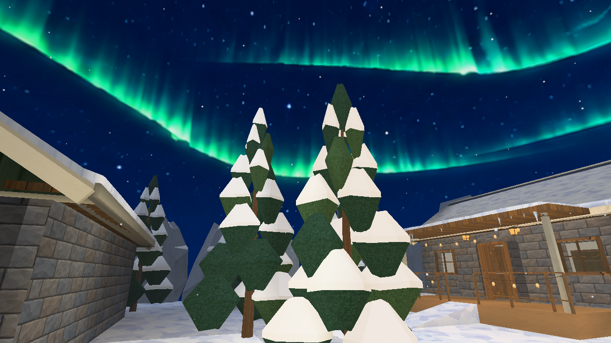 |
| Full diagonal caster / finer edge coverage, residual stairs visible<br>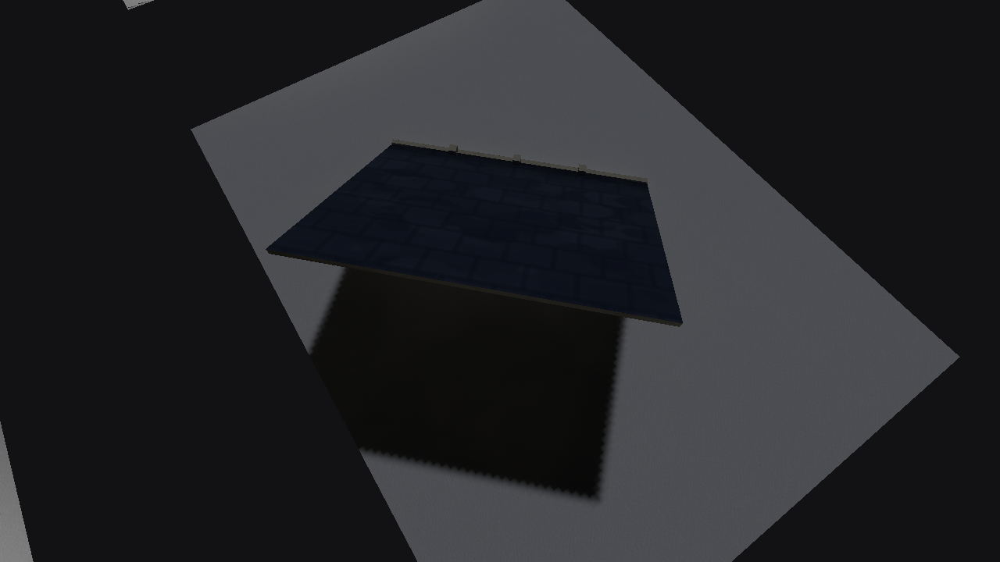 |  |
| Full snow / retained cold light and gradients<br> | 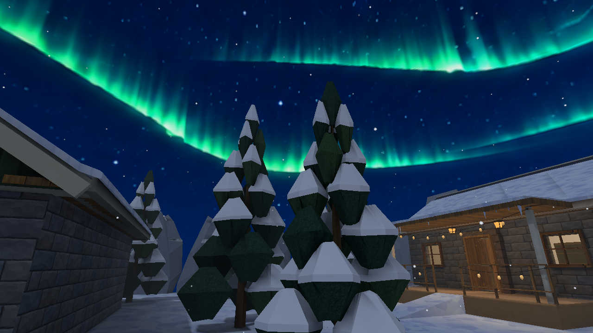 |
| Full UV room / retained colour and reactive pigments<br>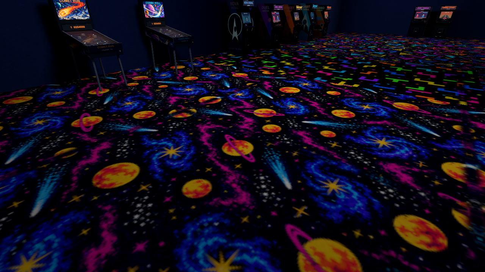 |  |

Capture inputs `(x,z,yaw) / pitch`: Winter `(-2.5,2,-69) / 19`; Arcade
`(7.3,22.5,322) / -28`. The shadow control explicitly sets `(x,y,z,yaw)` to
`(23.6,6.5,36.9,124) / -65`; its two-page data uses the same final coverage rule.
Winter interior retained its restrained appearance (maximum change 9/255);
closed-roof isolation also passes a bounded fixture. Exposed snow/props receive
authored sky. Home, Demo, ice, coloured arcade props, UV and
current Zoo were also inspected in both modes. The matched shadow view changes by at most 2/255, so its improvement is modest
at this distance; remaining 16-interval/m stair structure is not hidden by blur.

The live Arcade run verified **Static → Full → Static → Full**, then Low
textures → High textures without changing Full. Both Static captures and both
Full captures were pixel-identical; UV off/on and texture restoration returned
exact Full pixels. A spawned duck survived every transition and moved afterward.
The two texture refits reused the oversized active records (272.7 MB); no decoded
variant read was needed. Saved Medium lighting selected Full with Medium textures
and Full material response in a separate native run. Two small explicit headless
GPU tests passed repeated world/prop/character/material-resource transitions.
No total GPU leak counter was available; resource assertions and restoration passed.

Final local gates: formatting; strict workspace/all-target/all-feature Clippy
in debug and release; `cargo test --workspace` (2,262 library tests), all-features
tests (2,268), integration tests, source Python contracts (346 plus the new focused export guard), asset validation and patch whitespace. Production maps were
built only by explicit developer commands; hosted CI remains source-only. The
starting documentation CI 38184168719 passed. Publication SHA/CI are recorded in
the task delivery. Raw measurement/capture logs remain temporary rather than
being duplicated into tracked documentation.

<a id="menu-redesign"></a>
## Menu redesign verification

Places keeps its bitmap font, warm dark panels and yellow selection accent. A shared layout now draws each row and supplies its pointer region. Titles, short section descriptions, aligned values and one contextual hint replace the dense centred lists. Maps and Controls scroll within bounded lists; Import and Back stay visible. No existing option was removed.

| Native screen | Before | After |
| --- | --- | --- |
| Main | [Capture](../images/menus/before-main.png) | [Capture](../images/menus/after-main.png) |
| Map selection | Archived locally | [Capture](../images/menus/after-maps.png) |
| Graphics | [Capture](../images/menus/before-graphics.png) | [Capture](../images/menus/after-graphics.png) |
| Controls | Archived locally | [Capture](../images/menus/after-controls.png) |

These are genuine native screenshots at 960×544 logical / 1920×1088 drawable, including the macOS title bar. The capture tool supplied JPEG frames; these were saved as real PNGs with identical decoded pixels, without resizing or retouching. Baseline: `324d02265c36e1987d0def6a03c13ccb93fff4be`. Additional archived views cover Pause, independent lighting preferences, loading, failed-load recovery and 640×360. Native 1280×720 windowed and desktop fullscreen were also exercised; on the 1512×982 display, SDL reported a 1512×949 fullscreen content area below the macOS menu bar. The available display uses 2× backing scale; deterministic tests cover 1× and 1.5× conversions, letterboxing and invalid sizes.

Pointer motion selects a row. A fresh left press activates once; release is required before another action. Value arrows step backward/forward; clicking the value or row advances. Keyboard focus persists until real pointer movement. Menu, scroll, modal, focus and viewport changes discard stale hover. Loading and binding prompts expose only Cancel. Menus show the cursor; focused gameplay captures it.

Native checks covered nested Escape returns, repeated pause/resume, all 17 control rows, rebinding/cancel, scrolling, expanded Graphics, disabled lighting/resolution feedback, live texture and lighting changes, load cancellation and an invalid isolated map package. While paused, 470 initial state samples and a separate 1,112-sample pointer verification interval retained identical position/yaw/pitch across navigation and focus switches; resuming restored movement and mouse-look. Restore Defaults remains the existing immediate action; no confirmation dialog or controller navigation exists in this source.

Validation passed: formatting, strict debug and release Clippy, 2,253 all-feature unit tests plus seven integration tests (32 ignored), 37 focused UI tests, and both existing native Low-lighting GPU gates. Final modal/footer presentation was followed by focused tests, both Clippy profiles and a release rebuild. Fixed-spawn High and Low gameplay captures were pixel-identical to baseline. No map, texture or renderer resource pipeline changed; no meaningful performance delta is claimed.

The computer-use tool sometimes supplied stale pointer coordinates. With explicit user approval, a macOS mouse-event helper restricted to the frontmost Places test window completed real pointer verification: hover and keyboard handoff, fresh-press activation, held-button protection across opening a menu, outside clicks, value arrows, disabled feedback, binding Cancel, scrolling, map selection/loading Cancel, pause navigation and resumed mouse-look. Pointer targets were exercised at 960×544, after resizing to 1280×720, in fullscreen and after returning to windowed mode. Clicks in the fullscreen letterbox did nothing. No macOS security settings changed.

Raw logs, traces, isolated settings and fixtures remain under `tools/bench/results/menus-20261011/` (ignored). No user settings or repository maps were modified. Exact-commit CI and custody are recorded in its final handoff.

<a id="model-lighting-root-cause-and-fix"></a>
## Model lighting: root causes and correction

**Status: lighting correction verified — production defects reproduced and
corrected; native visual, package, automated and runtime gates passed. Publication
identity and exact-head CI are recorded separately in the final delivery record.**

This separate correction follows the completed seven-stage Art-style overhaul.
The original production baseline is `a1e7122bba5df549c2e82c16371bcc57db99e976`.
Production visual comparisons use the actual native SDL3/wgpu renderer on Apple
M2 Pro / Metal, 1280×720, FOV 60°, unchanged exposure, source geometry, materials
and textures. Focused GPU fixtures also exercise other resolutions and FOVs.

<a id="model-lighting-root-cause-and-fix-original-defects-and-confirmed-causes"></a>
### Original defects and confirmed causes

<a id="model-lighting-root-cause-and-fix-hallows-skeleton-lighting-changed-with-camera-distance"></a>
#### Hallows skeleton lighting changed with camera distance

The original seated `campfire_skeleton_1` in Lantern Hollow is at
`[-16.7009,0,-31.7478]`, yaw −150.0229°, playing its constant held
`pose_sit_chair`. Its GLB has no authored normals. The shader reconstructs facet
normals from screen derivatives of posed world positions, but the old absolute
squared-length threshold (`1e-12`) rejects valid derivatives as the camera gets
closer. It substitutes world-up normals, creating incorrectly bright regions.
The triggering variable is render-eye depth/resolution/FOV; player distance,
probe payload and animation pose are unchanged in the controlled reproduction.

The corrected shader rescales each derivative by its largest absolute component
before crossing, then safely normalizes the direction. Authored normals use the
same normalization. Only exact zero or collinear frames use the fallback. No
light, brightness floor, exposure, facing rule or material exception is changed.

The original native GPU twin fails at 512×288, FOV 45°, depth 0.125 m:
missing-normal RGB `[148,148,149]`, authored-normal `[88,88,89]`, with identical
incident lighting. Corrected twins pass across four transforms, two resolutions,
three FOVs and two depths; extreme, zero and collinear vectors remain finite.
The original 128×128 fixture could not reach the faulty threshold above its near
plane. CPU probe tests never exercised this fragment-normal branch.

<a id="model-lighting-root-cause-and-fix-corridor-recovery-rays-falsely-hit-their-own-boundary"></a>
#### Corridor recovery rays falsely hit their own boundary

The Demo Home corridor's ceiling/wall teeth originate in recovery fill.
Ceiling chart 1006's maximum adjacent edge RGB-mean jump increases from
0.00004969 direct to 0.01390652 filtered to 0.15931628 filled. The fill traced
visibility from the physical point on the adjoining wall, where floating-point
cancellation creates a tiny positive hit on the boundary the ray is leaving.

Recovery now evaluates falloff at the same physical point and traces from the
receiver's existing safe ray origin, as direct transport already does. Air-probe
semantics and real blockers are preserved. Exact production-coordinate controls
fail before and pass after; a sealed blocker still receives zero. Solver
revision 17 invalidates stale bakes. Generic room tests missed the exact boundary
coordinates and the separate recovery stage.

<a id="model-lighting-root-cause-and-fix-kitchen-lightmaps-smeared-real-small-shadows-across-panels"></a>
#### Kitchen lightmaps smeared real small shadows across panels

The actual cupboards, sink and refrigerator contain proud rails, pulls and
recesses; their directional contact shadows are legitimate. Three interacting
bake/reconstruction errors spread or invent broad dark patches:

- Centre plus four-corner agreement did not prove uniform footprint visibility.
  The original refrigerator returned zero even though an interior sample
  received RGB `[0.325395,0.296110,0.250554]`. Medium now integrates a bounded
  2×2 physical grid and High a 4×4 grid, retaining per-tap visibility and cosine.
- Triangle-centroid texture colour was mistaken for material identity. Two
  coplanar triangles of one textured refrigerator primitive were separated at
  their geometric diagonal. Scene-local source-primitive identity now preserves
  continuity within that material, while real material, gap, plane, shading-
  normal and transmission boundaries remain guarded.
- Eight High intervals/metre gave 125 mm footprints around 12 mm rails and
  30 mm strips. Small opaque props now use High 32 / Medium 24 intervals/metre;
  large architectural and cutout contracts retain their original sampling.
  A 4 mm physical oracle on 284 visible samples per panel shows decreasing
  reconstruction error at 8/16/32 density: cabinet 0.036505/0.025410/0.014363,
  sink 0.037496/0.027042/0.014212, refrigerator 0.018581/0.010987/0.005147.
  The cabinet/sink oracle itself is bit-identical before and after.

Compatible coplanar source triangles share illumination charts while preserving
the original source diagonal and all six corners. Unsupported shapes retain the
triangle path. Independent native preparation checks preserve 1,242,369 ordered
corners per quality profile, including source attributes, bounds, draw ranges and
casters; architectural frames, dimensions and sampling pitches are unchanged.
Charts decrease from 126,624 to 78,818 in Demo and 245,495 to 191,610 in Hallows.

The planner applies the exact typed byte budget to the actual contribution-group
count before emitting charts. Full permits up to eleven pages; Demo's two groups
fit ten pages under the unchanged 320 MiB +64 KiB bound. Hallows uses eleven base
pages (176 MiB, previously 160 MiB); Medium uses eight. No codec guard, gutter or
sampling quality is weakened. Geometry revision 8 and cache format 14 invalidate
old preparations; legacy folded-triangle readers and explicit quad topology are
covered by regressions. Earlier simplified fixtures lacked these real rails,
textured diagonals and narrow interior lighting openings.

<a id="model-lighting-root-cause-and-fix-native-visual-verification"></a>
### Native visual verification

An independent specialist inspected 210 integrated native captures: 42 static,
102 skeleton, 30 supplemental and 36 quality. All original target cases pass:

- Camera-only 12 → 0.4 m approach and retreat, fixed-eye player movement,
  orientation-only controls and ordinary crouch/controller movement preserve
  directional skeleton shading. The collision-limited approach reaches an
  actual 0.600017 m. Its selected skull region's erroneous world-up fallback
  count decreases from 12,908 to zero. Eight retreat pairs and all seventeen
  fixed-eye player normal images match exactly; the incident target payload is
  constant throughout each controlled sequence.
- Demo and Hallows cupboard/sink/refrigerator close-ups and both Demo corridor
  legs pass at Medium and High, with Low as a reference. Actual Home Showcase
  cabinet/sink and unoccluded refrigerator doors also pass. Recesses, handles,
  rails, grounding and directional shadows remain visible.
- Actual animated/skinned cat, movable washer/door, indirect/dark rooms and
  nighttime controls pass. All 268 non-level assets and 27 supplemental target
  transforms match the originals.
- Low → Medium → High → Low → High restoration passes at the Demo kitchen and
  original close skeleton. All sixteen same-frame/profile High-only and
  Low-only image comparisons are byte-exact, with matching capture state.

The final normal release player repeats eleven static and seventeen held-skeleton
captures byte-exact against accepted diagnostic-player final composition. All 48
supported packages compile, verify currentness, decode and load natively; all 49
positive/named-negative geometry controls retain their expected results. A second
specialist independently inspects all 48 current native views and paired originals.
Forty-three broad pairs share the original source/view/settings/catalogue; three
intentional camera changes and two earlier source repairs are qualified. Default
spawn animation phases are not pinned, so broad pixel differences are not claimed
as deterministic target comparisons. No new fallback appears; the existing
`capacity_dense` Medium/Full page overflow remains explicit.

Original and corrected baked-light diagnostics use the same encoding; an earlier
receipt's inaccurate description was corrected after inspecting both frozen
binaries. Both final-composition and baked-light PNGs are comparable. The images
below are untouched native captures copied byte for byte into this curated set.

| Original production case | Before | After |
| --- | --- | --- |
| Hallows skeleton, 0.6 m | [PNG](../images/model-lighting/hallows-close-before.png) | [PNG](../images/model-lighting/hallows-close-after.png) |
| Demo cabinet/sink close-up | [PNG](../images/model-lighting/demo-cabinet-sink-before.png) | [PNG](../images/model-lighting/demo-cabinet-sink-after.png) |
| Demo corridor, north | [PNG](../images/model-lighting/demo-corridor-north-before.png) | [PNG](../images/model-lighting/demo-corridor-north-after.png) |

The complete native review also includes the 12 m skeleton, wide Demo kitchen, Hallows cabinets/refrigerator, south corridor and both Home Showcase views. Those additional pairs are retained locally; the replay controls below retain their accepted cameras and sequence settings.

<a id="model-lighting-root-cause-and-fix-repeatable-controls-and-regression-protection"></a>
### Repeatable controls and regression protection

[Native replay instructions](../../tests/fixtures/native/model-lighting/README.md)
retain the accepted production cameras, frame sequences, player/camera controls,
quality loop and commands. The opt-in benchmark pins delta and records actual
render eye, player eye, angles, FOV, ready frame and simulation time. These
controls are inert during ordinary gameplay. Capture output must be new and
lives outside published docs; original baseline images are never overwritten.

Focused regressions cover near/far GPU twins, finite normal math, exact corridor
boundary/support visibility, sealed blockers, real refrigerator material and
narrow-slot coverage, source-prop oracle grids, source-attribute preservation,
quad topology/legacy decoding, typed page limits and cache-key consistency.
Actual compiled-environment GPU tests also trace probe → CPU payload → GPU
uniform → directional pixel and exercise quality/resource restoration.

| Final local gate | Result |
| --- | --- |
| `cargo fmt --all --check` | Pass |
| `cargo check --locked --workspace --all-targets --all-features` | Pass |
| `cargo clippy --workspace --all-targets --all-features -- -D warnings` | Pass |
| Strict release workspace/all-target/all-feature Clippy | Pass |
| `cargo test --workspace` | Pass, 2,197 library tests plus all integration/compiler targets; 32 ignored |
| Six ignored native entity-lighting GPU regressions | Pass, 6/6 |
| Complete Python discovery, including native smoke and packaging | Pass, 292/292 |
| Native Low/Medium/High resource override regressions | Pass, 2/2 |
| Real bundled static-model atlas planning | Pass |
| Normal and diagnostic release compiler/player builds | Pass |
| Demo, Hallows and actual Home Showcase currentness/full record validation | Pass |
| Complete supported package and native campaigns | Pass, 48/48 supported maps and 49 geometry controls |
| Independent final source/diff review | Pass |
| Quiet runtime comparison | Pass, four paired native views with presentation verified |

Earlier complete workspace attempts exposed stale page/topology/chart expectations.
Their updated checks preserve out-of-range rejection, legacy topology and the real
dense record's old-cap rejection, adding explicit quad and exact current Hallows
inventory checks. The final full rerun passes; earlier failures are not
claimed as passes. The Python dump inspector now accepts page 10 and rejects 11,
with edge/gutter/overlap tests on the last valid page.

<a id="model-lighting-root-cause-and-fix-costs-and-limits"></a>
### Costs and limits

Full cold production bakes take 562.666 s (Demo), 506.804 s (Hallows), 37.714 s
(Home Showcase) on this host. Demo peaks at 3.98 GiB measured RSS. The fixed High
coverage grid costs at most sixteen transport evaluations versus the former
uniform five; Medium uses four. These are offline compiler costs. This mission
has no valid matched original cold-bake timing and makes no compiler-speed claim.
Four paired High views use matching source cameras, assets and settings, with
GPU drain and a presentation trace, with VSync off and a 640×360 logical window
confirmed as a 1280×720 Retina drawable. All corrected intervals and three
complete original intervals follow 120 actually presented warmup frames and
contain 900 continuously presented frames. The original kitchen retains 891
frames, excluding nine trace-proven unavailable frames; no timing outliers are
discarded.

| View | CPU update mean, before → after (ms) | Renderer mean (ms) | Renderer median (ms) | Peak RSS, before → after (MiB) |
| --- | --- | --- | --- | --- |
| Demo kitchen | 8.818 → 8.866 | 3.227 → 3.348 | 3.165 → 3.248 | 2661.6 → 2663.6 |
| Demo corridor | 8.872 → 8.849 | 2.830 → 2.841 | 2.787 → 2.752 | 2290.9 → 1915.5 |
| Hallows far skeleton | 4.135 → 4.080 | 4.819 → 4.571 | 3.755 → 4.026 | 1269.1 → 1357.1 |
| Hallows campfire | 4.121 → 4.075 | 4.623 → 4.384 | 3.821 → 3.998 | 1270.9 → 1332.6 |

Draw calls remain 258/195/103/63 for these four views, and index storage is
unchanged. Demo VBO storage decreases 29,932,144→28,368,824 B and Hallows
56,547,800→55,610,568 B. The largest renderer median increase is 0.271 ms
(7.2%) in Hallows; CPU updates remain comparable. Hallows adds one 16 MiB GPU
atlas page. Its measured process peak rises by up to 88.0 MiB; peak RSS does not
isolate allocation causes or demonstrate a sustained plateau. All allocations
remain bounded by fixed atlas, chart and quality contracts. These single runs
include tracing and measure GPU-drained completion wall time, not GPU timestamps
or gameplay FPS. Timing variability prevents a speedup claim.

Earlier occluded runs were rejected. Nonzero draw counters alone do not prove
presentation because they can remain stale after skipped acquisition. With the
desktop available, normal accessibility focus/raise of the verified owned game
window restored continuous presentation for the corridor and both Hallows views.
Existing accessibility authorization was used; no security, permission or
persistent OS settings were changed. No rejected interval contributes to this table.

Restored Low disables atlas/probe/reflection lighting but retains an inactive
CPU visibility cache: Demo 16 meshes/5,178 triangles, Hallows 8/2,592. That is not
an active lighting leak and does not prove a sustained memory plateau. The
original nighttime missing-decal checkerboards remain unrelated; optional door
footage is partly occluded. Physical Linux/Windows GPU results, gameplay FPS and
sustained memory plateau are unclaimed. Publication uses the existing Art-style branch. Remote SHA and exact-head CI
are checked after commit and recorded with the final delivery. The matching
normal/diagnostic binaries, compiler, SDL library, all 48 packages, assets,
settings, curated PNG hashes, replay inputs and accepted verification summaries
are preserved outside `target` in the local `integrated-runtime-v3` recovery
bundle. Historical and superseded corrective evidence is recoverable in genuine
macOS Trash as described in the [docs index](../README.md). Reproducible Rust build
artifacts are cleaned only after publication, CI and recovery acceptance.

<a id="office-defect-repair"></a>
## Office defects, recovery and colour response

Office: After Hours now blocks the reported pressed-wall jump escape, grounds its
railings, removes the artificial ceiling stripe and preserves dark basement gaps.
It adds three deliberate middle-floor furniture placements and two sparse roach
encounters. A reusable geometry-derived escape fallback restores a validated spawn.
Linear colour controls confirm one albedo multiplication and coloured diffuse bounce.

Work began at `7aa4ad931a586558e399ae68fd6bb5132ec126c9` on `arcade-env`.
The retained local receipt `local/office-repair/verification.json` records package,
binary and image identities, native movement samples, actor states and measurements.
Machine receipts remain local under the repository's existing ignore policy.
Publication SHA and remote CI outcome are recorded in the final handoff rather than
making this document refer recursively to its own commit.

<a id="office-defect-repair-pressed-face-jump-and-shared-terrain-contacts"></a>
### Pressed face, jump and shared terrain contacts

The exact Office defect is beside the upper flight, reached from the bottom floor:
the ramp spans X31–34, Z4–14 and its side at Z9 reaches Y5.4. Start east at
`[35,1.6,9,270]`, or west at `[30.55,1.6,9,90]`. Hold forward for 2.5 seconds,
then jump at 1.25 seconds, with a fixed 1/60-second simulation step.

Before repair, east walking stopped at X34.0249, only 25 mm from the side; west
stopped at X31. The 0.30 m body already intersected the face and the 0.10 m camera
near plane could look through it. Jumping while pressed crossed the rendered
terrain and both traces fell to eye Y−22.1676. This reproduces both reported phases.

The rendered closed ramp sides were absent from the horizontal body sweep.
Grounded centre-height rejection could stop the centre without protecting the
radius. Airborne support queries rejected the slope above the feet and permitted
entry into the wedge. A second small native topology confirmed the same missing
contact on a stair side: the stair mesh was crossed, although that particular
stair trace did **not** record a void fall. Its ramp counterpart did.

Shared sweeps now use the real ramp/stair side and end faces, clipped to the live
body and step plane, plus actual stair riser bands. One-sided incoming contacts
preserve inside exits and legal climbing. Falling discs catch terrain edges;
grounded stair walking retains its centre-sampled smooth nosing pitch line.
No camera offset, oversized invisible wall, collision schema or speculative
ordinary-wall/door/ceiling rewrite was introduced.

Final Office traces remain east of X34.3 or west of X30.7 throughout pressing and
jumping; sampled eye Y never falls below 1.6. Recovery therefore never substitutes
for the collision repair. The standalone stair/ramp control holds X6.8/X2.8 with
the same full radius and ordinary jumping. Existing maximum/signed-slope, short
tread, ceiling/header, wall, door, water and Home stair regressions pass.


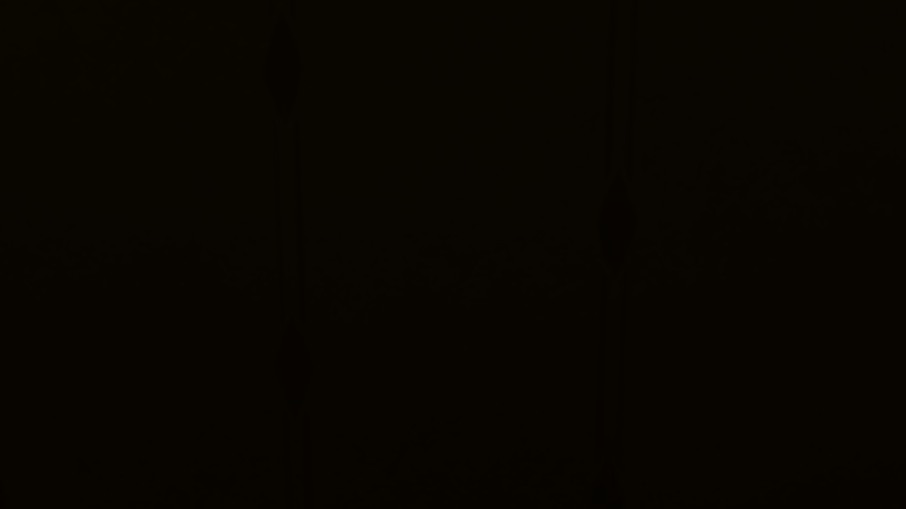

The ordinary native control also blocks a pressed wall at Z2.7 and a jump under a
1.85 m slab at eye Y1.6246. Its new door starts closed. The leaf correctly refuses
to swing into a pressed player; stepping clear, opening and walking through reaches
Z4.5275 with floor support intact. Ordinary wall/door failures were not confirmed.

<a id="office-defect-repair-escape-recovery"></a>
### Escape recovery

Recovery uses a union of local room envelopes, including their regions, ramps and
stairs, ladder volumes, exact rectangular/circular water footprints and real solid
support bounds. Gaps between rooms and different storey elevations are preserved.
An ordinary brief edge jump receives one second of grace; sustained escape returns
to the resolved spawn. Non-finite motion is handled before collision queries.

The destination is cached only with real support/water and standing-body clearance,
then revalidated when selected. Reset clears motion, vertical accumulation, stance,
bob, ladder/water transitions, ceiling contact and held action edges. Trigger
membership is reseeded without a teleport sweep; doors and AI retain their state.
The single destination-selection method is the extension point for a future
checkpoint destination. No checkpoint or save system was added.

In the native open-edge fixture, the player falls to sampled eye Y−3.2187, returns
once to `[1,1.6,1]`, and remains there for the final two seconds. A normal jump
finishes at `[2.45,1.6,1]`; swimming remains near `[10,−0.4,1.5213]`, without a
spawn return. Small deterministic tests additionally cover recesses, room gaps,
storeys, circular-water corners, held actions, entity/trigger preservation,
non-finite motion and invalid-spawn loop refusal.

The detector deliberately uses conservative local envelopes, not an arbitrary
inside-solid penetration detector. A missing or obstructed safe destination warns
and refuses the teleport. Collision defects must still be repaired independently.

<a id="office-defect-repair-ceiling-stripe-fixture-mounts-and-basement-reach"></a>
### Ceiling stripe, fixture mounts and basement reach

The top doorway stripe occupied one continuous ceiling chart and ended on a
coarse 1.2 m baseline-zone boundary. It was not a normal/UV/packing seam. Occupancy
had considered other storeys' walls in XZ alone, and a cell straddling a partition
could assign a ceiling sample to the wrong side. Occupancy now uses the actual
roof-probe height; local lookup selects a visible air cell on the sample's side.
Full recovery targets use the existing owning-side receiver inset.

Saved coefficient comparisons at five affected X positions across Z8.30/8.42 show
the median luminance step falling **0.229968 → 0.006537**, a **97.16% reduction**.
Sampled ceiling charts 44/46 retain identical geometry, dimensions and placement.
The remaining differences match nearby smooth gradients. Legitimate doorway
ceiling shadow remains dark, **0.020711 → 0.020193**; floor below a panel is
2.41% dimmer. Top-floor switched contributions are exactly zero.

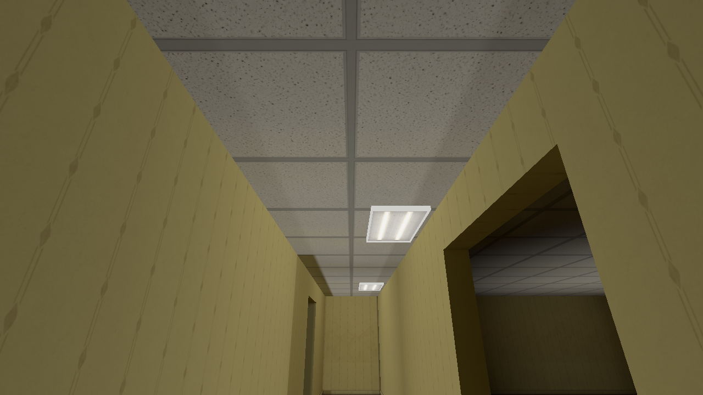
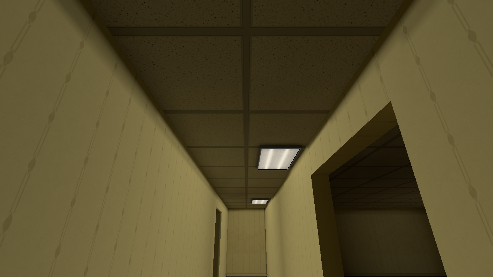

Strict source geometry also exposed **157 overlaps and one sliver already present
before this work**: 31 fluorescent backplates shared the ceiling plane. The
ordinary opaque pipeline has no depth bias, and transport ownership was ambiguous.
Those mounts now use the documented 10 mm ceiling clearance; the two wall sconces
are unchanged. The approved opaque backplate, non-emissive housing and diffuser
remain intact. Strict geometry now reports **zero errors and zero warnings**.
No checker finding was suppressed to obtain that result.

Only seven basement light ranges increased: fixed pools **2.7 → 3.8 m**, failing
pools **3.0 → 4.2 m**. Their brightness, colour, emission, timing and Static holds
are unchanged. Native Full captures retain dark termini and visible light failures.
Exposure and ambient settings are unchanged.

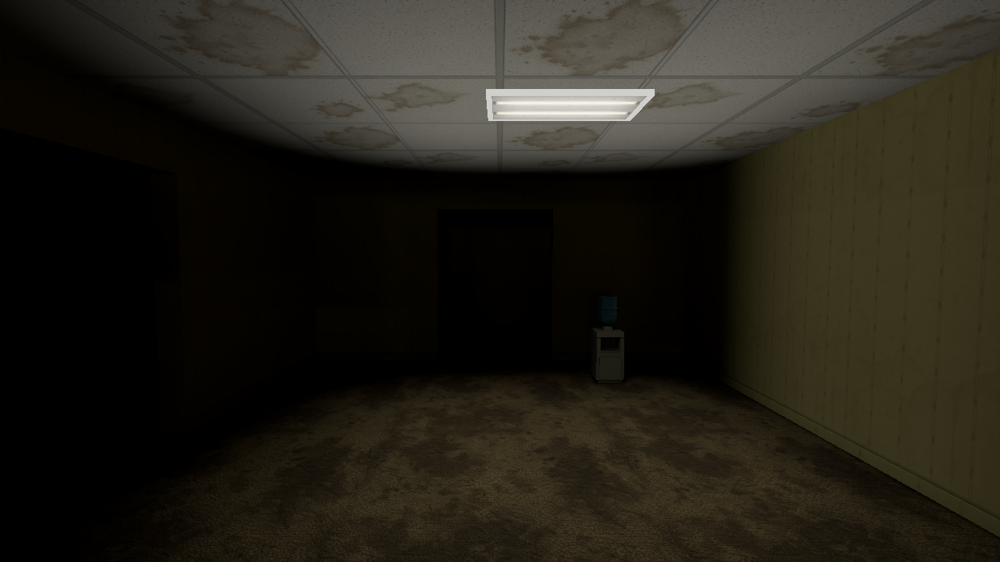
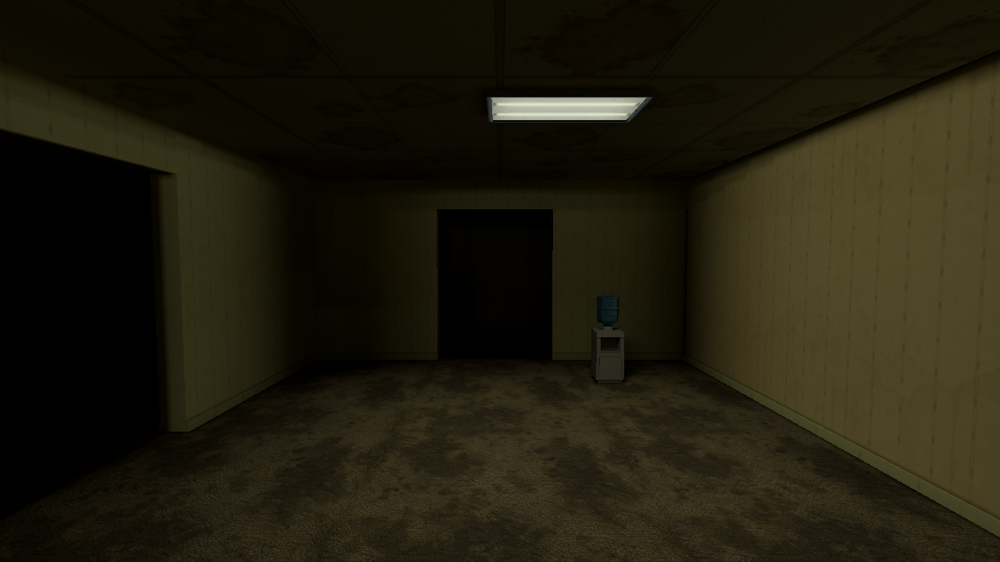

<a id="office-defect-repair-rails-furniture-and-actors"></a>
### Rails, furniture and actors

Four sloped rails had posts 20 cm outboard of the ramp. Their centres now sit at
X25.035/27.965 and X31.035/33.965, with bounded penetration and supported landing
joins. All **56 posts / 504 footprint samples** intersect supporting terrain by
**9.2–30.8 mm**; the clear ramp lane remains **2.86 m**. Native close views show
grounded feet. Both directions on both flights pass, and the three-floor walkthrough
reaches `[8.45,1.6,9]` without a floor leak. The final mount-only refresh retains
byte-identical collision/navigation records; lower-flight traversal was recaptured.

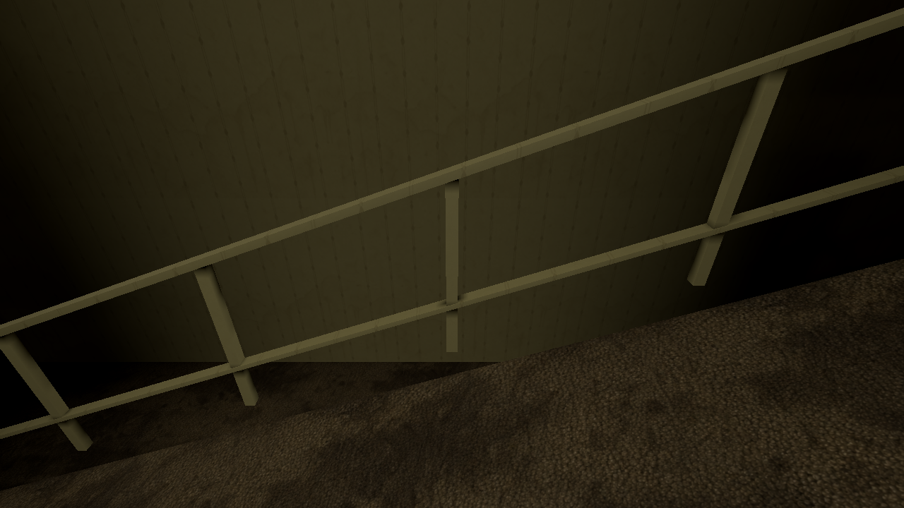
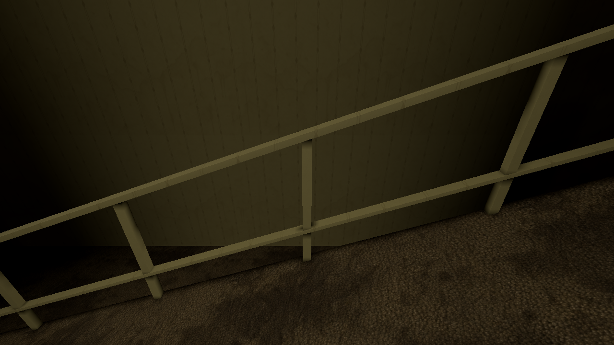

Middle-floor dressing adds a sideways table at `[8.4,3.42,1.9]`, a rotated sunken
desk at `[9.35,3.18,8.5]` and a chair clipped into the partition at
`[5.04,3.48,7.4]`. All nine middle openings retain standing-player routes. The
table is a proper offline +90° Z rotation of the repaired shipped model, with exact
visible-corner UV/pigment and embedded oak PNG preservation. Two negligible source
cap triangles are omitted: it has 338 triangles and six boundary edges, not a claim
of fully closed topology. No new raster artwork or runtime texture generation exists.
The top layout and basement maze remain unchanged.

The table occupies a deliberately dark pocket. The paired native final/albedo
views show its normal composition and make its preserved wood texture, orientation
and floor intersection inspectable without changing scene lighting.

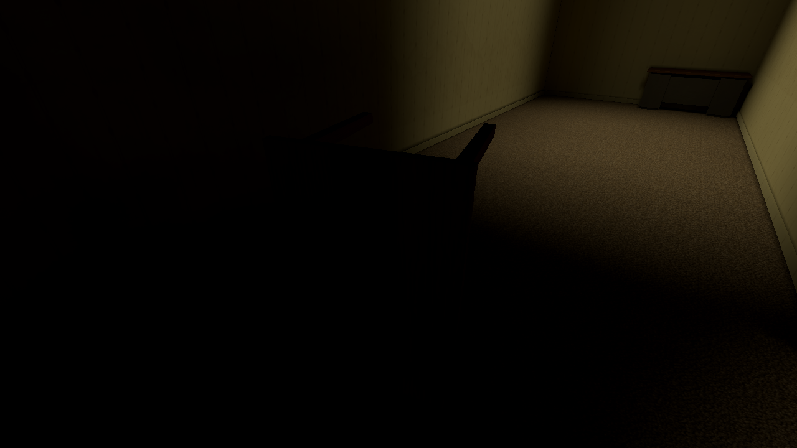
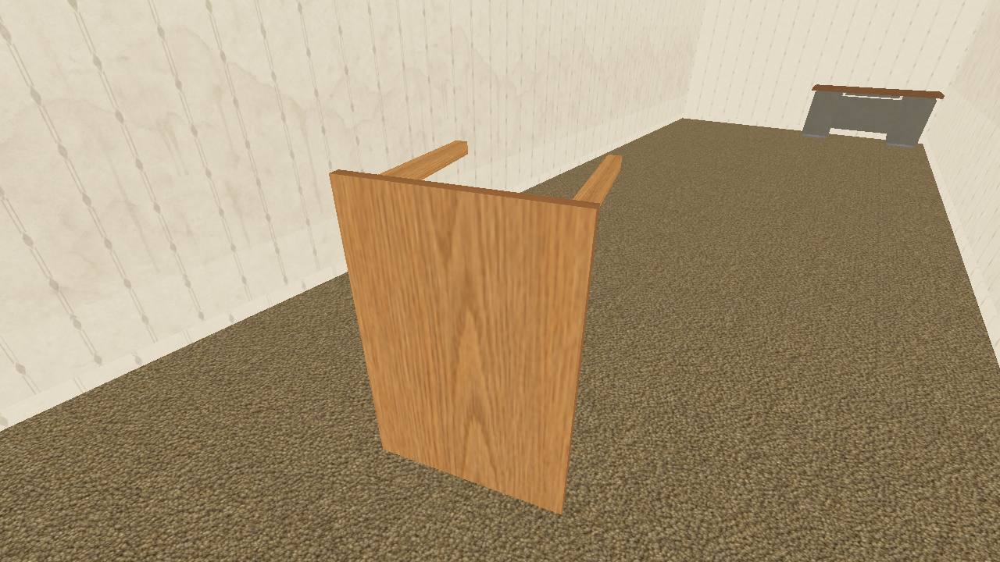

The roach was bound to its intended opaque white PNG with valid UVs and per-part
pigment; it was not a missing-texture placeholder. Palette values selected as sRGB
had been exported into glTF's linear `COLOR_0`, making the shell too pale. A narrow
linear material factor anchors the existing palette to dark-brown `#462412`, with
nonmetal roughness 0.48 and no emission. Geometry, skin, animation and PNG bytes
are preserved. Native close views confirm dark-brown environmental response.

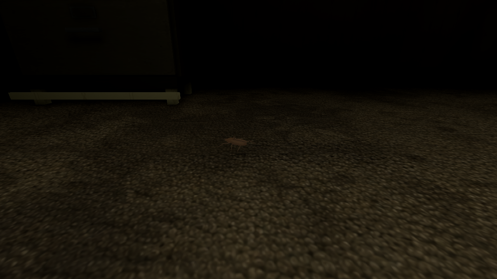
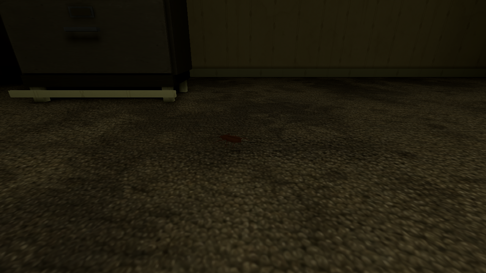

Roaches increase **two → four**, with one additional filing-cabinet plinth refuge.
All four native encounters perceive approach, scurry at 0.62 m/s along complete
compiled refuge routes, physically arrive and hide, then emerge after their
15/19/23/27-second cooldowns. The two added encounters reach refuges near
`[9.7,0,1.2]` and `[14.5,0,10.1]`. Existing small AI regression covers unreachable
nearest shelters and visible return. No broader AI system was added.

All four chains were inspected before only the final 10 mm lamp correction;
their final serialized collision/navigation and authored AI are unchanged. The
original chain and mannequin poses were also recaptured from the final package.
The mannequin follows its basement route without stuck/caught state, retaining
arms forward while moving and arms down when idle.

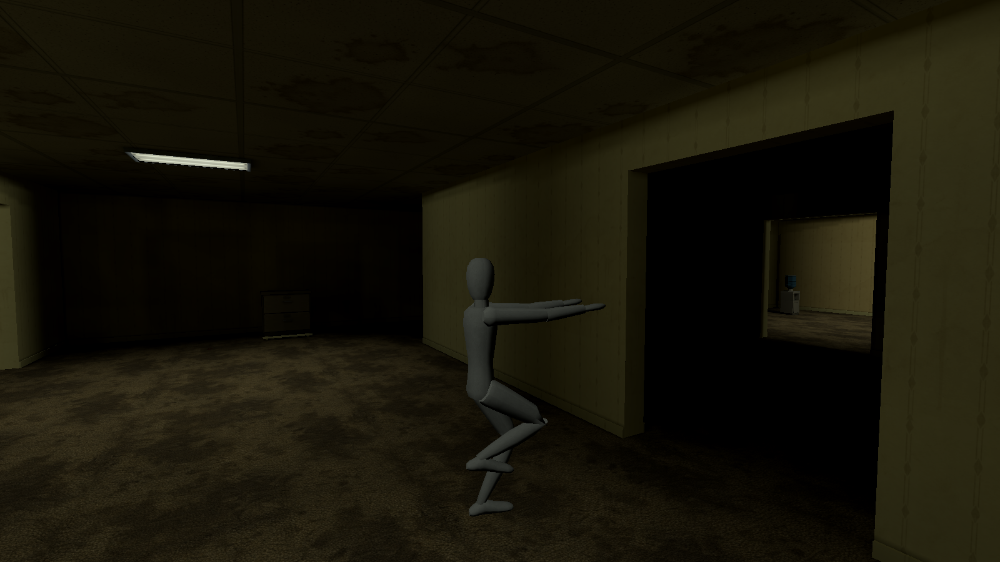
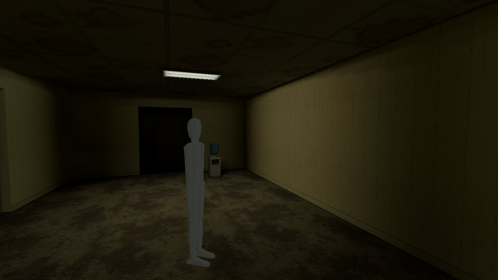

<a id="office-defect-repair-linear-material-and-bounce-controls"></a>
### Linear material and bounce controls

The explicit developer control uses two 3×3 m rooms and the real committed flat
white fallback PNG, with neutral `[.6,.6,.6]`, ideal red `[.6,0,0]` and ideal blue
`[0,0,.6]` linear material albedos. Fluorescent mounts have the same 10 mm clearance.
Normal white, pink `[1,.1,.45]` and blue `[0,0,1]` sources test receiving colour;
a white-lit red wall/baffle casts a shadow on a neutral receiver to test bounce.

Direct incident pink RGB is `[.321307,.032131,.144588]`, preserving `[1,.1,.45]`.
The existing room/recovery baseline compressed channels independently, desaturating
pink to filled ratios `[1,.444448,.693049]`. One shared strongest-channel amplitude
now preserves hue, with exact white-light scalar calibration. Final filled ratios
are `[1,.098895,.447293]`; small differences are legitimate coloured-surface bounce.
Solver revision 20 and the baseline-policy fingerprint invalidate prior packages.
Direct and indirect stage arrays remain **bit-identical** across this correction.

Pure blue produces **exactly zero** outgoing light on ideal red-only albedo. White
direct light remains equal across RGB channels. The shadow receives zero direct
light, but red-tinted indirect `[.090183,.070001,.070001]`; filtered and filled
values match, so no recovery fill manufactures that bounce. This validates the
existing RGB approximation, not a spectral renderer or a new GI architecture.

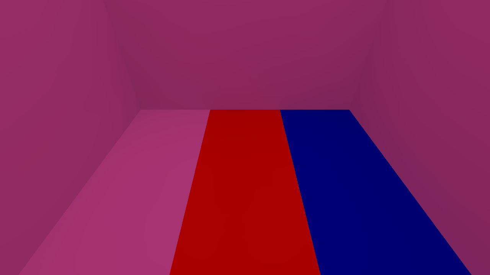
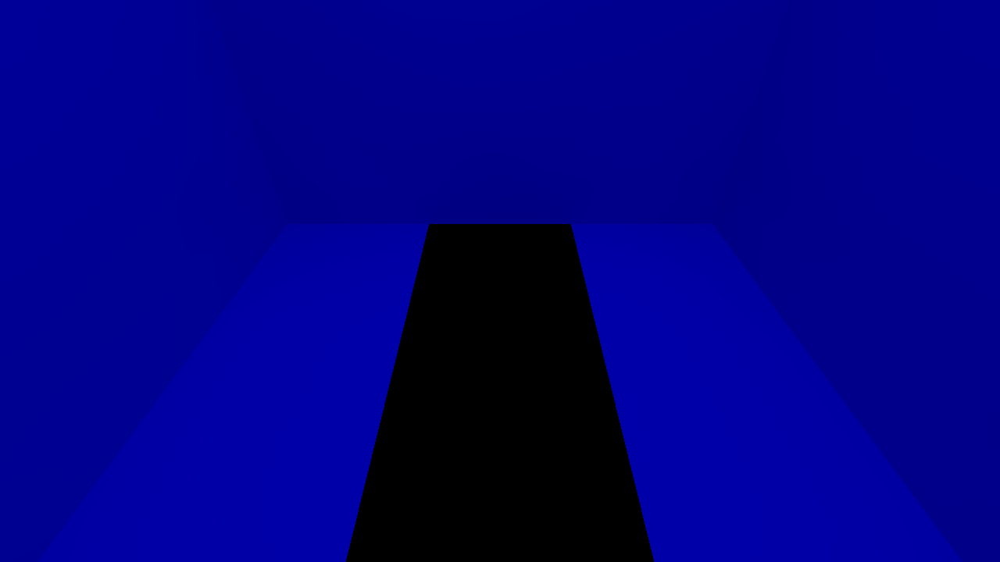


Matching native BakedLight pixels encode numeric HDR/(1+HDR). Inverting that,
applying the known albedo and unchanged display pipeline predicts neutral
`[165,50,112]`; the actual final pixel is `[165,51,113]`. Incorrect double albedo
would produce `[130,37,88]`. Red/blue strip checks agree within the 3-byte
quantization allowance. The native Albedo diagnostic shows sampled authored PNG
RGB only; it intentionally excludes material/vertex tint.

The diagnostic exporter also now reconstructs verified shared `PLPS` prop recipes
into exact runtime `PLMP` bytes, rather than failing before atlas export. Its existing
tiny metadata/navigation reuse test verifies byte identity without another bake.

<a id="office-defect-repair-gates-cost-and-package-currency"></a>
### Gates, cost and package currency

- Formatting, patch whitespace, strict configured debug and release Clippy pass.
- Default Rust: **2,260 library tests**; all features: **2,266**. Each also passes
  two compiler CLI tests and seven integration tests. The 18 existing ignored
  developer campaigns remain outside ordinary CI.
- Source Python: **350 tests, four existing native-class skips**, 110.09 seconds.
  Asset validation: **571 entries / 348 placeables**, zero warnings. Whole prop,
  texture, GLB/PNG audit, Office generator, cockroach and mannequin checks pass.
  The texture checker retains its 96 existing warnings; they were not hidden.
- Strict Office and small body-contact geometry: **zero errors / zero warnings**.
  Ordinary tests and hosted CI do not bake production maps.
- Added Rust coverage comprises two body-contact regressions, three compact
  recovery regressions and two scalar/35-cell lighting regressions. They protect
  distinct failures without shipped-map bakes. Existing tests were expanded for
  exporter identity and post-fall recovery. The mount regression parses one JSON
  and fails on all 31 original mounts; it adds no mesh/native/bake dependency.

Final Office normal Static/Full build took **336.65 seconds**, eight CPU workers,
peak RSS **2,167,685,120 bytes**. One earlier 341.77-second build exposed the real
mounting defect; the second was necessary to correct it. Both unchanged follow-up
builds reused their package rather than rebaking. Only Office was refreshed in the
production collection; small explicit native/colour controls were disposable builds.

One matched 240-frame native basement observation, after 120 warmup frames and
with builds idle, records:

| Observation | Before | Final |
| --- | ---: | ---: |
| Deduplicated GPU timestamp samples | 197 | 211 |
| GPU pass-sum median / p95 | 17.188 / 19.753 ms | 10.939 / 18.487 ms |
| CPU loop mean / update mean | 8.334 / 1.283 ms | 6.965 / 1.861 ms |
| Peak RSS | 753,778,688 B | 779,927,552 B |

These are bounded observations, not an isolated performance-improvement claim.
GPU timing/utilization/RSS reporting code was untouched. GPU baking remains an
audit recommendation, not a production implementation.

Final Office package is **25,965,291 bytes**, SHA-256
`d3574083eacb452969b13ee704a96fd640aeababfd2861d677c440b420d20726`.
Normal validation has no warnings; `--require-current` passes; the unchanged build
returns `rebuilt: false`. Before native views used the exact initial installed stale
package `8a6372f7…` and matching catalogue snapshot. Their capture working-source
hash must not be attributed to that package. Office A/B includes the needed normal
refresh of prior approved packing/backplate work; compact regressions isolate the
new engine repairs, and saved packages cannot recover intermediate solver stages.

All eight active sources remain active. Beach, Frutiger Aero, Home, Lantern Hollow,
Pool, Arcade and Winter packages remain byte-unchanged and **stale for catalogue
bytes and compiler executable**, requiring their normal future refresh. Archived
Places Demo and Model Zoo were neither rebaked nor reactivated. Approved Arcade
assets, bottles, rebated doorway, switches, square vents and cloud-only entity work
were not changed. Unrelated user audit files are preserved and excluded from this
commit. No later queue task was started.

The curated 17 PNGs are unmodified native captures (10.31 MB total); compact
receipts remain in `local/office-repair`. Final requested deliverables and the Office package
remain outside `target`. Publication/CI and cleanup custody are confirmed in the
final handoff and retained local publication receipt.

<a id="office-demo"></a>
## Office demo validation

`Office: After Hours` is a playable three-floor environment discovered as
`office_demo`. A believable office upstairs gives way to offset corridors and
displaced furniture, then stained basement halls with dark gaps between lights.
Two ramps and shared landings physically connect every floor. Existing Office
concept art, materials and modular furniture supply the visual language.

The source is [projects/environments/levels/office.json](../../projects/environments/levels/office.json), maintained
by [build_office.py](../../tools/levels/build_office.py). The normal compiler
creates the ignored `assets/levels/office_demo.placesmap`; the curated lineup
and generated model zoo register the map and new cockroach through existing
external discovery. Other authored maps retain their layouts and content.

```sh
RUSTC_WRAPPER= cargo build --release --bins
python3 tools/levels/build_office.py --check
sh tools/build-maps.sh --map office_demo --workers 8
PLACES_LEVEL=office_demo target/release/places
```

The main floors sit at 0, 3.6 and 7.2 m, with 2.8 m clear height. The 3 m wide
ramps rise 3.6 m over 10 m and have guardrails. Middle-floor furniture burial
is intentional and confined to wall-side pockets. Explicit trim avoids
stacked-floor ownership ambiguity and crossing-wall overlaps.

<a id="office-demo-basement-encounters-and-lighting"></a>
### Basement encounters and lighting

One concrete mannequin wanders the reachable basement, resting with its arms
down and running with its arms forward. The added `run_arms_forward` clip
combines the existing running legs and forward-arm pose; the original geometry,
skin, textures and five clips remain intact. Its navigation radius covers the
running arm envelope. It has no pursuit or combat behavior.

Two small cockroaches wander slowly in dark basement pockets. Player sight
within 2.1 m triggers a scurry toward the shortest complete reachable route
among three authored cabinet refuges. They physically enter the refuge, hide
for 15 or 19 seconds, return along a path, then observe a cooldown. Raised
cabinet plinths provide real clearance. Unreachable or newly blocked paths
cannot make an insect disappear. The new reusable model has 480 triangles,
25 joints and idle/walk/run clips; its opaque texture is a committed PNG.
See the [cockroach](../assets/ENTITIES.md#cockroach) and
[mannequin](../assets/ENTITIES.md#concrete-mannequin) maintenance notes.

Generic AI additions provide bounded routes, authored shelters and named
locomotion clips. The current compiled navigation grid represents one surface
per X/Z cell: the basement owns that surface, and all three actors have a
basement height band and inset home bounds. Player collision and support handle
the connected upper floors independently. There is no cross-floor NPC travel.

Two fluorescents have independent, sparse failure sequences. Full lighting
changes the luminous face, prepared illumination group and model lighting
together. Static cannot animate its baked field, so these two fixtures opt into
`hold_in_static`, retaining their baked-on face and illumination. Other fixtures
keep their previous behavior. Lighting remains Static/Full, independently of
texture quality and filtering; the UV material system is unchanged.

<a id="office-demo-validation-on-12-october-2026"></a>
### Validation on 12 October 2026

Actual native wgpu/Metal runs on an Apple M2 Pro used a 1600 × 900 drawable,
65-degree FOV, bloom enabled and reflections off. Three composition passes
preceded final captures. Held-control walks traversed every ramp in both
directions, the floor entrances and basement passages. A continuous 47.6-second
walk started at the authored top spawn and reached the basement without a floor
leak. Wall collision stopped the player at the expected body clearance.

Native state traces and images confirmed basement-only mannequin movement,
arms-down idle, arms-forward running, physical roach refuge arrival, hidden
holds and visible return. The measured mannequin routes had no stuck or
unplaced state. Models retained environmental shading in lit and dark areas.
Full fixture failures visibly removed their light pools. Corresponding Static
on/off captures had identical bulb, wall and carpet pixels. Full/Low textures,
Static/High textures and a live independent filtering/lighting cycle passed.

Strict geometry reported **0 errors and 0 warnings**. Two guarded bridge-edge
openings have narrowly scoped authoring annotations. Archive, source freshness,
navigation records and both lighting variants validated through the normal
compiler. The package is **24,852,778 bytes**, SHA-256
`4effb221c87de00ad2a300bc5a5e1be728b2ee0d9dda80f9aeef784ee1374cf0`.
Its final display-name refresh reused verified prepared geometry and lighting.

Local checks passed:

- `cargo fmt --all --check`, strict workspace Clippy in debug and release with
  all targets/features and `-D warnings`, and workspace tests with all features.
  The library suite passed 2,278 tests; 19 existing developer checks remained
  ignored. Binary and integration tests also passed.
- Python source contracts passed 351 tests with four existing native smoke
  skips. Asset validation covered 555 assets and 336 placeables with no warnings;
  the full model/texture audit found no integrity errors.
- Office/model-zoo generation, cockroach regeneration and preserving mannequin
  clip regeneration checks passed. Hosted CI checks source and bounded fixtures;
  it does not bake production maps.

<a id="office-demo-bounded-performance-and-storage"></a>
### Bounded performance and storage

The full curated-lineup refresh exposed a pre-existing Model Zoo capacity
blocker. The exact zoo source from handover commit `79c78df` also overflows the
unchanged 12-page Full budget (29,783 charts placed before fallback); the new
registered insect is not its cause. A bounded ownership-cell experiment was
insufficient and was reverted. Zoo content and renderer limits are preserved.
Its fallback archive is not a passing Full export; the later map certification
work must address that capacity. Office's own Full package passes this gate.

Three final Full/High runs each measured 300 frames after 60 warmup frames, with
GPU completion enabled, vsync disabled and no capture readback or navigation
logging. Every frame presented successfully. These are bounded desktop samples,
not a sustained frame-rate guarantee.

| View | Mean frame ms | Median ms | 95th percentile ms | Mean update ms |
| --- | ---: | ---: | ---: | ---: |
| Top | 7.80 | 8.08 | 12.93 | 1.79 |
| Middle | 7.45 | 8.03 | 16.46 | 1.50 |
| Basement | 9.88 | 8.13 | 16.48 | 1.97 |

The three actors use two meshes, three character draws and 5,849 vertices.
Combined update timing includes AI, skinning, input and other gameplay work;
isolated NPC CPU cost was not measured. The Full atlas uses four pages and two
switchable groups, occupying 192 MiB on the GPU; world textures occupy about
41.3 MiB. The final physical bake took 282 seconds with eight workers. Curated
screenshots total 6,727,200 bytes. Reproducible diagnostics, temporary captures
and build output are disposable; source assets and the normal local packages
are the retained deliverables.

<a id="office-demo-native-screenshots"></a>
### Native screenshots

Top office, middle corridors and the shared ramp shaft:

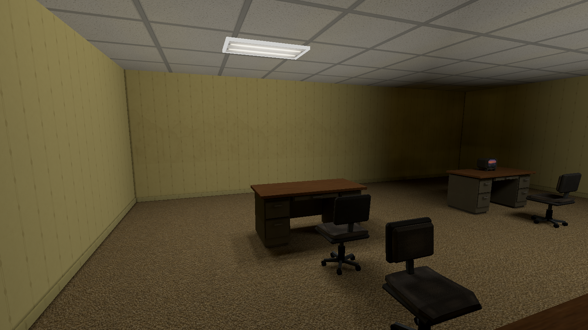
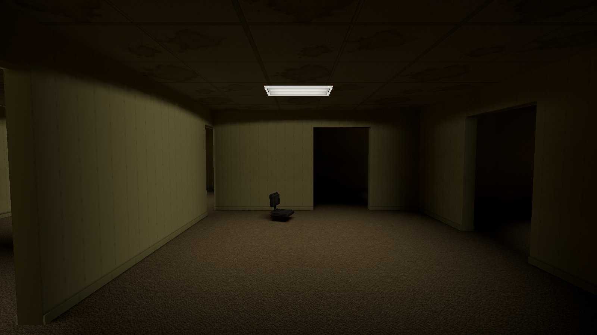
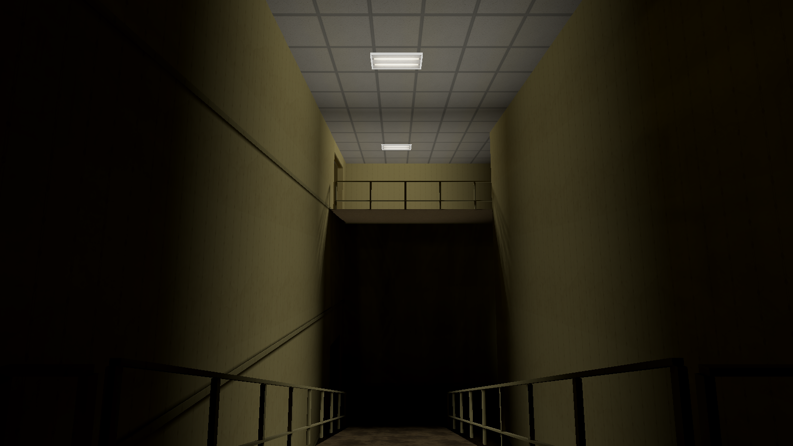

Basement mannequin running and resting, followed by a roach near its refuge:

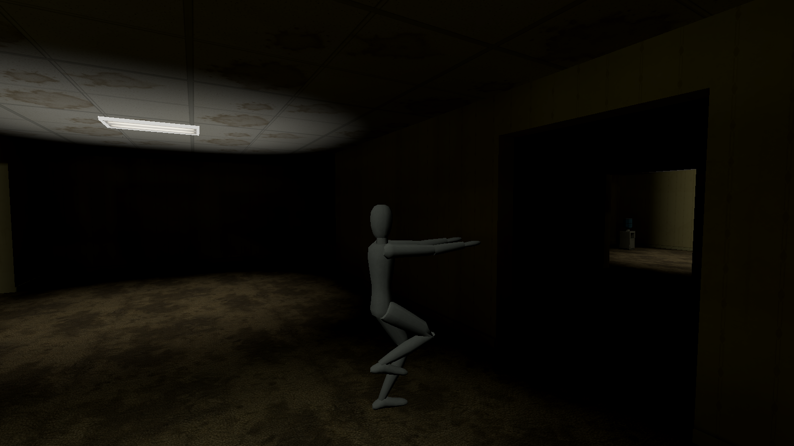
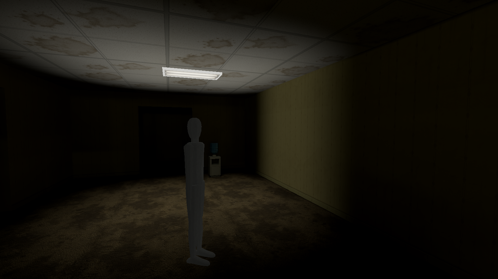
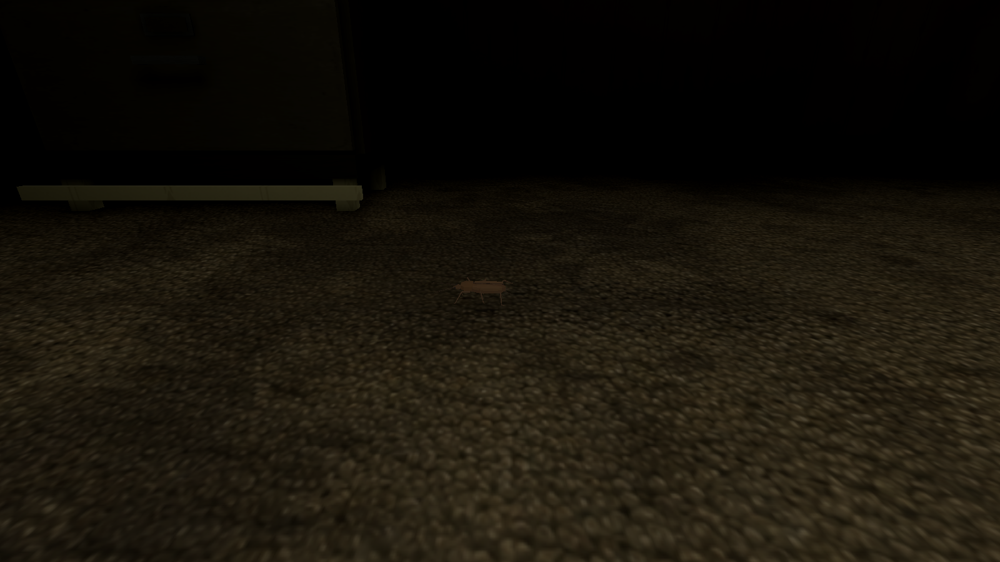

The same view before and during a Full lighting failure:

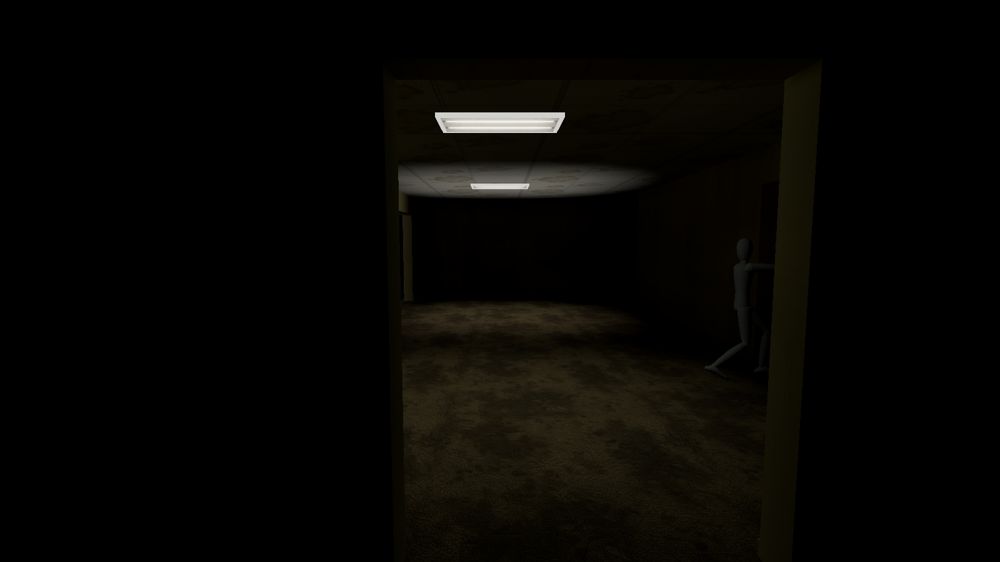
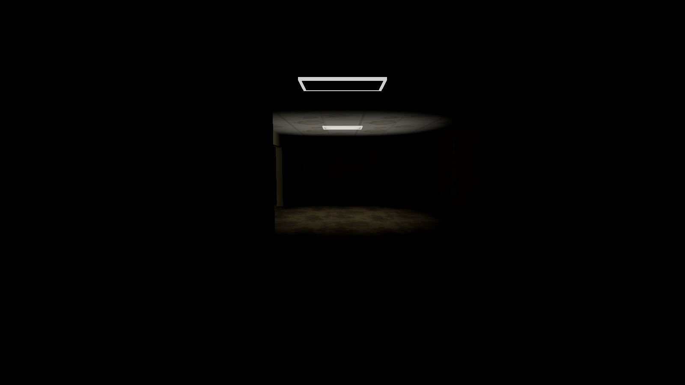

<a id="office-refinement"></a>
## Office concept-art refinement

Historical acceptance: October 2026 Office refinement. Counts, timings and validation below describe
that tested version; the canonical guides govern current contracts.

The existing Office assets now have separately readable furniture construction,
stronger material artwork and remade wallpaper. Asset IDs, material settings,
collision footprints, map sources and the rendering architecture are preserved.
The reference is `assets/references/office/Liminal Office Worlds Asset Board.png`.

<a id="office-refinement-reference-analysis-and-inventory"></a>
### Reference analysis and inventory

The board's main cues are faded vertical yellow wallpaper, dense beige carpet,
acoustic tiles with a regular suspended grid, bright tubes inside metal frames,
wood laminate over grey metal furniture, charcoal fabric, blue water bottles
and a mountain illustration on the drinks machine. Small seams, handles, inset
panels and narrow edge treatments communicate construction. Water damage is
irregular, while maintained surfaces stay quiet. Large empty spaces and sparse
furniture preserve the liminal atmosphere.

All five Office GLBs, their embedded/native atlases, six tiling surface sheets,
one fitted fluorescent face and seven Office materials were inspected. The
automatic baseboard, ceiling grid and fluorescent housing were reviewed in the
renderer, together with the demo's shared door/frame, window and vent details.
There are no registered Office computers, monitors, keyboards, cubicles or
signs in the existing set. Generic demo furnishings remain outside this pass.

| Existing asset | Assessment and action |
| --- | --- |
| Clean wallpaper | Remade at the user's request: vertical pinstripes and staggered faded lozenges replace double chevrons. Neutral cream albedo retains the existing yellow material tint. |
| Stained wallpaper | Derived from the new print; restrained water runs, rubbed paper and diffuse tide marks. Seam repaired and tested. |
| Clean beige carpet | Already has convincing dense short pile, warm tone and subtle variation; retained. |
| Damp carpet | Replaced uniform-looking damage with organically soaked, flattened patches and soft edges; retained fibre scale and repaired wrapped seams. |
| Clean acoustic ceiling | Existing pores, panel variation and grid are readable and consistent with the board; retained. |
| Stained acoustic ceiling | Reworked water damage inside the existing 2x2 grid; preserved seam orientation and acoustic texture. |
| Fluorescent face | Refined twin tubes, sockets and frosted diffuser ribs at the existing 2:1 aspect. Existing recessed housing and frame retained. |
| Baseboard and ceiling grid | Existing geometric trim, corner treatment and alignment are adequate. Baseboard inherits the remade wallpaper through its existing darker material tint. |
| Shared door/frame, window and vent | Existing depth, frame and louvre construction reviewed in demo captures; retained without changing shared assets. |

<a id="office-refinement-furniture-and-texture-changes"></a>
### Furniture and texture changes

| Model | Before triangles | After triangles | Refinement |
| --- | ---: | ---: | --- |
| Desk | 142 | 356 | Narrow desktop bevel, warm wood grain, metal pedestals, separated drawers, bridge pulls, pencil drawer and modesty panel. |
| Chair | 704 | 704 | Existing shaped/caster geometry and repairs retained exactly; new woven charcoal upholstery and restrained plastic/metal swatches. |
| Cabinet | 354 | 212 | Rebuilt as two broad metal filing drawers, recessed plinth, label holders and bridge pulls within the original low cabinet footprint. |
| Water cooler | 206 | 556 | Open recess, separate red/blue controls, drip tray and continuous eight-sided ribbed bottle; off-white cabinet and blue plastic artwork. |
| Vending machine | 146 | 252 | Inset mountain/DRINKS fascia, separate frame, raised selection buttons, coin bezel and delivery lip. |
| **Total** | **1,552** | **2,080** | **528 additional triangles; all models below the existing 800-triangle review budget.** |

Five new committed 1024-square prop master PNGs derive the existing 256-square
native atlases with the established box filter. The GLBs embed only the native
atlases. There are no new gameplay assets, material IDs, runtime texture sources
or external dependencies. ImageGen supplied the offline artwork; processing uses existing resizing and seam
repair tools; no runtime procedural imagery was introduced.

The Office surface and fluorescent exporters now load the authoritative PNGs,
including forced builds. This prevents the historical low-resolution painters
from replacing refined artwork. Tiny routing edits in the shared furniture,
appliance and fixture authoring modules select Office-only builders. The asset
specification's wallpaper description is updated to match the new print. The
stained wallpaper's existing seam-tool preset uses its new repair parameters.
These shared edits are necessary for repeatable authoring; catalog and Rust changes
belonging to the concurrent Winter work are excluded. A narrow Rust test
expectation update for the reduced cabinet chart count is explained below.

<a id="office-refinement-actual-renderer-review"></a>
### Actual renderer review

The dedicated `tests/fixtures/levels/office_asset_review.json` places all five
props in maintained architecture beside a damaged room. It is a validation
fixture, not an additional shipped map. `tools/bench/capture_office.py` records
eight fixed views through the actual wgpu Metal renderer: wide, desk/chair,
filing cabinet, cooler, vending, ceiling, transition and damaged room. The same
tool records seven demo views: reception, workroom, desk, hallway, ceiling,
window and vent. Settings and camera positions are identical before/after;
captures are 1280x720 on Apple M2 Pro.

Native High and Low fixture/demo comparisons used one fixed renderer, camera
and settings. Original/refined sources, matching packages/assets and the saved
player are independent reproduction inputs. The current combined package result
is recorded in the [October 7 integration](../style-upgrade-20261007/README.md#preceding-integration-provenance).

The largest differences are the quieter vertical wallpaper print, convincing
metal/wood desk construction, visible cabinet drawer reveals and label plates,
open cooler recess and ribbed bottle, and the fitted illustrated vending face.
The damaged room has clearer differences among water-stained paper, soaked pile
and discoloured ceiling panels. Tube/socket detail survives gameplay views.
Empty floor area and repetition remain intact.

Renderer inspection caught a cabinet carcass hiding its fitted drawer faces;
the carcass was shortened behind the fronts and recaptured. Geometry inspection
also caught coincident component endpoints in the cooler and vending frame;
those joints were adjusted and revalidated. Final prop topology has no
degenerate faces, duplicate faces, zero-area UV faces, open boundary edges,
inconsistent winding, flipped triangles, nonmanifold edges or contradictory
components. Closed assembled pieces deliberately penetrate their supports.

<a id="office-refinement-validation"></a>
### Validation

The four isolated shipped packages contain Off, Medium and Full variants and
pass both `places-compile validate` and `verify --require-current`. Asset
validation reports 287 assets / 165 placeables / five themes with zero warnings.
Texture and prop build checks pass; the texture checker reports the existing
56 soft size/manifest warnings. All five master/native atlas checks pass.
The full asset audit reports zero integrity errors across 165 models.

All six tiling sheets pass `tools/textures/seam_repair.py --check`.
`places --check-geometry --level tests/fixtures/levels/office_asset_review.json`
reports zero errors and zero warnings. The native fixture and demo camera
matrices pass on High and Low with no failed GLB loads.

`python3 -m unittest tests.test_office_assets tests.test_package tests.test_asset_audit`
ran 58 cases: 57 passed and the package case encountered unhydrated LFS pointers
in the newly created worktree. `git lfs checkout` hydrated them; the bundled
package integrity case then passed, including a final rerun after all bakes.
No test was skipped. Prop re-exports reproduce all five GLBs byte for byte.

The full Rust suite initially passed 2,006 tests and found one authored-fixture
count assumption: the refined cabinet reduces Hollow to 229,549 lightmap charts,
below a hard-coded 230,000 floor. The density guard now requires 225,000, while
the regression's actual checks remain unchanged: metadata exceeds the old
materials cap, the old-cap reader rejects it, the dedicated cap loads it,
eight atlas pages remain, and real stump/boulder vertices retain atlas UVs.
This is a test expectation update; no runtime budget or limit was changed.
The corrected focused test passed. The next complete run passed all 2,007
library tests but its cwd-discovery integration case exposed an incorrect
validation override: `PLACES_ASSET_ROOT` must name the repository root, not
its `assets` directory. Pointing it at the fixed repository made all three
launch-layout tests pass; no CLI or asset-discovery source changed.

Final Rust commands used the fixed source/asset snapshot, `PLACES_ASSET_ROOT` pointing at
that repository root, a private cargo target and uncached
compilation (`RUSTC_WRAPPER=`, `CARGO_INCREMENTAL=0`) to avoid stale embedded
source/package data discovered during concurrent testing:

* `cargo fmt --all --check` — passed.
* `cargo clippy --workspace --all-targets --all-features -- -D warnings -D clippy::all -D clippy::pedantic -D clippy::nursery -D clippy::cargo` — passed.
* `cargo test --workspace --all-features` — passed: 2,007 library tests plus
  all binary and integration tests; 23 pre-existing ignored library cases.
  The final complete run exited 0.

Asset and visual commands completed successfully:

* `python3 tools/assets/validate.py`.
* `python3 tools/textures/build.py --check`.
* `python3 tools/props/build.py --check`.
* `python3 tools/props/build_office_textures.py --check`.
* `python3 tools/assets/audit.py` (full inventory and integrity checks).
* `python3 tools/textures/seam_repair.py --check <the six Office surface PNGs>`.
* `places --check-geometry --level tests/fixtures/levels/office_asset_review.json`.
* `places-compile build`, `validate` and `verify --require-current` for all
  four dependent packages, plus the compiled review fixture.
* `python3 tools/bench/capture_office.py` with fixed High/Low settings for
  the review fixture and demo; twelve paired native benchmark runs.

<a id="office-refinement-performance-evidence"></a>
### Performance evidence

The five native atlases retain **1,280 KiB** of uncompressed texture residency,
five prop draws and one material/atlas per model. No high-resolution master is
loaded by the game. Surface dimensions, texture count and mip-chain costs are
unchanged. Each model stays below the existing review/hard budgets. Total GLB
file bytes rise from 373,564 to 577,008 as the richer atlases compress less;
Office surface PNG bytes fall from 11,077,249 to 10,265,527. Five retained masters
are authoring sources only. A read-only re-export reproduces all five final
GLBs byte for byte, including the chair geometry-preserving path.

In the fixture's wide High view, total static batches remain 21, visible draws
remain 13 and texture binds remain 10. Vertex buffer bytes change from 336,640
to 438,016 and index bytes from 11,220 to 14,388. Full lighting charts change
from 1,607 to 2,135, with two atlas pages, 32 MiB lightmap residency and 132
irradiance probes in both versions. The all-variant fixture package changes
from 2,741,125 to 2,846,960 bytes (+3.9%); compilation measured 10.33 s before
and 10.13 s after. These wall times were gathered during concurrent work and
are indicative, not a controlled speed comparison. Capture frame timings are
also short, concurrent samples; geometry, batches and residency are the more
reliable comparison.

A paired native benchmark alternated before/after roots for three runs per
quality with one pinned release binary, 60 warmup frames and 600 measured frames
per run. Median-of-run mean render time was 4.785 ms before / 5.030 ms after on
High and 4.951 ms before / 4.819 ms after on Low. High before samples ranged
from 1.580 to 5.256 ms, demonstrating substantial background/display variability;
this does not establish a precise performance delta. The cost counters are
unchanged except the documented vertices and indices.

The unchanged-source demo bake produced 96,219,764 bytes versus 96,163,308
before (+0.059%). Medium/Full charts increased from 153,410 to 154,332 (+0.6%);
prop batches remained 151, Full atlas pages remained eight, and navigation,
collision and world mesh counts were unchanged. Wall-clock bake time grew from
521.9 s to 958.2 s during heavy concurrent builds; the small chart increase does
not explain that timing increase, so it is not attributed to the assets.

<a id="office-refinement-remaining-gaps-and-shared-findings"></a>
### Remaining gaps and shared findings

The concept's tall filing storage was interpreted within the existing low
cabinet bounds to preserve placement and collision compatibility. Computers,
desktop clutter and additional signage would be new gameplay assets; they were
not needed to improve the existing set and were not added. The chair already
had stronger authored geometry than its primitive generator and was preserved.

Fixture face UVs use the existing renderer orientation, so rotated housings do
not provide an independently authored face rotation. Very bright emissive
diffusers suppress fine rib detail at distance. The existing lighting paths
also shade assembled prop faces differently between Low and High; the reviewed
assets remain readable on both. Sub-texel faces use the existing vertex-lighting
fallback rather than receiving their own lightmap chart. No global lighting, shader, geometry format or
asset limit was changed to address these constraints.

The compiler fingerprints the entire catalog even when new registrations are
unrelated to a map. Concurrent catalog edits therefore invalidate otherwise
successful asset-only bakes. Final asset comparisons used fixed source/asset
snapshots; combined-state integration requires matching package identities.

Four bundled packages reference changed Office assets: `places_demo`,
`movement_test`, `lantern_hollow` and `model_zoo`. Their package outputs require
rebuilding even though their source maps are unchanged, so runtime freshness
checks accept the new assets. Winter has no Office dependencies and its files
are excluded from this pass. Mixed-theme maps that already use these Office
props inherit their revised appearance; existing placement and collision bounds
remain compatible.

<a id="office-refinement-files-changed"></a>
### Files changed

* `assets/environments/office/README.md`; five Office prop GLBs, five native PNGs
  and five new master PNGs under `assets/environments/office/props/`.
* Five Office surface/fixture PNGs: both wallpapers, damp carpet, stained
  ceiling and fluorescent face. Clean carpet and clean ceiling remain intact.
* `tools/props/parts/office_refined.py`, `tools/props/build_office_textures.py`,
  small routing changes in `parts/furniture.py` and `parts/appliances.py`.
* `tools/textures/office_art.py`, Office-only changes in `lights_art.py` and
  the stained-wallpaper preset in `seam_repair.py`.
* `tests/test_office_assets.py`, `tests/fixtures/levels/office_asset_review.json`,
  `tools/bench/capture_office.py`.
* One density-expectation update in `src/static_prop_lighting_tests.rs` needed
  for the rebuilt Hollow package; actual metadata-cap assertions are retained.
* `docs/ASSET_SPECIFICATION.md`, this report.
* Four dependent `assets/levels/*.placesmap` outputs listed above.

<a id="pre-09-cleanup"></a>
## Focused engine cleanup before 0.9

October 12, 2026 · `arcade-env` · version 0.8.0. This report records the
dated cleanup, atlas-capacity proof and native comparison; the canonical guides
define current ownership, budgets and verification commands.

The focused cleanup reduces duplicated maintenance work and restores complete Full
lighting for the current Model Zoo. Artwork, map sources, controls and gameplay
stay intact. Engine builds, tests, packaging and startup still support zero maps.

<a id="pre-09-cleanup-changes-and-their-value"></a>
### Changes and their value

- Frame and HDR reflection captures now share aligned GPU staging, mapping and
  row compaction in `render/wgpu/readback.rs`. This removes two implementations of
  the same mechanism. Top-down RGBA ordering, half-float probe bytes and native
  rendered pixels are preserved; malformed rows now return an error.
- Exact prepared-prop sharing and compressed archive sizing moved into
  `compiler/storage.rs`, with their existing regression. Its implementation is
  unchanged after visibility and formatting normalization. Compilation,
  validation and publication remain with the compiler.
- Two unused quality predicates and their self-mirroring assertions were removed.
  Real framebuffer sizing and surface-response tests remain. One transport test
  now computes its independent serial reference once per configuration: 16
  reference solves replace 32, retaining all 32 worker comparisons. No elapsed
  speedup is claimed from that consolidation.
- Living guides now use the actual frozen-capture paths, describe package-based
  startup, include the dedicated Office, and document current atlas planning.
  Historical reports, curated images, unique untracked audits and original
  references remain intact. No developer tool was proven obsolete.

<a id="pre-09-cleanup-model-zoo-correctness"></a>
### Model Zoo correctness

The old twelve-page plan genuinely cannot hold current content. A manual
prepare-only witness measured **13,773,305 reserved texels** including endpoint
samples and gutters. Thirteen 1024-square pages hold only 13,631,488 texels.
The exact complete plan uses **fourteen pages**, the mathematical minimum,
with 49,773 charts. A fourteen-page run produced the same layout as the larger
20-page diagnostic witness. Planning took about 2.4 seconds on this host;
this excludes the expensive transport solve. The temporary witness was removed
before the source gates. The public dump inspector and its existing boundary
tests also accept the final page and reject the first out-of-range page.

Full's cap is therefore fourteen pages: **224 MiB for one resident group**.
Each 1024² page stores two RGBA16F planes (irradiance and signed direction),
16 bytes per texel per group: 16 MiB per page. Base and switchable groups share
the chart layout; their exact cost bounds total pages to 14/10/6/5/4 for one
through five groups. This is a per-variant limit, not a limit on installed maps.
Zoo's compact lightmap member occupies 136,489,336 bytes before ZIP compression
and 83,911,090 bytes inside ZIP, separate from the decoded 224 MiB GPU allocation.
Two-group maps still permit ten pages; lower profiles retain eight. The 320 MiB
plus 64 KiB typed atlas allowance, aggregate archive limit, group/layer/shape
checks, density, inclusive endpoints, gutters and directional/HDR encoding stay
intact. Existing architecture-hole reuse still starts at page eleven, preserving
previously successful placements.

A separate tiny regression exposed false overflow caused by adjacent disjoint
model-page holes. They are now joined only before final allocation failure.
Overlapping architecture holes retain their existing policy. The regression uses
four rectangles, two orientations and padded/unpadded variants, with no assets,
atlas pixels or transport. It protects prior coordinates, density, gutters,
disjointness, deterministic recovery and sticky genuine overflow.

<a id="pre-09-cleanup-deliberately-retained"></a>
### Deliberately retained

Static and Full lighting, legacy Medium readers and preparation fixtures,
independent texture/filter controls, material response, HDR, ultraviolet pigment,
probes, direct/indirect illumination, entity animation, weather and atmosphere
remain supported. Current Office, Arcade, Birthday and Spooner content is retained.

Catalogue and executable identities conservatively invalidate prepared packages;
existing tests explicitly enforce that contract. Safe selective catalogue reuse
needs a verified semantic dependency closure. This cleanup retains the contract
and refreshes optional packages once at stable source. Manual map preparation
remains outside default builds, Rust tests, packaging and hosted CI.

<a id="pre-09-cleanup-verification"></a>
### Verification

On Apple M2 Pro / Metal:

| Check | Result |
| --- | --- |
| Formatting and patch whitespace | Passed |
| Strict workspace/all-target/all-feature Clippy, debug and release | Passed |
| `cargo test --workspace` | 2,232 library + 8 integration tests passed; library execution 31.31 s |
| Python source suite | 348 passed, 4 explicit native/export/weather checks skipped (352 total) |
| Asset validator / prop check | 555 assets, 336 placeable; passed, validator has zero warnings |
| Texture generator check | Passed; 96 existing manual-source inventory warnings retained |
| Exact HDR cube upload/readback on GPU | Every face and mip passed |
| Fixed native baseline comparison | Four captures pixel-identical |

The 18 existing opt-in Rust developer/GPU campaigns remain opt-in; no new ignore
markers were introduced. The five lighting-dump tests were rerun successfully
after the final diagnostic boundary update. Native evidence covers the touched
paths; unrelated full-map visual and performance campaigns were not repeated.

The native comparison uses an isolated installation, a 641×360 logical / 1282×720
Metal drawable, and actual BGRA surface readback with padded rows. It covers the
zero-map menu plus Arcade Static, Full and Full with Low textures. Arcade uses
`(x,z,yaw)=(7.3,22.5,322)`, pitch −28°, ready frame 30 and a fixed 1/60-second
simulation step. An arbitrarily named external package is discovered normally.
These are appearance and readback checks, with no new frame-rate claim.

Model Zoo's normal source/archive validation passed after the complete bake.
Both Static and Full loaded through the existing fixed-camera manifest. The Full
native trace records fourteen resident pages / 28 layers / 234,881,024 bytes,
with zero missing world textures. Visual inspection found the expected Full
surface detail and contact lighting; Static retains its cheaper appearance.
The package is 93,752,262 bytes and the compiler reported zero build warnings.
Existing console notices for reviewed large cloth/wrapping textures remain.

<a id="pre-09-cleanup-optional-packages-and-interruption-recovery"></a>
### Optional packages and interruption recovery

Eight completed packages passed current source/catalogue/compiler and archive
validation again after the accidental user-run `cargo clean`. The restored
release compiler is byte-identical to the original
(`b77f987ebbb76f104f80cdb18581acc8516066bf6ee7048ef0cd25c80bb43380`).
No completed map needed another bake. The interrupted Arcade process later
faulted in macOS IOSurface/Metal initialization; the native user process also
exited. Healthy processes were not killed. The clean caused an operational
interruption, but its exact causal relationship to that OS fault is unproven.
Arcade's restored-tool retry passed normal Full probe capture, atomic
publication and current-input/archive validation in 548.31 seconds with zero
compiler build warnings; the fault did not recur. Office also passed normal
Full capture and publication in 283.68 seconds, with zero compiler build warnings.

The clean removed temporary target logs and native captures after their completed
comparisons. Their observed results are recorded above; original audit inputs and
all existing packages survived. The matching OS crash report was inspected
read-only and remains untouched.

All ten curated packages passed source/catalogue/tool freshness, bounded archive
validation and the complete Static/Full guard. Final input identities and whole
package hashes were checked again; the native player's headless discovery lists
all ten normally. The packages total 399,006,830 bytes (380.52 MiB)
and stay optional, ignored local outputs under `assets/levels/`.

The final Model Zoo package SHA-256 is
`39193785aab61038d34d9e85b5bbd6e1ad8b38c28d8508915baff385d7e10f6b`.
For the complete set, SHA-256 of sorted newline-separated `ID SHA256` rows
(with no trailing newline) is
`90e4a10b844793522db1df71c28da657fc1a6d865928c547b9f5d2b5cd93898e`.
Existing art-review console notices are retained; all ten compiler build reports
had zero warnings. These checks do not claim ten-map native gameplay acceptance.

<a id="pre-09-cleanup-atlas-packing-baseline"></a>
### Atlas-packing baseline

| Map | Full pages / groups | GPU atlas MiB | Reserved texels | Area minimum pages |
| --- | ---: | ---: | ---: | ---: |
| `places_demo` | 10 / 2 | 320 | 8,410,058 | 9 |
| `model_zoo` | 14 / 1 | 224 | 13,773,305 | 14 |
| `pool_showcase` | 2 / 1 | 32 | 1,314,265 | 2 |
| `home_showcase` | 2 / 1 | 32 | 515,433 | 1 |
| `lantern_hollow` | 11 / 1 | 176 | 10,167,576 | 10 |
| `winter` | 7 / 1 | 112 | 5,703,007 | 6 |
| `beach_demo` | 8 / 1 | 128 | 7,177,003 | 7 |
| `frutiger_aero_demo` | 4 / 1 | 64 | 3,434,645 | 4 |
| `retro_arcade_demo` | 4 / 5 | 320 | 3,179,877 | 4 |
| `office_demo` | 4 / 3 | 192 | 2,948,649 | 3 |

GPU values describe only the resident Full atlas. Area minima assume the saved
rectangles and gutters and are necessary rather than sufficient packing bounds.

Zoo allocates 14,680,064 texels. Its 11,926,139 data texels use 81.24% of
that allocation; gutters add 1,847,166 (12.58%); remaining holes account for
906,759 (6.18%). The data rectangles include triangle bounding-rectangle space.
With these fixed rectangles and gutters, even perfect packing cannot reach
thirteen pages. Reducing holes within fourteen pages alone does not reduce GPU
allocation. Any change to chart domains or gutters needs independent quality proof.

Current validated controls already suggest different opportunities: Home reserves
515,433 texels but allocates two pages (area lower bound one), while Demo reserves
8,410,058 over ten pages (area lower bound nine). Those lower bounds are necessary,
not sufficient: unrotated rectangle dimensions and fragmentation can prevent them.
One saved Home page would avoid 16 MiB of atlas allocation; one Demo page avoids
32 MiB because its two illumination groups share the layout. No saving is promised.
The existing separation of architecture MAXRECTS pages and model guillotine pages,
with cross-family holes searched only near the cap, is a concrete investigation
entry point. The current correction preserves existing successful placements.

First inspect existing packages rather than rebaking. `places-compile inspect
assets/levels/model_zoo.placesmap --json` names the Full variant's
`entries.lightmaps_meta` ZIP member. Its JSON stores `page_edge`, `page_count`,
`padding`, `stats.texels`, `charts` and `switchable_lights`. Sum
`(width + 2p) × (height + 2p)` for each saved chart, with `p=1` for props and
`p=2` for architecture, and compare with `page_count × page_edge²`.
`src/lighting/lightmap/atlas.rs` owns packing; `plan.rs` stamps UVs inline;
`LightmapConfig` in `mod.rs` owns density/endpoints/gutters. Preserve the patch's
orientation and both geometry/prop lightmap coordinates. Group-aware record
bounds live in `src/package/lightmaps.rs`; GPU allocation in
`src/render/wgpu/lightmap.rs`. The minimum page count is per prepared variant,
not a shared limit across installed maps.

For a deliberate fresh witness use `PLACES_VERBOSE=1 places-compile build
SOURCE --out NEW_PACKAGE --asset-root assets --workers 8 --force`.
Use `PLACES_LIGHTING_DUMP_DIR=NEW_DIRECTORY` for fresh bake-stage dumps, or the
existing `export-lighting` subcommand for saved package output. The tools
`tools/bench/inspect_lighting_dump.py`, `compare_packages.py` and the native
camera manifests under `tests/fixtures/native/` provide diagnostics/comparison
entry points. Final shader/transport/sample quality must remain unchanged.
The completed source regression gates continue to require no production bakes.

<a id="pre-09-cleanup-future-candidates-without-extending-this-cleanup"></a>
### Future candidates, without extending this cleanup

Zoo's single eight-worker bake took 1,082.87 seconds. Direct visibility used
670.12 seconds, indirect light 348.58 seconds, filtering 35.00 seconds and texel
fill 13.62 seconds. Planning took about two seconds; ZIP publication 1.81 seconds.
The solver recorded 13.78 billion direct rays and 1.53 billion bounce rays.
Peak resident memory was 3.09 GB; macOS also reported a distinct 6.15 GB peak
memory footprint. Those metrics include compiler/capture work and are not
isolated GPU counters. No CPU-heavy build/test/native campaign overlapped this
bake; small read-only reviews and documentation edits occurred.

A focused study of direct visibility is the useful performance candidate.
A hypothetical 20% gain there would save about 2.2 minutes on this Zoo, but
neither that gain nor a safe acceleration has been demonstrated. Verified
selective catalogue identity could avoid minutes of preparation for unaffected
maps during catalogue growth; its correctness proof remains future work.
Current findings do not justify a renderer rewrite or speculative abstractions.

<a id="pre-09-cleanup-completed-follow-through"></a>
### Completed follow-through

The former work queue is closed by the [graphics/diagnostics repair](release-0.8.0.md#graphics-diagnostics-repair),
[Arcade restroom](release-0.8.0.md#arcade-restroom), [lightmap efficiency](release-0.8.0.md#lightmap-efficiency-and-ceiling-halo),
[compiler terminal validation](release-0.7.0.md#compiler-pipeline-audit-20261003-terminal-progress-follow-up)
and [0.9.0 acceptance](release-0.9.0.md). Current tool ownership and commands live
in [Offline Tooling](../OFFLINE_TOOLING.md); those later results do not change
the dated baseline, capacity arithmetic or remaining investigation limits above.

<a id="retro-bowling-arcade"></a>
## Retro Bowling Alley & Arcade


The Arcade pack recreates an operational, empty bowling alley from around 2001:
four honey-wood lanes, chunky CRTs, fixed seating and a darker family arcade.
It follows the complete 1,865-line master and both original concept boards in
`assets/references/neon_bowling_arcade/`. Both boards were downloaded to this Mac,
verified as readable original PNGs, and inspected as actual pixels throughout
construction. Their files remain unchanged. Production artwork is original;
none of the textures is a crop of a concept board.

**Verification status:** final art, native visual acceptance and the full shared
Rust checks passed. Four inspected modeling passes and all fourteen final Metal
views are complete. Implementation and catalog-test correction commits are
published on `arcade-env`. The source-check policy correction and its remote
verification are recorded below.

<a id="retro-bowling-arcade-play-and-reuse"></a>
### Play and reuse

The source is [`projects/environments/levels/arcade.json`](../../projects/environments/levels/arcade.json),
maintained by [`tools/levels/build_retro_arcade.py`](../../tools/levels/build_retro_arcade.py).
The local compiled package is `assets/levels/retro_arcade_demo.placesmap`.
Launch `target/release/places` and select **Cosmic Lanes & Arcade**. Use the
existing movement/look controls and **E** on the wall switch beside the vending
area to switch all four blacklights. Presets and advanced texture/lightmap
settings work live. The connected concourse, seating, cabinet aisle and lanes
have ordinary collision and closed exterior boundaries.

To rebuild through the normal pipeline:

```sh
cargo build --locked --release --bins
target/release/places-compile build projects/environments/levels/arcade.json \
  --out assets/levels/retro_arcade_demo.placesmap \
  --variants off,medium,full --workers 8
target/release/places-compile verify projects/environments/levels/arcade.json \
  --package assets/levels/retro_arcade_demo.placesmap --require-current
```

Compiled maps stay outside Git. Full bowling scoring, ball simulation and arcade
gameplay were not part of the requested environment work. The demo uses existing
movement, collision, switches, rigid lever animation, prepared lighting and
reflection probes. The separate static tuxedo plush does not change the queued
animated cat work.

<a id="retro-bowling-arcade-complete-asset-coverage"></a>
### Complete asset coverage

The pack adds **35 reusable GLBs**, six carpet designs and their response masks,
building surfaces, fixture faces and bowling decals. All models are registered
under `arcade:` and appear in the complete Model Zoo. The catalog now contains
514 entries, 297 placeable assets and eight themes, with zero validation warnings.

| Family | Implemented assets and use in the connected demo |
|---|---|
| Carpet | **Cosmic Bowl**, **Neon Confetti**, **Starburst**, **Retro Swirl**, **Geometric**, **Arcade Grid**. Cosmic Bowl fills the concourse; five distinct designs occupy arcade bays. Each has a 1024-square master, 256-square native albedo and co-registered linear RGB response mask, repeated over 4 m. |
| Building | Navy walls; cool acoustic module/grid; recessed troffers; operational narrow blacklight battens; a fitted 4:1 rough painted bowling mural behind the decks. |
| Lanes | Honey planks, approach, seven arrow markers per lane, foul lines, recessed curved gutter segments, dark dividers/deck strips and ten ivory double-red-banded pins per lane. |
| Balls and returns | Seven muted ball variants with three recessed finger holes; rounded return hood with a deep opening and inner rails; two-tier racks with exact exported-facet ball contacts. |
| CRTs and seating | Active and inactive convex score CRTs, physical ceiling brackets, original OPEN BOWL scoring graphics; fixed red/blue chairs, round white pedestal tables and STRIKE COLA bottles. |
| Arcade | Distinct racing, shooter, action, fighting and sci-fi cabinet silhouettes; fictional marquees and side artwork, pitched CRTs and physical controls. An inactive cabinet adds variation. Sci-fi side printing also demonstrates reusable UV response. |
| Pinball | **COSMIC ROLL** and **COMET RUN** with distinct illustrated backglasses and sloped printed playfields, thin glass, physical bumpers/flippers, selected lamps, score displays and ordinary legs/housings. |
| Concourse | Blue STRIKE vending with lit advertisement/product rows, controls and deep dispenser; ordinary change machine; red BOWL tube lettering, blue border and yellow star; non-emissive tuxedo plush; restrained can/cup/wrapper/paper/fallen-bottle litter. |


This is an **offline artwork QA sheet**, not an in-game screenshot. The six
designs were inspected at native 256 and stressed 128 pixels, including repeated
seams. Cosmic Bowl retains ringed planets, small stars, shooting trails and
nebula swirls after downsampling. The masks suppress the navy negative space;
the floor is neither uniformly fluorescent nor an ordinary light emitter.

The five material behavior classes stay separate: real fixtures/neon lamps,
controlled CRT/front-panel emission and localized spill, masked fluorescent
pigment, reflective non-emitting balls/pins/metal, and ordinary walls/furniture/
plush/litter. Bright paint alone never grants emission.

<a id="retro-bowling-arcade-inspected-modeling-passes"></a>
### Inspected modeling passes

1. **Initial construction:** inspect software views of all 35 models and their
   fitted atlases. Identify shallow return throats, buried pinball playfields
   and weak finger-hole mouths.
2. **Direct concept comparison:** reopen both complete boards; deepen the return,
   separate glass/playfield from edge stock and model recessed eight-sided
   finger openings. Inspect the revised silhouettes, contact sheets and details.
3. **Actual in-game polish:** inspect six real Metal views against both boards.
   Narrow rack tiers to support balls, add return rails, round/taper the hood,
   orient it toward players and calculate exact ball contact heights. Refine
   display/lamp emission, pinball spill, fixture placement, fluorescent balance,
   dark lane gaps and the fitted painted mural. Inspect eleven revised native
   views; their remaining weak UV contrast, grey ceiling and sparse pinball art
   require another pass.
4. **Additional refinement:** author distinct illustrated pinball art and inspect
   its 256-pixel atlases and hardware alignment. Replace a duplicated lane header
   with OPEN BOWL. Darken carpet pigment and ceiling tint, increase masked UV
   excitation, and fix coarse receiver visibility sampling. Inspect all fourteen
   final Metal views and both original boards. The independent final model review
   finds no remaining mandatory model/art deficiency.

The following captures use the **same arcade camera** at initial and final
construction. Raw capture receipts remain available locally; these PNGs are
unaltered copies, without brightness correction or compositing.

| Initial native pass | Final native refinement |
|---|---|
|  |  |


<a id="retro-bowling-arcade-reusable-ultraviolet-response"></a>
### Reusable ultraviolet response

Fluorescence is a distinct material behavior. It does not refer to texture UV
coordinates and does not inject emitted light, probe/lightmap irradiance or
emission-only bloom. Material `uv_response` and an optional `uv_response_mask`
define pigment response. Up to four stable `ultraviolet` fixture slots combine
enabled state, range/falloff, facing and alpha-aware visibility. Visible tube
spill and face emission remain independently authored ordinary lighting.

The shader adds the masked albedo/pigment-tint response after incident lighting.
Static receivers interpolate four emitter-visibility samples. Reactive
architecture receives a GPU-only world-aligned 2.5 m grid, bounded by the existing
12-cell cap per axis. Triangle boundaries, texture coordinates, lighting
attributes and atlas pages are preserved; refined triangles merge into the
original draw ranges. Static props retain their authored vertices. Moving and
character receivers interpolate eight bounds anchors using static and dynamic
alpha-aware occlusion. Tint/base-color factor stays separate from baked vertex
lighting, so Lighting Off does not erase pigment response.

Neutral PLMW geometry is unchanged. PLMP v7 stores response strength, optional
mask image slot and independent linear pigment tint; literal v3–v5 and paletted
v6 remain readable with zero response. Numeric-mask images avoid redundant
display uploads when used only as masks. No texture is generated at runtime.

For another fluorescent surface:

1. Store real albedo and co-registered mask PNGs under `assets/`. Mask RGB is
   linear numeric coverage: black suppresses response, white allows it. Preserve
   the albedo's wrapping, aspect ratio, orientation and repeat scale.
2. Register the mask as a texture and reference it from a material with
   `uv_response` in `0..=2` and `uv_response_mask`. For GLB printing, use material
   `extras.uv_response` and `extras.uv_response_mask = {"texture": N, "texCoord": 0}`.
3. Author a reachable fixture with `ultraviolet` in `0..=8`; there may be at most
   four positive sources, including disabled sources. `brightness` independently
   controls ordinary spill. A zero-brightness UV source still excites pigment.
4. Use the existing switchable `toggle`/`set_light` action and inspect on/off
   restoration with ordinary lights enabled. Do not attach fake floor lights or
   substitute emissive ink.

[Map authoring](../MAP_AUTHORING_GUIDE.md#ultraviolet-reactive-pigments),
[asset contracts](../ASSET_SPECIFICATION.md) and
[package format](../PACKAGE_FORMAT.md) contain the authoritative fields and
limits. The sci-fi cabinet's printed side demonstrates reuse beyond carpet.

<a id="retro-bowling-arcade-actual-native-verification"></a>
### Actual native verification

Final captures use the normal production binary on **Apple M2 Pro / Metal** at
1280×720. Fourteen individually inspected views cover hero, lanes, seating,
arcade, vending, pinball, near/medium carpet, model lighting, ceiling fixtures,
switch, neon, ball/return details and pins. Additional real native sequences prove:

| Check | Actual result |
|---|---|
| UV on/off/restored, bloom off | Clear spatial pigment response; on/off mean absolute RGB difference 5.20, lower-floor difference 4.94. Restored pixels match exactly. |
| Ordinary E-key switch | Existing wall lever switches the four UV fixtures; the fixed room view changes and restores exactly. |
| Moving reactive cabinet | Printed side changes under UV (selected print-region mean RGB difference 8.12); ordinary CRT-region difference is 0.15. Moving away and returning restores exact pixels. |
| Player proximity | Fixed model view remains pixel-identical with player near, far and restored. |
| Low → Medium → High | Each prepared quality loads without loss or failure; restored High is pixel-identical. Existing Low/Off vertex lighting is visibly brighter/flatter than prepared Medium/Full. |
| Independent texture/lightmap settings | Filtering changes between 4×/16× independently of Off/Full lightmaps and the low-lighting override; both restored Full views match exactly. |
| Bloom off | Hero, neon and vending remain readable; pigment does not become an emission/bloom source. |

| UV enabled, bloom off | UV disabled, ordinary lights retained |
|---|---|
|  |  |

No missing world textures, failed model loads, renderer fallback, observed
z-fighting, bad winding, transparency defect or unsupported visual masking was
found in the final native review. The source catalog's expected white bindings
are not missing-asset errors. The demo retains existing quality behavior rather
than compensating with room-wide ambient or exposure changes.

<a id="retro-bowling-arcade-measured-resources-and-performance"></a>
### Measured resources and performance

Measurements are proportional to this room, not a claim about all hardware.
Serial fixed-hero runs measured **480 frames after 120 warmup frames**, VSync off,
with no Cargo/compiler job competing for resources. The output surface is
1280×720; quality presets retain their existing internal-resolution differences.

| Preset | CPU loop mean / median / p95 | CPU render submission mean | Visible draws / triangles | Peak process RSS |
|---|---:|---:|---:|---:|
| Low | 5.08 / 2.84 / 13.84 ms | 4.71 ms | 136 / 35,726 | 164 MiB |
| Medium | 6.32 / 6.69 / 14.94 ms | 5.74 ms | 132 / 35,014 | 1,398 MiB |
| High | 6.23 / 6.80 / 14.60 ms | 5.78 ms | 132 / 35,014 | 1,411 MiB |

CPU submission is not GPU timing. A separate actual **8-second Metal System
Trace**, attached only to the native demo, gives a stable six-second window with
975 scene encoders: **2.00 ms mean occupied GPU time per frame**, **2.06 ms median
scene span**, **3.36 ms p95 scene span**. Occupancy unions active hardware-channel
intervals, avoiding overlap double-counting. Time-weighted Metal allocation is
**325,632,000 bytes (310.55 MiB)**. The High lightmap upload alone is
251,658,240 bytes: three 1024-square pages, thirty selected-contribution layers.

The final normal cold compile, including reflection capture, took **420.36 s**
with eight workers. The **84,210,140-byte (80.31 MiB)** package contains Off,
Medium and Full, with no warnings and current provenance. Medium/Full have three
atlas pages, 23,385 charts, 882 irradiance probes and one reflection probe. Full
GPU world geometry is 3,524 vertices / 4,374 indices / 55 draws; UV sampling adds
vertices without multiplying world draws. The room uses 158 placed props, 33
decals, 14 ceiling fixtures and 40 total lights.

Source pack: 35 GLBs **1,577,904 bytes**; 36 runtime PNGs **2,455,071 bytes**;
34 masters **26,454,479 bytes**; four original pinball illustration inputs
**12,831,655 bytes**. Total **43,319,109 bytes**, excluding the unchanged concept
references. Unique new models total **11,080 triangles**, maximum **712** on one
model. The complete catalog's decoded embedded images remain **64,917,504 bytes**,
below the unchanged 64 MiB bound.

Focused source/GLB/lineup tests pass (19 tests), asset validation has zero warnings,
and the sampling/visibility regression tests pass. Before the test-policy
correction, the full shared Rust gate passed formatter, locked workspace check,
strict debug/release Clippy and **2,281 library plus eight binary/integration
tests**, with zero failures and 32 existing ignored library tests. Its library
execution took **4,112.54 s** because two tests baked complete Demo/Hollow Full
archives. That historical run is evidence already obtained, not a requirement for
future source checks. The outer `/usr/bin/time -l` wrapper separately failed on a
sandbox-denied `sysctl kern.clockrate`; the child Rust checks all passed.

The user's October 11 correction removes full shipped-map bakes from the Rust
suite entirely, including ignored report/sweep helpers, and removes the hosted
curated-map compilation matrix. No feature gate or ignore marker hides the
removed workloads. The practical suite retains bounded fixtures for atlas page
limits/overflow, KTX overhead, HDR round trips, archive limits/security, chart UVs,
material seams, shadow/visibility, probe coverage and blacklight response.
Renderer density and Off-path parity checks use a small room; full-source geometry
checks that remain build meshes with empty lighting instead of baking illumination.
The local ignored `AGENTS.md` now requires every test addition to justify its
concrete behavior, unique coverage and resource cost.

The revised all-feature gate passes **2,250 library plus eight binary/integration
tests**, with zero failures and 19 existing ignored library tests. The pruning
removes 44 net tests, including 13 ignored tests, based on redundant or costly
workloads rather than a count target. Library execution falls from the historical
**4,112.54 s to 34.53 s** on this Mac. The final stage timings separate compiler
work from test execution. The separately required `cargo test --workspace` also
passes: **2,244 library plus eight binary/integration tests**, zero failures.

| Local stage | Elapsed time | Result |
|---|---:|---|
| Format | 1.58 s | Passed |
| Workspace/all-target/all-feature check | 4.45 s | Passed |
| Strict debug Clippy | 8.79 s | Passed |
| Strict release Clippy | 15.18 s | Passed |
| All-feature test stage | 62.67 s | Passed; 23.54 s compilation and 34.53 s library execution |
| Default workspace tests | 87.47 s | Passed; 48.98 s compilation and 33.89 s library execution |
| Python source discovery | 192.38 s | 346 checks, four native-related skips, zero failures |

These are local incremental-build measurements; hosted cold compilation has its
own visible stages. The local optional `sccache` could not invoke the compiler,
so this gate used `RUSTC_WRAPPER=` without clearing target or changing cache policy.

Full-map compilation and native/performance campaigns remain explicit desktop
operations through the existing compiler, `tools/levels/compile.py` and
`tools/bench/`. The already-completed Arcade native captures and compiled package
above are preserved. No production package or native campaign was rebuilt for
test pruning. The first reduced-suite run exposed three remaining implicit
Demo vertex-lighting wrappers, which now emit geometry with empty lighting.

Published source commits are
[`d5e34eda`](https://github.com/csd113/Places/commit/d5e34eda6c068b80404bf87124f829841175050f)
(pack, demo and reusable response),
[`d3e2e2b`](https://github.com/csd113/Places/commit/d3e2e2b78544ac99a548f561e06358e7d1c3465e)
(catalog/lineup expectations), and
[`86bec3ef`](https://github.com/csd113/Places/commit/86bec3ef65e7dca67a9cc1bb2c98747d42d6d109)
(visual report). The user-authorized cancellation stopped
[run 38167204022](https://github.com/csd113/Places/actions/runs/38167204022)
before the CI/test-policy correction. The replacement workflow has distinct timed
format, check, debug Clippy, release Clippy and fixture-test stages; it performs no
shipped-map compilation or probe capture.
[Latest Arcade CI](https://github.com/csd113/Places/actions?query=branch%3Aarcade-env)
shows the published correction's current status. The inherited
[main run](https://github.com/csd113/Places/actions/runs/38149512939) and
[merged-PR run](https://github.com/csd113/Places/actions/runs/38149078556)
completed successfully with all nine former jobs.

Capture identity: production binary SHA-256
`4a03b20600e7c326862d49a30bec3014e201fad690c4bf6d7b83b5607f85d94f`;
whole-package SHA-256
`35e5c884829add078288832d0235afc72ff5a1211ed697240532a23f77aa219a`;
current prepared fingerprint
`f8f09bec07d327b7f1ccac63aea1ce7f574a93e9fd0c4e05fb8bc0355e283eef`.
Portable camera and action fixtures live under `tests/fixtures/native/retro-arcade-*`.
Detailed native receipts, sequence images, benchmarks, compile reports and the
Metal trace remain local under `tools/bench/results/arcade-20261011/` and `target/`;
they are intentionally excluded from Git.

<a id="retro-bowling-arcade-limits"></a>
### Limits

Small UV shadows are approximated by the bounded architecture grid, model
vertices and eight moving bounds anchors. Moving casters do not rewrite static
receiver visibility. Native decals do not apply fluorescence; use a fitted thin
GLB or architectural surface for reactive posters. Arbitrary GLB vertex-color
gradients are not pigment tint. Prepared reflection cubemaps retain their initial
UV appearance after a source toggle, although direct surfaces and fixture faces
update live. Low/Off keeps the engine's brighter vertex-lit appearance. Optional
audio is absent because the existing engine has no audio device backend.

<a id="retro-bowling-birthday"></a>
## Retro bowling birthday and three connected rooms

12 October 2026. The composed room was accepted, then the requested sharper
cloth/wrapping prints, fluorescent ink and carpet-matched baseboards were
implemented and checked in the native player. The accepted Spooner-man remains
untouched. Office and the later whole-arcade lighting/vending overhaul remain
queued outside this task.


<a id="retro-bowling-birthday-references-and-reusable-kit"></a>
### References and reusable kit

The complete 2,035-line / 36-section master was read. Later instructions govern
three rooms, dark-purple party walls, identical cube gifts and mandatory candle
illumination. Both genuine reference images were inspected on this Mac and
retained unchanged in `assets/references/neon_bowling_party/`; reference crops
are never runtime textures. Library transfer initially failed, including its
bounded retry; an authorized authenticated download and the user's Downloads
clarification resolved access to the genuine local images.

| Reference | Retained file | SHA-256 |
|---|---|---|
| Newer primary | `party-primary.png` | `1dab1a506a2f9c5f662c11c6e9161ff5d82e228656245601848f805d257c16ec` |
| Original cake/details | `party-original.png` | `7bee014d46c3db5e490fddc9a8da6bae805cb24cc5ef35e219763c111f3fecab` |

**38 normally registered models** provide two commercial tables, eight cloth
variants, five paper hats, four cups, four plates, six wrapping/ribbon designs,
lit/unlit cakes, five streamers, one shared balloon rig and an ordinary weight.
Existing chunky red/blue chairs are reused. All gifts have the same **0.30 m
cubic body at scale 1**; only ribbons/bows extend beyond it. No birthday signage,
foil or star-shaped balloons, new people or NPCs were added.

Editable source and metadata: `assets/environments/arcade/party/birthday_party.blend`
and `asset_metadata.json`. Exports and real PNG artwork live in its `models/`
folder; `tools/props/author_birthday_party.py` authors/checks them with installed
**Blender 5.2.2 LTS**. Independent source reopening finds 38 logical roots, 28
readable file images and no missing paths. Catalogued Blender ownership protects
these exports from ordinary/forced primitive regeneration.

<a id="retro-bowling-birthday-layout-and-compositions"></a>
### Layout and compositions

`levels/retro_arcade_demo.json` is generated by `tools/levels/build_retro_arcade.py`.
Three nonoverlapping connected room volumes total **730 m²**:

| Room | X / Z bounds, metres | Floor |
|---|---|---|
| Arcade | 0–9.2 / 0–30 | Retro Swirl |
| Bowling | 9.2–20 / 0–30 | Cosmic Bowl circulation; wooden lanes preserved |
| Party | 20–30 / 17–30 | Neon Confetti; dark-purple walls |

The shared partitions have 3.2 m openings and closed wall volumes. All six
original carpet designs remain reusable. The party room contains a six-seat
rectangular table, separate corner gift table with seven stacked presents,
round table and cake focal table with three nearby gifts. The four compositions
are reusable through `tools/levels/birthday_compositions.py`. The map contains
252 props, including 94 party placements, 18 fixtures and four operational UV
sources. Only furniture adds collision; walking approaches remain open.

<a id="retro-bowling-birthday-actual-refinement-and-finishing-changes"></a>
### Actual refinement and finishing changes

| Pass | Inspection | Material change |
|---|---|---|
| A | Installed Blender kit render against both references | Commercial supports, latex neck/knot, exact cube size, paper patterns and initial cake construction |
| B | Blender kit/cake/gift renders | 44 piped frosting shells, eight icing scallops, 18 sprinkles, seven striped candles/wicks/flames; folded bows, cloth corners, hat prints and corrected degenerate tips |
| C | Actual wgpu/Metal room views, revised Blender renders, corrected game views | Softer frosting crests, open bow loops, 1.7 mm string radius, tabletop weights and clear cup ties, continuous folded stripe wrapping, placement and lighting corrections |

Later accepted feedback refined the latex shoulder by 32 useful triangles,
added painted purple wall detail, darkened acoustic tile tint, and redistributed
the same 1.24 party-practical output into two central directional keys. The
existing selected direct-source IDs are 4, 5, 14 and 17; no UV or entity-light
system rewrite was introduced. The purple wall has a seamless 1024 master /
256 native and 0.8 m repeat, created with imagegen for maintained, unlit dark-purple
roller stipple without perspective, text, borders or damage.

The final print correction changes exactly **14 GLBs**; the other 24, including
cake and balloon, remain byte-identical to the accepted refinement. Four cloth
prints now use 1024-square native PNGs across eight variants, and six dedicated
wrap PNGs use 512. Other small printed props retain 128 and the palette 32.
High preserves these authored pixels; Medium/Low retain their 256/128 prop
budgets. No unrelated sheet was reduced. The round skirt's measured UV/world
edge-density ratio improved from **0.117–0.124 to 1.107–1.119**, eliminating the
approximately eightfold vertical stretch. Gift stripe continuity remains checked
at actual shared cube corners.

Seven 256-square numeric RGB masks, with retained 1024 masters, register to the
original prints. Ink uses the existing masked UV response at 0.65; ordinary
backing and ribbons remain nonreactive and non-emissive. Printed stripes can
fill the wrap. The masks count as **3.5 MiB across 14 model payloads**. Thirty-two
explicit trim bands use the actual adjacent carpet material and its response:
10 Retro Swirl, 12 Cosmic Bowl and 10 Neon Confetti. Optional `floor_fold` UVs
continue world-floor scale up the 100 mm stepped profile from one floor origin.
Default trim mapping and other maps remain unchanged.

<a id="retro-bowling-birthday-balloons-and-cake-illumination"></a>
### Balloons and cake illumination

Seventeen instances form two singles and bouquets of 3, 5 and 7, with seven
latex colours. The typed `balloon` component exposes scale, anchor, length,
enabled state, sway/bob/rotation, speed and deterministic individual/shared
phases. Twelve curved string segments follow the moving knot while chair/weight
ties stay fixed. Motion uses simulation time without per-frame random jumps,
rope physics or heap allocations. Retained frame/pose buffers are tested.
Upload coalesces only adjacent identical opaque materials, retaining node ownership:
19 characters share three meshes and **38 draws**, including 34 balloon draws.

The 30 cm cream cake and board/wax remain non-emissive. Seven tiny flames flicker;
one attached warm cluster at `[0,0.218,0]`, intensity 0.28 and range 0.8 m supplies
actual local light. Native on/off captures keep flame emission present. A frosting
patch gains **15.27 / 7.98 / 2.00 RGB display levels** and nearby cloth gains
**1.24 / 1.99 / 0.99**; far-cloth and upper-wall controls remain identical.

<a id="retro-bowling-birthday-native-checks-and-measured-cost"></a>
### Native checks and measured cost

Actual **wgpu / Metal, Apple M2 Pro, 1280×720** views cover the hero, cake,
rectangular/round tables, six gift designs, singles/bouquet, ordinary arcade and
bowling rooms and the connecting approach. Separate captures verify dim-coloured
and ordinary fluorescent light, UV switching and Static/Full with independent
Low/High textures. All model loads succeed. Geometry checking reports **zero
errors** and 34 generic duplicate-anchor warnings for differently posed bouquet
instances. No unresolved clipping, z-fighting, floating ties or blocked route
was found in the inspected views.

An ordinary held-control walk crosses Arcade → Bowling → Party → Bowling →
Arcade: 192 ready samples, X=6.7–25.3497, Z=25.2, eye Y=1.6. Six-second bouquet
poses at 30/60 Hz differ at only **4 of 921,600 pixels**, by one channel level;
two/four/six-second views show independent motion and fixed ties.

Two bounded 480-frame stationary Full/High runs, after 120 warmup frames,
VSync off and fixed 1/60 s simulation, had no competing builds. CPU loop means
were **8.177 and 5.552 ms**, p95 **9.015 and 13.609 ms**; update means 1.430/1.078
and render-submission means 6.489/4.292 ms. Host/frame-pacing variation is visible;
these are CPU timings, not hardware GPU timestamps. Both report **163 visible
draws, 131 texture binds, 154 material changes and 69,770 visible vertices**.
Peak RSS is **1,033.44–1,033.52 MiB**. The scene caches 68 models and 31,956 KiB
of imported textures. Compared with the earlier measured pass, visible draws
and binds increase by two and model texture data by 23.125 MiB.

The final normal bake took **551.41 s**, producing **45,250,416 bytes / 43.15 MiB**
with current provenance and no package warnings. Full has four atlas pages,
35,845 charts, 1,323 probes, 120 prop batches, 57 wall boxes and one navigation
region across 14,696 cells. Compact lighting, precision fallback and exact
prepared-data sharing remain intact. Only this demo and a bounded developer
lighting fixture were baked.

The kit totals **11,848 triangles / 1,808,256 GLB bytes**, 63 exported material
slots / 30 names, 28 native PNGs plus 21 masters and a 2,492,782-byte Blender
source. Catalog totals: **554 assets / 335 models / 96 materials**. Imported
texture payloads use **109,432,832 bytes / 104.36 MiB**, leaving 1,716,224 bytes
under the documented 106 MiB cap. Every per-model copy is counted. Ordinary-size
review notes still appear for the intentionally larger prints; policy checks pass.

<a id="retro-bowling-birthday-checks-evidence-and-limitations"></a>
### Checks, evidence and limitations

Formatting, required strict all-target/all-feature Clippy and `cargo test
--workspace` pass: **2,268 library tests**, eight bounded integration tests and
19 existing GPU tests ignored. All **351 Python tests** pass with four expected
native skips. Asset audit reports zero errors across 335 models, 363 embedded
PNGs and 483 standalone PNGs. Source freshness, authorer, model UV/normals/bounds,
PNG/mask alignment and package `--require-current` checks pass. New tests protect
specific anchor/buffer, ownership, batching, equal-cube, wrapping/skirt and trim
seam regressions with bounded sources. Normal Rust tests and CI never bake
production maps.

[Evidence receipt](../images/retro-bowling-birthday/evidence.json) retains hashes,
actual native receipts and measurements. Ten final view PNGs are beside it.
The five compact model/light/motion/settings sheets retain their historical pass
frames; the separately labeled fluorescent-only comparison was captured before
final print/mask/trim correction and does not replace normal lighting. Raw logs,
intermediate captures and redundant binaries are disposable and not archived.

Interactive Blender window inspection was unavailable after loading/appending;
installed Blender background reopen/export/render and actual game inspection
succeeded. The existing attached candle light is unshadowed. Static uses the
existing brighter/flatter vertex approximation; distant thin strings can alias,
especially with Low textures. Windows/Vulkan and GPU hardware timing were not run.

<a id="retro-bowling-birthday-deliverables-and-reproduction"></a>
### Deliverables and reproduction

Main map: `levels/retro_arcade_demo.json`; local compiled deliverable:
`assets/levels/retro_arcade_demo.placesmap`. Package SHA-256:
`88965d28c83ce12ffa17760df520daebd9bc3a06db0067c6f386fba4dd5ceef3`.
Source, registered assets, editable Blender file and curated evidence are retained;
compiled packages remain outside Git.

```sh
cargo build --locked --release --bins
python3 tools/props/author_birthday_party.py --check
python3 tools/levels/build_retro_arcade.py --check
target/release/places-compile build levels/retro_arcade_demo.json \
  --out assets/levels/retro_arcade_demo.placesmap --variants static,full --workers 8
target/release/places-compile verify levels/retro_arcade_demo.json \
  --package assets/levels/retro_arcade_demo.placesmap --require-current
python3 tools/bench/capture_art_style_hero.py \
  --manifest tests/fixtures/native/birthday-party-manifest.json \
  --views party_hero --out /tmp/new-birthday-capture
```

The final handoff supplies exact commit/CI, scoped cleanup/free space and explicit
custody release. Five unrelated untracked audit files are preserved. The approved
obsolete benchmark directory was removed after replacing its verified caffeine
handle, reclaiming 2.728 GiB. The verified replacement idle-system/display
assertion remains active for the next task.

<a id="spoonerman-body-refinement"></a>
## Spooner-man body refinement — 2026-10-11

**Status: user-accepted on 2026-10-11 at 23:18 UTC.** The user accepted the
published visual result as good enough and requested finishing immediately.
The model and reproducible authoring source remain at the verified `2d7f10b`
checkpoint; unfinished corrective experiments were retained locally, not shipped.

The parent subsequently viewed the actual pixels of the exact newly supplied
`Places & Entities_ Low-Poly Game Atlas(1).png`
(`libfile_e16257a56b888191975d8d6eba5af6a0`) and the published native captures.
The local author did not view that sheet: both local transfers failed and the
image read supplied a pointer and metadata. The older repository atlas was not
substituted. Concept art direction and comparison therefore came from the
parent's actual pixel review.

The accepted model remains longer and lower than the compact concept cat.
The seated capture is established `sit_idle` (about 0.98 seconds into the hold),
not a transition: it retains a diagonal torso, a sharp shoulder fold and raised
haunch flesh. The follow-up audit identified abrupt trunk-to-limb/tail weight
ownership and an oblique immutable seated spine; the fore elbows also remain
32 mm behind the paws. These are user-accepted visual limits, not a claim of
an exact concept match. Further proportion, skinning and pose work stopped at
the user's request; no animation keys or corrective model changes were shipped.

<a id="spoonerman-body-refinement-result-and-preservation"></a>
### Result and preservation

The canonical asset is `assets/entities/spooner-man/model/spooner-man.glb`.
The original was a manually authored Blender export; no original `.blend`
source was found. The exact pre-refinement GLB is retained at
`tools/props/sources/spooner_man_original.glb`. The offline authoring script
`tools/props/refine_spooner_man.py` regenerates the refinement from that source.
It creates geometry and UV coordinates, never texture imagery.

| Measured property | Original | Refined |
| --- | ---: | ---: |
| Triangles | 1,374 | 1,950 |
| Exported vertices, including seams | 3,029 | 2,443 |
| GLB bytes | 708,624 | 683,352 |
| Head triangles | 454 | 454, unchanged |
| Materials / PNG textures | 3 / 3 | 3 / 3, unchanged |
| Skin joints / clips | 26 / 7 | 26 / 7, unchanged |

Every original head triangle retains its positions, normals, UVs, skin
attributes, material assignment, winding and order, including the face, eyes,
ears and whiskers. The head attribute digest is
`95932d711b2ec94aa52267a125d7a13192dec6db6f3400cbf295254bbcb20aaf`.
Nodes, joint order, inverse bind matrices, all animation keys/interpolations,
clip durations and playback metadata compare exactly with the original.
Embedded PNG bytes also match the three unchanged repository texture files:

| Texture | SHA-256 |
| --- | --- |
| `spooner_man_00.png` | `43078d9e5617a0a3b57a32e9c0c2ae1ee26d29b0363f82160bae75a970030d0e` |
| `spooner_man_01.png` | `956c87cc4044e24fdc346ada19faf7de0b0a8ac5fde42ee9067528a22000418b` |
| `spooner_man_02.png` | `1ce7314a218a69ec95ee789cbc5bb6e35d35abbfa7261c66aebdbb5b0ba877f0` |

<a id="spoonerman-body-refinement-three-refinement-passes"></a>
### Three refinement passes

1. **Silhouette and topology:** audited the untouched source and captured its
   native baseline. Replaced the coarse torso sections with authored elliptical
   rib cage, waist, haunch and neck profiles; rounded leg sections and paws.
   Split selected circumferential edges rather than subdividing the whole cat.
   The first reviewed export had 1,842 triangles. Edges requiring more than four
   combined skin influences were excluded, preserving every nonzero influence.
2. **Markings and joins:** inspected Blender close-ups and the native side view.
   Restored the bib's vertical extent after the first profile raised its lower
   edge too far; refined the balancing tail and retained its original medial
   curve. Repaired the upper-neck UV sliver and the wrongly white tail root.
   This export had 1,950 triangles. White paws, authored hind-leg bands, belly
   markings and the actual tail tip retain their original UV regions.
3. **Native correction:** compared the original and refined model under matching
   native cameras, lighting and animation times. Shared shoulder/hip seam
   vertices now receive the same projection. Restored sole interior radial
   fractions and the planar tail insertion; limited projection at tiny original
   Boolean junctions to prevent folded faces. Authored outward hard normals for
   soles, the rear cap and concave cuts. Replaced stretched dorsal UVs with a
   cylindrical mapping into existing fur. The final native rear view exposed a
   tail-root triangle interpolating between separate dark atlas regions through
   a white swatch; both sides now use the same dark column.

The flat black back was confirmed to sample unused pure-black artwork: 67
original body triangle centroids reached that region. The upper-neck faces
crossed the white bib despite dark corner samples. Three tail-root faces used
the white-tip swatch. These were UV defects, so no textures were repainted.
The reported thigh streak was not established as a separate accidental island;
the source's asymmetric leg stripe remains intact.

<a id="spoonerman-body-refinement-genuine-native-comparisons"></a>
### Genuine native comparisons

These are unedited 1280×720 captures from the actual Metal player on Apple M2
Pro. Each pair uses the same tiny room, camera, high settings, full lightmaps,
fixed 1/60-second simulation step and animation time. The sit pair is native
ready frame 480, extracted from the recorded sequence. No full shipped map was
rebaked.

| View | Original | Refined |
| --- | --- | --- |
| Side, idle |  |  |
| Chest, idle |  |  |
| Sitting |  |  |

The 19-second native sequence covers `idle`, `walk`, `run`, `sit_down`,
`sit_idle`, `stand_up` and `pounce`, including return to idle. It was reviewed
through its captured frame sequence and playing in QuickTime, with attention
to neck, shoulder/hip bends, paw contact and the moving tail. The reviewed
poses retain the original motion, including the inherited seated limitations
above. Close-up front
and rear views and a separate direct-light capture also passed visual review;
no new fullbright faces or blank-black dorsal panels appeared.

<a id="spoonerman-body-refinement-validation-cost-and-limits"></a>
### Validation, cost and limits

`check_spooner_refinement.py` verifies exact preservation, valid attributes,
normalized skin weights/normals, UV bounds, outward winding/normals and all
2,925 welded edges having two incident faces. Duplicate seam skin weights
differ by at most 0.0000013. All 190 final dark torso face centroids reach real
fur. The independent 60 Hz animation sampler evaluated 894 poses across all
clips in 2.25 seconds: worst floor excursion 0.238 mm; worst edge stretch
1.899×, below its existing 2× limit. Existing clip-boundary and asset checks
pass. The existing Rust paw regression now checks each paw's own leg-chain
weight directly, replacing a topology-dependent whole-mesh percentage.

Local required checks passed: `cargo fmt --all --check`, configured strict
Clippy (9.30 seconds), `cargo test --workspace` (8.30-second incremental build,
35.50-second unit suite plus integration tests), and the source Python suite
(346 tests, 204.27 seconds, four existing smoke skips). `RUSTC_WRAPPER=` was
needed locally because the installed sccache wrapper could not spawn rustc.
The two new CI authoring checks only read/regenerate this small GLB; no test or
automatic CI step bakes a production map.

The new mesh adds 576 triangles (+41.9%) while removing 586 seam vertex slots
(-19.3%) and 25,272 GLB bytes (-3.6%). Materials, textures and clips add no new
resources. The explicit one-room package changed from 618,764 to 620,328 bytes
(+0.25%); each affected control compilation took approximately 1.26 seconds.
These are geometry/storage measurements, not an FPS claim. Native telemetry
was not equivalent between both recordings, so no frame-time improvement is
claimed.

Height and length bounds remain unchanged; width grows from 0.16496 to
0.18361 metres. Catalog metadata, scale, placements, routes and collision
settings are unchanged, and catalog bounds validation passes. The original
GLB mixes nearest and linear texture samplers; those records are unchanged.
The current native renderer uses global linear/anisotropic filtering even at
Low, so preserving its existing behavior does not establish nearest sampling
in-game. No global renderer change was made. Other platforms were not run.

<a id="spoonerman-body-refinement-reproduction-and-retained-evidence"></a>
### Reproduction and retained evidence

Python with the repository's existing NumPy dependency is sufficient:

```sh
python3 tools/props/refine_spooner_man.py --check
python3 tools/entities/check_spooner_refinement.py
python3 tools/entities/validate_entities.py --glb assets/entities/spooner-man/model/spooner-man.glb --workers 2 --samples-per-second 60 --json
```

Original source SHA-256:
`3ac24ca7efea8a04ce70e285d0219e372826bdd36503d2541237213cb1084981`.
Refined GLB SHA-256:
`b5bda8cdeda62791f5757382ac597ba9f1cb526ac6562caa2e0fd704a4bd57fe`.
Ignored local evidence is retained at
`tools/bench/results/spoonerman-20261011/`: baseline and pass exports, Blender
reviews, the source/manifest and minimal packages, native receipts and 190
frames per recording, `final-native-motion.mp4`, preservation/animation JSON
and raw validation logs. `native-accepted/` is the package matching the final
asset. The final handoff records the branch commit, exact-head CI and custody.

<a id="two-environment-implementation-plan"></a>
## Beach and Frutiger Aero final program report

Final Phase 5 integration on `Art-style`, October 10, 2026. Both demos are playable, independently reviewed against their concept sheets and refined; all local final gates passed.
Both original concept sheets were inspected at original resolution by the primary
and independent visual reviewer. Independent lighting/material and traversal/technical
reviews also accepted the final demos. All B01–B18 and A01–A15 families are implemented
and naturally placed. This report consolidates all five
phases; the authoring and asset contracts remain in their canonical guides.

<a id="two-environment-implementation-plan-playable-deliverables"></a>
### Playable deliverables

| Demo | Authoring source | Shipped playable package | Generator |
| --- | --- | --- | --- |
| Beach | `levels/beach_demo.json` | `assets/levels/beach_demo.placesmap` | `tools/levels/build_beach.py` |
| Frutiger Aero | `levels/frutiger_aero_demo.json` | `assets/levels/frutiger_aero_demo.placesmap` | `tools/levels/build_frutiger_aero.py` |

Beach is a connected 48×52 m cove with sand, submerged support, pier, hollow
waterfront buildings, town arches/stairs and a planted inland return. Aero connects
its 12×12 m atrium, 10×4 m corridor, 10×11 m reception and 32×8 m garden terrace.
Both use real structural support and tight local collision around hollow models.
Scenery boundaries keep landmarks within the 100 m camera range.

After the authorized final clean, use the retained ordinary player:

```sh
player=tools/bench/results/environment-program-20261009/phase5-final-tools/places
PLACES_ASSET_ROOT="$PWD" PLACES_LEVEL=beach_demo "$player"
PLACES_ASSET_ROOT="$PWD" PLACES_LEVEL=frutiger_aero_demo "$player"
```

For a fresh checkout, `cargo build --release` recreates `target/release/places`.

The final ordinary tools and self-contained runnable snapshots are preserved
outside `target` in `tools/bench/results/environment-program-20261009/phase5-final-tools/`
and `phase5-final-runnable/`. That ignored evidence queue also holds manifests,
exact package/tool identities and recoverable raw evidence, rather than duplicating
large audits in the public documentation. The separately supplied storage/HDR
audits and all nine unrelated inputs remain unchanged.

<a id="two-environment-implementation-plan-reference-coverage-and-assets"></a>
### Reference coverage and assets

| Immutable concept | Pixels | SHA-256 |
| --- | --- | --- |
| `assets/references/beach/Low-Poly Tropical Beach Concept Board.png` |1536×1024|`6f6f97f68890c15ddf5c5fa977757f62f28d4635865bffb87ef17286c846df03`|
| `assets/references/frutiger_aero/Frutiger Aero Places Concept Sheet.png` |1448×1086|`4cc998ad3535219dd2d938c495f4274bad92712c5464715c618c0abc8d8bb34a`|

The [Beach kit](../assets/ENVIRONMENTS.md#beach) contains 27 static GLBs,
three skinned animal families, five clips and 29 retained PNGs. Its 52 catalog
resources comprise 30 placeables, 11 textures and 11 materials; asset geometry totals
7,786 triangles. Seven labelled surface families—sand, water, rock, stucco, wood,
palm trunk and palm leaf—plus roof, grass, foam, upholstery and umbrella resources
are committed artwork. Source paths are `assets/environments/beach/` and
`assets/entities/beach_{seagull,crab,fish}/`.

<a id="two-environment-implementation-plan-beach"></a>
#### Beach

| Key | Implemented reference content | Natural showcase location |
| --- | --- | --- |
| B01 | Cream faceted sand, gently curved shore, green ground behind palms, irregular white foam edge | Main beach and shallow entry |
| B02 | Cyan/turquoise shallows, deeper blue sea, broad clean polygon-cell water pattern | Shore and pier; submerged floor remains real geometry |
| B03 | Gray/blue-violet angular rocks and islands with thin green caps; prominent **sea arch** | Beach rocks and northwest offshore landmark |
| B04 | Tapered pale lighthouse, small dark/red windows, top gallery/lantern, **red conical cap** | Sea-arch island, visible from hero spawn |
| B05 | Bent, banded ochre palm trunk; separate pointed, folded green fronds, uneven drooping crown | Foreground framing and grassy fringe |
| B06 | Wood crate with thick frame, plank panels and diagonal **X braces** | Kiosk/pier supplies |
| B07 | Plank dock with substantial square posts and underside beams | Short walkable pier on right of hero composition |
| B08 | Open kiosk/hut: four timber posts, blue counter, broad yellow hipped roof, entry step | Beach end of pier |
| B09 | Larger blue waterfront stilt building, yellow roof, framed windows; secondary brown structure | Pier/town edge |
| B10 | Coral/off-white alternating umbrella sectors, pointed cap and slender dark pole | Sand seating vignette |
| B11 | Blue reclining sling chair with warm timber folding frame | Umbrella seating vignette |
| B12 | Timber signpost with right-pointing unlettered arrow | Beach/town route junction |
| B13 | Compact cream/blue/pale-coral town: yellow roofs, framed windows, arched ground-floor openings, exterior stairs, terraces/parapets | Connected small town behind east beach |
| B14 | Town shrubs/palms and orange/blue bunting | Courtyard and stairs |
| B15 | **Seagull: idle/fly**; white/gray body, dark wingtips, yellow beak/legs, black eyes | Perched pier bird and observable flying presentation |
| B16 | **Crab: walk/idle**; coral-red wide body, stalk eyes, angular legs, two pincers | Dry sand beside a clear observation route |
| B17 | **Fish: swim**; yellow face/bands, turquoise body/fins, dorsal fin, forked tail | Clear shallow water beside pier |
| B18 | Bright blue daylight sky, pale horizon, chunky faceted white/icy-blue cumulus and small sun | Seamless panoramic sky; real island geometry supplies parallax |

The [Aero kit](../assets/ENVIRONMENTS.md#frutiger-aero) contains 23 GLBs
(6,864 triangles), 26 PNGs, six materials and five reusable decal entries. Clean
white paneling, aqua tile, cyan glass/upholstery/water, restrained silver trim,
lime graphics and green foliage retain the depicted silhouettes and fitted UVs.
The below-grade scenery foundation reuses the committed Beach grass PNG.

<a id="two-environment-implementation-plan-frutiger-aero"></a>
#### Frutiger Aero

| Key / sheet label | Implemented reference content | Natural showcase location |
| --- | --- | --- |
| A01 / 01 | Broad rounded white frame with panel seams, cyan glazing, returning end and angular green leaf motif | Atrium glazing/bays |
| A02 / 02 | Wide faceted round-crown white portal, straight jambs, **lime inner band**, small cyan base insert, open center | Atrium/corridor threshold |
| A03 / 03 | **Three** tall cyan glass panels folded into a zigzag, thin white joints/rails, differently sized leaves | Lounge seating divider |
| A04 / 04 | Suspended wide **octagonal** white light pod, cyan luminous ring, pale recessed center, three suspension lines | Atrium feature; distinct from corridor's inset circular rings |
| A05 / 05 | Soft-corner square white planter, aqua base stripe, brown branched small tree, irregular angular green canopy, basal planting | Atrium corners and lounge |
| A06 / 06 | White curved wraparound shell, divided cyan two-seat cushions/back, recessed underside and short feet | Atrium and lounge seating |
| A07 / 07 | Tall framed cyan display on squat white plinth, lime side inset, leaf logo and “A BRIGHTER TOMORROW” | Entry information point |
| A08 / 08 | Shallow circular white basin with cyan water and **three stacked faceted cyan spheres**, green leaf detail | Central atrium sculpture |
| A09 / 09 | Walk-through cyan-glass tube with faceted barrel roof, white end arch frames and side leaf | Corridor/lounge connection |
| A10 / 10 | Upright cyan accent, broad diagonal white band and angular lime leaves; usable as floor/wall graphic | Reception feature panel |
| A11 / atrium | Glazed domed/skylit roof with pale radial ribs and circular soffit; tall segmented windows; white/aqua tile variation | Main atrium, open room ceiling plus authored roof GLB |
| A12 / corridor | Pale panel ceiling, repeated cyan ceiling rings, leaf glazing, planters, gray terminal double doors, wall typography | Connected corridor |
| A13 / reception | Curved white reception counter with aqua base strip, **two dark countertop terminals**, rounded overhead soffit, small warm downlights | Lounge/reception |
| A14 / graphics | Leaf branding; atrium “NATURE / PEOPLE / TECHNOLOGY / TOGETHER”; corridor “CLEANER / SPACES / BRIGHTER / TOMORROWS”; reception “PLACES / A BRIGHTER / TOMORROW / TOGETHER” | Fitted signage, banners and graphic panels |
| A15 / backdrop | Bright pale-blue cloudy sky, distant blue city towers and green landscape beyond glazing | Nontraversable scenic perimeter/backdrop |

All imagery loads from real committed PNGs. Surface tiling, fitted graphics,
alpha, aspect ratios, +Y-up/+Z-front orientation and model base/UV contracts follow
[ASSET_SPECIFICATION.md](../ASSET_SPECIFICATION.md). Both daylight panoramas are
seamless 2:1 equirectangular skies with cloudy faceted artwork; the authored sun
matches the panorama bearing/elevation. No concept-board crop is used as a texture.

<a id="two-environment-implementation-plan-animation-and-rendering-contracts"></a>
### Animation and rendering contracts

Beach explicitly initializes gull `idle`/`fly`, crab `idle`/`walk` and fish `swim`.
The walking crab follows a one-metre sand route at approximately 0.16 m/s with idle
pauses and a turn/return. The other flight/swim clips animate locally around fixed
world anchors; they are bounded presentations, without airborne/swimming navigation.
Full 120 Hz pose sweeps preserve all XYZ culling envelopes, with minimum margin
57.7 mm for gulls, 74.3 mm for crab and 64.8 mm for fish. Underwater fish keep more than
0.52 m clearance over the real seabed throughout their clip.

Baked directional sunlight, soft visibility, direct/indirect HDR transport,
spatial irradiance probes, projected character grounding, reflection probes,
water tint/attenuation, slight fog and optional bloom use the existing renderer.
The Aero fixtures retain legitimate housing shadows and explicit local emitters.
World material normal maps and current model-lighting precision are preserved.
Exposure/ambient settings, global precision and production Rust renderer are
unchanged in Phase 5; skeleton/kitchen/corridor fixes remain protected.

Phase 2 corrected the panorama U-wrap derivative seam. Phase 3 corrected world-Y
versus seabed-relative authored light positions and Low sunlight depth handling.
Phase 4 added tested GLB BLEND/opacity authoring while preserving legacy outputs.
Phase 5 corrects environment content without a movement or lighting-engine rewrite.

<a id="two-environment-implementation-plan-final-corrective-work"></a>
### Final corrective work

- Beach’s coarse 1/8 m shore joints drew conspicuous transverse sand bands. The
  central curved shore now uses capped outer tangents and binary-exact 1/64 m joins,
  with 64 supported bands, maximum 9.375 mm upper / 25 mm submerged lateral risers and
  one continuous seabed room. The new regression checks at least 50 actual joins
  on each grade. All 303 existing solid proxy transforms remain unchanged.
- Foam formerly inherited narrow collision-band scale and became a ruler-thin
  line. Sixteen independently placed broader fitted ribbons restore the irregular
  white silhouette without adding geometry/texture assets. A reachable wider town
  view now shows the stairs, arches, yellow roofs, bunting and shrubs together.
- The glass sphere stack was smoky gray. Icy-cyan/white facets and .45 BLEND alpha
  preserve the geometry and leaf detail with compact scalar sheen. The material’s
  roughness .055 and metallic .12 are stylized authoring inputs, not full refraction.
- Aero ceiling mottling was real prepared light, rather than albedo, flipped
  normals or reflection noise. Existing direct/indirect/filtered/filled stage
  diagnostics traced it to fixture-support/fill patterns. Ring housing is physically
  recessed into the ceiling; eight small square rect emitters per ring lie within
  its actual faceted luminous annulus and avoid the opaque centre. Sampled ceiling
  variation improved; mild residual baked variation remains. No brightness floor,
  ambient boost, disabled shadow or global quality reduction was introduced.
- Green banks previously ended against sky below the glazing, including east
  reception and corridor garden views. One closed nonsolid/nonoccluding scenic
  foundation joins the landscape, 6 cm below every playable floor. Replacing adjoining
  boxes also removed 16 buried coincident-face checker warnings at their source.

Rejected dense shore/room-partition and fixture candidates are retained recoverably;
atlas fallback or missing probe coverage was never accepted as a final bake.

<a id="two-environment-implementation-plan-curated-native-screenshots"></a>
### Curated native screenshots

Five representative PNGs remain here: the two promotional heroes and the three
Beach animal families. They are unmodified 1280×720 ordinary native wgpu captures,
independently inspected against the original sheets. The remaining architecture,
shoreline, garden, water and fitted-graphics frames are retained locally;
[environment refinement](release-0.8.0.md#environment-refinement) contains the later selected
construction comparisons. The original coverage table and capture controls above
retain the full program's acceptance scope.

| Beach | Frutiger Aero |
| --- | --- |
| [Promotional hero](../images/two-environments/beach/hero.png) | [Promotional hero](../images/two-environments/frutiger-aero/hero.png) |
| [Gulls](../images/two-environments/beach/gulls.png) | |
| [Crabs](../images/two-environments/beach/crabs.png) | |
| [Fish](../images/two-environments/beach/fish.png) | |

<a id="two-environment-implementation-plan-final-verification"></a>
### Final verification

`RUSTC_WRAPPER='' CARGO_BUILD_JOBS=12 sh tools/verify.sh` passed on the frozen
final inputs. Its Rust gate ran `cargo fmt --all --check`,
`cargo check --locked --workspace --all-targets --all-features`, debug and release
`cargo clippy --locked --workspace --all-targets --all-features -- -D warnings`
(the release invocation adds `--release`) and
`cargo test --locked --workspace --all-features`: **2,205 library + 7 other tests
passed**, zero failed. Separate `cargo test --locked --workspace` passed
**2,199 library + 7 other tests**. Each ordinary run reported 32 ignored cases;
the required ignored atlas case and two native Low-lighting cases were then run
explicitly and passed. The other **29 ignored cases were not run**.

The same desktop gate passed asset validation, 12-worker inventory, GLB/clip checks,
all generated-source checks and `python3 -m unittest discover -s tests -p 'test_*.py'`:
**330 passed, zero skipped**. `regression_maps.py --run-packages` inventoried
52 sources: all 50 supported maps passed current-package validation, one intended
CPU-boundary witness and one named loader rejection behaved as expected.
`python3 tools/bench/native_regression_maps.py --campaign
target/verification/map-regression-20261010T140437Z-8745 --out
tools/bench/results/environment-program-20261009/phase5-final-inventory-native
--binary tools/bench/results/environment-program-20261009/phase5-final-tools/places`
then loaded/captured **all 50 supported maps**, with zero failures. All **12 installed
packages** passed `places-compile verify <source> --package <package> --require-current
--json`, `places-compile validate <package> --json` and independent ZIP CRC checks.
The final inventory helper's single-root glob initially omitted five installed
packages; completing just those five resolved its count assertion without repeating
successful suites or hiding a test failure.

Actual held-controller routes covered **35 Beach routes / 1,265 samples** and
**20 Aero routes / 819 samples**: walking, jumps, slopes, deep/shallow water entry
and exit, pier return, doorways, furniture and scenery boundaries. All **55 routes /
2,084 samples** passed. Aero endpoints and collision data preserve Phase 4 exactly;
all five exported Beach clips initialize and play. Two additional native hero
captures using only the retained snapshot asset root verified cleanup-safe playability.

Final integration inspected 35 High views and 24 selected Medium/Low views, plus
live quality restoration, bloom off/on/off, approach/retreat and timed animal
poses. Established Hero’s six matched High views are byte-identical to Phase 4
with the exact bloom-on, frame 60, fixed 1/60 protocol. Aero reciprocal controls
restore identical pixels. Beach animation differences are confined to actual
moving animals; fixed-anchor spatial payloads remain stable across camera moves.
These captures verify sampled behavior, rather than every possible input/pose.

The source geometry checker reports zero errors for both demos: Aero zero warnings;
Beach one tiny 0.00025 m² opposed-face overlap at the submerged pier/shore closure
(run 57.3 mm, maximum 8.6 mm height), with no overlapping walking top or new collider.
Existing narrow intent annotations describe genuine kit boundaries and buried
shore caps. Normal final package bakes have no warnings or atlas fallbacks.

<a id="two-environment-implementation-plan-measured-costs"></a>
### Measured costs

Measured on Apple M2 Pro / Metal, 12 logical CPUs, 16 GiB, macOS 27.0.1 (26A434).
Quiet serial ordinary-release runs used a 640×360 logical / 1280×720 drawable
window, VSync/bloom off, fixed 1/60 simulation, GPU completion waits, 120 warmup
and 600 measured frames, three repeats per row and retained OS/GPU caches.
All 18 runs had nonzero submissions and at least 720 actual ready presents;
locked, occluded or unpresented results were not accepted.

| Scene / quality | Median loop ms | P95 loop ms | Draws / submitted triangles | Median process peak RSS MiB |
| --- | ---: | ---: | ---: | ---: |
| Beach hero / High |5.689|15.896|89 / 19,466|1,086.8|
| Aero hero / High |6.579|14.093|83 / 18,546|593.3|
| Aero corridor / High |6.555|14.848|62 / 8,468|595.9|
| Existing Hero room / High |5.730|14.938|31 / 4,954|396.5|

Aero hero Low / Medium loops were 5.950 / 5.526 ms, P95 15.383 / 15.260 ms;
scene targets were 480×270 / 640×360, with the same 1280×720 drawable. Their
process peak RSS medians were 156.3 / 580.7 MiB. Whole-update means were
1.499 ms Beach and .076 ms Aero High (medians of repeats); these include ordinary
simulation and animation work, rather than isolated clip costs. Beach retains
74 animated joints / 8,628 animated vertex slots. Native world batches contain
13 translucent Beach / 2 translucent Aero ranges; fragment overdraw is unmeasured.

`python3 tools/bench/loading.py --binary
tools/bench/results/environment-program-20261009/phase5-final-tools/places --out
tools/bench/results/environment-program-20261009/phase5-final-loading --levels
beach_demo frutiger_aero_demo --repeat 3 --window-size 640x360 --timeout 120` produced 12 actual presented
High scene starts. Median first usable scene was **2.199 / 2.178 s Beach** and
**1.644 / 1.625 s Aero**, empty / warm application cache respectively; OS/GPU
caches remained intact. These include process startup and GPU upload.

| Final package / normal bake | Beach | Aero |
| --- | ---: | ---: |
| Compressed `.placesmap` bytes |43,285,251|26,349,811|
| Compile seconds, all normal variants |334.699|126.659|
| High atlas pages / resident MiB |9 / 144|4 / 64|
| Medium atlas pages / resident MiB |7 / 112|4 / 64|
| High world textures / decoded prop source MiB |6.667 / 7.504|16.000 / 5.754|
| High VBO / index bytes |5,473,064 / 158,688|4,839,376 / 141,804|
| Spatial probes / valid probes |4,864 / 81|13,760 / 1,142|

Final bakes froze catalog/source and retained geometry/preparation caches, used
12 transport workers, and preserved normal Off/Medium/Full quality, probe coverage
and deterministic provenance. Both retained two reflection-probe locations.
Aero's final package is larger than Phase 4's 18,485,830 bytes; accepted visual
corrections were preserved instead of reducing bake quality for size savings.

Draw/triangle counters describe base-scene submissions, including depth-occluded
ranges; sky, emission, post-processing and UI are excluded. GPU-wait loop time
includes completion/presentation work and is not an isolated GPU timestamp,
display FPS guarantee or cross-platform comparison. Resident resource inventories
are separate allocations, rather than total GPU/driver memory. No theoretical
savings are reported.

<a id="two-environment-implementation-plan-remaining-limits"></a>
### Remaining limits

Fine stylized shore/foam joins and some bank contact edges remain visible at close
range, especially Low. Fish are subdued by water attenuation. Gull flight and fish swimming remain
anchored clips; current animated poses do not cast realtime world shadows.
Aero retains mild baked ceiling variation. GLB glass uses compact sheen and
stable object/batch alpha sorting without refraction, per-triangle intersecting
sorting, probe/planar routing or imported normal maps. Architectural reflections
use the existing material path. Aero’s sheet requires no animal family or NPC.

GPU timestamps, true fragment overdraw, isolated animation/transparency costs,
same-position dynamic/static lighting parity and other native backends/platforms
remain unmeasured. Those are stated instrument limits; no such measurements are
claimed. No critical visual, traversal or runtime blocker remains in the accepted final samples.

<a id="two-environment-implementation-plan-phase-identities-and-publication"></a>
### Phase identities and publication

| Phase | Accepted commit |
| --- | --- |
|1 — discovery/contracts|`ef219f23e2d4e3b13708c81a8ec0b5d629d1070c`|
|2 — Beach assets|`1bd47995930d6c3eef8c9e029f7a4eded20e231b`|
|3 — playable Beach|`572decd76f7b577ab1a30be8a5dec50864bad4cf`|
|4 — playable Aero|`c840889ed9734e8eb3b0d0672db652700e00e19b`|
|5 — corrections/certification|`5d93828c1c4f4f93823fb5e340ba5f3b0bff2d7e`|

Phase 5’s report-publication commit, exact remote SHA and terminal CI are recorded
in the final delivery receipt. All work stays on `Art-style`; no main merge or
release is part of this program. After terminal publication acceptance, disposable intermediates and unique debug
maps are archived recoverably with file hashes before removal; the authorized
`cargo clean` runs only after a fresh ownership check. Final runnable snapshots,
ordinary tools, curated images and essential evidence remain outside `target`.
The delivery receipt records cleanup and released custody.

Canonical contracts: [map authoring](../MAP_AUTHORING_GUIDE.md),
[asset specification](../ASSET_SPECIFICATION.md), [desktop gate](../VERIFICATION.md),
[model-lighting correction](release-0.8.0.md#model-lighting-root-cause-and-fix).

<a id="winter-final-audit"></a>
## Winter environment development

Winter grew from a compact settlement into the reusable snow, ice, sky and
weather kit during October 6–7, 2026. This finalized history consolidates the
foundation, snow, ice, string-light, aurora, snowfall, blizzard and integration
reports. Measurements describe those dated builds. Current authoring contracts
belong to the [map guide](../MAP_AUTHORING_GUIDE.md),
[asset specification](../ASSET_SPECIFICATION.md) and
[Winter asset profile](../assets/ENVIRONMENTS.md#winter).

<a id="winter-final-audit-settlement-and-snow-kit"></a>
### Settlement and snow kit

The foundation established a 48 × 60 m settlement with three furnished cottages,
a raised lodge, paths, square, frozen pond, forest and physical rock boundaries.
Sealed gable ceilings, operable doors, the lodge stairs/ramp and trunk collision
made it useful for movement and weather controls. Initial shared plaster,
concrete and glass placeholders were replaced by committed snow/packed-snow/ice
PNGs. The immutable Winter concept sheet remains in `assets/references/winter/`.

The snow pass added 28 reusable models: evergreen loads, drifts, capped rocks,
architecture/rail overlays and icicles. Separate snow meshes preserve canonical
positions, UVs, vertex colours and foliage alpha. Accessories remain non-solid;
rocks and trees keep their existing collision. Icicle roots embed into supports,
and caps sit slightly inside their receiving surface. Snow artwork uses a 1024²
terrain sheet and a 256² prop derivative. No runtime painting or accumulation is
involved.

Native inspection found that textureless GLB materials incorrectly selected a
model's first atlas. A shared white binding corrected the snow material while
preserving textured primitives. Structural regressions cover mixed materials,
empty image lists and local image bounds. The kit's reviewed evergreen loads
use 1,238/1,442 triangles, within the 1,500 static-art ceiling; small caps and
icicles retain much smaller budgets.

<a id="winter-final-audit-frozen-pond"></a>
### Frozen pond

Ice became a physical ground surface with contact-dependent traction rather
than a visual-only material. Its opaque RGB 1024² albedo is separate from material
translucency and the depth backing. Controller checks cover acceleration,
coasting, wall contact, jumps and 30/60/144 Hz endpoints. Native shoreline entry
and exit retained ordinary support without clipping or vertical recovery.

The dated pond comparison added 1,320 expanded vertices, seven draws and
82.5 KiB of vertex buffers. A separate VSync-enabled 1,200-frame run observed a
median 8.331 ms loop; that host-paced result is not an isolated ice GPU cost.
Current ground-surface fields and alpha rules are specified in the canonical
guides rather than duplicated here.

<a id="winter-final-audit-warm-string-lights"></a>
### Warm string lights

Three native-size modules share the cable/bulb/source construction in
`tools/props/string_lights.py`:

| Module | Span / sag | Bulbs | Triangles |
| --- | --- | ---: | ---: |
| Short | 2.8 m / 0.15 m | 3 | 344 |
| Medium | 4.0 m / 0.28 m | 5 | 552 |
| Long | 6.6 m / 0.40 m | 7 | 760 |

The 128² atlas is a lossless family copy of the established bulb artwork.
Only glass emits; separate static sources sit below opaque glass to avoid
self-shadowing. Eight supported placements added 38 amber sources at entrances,
the lodge, square and path crossing. Lower rail sources avoid local hotspots;
the forest and distant pond retain cold light.

An identical-geometry control disabled physical sources while retaining visible
emissive bulbs. Full receiver charts agreed exactly. Added linear RGB was
approximately `[.208,.125,.041]` on square snow and `[.153,.096,.030]` near the
lodge; distant forest red contribution was only `.0000062`. Regional prop
receivers also gained amber light. The floor peak was 1.234, below the diagnostic
1.4 threshold. These are sampled positions, not proof of every visibility ray.
`tools/bench/audit_winter_strings.py` retains the NumPy comparison workflow.

| Physical sources enabled | Same bulbs, sources disabled |
| --- | --- |
|  |  |

The historical Zoo was refreshed for catalog coverage during this pass. That
history does not put Zoo back in the active lineup: its JSON is frozen under
`docs/archive/levels/` and is excluded from default compilation.

<a id="winter-final-audit-aurora-and-weather"></a>
### Aurora and weather

The static aurora is an opaque 2048×1024 equirectangular PNG with U repeat and
V clamp. The retained original master is 1774×887; it is not native 4K art.
Cardinal, wrap, zenith, interior and transition captures checked orientation,
seams and texture quality. The sky uses one fullscreen draw; the High albedo is
8 MiB before mips. The sky pass itself adds no green illumination: the dated
before/after packages retained identical physical lighting, collision and
navigation. Closed ceilings hide the sky.


Gentle snowfall is the normal authored climate. Generic `weather.kind = "snow"`
configuration selects stable seeds, volume, wind, size, speed, opacity and a
committed 256² RGBA flake sheet with zero-alpha borders. High/Medium/Low evaluated
1,400/1,050/700 seeds in the dated campaign. Snow uses depth rejection, fading,
frustum rejection and room/slab shelter without collision or accumulation.
Quality cycling keeps a monotonic weather clock.

The severe control uses the same settlement with severity 1, visibility 5 m and
wind `[8,3]` m/s. Exponential-squared extinction attenuates outdoor sightline
segments, including emission before bloom; indoor portions remain clear.
Overlapping shelter intervals are unioned, bounded to 32 regions. Props, tree
canopies and moving roofs do not supply traced weather shelter. No Winter-ID
switch, screen noise, generated texture or camera shake is involved. Severe
sources are explicit developer controls, not a second maintained village.

<a id="winter-final-audit-composition-and-acceptance"></a>
### Composition and acceptance

The integration pass reduced repeated tree grids to 61 trees, narrowed the
walked spine, varied shore shelves and supported snow, removed sheltered
accumulation and added lodge foundation skirts/window surrounds. It retained
calm default weather, the severe control's settings and existing traversal.
Compared with the prior composition, placed model triangles fell 16.1%, prop
draws fell by 19 and Full atlas residency fell 16 MiB. Those are dated content
counts; later packing and lighting changes have separate identities.

The October 7 final campaign accepted 90 weather/quality views, 36 traversal
routes, two live quality cycles, six contrast-map views and eight transitions.
It recorded 34,774 ready presentations, no missed ready presentations and no
particle-buffer growth. The capture helper was repaired to reject occlusion,
missing draws/samples, invalid weather accounting and incomplete quality cycles.
Earlier unavailable-surface attempts were rejected and are excluded from those
accepted counts. Held controls do not replace exhaustive human playtesting.

The historical gate passed strict Clippy, Rust fixtures, source checks and native
checks. Two earlier Zoo coverage failures during snow/ice development were
resolved by the later coverage pass. The final whole-frame ABBA weather timing
campaign varied in both directions with host activity; it establishes neither
an isolated weather GPU cost nor a speedup. Native evidence is from M2 Pro/Metal
and does not certify Linux or Windows hardware.

Use `build_winter.py --check` for source currency, `capture_winter.py` for art
cameras and `capture_snowfall.py` / `capture_winter_integration.py` for explicit
weather, route and quality campaigns. [Verification](../VERIFICATION.md) explains
package preparation and evidence identity. Historical test counts, package hashes
and local launch paths are deliberately not a current gate checklist.
