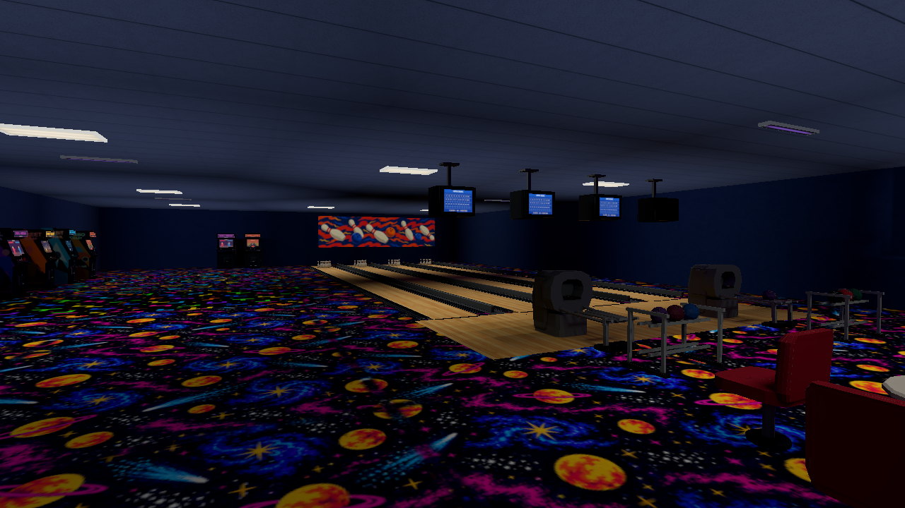
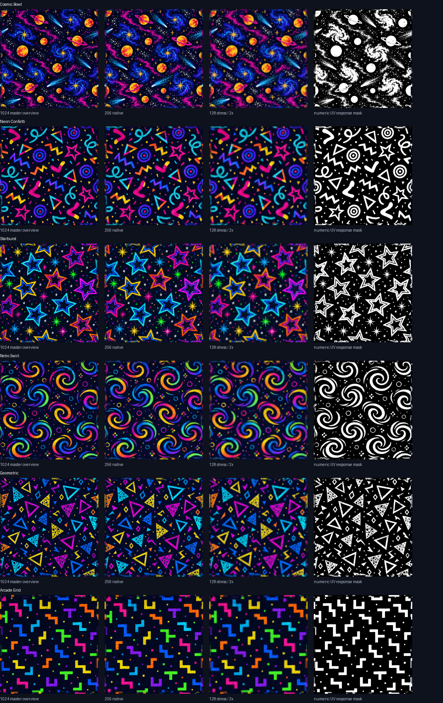
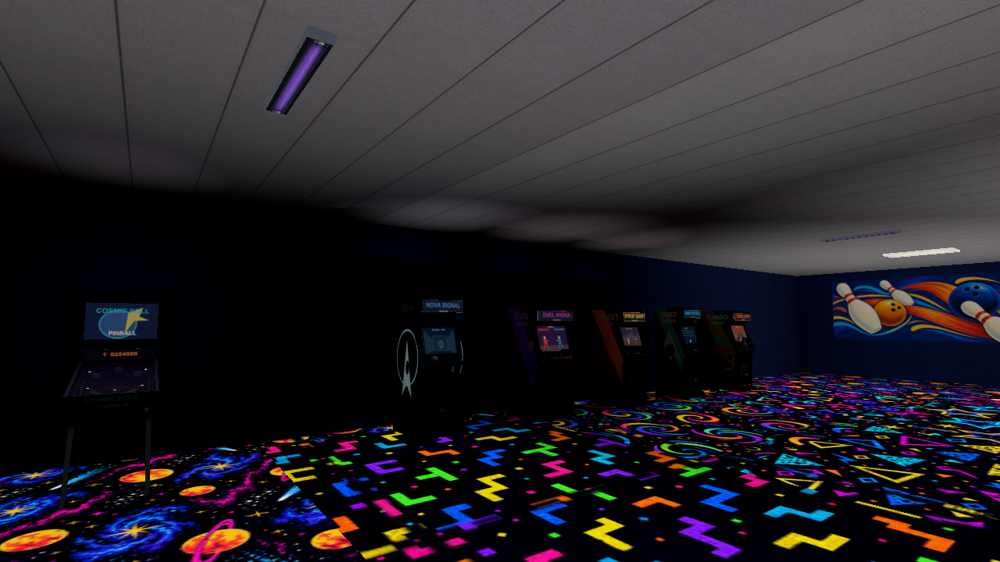
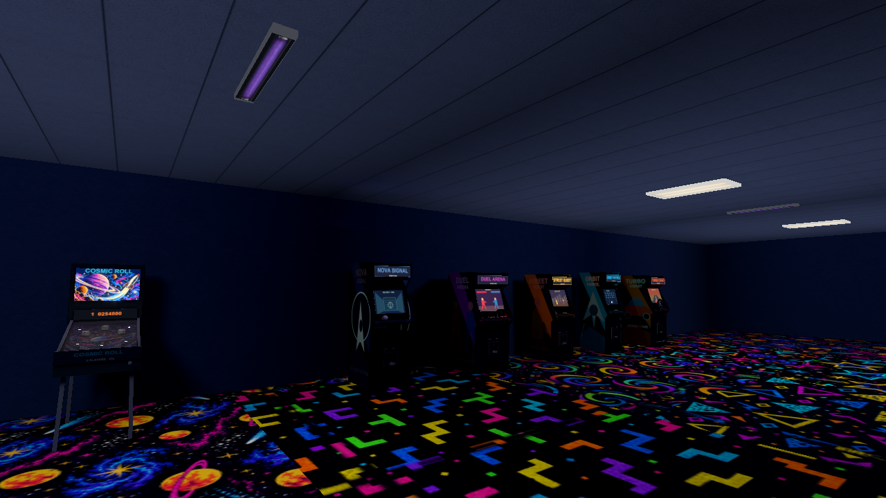
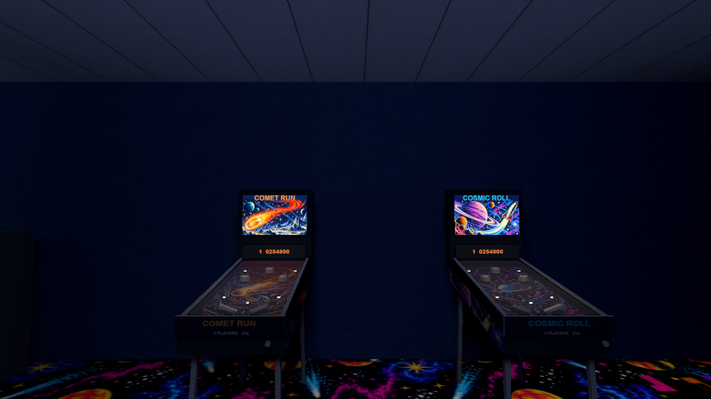
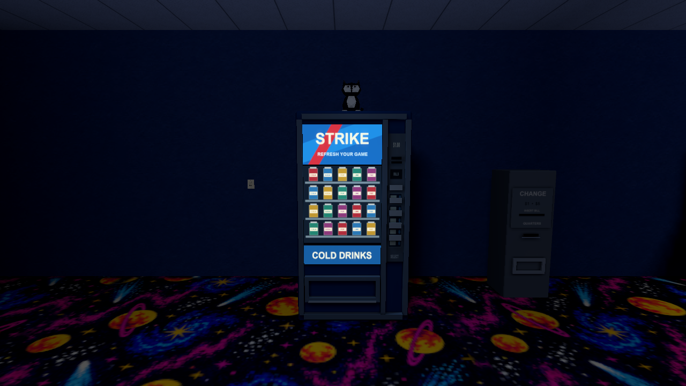
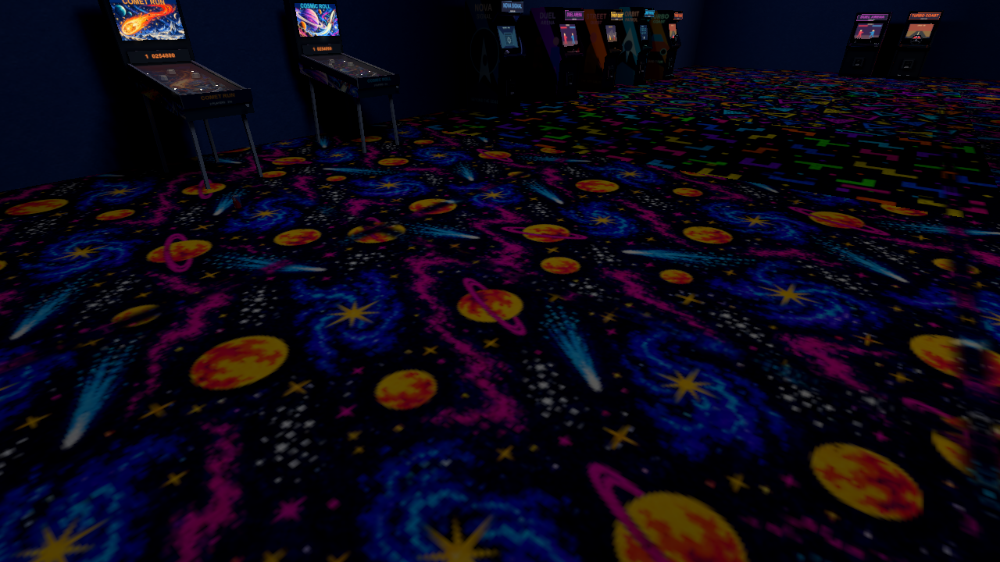

# Retro Bowling Alley & Arcade



The Arcade pack recreates an operational, empty bowling alley from around 2001:
four honey-wood lanes, chunky CRTs, fixed seating and a darker family arcade.
It follows the complete 1,865-line master and both original concept boards in
`assets/references/neon_bowling_arcade/`. Both boards were downloaded to this Mac,
verified as readable original PNGs, and inspected as actual pixels throughout
construction. Their files remain unchanged. Production artwork is original;
none of the textures is a crop of a concept board.

**Verification status:** final art, native visual acceptance and the full shared
Rust checks passed. Four inspected modeling passes and all fourteen final Metal
views are complete. Implementation and catalog-test correction commits are
published on `arcade-env`. The source-check policy correction and its remote
verification are recorded below.

## Play and reuse

The source is [`levels/retro_arcade_demo.json`](../../levels/retro_arcade_demo.json),
maintained by [`tools/levels/build_retro_arcade.py`](../../tools/levels/build_retro_arcade.py).
The local compiled package is `assets/levels/retro_arcade_demo.placesmap`.
Launch `target/release/places` and select **Cosmic Lanes & Arcade**. Use the
existing movement/look controls and **E** on the wall switch beside the vending
area to switch all four blacklights. Presets and advanced texture/lightmap
settings work live. The connected concourse, seating, cabinet aisle and lanes
have ordinary collision and closed exterior boundaries.

To rebuild through the normal pipeline:

```sh
cargo build --locked --release --bins
target/release/places-compile build levels/retro_arcade_demo.json \
  --out assets/levels/retro_arcade_demo.placesmap \
  --variants off,medium,full --workers 8
target/release/places-compile verify levels/retro_arcade_demo.json \
  --package assets/levels/retro_arcade_demo.placesmap --require-current
```

Compiled maps stay outside Git. Full bowling scoring, ball simulation and arcade
gameplay were not part of the requested environment work. The demo uses existing
movement, collision, switches, rigid lever animation, prepared lighting and
reflection probes. The separate static tuxedo plush does not change the queued
animated cat work.

## Complete asset coverage

The pack adds **35 reusable GLBs**, six carpet designs and their response masks,
building surfaces, fixture faces and bowling decals. All models are registered
under `arcade:` and appear in the complete Model Zoo. The catalog now contains
514 entries, 297 placeable assets and eight themes, with zero validation warnings.

| Family | Implemented assets and use in the connected demo |
|---|---|
| Carpet | **Cosmic Bowl**, **Neon Confetti**, **Starburst**, **Retro Swirl**, **Geometric**, **Arcade Grid**. Cosmic Bowl fills the concourse; five distinct designs occupy arcade bays. Each has a 1024-square master, 256-square native albedo and co-registered linear RGB response mask, repeated over 4 m. |
| Building | Navy walls; cool acoustic module/grid; recessed troffers; operational narrow blacklight battens; a fitted 4:1 rough painted bowling mural behind the decks. |
| Lanes | Honey planks, approach, seven arrow markers per lane, foul lines, recessed curved gutter segments, dark dividers/deck strips and ten ivory double-red-banded pins per lane. |
| Balls and returns | Seven muted ball variants with three recessed finger holes; rounded return hood with a deep opening and inner rails; two-tier racks with exact exported-facet ball contacts. |
| CRTs and seating | Active and inactive convex score CRTs, physical ceiling brackets, original OPEN BOWL scoring graphics; fixed red/blue chairs, round white pedestal tables and STRIKE COLA bottles. |
| Arcade | Distinct racing, shooter, action, fighting and sci-fi cabinet silhouettes; fictional marquees and side artwork, pitched CRTs and physical controls. An inactive cabinet adds variation. Sci-fi side printing also demonstrates reusable UV response. |
| Pinball | **COSMIC ROLL** and **COMET RUN** with distinct illustrated backglasses and sloped printed playfields, thin glass, physical bumpers/flippers, selected lamps, score displays and ordinary legs/housings. |
| Concourse | Blue STRIKE vending with lit advertisement/product rows, controls and deep dispenser; ordinary change machine; red BOWL tube lettering, blue border and yellow star; non-emissive tuxedo plush; restrained can/cup/wrapper/paper/fallen-bottle litter. |



This is an **offline artwork QA sheet**, not an in-game screenshot. The six
designs were inspected at native 256 and stressed 128 pixels, including repeated
seams. Cosmic Bowl retains ringed planets, small stars, shooting trails and
nebula swirls after downsampling. The masks suppress the navy negative space;
the floor is neither uniformly fluorescent nor an ordinary light emitter.

The five material behavior classes stay separate: real fixtures/neon lamps,
controlled CRT/front-panel emission and localized spill, masked fluorescent
pigment, reflective non-emitting balls/pins/metal, and ordinary walls/furniture/
plush/litter. Bright paint alone never grants emission.

## Inspected modeling passes

1. **Initial construction:** inspect software views of all 35 models and their
   fitted atlases. Identify shallow return throats, buried pinball playfields
   and weak finger-hole mouths.
2. **Direct concept comparison:** reopen both complete boards; deepen the return,
   separate glass/playfield from edge stock and model recessed eight-sided
   finger openings. Inspect the revised silhouettes, contact sheets and details.
3. **Actual in-game polish:** inspect six real Metal views against both boards.
   Narrow rack tiers to support balls, add return rails, round/taper the hood,
   orient it toward players and calculate exact ball contact heights. Refine
   display/lamp emission, pinball spill, fixture placement, fluorescent balance,
   dark lane gaps and the fitted painted mural. Inspect eleven revised native
   views; their remaining weak UV contrast, grey ceiling and sparse pinball art
   require another pass.
4. **Additional refinement:** author distinct illustrated pinball art and inspect
   its 256-pixel atlases and hardware alignment. Replace a duplicated lane header
   with OPEN BOWL. Darken carpet pigment and ceiling tint, increase masked UV
   excitation, and fix coarse receiver visibility sampling. Inspect all fourteen
   final Metal views and both original boards. The independent final model review
   finds no remaining mandatory model/art deficiency.

The following captures use the **same arcade camera** at initial and final
construction. Raw capture receipts remain available locally; these PNGs are
unaltered copies, without brightness correction or compositing.

| Initial native pass | Final native refinement |
|---|---|
|  |  |





## Reusable ultraviolet response

Fluorescence is a distinct material behavior. It does not refer to texture UV
coordinates and does not inject emitted light, probe/lightmap irradiance or
emission-only bloom. Material `uv_response` and an optional `uv_response_mask`
define pigment response. Up to four stable `ultraviolet` fixture slots combine
enabled state, range/falloff, facing and alpha-aware visibility. Visible tube
spill and face emission remain independently authored ordinary lighting.

The shader adds the masked albedo/pigment-tint response after incident lighting.
Static receivers interpolate four emitter-visibility samples. Reactive
architecture receives a GPU-only world-aligned 2.5 m grid, bounded by the existing
12-cell cap per axis. Triangle boundaries, texture coordinates, lighting
attributes and atlas pages are preserved; refined triangles merge into the
original draw ranges. Static props retain their authored vertices. Moving and
character receivers interpolate eight bounds anchors using static and dynamic
alpha-aware occlusion. Tint/base-color factor stays separate from baked vertex
lighting, so Lighting Off does not erase pigment response.

Neutral PLMW geometry is unchanged. PLMP v7 stores response strength, optional
mask image slot and independent linear pigment tint; literal v3–v5 and paletted
v6 remain readable with zero response. Numeric-mask images avoid redundant
display uploads when used only as masks. No texture is generated at runtime.

For another fluorescent surface:

1. Store real albedo and co-registered mask PNGs under `assets/`. Mask RGB is
   linear numeric coverage: black suppresses response, white allows it. Preserve
   the albedo's wrapping, aspect ratio, orientation and repeat scale.
2. Register the mask as a texture and reference it from a material with
   `uv_response` in `0..=2` and `uv_response_mask`. For GLB printing, use material
   `extras.uv_response` and `extras.uv_response_mask = {"texture": N, "texCoord": 0}`.
3. Author a reachable fixture with `ultraviolet` in `0..=8`; there may be at most
   four positive sources, including disabled sources. `brightness` independently
   controls ordinary spill. A zero-brightness UV source still excites pigment.
4. Use the existing switchable `toggle`/`set_light` action and inspect on/off
   restoration with ordinary lights enabled. Do not attach fake floor lights or
   substitute emissive ink.

[Map authoring](../MAP_AUTHORING_GUIDE.md#ultraviolet-reactive-pigments),
[asset contracts](../ASSET_SPECIFICATION.md) and
[package format](../PACKAGE_FORMAT.md) contain the authoritative fields and
limits. The sci-fi cabinet's printed side demonstrates reuse beyond carpet.

## Actual native verification

Final captures use the normal production binary on **Apple M2 Pro / Metal** at
1280×720. Fourteen individually inspected views cover hero, lanes, seating,
arcade, vending, pinball, near/medium carpet, model lighting, ceiling fixtures,
switch, neon, ball/return details and pins. Additional real native sequences prove:

| Check | Actual result |
|---|---|
| UV on/off/restored, bloom off | Clear spatial pigment response; on/off mean absolute RGB difference 5.20, lower-floor difference 4.94. Restored pixels match exactly. |
| Ordinary E-key switch | Existing wall lever switches the four UV fixtures; the fixed room view changes and restores exactly. |
| Moving reactive cabinet | Printed side changes under UV (selected print-region mean RGB difference 8.12); ordinary CRT-region difference is 0.15. Moving away and returning restores exact pixels. |
| Player proximity | Fixed model view remains pixel-identical with player near, far and restored. |
| Low → Medium → High | Each prepared quality loads without loss or failure; restored High is pixel-identical. Existing Low/Off vertex lighting is visibly brighter/flatter than prepared Medium/Full. |
| Independent texture/lightmap settings | Filtering changes between 4×/16× independently of Off/Full lightmaps and the low-lighting override; both restored Full views match exactly. |
| Bloom off | Hero, neon and vending remain readable; pigment does not become an emission/bloom source. |

| UV enabled, bloom off | UV disabled, ordinary lights retained |
|---|---|
|  |  |

No missing world textures, failed model loads, renderer fallback, observed
z-fighting, bad winding, transparency defect or unsupported visual masking was
found in the final native review. The source catalog's expected white bindings
are not missing-asset errors. The demo retains existing quality behavior rather
than compensating with room-wide ambient or exposure changes.

## Measured resources and performance

Measurements are proportional to this room, not a claim about all hardware.
Serial fixed-hero runs measured **480 frames after 120 warmup frames**, VSync off,
with no Cargo/compiler job competing for resources. The output surface is
1280×720; quality presets retain their existing internal-resolution differences.

| Preset | CPU loop mean / median / p95 | CPU render submission mean | Visible draws / triangles | Peak process RSS |
|---|---:|---:|---:|---:|
| Low | 5.08 / 2.84 / 13.84 ms | 4.71 ms | 136 / 35,726 | 164 MiB |
| Medium | 6.32 / 6.69 / 14.94 ms | 5.74 ms | 132 / 35,014 | 1,398 MiB |
| High | 6.23 / 6.80 / 14.60 ms | 5.78 ms | 132 / 35,014 | 1,411 MiB |

CPU submission is not GPU timing. A separate actual **8-second Metal System
Trace**, attached only to the native demo, gives a stable six-second window with
975 scene encoders: **2.00 ms mean occupied GPU time per frame**, **2.06 ms median
scene span**, **3.36 ms p95 scene span**. Occupancy unions active hardware-channel
intervals, avoiding overlap double-counting. Time-weighted Metal allocation is
**325,632,000 bytes (310.55 MiB)**. The High lightmap upload alone is
251,658,240 bytes: three 1024-square pages, thirty selected-contribution layers.

The final normal cold compile, including reflection capture, took **420.36 s**
with eight workers. The **84,210,140-byte (80.31 MiB)** package contains Off,
Medium and Full, with no warnings and current provenance. Medium/Full have three
atlas pages, 23,385 charts, 882 irradiance probes and one reflection probe. Full
GPU world geometry is 3,524 vertices / 4,374 indices / 55 draws; UV sampling adds
vertices without multiplying world draws. The room uses 158 placed props, 33
decals, 14 ceiling fixtures and 40 total lights.

Source pack: 35 GLBs **1,577,904 bytes**; 36 runtime PNGs **2,455,071 bytes**;
34 masters **26,454,479 bytes**; four original pinball illustration inputs
**12,831,655 bytes**. Total **43,319,109 bytes**, excluding the unchanged concept
references. Unique new models total **11,080 triangles**, maximum **712** on one
model. The complete catalog's decoded embedded images remain **64,917,504 bytes**,
below the unchanged 64 MiB bound.

Focused source/GLB/lineup tests pass (19 tests), asset validation has zero warnings,
and the sampling/visibility regression tests pass. Before the test-policy
correction, the full shared Rust gate passed formatter, locked workspace check,
strict debug/release Clippy and **2,281 library plus eight binary/integration
tests**, with zero failures and 32 existing ignored library tests. Its library
execution took **4,112.54 s** because two tests baked complete Demo/Hollow Full
archives. That historical run is evidence already obtained, not a requirement for
future source checks. The outer `/usr/bin/time -l` wrapper separately failed on a
sandbox-denied `sysctl kern.clockrate`; the child Rust checks all passed.

The user's October 11 correction removes full shipped-map bakes from the Rust
suite entirely, including ignored report/sweep helpers, and removes the hosted
curated-map compilation matrix. No feature gate or ignore marker hides the
removed workloads. The practical suite retains bounded fixtures for atlas page
limits/overflow, KTX overhead, HDR round trips, archive limits/security, chart UVs,
material seams, shadow/visibility, probe coverage and blacklight response.
Renderer density and Off-path parity checks use a small room; full-source geometry
checks that remain build meshes with empty lighting instead of baking illumination.
The local ignored `AGENTS.md` now requires every test addition to justify its
concrete behavior, unique coverage and resource cost.

The revised all-feature gate passes **2,250 library plus eight binary/integration
tests**, with zero failures and 19 existing ignored library tests. The pruning
removes 44 net tests, including 13 ignored tests, based on redundant or costly
workloads rather than a count target. Library execution falls from the historical
**4,112.54 s to 34.53 s** on this Mac. The final stage timings separate compiler
work from test execution. The separately required `cargo test --workspace` also
passes: **2,244 library plus eight binary/integration tests**, zero failures.

| Local stage | Elapsed time | Result |
|---|---:|---|
| Format | 1.58 s | Passed |
| Workspace/all-target/all-feature check | 4.45 s | Passed |
| Strict debug Clippy | 8.79 s | Passed |
| Strict release Clippy | 15.18 s | Passed |
| All-feature test stage | 62.67 s | Passed; 23.54 s compilation and 34.53 s library execution |
| Default workspace tests | 87.47 s | Passed; 48.98 s compilation and 33.89 s library execution |
| Python source discovery | 192.38 s | 346 checks, four native-related skips, zero failures |

These are local incremental-build measurements; hosted cold compilation has its
own visible stages. The local optional `sccache` could not invoke the compiler,
so this gate used `RUSTC_WRAPPER=` without clearing target or changing cache policy.

Full-map compilation and native/performance campaigns remain explicit desktop
operations through the existing compiler, `tools/levels/compile.py` and
`tools/bench/`. The already-completed Arcade native captures and compiled package
above are preserved. No production package or native campaign was rebuilt for
test pruning. The first reduced-suite run exposed three remaining implicit
Demo vertex-lighting wrappers, which now emit geometry with empty lighting.

Published source commits are
[`d5e34eda`](https://github.com/csd113/Places/commit/d5e34eda6c068b80404bf87124f829841175050f)
(pack, demo and reusable response),
[`d3e2e2b`](https://github.com/csd113/Places/commit/d3e2e2b78544ac99a548f561e06358e7d1c3465e)
(catalog/lineup expectations), and
[`86bec3ef`](https://github.com/csd113/Places/commit/86bec3ef65e7dca67a9cc1bb2c98747d42d6d109)
(visual report). The user-authorized cancellation stopped
[run 38167204022](https://github.com/csd113/Places/actions/runs/38167204022)
before the CI/test-policy correction. The replacement workflow has distinct timed
format, check, debug Clippy, release Clippy and fixture-test stages; it performs no
shipped-map compilation or probe capture.
[Latest Arcade CI](https://github.com/csd113/Places/actions?query=branch%3Aarcade-env)
shows the published correction's current status. The inherited
[main run](https://github.com/csd113/Places/actions/runs/38149512939) and
[merged-PR run](https://github.com/csd113/Places/actions/runs/38149078556)
completed successfully with all nine former jobs.

Capture identity: production binary SHA-256
`4a03b20600e7c326862d49a30bec3014e201fad690c4bf6d7b83b5607f85d94f`;
whole-package SHA-256
`35e5c884829add078288832d0235afc72ff5a1211ed697240532a23f77aa219a`;
current prepared fingerprint
`f8f09bec07d327b7f1ccac63aea1ce7f574a93e9fd0c4e05fb8bc0355e283eef`.
Portable camera and action fixtures live under `tests/fixtures/native/retro-arcade-*`.
Detailed native receipts, sequence images, benchmarks, compile reports and the
Metal trace remain local under `tools/bench/results/arcade-20261011/` and `target/`;
they are intentionally excluded from Git.

## Limits

Small UV shadows are approximated by the bounded architecture grid, model
vertices and eight moving bounds anchors. Moving casters do not rewrite static
receiver visibility. Native decals do not apply fluorescence; use a fitted thin
GLB or architectural surface for reactive posters. Arbitrary GLB vertex-color
gradients are not pigment tint. Prepared reflection cubemaps retain their initial
UV appearance after a source toggle, although direct surfaces and fixture faces
update live. Low/Off keeps the engine's brighter vertex-lit appearance. Optional
audio is absent because the existing engine has no audio device backend.
