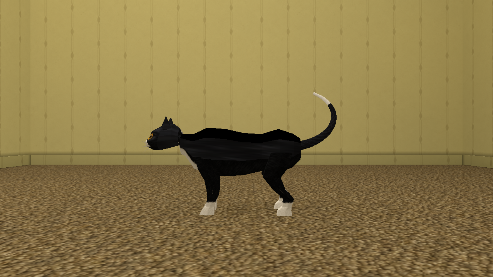
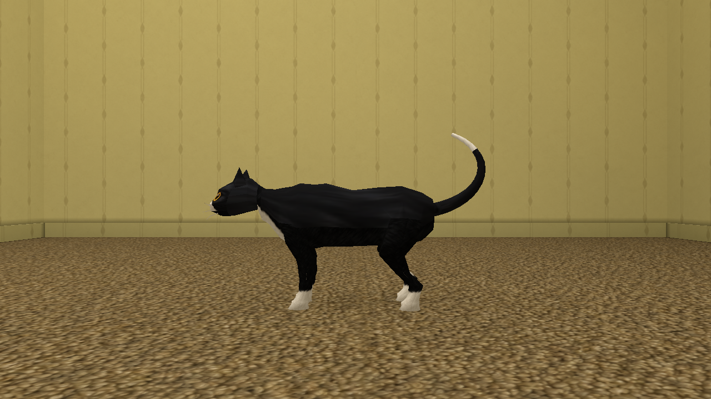
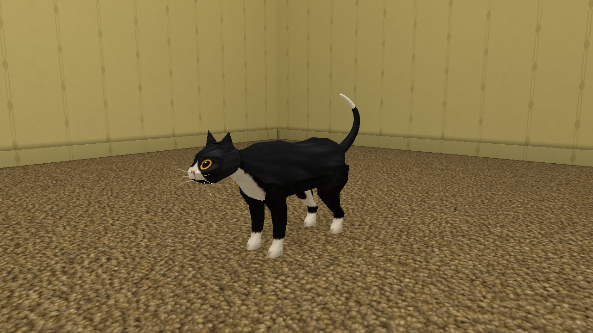
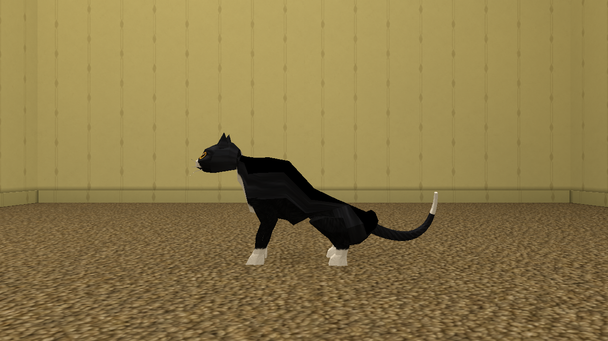

# Spooner-man body refinement — 2026-10-11

**Status: INCOMPLETE.** Three geometry/UV passes and native validation are
complete. The subsequently supplied concept sheet has not been viewed or used:
Library resolved `Places & Entities_ Low-Poly Game Atlas(1).png`
(`libfile_e16257a56b888191975d8d6eba5af6a0`), but both supported local transfers
failed. Its image read returned a pointer and metadata, rather than pixels.
The older repository atlas was not substituted. Concept-art comparison remains
an explicit follow-up.

## Result and preservation

The canonical asset is `assets/entities/spooner-man/model/spooner-man.glb`.
The original was a manually authored Blender export; no original `.blend`
source was found. The exact pre-refinement GLB is retained at
`tools/props/sources/spooner_man_original.glb`. The offline authoring script
`tools/props/refine_spooner_man.py` regenerates the refinement from that source.
It creates geometry and UV coordinates, never texture imagery.

| Measured property | Original | Refined |
| --- | ---: | ---: |
| Triangles | 1,374 | 1,950 |
| Exported vertices, including seams | 3,029 | 2,443 |
| GLB bytes | 708,624 | 683,352 |
| Head triangles | 454 | 454, unchanged |
| Materials / PNG textures | 3 / 3 | 3 / 3, unchanged |
| Skin joints / clips | 26 / 7 | 26 / 7, unchanged |

Every original head triangle retains its positions, normals, UVs, skin
attributes, material assignment, winding and order, including the face, eyes,
ears and whiskers. The head attribute digest is
`95932d711b2ec94aa52267a125d7a13192dec6db6f3400cbf295254bbcb20aaf`.
Nodes, joint order, inverse bind matrices, all animation keys/interpolations,
clip durations and playback metadata compare exactly with the original.
Embedded PNG bytes also match the three unchanged repository texture files:

| Texture | SHA-256 |
| --- | --- |
| `spooner_man_00.png` | `43078d9e5617a0a3b57a32e9c0c2ae1ee26d29b0363f82160bae75a970030d0e` |
| `spooner_man_01.png` | `956c87cc4044e24fdc346ada19faf7de0b0a8ac5fde42ee9067528a22000418b` |
| `spooner_man_02.png` | `1ce7314a218a69ec95ee789cbc5bb6e35d35abbfa7261c66aebdbb5b0ba877f0` |

## Three refinement passes

1. **Silhouette and topology:** audited the untouched source and captured its
   native baseline. Replaced the coarse torso sections with authored elliptical
   rib cage, waist, haunch and neck profiles; rounded leg sections and paws.
   Split selected circumferential edges rather than subdividing the whole cat.
   The first reviewed export had 1,842 triangles. Edges requiring more than four
   combined skin influences were excluded, preserving every nonzero influence.
2. **Markings and joins:** inspected Blender close-ups and the native side view.
   Restored the bib's vertical extent after the first profile raised its lower
   edge too far; refined the balancing tail and retained its original medial
   curve. Repaired the upper-neck UV sliver and the wrongly white tail root.
   This export had 1,950 triangles. White paws, authored hind-leg bands, belly
   markings and the actual tail tip retain their original UV regions.
3. **Native correction:** compared the original and refined model under matching
   native cameras, lighting and animation times. Shared shoulder/hip seam
   vertices now receive the same projection. Restored sole interior radial
   fractions and the planar tail insertion; limited projection at tiny original
   Boolean junctions to prevent folded faces. Authored outward hard normals for
   soles, the rear cap and concave cuts. Replaced stretched dorsal UVs with a
   cylindrical mapping into existing fur. The final native rear view exposed a
   tail-root triangle interpolating between separate dark atlas regions through
   a white swatch; both sides now use the same dark column.

The flat black back was confirmed to sample unused pure-black artwork: 67
original body triangle centroids reached that region. The upper-neck faces
crossed the white bib despite dark corner samples. Three tail-root faces used
the white-tip swatch. These were UV defects, so no textures were repainted.
The reported thigh streak was not established as a separate accidental island;
the source's asymmetric leg stripe remains intact.

## Genuine native comparisons

These are unedited 1280×720 captures from the actual Metal player on Apple M2
Pro. Each pair uses the same tiny room, camera, high settings, full lightmaps,
fixed 1/60-second simulation step and animation time. The sit pair is native
ready frame 480, extracted from the recorded sequence. No full shipped map was
rebaked.

| View | Original | Refined |
| --- | --- | --- |
| Side, idle |  |  |
| Chest, idle |  |  |
| Sitting |  |  |

The 19-second native sequence covers `idle`, `walk`, `run`, `sit_down`,
`sit_idle`, `stand_up` and `pounce`, including return to idle. It was reviewed
through its captured frame sequence and playing in QuickTime, with attention
to neck, shoulder/hip bends, paw contact and the moving tail. The reviewed
poses show continuous joins and retain the original motion. Close-up front
and rear views and a separate direct-light capture also passed visual review;
no new fullbright faces or blank-black dorsal panels appeared.

## Validation, cost and limits

`check_spooner_refinement.py` verifies exact preservation, valid attributes,
normalized skin weights/normals, UV bounds, outward winding/normals and all
2,925 welded edges having two incident faces. Duplicate seam skin weights
differ by at most 0.0000013. All 190 final dark torso face centroids reach real
fur. The independent 60 Hz animation sampler evaluated 894 poses across all
clips in 2.25 seconds: worst floor excursion 0.238 mm; worst edge stretch
1.899×, below its existing 2× limit. Existing clip-boundary and asset checks
pass. The existing Rust paw regression now checks each paw's own leg-chain
weight directly, replacing a topology-dependent whole-mesh percentage.

Local required checks passed: `cargo fmt --all --check`, configured strict
Clippy (9.30 seconds), `cargo test --workspace` (8.30-second incremental build,
35.50-second unit suite plus integration tests), and the source Python suite
(346 tests, 204.27 seconds, four existing smoke skips). `RUSTC_WRAPPER=` was
needed locally because the installed sccache wrapper could not spawn rustc.
The two new CI authoring checks only read/regenerate this small GLB; no test or
automatic CI step bakes a production map.

The new mesh adds 576 triangles (+41.9%) while removing 586 seam vertex slots
(-19.3%) and 25,272 GLB bytes (-3.6%). Materials, textures and clips add no new
resources. The explicit one-room package changed from 618,764 to 620,328 bytes
(+0.25%); each affected control compilation took approximately 1.26 seconds.
These are geometry/storage measurements, not an FPS claim. Native telemetry
was not equivalent between both recordings, so no frame-time improvement is
claimed.

Height and length bounds remain unchanged; width grows from 0.16496 to
0.18361 metres. Catalog metadata, scale, placements, routes and collision
settings are unchanged, and catalog bounds validation passes. The original
GLB mixes nearest and linear texture samplers; those records are unchanged.
The current native renderer uses global linear/anisotropic filtering even at
Low, so preserving its existing behavior does not establish nearest sampling
in-game. No global renderer change was made. Other platforms were not run.

## Reproduction and retained evidence

Python with the repository's existing NumPy dependency is sufficient:

```sh
python3 tools/props/refine_spooner_man.py --check
python3 tools/entities/check_spooner_refinement.py
python3 tools/entities/validate_entities.py --glb assets/entities/spooner-man/model/spooner-man.glb --workers 2 --samples-per-second 60 --json
```

Original source SHA-256:
`3ac24ca7efea8a04ce70e285d0219e372826bdd36503d2541237213cb1084981`.
Refined GLB SHA-256:
`b5bda8cdeda62791f5757382ac597ba9f1cb526ac6562caa2e0fd704a4bd57fe`.
Ignored local evidence is retained at
`tools/bench/results/spoonerman-20261011/`: baseline and pass exports, Blender
reviews, the source/manifest and minimal packages, native receipts and 190
frames per recording, `final-native-motion.mp4`, preservation/animation JSON
and raw validation logs. `native-accepted/` is the package matching the final
asset. The final handoff records the branch commit, exact-head CI and custody.
