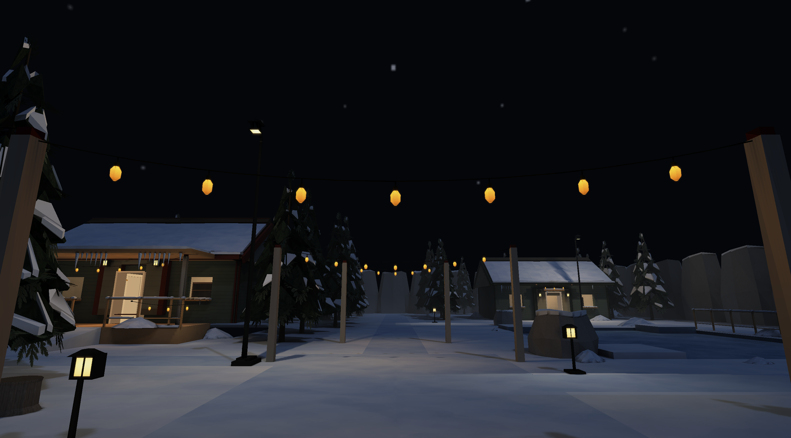
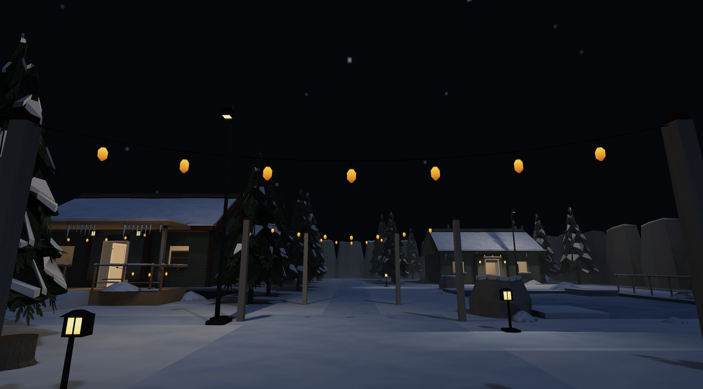
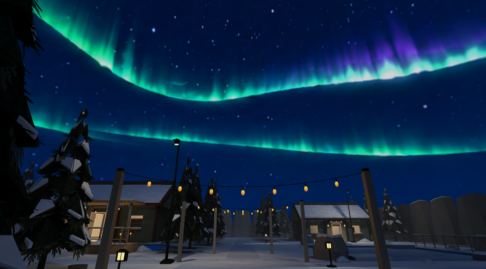

# Winter environment development

Winter grew from a compact settlement into the reusable snow, ice, sky and
weather kit during October 6–7, 2026. This finalized history consolidates the
foundation, snow, ice, string-light, aurora, snowfall, blizzard and integration
reports. Measurements describe those dated builds. Current authoring contracts
belong to the [map guide](../MAP_AUTHORING_GUIDE.md),
[asset specification](../ASSET_SPECIFICATION.md) and
[Winter asset profile](../assets/ENVIRONMENTS.md#winter).

## Settlement and snow kit

The foundation established a 48 × 60 m settlement with three furnished cottages,
a raised lodge, paths, square, frozen pond, forest and physical rock boundaries.
Sealed gable ceilings, operable doors, the lodge stairs/ramp and trunk collision
made it useful for movement and weather controls. Initial shared plaster,
concrete and glass placeholders were replaced by committed snow/packed-snow/ice
PNGs. The immutable Winter concept sheet remains in `assets/references/winter/`.

The snow pass added 28 reusable models: evergreen loads, drifts, capped rocks,
architecture/rail overlays and icicles. Separate snow meshes preserve canonical
positions, UVs, vertex colours and foliage alpha. Accessories remain non-solid;
rocks and trees keep their existing collision. Icicle roots embed into supports,
and caps sit slightly inside their receiving surface. Snow artwork uses a 1024²
terrain sheet and a 256² prop derivative. No runtime painting or accumulation is
involved.

Native inspection found that textureless GLB materials incorrectly selected a
model's first atlas. A shared white binding corrected the snow material while
preserving textured primitives. Structural regressions cover mixed materials,
empty image lists and local image bounds. The kit's reviewed evergreen loads
use 1,238/1,442 triangles, within the 1,500 static-art ceiling; small caps and
icicles retain much smaller budgets.

## Frozen pond

Ice became a physical ground surface with contact-dependent traction rather
than a visual-only material. Its opaque RGB 1024² albedo is separate from material
translucency and the depth backing. Controller checks cover acceleration,
coasting, wall contact, jumps and 30/60/144 Hz endpoints. Native shoreline entry
and exit retained ordinary support without clipping or vertical recovery.

The dated pond comparison added 1,320 expanded vertices, seven draws and
82.5 KiB of vertex buffers. A separate VSync-enabled 1,200-frame run observed a
median 8.331 ms loop; that host-paced result is not an isolated ice GPU cost.
Current ground-surface fields and alpha rules are specified in the canonical
guides rather than duplicated here.

## Warm string lights

Three native-size modules share the cable/bulb/source construction in
`tools/props/string_lights.py`:

| Module | Span / sag | Bulbs | Triangles |
| --- | --- | ---: | ---: |
| Short | 2.8 m / 0.15 m | 3 | 344 |
| Medium | 4.0 m / 0.28 m | 5 | 552 |
| Long | 6.6 m / 0.40 m | 7 | 760 |

The 128² atlas is a lossless family copy of the established bulb artwork.
Only glass emits; separate static sources sit below opaque glass to avoid
self-shadowing. Eight supported placements added 38 amber sources at entrances,
the lodge, square and path crossing. Lower rail sources avoid local hotspots;
the forest and distant pond retain cold light.

An identical-geometry control disabled physical sources while retaining visible
emissive bulbs. Full receiver charts agreed exactly. Added linear RGB was
approximately `[.208,.125,.041]` on square snow and `[.153,.096,.030]` near the
lodge; distant forest red contribution was only `.0000062`. Regional prop
receivers also gained amber light. The floor peak was 1.234, below the diagnostic
1.4 threshold. These are sampled positions, not proof of every visibility ray.
`tools/bench/audit_winter_strings.py` retains the NumPy comparison workflow.

| Physical sources enabled | Same bulbs, sources disabled |
| --- | --- |
|  |  |

The historical Zoo was refreshed for catalog coverage during this pass. That
history does not put Zoo back in the active lineup: its JSON is frozen under
`docs/archive/levels/` and is excluded from default compilation.

## Aurora and weather

The static aurora is an opaque 2048×1024 equirectangular PNG with U repeat and
V clamp. The retained original master is 1774×887; it is not native 4K art.
Cardinal, wrap, zenith, interior and transition captures checked orientation,
seams and texture quality. The sky uses one fullscreen draw; the High albedo is
8 MiB before mips. The sky pass itself adds no green illumination: the dated
before/after packages retained identical physical lighting, collision and
navigation. Closed ceilings hide the sky.

Gentle snowfall is the normal authored climate. Generic `weather.kind = "snow"`
configuration selects stable seeds, volume, wind, size, speed, opacity and a
committed 256² RGBA flake sheet with zero-alpha borders. High/Medium/Low evaluated
1,400/1,050/700 seeds in the dated campaign. Snow uses depth rejection, fading,
frustum rejection and room/slab shelter without collision or accumulation.
Quality cycling keeps a monotonic weather clock.

The severe control uses the same settlement with severity 1, visibility 5 m and
wind `[8,3]` m/s. Exponential-squared extinction attenuates outdoor sightline
segments, including emission before bloom; indoor portions remain clear.
Overlapping shelter intervals are unioned, bounded to 32 regions. Props, tree
canopies and moving roofs do not supply traced weather shelter. No Winter-ID
switch, screen noise, generated texture or camera shake is involved. Severe
sources are explicit developer controls, not a second maintained village.

## Composition and acceptance

The integration pass reduced repeated tree grids to 61 trees, narrowed the
walked spine, varied shore shelves and supported snow, removed sheltered
accumulation and added lodge foundation skirts/window surrounds. It retained
calm default weather, the severe control's settings and existing traversal.
Compared with the prior composition, placed model triangles fell 16.1%, prop
draws fell by 19 and Full atlas residency fell 16 MiB. Those are dated content
counts; later packing and lighting changes have separate identities.

The October 7 final campaign accepted 90 weather/quality views, 36 traversal
routes, two live quality cycles, six contrast-map views and eight transitions.
It recorded 34,774 ready presentations, no missed ready presentations and no
particle-buffer growth. The capture helper was repaired to reject occlusion,
missing draws/samples, invalid weather accounting and incomplete quality cycles.
Earlier unavailable-surface attempts were rejected and are excluded from those
accepted counts. Held controls do not replace exhaustive human playtesting.

The historical gate passed strict Clippy, Rust fixtures, source checks and native
checks. Two earlier Zoo coverage failures during snow/ice development were
resolved by the later coverage pass. The final whole-frame ABBA weather timing
campaign varied in both directions with host activity; it establishes neither
an isolated weather GPU cost nor a speedup. Native evidence is from M2 Pro/Metal
and does not certify Linux or Windows hardware.

Use `build_winter.py --check` for source currency, `capture_winter.py` for art
cameras and `capture_snowfall.py` / `capture_winter_integration.py` for explicit
weather, route and quality campaigns. [Verification](../VERIFICATION.md) explains
package preparation and evidence identity. Historical test counts, package hashes
and local launch paths are deliberately not a current gate checklist.
