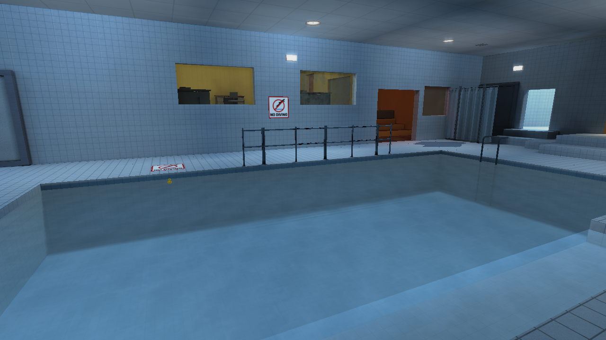
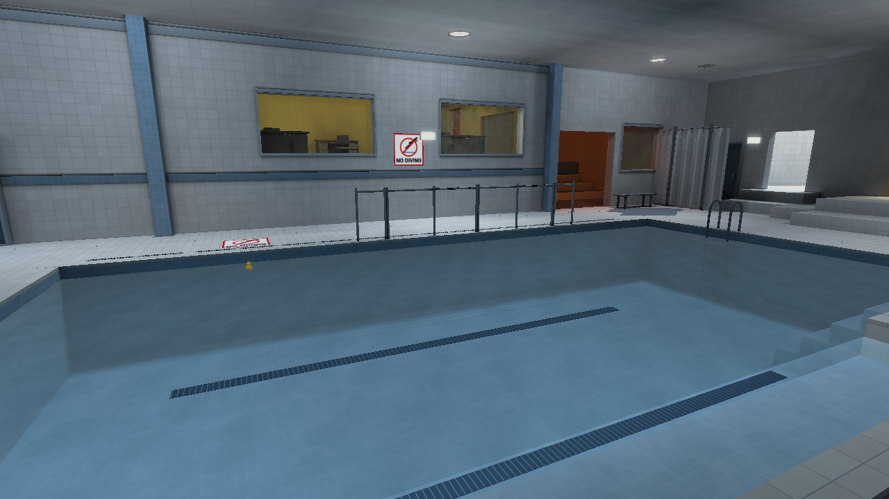
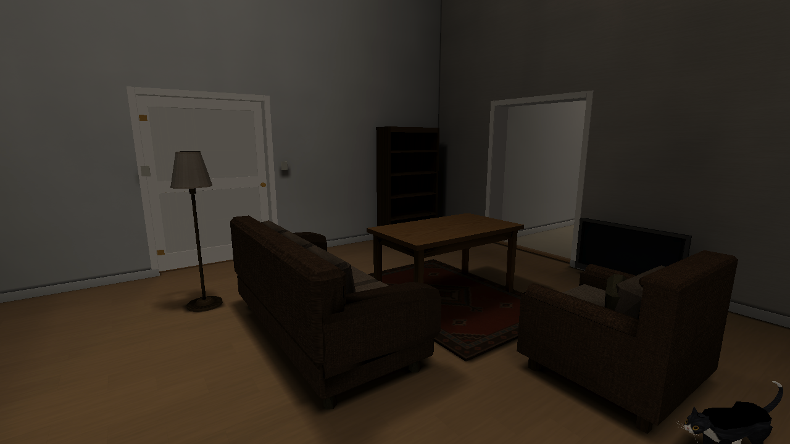
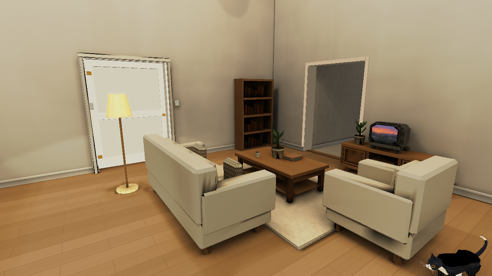
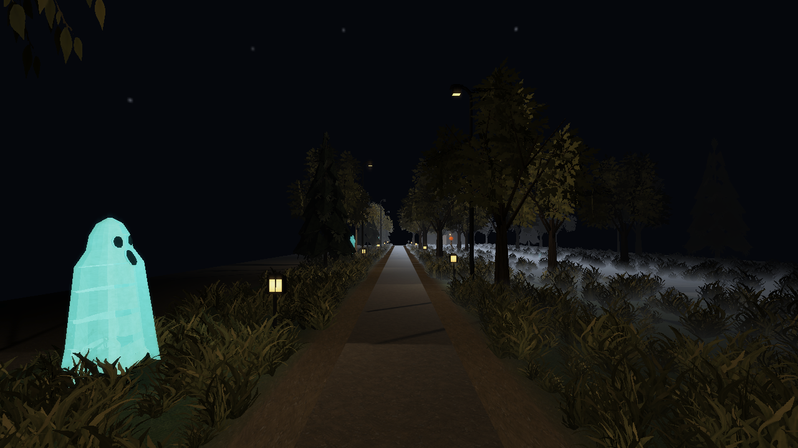
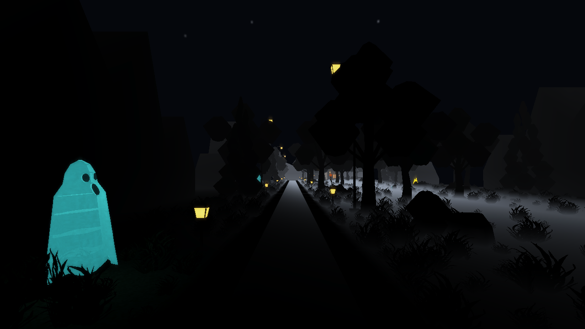

# Places visual development — October 7–9, 2026

The four scene reconstructions and seven Art-style milestones are completed historical work. Their reports preserve concrete authoring decisions, genuine native results, dated costs and remaining limitations. Concept artwork is a reference, not a renderer screenshot. Images below are byte-exact copies of the selected original captures.

## Production scene reconstruction

### [Pool](pool/README.md)

| Before | Final |
| --- | --- |
|  |  |

### [Home](home/README.md)

| Before | Final |
| --- | --- |
|  |  |

### [Outdoors](outdoors/README.md)

| Before | Final |
| --- | --- |
|  |  |

### [Winter](winter/README.md)

The reconstruction report retains source, weather, traversal and camera controls. Its earlier cottage/pond frames are archived locally; [later refinement evidence](../reports/environment-refinement.md) illustrates the subsequently accepted environment.

Pool/Home/Outdoors/Winter preserve the original logical asset roles, geometry/UV/alpha contracts and meaningful gameplay. Full outdoors High lighting remains very dark; severe Winter whiteout remains nearly opaque. Camera/startup timing tables describe those particular native runs and are not controlled FPS gains. Historical local stale drop-in discovery failures were retained honestly and later reconciled in Stage 7.

## Completed Art-style sequence

[Seven Art-style milestones](art-style-history.md) provides the compact progression: baseline/diagnostics; linear colour/HDR; continuous surfaces/transport; spatial live entities; highlight/atmosphere controls; content/cache currency; then supported-map integration. [Stage 7](../art-style/stage7/README.md) completed at publication [a1e7122](https://github.com/csd113/Places/commit/a1e7122bba5df549c2e82c16371bcc57db99e976) with successful [exact-head CI](https://github.com/csd113/Places/actions/runs/37906450891). Home restored-lighting/parity acceptance is qualified around its untraced animated cat, with static pixels and actual lighting payloads exact; physical Linux/Windows GPU and sustained memory plateau remain unclaimed.

The later [model-lighting root cause and correction](../reports/model-lighting-root-cause-and-fix.md) covers production kitchen surfaces, Home corridor joins and the camera-dependent close Hallows skeleton normal. It is distinct from this historical concept and Stage 7 acceptance. [Verification](../VERIFICATION.md), [map authoring](../MAP_AUTHORING_GUIDE.md) and [asset specification](../ASSET_SPECIFICATION.md) are the maintained implementation contracts.

## Preceding integration provenance

The October 7 consolidation combined reviewed Office refinement, hanging painting
and Winter aurora with existing movement/lighting work. This is dated provenance;
current package identities and format requirements come from normal compiler
validation and the canonical guides. Asset results remain in
[Office refinement](../reports/office-refinement.md),
[hanging painting](../reports/hanging-painting.md) and
[Winter development](../reports/winter-final-audit.md).

Office originated at `62012e820`, aurora at `7a6565f8`, and the painting used its
released canonical sources. `d35adbc` carried the canonical Office/painting and
combined packages. The Office merge `3b6b45f` retained reviewed asset bytes and
resolved four conflicts against that combined state. The narrow `0bc7c227`
cherry-pick took verified Git LFS checkout hydration and two-ZIP checks from
`176222`; it did not merge the unrelated branch or publish a release.

Places Demo, Model Zoo, Movement Test, Lantern Hollow and Winter passed normal
package currentness and full decode. Winter's identity refresh took 241.131 s
and produced 53,540,766 bytes, with all 17 physical payloads unchanged. Compact
painting JSON triggered a 7.298 s Demo identity refresh with all 31 physical
payloads unchanged. Neither operation introduced a discretionary lighting rebake.
A campfire property-order repair retained legacy geometry/material bytes; dense
Hollow validation used its actual 229,549 charts and real capacity rather than a
stale chart-count floor.

The final workspace run passed 2,008 Rust library cases, six additional cases and
doctests, retaining 23 existing ignored diagnostics. The canonical gate passed
192 Python cases; ten compiled-build and 26 native presentation cases completed
with zero skips. Strict formatting/Clippy passed. Independent native review
covered 14 Office High/Low views, one Home painting view and nine Winter
High/Medium/Low views, including the square/lodge seam. Tool/texture checks kept
their existing soft provenance advisories.

Frozen integration controls used an unset asset-root override, empty
`RUSTC_WRAPPER` and disabled incremental compilation. Compiler `--asset-root`
names the `assets` directory; runtime `PLACES_ASSET_ROOT` names its parent payload
root. Mixing those meanings can select different inputs, so reproduction must
verify the loaded package identity.

Source photograph/aurora masters, seven custom map inputs, matching assets and
packages, saved player/compiler binaries and launchers were preserved outside
disposable build output. The separate Office archive verified 601 files totaling
979,710,628 bytes with zero hash discrepancies. These originals are necessary to
reproduce dated comparisons; screenshots and a later checkout alone cannot
reconstruct them. Custody details remain outside the technical reports.
